# Architecture: TraceCore

> Status: Draft (chờ chủ đầu tư review) · Last updated: 2026-10-22 · Author: Pipeline software-architecture (Claude) + chủ đầu tư Miyano/Medcons
> Nguồn yêu cầu: `docs/srs.md` v1.11 Finalized (90 FR, 35 NFR) · `docs/use-cases.md` (39 UC) · BA v1.10 #08 DM, #11 API, #12 ARCH, #13 SEC, #16 WSS · `docs/.architecture-inputs.md` (quyết định chủ đầu tư 2026-10-17)
> Quy ước: tiếng Việt, thuật ngữ kỹ thuật tiếng Anh; ADR inline (§9); Mermaid dùng `flowchart`/`sequenceDiagram`/`erDiagram`. Kế thừa #12 ARCH v1.10 với hai đổi tên: app `cssd` → `tracecore`, RPC namespace `cssd.v1.*` → `tracecore.v1.*` (xem ADR-001). Mọi ID FR/NFR/UC trong tài liệu này trỏ về `docs/srs.md` và `docs/use-cases.md`.

## Revision History

| Ngày | Phiên bản | Người thực hiện | Thay đổi |
| --- | --- | --- | --- |
| 2026-10-19 | Amendment A-01 | Miyano (dev) + Claude Code, chủ đầu tư duyệt | Tên module Frappe: `Core` (frappe) và `HR` (hrms) đã là Module Def có sẵn, không đăng ký trùng được. Dịch vụ `core` ở package Python `tracecore/core/`; DocType nền (Audit Log, Code Registry, Idempotency Key, Print Job) ở module `TraceCore`; Zone Station ở `Admin Reports`; Page `station` ở `UI`; M4 chưa đăng ký Module Def. Xem ghi chú ở §5.2 và §5.3. |
| 2026-10-20 | Amendment A-02 | Miyano (dev lead) + Claude Code; D1–D5, D7 tạm chờ chủ đầu tư duyệt; D6 còn mở | Ghi quyết định thiết kế FEAT-018 (T4 đóng gói → Cycle ID → in nhãn) trước khi code; mã D1–D14 theo `docs/superpowers/plans/FEAT-018-t4-packing-cycle-id.md`. **Trạng thái duyệt:** dev lead duyệt toàn bộ kế hoạch và bảng mã HTTP (D3) ngày 2026-10-20. D1 (nút "Xác nhận tất cả thành phần"), D2 (mã cuộn `CN-` do FEAT-005 cấp), D3 (mã HTTP theo loại lỗi), D4 (hạn dùng), D5 (ngưỡng chặn bảo dưỡng), D7 (nhãn 60 × 40 mm, ZPL trước) ghi **tạm — trình CĐT 20/10/2026**; đổi thành "đã duyệt" khi chủ đầu tư phê duyệt, chủ đầu tư đổi ý thì sửa kế hoạch và mục tương ứng. D6 (GTIN-14 loại bộ) **còn mở** (OQ-05): FEAT-018 dùng GTIN test; phải có GS1 Company Prefix thật và quy tắc cấp GTIN-14 trước UAT và trước khi in nhãn thật. D8–D14 dev lead xác nhận. **Nội dung:** (a) Custom Field Item `tc_ci_class`, `tc_shelf_life_days`; (b) `Pack.packed_by_user`, `Pack.shelf_life_days_applied`, `Pack.shelf_life_source`, `Set Unit.current_cycle_no`, `Printer.supports_unicode`; (c) `Step Gate Result`, `Printer`, `Label Template` ở module `TraceCore`, `Pack` và `Assembly Record` (stub) ở `Reprocessing`; (d) bốn hook tùy biến M1/M8 → M2: `tracecore_pack_context`, `tracecore_pack_prechecks`, `tracecore_pack_checks`, `tracecore_after_cycle_id`; (e) bảng ánh xạ `error.code` → HTTP (ADR-003, nơi duy nhất); (f) công thức hạn dùng và ngưỡng chặn bảo dưỡng; (g) lớp dialect máy in (ZPL trước, TSPL sau); (h) bổ sung sau rà soát cuối FEAT-018: quyền nhập GTIN (ruling Task 3, ghi chú M1), giới hạn lệch giờ `client_ts` khi sinh online, các mã cảnh báo in `LABEL_TEMPLATE_MISSING`, `LABEL_RENDER_FAILED`, `LABEL_ALREADY_WAITING` và `IdempotencyConflictError` → 409 (ADR-003). Xem ghi chú A-02 ở §5.3.1 (M1, M2, M6, M9), §6.3 và ADR-003. |
| 2026-10-20 | Amendment A-03 | Miyano (dev lead) + Claude Code; E1–E3 đã duyệt (người dùng xác nhận 21/10/2026); E4–E8 dev lead xác nhận | Ghi quyết định thiết kế FEAT-002 (khu – trạm – thiết bị ngoại vi – cấu hình in nhãn) trước khi code; mã E1–E8 theo `docs/superpowers/plans/FEAT-002-zone-station-peripherals.md`. **Trạng thái duyệt:** dev lead duyệt kế hoạch ngày 2026-10-20. E1 (mã khu `ZONE-.##`), E2 (trạm chưa gán khu lưu được nhưng không hoạt động, mã `STATION_INACTIVE`) và E3 (chức năng trạm theo loại khu) **đã duyệt (người dùng xác nhận 21/10/2026)**. E4–E8 dev lead xác nhận. **Nội dung:** (a) mã khu mới `ZONE-.##` (3 khu mặc định giữ `ZONE-DIRTY/CLEAN/STERILE`), trạm giữ `TR-.###` và ghi `Code Registry` (E1, E6); (b) trạm chưa gán khu được lưu với `is_active = 0`, mọi RPC trạm và `ping` từ chối trạm không hoạt động bằng `STATION_INACTIVE` (409) (E2); (c) bảng chức năng theo loại khu là hằng số `core.zones.STEPS_BY_ZONE_TYPE` (E3); (d) child `Station Peripheral` chỉ cho máy quét và cân, máy in vẫn là DocType `Printer` (E4); (e) `core.zones.check_pass_through` cho máy hai cửa (E5); (f) xem trước mẫu nhãn trên Desk bằng dữ liệu mẫu, không gọi dịch vụ ngoài (E7); (g) quyền Zone Station (E8); (h) ruling P1: `tracecore.v1.printer.set_roll` nhận thêm TC R10 từ Desk kèm máy in chỉ định rõ. **Cập nhật 2026-10-21 (review cuối FEAT-002):** đường Desk chỉ cho TC R10 và System Manager, ghi nhận cuộn nhưng không phát hành nhãn chờ; khung 3 khu + 7 trạm mặc định tạo nếu chưa có (`tracecore.setup.seed`), không còn là fixtures. Không thêm/bớt ID FR hay BRU (49 BRU). Xem ghi chú A-03 ở §5.3.1 (M9), §5.3.3 và ADR-003. |
| 2026-10-21 | Amendment A-04 | Miyano (dev lead) + Claude Code; Q1–Q3 tạm — chờ chủ đầu tư duyệt (người dùng đã duyệt kế hoạch 21/10/2026, chủ đầu tư chưa); Q4–Q9 dev lead xác nhận | Ghi quyết định thiết kế FEAT-038 (hồ sơ thiết bị – chương trình xử lý) trước khi code; mã Q1–Q9 theo `docs/superpowers/plans/FEAT-038-equipment-programs.md`. **Nội dung:** (a) định mức đủ/thiếu/mặc định của chương trình (`norm_status`: `Complete/Missing/Default`) và DocType mới `Equipment Type Norm` (định mức mặc định theo loại máy) (Q1); (b) khấu hao/mẻ = nguyên giá ÷ (năm khấu hao × số mẻ kế hoạch/năm), Link `Asset` chỉ tham chiếu (Q2); (c) dải an toàn của máy là trường tùy chọn trên Equipment, ngoài dải chỉ cảnh báo (Q3); (d) in QR thiết bị thuộc FEAT-005 (Q4); (e) trạng thái thiết bị đổi qua `equipment.status.set_status` (Q5); (f) `param_schema` là bảng con `Program Parameter` (Q6); (g) quyền Equipment, Process Program, Equipment Type Norm (Q7); (h) serial duy nhất, `zone_in`/`zone_out` (Q8); (i) ngoài phạm vi (Q9). **Ruling P1 (bộ điều khiển):** `use_default_norms` chỉ ghi được bởi TC R10 và System Manager; TC R02 chỉ đọc trên Process Program. **Duyệt E1–E3 của A-03:** người dùng xác nhận 21/10/2026, chuyển từ "tạm" sang đã duyệt. Không thêm/bớt ID FR hay BRU (49 BRU). Xem ghi chú A-04 ở §5.3.1 (M5). |
| 2026-10-21 | Amendment A-05 | Miyano (dev lead) + Claude Code; R1–R3 tạm — chờ chủ đầu tư duyệt (người dùng đã duyệt kế hoạch 21/10/2026, chủ đầu tư chưa); R4–R8 dev lead xác nhận | Ghi quyết định thiết kế FEAT-005 (sinh mã đối tượng và in QR nội bộ) trước khi code; mã R1–R8 theo `docs/superpowers/plans/FEAT-005-object-codes-qr.md`. **Nội dung:** (a) đường in nhãn đối tượng từ Desk là server worker (ADR-006 dự phòng): lệnh in nằm hàng đợi `Print Job`, một background job gửi ZPL tới `Printer.host`:`Printer.port` (TCP, timeout, tối đa 3 lần, ack Printed/Failed); host/port chỉ lấy từ `Printer` đang hoạt động, không nhận từ client; máy in chỉ qua agent (host rỗng) không in được từ Desk (R1, tạm); (b) nhãn đối tượng 50 × 30 mm, 300 dpi, ZPL, QR bên trái (payload = mã trần) và 3 dòng bên phải (mã, tên, loại/khu); mẫu cấu hình trong `Label Template` với giá trị `label_object` mới (`Equipment`, `Station`, `Roll`, `Employee Card`, `Location`) (R2, tạm); (c) cấp mã cuộn `CN-` hàng loạt (1–200) từ form Item, ghi `Code Registry`, không có DocType cuộn riêng (R3, tạm); (d) vô hiệu mã: thiết bị `Retired` làm mã `TB-` thành `Disabled`, trạm chỉ tắt `is_active` không vô hiệu mã, mã `Disabled` vẫn tra được nhưng không in được nhãn (R4); (e) thư viện QR `PyQRCode~=1.2.1` bọc trong `core.qr` (PNG xem trước và ZPL `^BQN`) (R5); (f) `NV-`/`KE-` chỉ có hàm `core.code_registry.next_code` và `register_card` kèm test, chưa có UI/DocType; Employee và Sterile Location tự gọi, nút in dùng chung (R6); (g) ngoài phạm vi: nhãn Set ID DataMatrix GIAI (FEAT-016), mã `CT-` (FEAT-047), in từ kiosk/PDA, Print Designer, in thử trên máy thật (R7); (h) quyền in nhãn đối tượng và cấp mã cuộn: TC R10 và System Manager, TC R02 chỉ xem trước (R8). Không thêm/bớt ID FR hay BRU (49 BRU). Xem ghi chú A-05 ở §5.3.1 (M9) và ADR-006. |
| 2026-10-21 | Amendment A-06 | Miyano (dev lead) + Claude Code; I1–I8 tạm — chờ chủ đầu tư duyệt (người dùng đã duyệt kế hoạch 21/10/2026, chủ đầu tư chưa); I9–I17 dev lead xác nhận | Ghi quyết định thiết kế FEAT-014 (danh mục dụng cụ đơn lẻ, ngưỡng bảo dưỡng, mã GIAI khắc laser) trước khi code; mã I1–I17 theo `docs/superpowers/plans/FEAT-014-instrument-master.md`. **Nội dung:** (a) phiên bản dụng cụ **không thêm DocType**: `Instrument.version_no` tăng 1 khi **tập** phương pháp tương thích đổi, lịch sử = Audit Log + Frappe Version, cảnh báo (không chặn) mọi loại bộ có BOM hiện hành chứa dụng cụ (I1, I3, tạm); (b) `Instrument Compatible Method.method` = `Steam 121`, `Steam 134`, `Plasma`, `EO`, ánh xạ họ phương pháp `Steam`/`Plasma`/`EO` để so với `Instrument Set Type.method` (I2, tạm); (c) cơ số tối đa giữ ở `Instrument.max_cycles`, trống = Chưa xác định, chỉ cảnh báo; **chỗ trùng với `Par Level` (FEAT-031, FR-M8-01): FEAT-031 phải đọc `Instrument.max_cycles`, không nhập hai nơi; OQ-07 còn mở** (I4, tạm); (d) DocType mới `Instrument Group` (module Instrument) cho ngưỡng bảo dưỡng theo nhóm (I5, tạm); (e) khởi tạo bộ đếm bảo dưỡng chỉ khi chưa có lịch sử T4 (I6, tạm); (f) Single mới `TraceCore Settings` (module `TraceCore`) mang cờ `enable_instrument_giai` (I7, tạm); (g) mã GIAI dụng cụ `<prefix>I-########`, server sinh, ghi `Code Registry`, `parse_scan` trả `instrument`; **gap: mô hình mã theo bản ghi danh mục (một mã cho mỗi `Instrument`) không phân biệt từng chiếc vật lý cùng loại; mã theo từng chiếc (serial) cần quyết định riêng, chưa có** (I8, tạm); (h) I9–I17 (trường bắt buộc, trùng mã và gợi ý, kiểm file ảnh/IFU, `v1.instrument.get_image`, trạng thái Đang dùng/Ngừng sử dụng, `Item` và giá trị, quyền, hook `tracecore_after_release` tăng bộ đếm khi giải phóng, phạm vi) do dev lead xác nhận. FR-M1-02.2/.4 (quét mã dụng cụ tại T3) chuyển sang FEAT-020. Không thêm/bớt ID FR hay BRU (49 BRU). Xem ghi chú A-06 ở §5.3.1 (M1, M9), §5.3.3 và ADR-004. |
| 2026-10-22 | Amendment A-07 | Miyano (dev lead) + Claude Code; V1–V6, V11 tạm — chờ chủ đầu tư duyệt (người dùng đã duyệt kế hoạch 22/10/2026, chủ đầu tư chưa); V7–V10, V12–V14 dev lead xác nhận | Ghi quyết định thiết kế FEAT-041 (vật tư tiêu hao trên `Item` + nhập kho theo lô/hạn) trước khi code; mã V1–V14 theo `docs/superpowers/plans/FEAT-041-supplies-receipt.md`. **Nội dung:** (a) nhóm cố định `tc_item_group_cssd` = 9 nhóm của FR-M6-02.1 (`Chemical Indicator`, `Biological Indicator`, `Test`, `Packaging`, `Pouch`, `Filter Box`, `Label`, `Chemical`, `Other`) và **giữ `Lubricant`** vì `instrument/maintenance.py` lọc lô dầu theo giá trị này; giữ nguyên chuỗi 4 giá trị cũ (V1, tạm); (b) `tc_ci_class` thêm lớp `3`, T4 vẫn chỉ nhận lớp 5/6, chỉ nhập khi nhóm = `Chemical Indicator` (V2, tạm); (c) nhóm bắt buộc hạn dùng: `Chemical Indicator`, `Biological Indicator`, `Chemical`, `Lubricant`; Item thuộc nhóm này bị ép `has_batch_no = 1`, `has_expiry_date = 1` (V3, tạm); (d) tồn tối thiểu theo kho dùng bảng con chuẩn `Item Reorder` (`Item.reorder_levels`), **không** tạo Custom Field `tc_min_qty_by_warehouse` (ADR-009 cho phép) (V4, tạm); (e) giá bình quân gia quyền tính theo **Item**: Item CSSD ép `valuation_method = Moving Average`, `Batch` tạo khi nhập kho đặt `use_batchwise_valuation = 0` (V5, tạm); (f) Custom Field mới ngoài danh sách §5.3: `Item-tc_specification` (quy cách), `Stock Entry-tc_supplier`, `Stock Entry-tc_document_no`, `Stock Entry Detail-tc_batch_id`, `Stock Entry Detail-tc_expiry_date` (V6, V14, tạm); (g) quyền Item, Batch, Stock Entry nhập (V11, tạm), hiện thực bằng `Custom DocPerm` idempotent; (h) V7–V10 (hạn điền cho vật tư không theo dõi hạn bị chặn, hạn đúng hôm nay được nhận, đơn giá 0 chỉ cảnh báo, quy tắc lô đã tồn tại), V12 (nhập Excel: một file `.xlsx` ≤ 2 MB, ≤ 1000 dòng, tất cả hoặc không gì, báo mọi dòng lỗi), V13 (Company mặc định, thiếu thì `COMPANY_NOT_CONFIGURED`), V14 (phạm vi) do dev lead xác nhận. Mã HTTP mới: `IMPORT_ROWS_INVALID`, `IMPORT_FILE_INVALID` → 422, `COMPANY_NOT_CONFIGURED` → 409 (ADR-003). Không thêm DocType, không thêm/bớt ID FR hay BRU (49 BRU). Xem ghi chú A-07 ở §5.3.1 (M6). **Ghi bổ sung sau Task 2–5 (cùng ngày, không đổi ID FR/BRU, không thêm DocType):** (i) quyền thêm cho `Serial and Batch Bundle` (ERPNext tạo bundle khi ghi sổ/hủy phiếu có lô) và quyền đọc `Stock Settings` (form Stock Entry đọc khi mở), không gỡ quyền xóa chuẩn; (j) `Batch.use_batchwise_valuation = 0` đặt bằng `batch.db_set` vì ERPNext khóa trường (`set_only_once`); (k) mã lỗi dòng `BATCH_ID_INVALID`, `DATE_INVALID`, `RATE_INVALID`, `SUPPLIER_NOT_FOUND`, `WAREHOUSE_NOT_FOUND`; (l) mẫu Excel 8 cột, giới hạn quét thêm, file chỉ có tiêu đề → `IMPORT_FILE_INVALID`, file đọc vào phải là File riêng tư của chính người gọi; (m) khóa `warnings` (`RATE_ZERO`) trong `receipt_check`/`receipt_import`; (n) `Item Reorder` bắt buộc `warehouse_reorder_qty` khi `warehouse_reorder_level` > 0 (luật ERPNext); (o) cờ `doc.flags.tc_legacy_data` do `factories` đặt cho dữ liệu test cũ, không có đường nào trong sản phẩm đặt cờ này. Chi tiết ở khối ghi chú A-07, mục "Ghi bổ sung sau Task 2–5". |
| 2026-10-21 | Amendment A-08 | Miyano (dev lead) + Codex; A1–A8 chờ review FEAT-003 | Ghi quyết định triển khai FEAT-003 trước khi code, không thêm/bớt FR hay BRU: ma trận SEC #13 là baseline và amendment mới hơn thắng; R01/R02/R09/R10 dùng 2FA trên WEB; thẻ/PIN dùng tại trạm; mã thẻ duy nhất; PIN bcrypt; phiên lưu SHA-256 của opaque token, tuyệt đối 8 giờ, idle server 10 phút, một thẻ–một phiên; competency tạm tối đa 24 giờ; sai PIN 3 lần khóa 5 phút; password tối thiểu 10 ký tự, hết hạn 90 ngày, khóa sau 5 lần sai. Chi tiết tại `docs/superpowers/plans/FEAT-003-rbac-station-auth.md`. |
| 2026-10-22 | Amendment A-09 | Miyano (dev lead) + Claude Code; S1–S8 tạm — chờ chủ đầu tư duyệt (người dùng đã duyệt kế hoạch 22/10/2026, chủ đầu tư chưa); S9–S15 dev lead xác nhận | Ghi quyết định thiết kế FEAT-015 (loại bộ, BOM có phiên bản, ảnh bộ đã xếp, hạn lưu theo loại gói, phiếu kiểm đếm PDF) trước khi code; mã S1–S15 theo `docs/superpowers/plans/FEAT-015-set-type-bom.md`. Người dùng cũng đã chốt 13 điểm mâu thuẫn/khoảng trống của tài liệu theo phương án mặc định trong kế hoạch. **Nội dung:** (a) phiên bản BOM **không thêm DocType**: một phiên bản = tập dòng `Set BOM Item` cùng (`set_type`, `bom_version`), bất biến, `Instrument Set Type.current_bom_version` là giá trị suy ra do server ghi (S1, tạm); (b) ngày hiệu lực theo `Asia/Ho_Chi_Minh`, quá khứ bị chặn, hôm nay và tương lai được, cùng ngày thì phiên bản số lớn thắng (S2, tạm); (c) trường vòng đời mới `Set Unit.cycle_bom_version`, chỉ `core.step_gate.start_cycle` ghi qua hook `tracecore_cycle_bom_version` để ghim phiên bản cho chu trình (S3, tạm); (d) tạo phiên bản mới là gửi toàn bộ dòng kèm lý do, khóa chống ghi đồng thời, quyền TC R02/R10/System Manager (S4, tạm); (e) luật dòng BOM và tương thích theo họ phương pháp `Steam`/`Plasma` (S5, tạm); (f) 1–3 ảnh bộ đã xếp là trường trên loại bộ, không DocType, không theo phiên bản (S6, tạm); (g) hạn lưu: `Item.tc_shelf_life_days` là hạn loại gói, `shelf_life_days` của loại bộ chỉ ghi đè bằng giá trị ngắn hơn, sửa hạn loại gói qua RPC có lý do cho R02/R10/SM (S7, tạm); (h) mã `BOM-<TYPE_CODE>-V<n>` trên phiếu kiểm đếm, không phải GS1, không vào `Code Registry` (S8, tạm); (i) S9–S15 (phiếu kiểm đếm PDF, so sánh hai phiên bản, `v1.set_type.bom` và cache, quyền, trường phần đầu loại bộ và sao chép, Audit Log, phạm vi) do dev lead xác nhận. **Gap ghi nhận:** ảnh bộ đã xếp theo loại bộ chứ không theo phiên bản (phiếu của phiên bản cũ in ảnh hiện tại); font in PDF dùng Liberation/DejaVu thay Arial/Segoe UI trên server Linux; chưa phân biệt nhiệt độ hấp 121/134 °C ở loại bộ; người sửa hạn lưu loại gói (FR-M2-07.8 nói R02, thông báo T4 nói R10) chưa được chủ đầu tư chốt. **Rủi ro đánh số:** nhánh FEAT-003 (`~/tracecore-codex`) cũng đã dùng số A-06 cho quyết định của nó, và kế hoạch FEAT-022 (chưa commit) định dùng A-09/A-08; nhánh vào `main` sau cùng phải đánh lại số amendment và sửa mọi tham chiếu "A-06/A-09/A-08" của mình. Không thêm/bớt ID FR hay BRU (49 BRU). Xem ghi chú A-09 ở §5.3.1 (M1, M2), §5.3.3, §8, ADR-003 và ADR-004. Đính chính khi hiện thực (22/10/2026): cache BOM có thêm khóa ngày hiệu lực `tc_bom:<set_type>:dates`, nên tạo phiên bản mới **có** xóa cache của loại bộ (§8, ghi chú M1 S11); trả lời `not_modified` mang `set_type`, `bom_version`, `status`. |
| 2026-10-22 | Amendment A-10 | Miyano (dev lead) + Claude Code; D1 chủ đầu tư/người dùng chốt 22/10/2026; D2–D7 dev lead xác nhận | Ghi quyết định thiết kế FEAT-025 (T6 kho vô khuẩn: nhập kho theo vị trí, báo rách/ướt, hết hạn 00:00, FEFO) trước khi code; mã D1–D7 theo `docs/superpowers/plans/FEAT-025-t6-sterile-storage.md`. **Nội dung:** (a) `Set Unit.status` thêm `Awaiting Receipt` (Chờ tiếp nhận), chỉ `core.step_gate.return_to_receipt` đặt (từ `Sterile`); giải quyết mâu thuẫn số 4 ở `srs.md` §3.1.11; FEAT-027 dùng chung, T1 (FEAT-019) phải nhận trạng thái này (D1, đã chốt); (b) test T6 dựng gói Released + 5 cổng Pass bằng factory thay luồng T5b (D2); (c) cổng T6 `step_gate.check_stored` chỉ đọc, không thêm hàng `Step Gate Result` T6 (D3); (d) DocType `Sterile Location` (`KE-.####`, Code Registry prefix `KE`) và `Sterile Putaway` (submittable, `SP-.YY.MM.DD.-.####`), trường `Pack.location` (D4); (e) quá hạn = `expiry` < hôm nay, scheduler `0 0 * * *` đóng gói → `Void` (`Expired`), rách/ướt/mở → `Void` (`Torn`, lý do bắt buộc) (D5); (f) `storage.fefo_suggest`/`fefo_check` và RPC `v1.putaway.fefo` cho FEAT-026 (D6); (g) ngoài phạm vi: gia hạn hạn lưu, kiểm kê E3, PDF danh sách về khu bẩn, chặn quét ở T7 (D7). RPC màn T6 (`v1.putaway.scan/overview/fefo`, `v1.pack.mark_damaged`) xác thực phiên trạm thẻ nhân viên theo A-08 (`@station_session`, POST, token trong body) như T4. **Đánh số:** viết trên nhánh với số A-08, đổi thành A-10 khi đưa lên `develop` (A-08 thuộc FEAT-003, A-09 thuộc FEAT-015). Không thêm/bớt ID FR hay BRU. Xem ghi chú A-10 ở §5.3.1 (M2). |
| 2026-10-22 | Amendment A-11 | Miyano (dev) + Claude Code; S1 người dùng duyệt 22/10/2026 (chủ đầu tư chưa); S2–S11 tạm — chờ chủ đầu tư duyệt | Ghi quyết định thiết kế FEAT-031 (cấu hình cơ số tái xử lý và cơ số tồn khoa); mã S1–S11 theo `docs/superpowers/plans/FEAT-031-par-config.md`. **Nội dung:** (a) `Par Level` là nguồn sự thật cơ số tái xử lý, lưu Par Level của dụng cụ đồng bộ một chiều sang `Instrument.max_cycles` (chốt chỗ trùng ghi ở A-06 I4); Par Level của loại bộ không ghi vào `Set Unit.max_cycles` (S1); (b) hai loại Par Level `Reprocessing` / `Department Stock`, `target_doctype` chỉ `Instrument` và `Instrument Set Type`, `Linen Type` chờ FEAT-033, vật tư tái sử dụng chờ quyết định riêng (S2, S3); (c) cơ số bộ suy ra = min cơ số dụng cụ trong BOM hiệu lực khi loại bộ không có Par Level riêng (S4); (d) ngưỡng cảnh báo sớm lưu hai trường `warn_percent`, `warn_count`, cách kết hợp "10 % hoặc 5 lần" thuộc FEAT-032 (S5); (e) báo cáo tồn khoa so với cơ số (FR-M8-02.2) chờ FEAT-026 (S6); (f) cơ số ≤ số chu trình đã dùng chặn lưu tới khi tick xác nhận (S7); (g) khoa cấp cứu mới được đặt % vượt, tối đa 20 % (S8); (h) lịch sử bất biến ở bảng con `Par Level History` (S9); (i) quyền theo `permission_matrix.csv` DT-PARLEVEL, không xóa (S10); (j) naming `PAR-.#####` (S11). Không thêm DocType ngoài §5.3, không thêm/bớt ID FR hay BRU (49 BRU). **Đánh số:** A-08 (FEAT-003), A-09 (FEAT-015) đã trên `develop`, A-10 đã cấp cho FEAT-025 (nhánh khác) nên FEAT-031 dùng A-11; nhánh vào `main` sau phải kiểm lại số. |
| 2026-10-22 | Amendment A-12 | Miyano (dev lead) + Claude Code; Q1, Q5, Q11, Q13, Q23 tạm — chờ chủ đầu tư duyệt (người dùng đã duyệt kế hoạch 22/10/2026, chủ đầu tư chưa); Q17, Q22 đã chốt (người dùng xác nhận 22/10/2026); các Q còn lại dev lead xác nhận | Ghi quyết định thiết kế FEAT-021 (T2 lô rửa) trước khi code; mã Q1–Q23 theo `docs/superpowers/plans/FEAT-021-t2-wash-batch.md` (khác bộ Q1–Q9 của A-04). **Nội dung:** (a) `Wash Batch` theo BA #08 DT-WASHBATCH: `batch_type`, `operator` (Employee), `loaded_by_scan`, `load_completed_at`, `started_at`, `ended_at`, `unload_scan_equipment`, `unload_scan_at`, `cycle_result`, `result_source`, `clean_test_result`, `data_source`, `machine_data` (JSON), `machine_files`, `manual_confirmed_by/at`, `cost_total`; **chỉ hai bảng con** `set_units` và `chemicals` (item, lot, qty), không thêm DocType; tham số máy, cảnh báo máy và kết quả máy tự báo nằm trong `machine_data`, ảnh bản in trong `machine_files` (Q18); (b) `status` = `Running/Passed/Failed`, insert ở `Running` (`docstatus 0`) khi Hoàn thành nạp, ghi sổ (`docstatus 1`) khi kết luận; hủy và xóa bị chặn (Q2); (c) **mã lô `LR-YYMMDD-NN` chỉ sinh khi Hoàn thành nạp, không dùng trạng thái Nháp ST-WB-DRAFT của WF-04**; BRU-REP-015 ("sinh ngay khi bắt đầu nạp") mâu thuẫn BRU-REP-016, quyết định theo BRU-REP-016 (Q17, đã chốt); (d) danh sách bộ đang quét giữ trên kiosk, server chỉ kiểm từng bộ, quét lặp không lỗi, `wash.complete` nhận một phần và trả `rejected[{set_id, code, reason}]` như BA API-M2-02 (Q1 tạm, Q4, Q19); (e) tên RPC giữ `v1.wash.start/add_set/complete/unload/result/manual_data` của implementation-plan §3 và thêm `unload_context`, `lookup`, `redo_queue`; ánh xạ BA `cssd.wash.create_batch` ↔ `wash.complete`, `cssd.wash.set_result` ↔ `wash.result` (Q15, Q16); (f) mã HTTP mới (ADR-003): 422 `EQUIPMENT_NOT_WASHER`, `PROGRAM_INVALID`, `CHEMICAL_LOT_INVALID`, `CHEMICAL_LOT_EXPIRED`, `BATCH_EMPTY`, `DATA_INCOMPLETE`, `RESULT_INVALID`; 404 `WASH_BATCH_NOT_FOUND`; **423** `EQUIPMENT_NOT_READY` (theo BA API-M2-02/03); 409 `STEP_ALREADY_PASSED`, `SET_IN_OTHER_BATCH`, `BATCH_NOT_RUNNING`, `EQUIPMENT_MISMATCH`, `R02_CONFIRM_REQUIRED` (Q21); (g) kết luận Đạt cần `data_complete` và `clean_test_result = Pass`, mọi kết luận cần dữ liệu chu trình (FR-M2-04.6); máy cũ không kết nối, không bản in cần PIN R02 (Q6, Q7, Q14); (h) dỡ lô quét từng mã, máy sai bị từ chối ngay, server kiểm lại cả hai mã; dỡ tại cửa ra máy hai cửa: RPC cho phép, lối vào từ trạm khu sạch thuộc FEAT-020 (Q5 tạm, Q15); (i) FEAT-021 chỉ có nguồn dữ liệu `Manual`; máy kết nối API tạm đi đường nhập tay có xác nhận, nguồn Tự động thuộc FEAT-024 (Q13 tạm); (j) quyền DocType theo ma trận BA #13 §2.1; RPC nạp: R03, R05, R02; dỡ, nhập dữ liệu, kết luận: R03, R04, R05, R02 (Q20); (k) **NC tự tạo, trừ hóa chất, chi phí lô chưa làm ở FEAT-021** (chỉ cờ `nc_pending`, Audit `WashFailed`, hook `tracecore_after_wash_failed`/`tracecore_after_wash_complete`); BRU-REP-002 và TC-06-01 bước 5 đạt một phần cho tới FEAT-030/042/046 (Q22, đã chốt); (l) hóa chất bắt buộc khi chương trình khai `chemical`; rửa thủ công không máy ngoài phạm vi (Q23, Q11 tạm). Dòng FEAT-024 của `docs/implementation-plan.md` đổi `params`/`chart_files` thành `machine_data`/`machine_files` theo BA #08. Không thêm DocType, không thêm/bớt ID FR hay BRU (49 BRU). Xem dòng Wash Batch ở §5.3.1 (M2). |
| 2026-10-24 | Amendment A-13 | Miyano (dev lead) + Claude Code; người dùng chốt G1–G14 ngày 24/10/2026; chủ đầu tư chưa xác nhận: vật liệu và kích thước thẻ (G8), tiền tố GS1 thật (D6/OQ-05), thao tác Thanh lý (FEAT-032); G15–G17 dev lead xác nhận | Ghi quyết định thiết kế FEAT-016 (cấp Set ID GIAI hàng loạt, in thẻ kim loại/nhãn khay, in lại có lý do, vòng đời và lịch sử Set Unit); mã G1–G17 theo `docs/superpowers/plans/FEAT-016-set-id-batch.md`. **Nội dung:** (a) mỗi yêu cầu cấp 1–100 bộ, nguyên tử trong một transaction, serial liên tiếp, replay cùng `X-Idempotency-Key` trả cùng danh sách Set ID; UC-03 E3 sửa từ 200 thành 100 (G1); (b) GIAI **không có check digit** (GS1 GenSpecs AI 8004), series riêng theo (tiền tố GS1, mã loại bộ), 6 số, hết dải 999 999 thì dừng (G2); (c) tiền tố lấy duy nhất từ cấu hình site, form không có ô nhập tiền tố; production phải có tiền tố thật trước khi cấp, in, khắc; chặn toàn dải `952` ngoài dev/test (`GS1_PREFIX_NOT_CONFIGURED`); không đổi tiền tố, không tái cấp mã; khi chuyển lên production chỉ mang cấu hình/danh mục, không mang định danh demo (G3, G5); (d) Set Unit chỉ tạo qua `set_units.issue_batch`; không ghim BOM khi cấp, chỉ `step_gate.start_cycle()` tại T1 ghim; UC-03 bước 3 sửa thành "hiển thị phiên bản dự kiến" (G4); (e) "mẫu thẻ" = chọn loại bản in, server chọn đúng một mẫu `Label Template` active của loại đó, thiếu hoặc nhiều hơn một thì chặn (G5, G8); (f) **nguồn cơ số tối đa là `Par Level`** (FEAT-031); `Instrument.max_cycles` là bản sao đồng bộ, `Set Unit.max_cycles` là snapshot lúc cấp; form điền sẵn từ `par.config.effective_set_type_cap()` qua hook mới `tracecore_set_type_cap` (M1 không import M8); R02 nhập thấp hơn nguồn được, cao hơn thì **chặn** `MAX_CYCLES_INVALID`, ghi đè có duyệt là việc của FEAT-032 (G5); (g) `Set Unit.cycles_source` là Select bất biến `System`/`Estimate`; `Estimate` yêu cầu `cycles_used > 0` và lý do 1–500 ký tự, người/thời điểm/lý do nằm trong Audit Log `Create` của từng bộ (`issue: <lý do>`) và của lô (G6); (h) quyền cấp/in/in lại/CSV: TC R02, TC R10, System Manager; TC R04 chỉ gắn thẻ và quét xác minh; Set Unit không có cờ `create` cho vai trò nào (`setup.permissions.NO_CREATE_DOCTYPES`) dù ma trận ghi W (G7); (i) thẻ kim loại 50 × 30 mm chỉ là phương án tạm cho prototype/UAT, **không phải spec production**; CĐT/đơn vị khắc phải chốt vật liệu, độ dày, bo góc/lỗ gắn, vùng DataMatrix và thử quét sau tiệt khuẩn; có xuất CSV khắc và xem trước PNG ở form để duyệt bố cục (G8); (j) một Print Job cho mỗi (Set Unit, loại bản in), gửi cả lô bằng một RQ job (G9); in lại cần lý do 1–500 ký tự, ghi Audit `Create` trên Print Job kèm `reprint_reason`, không thêm hành động `Print` vào Audit Log (G10, G11); (k) hook `tracecore_after_set_status` do `core.step_gate` gọi, chỉ khi `status` thực sự đổi, payload `{set_unit, old_status, new_status, event, client_ts, ref_doctype, ref_name}`; lịch sử vòng đời vẫn từ Audit Log kèm tên sự kiện, là hai cơ chế khác nhau (G13); (l) **thao tác Thanh lý hoãn sang FEAT-032**: FEAT-016 chỉ hiển thị trạng thái và lịch sử, không có `step_gate.dispose`, `v1.set_unit.dispose` hay nút Desk (G14); (m) `Set Unit.status` có đúng 9 giá trị: `New`, `In Circulation`, `Processing`, `Reprocess`, `Sterile`, `At Department`, `Awaiting Receipt`, `End of Life`, `Disposed`; FR-M1-06 chỉ liệt kê khái quát; FR-M2-02 sửa để T1 nhận `New`, `At Department`, `Awaiting Receipt` (cộng trạng thái Đã sử dụng nếu hệ thống thực sự tạo) và FEAT-019 hiện thực (G4); (n) đánh số **A-13** (A-08 FEAT-003, A-09 FEAT-015, A-10 FEAT-025, A-11 FEAT-031, A-12 FEAT-021); (o) ngoài phạm vi (G15), 6 mã lỗi mới trong ADR-003 (G16), không thêm bộ Playwright tự động riêng cho FEAT-016 (G17). **Gap ghi nhận:** tiền tố GS1 thật chưa có (OQ-05, D6) nên chưa in thẻ thật; vật liệu thẻ kim loại (R-01); phiếu proof SVG/PDF cho thẻ chưa làm; thao tác Thanh lý (actor, điều kiện, lý do, phê duyệt) → FEAT-032. Không thêm/bớt ID FR hay BRU (49 BRU), không thêm DocType. Xem ghi chú A-13 ở §5.3.1 (M1, M9), §5.3.3 và ADR-003..006. |
| 2026-10-23 | Amendment A-18 | Miyano (dev lead) + Claude Code; Q1–Q4, Q6, Q10, Q11 tạm — chờ người dùng/chủ đầu tư duyệt; Q5, Q7–Q9, Q12–Q15 dev lead xác nhận | Ghi quyết định thiết kế FEAT-032 (kiểm soát vượt cơ số và ghi đè có phê duyệt) trước khi code; mã Q1–Q15 theo `docs/superpowers/plans/FEAT-032-par-override.md`. (bảng đã chốt: A-13 FEAT-016, A-14 FEAT-011, A-15 FEAT-019, A-16 FEAT-022, A-17 FEAT-026.) **Nội dung:** (a) cảnh báo sớm khi còn lại ≤ max(⌈`warn_percent` % × cơ số⌉, `warn_count`), mặc định 10/5 (Q1); (b) cơ số cấp dụng cụ dùng `cycles_used` của bộ chứa dụng cụ và `Instrument.max_cycles` theo BOM ghim của chu trình, chưa có bộ đếm riêng của dụng cụ (Q2); (c) T4 phát hiện vượt không có ghi đè hiệu lực → `core.step_gate.end_of_life` (Set Unit → End of Life); `step_gate.check` trả `SET_END_OF_LIFE` (409) ở mọi bước (Q3); duyệt ghi đè → `step_gate.reopen_after_override` (End of Life → Processing, Q4); từ chối giữ End of Life (Q5); (d) DocType `Par Override` submittable, naming `GD-.YYYY.-.#####`: Requested (Nháp) → Approved/Rejected (Ghi sổ) → Expired, hủy = Cancelled; chỉ `par.override` submit (Q8, Q10); (e) R02 được ủy quyền = `TraceCore Settings.par_override_delegate` (Q6); duyệt trên Desk bằng PIN Employee qua `station_auth.verify_pin` (Q7); (f) tiêu thụ theo chu trình qua hook `tracecore_after_cycle_id`, hết hiệu lực khi đủ số chu trình hoặc qua ngày thời hạn (cron 00:00) (Q9); (g) thông báo bằng `Notification Log` cho R01 + R02 ủy quyền, ngày 1 hằng tháng báo R01 xem báo cáo ghi đè; email/SMS → FEAT-010 (Q11); KPI ghi đè ÷ số bộ chuyển End of Life trong tháng (Q12); (h) RPC `tracecore.v1.par.check`, `tracecore.v1.par.override.request` (trạm, idempotent), `request_desk`, `approve`, `reject` (Desk); mã HTTP mới 409 `SET_END_OF_LIFE`, `PAR_NOT_EXCEEDED`, `OVERRIDE_PENDING`, `OVERRIDE_NOT_PENDING`; 403 `APPROVER_NOT_ALLOWED`; 422 `EXTRA_CYCLES_INVALID`, `VALID_UNTIL_INVALID` (Q14); (i) T3 (FEAT-020) hiển thị qua `par.check.evaluate`, dashboard SCR-32 → FEAT-006, dự báo thay thế → FEAT-007 (Q13). Không thêm DocType ngoài §5.3, không thêm/bớt ID FR hay BRU. |
| 2026-10-24 | Amendment A-35 | Miyano (dev lead) + Claude Code; T5, T6 tạm — chờ chủ đầu tư duyệt; T7 còn mở; các mã T còn lại dev lead xác nhận | Ghi quyết định thiết kế FEAT-020 (T3 kiểm tra – lắp ráp theo BOM) trước khi code; mã T1–T14 theo `docs/superpowers/plans/FEAT-020-t3-assembly.md`. **Nội dung:** (a) `Assembly Record` thay stub FEAT-018 bằng chứng từ đầy đủ, giữ `set_unit`, `cycle_no`, `result`, `notes` và tên `AS-.YYYY.-.#####`; thêm child `Assembly Line` (`lines`; kiểm đếm theo BOM, đã có ở §5.3.1) và các trường `set_type`, `bom_version`, `station`, `assembled_by_user`, `assembled_at`, `client_ts`, `has_shortage`, `shortage_confirmed*`, `nc_pending`, `foreign_instruments`, `branch`, `branch_reason`; không thêm DocType ngoài §5.3 (T1, T2, T3); (b) bản nháp là phiên kiểm đếm của (bộ, chu trình), ghi sổ khi `submit` (T2); (c) thiếu chưa R02 xác nhận thì `submit` bị từ chối nên cổng T3 vẫn Chưa và T4 khóa bằng chính cổng (T4); R02 xác nhận bằng phiên thẻ + PIN proof + lý do (T5, tạm); (d) NC khi thiếu/dụng cụ lạ: cờ `nc_pending`, Audit và hook `tracecore_assembly_nc`, Incident CAPA thật thuộc FEAT-030 (T6, tạm); (e) rẽ nhánh Sửa chữa/Thanh lý ghi `branch` và cổng T3 Không đạt; không đổi `Set Unit.status` ngoài cổng, thao tác Thanh lý chờ FEAT-032 (T7, còn mở); (f) cơ số chỉ đọc, ghi chú tiếp nhận chờ FEAT-019, kho dự phòng chỉ ghi nhận (T8, T10, T11); quét mã GIAI dụng cụ tự tick và cảnh báo dụng cụ lạ (T9); (g) `packing.generate` không yêu cầu tick dòng thiếu đã xác nhận, nhãn T4 in dòng THIẾU (T12); (h) hook mới `tracecore_assembly_context`, `tracecore_assembly_nc`, `tracecore_after_assembly`; (i) mã HTTP mới (ADR-003): 422 `LINES_NOT_COUNTED`, `QTY_INVALID`, `BRANCH_INVALID`, `PHOTO_INVALID`; 404 `ASSEMBLY_NOT_FOUND`; 409 `SHORTAGE_UNCONFIRMED`, `NO_SHORTAGE`, `ASSEMBLY_CLOSED` (T14). Không thêm/bớt ID FR hay BRU. Xem ghi chú A-35 ở §5.3.1 (M2). |
| 2026-10-24 | Amendment A-30 | Miyano (dev lead) + Claude Code; chủ đầu tư chưa duyệt | FEAT-019 (T1 Tiếp nhận): ba DocType `Dirty Receipt`, `Dirty Receipt Item`, `Dirty Receipt Confirm Line` (đã có trong §5.3, module Reprocessing); Set Unit chỉ đổi trạng thái khi **ghi sổ** phiếu (không đổi ở bước Xác nhận bộ), để sửa được xác nhận/ghi chú tới khi ghi sổ (FR-M2-23.5) và không có chu trình mở dở thiếu cổng T1. Xem ghi chú A-30 ở §5.3 M2. |
| 2026-10-24 | Amendment A-31 | Miyano (dev lead) + Claude Code | FEAT-019: RPC `tracecore.v1.receive.open/scan_set/confirm_line/submit/discard/attach_photo`, mã lỗi mới và bảng mã HTTP. Xem ghi chú A-31. |
| 2026-10-24 | Amendment A-32 | Miyano (dev lead) + Claude Code | FEAT-019: hook mới `tracecore_receipt_context` (M1 trả BOM + ảnh áp dụng tại ngày tiếp nhận), `STATION_STATUSES["T1"]`, hủy Cycle ID chưa dùng khi tiếp nhận (`packing.void_returned_unused`). Xem ghi chú A-32. |
| 2026-10-24 | Amendment A-33 | Miyano (dev lead) + Claude Code; tạm — chờ chủ đầu tư | FEAT-019: tiếp nhận cưỡng bức (FR-M2-02.2) do R02 đang đăng nhập thẻ tại trạm, PIN proof + lý do; NC tạo qua hook `tracecore_after_force_receive` (FEAT-030 đăng ký). Xem ghi chú A-33. |
| 2026-10-24 | Amendment A-34 | Miyano (dev lead) + Claude Code | FEAT-019: điểm tài liệu mâu thuẫn/thiếu đã chọn phương án và phần chưa làm. Xem ghi chú A-34. |

---

## 1. Introduction and Goals

**TraceCore** là phần mềm quản lý vận hành Khoa Kiểm soát Nhiễm khuẩn (CSSD-KSNK) của bệnh viện: truy xuất bộ dụng cụ qua chuỗi tái xử lý 8 trạm T1–T8 với mã vạch hai tầng (Set ID vĩnh viễn GS1 GIAI + Cycle ID dùng một lần), cổng kiểm soát 5 bước, quản lý đồ vải, nhân sự – chứng chỉ, thiết bị – bảo trì, kho vật tư tiêu hao, chi phí – giá thành, cơ số, báo cáo – quản trị và (từ v1.11) quản lý chất thải y tế rắn toàn bệnh viện. Hệ thống không tích hợp HIS/EMR; mã bệnh nhân nhập tay và mã hóa. Yêu cầu đầy đủ xem `docs/srs.md` (§1.2 phạm vi, §2.3 vai trò R01–R10, §3.1 FR theo M1–M10, §3.3 NFR); tài liệu này chỉ tóm tắt và tham chiếu.

### 1.1 Top quality goals (xếp hạng)

| # | Mục tiêu chất lượng | NFR / FR dẫn hướng | Hệ quả kiến trúc |
| --- | --- | --- | --- |
| 1 | **An toàn người bệnh qua truy xuất và audit bất biến** — mọi sự kiện người – thời điểm – trạm – giá trị trước/sau được ghi, không xóa, lưu ≥ 10 năm; truy xuất hai chiều bệnh nhân ↔ mẻ ↔ máy ↔ người | NFR-SEC-03, NFR-COMP-01, NFR-PERF-04, NFR-SCAL-02, OTH-RET-001/002, FR-M2-19, FR-M9-05 | DocType `Audit Log` append-only riêng + Frappe Version (ADR-008); Step Gate engine chặn bước sai (ADR-005); chỉ Cancel, không Delete |
| 2 | **Trạm vẫn chạy khi mất mạng** — ≥ 4 giờ offline, đồng bộ idempotent theo thời gian, Cycle ID từ dải cấp trước | NFR-AVAIL-02, NFR-AVAIL-04, FR-M9-06, FR-M2-07.11, EI-COM-004 | Offline queue IndexedDB trong Frappe PWA + `X-Idempotency-Key` + dải mã trạm (ADR-003); thiết bị ngoại vi không là SPOF (ADR-006/007) |
| 3 | **Phản hồi quét ≤ 1 giây P95** dưới tải 40 trạm, 3.000 Cycle ID/ngày | NFR-PERF-01, NFR-PERF-02, NFR-SCAL-01 | RPC `tracecore.v1.*` mỏng, cache danh mục Redis, index theo mã quét, hook đồng bộ tối thiểu, việc nặng đẩy Redis Queue (§8.5) |
| 4 | **Tuân thủ pháp lý và chuẩn mã** — GS1 DataMatrix, nhãn chịu hấp/plasma, TT 16/2018, QĐ 3671, TT 20/2021, NĐ 08/2022 | NFR-COMP-01, NFR-COMP-02, OTH-LEG-001..003 | GS1 encoder tại server (ADR-004); 2 loại nhãn gán theo máy in/cuộn (ADR-006); M10 cùng pattern M3 (ADR-013) |
| 5 | **Bảo mật và bảo vệ dữ liệu bệnh nhân** — thẻ + PIN, RBAC 10 vai trò, Department permission, AES-256 | NFR-SEC-01/02/04/06/07/08, OTH-PRIV-001/002 | Frappe Role/User Permission + trường Password + hook kiểm tra khu trạm (ADR-010) |
| 6 | **Vận hành được bởi đội nhỏ, cấu hình không code** | NFR-MAINT-01/02/03, NFR-PORT-01, NFR-BACKUP-01/02 | Modular monolith trên Frappe (ADR-001), tận dụng ERPNext/HRMS (ADR-009), on-prem + backup/DR (ADR-011), test + CI (ADR-012) |

### 1.2 Key stakeholders

| Stakeholder | Quan tâm |
| --- | --- |
| R01 Trưởng khoa KSNK (chủ sản phẩm nghiệp vụ) | Tuân thủ BYT, báo cáo, phê duyệt nhanh, chi phí |
| R02 Giám sát CSSD | Luồng trạm không gãy, offline, xử lý xung đột, giải phóng mẻ có kiểm soát |
| R03–R08 KTV / nhân viên khoa | Quét nhanh ≤ 1 s, ≤ 3 chạm, cảnh báo đỏ rõ, dùng được khi đeo găng |
| R09 Kế toán / Vật tư | Số liệu kho – giá thành khớp kế toán quản trị, xuất Excel |
| R10 Phòng CNTT BV | On-prem Ubuntu, backup/DR, giám sát, vá lỗi, cấu hình không code |
| Miyano Dev + Claude Code | Một codebase Frappe app, test tự động, CI GitHub Actions, dev bench riêng |
| Medcons PM/BA | Truy vết FR → ADR → feature; kiểm soát thay đổi (#00 CHG) |

---

## 2. Constraints

Từ `srs.md` §2.5, §2.4 và `.architecture-inputs.md` (quyết định chủ đầu tư 2026-10-17).

| ID | Loại | Ràng buộc | Nguồn | Ảnh hưởng thiết kế |
| --- | --- | --- | --- | --- |
| C-01 | Nền tảng | **Frappe Framework v15 / ERPNext v15** (nhánh `version-15`), Python 3.11, Node 18, MariaDB 10.6, Redis 7, Nginx; app tùy biến `tracecore`. **Không lên v16.** Mọi nghiệp vụ hiện thực bằng DocType/Workflow/Server Script/hook — không hệ thống riêng ngoài Frappe | inputs; srs §2.5 | ADR-001, ADR-009; rủi ro EOL v15 (§11) |
| C-02 | UI | Trạm quét, PDA, cổng khoa đều là **Frappe UI** (Page/Desk tùy biến, PWA từ Frappe, Web Form/Portal). **Không xây SPA Vue riêng.** Offline queue hiện thực trong Frappe page/PWA | inputs | ADR-002, ADR-003 |
| C-03 | App phụ thuộc | ERPNext (Stock, Buying, Assets, Accounts, Quality) và **HRMS bắt buộc**; Insights, Print Designer khuyến nghị; Raven/Wiki/Builder/Drive tùy chọn | inputs; srs EI-SW-008/009 | ADR-009 |
| C-04 | Triển khai | Production **on-premise tại bệnh viện** (Ubuntu 22.04, 8 vCPU/16 GB, VM dự phòng); dev/staging trên **máy chủ dev Miyano, bench riêng** | inputs; srs §2.4 | ADR-011, §7 |
| C-05 | Repo/ADR | GitHub org `mvl26`, repo `mvl26/tracecore`, nhánh `main`; ADR inline trong tài liệu này | inputs | §9, ADR-012 |
| C-06 | Team/vận hành | Đội Dev Miyano (Frappe/ERPNext, Python, JS) + Claude Code; vận hành 24/7 do Phòng CNTT BV + Miyano hỗ trợ | inputs | Ưu tiên đơn giản vận hành (monolith, ít thành phần) |
| C-07 | Station agent | Python service trên PC trạm cho cân RS-232/USB, máy in ZPL/TSPL TCP 9100, đọc CSV/API máy kết nối được (giữ như #12) | inputs; srs EI-HW-002/004, EI-SW-001 | ADR-006, ADR-007 |
| C-08 | Pháp lý | TT 16/2018/TT-BYT, QĐ 3671/QĐ-BYT, kiểm định thiết bị áp lực, lưu hồ sơ ≥ 10 năm; TT 20/2021/TT-BYT + NĐ 08/2022/NĐ-CP cho M10 | srs §2.5 | ADR-005, ADR-008, ADR-013; OTH-LEG-001..003 |
| C-09 | Mã vạch | Set ID = GS1 DataMatrix GIAI (AI 8004) duy nhất, tiền tố GS1 bệnh viện; Cycle ID = GS1 DataMatrix (01)(11)(17)(21); không Code-128 làm mã máy đọc | srs §2.5, NFR-COMP-02 | ADR-004 |
| C-10 | Nhãn | Hai loại nhãn (hấp 134 °C / plasma H2O2) gán theo máy in/cuộn; chặn in sai loại (BRU-REP-011) | srs §2.5 | ADR-006 |
| C-11 | Vận hành khoa | Một chiều 3 khu, máy hai cửa khai báo cửa vào/ra; mọi chứng từ Nháp → Ghi sổ → Hủy (không xóa) | srs §2.5, OTH-LEG-002 | Submittable DocType, `is_submittable=1`, cancel tạo bản ghi hủy |
| C-12 | Tích hợp | Không tích hợp HIS/EMR; API `tracecore.v1` sẵn sàng mở; ERP BV chỉ nhận Excel/CSV | srs EI-SW-005/006 | §3, ADR-010 |
| C-13 | Tài chính | Bảng định giá có phiên bản; không tính lại giao dịch quá khứ (BRU-CST-002) | srs §2.5 | Domain model `Cost Rate Version` (§5.4) |
| C-14 | Ngôn ngữ | Tiếng Việt chính, thuật ngữ QĐ 3671; bản dịch `vi` cho toàn bộ DocType/màn hình; nhãn thêm tiếng Anh | srs §2.5, NFR-USAB-02, NFR-L10N-01 | File `translations/vi.csv` trong app; Asia/Ho_Chi_Minh |

---

## 3. Context and Scope

### 3.1 Ranh giới hệ thống

Bên trong: một Frappe site chạy app `tracecore` cùng `erpnext`, `hrms` (+ `insights`, `print_designer`) với mọi lớp UI (Desk, kiosk, PDA PWA, cổng khoa), scheduler, hàng đợi, CSDL và **station agent** do dự án xây dựng. Bên ngoài: người dùng 10 vai trò, thiết bị ngoại vi (máy quét, máy in nhãn, cân, máy rửa/tiệt khuẩn, cảm biến), email/SMS gateway của bệnh viện, đơn vị xử lý chất thải (actor ngoài, ký nhận), ERP bệnh viện (nhận file). HIS/EMR **không** nằm trong ngữ cảnh (chỉ giữ API sẵn sàng).

### 3.2 System Context (C4 L1)

```mermaid
flowchart TB
    subgraph users["Người dùng (10 vai trò)"]
        r01["R01 Trưởng khoa KSNK<br/>(Desk, duyệt)"]
        r02["R02 Giám sát CSSD<br/>(Desk + mọi trạm)"]
        r0307["R03–R07 KTV trạm / đồ vải / chất thải<br/>(kiosk cảm ứng, PDA)"]
        r08["R08 Nhân viên khoa sử dụng<br/>(PDA T8, Cổng khoa)"]
        r09["R09 Kế toán / Vật tư (Desk)"]
        r10["R10 Quản trị CNTT (Desk)"]
    end

    tc["<b>TraceCore</b><br/>Frappe/ERPNext v15 site · app tracecore<br/>M1–M10 · Desk · Kiosk · PDA PWA · Cổng khoa<br/>Scheduler · Queue · Audit · Print · Notification"]

    subgraph periph["Thiết bị ngoại vi (qua station agent / HID)"]
        scanner["Máy quét 2D<br/>HID / serial"]
        printer["Máy in nhãn ZPL/TSPL<br/>TCP 9100 · 2 loại nhãn"]
        scale["Cân điện tử<br/>RS-232/USB"]
        machine["Máy rửa / máy tiệt khuẩn<br/>CSV / API hãng (nếu kết nối được)"]
        sensor["Cảm biến môi trường<br/>Modbus/HTTP (tùy chọn)"]
    end

    subgraph ext["Hệ thống / tổ chức ngoài"]
        mail["Email SMTP · SMS gateway BV"]
        vendor["Đơn vị xử lý chất thải<br/>(ký nhận, số chứng từ CTNH)"]
        erp["ERP bệnh viện<br/>(nhận Excel/CSV)"]
        his["HIS / EMR<br/>KHÔNG tích hợp"]
    end

    r01 -->|"HTTPS"| tc
    r02 -->|"HTTPS"| tc
    r0307 -->|"HTTPS · quét thẻ + mã"| tc
    r08 -->|"HTTPS · PWA offline"| tc
    r09 -->|"HTTPS"| tc
    r10 -->|"HTTPS · cấu hình"| tc
    scanner -->|"chuỗi quét"| tc
    tc -->|"lệnh in ZPL/TSPL"| printer
    scale -->|"số cân"| tc
    machine -->|"dữ liệu chu trình"| tc
    sensor -.->|"T/RH/dP"| tc
    tc -->|"thông báo"| mail
    vendor -->|"chữ ký / ảnh biên bản"| tc
    tc -->|"phiếu bàn giao PDF"| vendor
    tc -->|"xuất file"| erp
    his -.-|"API tracecore.v1 sẵn sàng mở"| tc

    classDef person fill:#08427b,stroke:#052e56,color:#fff
    classDef internal fill:#1168bd,stroke:#0b4884,color:#fff
    classDef external fill:#999,stroke:#666,color:#fff
    class r01,r02,r0307,r08,r09,r10 person
    class tc internal
    class scanner,printer,scale,machine,sensor,mail,vendor,erp,his external
```

### 3.3 Giao diện ngoài chính

| Đối tác | Giao thức | Chiều | SRS |
| --- | --- | --- | --- |
| Máy quét mã | HID keyboard wedge (trình duyệt kiosk/PDA) hoặc serial qua agent | Vào | EI-HW-001 |
| Máy in nhãn | ZPL/TSPL raw TCP 9100 (qua station agent; fallback server → printer trong VLAN thiết bị) | Ra | EI-HW-002/003/008 |
| Cân điện tử | RS-232/USB → station agent → HTTP local / RPC | Vào | EI-HW-004 |
| Máy rửa / tiệt khuẩn kết nối được | Agent đọc CSV export hoặc API hãng → RPC `tracecore.v1.load.ingest_machine_data` | Vào | EI-SW-001 |
| Cảm biến môi trường | Modbus/HTTP → agent → RPC (tùy chọn) | Vào | EI-HW-005 |
| Email / SMS | SMTP (Frappe Email Account/Queue); SMS gateway qua adapter HTTP | Ra | EI-SW-002, EI-COM-006 |
| Đơn vị xử lý chất thải | Ký cảm ứng (Signature) / ảnh biên bản (Attach); PDF phiếu bàn giao | Hai chiều (thủ công) | FR-M10-04 |
| ERP bệnh viện | Xuất Excel/CSV từ Report / Data Export | Ra | EI-SW-006 |
| HIS/EMR | Không tích hợp; REST `/api/resource` + RPC `/api/method/tracecore.v1.*` giữ sẵn | — | EI-SW-004/005 |

---

## 4. Solution Strategy

1. **Modular monolith trên một Frappe site** — app `tracecore` (10 module Frappe = M1–M10) cài cạnh `erpnext`, `hrms`, (`insights`, `print_designer`) trong một bench; một deployable, một CSDL MariaDB, một Redis; ranh giới module theo phân hệ, phụ thuộc hướng vào `tracecore.core` (step gate, GS1, audit, idempotency). → ADR-001.
2. **Mọi UI là Frappe UI** — Desk (Workspace/DocType form/List/Report) cho R01/R02/R09/R10; **kiosk trạm** = Frappe `Page` full-screen tùy biến (JS + Frappe UI components) chạy Chromium kiosk; **PDA** = cùng Page đóng gói **PWA** (manifest + Service Worker do app `tracecore` cung cấp qua `website_route_rules`); **Cổng khoa** = Portal Page/Web Form. Không SPA riêng. → ADR-002.
3. **Offline-first cho trạm/PDA** — hàng đợi IndexedDB, phát lại theo thứ tự thời gian với `X-Idempotency-Key`, bảng `Idempotency Key` server-side, dải Cycle ID cấp trước theo trạm (`Code Range`), xung đột → R02 qua `Sync Conflict`. → ADR-003.
4. **Mã GS1 sinh và mã hóa tại server** — `tracecore.core.gs1` sinh GIAI/(01)(11)(17)(21), encoder DataMatrix (pylibdmtx) để nhúng ảnh vào Print Format hoặc gửi lệnh ZPL `^BX`/TSPL `DMATRIX`. → ADR-004.
5. **Step Gate engine bằng server hook** — `Step Gate Result` được ghi/kiểm tra bởi hook `validate`/`on_submit` của Dirty Receipt, Wash Batch, Assembly Record, Pack, Sterilization Load, Sterile Putaway; Frappe Workflow chỉ hiển thị trạng thái; chuyển trạng thái hệ thống do hook thực hiện. → ADR-005.
6. **Station Agent** Python riêng trên PC trạm: cân, in TCP 9100 (hàng đợi + retry), đọc CSV/API máy, health check; xác thực API Key/Secret xoay 90 ngày. → ADR-006.
7. **Dữ liệu máy hai nguồn** — `data_source` = Tự động (agent) | Nhập tay có xác nhận; `data_complete` là điều kiện đóng lô/mẻ. → ADR-007.
8. **Audit bất biến** — DocType `Audit Log` append-only (hook `doc_events` cho mọi DocType nghiệp vụ, RPC trạm, đăng nhập/từ chối, ghi đè) + Frappe `Version` làm diff chi tiết; cấm Delete ở tầng permission và hook `on_trash`. → ADR-008.
9. **Tận dụng ERPNext/HRMS** — Item/Batch/Warehouse/Stock Entry cho M6; Asset cho khấu hao M5/M7; Non Conformance/Quality Action cho NC-CAPA; Employee/Shift/Skill Map cho M4; Department = khoa. DocType `tracecore` chỉ mang phần nghiệp vụ CSSD. → ADR-009.
10. **Bảo mật** — thẻ + PIN (bcrypt) tại trạm, 2FA cho web, RBAC 10 vai trò, User Permission theo Department cho R08, AES-256 (trường Password) cho mã bệnh nhân, TLS nội bộ, API key agent. → ADR-010.
11. **On-prem + backup/DR** — bench production tại BV; `bench backup --with-files` hằng ngày + binlog 15 phút + rsync ngoài site mã hóa; staging trên bench Miyano. → ADR-011.
12. **Testing & CI** — `FrappeTestCase` (unit/integration) + Playwright (Python) E2E cho UC-05/06/08/09/10/13; coverage enforced ≥ 70% changed-code; GitHub Actions với frappe_docker. → ADR-012.
13. **M10 chất thải dùng cùng pattern thu gom/cân/đối chiếu như M3** — `Waste Collection` ~ `Linen Collection`; thêm `Waste Container` (túi/thùng QR `CT-`), `Waste Storage Location`, `Waste Handover`, `Waste Treatment Vendor`. → ADR-013.
14. **Notification** — Frappe `Notification` + `Email Queue` + DocType `Notification Rule`/`Notification Log` cho cấu hình người nhận theo sự kiện, trạng thái gửi/đọc, retry; SMS qua adapter. → ADR-014.

---
## 5. Building Block View

### 5.1 Container diagram (C4 L2)

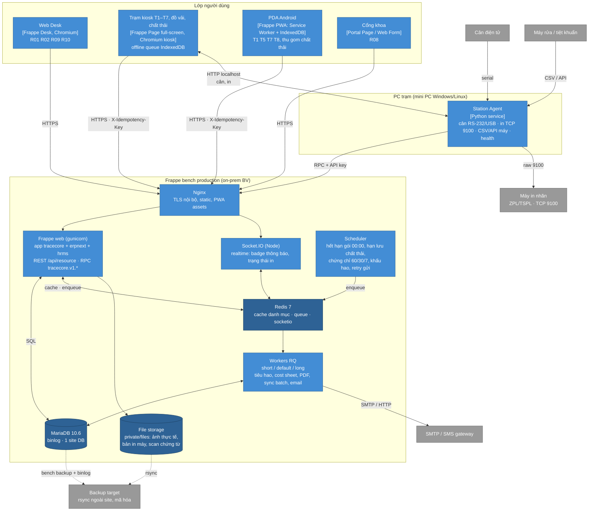

| Container | Công nghệ | Trách nhiệm | Phụ thuộc chính |
| --- | --- | --- | --- |
| Web Desk | Frappe Desk v15 (Workspace, Form, List, Report, Dashboard) + Client Script | Quản trị, danh mục M1/M3/M4/M5/M10, kho M6, chi phí M7, cơ số M8, báo cáo M9, phê duyệt | web |
| Trạm kiosk | Frappe `Page` (`tracecore/page/station/*`) full-screen; ô quét luôn focus; stepper; offline queue | T1–T7, trạm đồ vải, trạm thu gom/bàn giao chất thải; đăng nhập thẻ; in nhãn qua agent | web, agent, redis (realtime) |
| PDA PWA | Cùng Page + `manifest.json` + Service Worker (precache shell, IndexedDB queue) | T1/T5/T7/T8, thu gom chất thải, xác nhận thu hồi; offline ≥ 4 giờ | web |
| Cổng khoa | Portal Page + Web Form (website user) | R08 xem phiếu cấp phát, thu hồi, kg chất thải khoa mình | web |
| Nginx | Nginx + TLS nội bộ | Reverse proxy, static, gzip, giới hạn 20 req/s/trạm | — |
| Frappe web | gunicorn, Python 3.11; apps `frappe`, `erpnext`, `hrms`, `tracecore` (+ `insights`, `print_designer`) | DocType, Workflow, hook, RPC `tracecore.v1.*`, permission, GS1, audit, idempotency | MariaDB, Redis |
| Socket.IO | Node 18 | Realtime: huy hiệu thông báo, trạng thái lệnh in, cập nhật dashboard ≤ 60 s | Redis |
| Workers RQ | `bench worker` short/default/long | Stock Entry tiêu hao, Cost Sheet, PDF/Excel, xử lý batch sync, Email Queue, import | Redis, MariaDB |
| Scheduler | `bench schedule` | Cron: 00:00 hết hạn gói; mỗi 15 phút hạn lưu chất thải; hằng ngày chứng chỉ/kiểm định/giấy phép; tháng khấu hao, báo cáo ghi đè; retry email/SMS | Redis |
| Redis | Redis 7 (3 instance cache/queue/socketio) | Cache danh mục & BOM; hàng đợi; pub/sub | — |
| MariaDB | 10.6, binlog ROW, utf8mb4 | System of record; 1 site | — |
| File storage | `sites/<site>/private/files` (có thể mount NAS) | Ảnh thực tế, bản in máy, scan chứng từ; ≥ 500 GB | backup |
| Station Agent | Python 3.11 service (systemd / Windows service), `pyserial`, `requests` | Đọc cân, in ZPL/TSPL với hàng đợi/retry, đọc CSV/API máy, health check, cấu hình theo `Zone Station` | web (API key), printer, scale, machine |
| Backup | `bench backup --with-files` + binlog + rsync/restic | RPO ≤ 15 phút, RTO ≤ 4 giờ, bản ngoài site mã hóa | — |

### 5.2 Component view app `tracecore` (C4 L3)

App `tracecore` tổ chức theo **module Frappe = phân hệ**. Tên module (thư mục) và DocType nằm trong `tracecore/tracecore/<module>/doctype/...`; module `core` chứa dịch vụ xuyên suốt mà mọi module khác gọi; không module nghiệp vụ nào import chéo trực tiếp ngoài qua `core` hoặc qua Link/hook.

> **Amendment A-01 (2026-10-19).** Frappe yêu cầu tên Module Def duy nhất trên toàn bench; `Core` thuộc frappe và `HR` thuộc hrms nên không đăng ký được hai module `core`/`hr` đúng tên trên. Hiện thực:
> - `core`: dịch vụ ở package Python thường `tracecore/core/` (đường dẫn trong các ADR giữ nguyên: `tracecore.core.gs1`, `tracecore.core.audit`, `tracecore.core.idempotency`, `tracecore.core.step_gate`…). DocType nền xuyên suốt nằm trong module Frappe `TraceCore` (thư mục `tracecore/tracecore/doctype/...`).
> - `ui`: module Frappe `UI` chứa Page `station` (`tracecore/ui/page/station/`).
> - `hr` (M4): hiện chỉ là package `tracecore/hr/`, chưa đăng ký Module Def. Khi M4 có DocType đầu tiên, đặt tên module khác `HR` qua amendment.
> - Module Def đăng ký: `TraceCore, Instrument, Reprocessing, Linen, Equipment, Inventory, Costing, Par, Admin Reports, Waste, UI`.

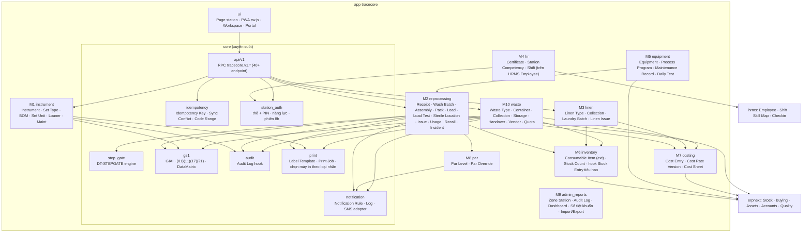

| Component | Trách nhiệm chính | FR chính |
| --- | --- | --- |
| `core.step_gate` | Ghi/kiểm `Step Gate Result` theo (set_unit, cycle_no, step); từ chối quét khi bước trước chưa Đạt; Vô khuẩn khi đủ 5 cổng; hàng đợi Xử lý lại | FR-M2-25, FR-M2-00.1..5 |
| `core.gs1` | Sinh Set ID GIAI, Cycle ID `CY-YYMMDD-NNNN` + payload (01)(11)(17)(21), mã QR nội bộ NV-/TB-/KE-/TR-/CN-/CT-, encoder DataMatrix, sổ đăng ký mã (`Code Registry`) | FR-M1-05, FR-M2-07.1, FR-M9-07, FR-M10-01.5 |
| `core.audit` | `doc_events` after_insert/on_update/on_submit/on_cancel/on_trash cho mọi DocType nghiệp vụ → `Audit Log`; API audit.query | FR-M9-05, NFR-SEC-03 |
| `core.idempotency` | Bảng `Idempotency Key` (key, user, endpoint, response hash, TTL 30 ngày); `Sync Conflict` cho R02; `Code Range` cấp dải Cycle ID/CT- cho trạm | FR-M9-06, FR-M2-07.11 |
| `core.station_auth` | `station.login`: thẻ → Employee → Competency + Certificate còn hạn → `Station Session` 8 h, idle 10 phút; PIN bcrypt sai 3 lần khóa 5 phút; một thẻ – một phiên | FR-M4-03, FR-M9-08, EI-UI-005 |
| `core.print` | `Label Template` (Jinja/ZPL/TSPL theo phương pháp), `Printer` (gắn `Zone Station`, loại nhãn đang nạp), `Print Job` hàng đợi/retry; chặn in sai loại | FR-M2-08, FR-M1-05.4, EI-HW-003/008 |
| `core.notification` | `Notification Rule` (sự kiện → vai trò/người → kênh), `Notification Log` (đã gửi/đã đọc), adapter SMS, retry | FR-M9-10 |
| `core.api.v1` | Whitelisted methods `tracecore.v1.<domain>.<action>`; validate khu trạm; wrap idempotency; rate limit | EI-SW-004 |
| `ui` | Page `station` (router theo trạm T1..T8, đồ vải, chất thải), `sw.js`, `manifest.json`, Workspace M1–M10, Portal khoa | EI-UI-001..004, FR-M9-14 |

### 5.3 Conceptual domain model

Mục này là **nguồn chuẩn cho detailed-design và implementation-planning**: mọi DocType của app `tracecore` phải có ở đây (40 gốc từ #08 giữ nguyên tên EN + **23 DocType mới v1.11**). DocType mới không có trong bảng sẽ bị coi là cần amendment kiến trúc. Tên theo quy ước Frappe Title Case; child table đánh dấu *(child)*. Cột "ERPNext/HRMS" ghi DocType nền tảng được tận dụng (theo #12 §5.2–5.3, ADR-009): **Link** = trỏ tới DocType ERPNext; **Ext** = mở rộng bằng Custom Field; **Thay** = dùng DocType ERPNext thay vì tự xây.

#### 5.3.1 Danh sách DocType

**M1 — Danh mục dụng cụ (6 gốc)**

| DocType | BA ID | Vai trò | ERPNext/HRMS | FR |
| --- | --- | --- | --- | --- |
| Instrument | DT-INSTR | Dụng cụ đơn lẻ; Spaulding, IFU, phương pháp tương thích (child `Instrument Compatible Method`), ảnh thực tế, cơ số, mã GIAI khắc laser tùy chọn | — (tùy chọn Link Item nếu quản lý kho dự phòng) | FR-M1-01, FR-M1-02, FR-M1-09 |
| Instrument Set Type | DT-SETTYPE | Loại bộ, khoa sở hữu (Link Department), phương pháp, loại gói mặc định, hạn lưu, cờ cấy ghép, ảnh bộ đã sắp xếp, phiên bản BOM hiện hành | Link Department | FR-M1-03, FR-M1-04 |
| Set BOM Item | DT-SETBOM | Dòng BOM: set_type, bom_version, instrument, qty, thứ tự xếp, ngày hiệu lực (DocType độc lập để versioning) | — | FR-M1-03, FR-M1-04 |
| Set Unit | DT-SETUNIT | Bộ vật lý; `set_id` GIAI PK, cycles_used, max_cycles, active_cycle_id, status WF-01, current_station, is_loaner | Link Department | FR-M1-05, FR-M1-06 |
| Loaner Set | DT-LOANER | Bộ mượn; child `Loaner BOM Item`; biên bản nhận/trả | — | FR-M1-07, FR-M1-08 |
| Instrument Maintenance | DT-INSTRMAINT | Ngưỡng và lịch sử tra dầu/bảo dưỡng theo dụng cụ × set_unit; bộ đếm kể từ lần bảo dưỡng | — | FR-M1-09, FR-M2-07.4 |
| **Instrument Group** *(mới, A-06)* | — | Nhóm dụng cụ: `group_name`, ngưỡng bảo dưỡng theo nhóm (`maint_interval_cycles`, `maint_type`), mô tả; `Instrument.instrument_group` Link | — | FR-M1-01, FR-M1-09 |

> **Amendment A-06 (2026-10-21), M1 (FEAT-014; I1–I17):** I1–I8 tạm — chờ chủ đầu tư duyệt (người dùng đã duyệt kế hoạch 21/10/2026, chủ đầu tư chưa); I9–I17 dev lead xác nhận.
> - **Instrument (I1, I2, I9–I14):** thêm Spaulding (`Critical/Semi-critical/Non-critical`), hãng, model, IFU, ảnh + thumbnail, giá trị VND, `instrument_group`, `item` (tùy chọn), `status` (`Active/Retired`, chỉ đổi qua `catalog.retire`), `version_no`, mã GIAI tùy chọn. Bắt buộc: mã, tên, Spaulding, ít nhất một phương pháp. Mã chuẩn hóa NFKC, viết hoa, `[A-Z0-9-]{1,40}`; trùng mã (kể cả đã Ngừng sử dụng) báo kèm mã kế tiếp còn trống. IFU ≤ 20 MiB, ảnh ≤ 5 MiB, kiểm theo nội dung file, file private.
> - **Instrument Compatible Method (I1–I3):** child với `method` Select `Steam 121/Steam 134/Plasma/EO`, không trùng dòng. Phiên bản dụng cụ **không có DocType riêng** (§5.3 không liệt kê; phương án thay là child `Instrument Version`, cần amendment mới): `version_no` tăng đúng 1 khi tập phương pháp đổi (đổi thứ tự không tính); lịch sử dựng lại từ Audit Log và Frappe Version. Cảnh báo BOM chỉ cảnh báo, không chặn; gói và Set Unit đang giữa chu trình không đổi; chặn khi lưu BOM không tương thích là FEAT-015 (UC-02 E1).
> - **Cơ số (I4):** `Instrument.max_cycles` là cơ số cấp dụng cụ; 0/trống = Chưa xác định (chỉ cảnh báo, FR-M8-01.1). **Trùng chức năng với `Par Level` (M8, FEAT-031): hai nơi cùng nói về cơ số; đã chốt ở A-11 (S1): `Par Level` là nguồn, đồng bộ một chiều sang `Instrument.max_cycles`.** OQ-07 (cơ số mặc định theo nhóm) còn mở nên FEAT-014 không có cơ số mặc định.
> - **Instrument Maintenance (I5, I6, I15, I16):** ngưỡng hiệu lực = ngưỡng riêng của dụng cụ (> 0) → ngưỡng `Instrument Group` (> 0) → không có (không nhắc, FR-M1-09.1). Bộ đếm chỉ đổi qua `maintenance` (T4, giải phóng, khởi tạo một lần khi chưa có lịch sử T4); sửa tay bị chặn kể cả System Manager. `maintenance.on_set_released(ctx)` tăng bộ đếm, gọi qua hook mới `tracecore_after_release` (FEAT-023 gọi bằng `core.extension.run`) với `ctx = {set_unit, set_type, bom_version, cycle_id}`; **`cycle_id` (Cycle ID của gói được giải phóng) bắt buộc**: dòng bộ đếm ghi `last_release_cycle` nên gọi lại cùng Cycle ID không cộng hai lần (idempotent khi FEAT-023 thử lại bước giải phóng). Quy tắc chặn D5 (A-02) giữ nguyên.
> - **Quyền (I15):** Instrument, Instrument Group: TC R02, TC R10, System Manager đọc/tạo/ghi; TC R01 và R03–R09 đọc; không ai xóa. TC R01 có thêm quyền `report` (chỉ xem báo cáo, không ghi) trên Instrument và Instrument Group, cần cho Script Report `Instrument Data Gaps` (dụng cụ thiếu cơ số/ảnh/IFU/Spaulding/phương pháp); lệch so với ma trận I15 ban đầu, ghi lại ở đây để chủ đầu tư duyệt cùng A-06. Xem trước DataMatrix GIAI (`v1.instrument.giai_preview`) chỉ TC R10/System Manager, như cấp mã và ghi nhận khắc; khi cờ tắt vẫn xem trước được mã đã cấp.
> - **Mã GIAI khắc laser (I7, I8; FEAT-014 Task 5):** `v1.instrument_admin.assign_giai` / `record_etching` (POST, `@idempotent`, TC R10/SM) và `v1.instrument.giai_preview` (GET, chỉ đọc, TC R10/SM). Ghi nhận khắc ghi một lần; ghi lại phải có lý do (vào Audit Log), thiếu lý do → `REASON_REQUIRED` (422). Mã lỗi mới: `FEATURE_DISABLED` (409, cờ tắt: không cấp mã, không ghi khắc; mã cũ, ngày/vị trí khắc giữ nguyên và vẫn xem trước được), `GIAI_ALREADY_ASSIGNED` (409), `GIAI_NOT_ASSIGNED` (409), `CODE_NOT_FOUND` (404, `giai_preview`: mã của dụng cụ không có trong `Code Registry`), `ETCHING_INVALID` (422: ngày sai/tương lai, vị trí trống/quá 140 ký tự), `GS1_PREFIX_NOT_CONFIGURED` (409: tiền tố sai định dạng, hoặc tiền tố demo trên site không phải dev/test). Tiền tố demo = **toàn dải GS1 `952`** (GS1 dành dải này cho demo), không chỉ `9520000`.
> - **Desk SCR-01 (FEAT-014 Task 6):** form và list `Instrument` dùng hai RPC đọc: `v1.instrument.check_code(code)` → `{ok, code, valid, available, suggestion}` (kiểm mã khi gõ, không ghi Audit) và `v1.instrument.form_context(instrument)` → `{ok, instrument, status, version_no, giai_enabled, giai, effective_rule, bom_usage, history, image, counters, permissions}` (`counters` = mọi bộ đếm của dụng cụ + bộ chứa dụng cụ trong BOM hiện hành, trạng thái D5 `no_rule/not_due/due/overdue` tính ở server, `can_init`; `permissions` = nút ghi người dùng được thấy, RPC ghi vẫn kiểm lại). Cảnh báo phiên bản mới có link tới từng loại bộ. List view: cột cơ số bằng chữ, bộ lọc chuẩn và nút lọc nhanh cơ số Chưa xác định (cột mã dụng cụ và chu kỳ bảo dưỡng rời list view vì màn 1366 px chỉ còn một cột trường; cột ID đã là mã).
> - **Ngoài phạm vi (I17):** FR-M1-02.2/.4 → FEAT-020; import ảnh hàng loạt FR-M9-11.1 → FEAT-011; BOM và chặn không tương thích → FEAT-015; Par Level → FEAT-031; cache offline → FEAT-009; hiển thị ảnh T1/T3 → FEAT-019/020; Notification → FEAT của ADR-014.
> - **`v1.instrument.get_image` (I12):** GET chỉ đọc, trả URL ảnh, thumbnail 320 px và `etag` (= `content_hash` thumbnail); `bom.lines` thêm `thumbnail`.

> **Amendment A-09 (2026-10-22), M1 (FEAT-015; S1–S15):** S1–S8 tạm — chờ chủ đầu tư duyệt (người dùng đã duyệt kế hoạch 22/10/2026, chủ đầu tư chưa); S9–S15 dev lead xác nhận.
> - **Instrument Set Type (S6, S7, S13, S12, S14):** thêm `is_implant` (Check), `assembly_minutes` (Int 0–600, 0 = chưa nhập → cảnh báo), `tray_image_2`, `tray_image_3` và ba trường thumbnail `tray_thumbnail`, `tray_thumbnail_2`, `tray_thumbnail_3` (server ghi; `tray_image` giữ tên vì T4 đang đọc). `department` và `default_pack_type` thành bắt buộc (bản ghi cũ thiếu không bị bịa dữ liệu). `current_bom_version` chỉ đọc, do server ghi. Ảnh gắn **loại bộ**, không theo phiên bản (gap: phiếu của phiên bản cũ in ảnh hiện tại); luật file như ảnh dụng cụ (JPEG/PNG/WebP ≤ 5 MiB, ≤ 40 MP, private, thumbnail 320 px). `shelf_life_days` là ghi đè (0 = dùng hạn loại gói) và chỉ nhận `0 < giá trị < hạn loại gói mặc định`; hạn loại gói vẫn là `Item.tc_shelf_life_days` (A-02, D4), sửa qua RPC `set_pack_shelf_life` có lý do cho TC R02, TC R10, System Manager. Quyền: TC R02, TC R10, System Manager đọc/tạo/ghi (R10 ghi được GTIN, giải điều kiện "ruling Task 3" của A-02); TC R01 đọc + `report`; TC R03–R09 đọc; không ai xóa. Thêm `Instrument Set Type` vào audit `doc_events`.
> - **Set BOM Item (S1, S4, S5, S12):** thêm `change_reason` (≤ 500 ký tự, bắt buộc) và `based_on_version`; mọi dòng của một phiên bản mang cùng `effective_from`, `change_reason`, `based_on_version`. Dòng chỉ tạo qua `bom_versions` (cờ `flags.tc_bom`) và **bất biến**: không sửa, không xóa, kể cả System Manager. Unique (`set_type`, `bom_version`, `instrument`). Luật dòng: dụng cụ `Active`, họ phương pháp của loại bộ ∈ họ phương pháp của dụng cụ (so ở mức họ, không phân biệt 121/134 °C), `qty` nguyên 1–999, không trùng dụng cụ, `position` đánh lại 1..n, tối đa 500 dòng; mọi lỗi trả cùng lúc theo từng dòng. Tạo phiên bản mới: khóa dòng loại bộ, so `base_version` với phiên bản mới nhất, khác thì `BOM_VERSION_CONFLICT`.
> - **Set Unit.cycle_bom_version (S3):** Int, trường vòng đời cùng nhóm `status`, `current_cycle_no`; chỉ `core.step_gate.start_cycle(set_unit, on=None)` ghi, một lần mỗi chu trình, bằng hook `tracecore_cycle_bom_version` (M1 khai báo `bom_versions.pin_cycle_version`). Bộ chưa ghim đọc phiên bản hiệu lực hôm nay. FR-M1-04.2 "sau ngày hiệu lực" hiểu là từ ngày hiệu lực (≥). Hợp đồng `on` (đính chính 22/10/2026 khi review): ngày/giờ tiếp nhận theo giờ hệ thống `Asia/Ho_Chi_Minh` không múi giờ như `now_datetime()`; nơi gọi có `client_ts` (FEAT-019) đổi bằng `core.client_time.to_system_time(parse_client_ts(client_ts))` trước khi truyền. Không có phiên bản hiệu lực tại ngày `on` (tiếp nhận ghi lùi) → ghim `current_bom_version`; chỉ loại bộ chưa có dòng BOM nào mới không ghim (0). Ghim giữ nguyên sau khi giải phóng, tới lần tiếp nhận kế tiếp.
> - **Hiệu lực và kích hoạt (S2, S14):** phiên bản áp dụng tại ngày D = `max(bom_version)` có `effective_from ≤ D`; scheduler `0 0 * * *` cập nhật `current_bom_version` kèm Audit `Update` (user Administrator, reason "scheduled"), nhưng đọc luôn qua hàm tính trực tiếp nên đúng cả khi scheduler trễ.
> - **Cache BOM của trạm (S11, §8):** `v1.set_type.bom` cache nội dung phiên bản ở `tc_bom:<set_type>:<version>` và ngày hiệu lực các phiên bản ở `tc_bom:<set_type>:dates` (TTL 600 s). Tạo loại bộ / lưu phiên bản mới xóa mọi khóa của loại bộ (kể cả `dates`); đổi ảnh khay, tên, phương pháp loại bộ hoặc tên/ảnh dụng cụ cũng xóa. `status` không nằm trong cache và `etag`; trả lời `not_modified` mang `{ok, not_modified: true, etag, set_type, bom_version, status}`.
> - **Ngoài phạm vi (S15):** kiểm đếm T3 và phiếu kiểm đếm theo chu trình → FEAT-020; gọi `start_cycle` khi tiếp nhận → FEAT-019; Par Level → FEAT-031/032; import loại bộ/BOM → FEAT-011 (qua `bom_versions`); bộ mượn → FEAT-017; cache offline → FEAT-009; T4 hiển thị nhiều ảnh khay; phân biệt nhiệt độ hấp ở loại bộ.

> **Amendment A-13 (2026-10-24), M1 (FEAT-016; G1–G17):** người dùng chốt G1–G14 ngày 24/10/2026 (chủ đầu tư chưa xác nhận G8 và thao tác Thanh lý); G15–G17 dev lead xác nhận. Dòng `Set Unit` ở bảng trên đọc kèm các điểm sau.
> - **Trường mới (G6, G12):** `Set Unit.cycles_source` (Select `System`/`Estimate`, mặc định `System`, bất biến, ghi một lần khi cấp; `Estimate` cho bộ đang lưu hành nhập số chu trình ước tính kèm lý do), `tag_verified_on` (Datetime) và `tag_verified_by` (Link User), hai trường sau chỉ ghi qua `set_tags.verify` (cờ `flags.tc_tag_verify`). Bản ghi cũ đổi `Actual` → `System` và `Estimated` → `Estimate` bằng patch `rename_cycles_source`, không điền khoa.
> - **Tạo Set Unit (G4):** chỉ qua `set_units.issue_batch` (cờ `flags.tc_set_issue`); Desk "Mới", `frappe.client.insert` và Data Import trực tiếp bị chặn ("Set Unit chỉ tạo qua Cấp Set ID"); không ai có quyền `create` trên Desk. Trường vòng đời khởi tạo bằng `core.step_gate.init_unit(doc, cycles_used)`: `status = New`, `current_cycle_no = 0`, `cycle_bom_version = 0`, `active_cycle_id`/`current_station` rỗng. Không ghim BOM khi cấp (UC-03 bước 3 hiểu là form hiện phiên bản sẽ áp dụng); ghim ở `start_cycle` của lần tiếp nhận T1 đầu tiên (A-07, S3).
> - **Điều kiện cấp (G5, G6):** loại bộ phải có phiên bản BOM **hiệu lực hôm nay** (chỉ có phiên bản đã lên lịch thì chặn) và BOM không chứa dụng cụ Ngừng sử dụng/không tương thích (`SET_TYPE_BOM_INVALID`, liệt kê từng dòng); khoa sở hữu bắt buộc, mặc định khoa của loại bộ, không phải nhóm và không bị tắt (`DEPARTMENT_INVALID`); cơ số tối đa là số nguyên 1–99 999 và **không vượt nguồn cơ số** (`MAX_CYCLES_INVALID`): nguồn là `Par Level` của loại bộ, không có thì dụng cụ có cơ số thấp nhất trong BOM, lấy qua hook `tracecore_set_type_cap` (M8 khai báo `par.config.set_type_cap`; M1 không import M8); chưa có nguồn thì chỉ chặn ở 99 999. "Tiền tố mã" của FR-M1-05 là cấu hình site (R10), không phải ô nhập; "mẫu thẻ" là chọn loại bản in. Nguồn bộ `Mới` (`cycles_used = 0`) hoặc `Đang lưu hành` (số chu trình ước tính `1 ≤ n < max_cycles`, bắt buộc lý do 1–500 ký tự, `cycles_source = Estimate`; người, thời điểm và lý do ở Audit `Create` của từng bộ với `reason = issue: <lý do>`); một lô chỉ một nguồn và một số ước tính. Bộ mượn `LN` → FEAT-017.
> - **Quyền (G7):** cấp, in, in lại, xuất CSV: TC R02, TC R10, System Manager; quét kiểm tra thẻ thêm TC R04 (R04 chỉ gắn thẻ và quét xác minh); xem trước và đọc: mọi role đọc được Set Unit. Kiểm role trước mọi ghi; TC R04 gọi in lại → `PermissionError`, không để lại Idempotency Key hay Audit.
> - **Thanh lý (G14):** hoãn sang FEAT-032, FEAT-016 chỉ hiển thị trạng thái `Disposed` và lịch sử. Không có `step_gate.dispose`, `v1.set_unit.dispose` hay nút Desk. FEAT-032 phải chốt actor, điều kiện, lý do và phê duyệt (FR-M1-05.2: Set ID bị vô hiệu vĩnh viễn, không cấp lại). In/xuất CSV bộ ở trạng thái `Disposed` hoặc mã `Disabled` vẫn bị chặn (`SET_DISPOSED`, `CODE_DISABLED`).
> - **Lịch sử vòng đời (G13, FR-M1-06, FR-M1-06.2):** mọi đổi trường vòng đời đã đi qua `step_gate._save_lifecycle`; thêm tham số `event` (`issue`, `start_cycle`, `gate T2 Fail`, `bind_cycle`, `release_cycle`…) vào cột `reason` của Audit Log `Update` của Set Unit. `set_units.history(set_unit, before, limit)` gộp Audit Log của Set Unit, `Step Gate Result`, `Print Job` và `Pack` (mới → cũ, phân trang theo thời điểm, số truy vấn cố định). Form hiện đã dùng / tối đa / còn lại = `max(0, max − used)`, Cycle ID hiệu lực, nguồn số chu trình ("Ước tính" nếu `Estimate`) và phiên bản BOM (đã ghim hoặc "v N, sẽ ghim khi tiếp nhận").
> - **Hook trạng thái (G13):** `tracecore_after_set_status` (khai báo trong `hooks.py`, danh sách rỗng): `core.step_gate._save_lifecycle` gọi `extension.run` sau khi lưu, **chỉ khi `status` thực sự đổi**, trong cùng transaction, payload `{set_unit, old_status, new_status, event, client_ts, ref_doctype, ref_name}` (`client_ts`/tham chiếu lấy từ `start_cycle`, `record`). Khác với Audit Log: Audit ghi mọi lần lưu vòng đời, hook chỉ báo đổi trạng thái cho phân hệ khác.
> - **Ngoài phạm vi (G15):** T1 nhận bộ `New`, `At Department`, `Awaiting Receipt` và ghim BOM → FEAT-019 (cùng sửa FR-M2-02); bộ mượn `LN`, FR-M1-05.5 → FEAT-017; import Set Unit hàng loạt → FEAT-011 (phải gọi `set_units.issue_batch`); dải mã offline → FEAT-009 (không cấp Set ID offline); tăng bộ đếm → FEAT-023; tự chuyển Hết vòng đời và thao tác Thanh lý → FEAT-032; in từ kiosk/PDA, phiếu PDF thẻ, thử vật liệu thẻ/nhãn (R-01), kiểm `label_type_loaded` cho phôi thẻ; mã GIAI dụng cụ (FEAT-014, series `GI` riêng) không đổi.

> **Amendment A-02 (2026-10-20), M1 (FEAT-018; D4–D6, D9):**
> - `Set Unit.current_cycle_no` (Int, chỉ đổi qua `core.step_gate`, cùng nhóm `status`, `cycles_used`, `current_station`, `active_cycle_id`): số thứ tự chu trình hiện hành, là khóa chung của `Step Gate Result` (ADR-005 đã dùng tên này).
> - `Instrument Set Type.gtin` (D6, **còn mở**, OQ-05): GTIN-14 do R10 nhập tay (14 chữ số, check digit đúng, duy nhất), khóa sửa khi loại bộ đã có Pack; thiếu GTIN thì không sinh Cycle ID. Cách cấp GTIN-14 từ GS1 Company Prefix thật và mã loại bộ (đoạn "cấp từ Company Prefix + mã loại bộ" ở ADR-004) chưa chốt nên FEAT-018 không hiện thực công thức đó. Dev/staging dùng GTIN test (tiền tố demo `952`) do devdata/factory gán; nhãn mang GTIN test in thêm dòng `TEST`.
> - **Quyền nhập GTIN (ruling Task 3):** trong FEAT-018, R10 chỉ có quyền đọc `Instrument Set Type` (giữ nguyên quyền hiện có), nên GTIN do tài khoản System Manager nhập cho tới khi FEAT-003 (ma trận RBAC #13) và FEAT-015 (màn loại bộ) cấp quyền ghi cho R10. **Điều kiện trước UAT:** R10 phải nhập được GTIN bằng tài khoản của mình.
> - `Instrument Set Type.shelf_life_days` (Int; 0 hoặc trống = không ghi đè): hạn lưu riêng của loại bộ, kết hợp với hạn loại gói theo công thức ở ghi chú M2 (D4).
> - **Ngưỡng bảo dưỡng (D5, tạm — trình CĐT 20/10/2026):** `Instrument Maintenance` đến hạn khi bộ đếm ≥ ngưỡng; **chặn** sinh Cycle ID khi bộ đếm > ngưỡng × 1,2 **hoặc** số lần hoãn ≥ 3, trừ khi lần đóng gói này chọn Đã bảo dưỡng. So sánh bằng số nguyên `bộ đếm × 10 > ngưỡng × 12` để tránh lệch do số thực. Mỗi nhắc đến hạn phải được xử lý (Đã bảo dưỡng hoặc Hoãn có lý do) trước khi sinh. Yêu cầu PIN R02 khi hoãn thêm bổ sung ở FEAT-003.

**M2 — Chuỗi tái xử lý (12 gốc + 1 mới)**

| DocType | BA ID | Vai trò | ERPNext/HRMS | FR |
| --- | --- | --- | --- | --- |
| Dirty Receipt | DT-RECEIPT | Phiếu tiếp nhận nhiều bộ; child `Dirty Receipt Item`, `Dirty Receipt Confirm Line` (xác nhận thành phần, ghi chú bất thường); submittable | Link Department | FR-M2-01, FR-M2-02, FR-M2-23 |
| Wash Batch | DT-WASHBATCH | Lô rửa `LR-YYMMDD-NN` (naming series); child `Wash Batch Set Unit` (`set_units`), `Wash Batch Chemical` (`chemicals`: item, lot, qty); trường theo BA #08 (`batch_type`, `operator`, `data_source`, `data_complete`, `machine_data`, `machine_files`, `clean_test_result`, `cycle_result`…); `status` `Running/Passed/Failed` (WF-04, không dùng Nháp); A-12 | Link Batch (hóa chất) | FR-M2-03, FR-M2-04, FR-M2-24 |
| Assembly Record | DT-ASSEMBLY | Kiểm đếm theo BOM; child `Assembly Line`; thiếu được R02 duyệt | — | FR-M2-05, FR-M2-06 |
| Pack | DT-PACK | Gói `CY-YYMMDD-NNNN` (hoặc `CY-YYMMDD-T<tram>-NNNN` offline); barcode_payload GS1; child `Pack Instrument Confirmed`, `Pack Maintenance Done`; WF-02 | — | FR-M2-07, FR-M2-08, FR-M2-13, FR-M2-14 |
| Sterilization Load | DT-LOAD | Mẻ `ME-YYMMDD-NN`; child `Load Pack`; params JSON, machine_report, data_source, requires_bi; WF-03 | Link Asset qua Equipment | FR-M2-09, FR-M2-10, FR-M2-11, FR-M2-12, FR-M2-24 |
| Load Indicator Result | DT-LOADTEST | Bowie-Dick/CI 5-6/BI theo mẻ hoặc gói; lô chỉ thị; giờ đọc | Thay thế tùy chọn: Quality Inspection (quyết định tại detailed-design, mặc định DocType riêng) | FR-M2-11 |
| Sterile Location | DT-STERLOC | Vị trí kệ `KE-`; Link Zone Station | — | FR-M2-13 |
| Issue Note | DT-ISSUE | Phiếu cấp phát nhiều gói/khoa; child `Issue Note Pack`; chữ ký (Signature) | Link Department | FR-M2-15, FR-M2-16 |
| Usage Record | DT-USAGE | Quét sử dụng; `patient_code` kiểu Password (AES), ca mổ, PTV | Link Department | FR-M2-17, FR-M2-18 |
| Recall Order | DT-RECALL | Lệnh thu hồi; child `Recall Order Pack` (trạng thái từng gói); WF-05 | — | FR-M2-20 |
| Step Gate Result | DT-STEPGATE | Cổng bước T1..T5 theo (set_unit, cycle_no, step); redo_count; batch_ref Dynamic Link | — | FR-M2-25 |
| Incident CAPA | DT-INCIDENT | Sự cố/NC/CAPA; child `CAPA Action`; WF-06; dùng chung cho M10 | Link Non Conformance / Quality Action (đồng bộ một chiều, tùy chọn) | FR-M2-21, FR-M2-22, FR-M10-06 |
| **Sterile Putaway** *(mới)* | — | Chứng từ nhập kho vô khuẩn (quét gói + vị trí) để có bản ghi submittable cho cổng T6 và audit; Pack giữ location hiện hành | — | FR-M2-13 |

> **Amendment A-02 (2026-10-20), M2 (FEAT-018; D1, D4, D8, D9, D12, D13):**
> - **Vị trí module (D9):** `Pack` (+ child `Pack Instrument Confirmed`, `Pack Maintenance Done`) và `Assembly Record` (stub T3 của FEAT-018) ở module `Reprocessing`. `Step Gate Result` do `core.step_gate` sở hữu nên đặt ở module `TraceCore` (cùng tinh thần A-01), dù bảng trên nhóm theo FR (M2). `Instrument`, `Set BOM Item`, `Instrument Maintenance` ở module `Instrument`.
> - **Pack (D8, D12):** thêm `packed_by_user` (Link User, bắt buộc: user trạm đang đăng nhập) trong khi `packed_by` (Link Employee) để trống đến khi FEAT-003 điền. Thêm `shelf_life_days_applied` (Int) và `shelf_life_source` (Select `Pack Type`/`Set Type`): snapshot số ngày hạn lưu đã áp dụng và nguồn của nó. `status` có đủ 9 trạng thái WF-02 (`Packed, In Load, Quarantine, Released, In Sterile Stock, Issued, Used, Recalled, Void`); FEAT-018 chỉ dùng `Packed` và `Void`. Pack là chứng từ submittable, `docstatus = 1` ngay khi sinh; hủy bằng `status = Void`, không cancel, không xóa. Hủy tại T4 ghi cổng T4 Không đạt (`redo_count++`, Set Unit → `Reprocess`) và vô hiệu mã trong Code Registry.
> - **Thời điểm đóng gói (D13):** `packed_at` = `client_ts` đổi sang giờ hệ thống (ADR-003: thời điểm nghiệp vụ = `client_ts`). Ngày trong Cycle ID `CY-YYMMDD-NNNN`, trong AI (11) và hạn dùng đều lấy từ `packed_at`; series đếm theo ngày `packed_at`. Cửa sổ in lại 10 phút đo bằng giờ server, tính từ lúc tạo Pack (ruling Task 8). Khi sinh online, `client_ts` lệch giờ server quá `tc_client_ts_max_skew_seconds` thì bị từ chối (xem ADR-003, giới hạn lệch giờ).
> - **Hạn dùng (D4, tạm — trình CĐT 20/10/2026; trả lời điểm rà soát #5 ở SRS §3.1.11):** `expiry = ngày đóng gói + min(hạn loại gói, hạn ghi đè của loại bộ)`. Hạn loại gói là `Item.tc_shelf_life_days` của Item nhóm `Packaging`; loại gói chưa có hạn lưu thì không chọn được. Loại bộ không ghi đè (0 hoặc trống) thì dùng hạn loại gói. Số ngày áp dụng và nguồn được snapshot vào Pack, nên đổi danh mục sau đó không ảnh hưởng gói cũ.
> - **Hook tùy biến (D9):** M2 không import M1/M8 mà gọi `tracecore.core.extension.run("<hook>", …)`; M1/M8 khai báo hàm trong `hooks.py`: `tracecore_pack_context` (góp BOM + ảnh, nhắc bảo dưỡng, par bar vào ngữ cảnh màn T4), `tracecore_pack_prechecks` (kiểm cơ số, M8), `tracecore_pack_checks` (kiểm bảo dưỡng, M1), `tracecore_after_cycle_id` (sau khi sinh: M1 ghi kết quả bảo dưỡng; FEAT-042 nghe để trừ tiêu hao nhãn/bao gói/chỉ thị).
> - **Thứ tự kiểm khi sinh Cycle ID (trả lỗi đầu tiên gặp):** trạm đúng T4 → mã quét → trạng thái Set Unit → Cycle ID hiệu lực → cổng T3 → GTIN loại bộ → cơ số (precheck) → bảo dưỡng → BOM → lô chỉ thị → loại gói.
> - **Nút "Xác nhận tất cả thành phần" (D1, tạm — trình CĐT 20/10/2026):** T4 có nút này như T1 (FR-M2-01). Nút chỉ bật khi lưới BOM đã hiển thị đủ (mọi dòng đã render, mọi ảnh đã tải xong hoặc báo lỗi); một chạm tick mọi dòng, vẫn lưu từng dòng `Pack Instrument Confirmed`; người dùng bỏ chọn được từng dòng.
> - **Ngoài phạm vi FEAT-018 (D14):** sinh Cycle ID offline (FEAT-009); nhắc dán chỉ thị trong/ngoài cho gói đôi cấy ghép (UC-08 A2); trừ tiêu hao (FEAT-042); chuyển Set Unit sang Hết vòng đời khi vượt cơ số (FEAT-032); đếm chu trình (FEAT-023); dialect TSPL.

> **Amendment A-09 (2026-10-22), M2 (FEAT-015; S3):** hook tùy biến mới `tracecore_cycle_bom_version` của `core.step_gate.start_cycle(set_unit, on=None)`: M1 khai báo hàm trong `hooks.py` trả phiên bản BOM hiệu lực tại ngày tiếp nhận (`on` = giờ hệ thống; FEAT-019 đổi `client_ts` UTC bằng `core.client_time.to_system_time` trước khi gọi) để `step_gate` ghi `Set Unit.cycle_bom_version`; M2 không import M1. `reprocessing/packing.py`, `Pack` và luồng T4 không đổi: `Pack.bom_version` vẫn là snapshot, và `tracecore_pack_context` (M1, `bom.pack_context`) đọc phiên bản đã ghim của bộ (không ghim → phiên bản hiệu lực hôm nay). FR-M2-07.7/.8 (hạn lưu loại gói, giá trị mới chỉ áp cho gói đóng sau thời điểm sửa) xem ghi chú A-09 ở M1 (S7).

> **Amendment A-30..A-34 (2026-10-24), M2 (FEAT-019 T1 Tiếp nhận):**
> - **A-30 DocType (module Reprocessing):** `Dirty Receipt` (submittable, `RC-.YYYY.-.#####`): `department`, `deliverer` (Employee, trống nếu không thẻ), `deliverer_name`, `needs_card` (R02 cấp thẻ sau, FR-M2-01.7), `receiver`, `station`, `opened_at`, `received_at`, `abandoned`, `set_count`, `flagged_count`, child `items` (`Dirty Receipt Item`: `set_unit`, `set_type`, `set_name`, `status_before`, `bom_version`, `received_at`, `confirmed`, `abnormal_note`, `abnormal_photo`, `needs_review`, `forced`, `force_reason`, `cycle_no`, `voided_pack`) và `confirm_lines` (`Dirty Receipt Confirm Line`: `set_unit`, `instrument`, `instrument_name`, `qty`, `position`, `confirmed`; không có trường số lượng thực nhận, FR-M2-23.2). Phiếu chỉ do `reprocessing.receiving` tạo/sửa (cờ `flags.tc_receiving`); không hủy chứng từ, không xóa (như Wash Batch). Quyền theo ma trận `DT-RECEIPT` (đổi tên DocType `Receipt` → `Dirty Receipt`, giữ nguyên ký hiệu).
> - **Thời điểm đổi trạng thái:** `scan_set`/`confirm_line` chỉ ghi dòng phiếu. `submit` với mỗi bộ: `step_gate.start_cycle(set, on=client_time.to_system_time(<giờ quét của bộ, UTC>), client_ts=…)` (ghim BOM theo giờ hệ thống) rồi `step_gate.record(set, "T1", "Pass", "Dirty Receipt", phiếu, trạm)`. SRS FR-M2-01.4 viết "ghi sổ"; UC-05 bước 4 và sơ đồ §6.1 viết "Xác nhận bộ" — chọn FR-M2-01.4 vì FR-M2-23.5 cho sửa tới khi ghi sổ. Bộ không còn hợp lệ lúc ghi sổ (kiosk khác đã tiếp nhận) bị bỏ khỏi phiếu và trả trong `rejected`; không còn bộ nào → `RECEIPT_EMPTY`.
> - **A-31 RPC:** `open(station, raw?, department?, deliverer_name?, restart?)` (không tham số = tiếp tục phiếu nháp của người đang đăng nhập tại trạm; trả thêm `departments` khi chưa có phiếu), `scan_set(receipt, raw, station, force_reason?, reviewer_proof?)`, `confirm_line(receipt, set_id, station, lines?, confirm_all?, note?, finalize?, ack_incomplete?)`, `submit`, `discard`, `attach_photo` (ảnh bất thường JPEG/PNG/WebP ≤ 5 MiB, kiểm nội dung). Ghi dùng `@idempotent`, mọi RPC qua `@station_session(TC R03, TC R02, System Manager)`, chỉ ở trạm bước T1. Mã lỗi mới: 404 `RECEIPT_NOT_FOUND`, `DELIVERER_NOT_FOUND`; 422 `DELIVERER_NO_DEPARTMENT`, `DELIVERER_NAME_REQUIRED`, `RECEIPT_EMPTY`, `CONFIRM_INCOMPLETE` (nhắc FR-M2-23.6, gửi lại với `ack_incomplete`), `PHOTO_INVALID`; 409 `RECEIPT_CLOSED`, `ITEM_NOT_CONFIRMED`, `FORCE_NOT_ALLOWED`.
> - **A-32:** `core.step_gate.STATION_STATUSES["T1"] = ("New", "At Department", "Awaiting Receipt")` (G15 của A-13; `Used` chưa là trạng thái). Hook `tracecore_receipt_context(ctx {set_unit, set_type, on}) -> {bom_version, bom, tray_images}`: M1 khai báo `bom.receipt_context` (phiên bản = `bom_versions.pin_cycle_version`, nội dung = `bom.payload`); M2 không import M1. Bộ bị từ chối ghi trạng thái hiện tại và bước chưa Đạt đầu tiên của chu trình làm "trạm hiện tại" (FR-M2-02.1). Cycle ID hiệu lực chưa dùng (`Set Unit.active_cycle_id` còn, Pack chưa `Used`/`Void`/`Recalled`) bị `Void` với `void_reason = Returned Unused` và mã `Disabled` khi ghi sổ (FR-M2-01.3); đó là bản ghi cho thống kê lãng phí.
> - **A-33 (tạm):** tiếp nhận cưỡng bức chỉ khi người thao tác có `TC R02` và gửi PIN proof của chính phiên đó (`v1.station.verify_pin`) cùng lý do; chỉ cho bộ `Processing`/`Reprocess`/`Sterile` (không cho `Disposed`, `End of Life`). Phiếu ghi `forced`, `force_reason`; Cycle ID hiệu lực của bộ bị hủy như trên. NC tự tạo: hook `tracecore_after_force_receive` (rỗng) — FEAT-030 đăng ký.
> - **A-34 mâu thuẫn tài liệu và phần chưa làm:** (1) PDA SCR-34 ghi "chọn khoa → quét liên tục" nhưng FR-M2-01.1 cấm chọn khoa tay khi đã có thẻ: cả STN và PDA dùng chung luồng thẻ → bộ, "Người giao không có thẻ" mới chọn khoa. (2) Offline queue của PDA (EI-UI-003) thuộc FEAT-009: màn T1 chỉ có trạng thái offline (cần mạng). (3) In biên nhận/ghi chú kèm phiếu (FR-M2-23.3, UC-05 bước 6) chưa có mẫu in: chưa làm. (4) Hủy phiếu đã ghi sổ không hỗ trợ.

> **Amendment A-10 (2026-10-22), M2 (FEAT-025 T6 Kho vô khuẩn; D1–D7):** D1 chủ đầu tư/người dùng chốt 22/10/2026; D2–D7 dev lead xác nhận.
> - **D1 Set Unit.status:** thêm `Awaiting Receipt` (Chờ tiếp nhận) giữa `At Department` và `End of Life`; giải quyết điểm chưa thống nhất tên trạng thái giữa FR-M2-02, FR-M2-14 và FR-M2-17 (srs Appendix, mục "Chờ tiếp nhận"). Chỉ `core.step_gate.return_to_receipt` đặt trạng thái này (từ `Sterile`); FEAT-027 dùng chung; T1 (FEAT-019) phải nhận trạng thái này khi tiếp nhận.
> - **D2:** test T6 dựng gói Released + 5 cổng Pass bằng factory (`make_released_pack`) thay cho luồng T5b; FEAT-023 thay bằng luồng thật.
> - **D3 Cổng T6 kiểm:** `step_gate.check_stored(set_unit)` chỉ đọc, trả `GATE_PREV_NOT_PASSED` kèm `items` = bước chưa Đạt; không thêm hàng `Step Gate Result` T6 (enum bước giữ T1..T5).
> - **D4 DocType (đã thuộc §5.3):** `Sterile Location` (module Reprocessing, tên `KE-.####`, ghi Code Registry prefix `KE`, `is_active`, không xóa); `Sterile Putaway` (submittable, tên `SP-.YY.MM.DD.-.####`, `action` Putaway/Move, chỉ dịch vụ `reprocessing.storage` tạo); thêm `Pack.location` (allow_on_submit, chỉ đổi qua dịch vụ, cờ `tc_packing`). Quyền: R10 ghi kệ; R06 đọc kệ, tạo/ghi sổ Sterile Putaway, đọc Pack.
> - **D5 Hết hạn:** quá hạn = `expiry` < hôm nay; scheduler `0 0 * * *` (chung danh sách với FEAT-015) đóng gói `Released`/`In Sterile Stock` → `Void` (`Expired`), rách/ướt/mở → `Void` (`Torn`, lý do bắt buộc); Cycle ID bị vô hiệu trong Code Registry.
> - **D6 FEFO:** `storage.fefo_suggest(set_type)` và `fefo_check(cycle_id)` (cảnh báo `FEFO_NEARER_PACK`) cho FEAT-026 gọi; RPC `v1.putaway.fefo`.
> - **D7 Ngoài phạm vi:** gia hạn hạn lưu (FR-M2-14.3), kiểm kê E3, PDF danh sách về khu bẩn (FEAT-007), chặn quét Hết hiệu lực ở T7 (FEAT-026).
> - **RPC và mã lỗi:** `v1.putaway.scan/overview/fefo`, `v1.pack.mark_damaged`: POST, phiên trạm thẻ nhân viên A-08 (`@station_session`, token trong body, đúng trạm), role TC R06/System Manager (đọc `overview`/`fefo` thêm TC R02). 404 `LOCATION_NOT_FOUND`; 409 `PACK_NOT_RELEASED`, `PACK_EXPIRED`, `PACK_NOT_IN_STOCK`, `PACK_ALREADY_ON_LOCATION`, `LOCATION_INACTIVE`.

> **Amendment A-35 (2026-10-24), M2 (FEAT-020 T3 Lắp ráp; T1–T14):** T5, T6 tạm — chờ chủ đầu tư; T7 còn mở; còn lại dev lead xác nhận. Dòng `Assembly Record` ở bảng trên đọc kèm các điểm sau.
> - **Chứng từ (T1–T3):** `Assembly Record` (module `Reprocessing`, `AS-.YYYY.-.#####`, submittable, không hủy/xóa) giữ `set_unit`, `cycle_no`, `result`, `notes`. Thêm: `set_type`, `bom_version` (phiên bản BOM đã đối chiếu), `station`, `assembled_by_user`, `assembled_at`, `client_ts`, `has_shortage`, `shortage_confirmed`, `shortage_reason`, `shortage_confirmed_by`, `shortage_confirmed_at`, `shortage_summary`, `nc_pending`, `foreign_instruments`, `branch` (`Repair`/`Disposal`), `branch_reason`, bảng `lines` (`Assembly Line`: `instrument`, `instrument_name`, `bom_qty`, `counted`, `actual_qty`, `damaged_qty`, `replaced_qty`, `replacement_instrument`, `disposition`, `line_status`, `missing_qty`, `photo`, `note`). Các trường tính và xác nhận thiếu chỉ ghi qua `assembly` (cờ `flags.tc_assembly`). Chứng từ cũ không có dòng vẫn hợp lệ khi chu trình không ghim BOM có dòng.
> - **Luồng (T2, T4, T5):** `assembly.open` tạo/mở lại bản nháp; `line` ghi từng dòng (số lượng, hỏng/thay, quét mã dụng cụ, ảnh); `confirm_shortage` (R02, PIN proof, lý do 1–500 ký tự); `submit` kiểm đã đếm đủ, thiếu đã xác nhận, rồi ghi sổ và ghi cổng T3 qua `core.step_gate.record` (Đạt; hoặc Không đạt khi rẽ nhánh). Trạm T3 chấp nhận bộ `Processing`/`Reprocess` (`step_gate.STATION_STATUSES`).
> - **NC (T6):** chưa có `Incident CAPA` (FEAT-030). Bản nháp có dòng thiếu hoặc dụng cụ lạ thì `nc_pending = 1`, Audit `AssemblyShortage`/`AssemblyForeignInstrument` và hook `tracecore_assembly_nc(ctx {assembly, set_unit, kind, items})` (danh sách rỗng). FEAT-030 tạo Incident thật idempotent theo `assembly`.
> - **Rẽ nhánh (T7, còn mở):** `branch` + lý do + cổng T3 Không đạt (bộ sang `Reprocess`). Set Unit không có trạng thái Sửa chữa/Thanh lý; thao tác Thanh lý (actor, điều kiện, lý do, phê duyệt) vẫn chờ FEAT-032 (A-13 G14).
> - **Hook (ADR-001):** `tracecore_assembly_context` (ctx `{set_unit, set_type}`; M1 `bom.pack_context`, M8 `par.check.pack_context`; khóa `receipt_notes` chờ FEAT-019), `tracecore_assembly_nc`, `tracecore_after_assembly` (ctx `{assembly, set_unit, result, branch, shortage, damaged}`).
> - **T4 (T12):** `packing` đọc dòng thiếu đã xác nhận từ chứng từ T3 Đạt của chu trình: không yêu cầu tick, không ghi vào `Pack.instruments_confirmed`; `pack_label.label_context.warning = "THIẾU: <tên dụng cụ>"`.
> - **RPC (T13, T14):** `tracecore.v1.assembly.open/line/confirm_shortage/submit`: POST, phiên thẻ nhân viên, `@idempotent`, `client_ts` ISO 8601 có offset. Mã HTTP mới: 422 `LINES_NOT_COUNTED`, `QTY_INVALID`, `BRANCH_INVALID`, `PHOTO_INVALID`; 404 `ASSEMBLY_NOT_FOUND`; 409 `SHORTAGE_UNCONFIRMED`, `NO_SHORTAGE`, `ASSEMBLY_CLOSED`.

**M3 — Đồ vải (4 gốc)**

| DocType | BA ID | Vai trò | ERPNext/HRMS | FR |
| --- | --- | --- | --- | --- |
| Linen Type | DT-LINENTYPE | Loại, khối lượng chuẩn/chiếc, child `Linen Dept Quota` | — | FR-M3-02 |
| Linen Collection | DT-LINENCOL | Thu gom theo khoa; child `Linen Collection Line` (loại, số, kg, nhiễm) | Link Department | FR-M3-01 |
| Laundry Batch | DT-LAUNDRY | Lô giặt theo kg; child `Laundry Batch Chemical`; WF-04 (dùng chung trạng thái với Wash Batch) | Link Batch | FR-M3-03, FR-M3-04 |
| Linen Issue | DT-LINENISS | Cấp phát đồ vải; child `Linen Issue Line`; đối chiếu | Link Department | FR-M3-05, FR-M3-06 |

**M4 — Nhân sự (4 gốc, 1 mới)**

| DocType | BA ID | Vai trò | ERPNext/HRMS | FR |
| --- | --- | --- | --- | --- |
| Employee | DT-EMP | **Thay** bằng HRMS `Employee` + Custom Field: `tc_card_id` (unique, trim/uppercase), `tc_card_enabled`, `tc_pin_hash` (Password chứa bcrypt hash), `tc_zone`, `tc_health_check_expiry`, `tc_vaccination_expiry`; mã `NV-` qua naming | HRMS Employee (Ext) | FR-M4-01 |
| Certificate | DT-CERT | Chứng chỉ có hạn; file scan | HRMS Employee (Link); không dùng Training Result vì cần hạn/số | FR-M4-02 |
| Station Competency | DT-COMP | Năng lực theo trạm; child `Competency Required Cert`; hiệu lực; quyền tạm 24 h | Link Employee, Zone Station; HRMS Employee Skill Map chỉ tham khảo | FR-M4-03 |
| Shift Assignment | DT-SHIFT | **Thay** bằng HRMS `Shift Type` + `Shift Assignment` + Custom Field `tc_zone`; sản lượng theo ca tính từ Audit Log | HRMS (Ext) | FR-M4-04 |
| **Station Session** *(mới)* | — | Phiên trạm: employee/user/station, bắt đầu, hoạt động cuối, hết hạn tuyệt đối 8 giờ, kết thúc/lý do, SHA-256 `token_hash`; idle server 10 phút; opaque token chỉ trả một lần; một thẻ – một phiên | Link Employee | FR-M4-03.1, FR-M9-08; A-08 |

**M5 — Thiết bị (4 gốc)**

| DocType | BA ID | Vai trò | ERPNext/HRMS | FR |
| --- | --- | --- | --- | --- |
| Equipment | DT-EQUIP | Máy; mã `TB-`; zone_in/zone_out; `is_connected`, `has_printout`; dung tích; khấu hao/mẻ; WF-07 | Link Asset (tham chiếu tùy chọn; nguyên giá và khấu hao/mẻ tính trên Equipment, A-04 Q2), Asset Category | FR-M5-01, FR-M5-06 |
| Process Program | DT-PROGRAM | Chương trình theo máy; child `Program Consumable` (định mức Item/mẻ), `Program Compatible Pack Type`, `Program Parameter`; dải tham số | Link Item (hóa chất/chỉ thị) | FR-M5-02 |
| Maintenance Record | DT-MAINT | Bảo trì/kiểm định/sự cố; child `Maintenance Part`, `Maintenance Affected Load` | Link Asset Maintenance Log / Asset Repair (tùy chọn đồng bộ) | FR-M5-03, FR-M5-04 |
| Daily Test | DT-DAILYTEST | Test hằng ngày; mở/khóa máy | — (Quality Inspection tùy chọn) | FR-M5-05 |

> **Amendment A-04 (2026-10-21), M5 (FEAT-038; Q1–Q9, P1):** hai dòng Equipment và Process Program ở bảng trên đọc kèm các điểm sau. DocType mới: `Equipment Type Norm` (gốc), `Program Parameter` (child của Process Program); ba child `Program Consumable`, `Program Compatible Pack Type`, `Program Parameter` (hai child đầu đã nêu ở bảng). Lịch sử duyệt: E1–E3 của A-03 trước đó ghi tạm — chờ chủ đầu tư duyệt, nay đã duyệt (người dùng xác nhận 21/10/2026).
> - **Định mức (Q1, tạm — chờ chủ đầu tư duyệt):** `norm_status` (chỉ đọc) = `Complete` khi `duration_min > 0`, `kwh_per_cycle > 0`, có ≥ 1 dòng tiêu hao (hóa chất/chỉ thị) và, với loại máy dùng nước (Washer-Disinfector, Steam Sterilizer, Laundry Washer, Ultrasonic Cleaner), `water_l_per_cycle > 0`; ngược lại `Missing`. Cờ `use_default_norms` cùng dòng `Equipment Type Norm` (một dòng cho mỗi loại máy: phút chu trình, kWh, nước, hơi) → `norm_status = Default` khi có dòng mặc định, cảnh báo cam; FEAT-046 không tính giá thành khi `Missing`. Danh sách loại máy dùng nước là hằng số kỹ thuật `tracecore/equipment/norms.py`.
> - **Khấu hao/mẻ (Q2, tạm — chờ chủ đầu tư duyệt):** `depreciation_per_load = nguyên giá ÷ (năm khấu hao × số mẻ kế hoạch/năm)`, làm tròn VND không lẻ, bằng 0 khi một số hạng bằng 0; khấu hao đường thẳng tính trên chính Equipment. Link `Asset` (ERPNext) chỉ là tham chiếu tùy chọn, không đồng bộ giá trị. **Q2 thay dòng "Thiết bị, khấu hao" ở §5.7** ("Khấu hao/mẻ = Asset depreciation/năm ÷ số mẻ kế hoạch"): khấu hao/mẻ tính trên Equipment, Asset chỉ là tham chiếu tùy chọn; sau Q2, đọc dòng §5.7 theo công thức này.
> - **Dải an toàn (Q3, tạm — chờ chủ đầu tư duyệt):** trường tùy chọn trên Equipment `safe_temp_min`, `safe_temp_max` (°C), `safe_pressure_max` (bar). Chương trình có nhiệt độ/áp suất ngoài dải → cảnh báo (msgprint cam + cờ chỉ đọc `outside_safe_range`), không chặn lưu.
> - **In QR thiết bị (Q4):** FEAT-038 sinh mã `TB-` và ghi `Code Registry`; in QR thuộc FEAT-005 (`print.object_label`). FR-M5-01 chỉ đạt đủ khi FEAT-005 xong.
> - **Trạng thái (Q5):** `status` Select `Ready/Locked/Repair/Retired`, mặc định `Ready`, chỉ đổi qua `equipment.status.set_status(equipment, status, reason)` (cờ `flags.tc_equipment`) kèm Audit Log; FEAT-038 chỉ dùng `Retired` (nút "Ngừng sử dụng" cho R10/R02, bắt buộc lý do); `Locked/Repair` do FEAT-039/040. Thiết bị `Retired` không nhận chương trình mới và `equipment.get` trả cảnh báo.
> - **`param_schema` (Q6):** bảng con `Program Parameter` (`parameter_name`, `unit`, `min_value`, `max_value`, `required`); FEAT-021/022 sinh form nhập tay từ đây (ADR-007). Handoff FEAT-021/022: `min_value = 0` nghĩa là không đặt giới hạn dưới, `max_value = 0` nghĩa là không đặt giới hạn trên; dải một phía hợp lệ và chỉ so sánh hai đầu khi cả hai khác 0.
> - **Quyền (Q7, P1):** Equipment, Process Program, Equipment Type Norm: System Manager và TC R10 đọc/ghi/tạo; TC R01, R02 đọc; TC R03..R06 đọc (kiosk tra máy); TC R09 đọc; không ai xóa (chương trình ngừng dùng bằng `is_active = 0`, FR-M5-02.3). **Ruling P1:** `use_default_norms` chỉ ghi được bởi TC R10 và System Manager; TC R02 chỉ đọc trên Process Program (R02 chỉ có thêm nút "Ngừng sử dụng" của Equipment qua phương thức riêng).
> - **Serial và khu (Q8):** serial bắt buộc, duy nhất không phân biệt hoa/thường và khoảng trắng đầu/cuối; `zone_in` phải là khu (không phải trạm); `zone_out` rỗng = máy một cửa, khác rỗng → `core.zones.check_pass_through(zone_in, zone_out)` (A-03, E5).
> - **Ngoài phạm vi (Q9):** test hằng ngày, bảo trì, khóa máy (FEAT-039/040); trình điều khiển dữ liệu máy CSV/API và cờ `is_connected` hoạt động (FEAT-024; FEAT-038 chỉ lưu `is_connected`, `has_printout`); Workflow WF-07 hiển thị; đồng bộ Asset.

**M6 — Kho vật tư (3 gốc → tận dụng ERPNext)**

| DocType | BA ID | Vai trò | ERPNext/HRMS | FR |
| --- | --- | --- | --- | --- |
| Consumable Item | DT-ITEM | **Thay** bằng ERPNext `Item` + Custom Field: `tc_item_group_cssd` (Select nhóm cố định), `tc_compatible_method` (nhãn Hấp/Plasma), `tc_min_qty_by_warehouse`; lô/hạn = `Batch`; kho = `Warehouse` | ERPNext Item, Item Group, Batch, Warehouse (Ext) | FR-M6-02, FR-M6-06 |
| Stock Entry | DT-STOCKENTRY | **Thay** bằng ERPNext `Stock Entry` (Material Receipt/Issue) + Custom Field `tc_source_doctype`, `tc_source_name` (lô/mẻ/lô giặt/phiếu bàn giao), `tc_reason`; tiêu hao tự động do hook sinh | ERPNext Stock Entry (Ext); Stock Ledger | FR-M6-01, FR-M6-03, FR-M6-04 |
| Stock Count | DT-STOCKCOUNT | **Thay** bằng ERPNext `Stock Reconciliation` + Workflow duyệt R02/R09; khóa kho khi mở bằng hook | ERPNext Stock Reconciliation (Ext) | FR-M6-05 |

Đề nghị mua từ cảnh báo: ERPNext `Material Request` (FR-M6-06.2).

> **Amendment A-02 (2026-10-20), M6 (FEAT-018; D4, D9):** Custom Field của Item (fixtures, tên `Item-tc_*`) cho nhóm CSSD gồm `tc_item_group_cssd` (Select `Packaging`/`Chemical Indicator`/`Label`/`Lubricant`), `tc_compatible_method` (Select `Steam`/`Plasma`) và hai trường mới **`tc_ci_class`** (Select `1`/`2`/`4`/`5`/`6`: lớp chỉ thị hóa học; lô chỉ thị khi đóng gói phải lớp 5 hoặc 6 và đúng phương pháp) và **`tc_shelf_life_days`** (Int: hạn lưu của loại gói, chỉ áp dụng cho Item nhóm `Packaging`; loại gói chưa có hạn lưu thì không chọn được ở T4). Lô = ERPNext `Batch` (`expiry_date`). Các Custom Field khác trong bảng trên không đổi.

> **Amendment A-07 (2026-10-22), M6 (FEAT-041; V1–V14):** V1–V6, V11 tạm — chờ chủ đầu tư duyệt; V7–V10, V12–V14 dev lead xác nhận. Không thêm DocType.
> - **Nhóm vật tư (V1, V2, V3):** `Item-tc_item_group_cssd` (Select) có 10 giá trị: `Packaging`, `Chemical Indicator`, `Label`, `Lubricant` (giữ nguyên bốn chuỗi cũ, ghi đè ghi chú A-02) cộng `Biological Indicator`, `Test`, `Pouch`, `Filter Box`, `Chemical`, `Other`; `Lubricant` ngoài 9 nhóm của FR-M6-02.1 nhưng giữ vì `instrument/maintenance.py` lọc lô dầu theo giá trị này. `Item-tc_ci_class` thêm lớp `3` (options `1`..`6`); chỉ nhập khi nhóm `Chemical Indicator`; T4 vẫn chỉ nhận lớp 5/6 (A-02, D4). Nhóm bắt buộc có hạn dùng: `Chemical Indicator`, `Biological Indicator`, `Chemical`, `Lubricant` (ép `has_batch_no = 1`, `has_expiry_date = 1`).
> - **Tồn tối thiểu theo kho (V4):** bảng con chuẩn `Item Reorder` (`Item.reorder_levels`): `warehouse` + `warehouse_reorder_level`, một kho một dòng, mức ≥ 0, `material_request_type` mặc định `Purchase`. Không tạo Custom Field `tc_min_qty_by_warehouse` (thay dòng Consumable Item ở bảng trên); FEAT-043 (FR-M6-06) đọc bảng này.
> - **Định giá (V5):** bình quân gia quyền theo Item: Item CSSD ép `valuation_method = Moving Average` (Item đã có Stock Ledger Entry mà khác Moving Average thì chặn lưu); `Batch` tạo bởi nhập kho đặt `use_batchwise_valuation = 0`.
> - **Custom Field mới (V6, V14):** `Item-tc_specification` (Data, quy cách); trên `Stock Entry`: `tc_supplier` (Link Supplier), `tc_document_no` (Data, số chứng từ); trên `Stock Entry Detail`: `tc_batch_id` (Data), `tc_expiry_date` (Date) để nhập lô mới ngay trên dòng. Bổ sung cho `tc_source_doctype`, `tc_source_name`, `tc_reason` ở dòng Stock Entry (các trường này thuộc FEAT-042, chưa tạo).
> - **Quyền (V11, tạm; ma trận #13 không có trong repo, R-13):** Item: TC R09, TC R10, TC R02, System Manager đọc/tạo/ghi; TC R01, R03–R08 đọc. Batch và Stock Entry nhập: TC R09, TC R06, System Manager đọc/tạo/ghi/ghi sổ; hủy sổ: TC R09, TC R02, System Manager; TC R01 đọc + report. Không ai xóa. DocType được Link tới (Supplier, Warehouse, Item Group, UOM, Company, Stock Entry Type) cho đọc. Hiện thực bằng `Custom DocPerm` idempotent (`inventory.permissions.ensure_permissions`) ở `after_install` và `after_migrate`.
> - **Luật nhập kho (V7–V10, V13):** một hàm kiểm dòng dùng chung cho Desk, RPC và Excel; hạn < hôm nay (`Asia/Ho_Chi_Minh`) bị chặn, hạn = hôm nay nhận; thiếu hạn với nhóm bắt buộc hoặc Item có `has_expiry_date` bị chặn; điền hạn cho Item không theo dõi hạn bị chặn (`EXPIRY_NOT_TRACKED`); đơn giá 0 cảnh báo cam và đặt `allow_zero_valuation_rate = 1`, đơn giá âm hoặc số lượng ≤ 0 bị chặn; lô đã tồn tại: cùng Item và cùng hạn thì dùng lại, khác hạn → `BATCH_EXPIRY_MISMATCH`, thuộc Item khác → `BATCH_ITEM_MISMATCH`; dùng Company mặc định của site, chưa có → `COMPANY_NOT_CONFIGURED` (409).
> - **Nhập Excel (V12):** một file `.xlsx` ≤ 2 MB, ≤ 1000 dòng, đọc sheet đầu, dòng 1 là tiêu đề; tất cả hoặc không gì, báo mọi dòng lỗi theo số dòng Excel; gom theo (NCC, số chứng từ, kho) thành mỗi nhóm một Stock Entry đã ghi sổ, ngày ghi sổ = hôm nay. RPC `tracecore.v1.inventory.receipt_template/receipt_check/receipt_import`, chỉ `receipt_import` có `@idempotent`.
> - **Ghi bổ sung sau Task 2–5 (2026-10-22; điểm lệch nhỏ phát sinh khi hiện thực, không đổi ID FR/BRU):**
>   - **Quyền (bổ sung V11):** `Serial and Batch Bundle` (ERPNext tạo bundle khi ghi sổ/hủy phiếu có lô, bằng quyền của người dùng): TC R09 đọc/ghi/tạo/ghi sổ/hủy; TC R06 đọc/ghi/tạo/ghi sổ; TC R02 đọc + hủy; TC R01 đọc; System Manager đủ; không gỡ quyền xóa chuẩn của DocType này. `Stock Settings` (Single): TC R09, TC R06, TC R02, TC R01 chỉ đọc, vì form Stock Entry của ERPNext đọc `Stock Settings` khi mở (thiếu thì Desk báo "Không được phép").
>   - **Định giá (bổ sung V5):** `Batch.use_batchwise_valuation = 0` đặt bằng `batch.db_set` (không qua `save`) vì ERPNext khóa trường này (`set_only_once`).
>   - **Mã lỗi dòng (bổ sung V7–V10):** `BATCH_ID_INVALID` (mã lô dài quá 140 ký tự), `DATE_INVALID` (ô hạn dùng không phải ngày), `RATE_INVALID` (đơn giá không phải số hoặc âm), `SUPPLIER_NOT_FOUND`, `WAREHOUSE_NOT_FOUND` (kho không có, bị vô hiệu, là kho nhóm hoặc thuộc công ty khác).
>   - **Mẫu Excel (bổ sung V12):** 8 cột `item_code, batch_id, expiry_date, qty, rate, supplier, document_no, warehouse`; tiêu đề tiếng Anh "Item code", "Lot number", "Expiry date", "Received quantity", "Unit price", "Supplier name", "Supplier document number", "Receiving warehouse" (bản dịch vi trong `translations/vi.csv`; khi đọc nhận cả mã cột, tiêu đề tiếng Anh và bản dịch). Cột `warehouse` không bắt buộc nếu người dùng chọn kho mặc định khi nhập (thiếu cả hai → lỗi dòng). Giới hạn thêm: nội dung giải nén ≤ 50 MB, quét ≤ 10.000 dòng vật lý (kể cả dòng trống có định dạng), file chỉ có dòng tiêu đề → `IMPORT_FILE_INVALID`. File đưa vào RPC phải là File **riêng tư** của chính người gọi, đuôi `.xlsx`; RPC không nhận đường dẫn tùy ý.
>   - **Cảnh báo (bổ sung V9):** `receipt_check` và `receipt_import` trả khóa `warnings` = danh sách `{row, code, reason}`; hiện có `RATE_ZERO` (đơn giá 0, màu cam kèm chữ "Cảnh báo" ở Desk), không chặn. Lỗi chặn nằm ở `error.items` = `{row, code, field, reason}`.
>   - **Tồn tối thiểu (bổ sung V4):** `Item Reorder` bắt buộc `warehouse_reorder_qty` khi `warehouse_reorder_level` > 0 (luật của ERPNext, không phải luật TraceCore).
>   - **Dữ liệu cũ (bổ sung V1–V5):** cờ `doc.flags.tc_legacy_data` do `tracecore.tests.factories.make_item` đặt để dựng Item "cũ" (trước FEAT-041) cho test FEAT-005/014/018; không có đường nào trong sản phẩm đặt cờ này.
> - **Ngoài phạm vi FEAT-041 (V14):** import danh mục Item hàng loạt (FEAT-011), tiêu hao/xuất kho/FEFO (FEAT-042), kiểm kê và cảnh báo tồn tối thiểu/hạn (FEAT-043), đơn giá theo phiên bản định giá (FEAT-044, FR-M6-02.2), in nhãn lô.

**M7 — Chi phí (3 gốc)**

| DocType | BA ID | Vai trò | ERPNext/HRMS | FR |
| --- | --- | --- | --- | --- |
| Cost Entry | DT-COSTENTRY | Khoản chi phí theo kỳ; child `Cost Allocation` (thiết bị/khu/chương trình, %) | Link Cost Center; Journal Entry tùy chọn | FR-M7-01, FR-M7-02, FR-M10-04.5 |
| Cost Rate Version | DT-COSTRATE | Bảng định giá có hiệu lực; child `Cost Rate Line`, `Cost Norm Line` (định mức theo mẻ/gói) | Link Item | FR-M7-03, FR-M7-04 |
| Cost Sheet | DT-COSTSHEET | Giá thành mẻ → gói → bộ; child `Cost Sheet Line`; rate_version | — | FR-M7-05, FR-M7-06 |

**M8 — Cơ số (2 gốc)**

| DocType | BA ID | Vai trò | ERPNext/HRMS | FR |
| --- | --- | --- | --- | --- |
| Par Level | DT-PARLEVEL | Cơ số tái xử lý / tồn khoa / đồ vải; child `Par Level History` | Link Department | FR-M8-01, FR-M8-02 |
| Par Override | DT-OVERRIDE | Ghi đè có phê duyệt; WF-08; số chu trình thêm, thời hạn (A-18: submittable, `GD-.YYYY.-.#####`, Requested → Approved/Rejected → Expired, Cancelled) | — | FR-M8-03, FR-M8-04 |

> **Amendment A-11 (2026-10-22), M8 (FEAT-031; S1–S11):** S1 người dùng duyệt 22/10/2026 (chủ đầu tư chưa); S2–S11 tạm — chờ chủ đầu tư duyệt.
> - **Par Level (S2–S9, S11):** `par_kind` (`Reprocessing` / `Department Stock`), `target_doctype` (`Instrument` / `Instrument Set Type`; Department Stock chỉ `Instrument Set Type`) + `target` (Dynamic Link), `department` (Link Department, bắt buộc với Department Stock); Reprocessing: `max_cycles` (0 = Chưa xác định), `source` (`IFU` / `Estimate`), `warn_percent` (mặc định 10), `warn_count` (mặc định 5); Department Stock: `min_qty` ≤ `max_qty`, `over_percent` 0–20 chỉ khi `is_emergency_dept`; `is_active`; `confirm_below_used`, `reason` chỉ dùng lúc lưu (xóa trắng sau khi ghi lịch sử); unique (`par_kind`, `target_doctype`, `target`, `department`); naming `PAR-.#####`. Child `Par Level History` (`changed_by`, `changed_on`, `field_name`, `old_value`, `new_value`, `reason`) bất biến; lý do bắt buộc khi đổi `max_cycles` / `min_qty` / `max_qty`.
> - **Nguồn cơ số (S1):** Par Level Reprocessing của dụng cụ (đang dùng) đồng bộ một chiều sang `Instrument.max_cycles` + `max_cycles_status` trong `par.config.sync_instrument`; loại bộ không ghi `Set Unit.max_cycles`, cơ số bộ hiệu lực qua `par.config.effective_set_type_cap` (Par Level riêng, nếu không thì min BOM hiệu lực, S4).
> - **Quyền (S10):** theo `permission_matrix.csv` DT-PARLEVEL; không ai xóa (audit `block_delete`), ngừng dùng bằng `is_active`.
> - **Ngoài phạm vi:** vật tư tái sử dụng và `Linen Type` (G2), báo cáo tồn khoa so cơ số FR-M8-02.2 → sau FEAT-026 (G3), kiểm cơ số dụng cụ ≤ đã dùng khi chưa có bộ đếm (G4), import cơ số → FEAT-011, chặn/ghi đè tại T4 và cách kết hợp "10 % hoặc 5 lần" → FEAT-032.

**M9 — Quản trị, báo cáo (2 gốc + 9 mới)**

> **Amendment A-01 (2026-10-19), vị trí module Frappe:** Zone Station đặt ở module `Admin Reports`. Audit Log, Code Registry, Idempotency Key, Print Job (cùng các DocType nền xuyên suốt khác do `core.*` sở hữu) đặt ở module `TraceCore`, không ở `Admin Reports`. Bảng dưới vẫn nhóm theo FR (M9) như cũ. ADR-008 ghi "Audit Log (M9)" nên đọc là "Audit Log thuộc nhóm FR M9, nằm ở module Frappe `TraceCore`".

| DocType | BA ID | Vai trò | ERPNext/HRMS | FR |
| --- | --- | --- | --- | --- |
| Zone Station | DT-ZONE | Khu (Bẩn/Sạch/Vô khuẩn/Khoa/Nhà giặt/Kho chất thải) và trạm `TR-` (parent_zone); child `Station Peripheral` (loại, IP/cổng, agent id) | — | FR-M9-03 |
| Audit Log | DT-AUDIT | Append-only; action, ref_doctype/name, old/new JSON, reason, device, station; index (ref, timestamp) | — (bổ sung Frappe Version) | FR-M9-05, NFR-SEC-03 |
| **Code Registry** *(mới)* | — | Sổ đăng ký mã đã cấp (prefix, mã, doctype, name, ngày, trạng thái vô hiệu); bảo đảm không cấp lại | — | FR-M9-07 |
| **Code Range** *(mới)* | — | Dải mã cấp trước cho trạm (prefix CY-/CT-, station, from, to, đã dùng, hết hạn) | Link Zone Station | FR-M9-06.2, FR-M2-07.11 |
| **Idempotency Key** *(mới)* | — | Khóa idempotent (key UUID, endpoint, user, station, request hash, response JSON, created) TTL 30 ngày | — | FR-M9-06, EI-SW-004 |
| **Sync Conflict** *(mới)* | — | Xung đột khi đồng bộ (station, batch, doc, client state, server state, resolution, R02) | — | FR-M9-06.1, FR-M9-06.3 |
| **Notification Rule** *(mới)* | — | Loại sự kiện → child `Notification Recipient` (vai trò/người), kênh (in-app/PDA/email/SMS), mức khẩn, leo thang 15 phút | Link Role, User | FR-M9-10 |
| **Notification Log** *(mới)* | — | Thông báo theo người nhận: sự kiện, đối tượng, kênh, trạng thái Đã gửi/Đã đọc/Lỗi, số lần thử | Link User | FR-M9-10, FR-M9-10.1 |
| **Label Template** *(mới)* | — | Mẫu nhãn theo loại đối tượng × phương pháp (ZPL/TSPL Jinja hoặc Print Format); cấu hình không code | Print Designer (tùy chọn) | FR-M2-08.4, NFR-MAINT-01 |
| **Printer** *(mới)* | — | Máy in/cuộn theo trạm: IP:9100, ngôn ngữ, `label_type_loaded` (Link Item VT-NHAN-*), mã cuộn `CN-` | Link Item, Zone Station | FR-M2-08.2, EI-HW-003 |
| **Print Job** *(mới)* | — | Hàng đợi in: template, dữ liệu, printer, trạng thái, retry, lý do in lại | Link Printer | FR-M2-08.5/.8, EI-HW-008 |
| **Environment Log** *(mới)* | — | Nhật ký T/RH/dP theo khu và nhiệt độ kho lạnh chất thải (nhập tay/cảm biến) | Link Zone Station | FR-M9-04, FR-M10-03.2 |
| **Import Template** *(mới)* | — | Mẫu import theo danh mục (cột, giá trị hợp lệ, mapping) + `Import Batch` log lỗi theo dòng; bọc Frappe Data Import | Frappe Data Import | FR-M9-11 |
| **Archive Export** *(mới)* | — | Gói xuất hồ sơ theo kỳ: phạm vi, file PDF/CSV, checksum, dấu thời gian, người xuất | — | FR-M9-12 |
| **TraceCore Settings** *(mới, Single, A-06)* | — | Cấu hình bật/tắt tính năng toàn site, module `TraceCore`; hiện có `enable_instrument_giai` (Check, mặc định 0, chỉ TC R10 và System Manager ghi, đổi cờ ghi Audit Log) | — | FR-M1-02, FR-M1-02.3 |

> **Amendment A-02 (2026-10-20), M9 (FEAT-018; D2, D7, D9, D11):**
> - **Vị trí module (D9):** `Printer` và `Label Template` do `core.print` sở hữu nên đặt ở module `TraceCore` (cùng `Print Job` theo A-01), không ở `Admin Reports`; bảng trên vẫn nhóm theo FR (M9).
> - `Printer.supports_unicode` (Check, mặc định 0): máy in có hiển thị được Unicode hay không. Dữ liệu lưu trên Pack và label preview luôn giữ tiếng Việt có dấu; chỉ output gửi máy in bỏ dấu khi `supports_unicode = 0`.
> - **Dialect máy in (D7, tạm — trình CĐT 20/10/2026):** mẫu nhãn đầu 60 × 40 mm, 300 dpi, có dòng tiếng Anh phụ. `core.print` tách lớp "dialect" theo ngôn ngữ máy in (`core.print.DIALECTS`; hiện chỉ `ZPL`). Thêm TSPL (máy TSC) là thêm một dialect, không đổi dữ liệu hay nơi gọi; option `TSPL` chỉ mở khi có dialect TSPL đã thử trên máy thật (D-03).
> - **Mã cuộn nhãn (D2, tạm — trình CĐT 20/10/2026):** `CN-#####` do FEAT-005 cấp và ghi `Code Registry` (prefix `CN`, `ref_doctype = Item`, `ref_name` = Item nhãn `VT-NHAN-HAP`/`VT-NHAN-PLASMA`); FEAT-018 chỉ đọc và kiểm tra. Trước FEAT-005, devdata/test đăng ký mã cuộn trực tiếp vào Code Registry.
> - **Đường in an toàn (D11):** kiosk gửi `{print_job, zpl, printer}` (tên Printer) tới agent `127.0.0.1:8765/print`; agent chỉ in tới máy in có trong cấu hình trạm lấy từ RPC `tracecore.v1.station.config` (FEAT-018 trả danh sách máy in; FEAT-002 bổ sung ngoại vi khác). Đây là cách hiện thực câu "cấu hình kéo từ `Zone Station.peripherals`" ở ADR-006.

> **Amendment A-03 (2026-10-20), M9 (FEAT-002; E1–E8, P1):** dòng Zone Station ở bảng trên đọc kèm các điểm sau.
> - **Mã (E1, E6; E1 đã duyệt (người dùng xác nhận 21/10/2026)):** khu mới do R10 tạo đặt tên tự sinh `ZONE-.##` (khu không phải đối tượng quét); 3 khu mặc định giữ `ZONE-DIRTY/CLEAN/STERILE`; trạm giữ `TR-.###`, ghi `Code Registry` (prefix `TR`, ref Zone Station), patch ghi bù cho 7 trạm mặc định `TR-001..007`; in nhãn QR trạm để FEAT-005. Khung 3 khu + 7 trạm mặc định tạo **nếu chưa có** bằng `tracecore.setup.seed.ensure_zone_stations` (`after_install` và patch `seed_zone_stations`), không phải fixtures: `bench migrate` nhập lại fixtures với force (xóa rồi chèn lại, cả bảng con) nên sẽ xóa sửa của R10. Ô "Là khu" (`is_zone`) không đổi được sau khi tạo.
> - **Trạm chưa gán khu (E2, đã duyệt (người dùng xác nhận 21/10/2026)):** được lưu nhưng `is_active = 0` và không bật được tới khi có khu (thay cho việc báo lỗi như FEAT-001). Mọi RPC trạm và `ping` từ chối trạm không hoạt động bằng `core.errors.Block` mã `STATION_INACTIVE` (409); `ping` trả `station_error.code = "STATION_INACTIVE"`.
> - **Chức năng theo khu (E3, đã duyệt (người dùng xác nhận 21/10/2026)):** Bẩn: T1, T2 · Sạch: T3, T4, T5 · Vô khuẩn: T5b, T6, T7 · Khoa: T8 · Nhà giặt, Kho chất thải: chưa có chức năng (FEAT-033/047 thêm). Hằng số duy nhất `core.zones.STEPS_BY_ZONE_TYPE`; JS lấy từ server.
> - **Thiết bị ngoại vi (E4):** child `Station Peripheral` chỉ cho máy quét và cân (loại, model, kết nối USB HID/Serial/TCP, host, port, cổng serial, baud, đang dùng). Máy in vẫn là DocType `Printer` (FEAT-018), hiện trong tab Kết nối của trạm (liên kết `Printer.station`); khi đổi kiểu kết nối, thông số của kiểu khác (host/port, cổng serial/baud) bị bỏ; giao diện dữ liệu máy (CSV/API) thuộc FEAT-024.
> - **Máy hai cửa (E5):** `core.zones.check_pass_through(zone_in, zone_out)`: cửa ra phải là khu kế tiếp theo chiều Bẩn → Sạch → Vô khuẩn; FEAT-038 gọi khi lưu Equipment.
> - **Xem trước mẫu nhãn (E7):** nút "Xem trước" trên Desk dựng mẫu với dữ liệu mẫu (`sample_pack_context`) và hiện ZPL trong hộp thoại; không gọi dịch vụ ngoài (Labelary), chưa có "In thử" từ Desk (cần đường in server → máy in của FEAT-005). `LABEL_RENDER_FAILED` khi là lỗi của RPC xem trước là lỗi chặn 422; trong kết quả sinh Cycle ID vẫn là cảnh báo (ADR-003).
> - **Quyền (E8):** Zone Station: System Manager và TC R10 đọc/ghi/tạo; TC R01, R02, R09 đọc; không ai xóa (vô hiệu bằng `is_active`; xóa mềm danh mục là FEAT-004).
> - **Ruling P1 (thu hẹp 2026-10-21, review cuối FEAT-002):** `tracecore.v1.printer.set_roll` có `printer` là đường Desk: chỉ TC R10 và System Manager (không gồm R04); máy in phải thuộc trạm, trạm đang hoạt động, không cần là trạm T4. Đường Desk ghi nhận cuộn nhưng **không phát hành** nhãn đang chờ (Print Job `Waiting`), vì trình duyệt Desk không gửi được job tới Station Agent: kết quả có `released_jobs` rỗng và `jobs_waiting` = số nhãn còn chờ; nhãn chờ in khi cuộn được quét ở màn T4 của trạm. Đường kiosk (không có `printer`) giữ nguyên quy tắc FEAT-018 (trạm T4, R04 hoặc System Manager) và phát hành nhãn chờ.

> **Amendment A-05 (2026-10-21), M9 (FEAT-005; R1–R8):** FR-M9-07 (sinh mã, vô hiệu, in thẻ/nhãn QR) đọc kèm các điểm sau.
> - **Đường in từ Desk (R1, tạm — chờ chủ đầu tư duyệt):** server worker gửi ZPL tới `Printer.host`:`Printer.port` qua hàng đợi `Print Job`; chỉ lấy host/port từ `Printer` đang hoạt động; máy in chỉ qua agent không in được từ Desk và báo rõ lý do. Giao nhận ít nhất một lần (TCP 9100 không có ack: gửi một phần rồi timeout → gửi lại, có thể ra nhãn trùng). R10 theo dõi kết quả qua `tracecore.v1.print.job_status` (Đã in / Không in được: lý do / Đang chờ agent) và in lại mã cuộn đã cấp qua nút "In nhãn cuộn" (`tracecore.v1.codes.list_rolls`).
> - **Cờ `tracecore_allow_local_printers` (site_config, chống server tự gửi vào chính nó/dải nội bộ):** chặn **lúc gửi**: `core.print_server.printer_address` không trả địa chỉ khi `host` là địa chỉ IP dạng chữ thuộc dải loopback, link-local (gồm `169.254.169.254`), multicast hoặc unspecified (kể cả dạng `127.1`, `127.0.0.1.`, IPv6 `::1`, IPv4-mapped), và Print Job đường server của máy in đó chuyển `Failed` kèm lý do (không nằm im `Queued`); tên máy (hostname) vẫn được phép. `Printer.validate` **không** chặn các host này: Station Agent trên máy kiosk dùng cùng `Printer.host` (cầu nối 127.0.0.1 tới máy in USB, máy in APIPA 169.254.x.x), nên lưu Printer, `set_roll` và đường agent không bị ảnh hưởng. Chỉ bật cờ ở site dev/e2e (máy in giả trên 127.0.0.1): `scripts/e2e_prepare.sh` đặt cờ cho site nó chuẩn bị (CI dùng cùng script), test đơn vị bật cờ trong `setUp`. Không bật ở production.
> - **Nhãn đối tượng (R2, tạm):** 50 × 30 mm, 300 dpi, ZPL; QR trái (payload = mã trần), phải 3 dòng (mã, tên, loại/khu); `Label Template.label_object` thêm `Equipment`, `Station`, `Roll`, `Employee Card`, `Location`.
> - **Mã cuộn (R3, tạm):** nút "Cấp mã cuộn" trên form Item (nhóm Nhãn) cấp 1–200 mã `CN-` liên tiếp trong một transaction, ghi `Code Registry`; không có DocType cuộn riêng.
> - **Vô hiệu mã (R4):** thiết bị `Retired` → mã `TB-` `Disabled`; trạm tắt `is_active` không vô hiệu mã; mã `Disabled` tra cứu được, không in được nhãn; không cấp lại mã.
> - **QR, NV-/KE-, phạm vi, quyền (R5–R8):** `core.qr` bọc `PyQRCode`; `NV-`/`KE-` và `register_card` (thẻ có sẵn của bệnh viện) chỉ có hàm + test; ngoài phạm vi: DataMatrix GIAI, `CT-`, in từ kiosk/PDA, Print Designer, in thử máy thật; quyền in và cấp mã cuộn: TC R10 và System Manager, TC R02 xem trước.
> - Lịch sử duyệt: R1–R3 tạm — chờ chủ đầu tư duyệt (người dùng đã duyệt kế hoạch 21/10/2026); R4–R8 dev lead xác nhận.

> **Amendment A-13 (2026-10-24), M9 (FEAT-016; G3, G8–G11):** FR-M1-05 (bản in thẻ kim loại/nhãn khay) đọc kèm các điểm sau. G8 tạm — chờ chủ đầu tư (vật liệu, kích thước); G9–G11 người dùng chốt 24/10/2026.
> - **Label Template (G8):** `Label Template.label_object` thêm `Set Tag` (thẻ kim loại, in nhiệt lên phôi thẻ kim loại/foil chịu hấp, 50 × 30 mm, 300 dpi: DataMatrix GIAI trái; phải Set ID chữ to, mã loại bộ, dòng `TEST` nếu tiền tố demo) và `Set Tray Label` (nhãn khay 60 × 40 mm như D7: DataMatrix, mã người đọc, tên loại bộ, khoa, phương pháp, dấu "Cấy ghép" nếu có, ngày cấp `dd/mm/yyyy`). Mẫu ZPL R10 sửa được không cần code; một mẫu active mỗi (đối tượng, ngôn ngữ). Chọn in một hoặc cả hai loại cho cả lô. Khắc laser bên ngoài: xuất CSV của lô (`set_id`, `hri`, `element_string`, loại bộ, khoa). Form có xem trước PNG để duyệt bố cục; phiếu proof SVG/PDF chưa làm (gap). 50 × 30 mm chỉ là phương án tạm cho prototype/UAT; vật liệu, độ dày, bo góc/lỗ gắn, vùng DataMatrix và thử quét sau tiệt khuẩn do CĐT/đơn vị khắc chốt (R-01). Server chọn đúng một mẫu active của loại bản in; thiếu hoặc có nhiều hơn một thì chặn.
> - **Đường in lô (G9):** dùng lại đường server A-05 (host/port chỉ từ `Printer` đang hoạt động; máy in chỉ qua agent → job `Waiting` + cảnh báo `PRINTER_AGENT_ONLY`). **Một Print Job cho mỗi (Set Unit, loại bản in)**, tạo trong cùng transaction cấp mã; gửi bằng **một** RQ job `print_server.dispatch_many(jobs)` sau commit: tuần tự, mỗi job commit ngay, lỗi mạng đầu tiên tính một lần thử cho job đó, các job sau giữ `Queued` không tính lần thử, cron `dispatch_pending` thử lại sau 1 phút. Mẫu thiếu/lỗi khi đã chọn máy in → `LABEL_RENDER_FAILED` (422) **trước** khi cấp. Máy in hỏng giữa chừng → Set ID vẫn cấp (FR-M1-05.4, EI-HW-008).
> - **In lại và đếm in (G10, G11):** bản in đầu tiên và in bù khi mọi job trước của loại đó `Failed` không cần lý do; mọi bản in khác là in lại, lý do 1–500 ký tự (`REASON_REQUIRED`), ghi `Print Job.reprint_reason`; đang có job `Queued`/`Waiting` cùng loại → `TAG_PRINT_PENDING`. Số lần in suy ra từ `Print Job` (`ref_doctype = Set Unit`, `data.label_object`), không thêm trường đếm; thêm index (`ref_doctype`, `ref_name`) trên Print Job. Mỗi lần in/in lại ghi Audit `Create` trên `Print Job` kèm lý do (Audit Log không có hành động "In", không đổi DocType Audit Log).
> - **Tiền tố demo (G3):** in, in lại hoặc xuất CSV một Set ID có tiền tố demo trên site không phải dev/test → `GS1_PREFIX_NOT_CONFIGURED`; trên dev/test thẻ và nhãn in thêm dòng `TEST`.

**M10 — Chất thải y tế (7 mới)**

| DocType | BA ID | Vai trò | ERPNext/HRMS | FR |
| --- | --- | --- | --- | --- |
| **Waste Type** | — | Loại chất thải: nhóm TT 20/2021, mã màu tự gán, bao bì chuẩn (Link Item), kg chuẩn/túi, thời gian lưu tối đa (thường/lạnh), child `Waste Type Rate` (đơn giá/kg có hiệu lực) | Link Item | FR-M10-01 |
| **Waste Container** | — | Túi/thùng QR `CT-`; waste_type, collection, kg, trạng thái (Đã thu gom/Đang lưu giữ/Đã bàn giao), vị trí, collected_at, hạn lưu tính toán, sai phân loại | — | FR-M10-01.5, FR-M10-03 |
| **Waste Collection** | — | Phiếu thu gom theo khoa (pattern Linen Collection); child `Waste Collection Line` (loại, số túi, kg, nguồn cân, ảnh); người giao thẻ R08; submittable | Link Department | FR-M10-02, FR-M10-08.1 |
| **Waste Storage Location** | — | Vị trí kho lưu giữ `KE-` theo loại được phép, kho lạnh (cờ), Link Zone Station | — | FR-M10-03 |
| **Waste Handover** | — | Phiếu bàn giao: vendor, child `Waste Handover Line` (loại, số, kg thu gom, kg bàn giao, chênh lệch), child `Waste Handover Container`; số chứng từ CTNH, scan, biển số, chữ ký 2 bên; chi phí → Cost Entry; submittable | Link Supplier (tùy chọn) | FR-M10-04 |
| **Waste Treatment Vendor** | — | Đơn vị xử lý: MST, giấy phép (số, hiệu lực), child `Vendor Permitted Waste Type`, child `Vendor Contract` (số, hiệu lực, đơn giá/kg theo loại) | Link Supplier (tùy chọn) | FR-M10-05 |
| **Waste Quota** | — | Định mức túi/thùng và kg/giường/ngày theo khoa – loại, ngày hiệu lực | Link Department, Item | FR-M10-08 |

Sự cố chất thải dùng `Incident CAPA` (thêm `incident_category` = Chất thải, `waste_type`, `waste_source_doc`). Báo cáo M10 = Script Report + Print Format, không DocType.

**Tổng:** 40 DocType gốc (trong đó 5 **Thay** bằng ERPNext/HRMS: Employee, Shift Assignment, Consumable Item, Stock Entry, Stock Count — phần mở rộng là Custom Field thuộc `tracecore` fixtures) + 23 DocType mới = **63 DocType khái niệm**, 58 DocType tự tạo trong app `tracecore` (chưa tính child table).

#### 5.3.2 ERD các aggregate chính

Set Type / BOM / Set Unit / Pack / Cycle:

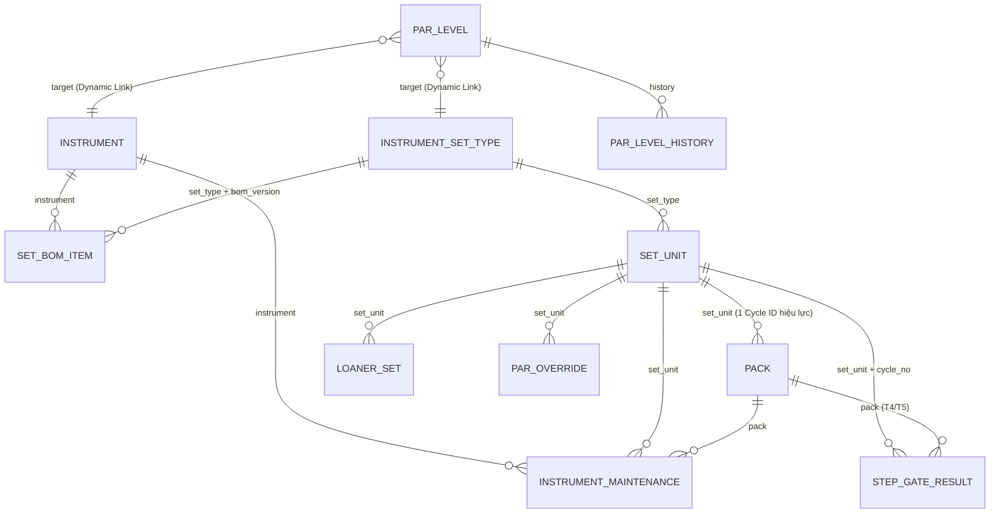

Chu trình tái xử lý: Receipt → Wash Batch → Assembly → Pack → Load → Putaway → Issue → Usage → Recall:

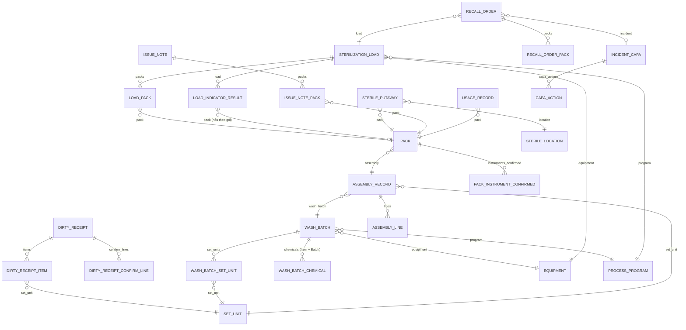

Thiết bị / Chương trình / Test / Bảo trì và tiêu hao – chi phí (ERPNext Stock):

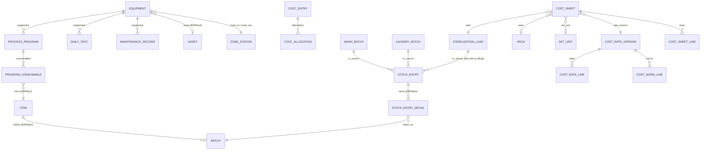

Đồ vải (M3) và Chất thải (M10) — cùng pattern thu gom/cân/đối chiếu:

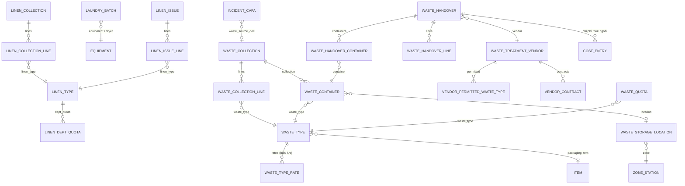

Nhân sự, trạm, phiên, audit, offline, thông báo, in:

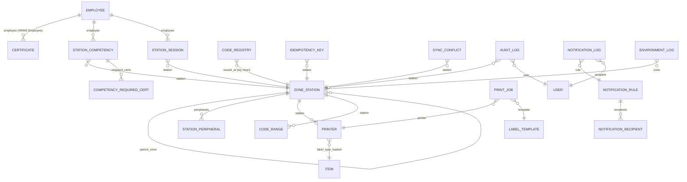

#### 5.3.3 Quy ước mã và naming series

| Đối tượng | Naming | Ghi chú |
| --- | --- | --- |
| Set Unit | `set_id` = chuỗi GIAI (AI 8004) do `core.gs1` sinh từ tiền tố GS1 BV + mã loại bộ + số thứ tự; bộ mượn thêm cờ `is_loaner`, hiển thị `LN-`. **A-13 (G2, G3):** series riêng theo (tiền tố GS1, mã loại bộ), sổ `Code Registry` prefix `<prefix><type_code>`; 6 số cuối luôn là serial; GIAI **không có check digit** (AI 8004 chỉ có tiền tố + tham chiếu tài sản, CSET 82, ≤ 30 ký tự); hết dải 999 999 → lỗi "series đã hết", không cấp mã 7 số; tiền tố demo (dải `952`) bị chặn khi cấp/in trên site không phải dev/test | FR-M1-05, C-09 |
| Instrument (mã GIAI khắc laser, tùy chọn, A-06) | `<prefix>I-########` (8 chữ số, series riêng): tiền tố GS1 + `I-` + số; dấu `-` làm dạng này không bao giờ trùng Set ID `<prefix><mã loại bộ [A-Z0-9]{2,8}><6 số>`; `Code Registry` prefix `GI`, không cấp lại, dụng cụ Ngừng sử dụng → `Disabled`; chỉ cấp khi `TraceCore Settings.enable_instrument_giai = 1`; tiền tố demo (toàn dải GS1 `952`) chỉ cấp trên site dev/test, site khác → `GS1_PREFIX_NOT_CONFIGURED`; ngày/vị trí khắc ghi một lần, ghi lại cần lý do (I8, tạm) | FR-M1-02, FR-M1-02.1 |
| Phiên bản BOM (mã tham chiếu trên phiếu kiểm đếm, A-09, S8) | `BOM-<TYPE_CODE>-V<n>` (vd `BOM-KHAM01-V3`), `core.gs1.make_bom_code`; **không phải GS1**, không ghi `Code Registry` (không phải đối tượng được cấp, chỉ tham chiếu bất biến tới phiên bản); `parse_scan` trả `type = "bom"` | FR-M1-03.2, FR-M1-04 |
| Pack | `CY-.YY.MM.DD.-.####` (naming series); offline `CY-YYMMDD-T<tram>-####` từ Code Range; `barcode_payload` GS1 (01)(11)(17)(21) | FR-M2-07 |
| Wash Batch / Laundry Batch | `LR-.YY.MM.DD.-.##` / `LG-.YY.MM.DD.-.##` | FR-M2-03, FR-M3-03 |
| Sterilization Load | `ME-.YY.MM.DD.-.##` | FR-M2-09 |
| Employee / Equipment / Sterile Location & Waste Storage Location / Zone Station / Printer roll / Waste Container | `NV-.#####` / `TB-.####` / `KE-.####` / `TR-.###` / `CN-.#####` / `CT-.YY.MM.DD.-.#####` | FR-M9-07, FR-M10-01.5 |
| Par Level (A-11, S11) | `PAR-.#####` | FR-M8-01, FR-M8-02 |
| Par Override (A-18, Q10) | `GD-.YYYY.-.#####` | FR-M8-04 |
| Zone (khu, Zone Station không phải trạm) | `ZONE-.##`; 3 khu mặc định giữ `ZONE-DIRTY/CLEAN/STERILE` (A-03, E1, đã duyệt (người dùng xác nhận 21/10/2026)) | FR-M9-03 |
| Chứng từ khác | `<PREFIX>-.YYYY.-.#####` (RC- Receipt, AS- Assembly, IS- Issue, US- Usage, TH- Recall, NC- Incident, TG- Waste Collection, BG- Waste Handover) | OTH-LEG-002 |

---
## 6. Runtime View

Mỗi kịch bản là hiện thực kỹ thuật của một UC trong `docs/use-cases.md`. Quy ước: `Kiosk` = Frappe Page trạm (hoặc PDA PWA); `RPC` = whitelisted method `tracecore.v1.*` chạy trong Frappe web; `Hook` = `doc_events`/controller method; `Agent` = Station Agent.

### 6.1 UC-05 Tiếp nhận đồ bẩn (quét thẻ + nhiều bộ nối tiếp)

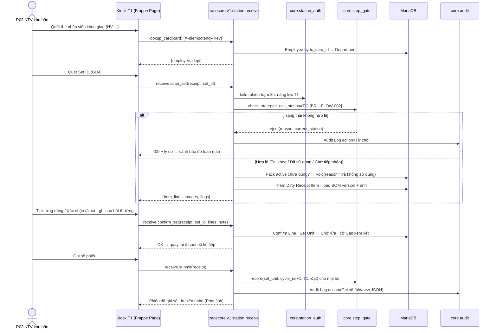

Luồng ngoại lệ E3 (mất mạng) đi theo §6.5: mọi lời gọi `receive.*` được xếp vào IndexedDB và phát lại.

### 6.2 UC-06 / UC-09 Nạp máy → mã mẻ tự sinh → dỡ máy (agent hoặc nhập tay có xác nhận)

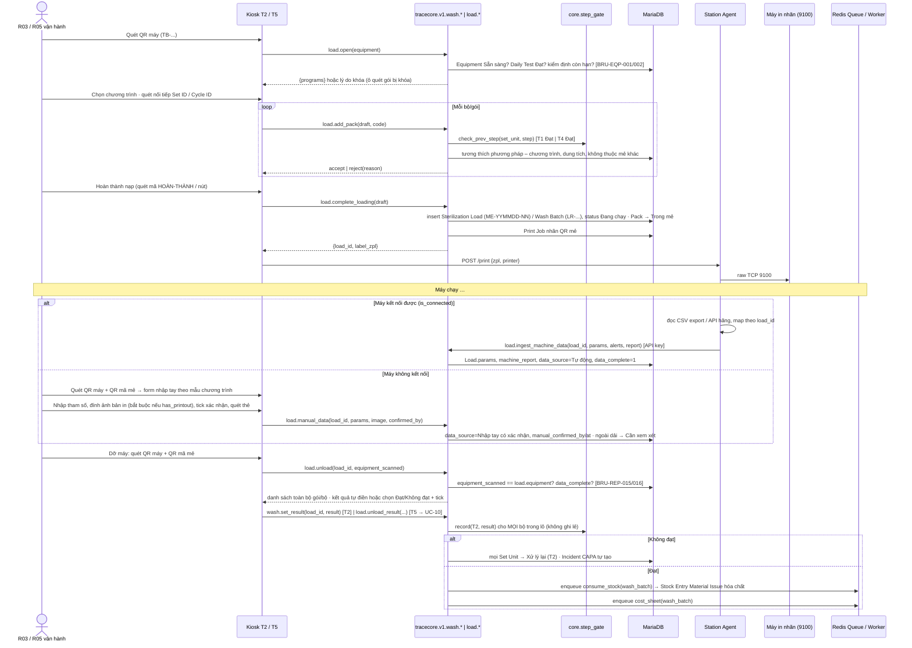

### 6.3 UC-08 Đóng gói → Cycle ID + in nhãn theo phương pháp

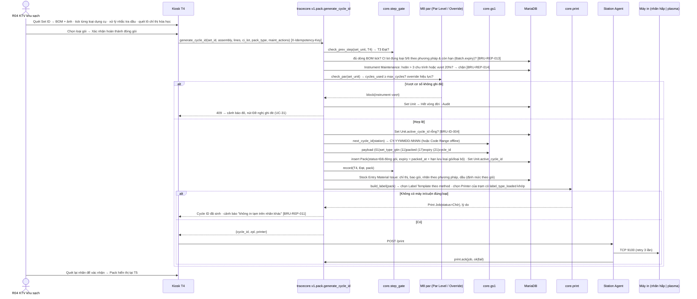

In lại trong 10 phút: `pack.reprint_label(cycle_id, reason)` → Print Job mới, `label_print_count++` (FR-M2-08.5); quá 10 phút → `pack.void` + sinh mới.

> **Amendment A-02 (2026-10-20):** sơ đồ trên ở mức khái quát. Công thức hạn dùng, ngưỡng chặn bảo dưỡng (thay cho "hoãn > 3 chu trình hoặc vượt 20 %"), thứ tự kiểm và hook M1/M8 → M2 xem ghi chú M1/M2 ở §5.3.1; mã HTTP của các từ chối ("409" trong sơ đồ là loại xung đột trạng thái) xem bảng ở ADR-003.

### 6.4 UC-10 Giải phóng mẻ → cổng 5 bước → tiêu hao M6 → chi phí M7 → bộ đếm M8

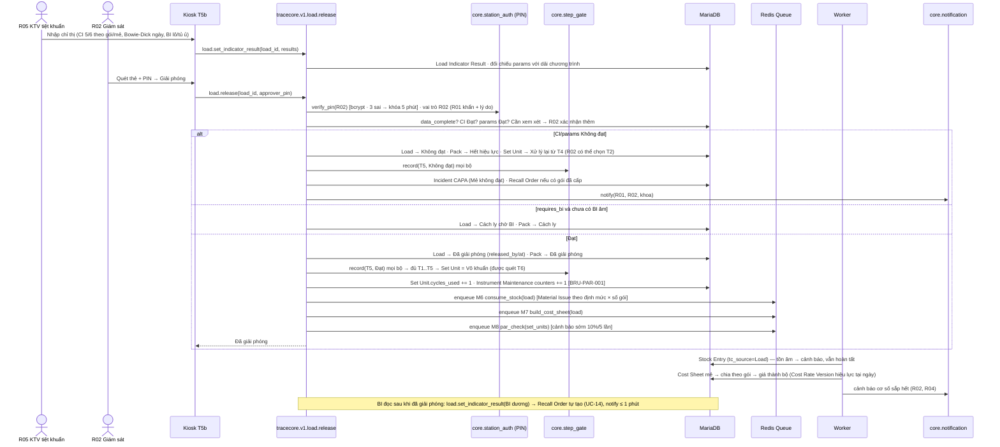

### 6.5 UC-13 Quét sử dụng trên PDA offline → sync idempotent

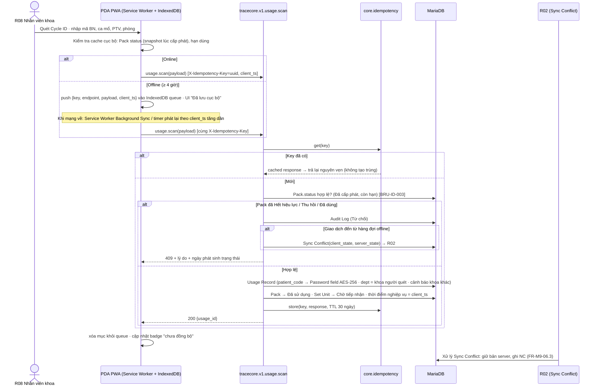

Cùng cơ chế cho Cycle ID offline tại T4: PWA/kiosk lấy `Code Range` (ví dụ 200 mã/trạm/ngày) khi online; khi offline sinh `CY-YYMMDD-T04-NNNN` từ dải; server xác nhận dải khi sync, không cấp lại.

### 6.6 UC-14 Thu hồi

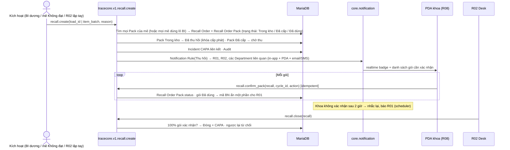

### 6.7 UC-31 Ghi đè cơ số

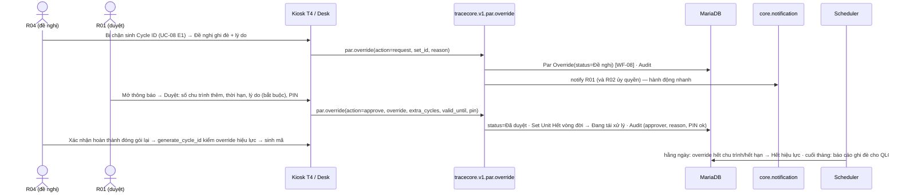

### 6.8 UC-36 Bàn giao chất thải cho đơn vị xử lý

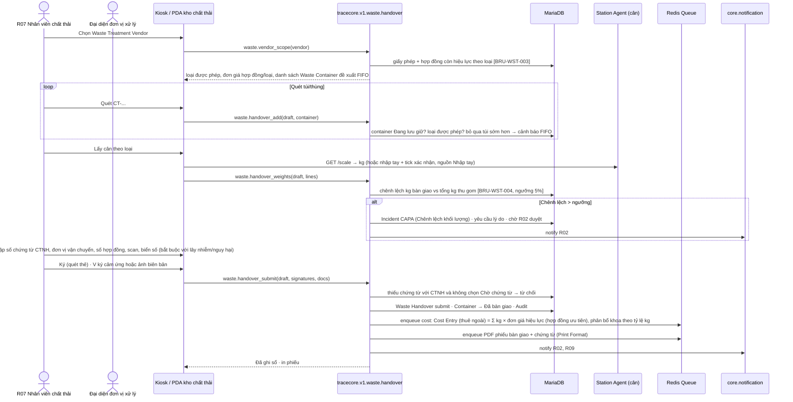

---
## 7. Deployment View

### 7.1 Topology production on-prem tại bệnh viện

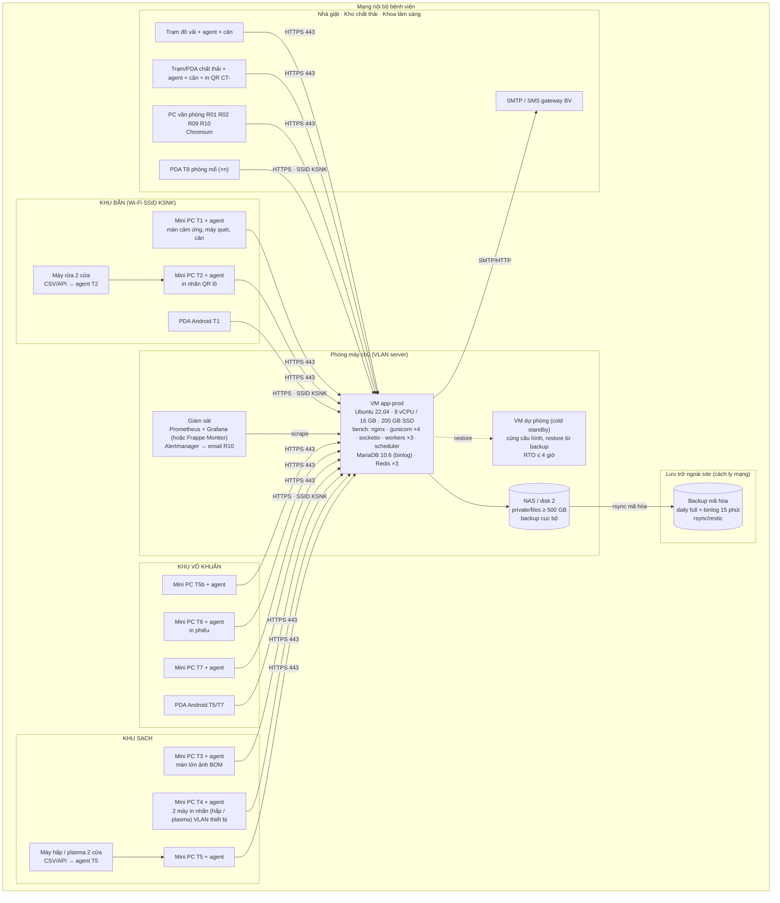

| Thành phần | Thông số | Ghi chú |
| --- | --- | --- |
| VM app-prod | Ubuntu 22.04, 8 vCPU/16 GB, 200 GB SSD hệ thống; MariaDB `innodb_buffer_pool_size` 6 GB; gunicorn 4 worker (2×vCPU/4); RQ worker short/default/long | ≤ 40 trạm, 25–40 user đồng thời (NFR-SCAL-01); nâng VM lên 16 vCPU/32 GB cho 80 user, không đổi kiến trúc |
| Lưu file | NAS/disk riêng mount `sites/<site>/private/files`, ≥ 500 GB (NFR-SCAL-02) | ảnh thực tế ~800–1.500 dụng cụ × 1 ảnh + 300 bộ × 3 ảnh + bản in máy 600 mẻ/tháng × ~300 KB ≈ 2 GB/năm + scan chứng từ |
| CSDL | 11 triệu Pack + 50 triệu Audit Log/10 năm ≈ 60–80 GB; partition `Audit Log` theo năm (MariaDB RANGE partition trên `timestamp`) từ năm 3 | NFR-PERF-04 |
| Mạng | Wi-Fi phủ 3 khu, SSID KSNK riêng cho PDA; máy in VLAN thiết bị; kiosk khóa OS; PDA MDM | EI-COM-002 |
| Giám sát | Prometheus node_exporter + mysqld_exporter + redis_exporter + endpoint `/api/method/tracecore.v1.health` + agent `/health`; Grafana; cảnh báo ≤ 5 phút | NFR-OBS-01 |
| Dự phòng | VM cold standby; quy trình restore: `bench restore` + binlog replay → đổi DNS nội bộ | NFR-BACKUP-01 |

### 7.2 Deployed environment set và thứ tự promotion

| Môi trường | Nơi chạy | Mục đích | Dữ liệu | Gate để promote |
| --- | --- | --- | --- | --- |
| **dev** | Bench `tracecore-dev` trên máy chủ dev Miyano (site `tracecore-dev.local`), mỗi dev có thể dùng bench cục bộ/frappe_docker | Phát triển, chạy test, review PR | Dữ liệu demo seed (fixtures) | PR merge vào `main` sau CI xanh (unit/integration + coverage ≥ 70% changed-code) |
| **staging** | Bench `tracecore-staging` riêng trên máy chủ dev Miyano, site `tracecore-staging` | UAT nghiệp vụ với R01/R02, E2E Playwright, load test JMeter/Locust (NFR-PERF-01/02), thử bản vá Frappe/ERPNext (NFR-SEC-05), thử restore | Bản sao production ẩn danh (mã BN đã mã hóa, không giải mã) hoặc dữ liệu UAT | Tag release `vX.Y.Z` + biên bản UAT; checklist NFR; diễn tập mất mạng |
| **production** | Bench on-prem tại bệnh viện | Vận hành 24/7 | Dữ liệu thật | Cửa sổ bảo trì ≤ 4 giờ/tháng ngoài 06:00–20:00, báo trước ≥ 24 giờ (NFR-AVAIL-03); rollback = `bench restore` backup trước deploy |

Promotion: `dev` → `staging` → `production`, cùng artefact là tag Git của `mvl26/tracecore` (+ pinned commit của `frappe`, `erpnext`, `hrms` version-15). Deploy production bằng script `bench update --pull --patch --build` theo tag hoặc image frappe_docker tự build; cấu hình môi trường (`site_config.json`, secrets) nằm ngoài repo (chi tiết cơ chế để bước initial-deployment).

---

## 8. Cross-cutting Concepts

### 8.1 Security

| Khía cạnh | Thiết kế | SRS |
| --- | --- | --- |
| Xác thực web | Frappe User + mật khẩu ≥ 10 ký tự, hết hạn 90 ngày (System Settings `password_expiry`), khóa sau 5 lần sai (`allow_consecutive_login_attempts`), 2FA bắt buộc cho Role R01/R02/R09/R10 (Frappe Two Factor Auth, OTP app/email) | NFR-SEC-01, FR-M9-05.4, FR-M9-09 |
| Xác thực trạm | Quét thẻ `NV-` → `tracecore.v1.station.login`: Employee.tc_card_id → Station Competency còn hiệu lực cho trạm + Certificate bắt buộc còn hạn → tạo `Station Session`; opaque bearer token chỉ trả một lần, DB chỉ lưu SHA-256; tuyệt đối 8 giờ, idle 10 phút ở client và server; một thẻ – một phiên (khóa hàng, đóng phiên cũ, audit). Mỗi RPC xác thực token rồi mới đặt effective user từ Employee/User, không nhận danh tính do client tự khai | FR-M4-03, FR-M9-08, EI-UI-005; A-08 |
| PIN phê duyệt | PIN 6 số băm bcrypt lưu trong Employee (`tc_pin_hash`, Password field); verify server-side; sai 3 lần khóa 5 phút (Redis key TTL); dùng cho giải phóng mẻ, xác nhận thiếu, ghi đè, mở khóa máy, tiếp nhận cưỡng bức | FR-M2-06.3, FR-M2-11.4, #13 §2.2 |
| RBAC | 10 Role Frappe `TC R01` … `TC R10`; Role Permission theo ma trận #13 xuất từ `permission_matrix.csv` thành fixture `custom_docperm.json`; test 100% ô chạy CI. Ma trận là baseline; amendment feature mới hơn và audit bất biến thắng khi xung đột; DocType chưa tồn tại giữ trong matrix nhưng chưa sinh DocPerm | NFR-SEC-07; A-08 |
| Ràng buộc khu/trạm | RPC `tracecore.v1.*` kiểm `Station Session.station.zone` khớp chức năng; thao tác ngược chiều bị chặn (BRU-FLOW-001/002) | FR-M2-00.1 |
| Department permission | R08 là website/system user có `User Permission` trên `Department`; Pack/Issue Note/Usage Record/Linen/Waste Collection có trường `dept` tham gia permission query (`permission_query_conditions` hook) | NFR-SEC-07, FR-M10-07.3 |
| Mã bệnh nhân | `Usage Record.patient_code` kiểu **Password** (Frappe mã hóa Fernet/AES với `encryption_key` trong `site_config.json`); hiển thị ẩn 4 ký tự giữa qua trường tính toán `patient_code_masked`; RPC `usage.reveal_patient_code(usage, reason)` chỉ R01/R02, ghi Audit; không xuất rõ ra Excel; không ghi vào log | NFR-SEC-02, OTH-PRIV-001 |
| Audit | §8.2 + ADR-008 | NFR-SEC-03 |
| Truyền tải | HTTPS TLS 1.2+ nội bộ (CA BV hoặc tự ký cài trên kiosk/PDA qua MDM); HSTS; Nginx rate limit 20 req/s/IP trạm | EI-COM-001 |
| Agent | API Key/Secret của user kỹ thuật `agent-<station>@local` (Role `TC Agent` chỉ gọi được RPC `print.*`, `scale.*`, `load.ingest_machine_data`, `health`); xoay 90 ngày bằng scheduler + cảnh báo R10; key lưu trong file cấu hình agent được OS ACL bảo vệ | EI-COM-003, NFR-SEC-06 |
| Secrets | `site_config.json` (db password, encryption_key, SMTP, SMS token) ngoài repo, quyền 600; không log; quy trình xoay `encryption_key` dùng `bench --site <site> set-config` + script re-encrypt có R10 phê duyệt | NFR-SEC-06 |
| Vulnerability | Bandit + pip-audit + npm audit trong CI; pentest nội bộ ASVS L2 trước go-live; vá Frappe/ERPNext ≤ 30 ngày qua staging | NFR-SEC-04/05 |
| Vận hành tài khoản | Employee Nghỉ việc → hook vô hiệu User + thẻ + đóng Station Session trong ngày; báo cáo rà soát quyền hằng quý (Script Report); ≥ 5 từ chối thẻ/15 phút hoặc đăng nhập ngoài ca → Notification Rule → R10 | NFR-SEC-08, FR-M9-09.2 |

### 8.2 Data

| Khía cạnh | Thiết kế |
| --- | --- |
| Store | MariaDB 10.6 một site DB (InnoDB, utf8mb4, binlog ROW, `expire_logs_days=14`); Redis cache/queue/socketio; file tại `private/files` (ảnh, bản in máy, scan chứng từ, PDF xuất) |
| System of record | DocType `tracecore` + ERPNext Stock/Asset; mọi chứng từ `is_submittable`: Draft(0) → Submitted(1) → Cancelled(2); không `delete` cho DocType nghiệp vụ (permission `delete=0` mọi vai trò trừ R10 trên bản ghi chưa có giao dịch, FR-M9-16) |
| Audit & lịch sử | `Audit Log` append-only (ADR-008) + Frappe `Version` (`track_changes=1`) cho diff trường; `Par Level History`, `Cost Rate Version`, `Set BOM Item` theo phiên bản (OTH-RET-002) |
| Naming | Naming series §5.3.3; `Set Unit.set_id` và `Pack.cycle_id` là `name` (PK) → index tự nhiên cho quét; `Code Registry` chặn cấp lại |
| GS1 | `core.gs1`: GIAI = `8004` + GS1 Company Prefix BV + asset ref (loại bộ + số); Cycle payload `(01)GTIN-14 loại bộ(11)YYMMDD(17)YYMMDD(21)CY...`; FNC1 separator; encoder DataMatrix `pylibdmtx` → PNG base64 nhúng Print Format; ZPL `^BXN,…` / TSPL `DMATRIX` khi in trực tiếp (máy in tự mã hóa) — cả hai đường đều từ cùng payload server (ADR-004) |
| Consistency | Giao dịch Frappe (một request = một DB transaction) cho: sinh Cycle ID + Pack + Step Gate + active_cycle_id (khóa hàng `SELECT … FOR UPDATE` trên Set Unit); release mẻ cập nhật Load/Pack/Gate/bộ đếm **trong một transaction**, còn tiêu hao M6, Cost Sheet M7, cảnh báo M8 chạy **async qua RQ** (eventual, idempotent theo `tc_source`), vì không ảnh hưởng an toàn người bệnh và tránh vượt 1 s |
| Idempotency | Bảng `Idempotency Key` (unique key); mọi RPC trạm bọc decorator `@idempotent`; TTL 30 ngày; cùng key trả cùng response |
| Migrations | Frappe patches (`patches.txt`) + `bench migrate`; fixtures cho Role, Custom Field, Property Setter, Workflow, Notification Rule mặc định, Label Template mẫu |
| Retention | Không purge DocType nghiệp vụ/Audit Log trong 10 năm; `Idempotency Key`, `Error Log`, `Activity Log`, `Email Queue` purge theo lịch (30/90/365 ngày); partition `Audit Log` theo năm; `Archive Export` tạo gói PDF+CSV có checksum SHA-256 (FR-M9-12) |
| Backup/DR | `bench backup --with-files` 02:00 hằng ngày (dump nén + files) → NAS → rsync/restic mã hóa (age/gpg) ngoài site; binlog flush 15 phút đồng bộ ra NAS/offsite → **RPO ≤ 15 phút**; restore drill hằng quý trên staging đo RTO (mục tiêu ≤ 4 giờ: restore dump ~30 phút + binlog replay + kiểm tra 1 mẻ ngẫu nhiên có đủ ảnh — NFR-BACKUP-02) |
| Localization | Hệ thống lưu UTC (Frappe lưu theo site time zone `Asia/Ho_Chi_Minh` — chấp nhận; `client_ts` của trạm gửi ISO 8601 có offset); định dạng `dd-mm-yyyy`, số `#.###,##`, VND không lẻ trong System Settings; `translations/vi.csv` 0 chuỗi chưa dịch (NFR-USAB-02, NFR-L10N-01) |

### 8.3 Resilience và xử lý lỗi

| Tình huống | Hành vi | SRS |
| --- | --- | --- |
| Mất mạng trạm/PDA | Service Worker precache shell + danh mục cần thiết (BOM/ảnh thu nhỏ của bộ đang xử lý, Pack đã cấp cho khoa, Code Range); mọi RPC ghi xếp vào IndexedDB `outbox` (key, endpoint, payload, client_ts); UI hiển thị trạng thái "Offline – n giao dịch chờ" (FR-M9-14); phát lại tuần tự theo `client_ts` khi online, dừng ở lỗi 5xx, bỏ qua và ghi `Sync Conflict` ở 409; ≥ 4 giờ bằng dung lượng IndexedDB (vài MB) | NFR-AVAIL-02, FR-M9-06 |
| Cycle ID offline | `Code Range` 200 mã/trạm nạp trước mỗi ca; sinh `CY-YYMMDD-T04-NNNN`; server chấp nhận nếu trong dải chưa dùng, từ chối trùng | FR-M2-07.11, FR-M9-06.2 |
| Xung đột trạng thái khi sync | Giữ bản server, tạo `Sync Conflict` + Incident CAPA, R02 xử lý trên Desk | FR-M9-06.3 |
| Máy in lỗi / không có cuộn đúng loại | `Print Job` trạng thái Chờ, agent retry 3 lần (backoff 5/15/60 s), cho in lại sau; không cấp mã mới; không in tạm trên nhãn khác | EI-HW-008, FR-M2-08.8 |
| Agent mất kết nối / cân không phản hồi | Kiosk gọi `http://localhost:8765` timeout 2 s → chuyển nhập tay kg có tick xác nhận, `weight_source=Nhập tay`; dữ liệu máy → nhập tay có xác nhận (ADR-007) | NFR-AVAIL-04, FR-M10-02.1, FR-M2-10.4 |
| Máy rửa/tiệt khuẩn kết nối được nhưng mất dữ liệu | `load.manual_data` kèm lý do; mẻ Cần xem xét | FR-M2-10.4 |
| Redis/worker down | RPC đồng bộ vẫn hoàn tất (an toàn người bệnh); job tiêu hao/cost xếp lại khi worker lên (RQ persist trong Redis AOF); scheduler `enqueue_after_commit` | NFR-AVAIL-04 |
| MariaDB down | Hệ thống dừng; trạm sang offline ≥ 4 giờ; restore standby theo DR | NFR-BACKUP-01 |
| Email/SMS thất bại | Email Queue retry Frappe; SMS adapter retry 3 lần qua scheduler; thông báo in-app luôn giữ; lỗi → R10 | FR-M9-10.1 |
| Timeouts | RPC trạm 5 s; agent print 10 s; agent machine fetch 30 s; worker long ≤ 15 phút (PDF sổ tháng) |  |
| Degradation có chủ đích | Ảnh thực tế tải lazy (thumbnail 320 px cache SW) để không chặn quét; dashboard làm mới 60 s qua socketio, fallback polling | NFR-PERF-01, FR-M9-01.1 |

### 8.4 Observability

| Lớp | Công cụ | Ngưỡng |
| --- | --- | --- |
| Metrics | Prometheus: node/mysqld/redis exporters; `tracecore.v1.health` trả queue depth RQ, số `Idempotency Key`/`Sync Conflict` 24 h, số Print Job chờ, số trạm online (Station Session), tuổi hàng đợi offline báo từ kiosk; agent `/health` (cân, máy in, máy kết nối) scrape qua server proxy | Cảnh báo ≤ 5 phút khi service down, RQ depth > 500, Print Job chờ > 10 phút, offline chưa sync > 4 giờ (NFR-OBS-01) |
| Logs | Frappe `logs/*.log` cấu hình JSON formatter (`frappe.utils.logger` + `python-json-logger`), trường: request_id, user, station, doctype/name, load_id; filter xóa `patient_code`; Nginx access log; agent log JSON xoay 30 ngày; lưu ≥ 12 tháng (logrotate + rsync) | NFR-OBS-02 |
| Business audit | `Audit Log` (không phải log hệ thống) — truy vấn Desk/Report; Frappe Monitor (`monitor=1`) cho latency theo endpoint | NFR-SEC-03 |
| Uptime | Blackbox exporter ping `/api/method/ping` mỗi 30 s; báo cáo uptime tháng ≥ 99,5 % | NFR-AVAIL-01 |
| Tracing | Không distributed tracing (monolith); `frappe.monitor` + request_id xuyên suốt agent → server đủ cho phân tích |  |

### 8.5 Performance và scaling

- **Đường quét ≤ 1 s P95**: RPC trạm chỉ đọc theo PK (`Set Unit.name`, `Pack.name`), `Step Gate Result` có index composite (`set_unit`, `cycle_no`, `step`); `Station Session` và `Equipment` trạng thái cache Redis TTL 60 s; BOM + URL ảnh cache theo (`set_type`, `bom_version`) TTL 10 phút (A-09, S11: khóa `tc_bom:<set_type>:<version>`, TTL 600 s; ngày hiệu lực của các phiên bản (để tính `status` và phiên bản hiệu lực) cache ở khóa `tc_bom:<set_type>:dates` cùng TTL; nội dung một phiên bản bất biến nhưng tạo loại bộ hoặc lưu phiên bản mới **có** xóa mọi khóa của loại bộ, kể cả `dates`, vì danh sách phiên bản và phiên bản hiệu lực đổi; ngoài ra xóa khi đổi ảnh khay, tên hoặc phương pháp loại bộ, hoặc `Instrument.on_update` đổi tên/ảnh; scheduler kích hoạt phiên bản đã lên lịch không cần xóa vì `status` tính từ `dates` theo ngày hôm nay, ngoài cache và ngoài `etag`; `if_none_match` = `etag` hiện tại → `{ok, not_modified: true, etag, set_type, bom_version, status}`); không `frappe.get_doc` nặng trong hook — dùng `frappe.db.get_value`/`set_value` cho các cập nhật phụ; audit ghi đồng bộ bằng `frappe.db.sql insert` (nhẹ) nhưng **không** trong path quét lặp (receive.scan_set) – audit tổng hợp khi submit.
- **Việc nặng async**: Stock Entry tiêu hao, Cost Sheet, PDF, import, export, email → RQ `default`/`long`.
- **Tải**: 3.000 Cycle ID/ngày ≈ 0,1 req/s trung bình; cao điểm đầu ca ~5–10 req/s toàn hệ thống — 4 gunicorn worker đủ; 40 kiosk realtime qua socketio.
- **Dữ liệu 10 năm**: partition `Audit Log` theo năm; archive `Pack`/`Load` không cần (11 triệu dòng InnoDB với index PK là ổn); truy xuất hai chiều dùng Query Report có index (`Usage Record.pack`, `Pack.set_unit`, `Pack.load`, `Load Pack.pack`) → ≤ 10 s (NFR-PERF-04).
- **Scale lên**: tăng vCPU/RAM, thêm gunicorn/worker (`bench setup supervisor`), tách MariaDB sang VM riêng — không đổi kiến trúc (NFR-SCAL-01).

### 8.6 Testing

**Chiến lược (pyramid, traced NFR-MAINT-02, NFR-SEC-07, NFR-COMP-01):**

| Tầng | Phạm vi | Framework / công cụ | Nơi chạy |
| --- | --- | --- | --- |
| Unit (nhiều) | `core.gs1` (mã GIAI/(01)(11)(17)(21), check digit), `core.step_gate` (ma trận bước trước), tính hạn dùng, cơ số, định mức tiêu hao, chi phí, FIFO/FEFO, chênh lệch kg; 100 % BRU có test | `FrappeTestCase` (`frappe.tests.utils`), `bench --site test_site run-tests --app tracecore` (pytest-style, có thể chạy qua `pytest` với plugin frappe) | CI mỗi PR |
| Integration (vừa) | Hook/Workflow end-to-end trong DB test: tiếp nhận → lô rửa → đóng gói → mẻ → giải phóng → tiêu hao Stock Entry → Cost Sheet; permission ma trận 10 vai trò × DocType (sinh test từ #13 §2.1, 100 % ô — NFR-SEC-07); idempotency; Department permission; audit append-only | `FrappeTestCase` + fixtures demo | CI mỗi PR |
| Contract/API | RPC `tracecore.v1.*` schema request/response (JSON schema từ #11), mã lỗi, `X-Idempotency-Key` | `FrappeTestCase` + `frappe.client` / `requests` lên site test | CI |
| E2E (mỏng) | **Luồng tới hạn**: UC-05 tiếp nhận; UC-06 lô rửa nạp/dỡ; UC-08 đóng gói + Cycle ID (+ chặn cơ số UC-31); UC-09 nạp mẻ; UC-10 giải phóng (Đạt / Không đạt → thu hồi UC-14); UC-13 quét sử dụng online + offline replay | **Playwright (Python)** chạy Chromium kích cỡ kiosk 1366×768 và PDA 412×915 với network offline emulation; không dùng Cypress | CI nightly + trước release trên staging |
| Phi chức năng | Load test NFR-PERF-01/02 (Locust 40 trạm, 3.000 scan/ngày nén trong 1 giờ); diễn tập offline 4 giờ; restore drill; pentest ASVS L2; kiểm nhãn sau hấp/plasma tại UAT (NFR-COMP-02) | Locust; checklist UAT (#14) | Staging / UAT |

**Coverage stance:** *enforced* — ≥ 70 % line coverage trên **changed code** của app `tracecore` cho mỗi PR (`coverage.py` + `diff-cover` so với `main`), kèm report toàn repo (mục tiêu dần ≥ 70 % whole-repo, NFR-MAINT-02 `[đề xuất]`); 100 % BRU có ≥ 1 test gắn tag `# BRU-XXX-NNN`. Caveat: ngưỡng % đo thực thi, không đo chất lượng assertion; tiêu chí nghiệm thu theo FR vẫn là thước đo chính (acceptance-verification).

**CI:** GitHub Actions trên `mvl26/tracecore`: job `test` dùng container `frappe/bench` (hoặc frappe_docker `development` image) + services MariaDB 10.6, Redis 7 → `bench init --frappe-branch version-15`, `get-app erpnext/hrms version-15`, `get-app .`, `new-site test_site`, `run-tests --coverage`; job `lint` (ruff, eslint, bandit, pip-audit); job `e2e` (nightly, Playwright lên staging); job `build` tạo tag/release notes. Chi tiết ADR-012.

---
## 9. Architecture Decisions

Mọi ADR Status **Accepted** theo quyết định chủ đầu tư 2026-10-17 (`.architecture-inputs.md`) trừ khi ghi Proposed. "Requirements addressed" trích ID thật từ `docs/srs.md` / `docs/use-cases.md`; FR được liệt kê ở đây là FR mà ADR **thiết kế trực tiếp** (dùng cho RTM Design ref).

### ADR-001: Frappe v15 modular monolith — một site, app `tracecore` cạnh erpnext/hrms

**Status:** Accepted
**Date:** 2026-10-17
**Requirements addressed:** NFR-SCAL-01, NFR-PERF-03, NFR-MAINT-01, NFR-MAINT-03, NFR-PORT-01, NFR-AVAIL-01; constraint C-01, C-06; FR-M9-03, FR-M9-13, FR-M9-16

**Context**
SRS §2.5 và chủ đầu tư ấn định Frappe v15/ERPNext v15; đội Dev Miyano mạnh Frappe; 10 phân hệ liên kết chặt qua dữ liệu (Set Unit, Pack, Load dùng chung bởi M2/M6/M7/M8); tải khiêm tốn (40 trạm, 0,1–10 req/s). Câu hỏi là một app hay nhiều app/site, và có tách service nào không. BA #12 đặt tên app `cssd`, RPC `cssd.v1.*`; sản phẩm đã đổi tên TraceCore (CHG-030).

**Decision**
Một Frappe site, một app `tracecore` gồm 11 module Frappe (`core` + M1–M10) cùng `erpnext`, `hrms`; khuyến nghị cài `insights`, `print_designer`. Đổi tên: app `cssd` → `tracecore`, namespace RPC `cssd.v1.*` → **`tracecore.v1.*`** (đường dẫn `/api/method/tracecore.v1.<domain>.<action>`), giữ nguyên 40 endpoint #11 về chức năng. Ranh giới module: module nghiệp vụ chỉ phụ thuộc `core` và ERPNext; không import chéo giữa M1–M10 ngoài Link field và `doc_events`. Không lên v16.

**Options considered**
- **Modular monolith trên 1 site (chọn)** — một deploy, một transaction scope cho giải phóng mẻ, permission/audit thống nhất. Con: scale as a unit (đủ cho NFR-SCAL-01).
- **Nhiều app Frappe (tracecore_core, tracecore_waste…)** — tách release M10. Con: phụ thuộc vòng Link field, patch phức tạp, đội nhỏ. Thua vì không có nhu cầu release độc lập.
- **Service riêng cho trạm (FastAPI) + Frappe backoffice** — tối ưu ≤ 1 s. Con: hai codebase, hai permission model, idempotency trùng lặp, vi phạm C-01. Thua.

**Consequences**
Đơn giản vận hành (1 bench), truy vết FR → module rõ. Phải giữ kỷ luật module (lint import, review). Chi phí: toàn hệ thống dừng khi MariaDB dừng (bù bằng offline ADR-003 + DR ADR-011). Mọi tài liệu BA tham chiếu `cssd.*` phải đọc là `tracecore.*`. Revisit nếu v15 EOL ép nâng cấp (§11 R-03).

### ADR-002: Frappe UI cho trạm kiosk, PDA và cổng khoa — không SPA riêng

**Status:** Accepted
**Date:** 2026-10-17
**Requirements addressed:** EI-UI-001, EI-UI-002, EI-UI-003, EI-UI-004, EI-UI-007, NFR-USAB-01, NFR-USAB-02, NFR-L10N-01, NFR-COMPAT-01, NFR-ACC-01, NFR-MAINT-01; FR-M9-14, FR-M9-15, FR-M4-01.1; constraint C-02

**Context**
BA #12 §5.4 để mở "Frappe UI (Vue) hoặc web app riêng". Yêu cầu trạm: ô quét luôn focus, ≤ 3 chạm, nút ≥ 48 px, cảnh báo đỏ toàn màn, offline; PDA Android 12+ PWA. Chủ đầu tư quyết định không xây SPA Vue riêng để giảm hai hệ build, hai lớp auth và tận dụng permission/translation của Frappe.

**Decision**
- **Kiosk**: Frappe `Page` `station` (`tracecore/tracecore/page/station/station.js|html|css`) full-screen, router theo trạm (T1…T8, linen, waste), dùng `frappe.ui` controls tối thiểu + CSS riêng cho nút lớn/độ tương phản; Chromium kiosk mode mở `https://<site>/app/station?station=TR-001`.
- **PDA**: cùng Page; app `tracecore` phục vụ `manifest.json` và `sw.js` qua `website_route_rules`/`hooks.py` (`app_include_js`, `web_include_js`); Service Worker precache shell `/app/station`, assets, danh mục tối thiểu; IndexedDB outbox (ADR-003). Cài lên màn hình chính Android (Add to Home Screen) bằng MDM.
- **Cổng khoa**: Portal Page + Web Form (Frappe Website) cho R08.
- **Desk**: Workspace M1–M10, Form/List mặc định + Client Script.
Không dùng Vue SPA riêng (`frappe-ui`) và không dùng Frappe Builder cho trạm.

**Options considered**
- **Frappe Page + PWA (chọn)** — một codebase, một auth/permission/translation, không build pipeline riêng. Con: Desk shell nặng (~2–3 MB) tải lần đầu; kiểm soát UI khó hơn SPA; Service Worker phải né cache của Desk.
- **Vue 3 + frappe-ui SPA trong `tracecore/public`** — UX tốt nhất, offline dễ. Con: build riêng, auth token riêng, permission phía client trùng lặp; trái quyết định C-02.
- **Native Android cho PDA** — quét/offline tốt. Con: hai nền tảng, đội không có Android dev.

**Consequences**
Tiết kiệm công sức, dễ bảo trì bởi Frappe dev. Phải đo thời gian tải Desk shell trên mini PC/PDA (rủi ro §11 R-07) và tối ưu (`frappe.boot` giảm, `--production` build). Offline queue hiện thực trong JS của Page (không framework), test bằng Playwright offline emulation. Revisit sang SPA nếu đo được Desk shell > 3 s trên PDA hoặc Service Worker xung đột không khắc phục được.

### ADR-003: Offline-first PDA/kiosk với IndexedDB queue, X-Idempotency-Key và dải mã cấp trước

**Status:** Accepted
**Date:** 2026-10-17
**Requirements addressed:** NFR-AVAIL-02, NFR-AVAIL-03, NFR-AVAIL-04, NFR-L10N-01, EI-COM-004, EI-SW-004; FR-M9-06, FR-M2-07.11, FR-M1-06.4; UC-05 E3, UC-08 E3, UC-13 E3, UC-34 A3

**Context**
Wi-Fi khu bẩn/phòng mổ không ổn định; NFR-AVAIL-02 yêu cầu ≥ 4 giờ offline, không mất giao dịch, sự kiện phát lại theo thứ tự thời gian, xung đột tới R02. Cycle ID phải sinh được khi T4 mất mạng (FR-M2-07.11). Frappe không có idempotency sẵn.

**Decision**
- Client: outbox IndexedDB `{key: uuid, endpoint, payload, client_ts, station, attempts}`; mọi RPC ghi của trạm đi qua `tcApi.call()` → online: gửi ngay; offline/thất bại mạng: xếp hàng. Phát lại tuần tự theo `client_ts` (Background Sync hoặc timer 15 s), dừng ở lỗi mạng/5xx, tiếp tục ở 4xx (ghi conflict).
- Server: DocType `Idempotency Key` (unique `key`), decorator `@tracecore.core.idempotency.idempotent` trên mọi RPC trạm: trùng key → trả response đã lưu; hoàn thành → lưu response (TTL 30 ngày). Thời điểm nghiệp vụ = `client_ts` (lưu UTC), thời điểm server ghi riêng (`synced_at`). Hook `Set Unit` xếp lại sự kiện theo `client_ts` trước khi cập nhật vòng đời (FR-M1-06.4).
- Dải mã: `Code Range` cấp theo trạm (prefix `CY-YYMMDD-T04-`, 200 mã/ca; `CT-` cho chất thải); client lấy khi online, dùng khi offline; server kiểm dải khi sync.
- Xung đột: 409 từ RPC trong khi replay → `Sync Conflict` + Incident CAPA; giữ bản server (FR-M9-06.3); R02 xử lý trên Desk.
- Dữ liệu đọc offline: Service Worker cache danh mục cần cho trạm (BOM + thumbnail của Set Unit đang ở khu, Pack đã cấp cho khoa của PDA, Equipment/Program) làm mới mỗi 10 phút khi online.

**Amendment A-02 (2026-10-20) — mã HTTP của từ chối nghiệp vụ (D3; dev lead duyệt 2026-10-20, tạm — trình CĐT 20/10/2026).** Bảng dưới là **nơi duy nhất** định nghĩa ánh xạ `error.code` → mã HTTP cho RPC `tracecore.v1.*` (từ FEAT-018); hiện thực ở `core.errors.HTTP_STATUS`, các tài liệu khác chỉ trỏ về đây. Từ chối nghiệp vụ là `core.errors.Block`, body giữ dạng `{"ok": false, "error": {code, title, reason, action, http_status, items?, redo_step?}}`, không dùng một mã chung cho mọi lỗi.

| HTTP | Ý nghĩa | `error.code` |
| --- | --- | --- |
| 400 | Sai định dạng yêu cầu (thiếu tham số, `client_ts`, key) | `IdempotencyKeyError`, `ClientTimestampError`, thiếu tham số (hành vi sẵn có của FEAT-001) |
| 403 | Thiếu quyền | `frappe.PermissionError` |
| 404 | Không tìm thấy | `SET_NOT_FOUND`, `PACK_NOT_FOUND`, `ROLL_NOT_FOUND`, `SET_TYPE_NOT_FOUND`, `BOM_VERSION_NOT_FOUND` (A-09, S11) |
| 409 | Xung đột trạng thái nghiệp vụ | `IdempotencyConflictError` (cùng `X-Idempotency-Key` cho yêu cầu khác; hành vi sẵn có của FEAT-001), `STATUS_INVALID_FOR_STATION`, `ACTIVE_CYCLE_EXISTS`, `GATE_PREV_NOT_PASSED`, `SET_TYPE_GTIN_MISSING`, `PAR_EXCEEDED`, `MAINT_OVERDUE`, `REPRINT_WINDOW_EXPIRED`, `PACK_NOT_VOIDABLE`, `ROLL_PRINTER_AMBIGUOUS`, `STATION_INACTIVE` (A-03, E2: trạm không hoạt động), `BOM_VERSION_CONFLICT` (A-07, S4: người sau tải lại phiên bản mới nhất), `SET_TYPE_CODE_EXISTS` (A-07), `SET_DISPOSED`, `TAG_PRINT_PENDING`, `TAG_MISMATCH` (A-13, G16) |
| 422 | Đúng cú pháp nhưng dữ liệu sai | `STATION_WRONG_STEP`, `SCAN_INVALID`, `BOM_INCOMPLETE`, `CI_LOT_INVALID`, `CI_LOT_EXPIRED`, `PACK_TYPE_INVALID`, `REASON_REQUIRED`, `MAINT_ACTION_REQUIRED`, `MAINT_OIL_LOT_REQUIRED`, `ROLL_NOT_LABEL`, `LABEL_RENDER_FAILED` (A-03, E7: chỉ khi là lỗi của RPC xem trước mẫu nhãn), `BOM_EMPTY`, `BOM_LINE_INVALID`, `BOM_TOO_LARGE`, `BOM_EFFECTIVE_DATE_INVALID`, `SHELF_LIFE_INVALID` (A-07, S4, S5, S7), `SET_TYPE_BOM_INVALID`, `DEPARTMENT_INVALID`, `MAX_CYCLES_INVALID` (A-13, G16) |

- `NO_PRINTER_FOR_METHOD`, `LABEL_TEMPLATE_MISSING` (không có mẫu nhãn active cho phương pháp + ngôn ngữ máy in), `LABEL_RENDER_FAILED` (mẫu nhãn lỗi khi dựng; trong RPC xem trước của FEAT-002 là lỗi 422, xem bảng) và `LABEL_ALREADY_WAITING` (in lại khi nhãn của gói còn chờ máy in: trả lại Print Job đang chờ, không tạo job mới, không tăng `label_print_count`) là **cảnh báo** trong `print.warning` của kết quả thành công (Cycle ID vẫn giữ, Print Job `Waiting`), không phải lỗi nên không có mã HTTP và không nằm trong bảng trên (trừ `LABEL_RENDER_FAILED` ở RPC xem trước, có trong bảng).
- **Amendment A-13 (2026-10-24, G16):** bảng trên thêm 6 mã của FEAT-016: `SET_TYPE_BOM_INVALID`, `DEPARTMENT_INVALID`, `MAX_CYCLES_INVALID` (422; `MAX_CYCLES_INVALID` còn dùng khi cơ số vượt nguồn hoặc số ước tính ≤ 0) và `SET_DISPOSED`, `TAG_PRINT_PENDING`, `TAG_MISMATCH` (409). FEAT-016 dùng lại `COUNT_OUT_OF_RANGE`, `REASON_REQUIRED` (cả lý do ước tính), `LABEL_RENDER_FAILED` (422), `SET_TYPE_NOT_FOUND`, `SET_NOT_FOUND` (404), `GS1_PREFIX_NOT_CONFIGURED`, `CODE_DISABLED` (409), `SCAN_INVALID`; tham số sai kiểu → `BadRequestError` 400.
- **Giới hạn lệch giờ `client_ts` (FEAT-018):** khi sinh Cycle ID online (`pack.generate_cycle_id`), `client_ts` quyết định ngày trong Cycle ID, AI (11)/(17), hạn dùng và kiểm lô chỉ thị, nên `|client_ts − giờ server| > tc_client_ts_max_skew_seconds` (site config, mặc định 300 s) bị từ chối bằng `ClientTimestampError` (400) trước khi ghi gì; thông báo nói số phút lệch và yêu cầu gọi R10 kiểm tra giờ trạm (NTP). Các RPC khác và phát lại offline (FEAT-009, dùng dải mã cấp trước) chưa áp giới hạn này.
- **Không đổi** contract FEAT-001: `set_unit.get` vẫn trả 200 + `ok: false` (`_common.rejection`) cho đến khi có amendment riêng và test migration.
- Mã "409" ở các câu ADR-003 phía trên (phát lại → `Sync Conflict`) và trong sơ đồ §6.1/§6.3/§6.5 đọc theo nghĩa xung đột trạng thái. Việc 422/404 khi phát lại offline có tạo `Sync Conflict` + Incident CAPA hay không (quy tắc hiện hành: dừng ở 5xx/mạng, tiếp tục ở 4xx) chốt khi làm FEAT-009 (offline).

**Options considered**
- **IndexedDB outbox + idempotency key server (chọn)** — chuẩn PWA, không hạ tầng thêm. Con: tự xây, phải test kỹ thứ tự/conflict.
- **CouchDB/PouchDB sync** — đồng bộ hai chiều sẵn. Con: store thứ hai, trái C-01, conflict model không khớp nghiệp vụ cổng bước.
- **Chỉ cache đọc, ghi yêu cầu online** — đơn giản. Con: vi phạm NFR-AVAIL-02 Must.

**Consequences**
Trạm tiếp tục quét ≥ 4 giờ; đồng bộ an toàn. Chấp nhận: kiểm tra cổng bước/cơ số **offline chỉ dựa snapshot cục bộ** → có thể bị 409 khi sync (đưa R02); `Idempotency Key` tăng ~5.000 dòng/ngày (purge 30 ngày). Yêu cầu client_ts đáng tin: kiosk/PDA đồng bộ NTP qua MDM. Revisit nếu tần suất Sync Conflict > 1 %/ngày.

### ADR-004: GS1 GIAI Set ID và DataMatrix Cycle ID mã hóa tại server

**Status:** Accepted
**Date:** 2026-10-17
**Requirements addressed:** NFR-COMP-02, EI-SW-003; FR-M1-05, FR-M2-07.1, FR-M9-07, FR-M10-01.5; constraint C-09; UC-03, UC-08

**Context**
Chốt 2026-10-17: Set ID = GS1 DataMatrix GIAI (AI 8004) duy nhất với GS1 Company Prefix của BV; Cycle ID = GS1 DataMatrix (01)(11)(17)(21); không Code-128 làm mã máy đọc. BA #12 để mở "thư viện Python hoặc mã hóa tại máy in". Mọi đối tượng quét khác (NV-, TB-, KE-, TR-, CN-, CT-) là QR nội bộ. Cần một nguồn sự thật cho payload để quét ở mọi trạm giải mã đồng nhất.

**Decision**
`tracecore.core.gs1` là nơi duy nhất **sinh và phân tích** mã: `make_giai(prefix, asset_ref)`, `make_cycle_payload(gtin_set_type, packed_date, expiry, cycle_id)`, `parse_scan(raw)` (nhận chuỗi từ máy quét HID có/không FNC1 `]d2`, tách AI, trả `{type: set|pack|employee|equipment|location|station|roll|container, id}`). Encoder DataMatrix dùng `pylibdmtx` (ảnh PNG cho Print Format/PDF thẻ, phiếu kiểm đếm) **và** lệnh ZPL `^BXN` / TSPL `DMATRIX` với cùng payload cho máy in nhãn (máy in tự mã hóa, giảm độ trễ). GTIN loại bộ: cấp từ Company Prefix + mã loại bộ (GTIN-14 nội bộ, không đăng ký GS1 công khai — chấp nhận vì không xuất ra ngoài BV). `Code Registry` ghi mỗi mã cấp, bảo đảm không cấp lại (FR-M9-07.1). Mã người đọc in dưới DataMatrix.

- **Amendment A-06 (2026-10-21, I8, tạm — chờ chủ đầu tư duyệt):** `parse_scan` thêm loại `instrument` cho mã GIAI dụng cụ `<prefix>I-########`; quét mã cũ (Set ID, Cycle ID, mã nội bộ) không đổi kết quả. Mã do `core.gs1` sinh qua `next_instrument_giai`. Gap: mã theo bản ghi danh mục, chưa theo từng chiếc vật lý. Không khắc lên dụng cụ thật trước khi có tiền tố GS1 thật (OQ-05).
- **Amendment A-09 (2026-10-22, S8, tạm — chờ chủ đầu tư duyệt):** `core.gs1.make_bom_code(type_code, version)` sinh mã tham chiếu phiên bản BOM `BOM-<TYPE_CODE>-V<n>` (không phải GS1, không vào `Code Registry`) để mã hóa DataMatrix PNG trên phiếu kiểm đếm bằng `encode_datamatrix_png`; `parse_scan` thêm loại `bom`, quét mã cũ không đổi kết quả. Không dùng GTIN-14 loại bộ vì D6 còn mở.
- **Amendment A-13 (2026-10-24, G2, G3):** GIAI Set ID **không có check digit** (AI 8004 chỉ gồm tiền tố công ty và tham chiếu tài sản trong CSET 82, tối đa 30 ký tự); `core.gs1.split_set_id(giai, type_code, prefix=None)` kiểm cấu trúc và tách tiền tố, mã loại bộ, 6 số serial; `parse_scan` của mọi mã cũ không đổi kết quả. Cấp, in hoặc xuất CSV Set ID với tiền tố demo (toàn dải `952`) trên site không phải dev/test bị chặn (`GS1_PREFIX_NOT_CONFIGURED`); series hết dải 999 999 thì dừng. Payload DataMatrix vẫn là FNC1 + `8004` + GIAI, mã người đọc `(8004)<GIAI>` in dưới.

**Options considered**
- **Server sinh payload + encoder đôi (chọn)** — một nguồn sự thật, kiểm thử được bằng unit test, in được cả PDF và ZPL. Con: phụ thuộc `libdmtx` native trên server (có sẵn trên Ubuntu).
- **Chỉ mã hóa tại máy in** — không cần lib. Con: thẻ kim loại/phiếu PDF không in được DataMatrix; không kiểm được ảnh mã.
- **Chỉ encoder server (ảnh bitmap gửi máy in)** — đồng nhất. Con: lệnh in nặng (bitmap `^GF`), chậm trên 300 dpi.

**Consequences**
Nhãn/thẻ quét được thống nhất; `parse_scan` chịu mọi biến thể máy quét. Phải cấu hình máy quét truyền FNC1/AIM ID (hướng dẫn D-03). Phụ thuộc tiền tố GS1 thực của BV (OQ-05) — tạm dùng prefix test cho dev/staging. Kiểm UAT 8 mẻ hấp + 2 mẻ plasma quét được (NFR-COMP-02).

### ADR-005: Step Gate engine (DT-STEPGATE) bằng server hook thay cho Workflow thuần

**Status:** Accepted
**Date:** 2026-10-17
**Requirements addressed:** FR-M2-25, FR-M2-00.1, FR-M2-00.2, FR-M2-00.4, FR-M2-02, FR-M2-03.6, FR-M2-05.4, FR-M2-07.10, FR-M2-09.4, FR-M2-13.1, FR-M1-06; NFR-SEC-03, NFR-PERF-01, NFR-COMP-01; UC-06..UC-11

**Context**
CHG-025: bộ chỉ Vô khuẩn khi đủ 5 cổng T1..T5 Đạt trong cùng chu trình; bước Không đạt đưa bộ về hàng đợi Xử lý lại đúng bước; nhiều bộ trong một lô/mẻ nhận cùng kết quả. Frappe Workflow mô hình hóa trạng thái **một DocType**; cổng bước là quan hệ **chéo DocType** (Receipt → Wash Batch → Assembly → Pack → Load) và theo từng bộ trong chứng từ nhiều bộ. Kiểm tra phải chạy ở mọi RPC quét ≤ 1 s.

**Decision**
`tracecore.core.step_gate` là engine duy nhất:
- `check(set_unit, step, station)`: bước liền trước của chu trình hiện tại (`Set Unit.current_cycle_no`) phải `Đạt`; trả `reject(reason, redo_step)` nếu không (FR-M2-25.1); dùng ở mọi RPC quét T2–T6 và trong `validate` của chứng từ.
- `record(set_unit, step, result, batch_ref, pack, by)`: upsert `Step Gate Result` (unique `set_unit`+`cycle_no`+`step`); `Không đạt` → `redo_count++`, các bước sau về `Chưa`, Set Unit → `Xử lý lại` (ST-SU-REDO); khi T1..T5 đều Đạt → Set Unit `Vô khuẩn` (cho phép T6).
- Gọi từ hook `on_submit`/method của Dirty Receipt (T1), Wash Batch result (T2, mọi bộ), Assembly Record (T3), Pack generate (T4), Sterilization Load release (T5, mọi gói), Sterile Putaway (T6 kiểm).
- Frappe **Workflow** (WF-01..09) vẫn dùng để **hiển thị trạng thái, phân quyền chuyển tay (R02 chuyển thủ công FR-M2-00.3)** và các DocType đơn (Recall, Incident, Equipment, Override, Stock Entry); chuyển trạng thái do hệ thống thực hiện bằng `frappe.db.set_value` + ghi audit, không qua Workflow Action.
- **Amendment A-13 (2026-10-24, G4, G13):** `step_gate.init_unit(doc, cycles_used=0)` khởi tạo trường vòng đời của Set Unit mới (nơi duy nhất ngoài `step_gate` có thể đặt `flags.tc_step_gate`, chỉ lúc cấp); `_save_lifecycle(unit, event=None, _notify=None, **fields)` đặt `flags.tc_audit_reason` = tên sự kiện để Audit Log `Update` của Set Unit thành lịch sử vòng đời, và gọi hook `tracecore_after_set_status` khi `status` đổi (xem ghi chú M1). Hook mới thứ hai `tracecore_set_type_cap` (ctx `{set_type}` → `{value, source}`) cho M1 lấy cơ số nguồn của M8 mà không import chéo (ADR-001).

**Options considered**
- **Engine hook tập trung + Workflow hiển thị (chọn)** — một chỗ kiểm/ghi, test được, nhanh. Con: trạng thái Set Unit/Pack do code đổi nên Workflow phải `override_status`/cho phép trạng thái không có transition tay.
- **Workflow thuần + Workflow Transition condition** — khai báo. Con: không biểu diễn được cổng chéo DocType và kết quả hàng loạt; điều kiện Python trong Workflow khó test.
- **State machine library (transitions)** riêng — rõ ràng. Con: thêm lớp trừu tượng, trùng với Workflow.

**Consequences**
Logic cổng kiểm thử được ở unit level (100 % BRU-FLOW-004 test); audit đầy đủ. Dev phải nhớ **mọi** đường ghi trạng thái đi qua engine (lint: cấm `set_value('Set Unit','status')` ngoài `core`). Revisit nếu Frappe v15 Workflow bổ sung multi-doc condition.

### ADR-006: Station Agent Python + in nhãn TCP 9100 + hai loại nhãn gán theo máy in/cuộn

**Status:** Accepted
**Date:** 2026-10-17
**Requirements addressed:** EI-HW-002, EI-HW-003, EI-HW-004, EI-HW-008, EI-COM-003, EI-COM-005, NFR-INT-01, NFR-AVAIL-04, NFR-COMP-02; FR-M2-08, FR-M1-05.4, FR-M3-01.2, FR-M10-02, FR-M10-04; constraint C-07, C-10

**Context**
Trình duyệt không truy cập serial/TCP raw; cân RS-232/USB, máy in ZPL/TSPL 9100, CSV/API máy nằm trên PC trạm hoặc VLAN thiết bị. Hai loại nhãn (hấp 134 °C / plasma) phải gán theo máy in/cuộn; in sai loại bị chặn; máy in lỗi không được chặn nghiệp vụ.

**Decision**
- **Station Agent**: Python 3.11 service (systemd trên Ubuntu kiosk; Windows Service qua `pywin32`/NSSM) chạy `http://127.0.0.1:8765` cho kiosk cùng máy (`GET /scale`, `POST /print`, `GET /health`) và **đẩy** lên server qua RPC với API Key/Secret (`load.ingest_machine_data`, `print.ack`, `agent.heartbeat`). Cấu hình (cổng COM, IP máy in, loại máy, đường CSV/API) kéo từ `Zone Station.peripherals` theo `station_id`. Hàng đợi in cục bộ (SQLite) retry 3 lần; `pyserial` cho cân với parser theo model (bảng cấu hình).
- **Đường in**: ưu tiên kiosk → agent → máy in (độ trễ thấp, hoạt động cả khi server bận); dự phòng server worker → máy in qua VLAN (khi trạm không có agent, ví dụ in thẻ từ Desk). Cả hai nhận cùng ZPL/TSPL từ `core.print.render(Label Template, doc)`.
- **Đường in từ Desk (Amendment A-05, R1, tạm — chờ chủ đầu tư duyệt):** nhãn đối tượng in từ Desk đi đường dự phòng server worker (Station Agent không kéo lệnh từ server): `Print Job` xếp hàng, background job gửi ZPL tới `Printer.host`:`Printer.port` (timeout, tối đa 3 lần, ack Printed/Failed); host/port chỉ từ `Printer` đang hoạt động; máy in chỉ qua agent không in được từ Desk.
- **Amendment A-13 (2026-10-24, G8, G9):** thẻ kim loại và nhãn khay Set ID cũng đi đường server worker của A-05: **một Print Job cho mỗi (Set Unit, loại bản in)** để theo dõi trạng thái từng thẻ và không in trùng cả lô khi giao nhận ít nhất một lần; cả lô gửi bằng một RQ job `print_server.dispatch_many(jobs)` (tuần tự, dừng ở lỗi mạng đầu tiên, các job chưa gửi giữ `Queued` không tính lần thử). Mẫu `Set Tag` và `Set Tray Label` là `Label Template` cấu hình được.
- **Hai loại nhãn**: `Printer.label_type_loaded` (Link Item `VT-NHAN-HAP`/`VT-NHAN-PLASMA`); đổi cuộn = quét mã cuộn `CN-` → cập nhật trường + audit; `core.print.select_printer(station, method)` chặn nếu không khớp (BRU-REP-011); `Print Job` chờ, không in tạm loại khác; tiêu hao nhãn theo Item thật (FR-M2-08.3).

**Options considered**
- **Agent Python riêng (chọn, theo BA #12)** — đội có Python; một codebase phụ nhỏ; cô lập driver. Con: thêm thành phần phải cài/giám sát trên ~12 trạm (dùng script cài + health).
- **Web Serial / WebUSB trong Chromium** — không cần agent. Con: không TCP raw cho máy in, Android PWA không hỗ trợ Web Serial, cấp quyền từng phiên.
- **In toàn bộ từ server qua VLAN** — không agent cho in. Con: vẫn cần agent cho cân/CSV; không giảm thành phần.

**Consequences**
Mọi ngoại vi tách khỏi trình duyệt; máy in/cân lỗi → degrade sang hàng đợi/nhập tay (NFR-AVAIL-04). Phải quản lý vòng đời agent (đóng gói, auto-update từ server, xoay key 90 ngày — scheduler tạo key mới, agent lấy qua `agent.rotate_key`). Rủi ro Windows service (§11 R-04).

### ADR-007: Dữ liệu máy hai nguồn — agent tự động hoặc nhập tay bắt buộc có xác nhận

**Status:** Accepted
**Date:** 2026-10-17
**Requirements addressed:** FR-M2-10, FR-M2-24, FR-M2-04.5, FR-M2-11.3, FR-M2-24.3, FR-M2-24.5, EI-SW-001, NFR-INT-01, NFR-COMP-01; UC-06 A3, UC-09 A3, UC-10 E1

**Context**
CHG-026/027: mỗi máy khai báo `is_connected`, `has_printout`; máy không kết nối phải nhập tay có xác nhận; mẻ không được kết luận Đạt nếu chưa có dữ liệu ở một trong hai nguồn (BRU-REP-015). Định dạng CSV/API khác nhau theo hãng (Getinge, Steris, Belimed…) và chỉ biết khi D-04 bàn giao.

**Decision**
`Sterilization Load`/`Wash Batch` có `data_source` (Tự động | Nhập tay có xác nhận), `data_complete`, `params` JSON theo schema chương trình (`Process Program.param_schema`: tên, đơn vị, dải, bắt buộc), `machine_report`/`chart_files`, `manual_confirmed_by/at`. Agent có **plugin driver** `tracecore_agent/drivers/<vendor>.py` (interface `fetch_cycles(since) → list[CycleData]`) — v1.0 ship driver CSV generic (mapping cột cấu hình) + stub API; driver hãng cụ thể thêm sau D-04. Server `load.ingest_machine_data` khớp theo `load_id` (quét/đặt tên chu trình trên máy) hoặc theo khoảng thời gian máy + equipment, đánh dấu `Cần xem xét` khi khớp mờ. Form nhập tay sinh động từ `param_schema`; `has_printout=1` bắt buộc ảnh; ngoài dải → cảnh báo đỏ, lưu, `Cần xem xét`, R02 xác nhận thêm khi giải phóng. Máy kết nối nhưng mất dữ liệu → chuyển nhập tay có lý do.

**Options considered**
- **Hai nguồn + plugin driver (chọn)** — đúng FR, mở rộng theo máy. Con: mỗi hãng một driver phải viết/kiểm.
- **Chỉ nhập tay v1.0, tự động GĐ2** — đơn giản. Con: FR-M2-10/24 Must yêu cầu tự động với máy kết nối được ngay v1.0 (OQ-03).
- **Chỉ tự động (bắt buộc máy kết nối)** — không khả thi với máy cũ.

**Consequences**
Hồ sơ mẻ luôn có dữ liệu + nguồn + người xác nhận (tuân thủ). Chi phí: driver theo máy là phần việc mở (§11 R-05); khớp mẻ ↔ dữ liệu máy cần quy trình vận hành (đặt tên chu trình trên máy = ME-…).

### ADR-008: Audit bất biến — DocType `Audit Log` append-only riêng, không chỉ dựa Version

**Status:** Accepted
**Date:** 2026-10-17
**Requirements addressed:** NFR-SEC-03, NFR-COMP-01, NFR-SCAL-02, NFR-PERF-04, NFR-OBS-02, OTH-RET-001, OTH-LEG-002; FR-M9-05, FR-M2-18.2, FR-M2-00.2, FR-M4-03.2, FR-M8-04.2, FR-M9-08, FR-M9-16

**Context**
Mọi tạo/sửa/ghi sổ/hủy/đăng nhập/từ chối/ghi đè phải ghi người – thời điểm – **trạm** – giá trị trước/sau, không xóa/sửa, lưu ≥ 10 năm, tra cứu theo đối tượng/người/ngày (#13 §4). Frappe `Version` chỉ ghi diff khi document đổi, không ghi **từ chối quét**, **đăng nhập thẻ**, **sự kiện RPC không tạo document**, không có trường trạm/thiết bị, và có thể bị xóa bởi Administrator. `Activity Log`/`Access Log` cũng purge được.

**Decision**
DocType `Audit Log` (M9) append-only: trường theo #08 DT-AUDIT (timestamp, user, station, ref_doctype, ref_name, action, old_value, new_value, reason, device, request_id, client_ts). Ghi qua `tracecore.core.audit.log(...)`: (a) `doc_events` `after_insert`, `on_update_after_submit`, `on_submit`, `on_cancel`, `on_trash` (chặn) cho mọi DocType nghiệp vụ `tracecore` + Stock Entry/Item/Employee custom; (b) gọi tường minh trong RPC cho Đăng nhập/Từ chối/Ghi đè/Xem mã BN/Đồng bộ offline. Bất biến: permission không có `write/delete/cancel` cho mọi Role kể cả R10 (chỉ `read`, `create` bởi System); hook `before_save` ném lỗi nếu `not doc.is_new()`; `on_trash` ném lỗi; DB user ứng dụng không có DROP trên bảng (hardening); bảng partition theo năm. Frappe `Version` (`track_changes=1`) giữ để xem diff chi tiết trên form; `Version` cũng chặn xóa qua permission. Tra cứu: Report `Audit Trail` + RPC `audit.query` với index (`ref_doctype`,`ref_name`,`timestamp`), (`user`,`timestamp`), (`station`,`timestamp`).

**Options considered**
- **DocType riêng append-only + Version (chọn)** — đủ sự kiện phi-document, có trạm/thiết bị, kiểm soát bất biến ở app + DB. Con: ~50 triệu dòng/10 năm, ghi thêm mỗi thao tác (nhẹ: 1 INSERT).
- **Chỉ Version + Activity Log** — có sẵn. Con: thiếu sự kiện từ chối/đăng nhập, không trạm, có thể purge; không đạt NFR-SEC-03.
- **Append-only log ngoài (Loki/ELK, WORM storage)** — bất biến mạnh. Con: thêm hệ thống, tra cứu ngoài Desk, trái C-01; có thể thêm sau như bản sao.

**Consequences**
Truy xuất và kiểm tra tuân thủ đầy đủ. Chấp nhận chi phí lưu trữ và không có "xóa dữ liệu" thật (chỉ vô hiệu, FR-M9-16). Mã BN không bao giờ ghi vào `old/new_value` dạng rõ (filter trường Password). Revisit nếu cần WORM pháp lý → thêm export hash chain (`Archive Export` checksum đã có).

### ADR-009: Tận dụng ERPNext Stock/Assets/Quality và HRMS thay vì tự xây

**Status:** Accepted
**Date:** 2026-10-17
**Requirements addressed:** EI-SW-008, EI-SW-009, NFR-MAINT-01, NFR-MAINT-03, NFR-PORT-02, OTH-LIC-001; FR-M6-01, FR-M6-02, FR-M6-03, FR-M6-04, FR-M6-05, FR-M6-06, FR-M4-01, FR-M4-04, FR-M5-01.2, FR-M10-08.2; constraint C-03

**Context**
#12 §5.2–5.3 ánh xạ M6 kho → ERPNext Stock, khấu hao → Assets, NC/CAPA → Quality, M4 → HRMS. Chủ đầu tư bắt buộc HRMS. Tự xây kho theo lô/hạn/FEFO/bình quân gia quyền là lặp lại ERPNext; nhưng DocType ERPNext có nhiều trường/ràng buộc (Company, Cost Center, UOM) gây nặng UI trạm.

**Decision**
| Nhu cầu | Dùng | Cách |
| --- | --- | --- |
| Vật tư tiêu hao, lô/hạn, kho, tồn, FEFO, giá bình quân | ERPNext `Item`, `Item Group`, `Batch`, `Warehouse`, `Stock Entry`, `Stock Ledger Entry`, `Stock Reconciliation`, `Material Request` | Custom Field tiền tố `tc_`; hook sinh Stock Entry Material Issue khi lô/mẻ/lô giặt/bàn giao hoàn tất với `tc_source_doctype/name` (idempotent); FEFO qua `Batch.expiry_date` query; nhóm vật tư cố định bằng `tc_item_group_cssd` Select; kho tối thiểu dùng `Item Reorder` hoặc `tc_min_qty` |
| Nhân viên, thẻ, ca | HRMS `Employee` (+ `tc_card_id` unique, `tc_pin_hash`, `tc_zone`, sức khỏe/tiêm chủng), `Shift Type`, `Shift Assignment`, `Employee Checkin` (ghi đăng nhập trạm tùy chọn) | DocType `Certificate`, `Station Competency`, `Station Session` riêng vì HRMS không có hạn chứng chỉ gắn trạm |
| Thiết bị, khấu hao | `Equipment` riêng (nghiệp vụ CSSD) Link tới ERPNext `Asset` cho nguyên giá/khấu hao; `Asset Maintenance` tùy chọn | Khấu hao/mẻ = Asset depreciation/năm ÷ số mẻ kế hoạch |
| NC/CAPA | `Incident CAPA` riêng (WF-06, liên kết mẻ/máy/bộ/chất thải) ; đồng bộ một chiều sang `Non Conformance`/`Quality Action` **tùy chọn** (bật bằng Setting) | Tránh ép người dùng trạm vào form Quality Management |
| Chỉ thị/test | `Load Indicator Result`, `Daily Test` riêng | Quality Inspection quá nặng cho thao tác 1 chạm |
| Khoa, công ty | `Department`, `Company` (1 company) | User Permission theo Department |
| Chi phí | `Cost Entry/Rate/Sheet` riêng; Link `Cost Center`; `Journal Entry` tùy chọn | Khớp kế toán quản trị BV |
| Dashboard/BI | Frappe Dashboard/Chart + Script/Query Report; Insights khuyến nghị | — |
| In | Print Format/Print Designer; nhãn ZPL/TSPL qua `Label Template` | — |

Không cài Healthcare, Payments, Webshop, Selling, CRM, Projects.

**Options considered**
- **Tận dụng có chọn lọc (chọn)** — kho/lô/hạn/giá chuẩn, ít code, báo cáo tồn sẵn. Con: phụ thuộc ERPNext upgrade; UI ERPNext nặng → che bằng RPC/Page trạm.
- **Tự xây toàn bộ 40 DocType như #08 (gồm Item/Stock Entry riêng)** — gọn, tùy biến. Con: lặp logic kho (valuation, FEFO), không có Stock Ledger chuẩn; ERPNext vẫn phải cài (constraint).
- **Dùng ERPNext cho cả Incident (Non Conformance)** — chuẩn ISO. Con: form nặng, thiếu Link mẻ/bộ/chất thải, WF cứng.

**Consequences**
Giảm ~30 % khối lượng DocType; tồn kho và đề nghị mua chuẩn ERPNext. Chấp nhận: hook của ERPNext Stock Entry phức tạp (kiểm UOM/valuation) → tiêu hao chạy async với xử lý tồn âm (FR-M6-03.2 cho phép tồn âm qua `allow_negative_stock` theo kho tiêu hao). Nâng cấp ERPNext phải regression test M6/M7.

### ADR-010: Mã hóa mã bệnh nhân (trường Password/AES) và RBAC 10 vai trò + User Permission theo Department

**Status:** Accepted
**Date:** 2026-10-17
**Requirements addressed:** NFR-SEC-01, NFR-SEC-02, NFR-SEC-06, NFR-SEC-07, NFR-SEC-08, OTH-PRIV-001, OTH-PRIV-002, EI-COM-001, EI-COM-002; FR-M2-17.1, FR-M2-20.3, FR-M9-05, FR-M9-09, FR-M10-07.3

**Context**
Không tích hợp HIS; chỉ lưu mã BN/ca mổ nhập tay nhưng đó vẫn là dữ liệu cá nhân → AES-256 tại trường, hiển thị ẩn, xem đầy đủ chỉ R01/R02 có lý do + audit, không xuất rõ. R08 (hàng chục khoa) chỉ thấy dữ liệu khoa mình; ma trận 10 vai trò × DocType #13 §2.1 phải kiểm thử tự động.

**Decision**
- Mã BN: trường `patient_code` kiểu **Password** trong `Usage Record` (Frappe mã hóa bằng `encryption_key` site — Fernet AES-128-CBC+HMAC; để đạt "AES-256" theo câu chữ NFR-SEC-02, `core.crypto` bọc thêm AES-256-GCM với khóa riêng `tc_patient_key` trong `site_config.json`, lưu ciphertext base64 vào trường Password → **giả định được chấp nhận**: nếu chủ đầu tư coi Fernet là đủ, bỏ lớp bọc); trường tính toán `patient_code_masked` (ẩn 4 ký tự giữa) dùng cho list/report/export; `usage.reveal_patient_code(usage, reason)` giới hạn Role R01/R02 → Audit action "Xem mã BN"; hash tìm kiếm `patient_code_hash` (HMAC-SHA256) cho tra cứu theo mã BN (FR-M2-19) không cần giải mã.
- RBAC: 10 Role `TC Rxx`; DocPerm từ ma trận #13 §2.1 làm fixtures; Role Profile theo vai trò; test sinh từ CSV ma trận chạy CI (NFR-SEC-07).
- User Permission `Department` cho R08 (và R09 không bị giới hạn); `permission_query_conditions` cho DocType có `dept`.
- Web: 2FA cho R01/R02/R09/R10; chính sách mật khẩu System Settings; R10 đặt lại mật khẩu, không gửi rõ (FR-M9-09.1).
- Trạm: thẻ + Competency (ADR-006/§8.1); PIN bcrypt.
- Mạng: HTTPS nội bộ, PDA SSID riêng, máy in VLAN thiết bị (vận hành BV).

**Options considered**
- **Password field + lớp AES-256-GCM app (chọn)** — tận dụng Frappe, đáp ứng câu chữ. Con: hai lớp mã hóa, cần quy trình xoay khóa (script re-encrypt).
- **Chỉ Password field (Fernet)** — đơn giản. Con: không đúng "AES-256" theo NFR-SEC-02 câu chữ (đưa OQ cho chủ đầu tư).
- **Mã hóa cột ở MariaDB (TDE)** — minh bạch. Con: không ẩn với Administrator Desk; không có mask theo vai trò.

**Consequences**
Mã BN không bao giờ xuất hiện rõ trong DB/log/export; RBAC kiểm thử được. Chi phí: tra cứu theo mã BN qua hash (chỉ khớp chính xác). Quy trình xoay khóa cần R10 phê duyệt (NFR-SEC-06).

### ADR-011: Triển khai on-premise tại bệnh viện với backup/DR; dev/staging trên bench Miyano

**Status:** Accepted
**Date:** 2026-10-17
**Requirements addressed:** NFR-AVAIL-01, NFR-AVAIL-03, NFR-BACKUP-01, NFR-BACKUP-02, NFR-PORT-01, NFR-SCAL-01, NFR-SCAL-02, NFR-SEC-05, NFR-OBS-01, NFR-COMPAT-01; constraint C-04

**Context**
Dữ liệu y tế nội bộ, mạng BV đóng, PDA/kiosk trong LAN; chủ đầu tư chọn on-prem, đội vận hành là Phòng CNTT BV + Miyano. Cần RPO 15 phút/RTO 4 giờ, uptime 99,5 %, cài lại ≤ 4 giờ, 3 môi trường.

**Decision**
Production: một VM Ubuntu 22.04 (8 vCPU/16 GB) chạy bench production (supervisor + nginx) với MariaDB và Redis cùng VM (đơn giản; tách DB khi vượt 40 trạm), VM cold standby, NAS cho files/backup, offsite backup mã hóa (restic) qua rsync đến máy chủ Miyano hoặc đĩa ngoài site của BV. Backup: `bench backup --with-files` hằng ngày 02:00 + MariaDB binlog sao chép mỗi 15 phút (`mysqlbinlog --read-from-remote-server` hoặc cron rsync binlog files) → RPO ≤ 15 phút. Restore script `scripts/restore.sh` (dump + binlog replay) kiểm hằng quý trên staging. Cài đặt: `scripts/install_prod.sh` idempotent (bench init version-15, get-app pinned commits, new-site, install-app, setup production) hoặc frappe_docker compose — ≤ 4 giờ (NFR-PORT-01). Dev và staging: hai bench riêng trên máy chủ dev Miyano (site riêng, DB riêng), staging nhận bản sao production ẩn danh. Giám sát Prometheus/Grafana trên VM nhỏ riêng hoặc cùng VM app (tối thiểu Frappe Monitor + uptime script). Vá bảo mật qua staging trước (NFR-SEC-05).

**Options considered**
- **On-prem 1 VM + standby (chọn)** — theo ràng buộc, chi phí thấp, đội CNTT BV quản lý. Con: không HA tự động; downtime khi vá (bù bằng offline ADR-003 và cửa sổ bảo trì).
- **On-prem HA (MariaDB Galera/replica + 2 app node + keepalived)** — uptime cao hơn. Con: vận hành phức tạp cho đội nhỏ; NFR-AVAIL-01 99,5 % đạt được với standby + offline.
- **Cloud (Frappe Cloud/VPS)** — ops ít. Con: trái quyết định chủ đầu tư, dữ liệu BN ra ngoài BV, PDA phải ra internet.

**Consequences**
Vận hành đơn giản; RPO/RTO đạt bằng quy trình thay vì HA. Phụ thuộc kỷ luật restore drill hằng quý (checklist). Nâng cấp lớn (ERPNext v16) sẽ là dự án riêng (§11 R-03).

### ADR-012: Testing frameworks, coverage stance và CI

**Status:** Accepted
**Date:** 2026-10-17
**Requirements addressed:** NFR-MAINT-02, NFR-MAINT-03, NFR-SEC-04, NFR-SEC-07, NFR-PERF-01, NFR-PERF-02, NFR-AVAIL-02; UC-05, UC-06, UC-08, UC-09, UC-10, UC-13; constraint C-05

**Context**
66 TC gốc (#14) là thủ công; NFR-MAINT-02 yêu cầu test tự động ≥ 70 %, 100 % BRU có test, CI trước merge; NFR-SEC-07 yêu cầu test ma trận quyền ở CI. UI là Frappe Page/PWA chạy trong Chromium kiosk và Android — E2E cần giả lập offline và kích cỡ màn hình. Frappe test runner là `FrappeTestCase` (unittest) chạy qua `bench run-tests`; cộng đồng Frappe dùng Cypress cho UI, nhưng đội chọn Python-first.

**Decision**
- **Unit/Integration/Contract**: `frappe.tests.utils.FrappeTestCase` (unittest-style, hỗ trợ `pytest` chạy qua `bench run-tests --app tracecore` hoặc `pytest` với `frappe-pytest` nếu ổn định trên v15 — mặc định `bench run-tests`), `--coverage` (coverage.py) → XML; test data bằng `test_records.json`/factory trong `tracecore/tests/factories.py`.
- **E2E**: **Playwright for Python** (`pytest-playwright`) chạy Chromium; cấu hình viewport kiosk 1366×768 và PDA 412×915 (device descriptor Pixel 7), `context.set_offline(True)` cho kịch bản offline → replay; kịch bản: UC-05, UC-06, UC-08 (+ chặn cơ số UC-31), UC-09, UC-10 (Đạt/Không đạt→UC-14), UC-13 online+offline. **Không dùng Cypress** (tránh Node test stack thứ hai; đội Python).
- **Coverage stance**: enforced ≥ 70 % **changed-code** (`diff-cover --fail-under=70` so với `main`) trên app `tracecore`; report whole-repo trong PR comment; 100 % BRU có test gắn marker `@bru("BRU-REP-005")` kiểm bằng script `scripts/check_bru_coverage.py` đối chiếu danh sách BRU trong SRS Appendix A. Driver: NFR-MAINT-02 (`[đề xuất]`, đã duyệt).
- **Permission matrix test**: `tests/test_permissions.py` sinh từ `fixtures/permission_matrix.csv` (#13 §2.1) — mỗi ô một assertion `frappe.has_permission`.
- **CI GitHub Actions** (`.github/workflows/ci.yml`): jobs `lint` (ruff, eslint, bandit, pip-audit), `test` (container `frappe/bench:latest` version-15 hoặc frappe_docker, services mariadb:10.6 + redis:7; cache bench apps; chạy run-tests + coverage + diff-cover), `e2e-nightly` (schedule, Playwright lên staging với secrets), `release` (tag → build notes, kiểm `bench --version` pin). Branch protection `main`: CI xanh + 1 review.
- **Phi chức năng**: Locust script `loadtest/locustfile.py` (NFR-PERF-01/02) chạy tay trên staging trước release; diễn tập offline theo checklist UAT.

**Options considered**
- **FrappeTestCase + Playwright Python (chọn)** — một ngôn ngữ test, Playwright có offline/device emulation tốt. Con: ít ví dụ Frappe+Playwright, phải viết helper đăng nhập thẻ.
- **FrappeTestCase + Cypress** — chuẩn cộng đồng Frappe (có `frappe/cypress` commands). Con: Node stack thứ hai, offline emulation yếu hơn, đội Python.
- **Report-only coverage** — ít ma sát. Con: không đáp ứng NFR-MAINT-02 "CI chạy toàn bộ test trước mỗi merge" với ngưỡng.

**Consequences**
Mỗi feature kèm test ở cả ba tầng; PR bị chặn khi coverage changed-code < 70 %. Chi phí CI ~10–15 phút/PR (bench init cache). E2E chỉ mỏng trên 6 luồng tới hạn, mở rộng khi ổn định.

### ADR-013: M10 chất thải dùng cùng pattern thu gom/cân/đối chiếu như M3 đồ vải, thêm Waste Container QR

**Status:** Accepted
**Date:** 2026-10-17
**Requirements addressed:** FR-M10-01, FR-M10-02, FR-M10-03, FR-M10-04, FR-M10-05, FR-M10-06, FR-M10-07, FR-M10-08, EI-HW-004, NFR-COMP-01, NFR-USAB-01, NFR-SEC-07; UC-34, UC-35, UC-36, UC-37; constraint C-08

**Context**
M10 mới v1.11 không có DocType/API/UI gốc trong BA. Nghiệp vụ "khoa – loại – số – kg" với cân RS-232 và đối chiếu thu – giao giống M3 (Linen Collection/Issue), nhưng thêm: mã QR từng túi/thùng (`CT-`), lưu giữ tạm có hạn theo loại/điều kiện lạnh, FIFO bàn giao, đơn vị xử lý có giấy phép, chứng từ CTNH, chi phí thuê ngoài phân bổ khoa, sự cố dùng NC/CAPA chung.

**Decision**
Module `waste` với 7 DocType (§5.3.1 M10) tái dùng: UI trạm pattern "Form chứng từ nhiều dòng + Lấy cân" của M3 (component chung `tc-weigh-line` trong Page station), `core.gs1` cho `CT-`, `core.print` nhãn QR túi, `core.notification` cho hạn lưu/giấy phép, `Incident CAPA` (thêm `incident_category=Chất thải`, `waste_type`, `waste_source_doc`), `Cost Entry` (khoản mục Thuê ngoài, child allocation theo Department tỷ lệ kg), `Environment Log` cho nhiệt độ kho lạnh, `Zone Station` loại khu "Kho chất thải". `Waste Container` là thực thể vòng đời (Đã thu gom → Đang lưu giữ → Đã bàn giao) với `max_storage_until` tính từ `collected_at` + thời gian theo loại (lạnh/thường) và tính lại khi kho lạnh > 8 °C 2 giờ (scheduler 15 phút). `Waste Treatment Vendor` độc lập (Link `Supplier` tùy chọn cho mua hàng/thanh toán). Báo cáo TT 20/2021 là Script Report + Print Format. Phân quyền: R07 W/S thu gom-lưu-bàn giao; R09 Vendor/hợp đồng; R08 chỉ đọc khoa mình; R02 duyệt chênh lệch; R01 báo cáo (bổ sung ma trận #13 — amendment SEC).

**Options considered**
- **Module riêng, tái dùng core + pattern M3 (chọn)** — nhanh, nhất quán UX trạm, ít DocType mới. Con: Waste Container cần vòng đời riêng (không có ở M3).
- **Mở rộng Linen Collection bằng `category=Chất thải`** — ít DocType nhất. Con: lẫn hai nghiệp vụ, trường chứng từ CTNH/vendor vô nghĩa với đồ vải, báo cáo khó.
- **Dùng ERPNext Stock (Item = loại chất thải, Batch = túi)** — có ledger. Con: chất thải không là tồn kho giá trị; valuation, UOM gây rối; không có hạn lưu theo điều kiện.

**Consequences**
M10 giao được như một epic độc lập trên nền core đã có; KTV R07 dùng cùng cách thao tác. Phải cập nhật ma trận quyền #13 và glossary. Mẫu báo cáo/chứng từ phụ thuộc bản mẫu từ khoa KSNK (open issue UC-36/37).

### ADR-014: Notification qua Frappe Notification + Email Queue với `Notification Rule`/`Notification Log` và adapter SMS

**Status:** Accepted
**Date:** 2026-10-17
**Requirements addressed:** FR-M9-10, FR-M9-10.1, FR-M2-12.3, FR-M2-20, FR-M2-21.3, FR-M4-02.1, FR-M5-03, FR-M6-06, FR-M8-03.1, FR-M10-03.3, FR-M10-05.2, EI-SW-002, EI-COM-006, NFR-AVAIL-04, NFR-OBS-01; UC-38

**Context**
#16 §4 liệt kê ~10 sự kiện thông báo đa kênh (đẩy, email, PDA, dashboard); FR-M9-10 yêu cầu cấu hình người nhận theo loại sự kiện, trạng thái đã gửi/đã đọc, retry khi email/SMS lỗi. Frappe có `Notification` (rule theo DocType event/cron, email/system notification), `Notification Log` (in-app) và `Email Queue` (retry), nhưng thiếu: cấu hình vai trò→kênh theo sự kiện nghiệp vụ không gắn DocType event, trạng thái đọc theo người nhận có audit, SMS, leo thang.

**Decision**
DocType `Notification Rule` (event_code, mô tả, child `Notification Recipient` {role|user|department-of-doc}, channels {in_app, pda_push, email, sms}, urgency, escalate_after_min, template Jinja) và `Notification Log` riêng của `tracecore` (recipient, event_code, ref doc, channel, status Đã gửi/Đã đọc/Lỗi, attempts, read_at). `core.notification.emit(event_code, doc, context)` được gọi từ hook/scheduler → tạo Notification Log per recipient → in-app qua Frappe `frappe.publish_realtime` + `Notification Log` chuẩn Frappe (badge Desk/Page) → email qua `frappe.sendmail` (Email Queue retry mặc định) → SMS qua adapter `core.notification.sms` (interface `send(to, text)`; implementation HTTP theo gateway BV, cấu hình trong `TraceCore Settings`; retry 3 lần qua scheduler 5 phút). Leo thang: scheduler kiểm Notification Log khẩn chưa đọc > 15 phút → gửi email/SMS R01 (UC-38 E3). SCR-42 Trung tâm thông báo = Page `notifications` đọc Notification Log. Frappe `Notification` DocType tiêu chuẩn vẫn dùng cho cảnh báo kỹ thuật đơn giản (R10). Push Firebase: tùy chọn, ngoài v1.0 (OQ-16) — PDA dùng in-app realtime khi app mở + badge khi mở lại.

**Options considered**
- **Rule/Log riêng trên nền Frappe (chọn)** — cấu hình không code, trạng thái đọc, SMS, leo thang. Con: hai nơi thông báo (Frappe Notification + TraceCore) — ranh giới rõ: nghiệp vụ → TraceCore.
- **Chỉ Frappe Notification + Notification Log chuẩn** — không code. Con: không SMS, không cấu hình vai trò theo sự kiện phi-DocType, không trạng thái đọc có audit.
- **Raven (chat)** — đẩy tức thời. Con: thêm app tùy chọn chưa chắc hỗ trợ v15 ổn định; không thay được email/SMS.

**Consequences**
Mọi sự kiện nghiệp vụ dùng một API `emit`; R10 cấu hình người nhận. Chi phí: SMS adapter phải viết theo gateway BV (chưa biết — giả định HTTP REST). Thông báo khẩn ≤ 1 phút (FR-M2-12.3) đạt vì in-app realtime + email ngay, không chờ scheduler.

---
## 10. Quality Requirements (kịch bản chất lượng)

| ID | Kịch bản kiến trúc (kích thích → phản ứng → đo) | Thiết kế đáp ứng |
| --- | --- | --- |
| NFR-PERF-01 | 40 kiosk/PDA quét liên tục, 3.000 Cycle ID/ngày nén trong 1 giờ (Locust) → mọi RPC quét (`receive.scan_set`, `load.add_pack`, `pack.generate_cycle_id`, `usage.scan`) trả về ≤ 1 s P95; màn hình đổi trạng thái ≤ 1 s | §8.5 cache/index; audit nhẹ; việc nặng async; đo bằng Frappe Monitor |
| NFR-PERF-02 / NFR-SCAL-01 | 40 trạm + 40 user Desk đồng thời trên 8 vCPU/16 GB → CPU < 70 %, không lỗi 5xx; nâng VM lên 16 vCPU → 80 user không đổi code | ADR-001, ADR-011; gunicorn/worker scale theo cấu hình |
| NFR-PERF-03 | Sổ tiệt khuẩn tháng (600 mẻ) → PDF ≤ 30 s chạy nền; 95 % trang Desk ≤ 3 s | RQ long worker; Query Report có index; Insights cho dashboard nặng |
| NFR-PERF-04 / NFR-SCAL-02 | DB 10 năm (11 triệu Pack, 50 triệu Audit) → tra cứu từ mã BN (hash) tới mẻ/máy/người ≤ 10 s; liệt kê gói của mẻ ≤ 10 s | Index composite; partition Audit Log; `patient_code_hash` |
| NFR-AVAIL-01 | Tháng vận hành có 1 cửa sổ bảo trì 3 giờ ngoài 06:00–20:00 → uptime ≥ 99,5 %; sự cố MariaDB → standby restore ≤ 4 giờ | ADR-011; NFR-AVAIL-03 |
| NFR-AVAIL-02 | Ngắt Wi-Fi khu bẩn 4 giờ trong ca sáng (120 bộ, 15 lô) → trạm T1/T2/T4 tiếp tục; khi nối lại, 100 % giao dịch lên server theo thứ tự, 0 trùng (idempotency), xung đột (nếu có) hiện ở R02 ≤ 5 phút | ADR-003; Code Range |
| NFR-AVAIL-04 | Rút cáp máy in T4 khi đóng gói → Cycle ID vẫn sinh, Print Job chờ, in lại khi nối; cân lỗi → nhập tay có nguồn | ADR-006, §8.3 |
| NFR-SEC-01 | Thẻ nhân viên hết năng lực T5 quét tại T5 → từ chối + lý do + Audit; 10 phút không thao tác → khóa; 5 lần sai mật khẩu → khóa tài khoản | §8.1 |
| NFR-SEC-02 | Dump DB + grep log sau UAT → 0 mã BN dạng rõ; R03 mở Usage Record → ẩn 4 ký tự; R02 xem đầy đủ → Audit action Xem mã BN | ADR-010 |
| NFR-SEC-03 | Administrator cố `DELETE`/`UPDATE` Audit Log qua Desk/API → bị từ chối; truy vấn audit theo Set ID 10 năm trả về đủ chuỗi | ADR-008 |
| NFR-SEC-07 | CI chạy test ma trận 10 vai trò × ~60 DocType → 100 % ô đúng; R08 khoa A truy vấn Pack khoa B → rỗng | ADR-010, ADR-012 |
| NFR-COMP-01 / NFR-COMP-02 | Đoàn kiểm tra yêu cầu hồ sơ mẻ 3 năm trước → Archive Export PDF+CSV checksum; nhãn hấp sau 134 °C và plasma quét được 100 % mẫu (10 mẻ UAT) | ADR-004, ADR-008, Archive Export |
| NFR-BACKUP-01 / 02 | Giả lập mất VM 10:07 → restore dump 02:00 + binlog tới 10:00 trên standby ≤ 4 giờ, mở 1 mẻ ngẫu nhiên đủ ảnh | ADR-011 |
| NFR-MAINT-01 | R10 thêm trạm T9, máy in mới, mẫu nhãn mới, đổi hạn lưu loại gói → không deploy | Zone Station, Printer, Label Template, Setting |
| NFR-MAINT-02 | PR sửa `core.step_gate` thiếu test → CI fail do diff-cover < 70 % | ADR-012 |
| NFR-OBS-01 | Worker RQ dừng → cảnh báo R10 ≤ 5 phút; agent T4 mất → hiển thị trên dashboard trạm | §8.4 |
| NFR-USAB-01 | 5 KTV đeo găng, màn ướt thực hiện tiếp nhận/nạp/đóng gói/cấp phát/quét sử dụng ≤ 3 chạm sau quét, nút ≥ 48 px | ADR-002; ux-foundations |
| NFR-L10N-01 | Giao dịch 23:30 ngày 1 ghi tại trạm, sync 00:10 ngày 2 → báo cáo ngày tính theo `client_ts` Asia/Ho_Chi_Minh ngày 1 | ADR-003 client_ts |
| NFR-PORT-01 / 02 | VM sạch Ubuntu 22.04 → `install_prod.sh` ≤ 4 giờ ra site chạy; xuất toàn bộ DocType ra CSV bằng Data Export | ADR-011; Frappe Data Export |

---

## 11. Risks and Technical Debt

| ID | Rủi ro / nợ kỹ thuật | Ảnh hưởng | Giảm thiểu | Khi nào xem lại |
| --- | --- | --- | --- | --- |
| R-01 | **Nhãn chịu hấp/plasma và DataMatrix 300 dpi** chưa kiểm thực tế (vật liệu, mực, kích cỡ module) | Nhãn không quét được sau chu trình → truy xuất gãy (NFR-COMP-02) | Mua mẫu 2 loại nhãn trước UAT (D-03); test 10 mẻ; dự phòng in dòng người đọc + mã QR dự phòng cùng payload | Trước Sprint in nhãn |
| R-02 | **Wi-Fi khu bẩn/phòng mổ** kém; PDA roaming | Offline nhiều, Sync Conflict tăng, trễ thông báo | ADR-003; khảo sát sóng (A-02); AP riêng SSID KSNK; dashboard tuổi hàng đợi | Khảo sát hạ tầng trước go-live |
| R-03 | **ERPNext/Frappe v15 EOL** — v16 phát hành 12/2025; v15 bảo trì giới hạn (dự kiến tới khoảng 2027 theo chính sách Frappe, chưa chốt) | Hết bản vá bảo mật (NFR-SEC-05); app tùy chọn ngừng hỗ trợ v15 | Pin commit; theo dõi lịch EOL; kiến trúc không dùng API nội bộ Frappe; kế hoạch nâng cấp v16 là dự án riêng sau 12 tháng vận hành; staging để thử | Rà mỗi quý |
| R-04 | **Station agent trên Windows** (service, COM port, quyền, antivirus) và vòng đời cài/cập nhật ~12 trạm | Cân/in lỗi lẻ tẻ; chi phí hỗ trợ | Ưu tiên mini PC Ubuntu kiosk; agent đóng gói PyInstaller/NSSM; auto-update từ server; health check; fallback nhập tay | Pilot 2 trạm trước |
| R-05 | **Driver CSV/API máy rửa/tiệt khuẩn theo hãng** chưa biết (D-04) | FR-M2-24 "Tự động" không đạt với một số máy → nhập tay toàn bộ | ADR-007 plugin; ship CSV generic; nghiệm thu từng máy tại UAT; nhập tay là đường chính thức | Sau D-04 |
| R-06 | **Dữ liệu BOM/ảnh/cơ số** bàn giao chậm hoặc không nhất quán giữa khoa (D-01, D-02, OQ-17) | Không UAT được M1/M2; cơ số Chưa xác định tràn lan | Import Template + báo lỗi theo dòng (FR-M9-11); cho phép Chưa xác định chỉ cảnh báo (A-05); checklist bàn giao | Trước Sprint 1 |
| R-07 | **Frappe Desk shell nặng trên mini PC/PDA** (ADR-002) | Tải lần đầu > 3 s, Service Worker xung đột cache Desk | Precache, build production, đo sớm trong walking skeleton; fallback cục bộ: Page tối giản không load Desk sidebar | Sprint skeleton |
| R-08 | **Dung lượng ảnh thực tế và bản in máy** (file storage ≥ 500 GB, backup lớn) | Backup chậm, RTO vượt | Thumbnail tự sinh, giới hạn kích cỡ upload (IFU ≤ 20 MB, ảnh ≤ 5 MB), NAS riêng, backup files incremental (restic) | Theo dõi hằng quý |
| R-09 | **Audit Log 50 triệu dòng** và `Idempotency Key` phình | Query chậm, backup lâu | Partition theo năm, index chọn lọc, purge Idempotency 30 ngày | Năm 2 |
| R-10 | **Hook ERPNext Stock Entry** nặng/thay đổi giữa minor version | Tiêu hao async lỗi, tồn âm | Test hồi quy M6 trong CI; `allow_negative_stock` kho tiêu hao; job retry | Mỗi nâng cấp |
| R-11 | **Hai lớp mã hóa mã BN** (giả định AES-256-GCM bọc Password field) phức tạp hóa | Lỗi xoay khóa, mất khả năng giải mã | Script re-encrypt có test; backup `site_config`; xin chủ đầu tư chốt Fernet đủ hay không (OQ) | Detailed-design M2 |
| R-12 | **SMS gateway BV** chưa rõ giao thức | FR-M9-10 kênh SMS trễ | Adapter interface; email là kênh chính; SMS Should-level thực tế | Khi BV cung cấp API |
| R-13 | **Ma trận quyền #13 chưa có M10 và DocType mới** | Lệch quyền | Amendment #13 trong detailed-design M10; test ma trận CI | Trước M10 |
| Debt-1 | Transaction đồng bộ ở `load.release` cập nhật nhiều bảng (Load, N Pack, N Gate, N Set Unit) — với mẻ 50 gói có thể gần 1 s | Vượt NFR-PERF-01 ở mẻ lớn | Đo; nếu cần tách cập nhật Pack sang job ngay sau commit (trạng thái Pack "Đang giải phóng") | Sau load test |
| Debt-2 | Dashboard làm mới 60 s bằng polling nếu socketio không ổn trên kiosk | Tải thêm | Chuyển realtime khi ổn | Sprint M9 |

---

## 12. Glossary

| Thuật ngữ | Nghĩa |
| --- | --- |
| CSSD / KSNK | Central Sterile Services Department / Kiểm soát nhiễm khuẩn |
| Set ID | Mã vĩnh viễn của bộ dụng cụ vật lý, GS1 GIAI (AI 8004), DataMatrix |
| Cycle ID | Mã dùng một lần cho một chu trình đóng gói; `CY-YYMMDD-NNNN`; nhãn GS1 DataMatrix (01)(11)(17)(21) |
| Load ID / mã mẻ, mã lô | `ME-YYMMDD-NN` mẻ tiệt khuẩn; `LR-YYMMDD-NN` lô rửa; sinh khi Hoàn thành nạp |
| Step Gate | Cổng kiểm soát 5 bước T1..T5; bước trước phải Đạt; đủ 5 cổng → Vô khuẩn |
| T1…T8 | Tiếp nhận, Rửa, Lắp ráp, Đóng gói, Tiệt khuẩn (T5/T5b hai cửa), Kho vô khuẩn, Cấp phát, Sử dụng |
| BOM | Danh mục dụng cụ × số lượng của một loại bộ, có phiên bản |
| Cơ số (Par Level) | Số chu trình tái xử lý tối đa; hoặc tồn min/max theo khoa |
| CI / BI | Chỉ thị hóa học (ISO 11140-1 loại 1–6) / chỉ thị sinh học (ISO 11138) |
| Bowie-Dick | Test thấm hơi hằng ngày cho máy hấp |
| FEFO / FIFO | First-Expired-First-Out (gói, lô vật tư) / First-In-First-Out (túi chất thải) |
| Station Agent | Dịch vụ Python trên PC trạm nối cân, máy in, máy xử lý |
| Kiosk / PDA / Cổng khoa | Frappe Page full-screen trên mini PC / cùng Page đóng gói PWA Android / Portal Page cho R08 |
| Idempotency Key | UUID client gửi kèm RPC để phát lại an toàn khi offline |
| Code Range | Dải mã (CY-, CT-) cấp trước cho trạm dùng offline |
| ZPL / TSPL | Ngôn ngữ lệnh máy in nhãn Zebra / TSC qua TCP 9100 |
| GIAI / GTIN / AI | GS1 Global Individual Asset Identifier / Global Trade Item Number / Application Identifier |
| Audit Log | DocType append-only ghi mọi thao tác (người – thời điểm – trạm – trước/sau) |
| NC / CAPA | Không phù hợp / hành động khắc phục – phòng ngừa (Incident CAPA) |
| CTNH | Chất thải nguy hại; chứng từ theo NĐ 08/2022/NĐ-CP |
| TT 20/2021/TT-BYT | Thông tư quản lý chất thải y tế trong khuôn viên cơ sở y tế (mã màu vàng/đen/xanh/trắng) |
| RPO / RTO | Recovery Point / Time Objective (≤ 15 phút / ≤ 4 giờ) |
| Modular monolith | Một deployable (Frappe site) với ranh giới module rõ (M1–M10 + core) |
