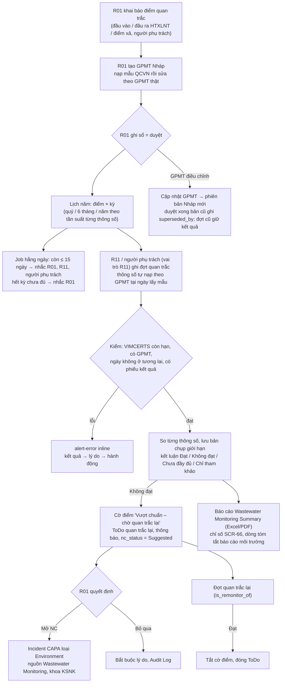

# As-Built FEAT-095 — Quản lý nước thải y tế (Amendment A-153)

> Nhánh `feat/FEAT-095-wastewater` · module Frappe `Environmental Hygiene` (M15) · FR-M15-08..13 · BRU-ENV-003..006 ·
> UC-58 · SCR-67 (Page `tc-ksnk`, slug `nuoc-thai`) · ngày 12/11/2026. Người dùng duyệt W1–W8 ngày 12/11/2026; chủ đầu
> tư chưa xác nhận. Tài liệu nguồn: `docs/srs.md` §3.1.15 và Appendix C, `docs/architecture.md` Revision History A-153.

## 1. Phạm vi

Có: giấy phép môi trường (GPMT) có phiên bản, điểm quan trắc, lịch quan trắc 12 tháng theo kỳ lịch, nhắc đến hạn/quá
hạn, ghi đợt quan trắc và so giới hạn, vượt chuẩn thì gắn cờ, quan trắc lại và đề nghị phiếu không phù hợp (NC), đơn vị
quan trắc có VIMCERTS, báo cáo PDF/Excel, chỉ số SCR-66, dòng tóm tắt trong báo cáo môi trường.

Không có: khí thải; nhật ký vận hành HTXLNT hằng ngày (W6, giai đoạn 2); kết nối trạm quan trắc tự động (W8); nộp báo
cáo lên Sở/Bộ (chỉ xuất số liệu); hóa chất xử lý nước thải.

## 2. Luồng nghiệp vụ

## 3. DocType mới và ý nghĩa

| DocType | Tên chứng từ | Ý nghĩa |
| --- | --- | --- |
| `Wastewater Point` | `NT-01`, `NT-02`… | Điểm quan trắc nước thải: đầu vào HTXLNT (chỉ tham khảo hiệu suất, không so giới hạn), đầu ra HTXLNT, điểm xả ra nguồn tiếp nhận. Có người phụ trách (User) nhận nhắc và thông báo, cờ "Vượt chuẩn – chờ quan trắc lại" do hệ thống đặt/tắt. Không xóa, ngưng dùng bằng `disabled`. |
| `Wastewater Permit` | `GPMT-<mã>-V<n>` | Giấy phép môi trường của bệnh viện, có phiên bản: số GPMT, cơ quan cấp, hạn, quy chuẩn (QCVN 40:2025 / QCVN 28:2010 / khác), cột A/B/C, ghi chú hệ số K, ngày hiệu lực, bản scan. Ghi sổ = R01 duyệt và khóa; sửa = tạo phiên bản mới. Còn ≤ 90 ngày hết hạn thì SCR-67 hiện badge "Còn N ngày". |
| `Wastewater Permit Parameter` (bảng con) | — | Một dòng GPMT: điểm, thông số, đơn vị, giới hạn dưới/trên (hoặc "Chỉ chấp nhận KPH"), tần suất 3/6/12 tháng, cờ quan trắc tự động (loại khỏi lịch). Giới hạn là giá trị tối đa đã áp dụng (đã nhân K nếu có). |
| `Wastewater Monitoring` | `QTNT-2026-0001`… | Một đợt quan trắc của một điểm: ngày lấy mẫu, kỳ, đơn vị quan trắc (Supplier) và số VIMCERTS (bản chụp), số phiếu và file phiếu kết quả, phiên bản GPMT đã áp dụng, kết luận đợt, trạng thái NC, liên kết đợt Không đạt nếu là quan trắc lại. Submittable; hủy khi nhập nhầm (R01). |
| `Wastewater Result` (bảng con) | — | Kết quả từng thông số: giá trị (0 = chưa nhập), KPH, bản chụp giới hạn (`GPMT-…-Vn · thông số khoảng đơn vị · quy chuẩn cột`), Đạt/Không đạt. |

Mở rộng có sẵn: `Supplier` thêm `tc_vimcerts_no`, `tc_vimcerts_valid_until`; `IC Program Settings` thêm
`wastewater_due_days` (trống = 15). Hook `tracecore_environment_nc` của M2 nhận thêm `source_doctype`/`source_name`.

## 4. Quy tắc nghiệp vụ

- **BRU-ENV-004** — giới hạn lấy từ phiên bản GPMT đã duyệt có hiệu lực tại ngày lấy mẫu (mỗi mã GPMT lấy bản mới nhất
  có `effective_from` ≤ ngày lấy mẫu, bản đó phải có dòng cho điểm); bản chụp lưu trên từng dòng kết quả.
- **BRU-ENV-005** — dòng Không đạt khi ngoài [min, max]; KPH = Đạt với giới hạn trên (Không đạt nếu thông số có giới hạn
  dưới, ví dụ pH); thông số "Chỉ chấp nhận KPH" có giá trị > 0 = Không đạt. Đợt Không đạt nếu ≥ 1 dòng Không đạt; thiếu
  thông số bắt buộc → Chưa đầy đủ; điểm đầu vào → Chỉ tham khảo.
- **BRU-ENV-006** — ô lịch (điểm, kỳ) chỉ "Đã quan trắc" khi mọi thông số bắt buộc trong kỳ có giá trị hoặc KPH. Thông số
  tần suất dài hơn kỳ của điểm chỉ bắt buộc ở kỳ kết thúc cùng kỳ riêng của nó (ví dụ Salmonella 6 tháng/lần bắt buộc ở
  quý 2 và quý 4 nếu các thông số khác 3 tháng/lần).
- **BRU-ENV-003 (mở rộng)** — đợt Không đạt bắt buộc quan trắc lại; cờ điểm giữ đến khi đợt quan trắc lại Đạt.
- Trạng thái ô lịch: Đã quan trắc · Không đạt · Thiếu thông số · Đến hạn · Quá hạn · Chưa đến kỳ · Không áp dụng (tự
  động) · Chưa có giấy phép — luôn có chữ.

## 5. Phân quyền (FR-M15-13.1)

| DocType | R01 | R02 | R10 | R11 | R13 |
| --- | --- | --- | --- | --- | --- |
| Wastewater Point | Đọc, ghi | Đọc | Đọc | Đọc | — (thẻ tóm tắt SCR-67) |
| Wastewater Permit | Đọc, ghi, duyệt | Đọc | Đọc | Đọc | — |
| Wastewater Monitoring | Đọc, ghi, ghi sổ, hủy | Đọc | — | Đọc, ghi, ghi sổ | — |

Mở/bỏ qua NC và "Cập nhật GPMT" chỉ R01 (kiểm ở dịch vụ và RPC). Người phụ trách HTXLNT (phòng HCQT) được cấp vai trò
R11 để ghi đợt (W7, không thêm vai trò).

## 6. Giao diện, RPC, báo cáo, lịch chạy

- **SCR-67** `/app/tc-ksnk/nuoc-thai` (nhóm Môi trường – nghề nghiệp): thanh thao tác (Ghi đợt quan trắc · Xuất báo cáo ·
  Điểm quan trắc), KPI năm, thẻ GPMT hiện hành + Cần xử lý (điểm vượt chuẩn với nút Mở NC / Không cần NC / Ghi đợt quan trắc
  lại, kỳ quá hạn, kỳ thiếu thông số, VIMCERTS hết hạn), lưới lịch T1–T12, bảng đợt gần nhất từng điểm. R13 chỉ KPI.
- **Form**: `Wastewater Monitoring` tự nạp thông số khi chọn điểm/ngày; `Wastewater Permit` có nút "Nạp thông số mẫu theo
  quy chuẩn" (Nháp) và "Phiên bản mới" (đã duyệt).
- **RPC** `tracecore.v1.wastewater.overview / schedule / parameters / template` (GET), `new_permit_version / open_nc /
  dismiss_nc` (POST, `@idempotent`).
- **Báo cáo**: Script Report `Wastewater Monitoring Summary` (điểm × đợt × thông số + số lần vượt; Export Excel, In PDF);
  Print Format `TC Wastewater Monitoring`; báo cáo môi trường tháng/quý có dòng "Nước thải y tế"; chỉ số `ww_period_on_time`.
- **Scheduler hằng ngày** `environmental_hygiene.wastewater_schedule.run_daily`: sự kiện `WW_MONITORING_DUE`,
  `WW_MONITORING_OVERDUE`; khi vượt chuẩn `WW_MONITORING_FAILED`.

## 7. Mẫu quy chuẩn (fixture Nháp)

`tracecore/environmental_hygiene/data/wastewater_standards.json` (phiên bản 1, trạng thái Draft): QCVN 28:2010/BTNMT cột
A và B có giá trị (chưa nhân K); QCVN 40:2025/BTNMT cột A và B chỉ có danh mục thông số, **giới hạn để trống** chờ chuyên
gia bệnh viện đối chiếu văn bản. Mẫu chỉ được chép vào GPMT Nháp khi R01 bấm nạp; `bench migrate` không ghi gì vào GPMT.

## 8. Cài đặt cho bệnh viện sau khi lên bản

1. `IC Program Settings`: đặt **Khoa KSNK** (`ic_department`, cần để mở NC) và nếu muốn đổi số ngày nhắc trước cuối kỳ.
2. `Supplier` của đơn vị quan trắc: nhập Số VIMCERTS và ngày hiệu lực.
3. Khai báo điểm quan trắc, người phụ trách; cấp vai trò TC R11 cho người phụ trách HTXLNT nếu họ tự ghi đợt.
4. Tạo GPMT theo giấy phép thật, nạp mẫu nếu cần, sửa giới hạn/tần suất, R01 ghi sổ.

## 9. Kiểm thử

52 test mới (`environmental_hygiene/tests/test_wastewater_*.py`, `tests/test_wastewater_api.py`, `tests/test_ksnk_scr67.py`)
gắn `@bru("BRU-ENV-003..006")`; kết quả chạy và coverage ghi ở báo cáo bàn giao của session.

## 10. Lưu ý

- Cột Float của Frappe không null nên giá trị 0 trên dòng kết quả nghĩa là chưa nhập; kết quả "không phát hiện" đánh dấu
  ô KPH.
- Không có patch: DocType, Custom Field, DocPerm nạp qua migrate/fixtures; không có bản ghi Link tới Role hay DocType mới
  được tạo trong patch.
