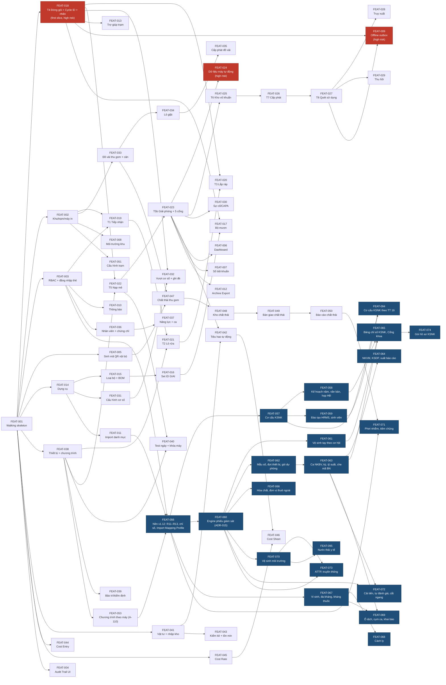

# Implementation Plan: TraceCore

> Status: Draft · Last updated: 2026-11-03 (Amendment A-113)
> Inputs: docs/srs.md (v1.12, 171 FR / 42 NFR) · docs/use-cases.md (57 UC) · docs/architecture.md (15 ADR; 63 DocType + ~45 DocType M11–M17) · docs/ux-foundations.md (63 SCR đã duyệt) · docs/design.md + docs/tokens.json · docs/.architecture-inputs.md · input/ba_md/cover.md ("Thứ tự phát triển đề xuất") · input/ba_md/d01.md §6 (GĐ1–8).
> Fidelity: đủ 4 tài liệu đầu vào chính. SCR-44..46 (ux-foundations §B5.2) là **đề xuất chưa duyệt**, không tính vào inventory và không được slice. Không có FR/SCR tombstoned.
> **Amendment A-113 (2026-11-03):** BA v1.12 "Mở rộng KSNK toàn viện" (M11–M17 + M9 mở rộng; 81 FR, 34 BRU, 7 NFR) → 7 epic E-12..E-19, **FEAT-056..074** (§3), sprint S6–S9 (§4.2), DoD v1.12 (§6.1). Người dùng duyệt quyết định D1–D11 ngày 03/11/2026; chủ đầu tư chưa xác nhận. Số FEAT của BA (053..071) dời +3 vì FEAT-053..055 đã dùng cho A-110..112.
> **Amendment A-131 (2026-11-06):** mọi màn WEB của M11–M17 và M9 mở rộng nằm trong một màn quản lý — Page `tc_ksnk` (architecture ADR-002, §5.2). FEAT-056 dựng khung Page (shell, router, registry màn, RPC `tracecore.v1.ksnk.nav`, hook `tracecore_ksnk_badges`); FEAT-057..074 mỗi FEAT thêm màn của mình vào registry thay vì làm Workspace/Desk page riêng.
> **Amendment A-153 (2026-11-12):** nước thải y tế vào M15 (mở một phần SC-01) → **FEAT-095** ở E-16 (sprint S9), FR-M15-08..13, UC-58, SCR-67, BRU-ENV-004..006. Người dùng duyệt W1–W8 ngày 12/11/2026; chủ đầu tư chưa xác nhận. Số FEAT-075 trong đề xuất đổi thành FEAT-095 vì FEAT-075 đã dùng cho A-114.
> **Amendment A-154 (2026-11-12):** thành phần bộ trên form Set Unit và loại chỉ thị hóa học của loại bộ (Không cần / Loại 4 / Loại 5 / Loại 6, T4 kiểm theo loại) → **FEAT-096** ở E-02 (M1, ngoài sprint), FR-M1-03.9, FR-M1-06.5, sửa FR-M2-07.2/.3. Người dùng duyệt C1–C3 ngày 12/11/2026; chủ đầu tư chưa xác nhận.
> **Amendment A-155 (2026-11-12):** loại vật liệu đóng gói thêm Giấy bọc, kích thước túi ép, số lớp giấy bọc → **FEAT-097** ở E-02 (M6/M2, ngoài sprint), FR-M6-02.5. Người dùng yêu cầu ngày 12/11/2026; chủ đầu tư chưa xác nhận.
> Thuật ngữ kỹ thuật giữ tiếng Anh (DocType, RPC, hook, Page, PWA…); nội dung tiếng Việt.

## 1. Overview

TraceCore là app Frappe v15 `tracecore` (cạnh `erpnext`, `hrms`) cho khoa KSNK/CSSD: truy xuất dụng cụ qua chuỗi 8 trạm T1–T8 với cổng kiểm soát 5 bước, Set ID GS1 GIAI vĩnh viễn, Cycle ID GS1 DataMatrix dùng một lần in trên 2 loại nhãn (hấp/plasma), cùng đồ vải, nhân sự, thiết bị, kho, chi phí, cơ số, báo cáo và (v1.11) chất thải y tế. Bốn surface: WEB (Desk), STN (kiosk Frappe Page), PDA (PWA cùng Page), DEPT (Portal).

Kế hoạch gồm **12 epic / 50 feature (FEAT-001..050)** (+ FEAT-051..055 theo amendment A-64/A-71/A-110..112; **+ 8 epic E-12..E-19 / 19 feature FEAT-056..074 theo A-113 — tổng 74 FEAT; + FEAT-094 theo A-138; + FEAT-095 theo A-153; + FEAT-096 theo A-154; + FEAT-097 theo A-155**), mỗi FEAT là một lát cắt dọc (UI + RPC `tracecore.v1.*` + domain + DocType). Ưu tiên sắp xếp (Phase 2, chủ đầu tư xác nhận):

1. **De-risk sớm** 4 ADR rủi ro nhất: ADR-004 (GS1 DataMatrix 300 dpi trên nhãn chịu hấp, rủi ro R-01), ADR-005 (step-gate engine), ADR-003 (offline/idempotency), ADR-006 (station agent + 2 loại nhãn, R-04).
2. **Milestone demo** "1 bộ đi hết T1→T8 + thu hồi" sớm nhất có thể (cuối Sprint 2).
3. **MVP cut line** = toàn bộ Must của M1, M2, M8 và M9 nền tảng (tinh thần Sprint 1–2 của BA). Không có deadline cứng ngoài PID (go-live T+28 tuần, d01 §6).
4. Đội: 2–3 dev Frappe Miyano + Claude Code; 1 BA/PM Medcons. Sprint 3 tuần (Sprint 2 cho phép 4 tuần).

Cấu trúc tài liệu: §2 walking skeleton → §3 epic/feature breakdown (toàn app) → §4 build sequence + dependency graph + milestones → §5 first slice (FEAT-018, handoff cho ui-design và detailed-design) → §6 engineering foundations → §7 rủi ro, coverage gap → §8 khác biệt so với BA Sprint 1–5 → §9 kết quả verification.

## 2. Walking Skeleton (FEAT-001)

Mục tiêu: chứng minh **mọi container** của architecture §5.1 chạy và deploy được bằng pipeline thật, trước khi viết nghiệp vụ. Đường đi: Chromium kiosk → Frappe Page `station` → RPC `tracecore.v1.*` → `core.gs1` + DocType → MariaDB → trả về; song song kiosk → Station Agent → máy in ZPL; Audit Log hook; CI xanh; deploy config cho dev/staging bench Miyano.

| Thành phần | Real | Stub / để sau |
| --- | --- | --- |
| Bench + site | Bench `tracecore-dev` version-15, site `tracecore-dev.local`, apps `frappe`, `erpnext`, `hrms`, `tracecore`; `install_app` sạch; `bench migrate` không lỗi | `insights`, `print_designer` cài ở Sprint 5 |
| App `tracecore` | 11 module Frappe (`core`, M1–M10) đúng tên architecture §5.2; `hooks.py` với `doc_events` audit, `website_route_rules` cho `manifest.json`/`sw.js`; `translations/vi.csv` khung | Module M3–M10 chỉ có `__init__` |
| DocType thật | **Set Unit** (đủ trường architecture §5.3: `set_id` = name GIAI, `set_type` Link, `cycles_used`, `max_cycles`, `active_cycle_id`, `status`, `current_station`, `is_loaner`); **Code Registry**; **Audit Log** (append-only, permission `delete=0`, hook `before_save`/`on_trash` chặn) | `Instrument Set Type` chỉ là DocType khung (name + method) để Link; các DocType khác chưa tạo |
| `core.gs1` | `make_giai(prefix, asset_ref)` thật với check cấu trúc AI 8004; `parse_scan(raw)` cho GIAI và QR nội bộ; encoder DataMatrix `pylibdmtx` → PNG; render ZPL `^BXN` cùng payload; unit test | `make_cycle_payload` (01)(11)(17)(21) — đến FEAT-018; GTIN loại bộ dùng prefix test (OQ-05) |
| RPC | `tracecore.v1.ping` (trả version, site, time zone, trạng thái agent nếu có); `tracecore.v1.set_unit.get(set_id)` đọc theo PK, qua decorator `@idempotent` (bảng `Idempotency Key` thật) | Mọi RPC nghiệp vụ khác |
| Kiosk shell | Frappe Page `station` full-screen tối giản: zonebar, ô quét luôn focus, 1 card kết quả, 4 trạng thái màn hình (loading / empty / error / offline — FR-M9-14) với **CSS vars `--tc-*` sinh từ docs/tokens.json** (script `scripts/build_tokens.py` → `tracecore/public/css/tokens.css`), font ≥ 16 px, nút ≥ 48 px; đo thời gian tải Desk shell trên mini PC (R-07) | Router trạm T1..T8; đăng nhập thẻ (dùng user kỹ thuật `station-t4@local` cấu hình sẵn); PWA Service Worker chỉ precache shell, chưa có outbox |
| Station Agent | Service Python `tracecore_agent` tối giản: `GET /health`, `POST /print` nhận ZPL, hàng đợi SQLite, gửi TCP 9100; lệnh `hello` in **1 nhãn test** (GIAI test + chữ) ra máy in thật tại Miyano **hoặc ghi file `.zpl` + ảnh render qua Labelary/`pylibdmtx` nếu chưa có máy in**; `agent.heartbeat` RPC với API key | Cân, driver CSV/API máy, auto-update, xoay key |
| Audit | Hook `after_insert/on_update/on_submit/on_cancel/on_trash` cho Set Unit → Audit Log; `audit.query` RPC đơn giản | Report Audit Trail UI (FEAT-004) |
| CI | GitHub Actions `mvl26/tracecore`: job `lint` (ruff, eslint, bandit, pip-audit), job `test` (frappe_docker + mariadb 10.6 + redis 7 → `bench run-tests --app tracecore --coverage`, `diff-cover --fail-under=70`), job `e2e` Playwright smoke (mở `/app/station`, quét giả GIAI → thấy card kết quả) | `e2e-nightly` lên staging, `release` job khung |
| Deploy config | `scripts/install_dev.sh` (bench init pinned commits, new-site, install apps), `scripts/install_prod.sh` idempotent (viết, chưa chạy), `deploy/staging.env.example`, `site_config.json.example` (secrets ngoài repo), systemd unit mẫu cho agent — **viết, không chạy** | Thực thi deploy production (initial-deployment) |
| Fixtures | Role `TC R01..R10` (rỗng permission trừ Set Unit read), Zone Station khung 3 khu | Ma trận quyền đầy đủ (FEAT-003) |

**Done when:** (1) `bench --site tracecore-dev.local install-app tracecore` sạch trên bench dev Miyano; (2) Chromium kiosk mở `/app/station?station=TR-004`, quét (hoặc gõ) một GIAI test → `set_unit.get` trả bản ghi ≤ 1 s, card hiển thị đúng token màu; quét mã lạ → trạng thái error đúng câu chữ tiếng Việt; (3) `tracecore_agent hello` tạo bản ghi `Print Job` Đã in và nhãn/ZPL kiểm được bằng mắt + quét được bằng máy quét HID (nếu có máy in); (4) tạo/sửa Set Unit sinh Audit Log, `DELETE` Audit Log bị từ chối; (5) CI xanh trên PR đầu; (6) `install_prod.sh --dry-run` và cấu hình staging review xong. **Không** có nghiệp vụ thật nào trong skeleton.

## 3. Epic & Feature Breakdown

Quy ước: **FEAT-NNN** bất biến (không đánh số lại, bỏ = tombstone). Cột *FRs* cite ID gốc `FR-Mx-NN` (dòng con `.k` kế thừa, chỉ ghi khi cần nói "partial"). *Screens* ghi SCR + surface. *Blocks/Endpoints* theo architecture §5.2 và namespace `tracecore.v1.<domain>.<action>` (ADR-001). *Size*: S ≈ ≤ 3 ngày-dev, M ≈ 1 tuần, L ≈ 2 tuần. *Sprint* = đề xuất §4 (S0..S5, S5b).

### E-00 Foundations & skeleton

| ID | Feature | FRs | UCs | Screens | Blocks / Endpoints | Data (DocType) | ADR | Size | Sprint |
| :- | :- | :- | :- | :- | :- | :- | :- | :- | :- |
| FEAT-001 | Walking skeleton (§2) | FR-M9-07 (partial: Code Registry + GIAI), FR-M9-14 (partial: 4 trạng thái shell) | — | shell STN (chưa SCR) | `core.gs1`, `core.audit`, `core.idempotency`, `ui.station`, agent; `v1.ping`, `v1.set_unit.get`, `v1.agent.heartbeat` | W: Set Unit, Code Registry, Audit Log, Idempotency Key, Print Job | 001, 002, 004, 006, 008, 012 | L | S0 |

### E-04 M9 Quản trị nền tảng & báo cáo (Zone Station · Audit · Dashboard · Sổ tiệt khuẩn)

| ID | Feature | FRs | UCs | Screens | Blocks / Endpoints | Data | ADR | Size | Sprint |
| :- | :- | :- | :- | :- | :- | :- | :- | :- | :- |
| FEAT-002 | Khu – trạm – thiết bị ngoại vi – máy in/cuộn – mẫu nhãn cấu hình không code | FR-M9-03; FR-M2-08 (partial .2 khai báo máy in/cuộn, .4 mẫu nhãn) | UC-33 | SCR-33 (WEB) | M9 admin, `core.print` config; Desk form + Client Script; `v1.station.config(station_id)` cho agent kéo cấu hình | W: Zone Station, Station Peripheral, Printer, Label Template | 006 | M | S1 |
| FEAT-003 | Tài khoản/vai trò RBAC 10 role, thẻ nhân viên, đăng nhập thẻ & phiên trạm 8 h, đăng xuất/khóa 10 phút, mật khẩu/PIN/2FA | FR-M9-05, FR-M9-08, FR-M9-09; FR-M4-01 (partial: Employee HRMS + `tc_card_id`, `tc_pin_hash`); FR-M4-03 (partial: kiểm Competency còn hiệu lực, cấp quyền tạm 24 h) | UC-33, UC-20 (partial) | SCR-33 (WEB), màn đăng nhập thẻ trạm (thuộc shell STN/PDA) | `core.station_auth`; `v1.station.login/logout/heartbeat`, `v1.station.verify_pin`; fixtures `custom_role.json`, `custom_docperm.json` từ `permission_matrix.csv`; test ma trận CI | W: Station Session, Station Competency (khung), HRMS Employee (Ext); R: Zone Station | 010, 008 | L | S1 |
| FEAT-004 | Audit Trail tra cứu, xóa mềm danh mục, R02 chuyển trạng thái thủ công có ticket + NC | FR-M9-16; FR-M2-00.3; (NFR-SEC-03) | UC-33 | SCR-33 (WEB) | Report `Audit Trail`, `v1.audit.query`; hook `on_trash` toàn DocType nghiệp vụ; `v1.admin.force_transition` | R/W: Audit Log; W: Incident CAPA (link) | 008, 005 | S | S3 |
| FEAT-005 | Sinh mã đối tượng tự động & in QR nội bộ (NV-/TB-/KE-/TR-/CN-): `core.code_registry` + `core.qr`; in nhãn 50 × 30 mm từ Desk qua server worker (A-05 R1/R2); cấp mã cuộn `CN-` hàng loạt trên form Item (R3); vô hiệu mã `TB-` khi `Retired` (R4); `NV-`/`KE-` và `register_card` chỉ có hàm + test, chưa UI (R6); ngoài phạm vi: DataMatrix GIAI, `CT-`, in từ kiosk/PDA (R7) | FR-M9-07 | UC-33 | SCR-33 (WEB); nút in trên SCR-03/19/21 | `core.gs1.next_code`, `core.print`; `v1.print.object_label` | W: Code Registry, Print Job; R: Employee, Equipment, Sterile Location, Zone Station, Printer | 004, 006 | S | S1 |
| FEAT-006 | Dashboard vận hành theo vai trò + tìm kiếm/lọc/phân trang mọi danh sách, ô quét là phím tắt | FR-M9-01, FR-M9-13 | UC-32 | SCR-32 (WEB) | Page Desk `tc-dashboard` (A-54 D1; thay Workspace + Dashboard Chart); polling 60 s; List View chuẩn Frappe + Client Script ô quét | R: Set Unit, Pack, Sterilization Load, Issue Note, Notification Log | 001, 009 | M | S5 |
| FEAT-007 | Sổ tiệt khuẩn điện tử theo máy, báo cáo KSNK mẫu BYT, dự báo dụng cụ hết vòng đời (PDF ≤ 30 s nền) | FR-M9-02; (OTH-LEG-001) | UC-32 | SCR-32 (WEB) | Query Report + Print Format; RQ long; `v1.report.sterilization_log` | R: Sterilization Load, Load Indicator Result, Load Pack, Pack, Set Unit, Par Level | 001, 008 | L | S5 |
| FEAT-008 | Nhật ký môi trường khu (nhập tay 2 lần/ngày hoặc cảm biến), báo cáo tháng | FR-M9-04 (Should) | UC-33 | SCR-33 (WEB) | `v1.env.log`; scheduler nhắc | W: Environment Log | 006 | S | S4 |

### E-11 Cross-cutting (offline · thông báo · import/export · trợ giúp)

| ID | Feature | FRs | UCs | Screens | Blocks / Endpoints | Data | ADR | Size | Sprint |
| :- | :- | :- | :- | :- | :- | :- | :- | :- | :- |
| FEAT-009 | Offline outbox IndexedDB + replay theo `client_ts`, dải mã cấp trước, Sync Conflict cho R02 (PWA Service Worker đầy đủ) | FR-M9-06; FR-M2-07.11; FR-M1-06.4 | UC-33 (offline), UC-05/08/13 E3 | SCR-34, SCR-35, SCR-36, SCR-37 (PDA); offline indicator mọi STN (SCR-05..12); SCR-33 (WEB, Sync Conflict) | `core.idempotency` (đã có decorator) + `v1.code_range.allocate`, `v1.sync.replay`; `sw.js` precache danh mục; `tcApi.call()` | W: Code Range, Sync Conflict, Idempotency Key; R: Pack, Set Unit | 003 | L | S3 |
| FEAT-010 | Trung tâm thông báo đa kênh (in-app/PDA/email/SMS), cấu hình người nhận theo sự kiện, đã gửi/đã đọc, leo thang 15 phút | FR-M9-10 | UC-38 | SCR-42 (WEB + STN + PDA + DEPT) | `core.notification.emit`, `v1.notification.list/mark_read`; Email Queue; SMS adapter; scheduler leo thang | W: Notification Rule, Notification Recipient, Notification Log | 014 | M | S3 |
| FEAT-011 | Import danh mục ban đầu từ Excel mẫu theo lô, kiểm từng dòng, import ảnh hàng loạt | FR-M9-11; (EI-SW-007, NFR-PORT-02) | UC-39 | SCR-43 (WEB) | Frappe Data Import bọc bởi Import Template; RQ default; import loại bộ/BOM qua `bom_versions.create_set_type/create_version`, cùng luật FEAT-015 (A-07, S15); import Set Unit qua `set_units.issue_batch`, không insert trực tiếp (A-13, G4) | W: Import Template, Import Batch; W: Instrument, Instrument Set Type, Set BOM Item, Par Level, Equipment, Process Program, Item, Employee, Certificate, Department | 009 | M | S1 |
| FEAT-012 | Archive Export hồ sơ tiệt khuẩn theo kỳ (PDF + CSV, checksum, dấu thời gian) | FR-M9-12; (OTH-RET-001, NFR-COMP-01) | UC-39 | SCR-43 (WEB) | `v1.archive.export`; RQ long; Frappe Data Export | W: Archive Export; R: Load, Load Indicator Result, Pack, Issue Note, Usage Record (masked), Audit Log | 008 | M | S5 |
| FEAT-013 | Trợ giúp theo trạm (3–5 bước có ảnh) & gửi phản hồi/báo lỗi kèm ảnh màn hình tới R10 | FR-M9-15 (Could) | — (mọi UC trạm) | overlay trên mọi STN/PDA (SCR-05..12, 16–18, 23, 34–40) | `ui.station_help`, `ui.feedback`; `v1.help.get`, `v1.feedback.create` (A-56) | W: ERPNext `Issue` (Issue Type TraceCore Software, A-56), File; R: Frappe `Help Article` | 002 | S | S5 |

> FR-M9-14 (trạng thái màn hình loading/empty/error/offline) là xuyên suốt → **Foundations** (§6, component thư viện shell STN/PDA từ FEAT-001), mọi FEAT trạm kế thừa.

### E-01 M1 Danh mục dụng cụ & bộ dụng cụ

| ID | Feature | FRs | UCs | Screens | Blocks / Endpoints | Data | ADR | Size | Sprint |
| :- | :- | :- | :- | :- | :- | :- | :- | :- | :- |
| FEAT-014 | Dụng cụ đơn lẻ (ảnh thực tế, Spaulding, IFU, phương pháp tương thích, phiên bản) + ngưỡng bảo dưỡng + mã GIAI khắc laser (tính năng bật/tắt) | FR-M1-01, FR-M1-09, FR-M1-02 (Should; FR-M1-02.2/.4 chuyển FEAT-020, A-06 I17) | UC-01 | SCR-01 (WEB) | M1 instrument; Desk form; `v1.instrument.get_image` (thumbnail cho trạm) | W: Instrument, Instrument Compatible Method, Instrument Group (mới, A-06), Instrument Maintenance, TraceCore Settings (mới, Single, A-06); R: Item (tùy chọn) | 004, 009 | M | S1 |
| FEAT-015 | Loại bộ & BOM có phiên bản (ngày hiệu lực, so sánh 2 phiên bản), ảnh bộ đã xếp, hạn lưu theo loại gói, phiếu kiểm đếm PDF | FR-M1-03, FR-M1-04 | UC-02 | SCR-02 (WEB) | M1; Print Format phiếu kiểm đếm (DataMatrix PNG); `v1.set_type.bom(set_type, version)` cache | W: Instrument Set Type, Set BOM Item, Set Unit (cycle_bom_version qua step_gate), Item (tc_shelf_life_days qua RPC); R: Instrument, Department, Item (loại gói) | 004 | M | S1 |
| FEAT-016 | Cấp Set ID GIAI hàng loạt (≤ 100), in thẻ kim loại/nhãn khay, in lại có lý do, vòng đời Set Unit & lịch sử | FR-M1-05, FR-M1-06 | UC-03 | SCR-03 (WEB) | `core.gs1.make_giai`, `core.print` (Label Template `Set Tag`/`Set Tray Label`); `v1.set_unit.create_batch/print_tags/reprint_tag/verify_tag/tag_preview/print_status/form_context/history/batch_csv`; vòng đời và lịch sử từ `core.step_gate` (`init_unit`, sự kiện trong Audit Log, hook `tracecore_after_set_status`; A-13) | W: Set Unit, Code Registry, Print Job, Label Template (mẫu Set Tag/Set Tray Label); R: Instrument Set Type, Printer | 004, 005, 006 | M | S1 |
| FEAT-017 | Bộ mượn (loaner): nhận LN-, biên bản nhận/trả PDF, chặn cấp phát trước tái xử lý đầy đủ, dòng LOANER trên nhãn | FR-M1-07, FR-M1-08 (Should) | UC-04 | SCR-04 (WEB) | `v1.loaner.receive/return`; hook chặn tại T4/T7 | W: Loaner Set, Loaner BOM Item, Set Unit (is_loaner) | 004 | M | S4 |

### E-02 M2 Chuỗi tái xử lý & truy xuất

| ID | Feature | FRs | UCs | Screens | Blocks / Endpoints | Data | ADR | Size | Sprint |
| :- | :- | :- | :- | :- | :- | :- | :- | :- | :- |
| **FEAT-018** | **T4 Đóng gói → Cycle ID GS1 + in nhãn theo phương pháp + cổng T3→T4** (first slice, §5) | FR-M2-07, FR-M2-08; FR-M2-25 (partial: check T3 Đạt, record T4); FR-M2-00.1, FR-M2-00.2; FR-M8-03 (partial: so sánh `cycles_used`/`max_cycles` + stub ghi đè); FR-M1-09 (partial: hiển thị nhắc bảo dưỡng, xác nhận/hoãn) | UC-08 | SCR-08 (STN) | `v1.pack.generate_cycle_id`, `v1.pack.reprint_label`, `v1.pack.void`, `v1.pack.scan`, `v1.printer.set_roll`, `v1.station.config`, `v1.print.ack`; `core.step_gate.check/record`, `core.gs1.make_cycle_payload`, `core.print.select_printer/render`; agent `/print` | W: Pack, Pack Instrument Confirmed, Pack Maintenance Done, Step Gate Result, Print Job, Code Registry, Set Unit (`active_cycle_id`); R: Instrument Set Type, Set BOM Item, Instrument, Instrument Maintenance, Assembly Record (stub), Item/Batch (lô chỉ thị), Printer, Label Template, Par Level (stub) | 003, 004, 005, 006 | L | S1 |
| FEAT-019 | T1 Tiếp nhận nhiều bộ nối tiếp: quét thẻ người giao + Set ID, kiểm chiều, danh sách BOM có ảnh, xác nhận thành phần từng dòng/tất cả, ghi chú bất thường | FR-M2-01, FR-M2-02, FR-M2-23; FR-M2-25 (T1 record) | UC-05 | SCR-05 (STN), SCR-34 (PDA) | `v1.receive.open/scan_set/confirm_line/submit`; `core.step_gate.record(T1)`; `core.step_gate.start_cycle(set_unit, on=client_time.to_system_time(client_time.parse_client_ts(client_ts)))` để ghim phiên bản BOM của chu trình (A-07, S3; `on` là giờ hệ thống `Asia/Ho_Chi_Minh` không múi giờ: **phải đổi** `client_ts` UTC sang giờ hệ thống trước, nếu không bộ tiếp nhận 00:00–06:59 bị ghim phiên bản của ngày hôm trước); T1 nhận bộ `New`, `At Department`, `Awaiting Receipt` (sửa FR-M2-02; A-13, G4: bộ cấp bởi FEAT-016 ở trạng thái `New`, ghim BOM ở `start_cycle`) | W: Dirty Receipt, Dirty Receipt Item, Dirty Receipt Confirm Line, Step Gate Result, Set Unit; R: Employee (thẻ), Set BOM Item, Instrument | 005, 003 | M | S2 |
| FEAT-020 | T3 Kiểm tra – lắp ráp theo BOM có ảnh, ghi thiếu/hỏng/thay, khóa Đóng gói khi thiếu chưa R02 xác nhận (PIN), rẽ nhánh Sửa chữa/Thanh lý | FR-M2-05, FR-M2-06; FR-M2-00.5; FR-M2-25 (T3 record; thay stub FEAT-018); FR-M1-02.2, FR-M1-02.4 (quét mã dụng cụ tại T3, chuyển từ FEAT-014, A-06 I17) | UC-07 | SCR-07 (STN) | `v1.assembly.open/line/confirm_shortage/submit`; `core.station_auth.verify_pin`; rẽ nhánh Thanh lý: actor, điều kiện, lý do, phê duyệt do FEAT-032 chốt (A-13, G14; A-35 T7: FEAT-020 chỉ ghi nhánh + lý do + cổng T3 Không đạt, thao tác Thanh lý chờ FEAT-032) | W: Assembly Record, Assembly Line, Step Gate Result, Incident CAPA (thiếu: A-35 T6 cờ `nc_pending` + hook `tracecore_assembly_nc`, Incident thật thuộc FEAT-030); R: Set BOM Item, Instrument, Par Level (cảnh báo cam) | 005 | M | S2 |
| FEAT-021 | T2 Lô rửa: quét QR máy → chương trình → hóa chất lô/hạn → quét từng bộ → Hoàn thành nạp (LR-), dỡ lô + kết quả Đạt/Không đạt áp cho mọi bộ, nhập tay có xác nhận. Handoff `param_schema`: giới hạn dưới/trên bằng 0 là không đặt; dải một phía hợp lệ | FR-M2-03, FR-M2-04; FR-M2-24 (partial: đính dữ liệu nhập tay vào mã lô); FR-M2-25 (T2 record, Xử lý lại) | UC-06 | SCR-06 (STN) | `v1.wash.start/add_set/complete/unload/result/manual_data` (+ `unload_context`, `lookup`, `redo_queue`, A-12); `core.step_gate.record(T2, mọi bộ)` | W: Wash Batch, Wash Batch Set Unit, Wash Batch Chemical, Step Gate Result; R: Equipment, Process Program, Batch | 005, 007 | L | S2 |
| FEAT-022 | T5 Nạp mẻ: quét QR máy → chương trình → quét Cycle ID từng gói (kiểm tương thích, dung tích, cổng T4) → Hoàn thành nạp → Load ID ME- + in QR mẻ; form nhập tay dữ liệu máy theo `param_schema` + ảnh bản in + xác nhận thẻ. Handoff `param_schema`: giới hạn dưới/trên bằng 0 là không đặt; dải một phía hợp lệ | FR-M2-09, FR-M2-10 | UC-09 | SCR-09 (STN), SCR-35 (PDA) | `v1.load.create/add_pack/complete/manual_data` (+ `lookup`, `overview`, `data_scan`, `data_context`, A-16; BA `cssd.load.create` ↔ `load.complete`, `cssd.load.add_pack` ↔ `load.add_pack`); `core.print` nhãn QR mẻ; hook `tracecore_load_equipment_checks` (stub test ngày/kiểm định) | W: Sterilization Load, Load Pack, Pack (`status` In Load, `load`), Print Job, Code Registry; R: Pack, Equipment, Process Program, Daily Test (stub "máy sẵn sàng" đến FEAT-040) | 005, 006, 007 | L | S2 |
| FEAT-023 | T5b Dỡ mẻ – giải phóng (R02 PIN) – cách ly chờ BI – Không đạt → Xử lý lại từ T4; **Vô khuẩn khi đủ 5 cổng**; tăng bộ đếm chu trình Set & dụng cụ; sự kiện async cho M6/M7 | FR-M2-11, FR-M2-12; FR-M2-25 (full: 5 cổng, redo, bảng cổng trên hồ sơ bộ); FR-M8-03 (counter thật, thay stub FEAT-018); FR-M1-06 (partial .1 bộ đếm); FR-M1-09.2 (gọi hook `tracecore_after_release` → `maintenance.on_set_released` với `ctx = {set_unit, set_type, bom_version, cycle_id}`, `cycle_id` bắt buộc để không đếm hai lần khi thử lại, A-06 I16) | UC-10 | SCR-10 (STN; R02 cũng dùng WEB) | `v1.load.unload/release/quarantine/bi_result`; `core.step_gate.record(T5, mọi gói)`; `enqueue_after_commit` → `inventory.consume`, `costing.build_sheet`, `par.evaluate` | W: Sterilization Load, Load Indicator Result, Pack, Step Gate Result, Set Unit, Instrument Maintenance (counter); R: Process Program | 005, 007, 008 | L | S2 |
| FEAT-024 | Dữ liệu máy tự động qua station agent: driver CSV generic + stub API, khớp theo Load ID/khoảng thời gian, `Cần xem xét` khi khớp mờ, chuyển nhập tay có lý do khi mất dữ liệu | FR-M2-24 (full); (EI-SW-001, NFR-INT-01) | UC-06 A3, UC-09 A3 | SCR-06, SCR-09 (STN: panel nguồn dữ liệu) | agent `drivers/csv_generic.py`, `v1.load.ingest_machine_data` (API key, idempotent) | W: Sterilization Load, Wash Batch (`machine_data`, `machine_files`, `data_source`) ; R: Equipment (`is_connected`) | 006, 007 | M | S3 |
| FEAT-025 | T6 Kho vô khuẩn: quét Cycle ID + mã kệ KE- → Trong kho; tồn theo vị trí; hết hạn 00:00/rách → Hết hiệu lực, Set Unit Chờ tiếp nhận; FEFO gợi ý | FR-M2-13, FR-M2-14 | UC-11 | SCR-11 (STN) | `v1.putaway.scan`, `v1.pack.mark_damaged`; scheduler 00:00 | W: Sterile Putaway, Pack, Set Unit, Step Gate Result (T6 kiểm); R: Sterile Location | 005 | M | S2 |
| FEAT-026 | T7 Cấp phát nhiều gói/khoa, quét thẻ người nhận, kiểm cơ số khoa min/max, ký điện tử (thẻ/chữ ký cảm ứng), in phiếu | FR-M2-15, FR-M2-16; FR-M8-02 (partial: áp dụng cơ số khoa khi cấp) | UC-12 | SCR-12 (STN), SCR-36 (PDA) | `v1.issue.create/add_pack/sign/submit`; Print Format phiếu | W: Issue Note, Issue Note Pack, Pack, Set Unit; R: Par Level (khoa), Employee, Department | 005, 006 | M | S2 |
| FEAT-027 | T8 Quét sử dụng: mã BN mã hóa (Password/AES), ca mổ, PTV; chặn 100 % mã Đã dùng/Quá hạn/Thu hồi/Hết hiệu lực kèm lý do; xem mã BN đầy đủ (R01/R02, lý do, audit) | FR-M2-17, FR-M2-18 | UC-13 | SCR-13 (DEPT), SCR-37 (PDA) | `v1.usage.scan`, `v1.usage.reveal_patient_code`; `core.crypto`; `permission_query_conditions` Department | W: Usage Record, Pack, Set Unit; R: Department | 010, 003 | M | S2 |
| FEAT-028 | Truy xuất hai chiều theo mã BN (hash), Set ID, Cycle ID, Load ID, máy, nhân viên, khoảng ngày — timeline 8 trạm | FR-M2-19 | UC-14 | SCR-14 (WEB; view DEPT) | Query Report + `v1.trace.query`; index composite | R: Usage Record, Pack, Load Pack, Sterilization Load, Wash Batch, Dirty Receipt, Issue Note, Step Gate Result, Audit Log | 008, 010 | M | S2 |
| FEAT-029 | Thu hồi theo Load ID / lô BI / lô vật tư: tự lập lệnh gồm mọi Cycle ID, khóa gói trong kho, thông báo khoa, xác nhận từng gói, đóng lệnh | FR-M2-20 | UC-14 | SCR-14 (WEB), SCR-42 (DEPT/PDA xác nhận — in-app tối thiểu) | `v1.recall.create/confirm_pack/close`; realtime badge | W: Recall Order, Recall Order Pack, Pack; R: Load Pack, Issue Note, Usage Record (masked) | 008, 014 | M | S2 |
| FEAT-030 | Sự cố / NC / CAPA: tạo Incident (loại, mức, liên kết đối tượng, ảnh), workflow Phân tích → CAPA → Kiểm tra → Đóng; đồng bộ Quality tùy chọn | FR-M2-21, FR-M2-22 (Should) | UC-15 | SCR-15 (WEB) | `v1.incident.create`; Workflow WF-06 | W: Incident CAPA, CAPA Action; R: mọi chứng từ liên kết | 009 | M | S3 |

### E-03 M8 Cơ số & kiểm soát vượt ngưỡng

| ID | Feature | FRs | UCs | Screens | Blocks / Endpoints | Data | ADR | Size | Sprint |
| :- | :- | :- | :- | :- | :- | :- | :- | :- | :- |
| FEAT-031 | Cấu hình cơ số tái xử lý (dụng cụ/loại bộ/vật tư, nguồn IFU/Ước tính, ngưỡng cảnh báo sớm) và cơ số tồn khoa (min/max/% vượt), lịch sử phiên bản | FR-M8-01, FR-M8-02 | UC-30 | SCR-30 (WEB) | M8 par; Desk form | W: Par Level, Par Level History; R: Instrument, Instrument Set Type, Department, Linen Type | 009 | S | S1 |
| FEAT-032 | Kiểm soát vượt cơ số đầy đủ: cảnh báo cam tại T3/dashboard, chặn sinh Cycle ID + Hết vòng đời, đề nghị ghi đè từ T4 → R01 duyệt PIN (WF-08) → mở trong phạm vi/thời hạn, báo cáo ghi đè tháng | FR-M8-03 (full), FR-M8-04 | UC-31 | SCR-31 (WEB), SCR-08 (STN nút Đề nghị ghi đè) | `v1.par.check`, `v1.par.override.request/approve`; thay stub trong `pack.generate_cycle_id`; duyệt Hết vòng đời và thiết kế thao tác Thanh lý (actor, điều kiện, lý do, phê duyệt; A-13, G14) | W: Par Override, Set Unit; R: Par Level, Instrument Maintenance | 005, 014 | M | S2 |

### E-05 M3 Đồ vải

| ID | Feature | FRs | UCs | Screens | Blocks / Endpoints | Data | ADR | Size | Sprint |
| :- | :- | :- | :- | :- | :- | :- | :- | :- | :- |
| FEAT-033 | Danh mục loại đồ vải (kg chuẩn, định mức khoa, giá) + thu gom theo khoa với cân RS-232 qua agent (`GET /scale`) hoặc nhập tay có xác nhận; component `tc-weigh-line` | FR-M3-01, FR-M3-02 | UC-16 | SCR-16 (STN) | `v1.linen.collect`; agent `/scale` | W: Linen Type, Linen Dept Quota, Linen Collection, Linen Collection Line | 006, 013 | M | S3 |
| FEAT-034 | Lô giặt theo kg (máy Sẵn sàng, chương trình, hóa chất) + trừ hóa chất & chi phí/kg khi Hoàn tất | FR-M3-03, FR-M3-04 (Should) | UC-17 | SCR-17 (STN) | `v1.laundry.start/complete`; hook → `inventory.consume`, `costing` | W: Laundry Batch, Laundry Batch Chemical; R: Equipment, Process Program | 009 | M | S3 |
| FEAT-035 | Cấp phát đồ vải theo khoa, tồn khoa, đối chiếu thu − trả − hủy cuối ngày, cảnh báo vượt định mức | FR-M3-05, FR-M3-06 | UC-18 | SCR-18 (STN; view DEPT) | `v1.linen.issue`; Script Report chênh lệch; scheduler cuối ngày | W: Linen Issue, Linen Issue Line; R: Linen Collection, Linen Dept Quota | 013 | M | S3 |

### E-06 M4 Nhân sự & chứng chỉ

| ID | Feature | FRs | UCs | Screens | Blocks / Endpoints | Data | ADR | Size | Sprint |
| :- | :- | :- | :- | :- | :- | :- | :- | :- | :- |
| FEAT-036 | Hồ sơ nhân viên HRMS (mã NV-, thẻ, khu, KSK, tiêm chủng, ảnh) + chứng chỉ có hạn & file scan, nhắc 60/30/7 ngày; vô hiệu khi nghỉ việc | FR-M4-01 (full), FR-M4-02 | UC-19 | SCR-19 (WEB) | HRMS Employee (Ext) + Desk; scheduler nhắc → `core.notification` | W: Employee (Ext), Certificate; W: Code Registry | 009, 014 | M | S3 |
| FEAT-037 | Ma trận năng lực theo trạm (chứng chỉ yêu cầu, hiệu lực, quyền tạm 24 h) + phân ca theo khu + sản lượng theo người/ca từ Audit Log | FR-M4-03 (full), FR-M4-04 (Should) | UC-20 | SCR-20 (WEB) | `core.station_auth` dùng Competency thật; HRMS Shift Type/Assignment (Ext); Script Report sản lượng | W: Station Competency, Competency Required Cert, Shift Assignment (Ext); R: Audit Log | 009, 010 | M | S3 |

### E-07 M5 Thiết bị & bảo trì

| ID | Feature | FRs | UCs | Screens | Blocks / Endpoints | Data | ADR | Size | Sprint |
| :- | :- | :- | :- | :- | :- | :- | :- | :- | :- |
| FEAT-038 | Hồ sơ thiết bị (mã TB-, khu, cửa vào/ra, `is_connected`, `has_printout`, dung tích, Link Asset) + chương trình xử lý (dải tham số `param_schema`, định mức tiêu hao, loại gói tương thích, yêu cầu BI) + mã `TB-` ghi `Code Registry` (in QR máy do FEAT-005 đảm nhiệm, A-04 Q4) | FR-M5-01, FR-M5-02 | UC-21 | SCR-21 (WEB) | Desk form; `v1.equipment.get(qr)` | W: Equipment, Process Program, Program Consumable, Program Compatible Pack Type, Program Parameter, Equipment Type Norm; R: Asset, Item | 009 | M | S1 |
| FEAT-039 | Kế hoạch bảo trì/kiểm định/hiệu chuẩn (nhắc 30/7 ngày, hết hạn → khóa), sự cố thiết bị (Đang sửa chữa, mẻ ảnh hưởng, chi phí) | FR-M5-03, FR-M5-04 | UC-22 | SCR-22 (WEB) | Workflow WF-07; scheduler; `core.notification` | W: Maintenance Record, Maintenance Part, Maintenance Affected Load, Equipment (status); R: Asset | 009, 014 | M | S4 |
| FEAT-040 | Test hằng ngày (Bowie-Dick, leak, làm sạch) mở khóa máy; khóa tạo mẻ/lô khi chưa test Đạt / quá hạn kiểm định / Sửa chữa; mở khóa tạm ≤ 24 h R02 (không với áp lực quá hạn) | FR-M5-05, FR-M5-06; (OTH-LEG-003) | UC-23 | SCR-23 (STN) | `v1.daily_test.record`, `v1.equipment.unlock_temp`; thay stub "máy sẵn sàng" trong `load.create`/`wash.start` | W: Daily Test, Equipment (lock state); R: Maintenance Record | 005 | M | S3 |

### E-08 M6 Kho vật tư tiêu hao

| ID | Feature | FRs | UCs | Screens | Blocks / Endpoints | Data | ADR | Size | Sprint |
| :- | :- | :- | :- | :- | :- | :- | :- | :- | :- |
| FEAT-041 | Vật tư tiêu hao trên ERPNext Item (nhóm CSSD, phương pháp tương thích cho nhãn, tồn tối thiểu/kho) + nhập kho theo lô/hạn (Stock Entry Material Receipt, bình quân gia quyền) | FR-M6-02, FR-M6-01 | UC-24 | SCR-24 (WEB) | ERPNext Item/Batch/Warehouse/Stock Entry (Ext `tc_*`); Desk | W: Item (Ext), Item Reorder (bảng con chuẩn), Batch, Stock Entry (Ext), Warehouse; Custom Field mới `Item-tc_specification`, `Stock Entry-tc_supplier`/`tc_document_no`, `Stock Entry Detail-tc_batch_id`/`tc_expiry_date` (A-07) | 009 | M | S4 |
| FEAT-042 | Tiêu hao tự động theo lô rửa/mẻ/lô giặt (Material Issue theo định mức × gói/kg, ghi lô vào hồ sơ, idempotent `tc_source`) + xuất kho thủ công FEFO | FR-M6-03, FR-M6-04 | UC-25 | SCR-25 (WEB) | hook `inventory.consume` (RQ default) nối với sự kiện FEAT-023/021/034; `v1.stock.issue_manual` | W: Stock Entry (Ext), Stock Ledger Entry; R: Program Consumable, Cost Norm Line, Batch | 009 | M | S4 |
| FEAT-043 | Kiểm kê (Stock Reconciliation + duyệt R02/R09, in phiếu) + cảnh báo tồn dưới tối thiểu (dashboard, email, Material Request) | FR-M6-05 (Should), FR-M6-06 | UC-26 | SCR-26 (WEB) | ERPNext Stock Reconciliation (Ext), Material Request; scheduler → `core.notification` | W: Stock Reconciliation, Material Request; R: Bin, Item | 009, 014 | S | S4 |

### E-09 M7 Chi phí & giá thành

| ID | Feature | FRs | UCs | Screens | Blocks / Endpoints | Data | ADR | Size | Sprint |
| :- | :- | :- | :- | :- | :- | :- | :- | :- | :- |
| FEAT-044 | Nhập chi phí theo khoản mục/kỳ/chứng từ + gắn đối tượng phân bổ (thiết bị/khu/chương trình, %) | FR-M7-01, FR-M7-02 | UC-27 | SCR-27 (WEB) | Desk form | W: Cost Entry, Cost Allocation; R: Equipment, Zone Station, Process Program, Cost Center | 009 | S | S4 |
| FEAT-045 | Bảng định giá có phiên bản (hiệu lực, phê duyệt) + định mức tiêu hao theo mẻ/gói | FR-M7-03, FR-M7-04 | UC-28 | SCR-28 (WEB) | Desk form; `v1.costing.rate_at(date)` | W: Cost Rate Version, Cost Rate Line, Cost Norm Line; R: Item | 009 | M | S4 |
| FEAT-046 | Cost Sheet mẻ khi giải phóng (khấu hao/mẻ + điện + nước + hóa chất + chỉ thị + nhân công + bảo trì phân bổ) → chia gói → giá thành bộ/chu trình (+ khấu hao dụng cụ ÷ cơ số); xuất Excel/CSV | FR-M7-05, FR-M7-06; (EI-SW-006) | UC-29 | SCR-29 (WEB) | job `costing.build_sheet` (RQ) nối sự kiện FEAT-023; Query Report; Data Export | W: Cost Sheet, Cost Sheet Line; R: Sterilization Load, Load Pack, Stock Entry, Cost Rate Version, Cost Entry, Asset, Par Level | 009 | L | S5 |

### E-10 M10 Quản lý chất thải y tế

| ID | Feature | FRs | UCs | Screens | Blocks / Endpoints | Data | ADR | Size | Sprint |
| :- | :- | :- | :- | :- | :- | :- | :- | :- | :- |
| FEAT-047 | Loại chất thải (nhóm TT 20/2021, mã màu, bao bì, hạn lưu thường/lạnh, đơn giá) + thu gom theo khoa: quét thẻ người giao, loại, số túi, kg (cân/nhập tay), sinh & in QR túi CT- | FR-M10-01, FR-M10-02 | UC-34 | SCR-38 (STN + PDA) | `v1.waste.catalog/giver/collect/acknowledge/release_held` (A-60), `core.code_registry` CT-, `core.print` nhãn QR túi; `tc-weigh-line` | W: Waste Type, Waste Type Rate, Waste Collection, Waste Collection Line, Waste Container, Code Registry; R: Employee, Department | 013, 004, 006 | M | S5b |
| FEAT-048 | Kho lưu giữ tạm: quét túi + vị trí KE- theo loại, thời gian lưu còn lại, cảnh báo 80 % / quá hạn + NC, nhiệt độ kho lạnh | FR-M10-03 | UC-35 | SCR-39 (STN; view WEB) | `v1.waste.store`; scheduler 15 phút; `core.notification` | W: Waste Container, Waste Storage Location, Environment Log, Incident CAPA | 013, 014 | M | S5b |
| FEAT-049 | Đơn vị xử lý (MST, giấy phép, loại được phép, hợp đồng/đơn giá) + Phiếu bàn giao (quét túi/theo loại, kg bàn giao, chênh lệch > ngưỡng → lý do + NC, chứng từ CTNH, chữ ký 2 bên, PDF) → Cost Entry thuê ngoài | FR-M10-04, FR-M10-05 | UC-36 | SCR-40 (STN bàn giao + WEB danh mục) | `v1.waste.handover.create/add/sign/submit`; Print Format | W: Waste Treatment Vendor, Vendor Permitted Waste Type, Vendor Contract, Waste Handover, Waste Handover Line, Waste Handover Container, Waste Container, Cost Entry | 013 | L | S5b |
| FEAT-050 | Báo cáo chất thải (kg theo khoa/loại/kỳ, chênh lệch, chi phí/kg, PDF/Excel, view khoa trên DEPT) + sự cố chất thải qua NC chung + định mức túi/thùng & kg/giường/ngày | FR-M10-06, FR-M10-07, FR-M10-08 | UC-37 | SCR-41 (WEB; view DEPT), SCR-32 (khối chất thải), SCR-15 (loại Chất thải) | Script Report + Print Format; `Incident CAPA` (`incident_category=Chất thải`); Desk form Waste Quota | W: Waste Quota, Incident CAPA; R: Waste Collection, Waste Handover, Waste Container, Item | 013 | M | S5b |
| FEAT-051 | Cấu hình vùng, trạm, chức năng trạm thay vì cố định T1–T8 (Amendment A-64): `Station Function`, `Zone Type`, `station_no`, màn theo chức năng, migration site đang chạy | FR-M2-00.4, FR-M9-03 | UC-33 |
| FEAT-052 | Khung mã lỗi (Amendment A-71): danh mục, cấu hình theo viện, Nhật ký lỗi, hiển thị thống nhất, lô hóa chất theo máy, cho phép tạm NS-001 | FR-M9-17..21, FR-M5-07, FR-M4-03.1 | UC-20, UC-23 |
| FEAT-054 | Vật tư theo chương trình (Amendment A-111): vai trò và cờ bắt buộc của vật tư, áp vật tư sang chương trình cùng loại, cảnh báo và báo cáo chương trình thiếu vật tư, xác nhận vật tư ở T2/T5/test đầu ngày, trừ kho theo số thực dùng (gồm test đầu ngày), truy vết lô đã xuất | FR-M5-02.6..8, FR-M2-03.9, FR-M2-09.9, FR-M5-05.5, FR-M6-03, FR-M6-03.5 | UC-06, UC-09, UC-21, UC-23, UC-25 | SCR-06, SCR-09, SCR-23, Desk Process Program | `core.run_consumables`; `v1.wash.complete`, `v1.load.complete`, `v1.daily_test.start_run`, `v1.equipment_admin.copy_consumables`; hook `tracecore_after_daily_test_record`; Script Report `Program Consumable Gaps` | W: Run Consumable, Program Consumable, Process Program, Wash Batch, Sterilization Load, Daily Test, Stock Entry | 009 | L | — |
| FEAT-055 | Vật tư KSNK theo lô (Amendment A-112): chọn/quét lô FEFO ở T2/T5/test đầu ngày, chặn lô hết hạn/khác vật tư/khác bệnh viện, cảnh báo sắp hết hạn/hết tồn, trừ đúng lô đã chọn, chỉ thị trừ đúng lô đã quét, lô test đầu ngày và kết quả chỉ thị liên kết Batch (liên kết dữ liệu cũ), R02 hủy lô rửa/mẻ tiệt khuẩn kèm hủy phiếu xuất, khối "Dùng trong chương trình" trên Item, báo cáo sử dụng vật tư và truy vết lô | FR-M6-02.4, FR-M6-03, FR-M6-03.5..10, FR-M2-03.10, FR-M2-09.10, FR-M6-07, FR-M6-08 | UC-06, UC-09, UC-10, UC-23, UC-24, UC-25, UC-26 | SCR-06, SCR-09, SCR-10, SCR-23, SCR-24, SCR-25, Desk Wash Batch, Sterilization Load, Item | `core.lots`, `core.step_gate.revert`, `reprocessing.run_cancel`, `inventory.usage`; `v1.wash.cancel`, `v1.load.cancel`, `v1.inventory.item_usage`; hook `tracecore_after_wash_cancel`, `tracecore_after_load_cancel`, `tracecore_after_release_cancel`; Script Report `Consumable Usage`, `Consumable Lot Trace`; patch `link_consumable_lots_a112` | W: Run Consumable, Daily Test, Load Indicator Result, Wash Batch, Sterilization Load, Pack, Step Gate Result, Set Unit, Instrument Maintenance, Cost Sheet, Stock Entry; R: Batch, Item, Program Consumable | 054 | L | — |
| FEAT-053 | Chương trình theo máy của loại bộ (Amendment A-110, ticket #1865): bảng con `Set Type Program`, kiểm phương pháp, khối chỉ xem trong Process Program, tự chọn chương trình và mức kiểm soát ở T2/T5, truy vết ghi đè | FR-M1-03.7, FR-M1-03.8, FR-M5-02.5, FR-M2-03.7, FR-M2-03.8, FR-M2-09.7, FR-M2-09.8 | UC-02, UC-06, UC-09 | SCR-02, SCR-06, SCR-09 | `core.program_match`; `v1.wash.start/add_set/complete`, `v1.load.create/add_pack/recheck/complete` | W: Set Type Program, Instrument Set Type, TraceCore Settings, Wash Batch, Sterilization Load; R: Process Program, Equipment | 005 | M | — |
| FEAT-083 | Mã lệnh cho nút, tab và trạm ở màn trạm, tờ A4 dán tại trạm (Amendment A-119): bộ nhận mã lệnh ở ô quét (`TR-###`, `CMD-TAB-…`, `CMD-DO-…`, `HOAN-THANH-NAP`), từ chối lệnh không dùng được bằng `COMMAND_NOT_AVAILABLE`, RPC `v1.station.command_sheet` dựng PDF A4, nút "In tờ mã lệnh" trên Zone Station | FR-M9-23 | UC-05..13 | SCR-06..09, SCR-33 và mọi màn trạm | `core.command_codes` (khóa lệnh, tên, nút ứng), `core.qr`; `v1.station.command_sheet` | R: Zone Station, Station Function; W: Audit Log | 080, 081 | M | — |
| FEAT-082 | Nhãn mã vạch cho lô vật tư/chỉ thị (Amendment A-118): đối tượng nhãn `Batch Label` (QR chứa tên Batch), nút In nhãn QR trên form và danh sách Batch, chỉ cho lô còn hạn và chưa vô hiệu | FR-M6-09 | UC-06, UC-09, UC-10 | SCR-06, SCR-09, SCR-10, Desk Batch | `core.print.OBJECT_LABELS`, `core.label_pdf.object_pdf`; `v1.print.object_label`, `v1.print.object_labels_pdf`; `public/js/batch.js` (nút in) | R: Batch, Item; W: Print Job | 075, 055 | S | — |
| FEAT-080 | Mã vạch sang trạm kế tiếp, khung dùng chung (Amendment A-117): `core.next_station`, RPC `v1.station.next_barcode`, khối "Quét để sang <trạm kế>" + nút bấm tay trong màn trạm, ô quét nhận đúng mã trạm kế; áp dụng T1→T2 và T3→T4 | FR-M9-22 | UC-05, UC-07 | SCR-06, SCR-07 và khung màn trạm | `core.next_station`, `core.qr`; `v1.station.next_barcode`, `v1.assembly.submit` (`next_station` có sẵn) | R: Zone Station, Zone | 021, 020 | M | — |
| FEAT-081 | Mã vạch sang trạm kế tiếp cho các bước còn lại (Amendment A-117): T2→T3, T4→T5, T5→T5b, T5b→T6, T6→T7, T7→T8, mỗi bước trả `next_station` khi xong | FR-M9-22 | UC-06, UC-08, UC-09, UC-10, UC-11, UC-12 | SCR-06, SCR-08, SCR-09, SCR-10, SCR-11, SCR-12 | RPC xong bước của từng trạm thêm `next_station` | R: Zone Station | 080 | M | — |
| FEAT-084 | Chọn tay lô chỉ thị ở T4 và kệ ở T6 (Amendment A-120): `packing.ci_lots` trả lô chỉ thị dùng được trong ngữ cảnh T4, khối Lô chỉ thị hiện nút chọn lô; RPC chỉ đọc `v1.lookup.locations`, panel Chọn tay có loại Kệ ở màn Lưu kho | FR-M2-07.2, FR-M2-13 | UC-08, UC-11 | SCR-08, SCR-11 | `reprocessing.packing.ci_lots`, `reprocessing.pick_list.locations`; `v1.lookup.locations`; `station_t4.js`, `station_t6.js`, `station_picker.js` | R: Batch, Item, Sterile Location | 018, 025, 055 | S | — |
| FEAT-085 | Thành phần bộ dạng bảng ở T4 và T3 (Amendment A-121): `bomHtml` ở `station_t4.js` và `linesHtml`/`lineHtml` ở `station_t3.js` sinh `<table>` 5 cột thay thẻ `ins`; giữ nguyên tick, Xác nhận tất cả, đếm n/n, dòng thiếu R02 đã xác nhận, nhắc bảo dưỡng | FR-M2-05, FR-M2-06, FR-M2-07 | UC-07, UC-08 | SCR-07, SCR-08 | `station_t3.js`, `station_t4.js`, `station.css`; không đổi RPC | — | 020, 018, 084 | S | — |
| FEAT-086 | Mặc định xử lý của loại bộ (Amendment A-122): nhóm vật liệu gói `Item-tc_pack_material` + patch phân nhóm, T4 chọn loại gói bằng droplist có optgroup và chọn sẵn loại gói mặc định; chỉ thị mặc định `Instrument Set Type.default_ci_item`, T4 đưa lô của mặt hàng đó lên đầu; tab Mặc định xử lý trên form loại bộ | FR-M1-03, FR-M2-07, FR-M2-07.2 | UC-02, UC-08 | SCR-02, SCR-08 | `reprocessing.packing.pack_types`, `reprocessing.packing.ci_lots`; `instrument.set_type`; `v1.set_type.ci_item_query`; Custom Field Item; patch `a122_pack_material`; `station_t4.js`, `instrument_set_type.js` | R/W: Item, Instrument Set Type | 015, 018, 084 | S | — |
| FEAT-087 | Kệ Đề xuất / Trống khi chọn tay kệ ở T6 (Amendment A-123): `pick_list.locations(pack=)` đếm gói trên kệ, xếp kệ cùng loại bộ rồi kệ trống lên trước; `v1.lookup.locations` nhận `pack`; panel Chọn tay gửi Cycle ID gói đang mở và hiện badge chữ | FR-M2-13 | UC-11 | SCR-11 | `pick_list.py`, `v1/lookup.py`, `station_picker.js` | — | 084 | S | — |
| FEAT-088 | QR truy xuất trên phiếu cấp phát (Amendment A-124, A-125): Print Format `TC Issue Note` in một QR chứa số phiếu (A-125: quét bằng máy quét vào ô Phiếu cấp phát của `Pack Trace`); tiêu chí `issue_note` trong `trace.query`, `v1.trace.query` và bộ lọc báo cáo | FR-M2-15.1, FR-M2-19 | UC-12, UC-14 | SCR-12, SCR-14 | `reprocessing.trace`, `v1.trace`, report `pack_trace`; `ui.issue_print`, `core.qr`; Print Format `TC Issue Note` | R: Issue Note, Issue Note Pack | 026, 028 | S | — |
| FEAT-089 | Ô quét tự gửi khi máy quét gõ xong mã (Amendment A-126): `TcScanBurst` nhận diện luồng quét theo tốc độ ký tự, gắn cho mọi ô `tc-scan-input` của Page station | EI-UI-002 | UC-06, UC-08 | SCR-05..SCR-12 (STN/PDA) | `public/js/tc_scan_burst.js`, `ui/page/station/station.js`, `hooks.page_js` | — | 080, 083 | S | — |
| FEAT-090 | QR mã lệnh cạnh nút xác nhận trên màn trạm (Amendment A-127): `command_codes.screen_qr`, RPC `station.commands` trả `show_qr`/`qr`, màn trạm gắn QR cạnh nút, `TraceCore Settings.show_command_qr` | FR-M9-23 | UC-06, UC-08 | SCR-05..SCR-12 (STN) | `core.command_codes`, `v1.station`, `ui/page/station/station.js`, `station.css`, TraceCore Settings | R: TraceCore Settings | 083, 089 | S | — |
| FEAT-091 | QR cạnh mọi nút ở màn trạm (Amendment A-128): mã `CMD-BTN-…`, RPC `station.command_qr`, `TcKeyBurst` bắt mã lệnh ở mọi ô, màn trạm gắn QR và bấm theo mã | FR-M9-23 | UC-06, UC-08 | SCR-05..SCR-12 (STN) | `core.command_codes`, `v1.station`, `public/js/tc_scan_burst.js`, `ui/page/station/station.js` | R: TraceCore Settings | 083, 089, 090 | M | — |
| FEAT-092 | QR cạnh nút dùng mã toàn số, báo bộ gõ tiếng Việt (Amendment A-129): `tcQrAlias`, RPC `station.command_qr` nhận `99-NNNN`, `SCAN_IME_ON` | FR-M9-23 | UC-06, UC-08 | SCR-05..SCR-12 (STN) | `core.command_codes`, `public/js/tc_scan_burst.js`, `ui/page/station/station.js` | — | 091 | S | — |
| FEAT-093 | Gợi ý, chọn tay và quét lô gói thử ở Kiểm tra hằng ngày (Amendment A-130): nút lô FEFO, quét nhãn lô vào form kết quả, máy chủ kiểm lô bằng `lots.check` | FR-M5-05 | UC-23 | SCR-23 | `equipment.daily_test`, `public/js/station_daily_test.js` | R: Batch, Run Consumable | 040, 055, 082 | S | — |
| FEAT-077 | Khổ nhãn chung mặc định 50 × 30 mm (Amendment A-116): đổi mặc định `label_width_mm` / `label_height_mm`, patch chỉ đổi site đang đúng 60 × 40, co bố cục nhãn gói cho vừa khổ | FR-M2-08 | UC-02, UC-06, UC-08, UC-09 | SCR-02, SCR-06, SCR-08, SCR-09, TraceCore Settings | `core.label_pdf` (khổ, bố cục) | W: TraceCore Settings; R: Label Template | 075 | S | — |
| FEAT-076 | Điền sẵn form nhập tay dữ liệu chu trình T2/T5 (Amendment A-115): tham số số điền theo mặc định chương trình, không có thì điểm giữa dải; hiện nguồn điền sẵn; giờ bắt đầu điền sẵn; không điền sẵn kết quả của máy; Audit Log ghi `kept_fields` | FR-M2-10, FR-M2-10.3, FR-M2-10.5 | UC-09 | SCR-09, SCR-35 | `reprocessing.cycle_defaults` (`parameter_schema`, `trace`); `v1.wash.unload_context`, `v1.load.data_scan`, `v1.wash.manual_data`, `v1.load.manual_data` | R: Process Program, Program Parameter; W: Wash Batch, Sterilization Load | 021, 022 | S | — |
| FEAT-075 | Một máy in nhãn chung, in PDF qua hộp thoại In của trình duyệt (Amendment A-114): máy in nhãn chung trong TraceCore Settings, mọi trạm có nút In, bỏ kiểm cuộn theo phương pháp và hàng chờ `Waiting`, chuyển thẻ Set ID, nhãn chất thải, QR đối tượng, nhãn thử từ ZPL sang PDF, giấy tờ A4 in cùng cơ chế, tắt gửi ZPL qua Station Agent / `print_server`, Print Job ghi `output_mode = Browser` | FR-M2-08, FR-M2-08.1, FR-M2-08.2, FR-M2-08.3, FR-M2-08.8, FR-M1-05.3, FR-M1-05.4, FR-M10-01.5, FR-M3-01.5, FR-M3-05.1, EI-HW-002, EI-HW-003, EI-HW-007, EI-HW-008, NFR-AVAIL-04 | UC-02, UC-06, UC-08, UC-09, UC-34 | SCR-02, SCR-06, SCR-08, SCR-09, SCR-38, Desk Printer, TraceCore Settings | `core.print` (chọn máy in trạm → máy chung, bỏ chặn theo phương pháp), `core.label_pdf`; trình in PDF dùng chung ở trang trạm; `v1.wash.label_pdf`, `v1.load.label_pdf`, `v1.pack.label_pdf`, `v1.pack.waiting_labels_pdf`, RPC PDF cho thẻ bộ, nhãn chất thải, QR đối tượng; patch chuyển job `Waiting` sang `Queued`; tắt cron `print_server.dispatch_pending` | W: TraceCore Settings, Printer, Print Job; R: Label Template, Pack, Set Unit, Wash Batch, Sterilization Load | 006 | L | — |

### E-12 M11 Chương trình KSNK [A-113]

> **Amendment A-113 (2026-11-03):** 7 epic E-12..E-19 (FEAT-056..074) triển khai BA v1.12 "Mở rộng KSNK toàn viện" (M11–M17 + M9 mở rộng); người dùng duyệt quyết định D1–D11 ngày 03/11/2026, chủ đầu tư chưa xác nhận. Số FEAT của BA (053..071) **dời +3** thành 056..074 vì FEAT-053..055 đã được dùng cho A-110..112 trên `develop`; thứ tự, phụ thuộc và giai đoạn giữ nguyên (GĐ1 = 056–066, GĐ2 = 067–072, GĐ3 = 073–074). Mọi FEAT của A-113 chịu Definition of Done v1.12 (§6.1).

| ID | Feature | FRs | UCs | Screens | Blocks / Endpoints | Data | ADR | Size | Sprint |
| :- | :- | :- | :- | :- | :- | :- | :- | :- | :- |
| FEAT-057 | Cơ cấu KSNK: `IC Program Settings` (số giường, tuyến, tỷ lệ giám sát viên/giường), Hội đồng KSNK (quyết định, thành viên, vai trò Chủ tịch/Thư ký, đại diện), mạng lưới viên theo khoa, kiểm tra cơ cấu bắt buộc theo BRU-ICP-001..003 và danh sách thiếu có chữ "Thiếu" | FR-M11-01, FR-M11-02, FR-M11-03 | UC-40 | SCR-47 (WEB) | Desk form + validate hook `infection_program.structure.check`; Script Report "Cơ cấu KSNK còn thiếu" | W: IC Committee (+IC Committee Member), IC Network Member; R: IC Program Settings, Department, Employee | 009, 015 | M | S6 |
| FEAT-058 | Kế hoạch KSNK năm (mục tiêu, chỉ số, hoạt động, ngân sách; R13 ghi sổ = duyệt; sau duyệt chỉ sửa bằng bản Amend BRU-ICP-004), nhắc hoạt động tới hạn/quá hạn (Notification Rule), tổng kết năm từ M9/M12/M13, sổ văn bản nội bộ có phiên bản & hạn rà soát (BRU-ICP-005), biên bản họp Hội đồng → việc theo dõi mỗi kết luận | FR-M11-04, FR-M11-05, FR-M11-06, FR-M11-07, FR-M11-08 | UC-41 | SCR-48 (WEB) | Desk form submittable; scheduler nhắc hạn; Print Format "Kế hoạch KSNK năm", "Báo cáo tổng kết KSNK"; `core.notification.emit` | W: IC Annual Plan (+IC Plan Indicator, IC Plan Activity), IC Procedure Document, IC Committee Meeting, ToDo; R: IC Indicator Value, IC Committee | 014, 015 | M | S6 |
| FEAT-059 | Đào tạo KSNK trên HRMS Training (tỷ lệ nhân viên đào tạo cơ bản/năm theo khoa; tỷ lệ chuyên trách/Hội đồng/mạng lưới đào tạo theo quy định; nhắc người chưa học), sinh viên thực tập (ngày đào tạo KSNK ≤ ngày bắt đầu thực tập) | FR-M11-09, FR-M11-10, FR-M11-11 | UC-42 | SCR-49 (WEB) | Script Report "Đào tạo KSNK theo khoa"; hàm chỉ số đăng ký hook `tracecore_ic_indicators`; HRMS Training Event/Result (ADR-009) | W: Trainee Induction; R: Training Event, Training Result (hrms), Employee, IC Network Member, IC Committee | 009 | S | S6 |
| FEAT-072 | Cải tiến chất lượng KSNK & nghiên cứu (`IC Improvement Project`: trạng thái, kết quả, đếm số dự án hoàn thành/năm cho chỉ tiêu QĐ 38), tự đánh giá chất lượng KSNK hằng năm dùng mẫu phiếu M12 loại "Tự đánh giá" (TT 35/2024; kết quả vào tổng kết năm FR-M11-06), điều tra cắt ngang tỷ lệ hiện mắc theo ngày (ghi từng người bệnh đang nằm viện có/không NKBV, mã BN mã hóa, kết quả theo khoa) | FR-M11-12, FR-M11-13, FR-M13-14 | UC-42, UC-50 | SCR-49 (WEB), SCR-58 (WEB) | Desk form; phiếu tự đánh giá qua engine M12 (ADR-015); Script Report "Điều tra cắt ngang"; hàm chỉ số qua `tracecore_ic_indicators` | W: IC Improvement Project, Audit Session (cắt ngang, [A-149] có mã BN mã hóa); R: Audit Template, IC Annual Plan, Device Episode, Department; [A-149] trạng thái PDCA, seed Nháp `TDG-KSNK`/`CAT-NGANG`, QD38-QI tự chấm | 015, 010 | S | S8 |
| FEAT-094 | **Cơ cấu KSNK kiểm đủ điều kiện TT 16/2018 (Amendment A-138)**: bộ tiêu chí cấu hình có phiên bản `IC Structure Profile` (R01 duyệt; fixture Nháp theo TT 16/2018 Điều 16–22), kiểm trình độ / khối ngành sức khỏe / chứng chỉ / toàn thời gian theo vai trò (trưởng khoa, điều dưỡng trưởng, giám sát viên, người phụ trách), tách người phụ trách và giám sát viên chuyên trách ở < 150 giường, cách làm tròn số giám sát viên cấu hình được, kiểm Chủ tịch / Thư ký / khối bắt buộc của Hội đồng, cột lý do và "Chưa xác minh" trên SCR-47 | FR-M11-01, FR-M11-01.1, FR-M11-01.2, FR-M11-01.5..01.8, FR-M11-02, FR-M11-02.2..02.4, FR-M11-03, FR-M11-03.3 | UC-40 | SCR-47 (WEB) | `infection_program.structure` (sửa), `infection_program.qualification` (mới), `v1.ksnk_structure.status` / `save_settings` (thêm khóa), validate hook IC Committee; fixture + patch `ic_role` cho dòng cũ | W: IC Structure Profile (+ IC Structure Committee Requirement, IC Structure Role Requirement), IC Program Settings (`director`, `surveillance_rounding`), [A-143] `IC Structure Profile.department_min_beds`, IC Surveillance Staff (`ic_role`), Custom Field Employee `tc_education_level`, `tc_health_field`; R: Certificate, Training Result, Employee, Department | 009 | M | S7 |

#### Acceptance criteria FEAT-094 [A-138] (EARS; BRU-ICP-001..003, BRU-ICP-006, BRU-ICP-007)

| AC | Câu EARS | FR / BRU |
| :- | :- | :- |
| AC-094-01 | Khi R01 duyệt `IC Structure Profile` ở trạng thái Nháp, hệ thống phải đổi sang Đã duyệt, ghi Audit Log, chuyển bản Đã duyệt trước đó cùng hiệu lực thành Thay thế và không cho sửa bản Đã duyệt. | FR-M11-01.8 |
| AC-094-02 | Nếu `bench migrate` chạy khi bản profile của bệnh viện đã được sửa hoặc duyệt, thì hệ thống phải giữ nguyên bản đó và không nạp lại fixture đè lên. | FR-M11-01.8; NFR-MAINT-04 |
| AC-094-03 | Khi chưa có profile Đã duyệt, hệ thống phải chỉ kiểm phần đếm (Hội đồng, khoa/bộ phận, mạng lưới, số người) và hiển thị thông báo "Chưa duyệt bộ tiêu chí cơ cấu" trên SCR-47. | FR-M11-01.8; OQ-V12-16 |
| AC-094-04 | Khi số giường là 420, `surveillance_rounding` = Up và có 2 giám sát viên chuyên trách đạt, hệ thống phải hiển thị "Thiếu 1" (yêu cầu 3); khi `surveillance_rounding` = Down, phải hiển thị "Đủ" (yêu cầu 2). | FR-M11-01.1, FR-M11-01.7; BRU-ICP-001 |
| AC-094-05 | Khi cơ sở có 120 giường nội trú và chỉ có người phụ trách toàn thời gian đạt (không có giám sát viên chuyên trách), hệ thống phải hiển thị thành phần giám sát viên là "Thiếu 1" và thành phần người phụ trách là "Đủ". | FR-M11-01.2, FR-M11-01.6; BRU-ICP-007 |
| AC-094-06 | Nếu một người cùng được khai là người phụ trách và giám sát viên và `allow_one_person_both_roles` = 0, thì hệ thống phải chỉ đếm người đó cho một vai và nêu lý do ở vai còn lại. | FR-M11-01.6; BRU-ICP-007; OQ-V12-11 |
| AC-094-07 | Nếu trưởng khoa hoặc điều dưỡng trưởng khoa KSNK có bậc học dưới đại học, không thuộc khối ngành sức khỏe, không có chứng chỉ KSNK hợp lệ hoặc không toàn thời gian, thì hệ thống phải không đếm người đó vào số tối thiểu và hiển thị lý do bằng chữ (ví dụ "Chưa đạt: bậc học dưới đại học"). | FR-M11-01.5; BRU-ICP-006 |
| AC-094-08 | Nếu giám sát viên có bậc học cao đẳng trở lên, thuộc khối ngành sức khỏe và có `Certificate` KSNK còn hiệu lực hoặc kết quả đào tạo đạt thuộc `Full-time IC Staff`, thì hệ thống phải đếm người đó là đạt. | FR-M11-01.5; BRU-ICP-006 |
| AC-094-09 | Nếu nhân viên chưa có `tc_education_level` hoặc chưa có chứng chỉ để đối chiếu, thì hệ thống phải hiển thị "Chưa xác minh", không đếm vào số tối thiểu và không cộng vào số thành phần thiếu. | FR-M11-01.5; OQ-V12-12 |
| AC-094-10 | Khi R01 ghi sổ Hội đồng thiếu lãnh đạo phòng chức năng (khối Functional Unit), hệ thống phải vẫn ghi sổ, cảnh báo nêu khối thiếu và ghi Audit Log. | FR-M11-02.2; BRU-ICP-002 |
| AC-094-11 | Nếu Chủ tịch không phải `director` đã khai, hoặc Thư ký không phải người giữ vai Trưởng khoa / Người phụ trách đang hiệu lực, thì hệ thống phải cảnh báo (hoặc chặn nếu profile đặt Block) và ghi Audit Log; chưa khai `director` thì bỏ qua kiểm Chủ tịch. | FR-M11-02.3; BRU-ICP-002 |
| AC-094-12 | Nếu Hội đồng không có đúng 1 Chủ tịch và 1 Thư ký, thì hệ thống phải từ chối ghi sổ bất kể profile (hành vi FEAT-057 giữ nguyên). | FR-M11-02.1 |
| AC-094-13 | Khi R01 duyệt profile mới có thêm khối Điều dưỡng, Quản lý chất lượng, `network_rule` = Any One Member và `committee_min_beds` = 0, hệ thống phải áp ngay tiêu chí đó từ `effective_from` mà không sửa code. | FR-M11-01.8, FR-M11-02.4, FR-M11-03.3 |
| AC-094-14 | Hệ thống phải giữ nguyên nhãn trạng thái bằng chữ (Đủ / Thiếu / Cảnh báo / Chưa xác minh / Không áp dụng), không chỉ bằng màu, và Script Report "Cơ cấu KSNK còn thiếu" phải liệt kê lý do từng người không đạt. | FR-M11-01.3, FR-M11-01.5; NFR-ACC-01 |

### E-13 M12 Giám sát tuân thủ [A-113]

| ID | Feature | FRs | UCs | Screens | Blocks / Endpoints | Data | ADR | Size | Sprint |
| :- | :- | :- | :- | :- | :- | :- | :- | :- | :- |
| FEAT-060 | **Engine phiếu giám sát (ADR-015)**: `Audit Template` có phiên bản (R01 duyệt → khóa; sửa = phiên bản mới; phiếu lưu bản chụp mẫu BRU-AUD-001), loại mẫu (Cơ hội VST / Điểm % / Gói dự phòng / Tự đánh giá / VSMT / ATTP), mục trọng yếu, trọng số, min_sample; `Audit Schedule` giao việc theo kỳ + độ bao phủ; `Audit Session` trên PDA/DEPT offline ≥ 4 giờ (ADR-003) ≤ 3 chạm; chấm điểm % theo trọng số (mục N/A loại khỏi mẫu số); chặn tự đánh giá mình (BRU-AUD-004); phản hồi tự động cho trưởng khoa/mạng lưới viên; mục trọng yếu không đạt → đề nghị mở Incident CAPA loại Compliance (BRU-AUD-005); nhãn "Chưa đủ mẫu"; báo cáo tuân thủ theo loại phiếu/khoa/nghề/thời điểm PDF/Excel | FR-M12-01, FR-M12-03, FR-M12-04, FR-M12-06, FR-M12-08, FR-M12-09, FR-M12-10, FR-M12-11, FR-M12-14 | UC-43, UC-44, UC-45 | SCR-50 (WEB), SCR-52 (PDA + DEPT), SCR-53 (WEB; view DEPT) | RPC `tracecore.v1.audit.submit_session` (@idempotent); Page `station` chế độ PDA form phiếu; scheduler lịch giám sát; Script Report "Tuân thủ theo khoa"; Print Format; `core.notification.emit`; `Incident CAPA` (`incident_category=Compliance`) | W: Audit Template (+Audit Template Item), Audit Schedule, Audit Session (+Audit Session Item), Incident CAPA, Notification Delivery; R: Department, Employee, IC Network Member | **015**, 003, 010, 014 | L | S6 |
| FEAT-061 | Vệ sinh tay theo cơ hội: ghi từng cơ hội (thời điểm 1–5, nghề nghiệp, hành động) ≤ 3 chạm, nút ≥ 48 px, một tay (NFR-USAB-03), offline queue + `@idempotent`; tỷ lệ tuân thủ = cơ hội có hành động / tổng cơ hội theo khoa–nghề–thời điểm (BRU-AUD-002); bộ mẫu khởi tạo nạp khi cài app ở trạng thái Nháp, không ghi đè khi migrate (NFR-MAINT-04): VST 5 thời điểm, phòng ngừa chuẩn–PPE, gói dự phòng, VSMT, đơn vị thuê ngoài (đúng 8 mẫu theo FR-M12-02.1, A-140; ATTP ở FEAT-070) | FR-M12-02, FR-M12-05 | UC-44 | SCR-51 (PDA) | RPC `tracecore.v1.audit.record_opportunity` (@idempotent); fixtures `audit_template` (Nháp, có phiên bản); hàm chỉ số VST qua hook `tracecore_ic_indicators` | W: Audit Session (+Audit Session Item), Idempotency Key; R: Audit Template, Employee | 015, 003 | M | S6 |
| FEAT-066 | Hóa chất KSNK theo khoa–tháng từ 3 nguồn (Stock Entry xuất tới kho khoa, file import qua Import Mapping Profile, nhập tay có nguồn) + chỉ số lít/1.000 ngày nằm viện; đơn vị thuê ngoài = ERPNext Supplier mở rộng (giấy phép, loại dịch vụ, hợp đồng), nhắc giấy phép 60/30/7 ngày và hết hạn (chỉ cảnh báo + Audit Log, BRU-AUD-006), phiếu giám sát đơn vị thuê ngoài dùng engine M12 | FR-M12-12, FR-M12-13 | UC-46 | SCR-54 (WEB) | Script Report "Hóa chất KSNK theo khoa"; scheduler nhắc giấy phép; Custom Field Supplier (`tc_ic_service_type`, `tc_license_no`, `tc_license_expiry`, `tc_contract_from`, `tc_contract_to` — A-142 Q1), Warehouse `tc_department` (A-142 Q2); hook Stock Entry (ADR-009) | W: IC Chemical Consumption, Supplier (Custom Field); R: Stock Entry, Item (`tc_ic_chemical_type`), Ward Daily Census, Audit Session | 009, 015 | S | S7 |

### E-14 M13 Giám sát nhiễm khuẩn bệnh viện [A-113]

| ID | Feature | FRs | UCs | Screens | Blocks / Endpoints | Data | ADR | Size | Sprint |
| :- | :- | :- | :- | :- | :- | :- | :- | :- | :- |
| FEAT-062 | Mẫu số ngày theo khoa (1 bản ghi/(ngày, khoa); số có thiết bị ≤ số người bệnh; nguồn Nhập tay/Import; khóa theo kỳ BRU-HAI-002), nhắc 10:00 khi khoa thiếu mẫu số hôm trước, đợt thiết bị (thở máy/CVC/thông tiểu; mã BN mã hóa ADR-010; số ngày thiết bị; khoa chọn chế độ ghi đợt hay chỉ đếm), phiếu gói dự phòng gắn đợt thiết bị, chấm tất-cả-hoặc-không (BRU-AUD-003) | FR-M13-02, FR-M13-03, FR-M13-04, FR-M12-07 | UC-47, UC-44 | SCR-55 (DEPT + PDA), SCR-52 (PDA + DEPT) | RPC `tracecore.v1.hai.census_upsert`, `tracecore.v1.hai.device_episode` (@idempotent); Portal page Cổng khoa; scheduler nhắc 10:00; Import Mapping Profile loại "Mẫu số ngày" (F-21) | W: Ward Daily Census, Device Episode, Audit Session (`device_episode`), Import Batch (`updated`, A-141); R: Audit Template, Department (`tc_inpatient`, `tc_device_day_source`, A-141), IC Program Settings | 010, 003, 015 | M | S6 |
| FEAT-063 | Định nghĩa ca NKBV có phiên bản (R01 duyệt → khóa; áp phiên bản hiệu lực tại ngày khởi phát BRU-HAI-001; fixtures Nháp theo QĐ 3916), ca NKBV Nghi ngờ → Xác định/Loại trừ (chỉ R11/R01 xác định), kiểm tra min_hours_after_admission / min_device_days_before_onset, tỷ suất NKBV/1.000 ngày nằm viện, VPTM/1.000 ngày thở máy, NK huyết/1.000 ngày CVC, NK tiết niệu/1.000 ngày thông tiểu (mẫu số 0 không hiển thị 0, BRU-HAI-006), kỳ báo cáo tháng khóa/mở khóa có lý do + Audit Log, che mã BN trên mọi danh sách/báo cáo/export (xem đầy đủ chỉ R01/R11 có lý do, BRU-HAI-005) | FR-M13-01, FR-M13-05, FR-M13-06, FR-M13-10, FR-M13-11, FR-M13-15 | UC-48 | SCR-56 (WEB), SCR-58 (WEB) | Desk form submittable; hàm chỉ số qua `tracecore_ic_indicators`; `core.patient_code` (mask/hash/reveal có lý do → Audit Log); test tự động export không chứa mã BN rõ (NFR-PRIV-01) | W: HAI Case Definition (+HAI Case Definition Criterion), HAI Case (+HAI Case Isolate), IC Reporting Period, IC Indicator Value, Ward Daily Census (`locked`, A-144); R: Device Episode, Department, Microbiology Isolate | **010**, 015, 008 | L | S7 |
| FEAT-064 | Giám sát NKVM theo QĐ 1526: nhóm phẫu thuật (T cắt, cửa sổ 30/90 ngày), đăng ký ca phẫu thuật (ASA, loại vết mổ, thời gian mổ → NNIS BRU-HAI-003; ngày kết thúc cửa sổ BRU-HAI-004), lịch theo dõi sau ra viện (nhắc R11 đúng ngày, ghi kết quả gọi điện), kháng sinh dự phòng (tỷ lệ có KSDP, tỷ lệ đúng thời điểm theo ngưỡng cấu hình), xuất báo cáo NKVM / NK hồi sức theo ánh xạ cột cấu hình được (Excel/CSV) | FR-M13-07, FR-M13-08, FR-M13-09, FR-M13-12 | UC-49 | SCR-57 (WEB + PDA), SCR-58 (WEB) | Desk form + PDA form theo dõi; scheduler lịch theo dõi; Script Report "NKVM theo nhóm phẫu thuật"; export theo `Report Export Profile` cấu hình [A-147]; Import Mapping Profile loại "Danh sách phẫu thuật" (F-21) | W: Surgical Procedure Group (+Follow-up), Surgical Surveillance (+SSI Follow-up), HAI Case, Report Export Profile [A-147]; R: HAI Case Definition, IC Reporting Period | 010, 014 | M | S7 |

### E-15 M14 Vi sinh, đa kháng, cách ly, ổ dịch [A-113]

| ID | Feature | FRs | UCs | Screens | Blocks / Endpoints | Data | ADR | Size | Sprint |
| :- | :- | :- | :- | :- | :- | :- | :- | :- | :- |
| FEAT-067 | Import kết quả nuôi cấy & kháng sinh đồ (WHONET/CSV) qua Import Mapping Profile (kiểm tra dòng, bỏ trùng (lab_sample_id, organism), báo lỗi theo dòng), nhập tay có xác nhận khi không có file, danh mục Organism, `MDRO Rule` có phiên bản R01 duyệt (BRU-MDR-001), gắn nhãn đa kháng + chủng đầu tiên/người bệnh–loài/kỳ (BRU-MDR-002), thông báo R11/trưởng khoa/mạng lưới viên ≤ 15 phút khi có chủng đa kháng mới, cảnh báo người bệnh từng đa kháng (so hash mã BN) tái xuất hiện ở M13/M14, báo cáo kháng thuốc quý (S/I/R theo vi khuẩn–kháng sinh, theo khoa) | FR-M14-01, FR-M14-02, FR-M14-03, FR-M14-04, FR-M14-05, FR-M14-08 | UC-51 | SCR-59 (WEB) | Import Batch loại Microbiology + Import Mapping Profile (F-21); hook `tracecore_mdro_detected(isolate)` (M13 đăng ký gắn nhãn); `core.notification.emit` Urgent; Script Report "Kháng thuốc theo quý" | W: Organism, Microbiology Isolate (+Isolate Susceptibility [A-136]), MDRO Rule (+MDRO Rule Organism, MDRO Rule Criterion), Import Batch; R: Department, HAI Case | 010, 014, 009 | L | S8 |
| FEAT-068 | Lệnh cách ly tại khoa (bắt buộc loại phòng ngừa theo đường lây và lý do; danh sách cách ly đang mở theo khoa; đóng lệnh có lý do), phòng cách ly (điều kiện đạt/không đạt), tỷ lệ khoa lâm sàng có ≥ 1 phòng cách ly đạt + danh sách khoa chưa có | FR-M14-06, FR-M14-07 | UC-52 | SCR-60 (WEB + DEPT) | Desk/Portal form; hàm chỉ số qua `tracecore_ic_indicators`; `core.notification.emit` | W: Isolation Order, Isolation Room; R: Microbiology Isolate, HAI Case, Department [A-146: Ext `Department.tc_clinical`, RPC `tracecore.v1.isolation.*`, sự kiện `ISOLATION_ORDER_OPENED/CLOSED`] | 010, 015 | S | S8 |
| FEAT-069 | Điều tra ổ dịch (gắn ca từ M13/M14, đường cong dịch theo ngày khởi phát, hành động kiểm soát, kết thúc), cảnh báo cụm ca (số ca cùng loại NK/tác nhân tại khoa trong N ngày vượt ngưỡng cấu hình → thông báo R01/R11, đề nghị mở ổ dịch), khai báo bệnh truyền nhiễm (nhóm A/B/C, hạn khai báo theo cấu hình, nhắc R11, mẫu báo cáo theo TT 15/2026; OQ-V12-03) | FR-M14-09, FR-M14-10, FR-M13-13 | UC-53, UC-50 | SCR-61 (WEB), SCR-58 (WEB) | Desk form submittable; scheduler phát hiện cụm ca; Insights chart đường cong dịch (design.md); Print Format "Báo cáo ổ dịch", "Khai báo bệnh truyền nhiễm"; `core.notification.emit` Urgent; [A-150] danh mục `Communicable Disease`, giờ khai báo theo nhóm ở IC Program Settings, `Cluster Alert Rule` / `Cluster Alert`, NC Outbreak Control qua hook `tracecore_outbreak_nc`, Cổng khoa `/ksnk-khoa/khai-bao` | W: Outbreak Investigation (+Outbreak Case), Notifiable Disease Report; R: HAI Case, Microbiology Isolate, Isolation Order | 010, 014 | M | S8 |

### E-16 M15 Vệ sinh môi trường và cơ sở hạ tầng [A-113]

| ID | Feature | FRs | UCs | Screens | Blocks / Endpoints | Data | ADR | Size | Sprint |
| :- | :- | :- | :- | :- | :- | :- | :- | :- | :- |
| FEAT-070 | Vùng vệ sinh (mức nguy cơ, bên chịu trách nhiệm nội bộ/thuê ngoài, danh sách vùng chưa đủ số liệu), phiếu VSMT gắn vùng dùng engine M12 → tỷ lệ đạt theo mức nguy cơ/khoa/bên chịu trách nhiệm, ngưỡng môi trường có phiên bản (`Environmental Limit`, BRU-ENV-*), kế hoạch lấy mẫu giao việc + mẫu trễ hạn, mẫu môi trường (so ngưỡng hiệu lực tại ngày lấy mẫu, Không đạt → thông báo + đề nghị NC loại Environment + lấy mẫu lại), phiếu kiểm tra hạ tầng (hạn kiểm tra kế tiếp, nhắc trước 7 ngày), báo cáo môi trường tháng/quý; [A-148] mức nguy cơ là DocType `Environment Risk Level`, hạ tầng = mẫu `Cơ sở hạ tầng` × vùng (`infra_category`, `inspection_interval_days`), ngưỡng `NG-<mã>-V<n>`, NC Environment qua hook `tracecore_environment_nc` | FR-M15-01, FR-M15-02, FR-M15-03, FR-M15-04, FR-M15-05, FR-M15-06, FR-M15-07 | UC-54 | SCR-62 (WEB), SCR-52 (PDA + DEPT) | Desk form; scheduler kế hoạch lấy mẫu & hạn hạ tầng; Script Report "Vệ sinh môi trường"; Print Format; `Incident CAPA` (`incident_category=Environment`); tái dùng `Environment Log` cho khu CSSD (ADR-009) | W: Environment Risk Level, Environment Zone, Environmental Limit, Sampling Plan, Environmental Sample, Audit Session, Incident CAPA; R: Audit Template, Supplier, Department | 015, 014, 009 | M | S8 |
| FEAT-095 | **Nước thải y tế (Amendment A-153)**: điểm quan trắc (đầu vào / đầu ra HTXLNT / điểm xả, người phụ trách), GPMT có phiên bản `GPMT-<mã>-V<n>` (thông số, giới hạn min–max hoặc KPH, tần suất 3/6/12 tháng từng thông số, thông số tự động), mẫu quy chuẩn Nháp (QCVN 28:2010, QCVN 40:2025 cột A/B) nạp vào GPMT, lịch quan trắc 12 tháng theo kỳ lịch + nhắc đến hạn 15 ngày / quá hạn, đợt quan trắc (thông số tự nạp theo GPMT tại ngày lấy mẫu, so giới hạn, bản chụp, KPH, bắt buộc phiếu kết quả, đơn vị có VIMCERTS còn hạn), Không đạt → cờ điểm + ToDo quan trắc lại + thông báo + đề nghị NC Environment (R01 quyết định), báo cáo PDF/Excel, chỉ số kỳ đúng hạn sang SCR-66, dòng tóm tắt trong báo cáo môi trường | FR-M15-08, FR-M15-09, FR-M15-10, FR-M15-11, FR-M15-12, FR-M15-13 | UC-58 | SCR-67 (WEB) | Page `tc-ksnk` slug `nuoc-thai`; RPC `tracecore.v1.wastewater.*`; Desk form + client script nạp thông số; scheduler hằng ngày nhắc kỳ; Script Report `Wastewater Monitoring Summary`; Print Format `TC Wastewater Monitoring`; hook `tracecore_environment_nc`, `tracecore_ic_indicators`, `tracecore_ksnk_badges` | W: Wastewater Point, Wastewater Permit (+ Parameter), Wastewater Monitoring (+ Result), Incident CAPA, ToDo; R: Supplier (Custom Field VIMCERTS), IC Program Settings, User | 015, 014, 009 | M | S9 |
#### Acceptance criteria FEAT-095 [A-153] (EARS; BRU-ENV-003..006)

| AC | Câu EARS | FR / BRU |
| :- | :- | :- |
| AC-095-01 | Nếu R01 lưu GPMT thiếu số GPMT, quy chuẩn, cột, ngày hiệu lực, không có dòng thông số, hoặc dòng không tự động thiếu tần suất, thì hệ thống phải từ chối lưu và nêu dòng/trường thiếu. | FR-M15-08 |
| AC-095-02 | Khi GPMT đã duyệt còn ≤ 90 ngày đến hạn, SCR-67 phải hiện badge "Còn N ngày" (có chữ). | FR-M15-08 |
| AC-095-03 | Khi R01 bấm "Cập nhật GPMT" trên bản V1 đã duyệt, hệ thống phải tạo V2 Nháp chép từ V1; khi V2 được duyệt, V1 phải có `superseded_by` = V2 và không sửa được. | FR-M15-08.1; BRU-ENV-004 |
| AC-095-04 | Khi R01 nạp mẫu QCVN 28:2010 cột B cho điểm NT-02, hệ thống phải thêm các dòng thông số của mẫu vào GPMT Nháp; `bench migrate` không được ghi vào GPMT nào. | FR-M15-08.2; NFR-MAINT-04 |
| AC-095-05 | Khi điểm có thông số tần suất 3 tháng, quý 4 chưa có đợt và hôm nay sau 31/12, lịch phải hiện "Quá hạn"; kỳ có đợt nhưng thiếu thông số phải hiện "Thiếu thông số"; thông số tự động phải hiện "Không áp dụng". | FR-M15-09; BRU-ENV-006 |
| AC-095-06 | Khi còn ≤ 15 ngày đến cuối kỳ mà kỳ chưa đủ thông số, job hằng ngày phải gửi `WW_MONITORING_DUE` tới R01, R11 và người phụ trách đúng một lần mỗi điểm mỗi kỳ; hết kỳ chưa đủ phải gửi `WW_MONITORING_OVERDUE` tới R01 một lần. | FR-M15-09.1 |
| AC-095-07 | Khi R11 ghi đợt với pH 9,2 (giới hạn 6–9) và COD "KPH", hệ thống phải đánh giá pH Không đạt, COD Đạt, đợt Không đạt và lưu bản chụp giới hạn từng dòng. | FR-M15-10; BRU-ENV-005 |
| AC-095-08 | Khi GPMT đổi sang phiên bản mới sau ngày lấy mẫu, đợt đã ghi sổ phải giữ phiên bản và kết quả cũ; đợt mới sau ngày hiệu lực dùng phiên bản mới. | FR-M15-10; BRU-ENV-004 |
| AC-095-09 | Nếu đợt không có phiếu kết quả đính kèm, thì hệ thống phải từ chối ghi sổ với lỗi inline. | FR-M15-10.1 |
| AC-095-10 | Khi đợt Không đạt được ghi sổ, hệ thống phải gắn cờ "Vượt chuẩn – chờ quan trắc lại" cho điểm, tạo ToDo quan trắc lại, thông báo R01, R11, người phụ trách và đặt `nc_status` = Suggested; đợt quan trắc lại Đạt phải tắt cờ. | FR-M15-11; BRU-ENV-003 |
| AC-095-11 | Khi R01 mở NC từ đợt Không đạt, hệ thống phải tạo một Incident CAPA loại Environment Nonconformity, nguồn Wastewater Monitoring; bỏ qua NC phải có lý do và ghi Audit Log; R11 không được mở/bỏ qua. | FR-M15-11; FR-M15-13.1 |
| AC-095-12 | Khi người dùng chạy `Wastewater Monitoring Summary` cho năm, báo cáo phải liệt kê điểm × thông số × đợt kèm giới hạn và số lần vượt, khớp số trên SCR-67, xuất được Excel/PDF. | FR-M15-12 |
| AC-095-13 | Nếu đơn vị quan trắc không có VIMCERTS hoặc VIMCERTS hết hạn trước ngày lấy mẫu, thì hệ thống phải chặn lưu đợt với lỗi inline (kết quả → lý do → hành động); SCR-67 phải cảnh báo đơn vị hết hạn. | FR-M15-13 |
| AC-095-14 | Nếu R02 hoặc R13 gọi RPC ghi hay tạo đợt, thì hệ thống phải từ chối; R13 nhận dữ liệu tóm tắt, không có danh sách đợt. | FR-M15-13.1; NFR-SEC-09 |


### FEAT-096 Thành phần bộ trên Set Unit, loại chỉ thị hóa học của loại bộ [A-154]

| ID | Feature | FRs | UCs | Screens | Blocks / Endpoints | Data | ADR | Size | Sprint |
| :- | :- | :- | :- | :- | :- | :- | :- | :- | :- |
| FEAT-096 | Khối "Thành phần bộ" trên form Set Unit (BOM phiên bản ghim, chưa ghim thì phiên bản hiệu lực; tổng số dụng cụ); trường `Instrument Set Type.ci_class` (Không cần / 4 / 5 / 6, trống = chưa khai) ràng buộc chỉ thị mặc định; T4 kiểm lô theo loại của bộ, Không cần thì không yêu cầu lô (cả offline) | FR-M1-03.9, FR-M1-06.5, FR-M2-07.2, FR-M2-07.3 | UC-02, UC-03, UC-08 | SCR-02, SCR-03, SCR-08 | `tracecore.v1.set_unit.form_context`, `tracecore.v1.set_type.ci_item_query`, `tracecore.v1.pack.*`, `tracecore.v1.sync` (T4) | Instrument Set Type (`ci_class`), Pack | — | S | ngoài sprint |

#### Acceptance criteria FEAT-096 [A-154] (EARS; BRU-REP-013)

| AC | Câu EARS | FR / BRU |
| :- | :- | :- |
| AC-096-01 | Khi người dùng mở form Set Unit 9520000THAYBANG000003 có BOM v1 đã ghim, tab Thông tin phải hiện bảng Thành phần bộ gồm từng dụng cụ của v1 (thứ tự, mã, tên, số lượng) và tổng số dụng cụ. | FR-M1-06.5 |
| AC-096-02 | Khi Set Unit chưa ghim phiên bản BOM, bảng Thành phần bộ phải theo phiên bản đang hiệu lực và ghi rõ "sẽ ghim khi tiếp nhận". | FR-M1-06.5 |
| AC-096-03 | Nếu Loại bộ khai loại chỉ thị Loại 5 mà chỉ thị mặc định là loại 6, hoặc khai Không cần mà có chỉ thị mặc định, thì hệ thống phải từ chối lưu. | FR-M1-03.9 |
| AC-096-04 | Nếu Loại bộ khai Loại 4 và KTV quét lô chỉ thị loại 5 ở T4, thì hệ thống phải chặn `CI_LOT_INVALID` nêu bộ cần loại 4; danh sách lô chọn tay chỉ có lô loại 4. | FR-M2-07.2; BRU-REP-013 |
| AC-096-05 | Khi Loại bộ khai Không cần, màn T4 phải ghi "Bộ này không cần chỉ thị hóa học trong gói", không khóa nút Xác nhận vì thiếu lô, và gói sinh ra không có lô chỉ thị (online và offline). | FR-M2-07.2, FR-M2-07.3 |
| AC-096-06 | Khi Loại bộ chưa khai loại chỉ thị, T4 phải nhận lô loại 5/6 như trước. | FR-M2-07.2 |

### FEAT-097 Loại vật liệu đóng gói: giấy bọc, kích thước túi ép, số lớp [A-155]

| ID | Feature | FRs | UCs | Screens | Blocks / Endpoints | Data | ADR | Size | Sprint |
| :- | :- | :- | :- | :- | :- | :- | :- | :- | :- |
| FEAT-097 | `Item.tc_pack_material` thêm Giấy bọc (`Paper Wrap`); trường `tc_pouch_size` (Túi ép) và `tc_wrap_layers` (Giấy bọc) bắt buộc theo vật liệu; T4 ghi kích thước/số lớp trong droplist loại gói; nhập file vật tư thêm cột; patch suy từ tên | FR-M6-02.5, FR-M2-07 | UC-24, UC-08 | SCR-24, SCR-08 | `tracecore.v1.pack.*` (`pack_types`), `inventory.items.validate_item`, `inventory.imports` | Item (Custom Field `tc_pouch_size`, `tc_wrap_layers`) | — | S | ngoài sprint |

#### Acceptance criteria FEAT-097 [A-155] (EARS)

| AC | Câu EARS | FR / BRU |
| :- | :- | :- |
| AC-097-01 | Khi người dùng mở Item nhóm Packaging, trường Nhóm vật liệu gói phải có Hộp hấp, Túi ép, Vải bọc, Giấy bọc. | FR-M6-02.5 |
| AC-097-02 | Nếu Item là Túi ép mà kích thước trống, hoặc không theo dạng "rộng × dài"/"rộng" (mm, 10–1000), thì hệ thống phải từ chối lưu; kích thước hợp lệ được lưu chuẩn hóa (`100x250mm` → `100 × 250`). | FR-M6-02.5 |
| AC-097-03 | Nếu Item là Giấy bọc mà chưa chọn 1 lớp / 2 lớp, thì hệ thống phải từ chối lưu. | FR-M6-02.5 |
| AC-097-04 | Khi Item đổi vật liệu sang loại khác, hệ thống phải xóa kích thước/số lớp không còn áp dụng; Item không thuộc nhóm Packaging có vật liệu gói thì từ chối lưu. | FR-M6-02.5 |
| AC-097-05 | Khi T4 mở ngữ cảnh một bộ, droplist loại gói phải có nhóm Giấy bọc (sau Vải bọc) và mỗi dòng Túi ép ghi `… · 100 × 250 mm · …`, dòng Giấy bọc ghi `… · 2 lớp · …`. | FR-M2-07, FR-M6-02.5 |
| AC-097-06 | Khi patch A-155 chạy, Item Packaging nhóm Vải bọc/trống có tên chứa "giấy"/"crepe" phải thành Giấy bọc, số lớp và kích thước túi suy từ tên khi còn trống; chạy lại không đổi thêm. | FR-M6-02.5 |

### E-17 M16 An toàn nghề nghiệp [A-113]

| ID | Feature | FRs | UCs | Screens | Blocks / Endpoints | Data | ADR | Size | Sprint |
| :- | :- | :- | :- | :- | :- | :- | :- | :- | :- |
| FEAT-071 | Báo phơi nhiễm ban đầu ≤ 3 bước trên PDA/DEPT (thông báo ngay R01/R11), tự tạo `Occupational Exposure` từ sự cố vật sắc nhọn của M10 qua hook `tracecore_exposure_incident` (FR-M10-06.1), thời gian phơi nhiễm → báo cáo → dự phòng + cờ vượt ngưỡng (BRU-OCC-*), sơ cứu & chỉ định dự phòng → lịch theo dõi từ `Exposure Follow-up Template` (có phiên bản, fixtures Nháp), quyền xem hồ sơ chỉ R01/R11/chính nhân viên (báo cáo khác ẩn danh), **không có trường kết quả xét nghiệm/chẩn đoán nhân viên** (NFR-PRIV-01), tiêm chủng nhân viên (`Immunization Requirement` theo vị trí; next_due; nhắc dùng lại FR-M4-01.4), cảnh báo tồn thuốc dự phòng (Item đánh dấu) dưới mức tối thiểu/lô ≤ 30 ngày hạn, báo cáo phơi nhiễm theo kỳ | FR-M16-01, FR-M16-02, FR-M16-03, FR-M16-04, FR-M16-05, FR-M16-06, FR-M16-07, FR-M16-08, FR-M16-09 | UC-55 | SCR-63 (PDA + DEPT), SCR-64 (WEB) | RPC `tracecore.v1.exposure.report` (@idempotent); hook `tracecore_exposure_incident(incident)` (M10 gọi, M16 đăng ký); scheduler lịch theo dõi & tiêm chủng; Script Report "Phơi nhiễm theo kỳ"; test JSON DocType không có trường kết quả XN; test ma trận quyền (F-22) | W: Occupational Exposure (+Exposure Follow-up), Exposure Follow-up Template, Staff Immunization, Immunization Requirement; R: Incident CAPA (M10), Employee, Item, Batch | 010, 003, 014, 009 | L | S8 |

### E-18 M17 An toàn thực phẩm & truyền thông người bệnh [A-113]

| ID | Feature | FRs | UCs | Screens | Blocks / Endpoints | Data | ADR | Size | Sprint |
| :- | :- | :- | :- | :- | :- | :- | :- | :- | :- |
| FEAT-073 | Giám sát bếp ăn/đơn vị suất ăn bằng mẫu phiếu M12 loại "An toàn thực phẩm" gắn Supplier, sức khỏe người chế biến (nhắc 30 ngày/quá hạn, danh sách không đủ điều kiện), mẫu thực phẩm xử lý như mẫu môi trường M15, sự cố nghi ngộ độc thực phẩm (báo ngay R01/R11, NC, ngưỡng số người → khai báo), buổi truyền thông KSNK (đối tượng, chủ đề, số người, tổng hợp quý), tài liệu truyền thông người bệnh có QR trỏ bản hiện hành [A-151: ngưỡng số người ở `IC Program Settings`, liên kết ổ dịch tạm Data đến khi có FEAT-069, tài liệu truyền thông Nháp/Thu hồi + trang `/tai-lieu/<mã>` công khai] | FR-M17-01, FR-M17-02, FR-M17-03, FR-M17-04, FR-M17-05, FR-M17-06 | UC-56 | SCR-65 (WEB), SCR-52 (PDA + DEPT) | Desk form; scheduler hạn khám sức khỏe; `core.gs1`/QR nội bộ cho tài liệu; Script Report "ATTP & truyền thông theo quý"; `Incident CAPA` (`incident_category=Food Safety`) | W: Food Handler Health Check, Foodborne Event, IC Education Session, Audit Session, Environmental Sample, Incident CAPA; R: Audit Template, Supplier, Environmental Limit, IC Procedure Document | 015, 009, 014 | M | S9 |

### E-19 M9 mở rộng — bảng chỉ số KSNK toàn viện & nhập file [A-113]

| ID | Feature | FRs | UCs | Screens | Blocks / Endpoints | Data | ADR | Size | Sprint |
| :- | :- | :- | :- | :- | :- | :- | :- | :- | :- |
| FEAT-056 | **Nền v1.12** (gồm: thêm 7 package mới vào tuple `BUSINESS` của `scripts/check_architecture.py` để lint không-import-chéo phủ M11–M17): 3 Role `TC R11..R13` + Role Profile + DocPerm fixtures (ma trận #13 mở rộng, NFR-SEC-09; R12 User Permission Department), 7 Module Def mới (Infection Program, Compliance Audit, HAI Surveillance, Microbiology, Environmental Hygiene, Occupational Safety, Food Safety) + package Python, `IC Program Settings` (Single), danh mục `IC Indicator` (14 nhóm biện pháp, kind, source_method, national_target), engine `IC Indicator Value` tính & khóa theo kỳ qua hook `tracecore_ic_indicators` (mỗi module đăng ký hàm tính), `Import Mapping Profile` (hồ sơ ánh xạ cột dùng chung cho mẫu số, phẫu thuật, vi sinh, hóa chất; nhập lại cùng file không trùng; báo lỗi theo dòng theo mẫu FR-M9-11); **[A-131] khung màn quản lý Page `tc_ksnk`**: shell rail theo 5 nhóm, router `/app/tc-ksnk/<màn>`, registry màn theo vai trò, RPC chỉ đọc `tracecore.v1.ksnk.nav` (menu + badge), hook `tracecore_ksnk_badges`, bộ lọc năm/kỳ/khoa dùng chung, 4 trạng thái màn, màn SCR-66 tối thiểu đọc `IC Indicator Value` (FEAT-065 hoàn thiện) | FR-M9-27, FR-M9-28 | UC-57 | SCR-66 (WEB + DEPT), SCR-43 (WEB, tab hồ sơ ánh xạ) | hook `tracecore_ic_indicators`; RPC `tracecore.v1.indicator.values` (chỉ đọc); Import Batch mở rộng loại import; fixtures Role/DocPerm/Module Def; `test_permissions.py` sinh từ CSV mở rộng (F-22) | W: IC Program Settings, IC Indicator, IC Indicator Value, Import Mapping Profile (+Import Mapping Profile Column), Import Batch; R: Department, Role | 015, 010, 009, 001 | M | S6 |
| FEAT-065 | [A-145: IC Council Report, IC QD38 Criterion, IC Self Assessment; hook `tracecore_ksnk_todos`, `tracecore_ic_self_checks`] Bảng chỉ số KSNK toàn viện (từng chỉ số của kế hoạch năm: giá trị kỳ gần nhất, mục tiêu, xu hướng 12 tháng, cỡ mẫu; lọc khoa; trạng thái đạt/chưa có chữ; mở ≤ 3 s với 24 tháng dữ liệu 1.000 giường — đọc IC Indicator Value, NFR-PERF-05), báo cáo một trang cho Hội đồng ngày làm việc thứ 5 hằng tháng (PDF, từ kỳ đã khóa, gửi R13/R01), view Cổng khoa (chỉ số khoa cạnh trung bình toàn viện + việc cần làm), tự đánh giá năm theo QĐ 38 điền sẵn từ dữ liệu | FR-M9-24, FR-M9-25, FR-M9-26, FR-M9-29 | UC-57 | SCR-66 (WEB + DEPT) | Page/Insights dashboard `ic_dashboard`; scheduler sinh PDF tháng + `core.notification.emit`; Portal view khoa; Print Format "Báo cáo Hội đồng KSNK 1 trang", "Tự đánh giá QĐ 38"; RPC `tracecore.v1.indicator.values`; test hiệu năng dữ liệu sinh giả | W: IC Annual Plan (tự đánh giá), Notification Delivery; R: IC Indicator Value, IC Indicator, IC Annual Plan, Audit Session, HAI Case, Department | 015, 014, 002 | M | S7 |
| FEAT-074 | Gói xuất hồ sơ KSNK cho đoàn kiểm tra theo kỳ (PDF + Excel: kế hoạch, biên bản, chỉ số, báo cáo tuân thủ/NKBV/môi trường/phơi nhiễm; checksum, dấu thời gian, che mã BN theo FR-M9-12/NFR-PRIV-01); API `tracecore.v1.ic.*` chỉ đọc **chỉ khi D3 được chủ đầu tư mở** (mặc định không triển khai) | FR-M9-30 | UC-57 | SCR-66 (WEB), SCR-43 (WEB) | Tái dùng Archive Export (FEAT-012) + RQ job nền; mask patient_code trong gói | W: Archive Export; R: toàn bộ DocType M11–M17, IC Indicator Value | 010, 008 | S | S9 |

> **[A-152, FEAT-074]** Gói hồ sơ KSNK: dải từ tháng – đến tháng, chỉ R01, Excel danh sách mã BN che + PDF tổng hợp, phơi nhiễm chỉ tổng hợp; hook `tracecore_ic_dossier_sections`; API `tracecore.v1.ic.*` vẫn hoãn (D3 chưa mở).

### 3.1 Coverage ledger

**Must FR (toàn bộ 90 FR gốc, kể cả Should/Could):** mỗi FR xuất hiện ở ít nhất một FEAT ở trên; FR-M9-14 đặt vào Foundations (§6). Kiểm bằng script (§9): **0 FR chưa phủ, 0 Must FR chưa phủ.** FR partial được hoàn tất tại: FR-M2-25 (018 → 019/020/021/022 → 023 full), FR-M8-03 (018 stub → 023 counter → 032 full), FR-M4-01/FR-M4-03 (003 partial → 036/037 full), FR-M2-24 (021 nhập tay → 024 tự động), FR-M2-08 (002 cấu hình → 018 in), FR-M9-07 (001 → 005), FR-M1-09 (014 → 018 nhắc tại T4), FR-M8-02 (031 → 026 áp dụng).

**SCR (43/43):** SCR-01→014 · 02→015 · 03→016, 005 · 04→017 · 05→019 · 06→021, 024 · 07→020 · 08→018, 032, 009 · 09→022, 024 · 10→023 · 11→025 · 12→026 · 13→027 · 14→028, 029 · 15→030, 050 · 16→033 · 17→034 · 18→035 · 19→036 · 20→037 · 21→038 · 22→039 · 23→040 · 24→041 · 25→042 · 26→043 · 27→044 · 28→045 · 29→046 · 30→031 · 31→032 · 32→006, 007, 050 · 33→002, 003, 004, 005, 008, 009 · 34→019, 009 · 35→022, 009 · 36→026, 009 · 37→027, 009 · 38→047 · 39→048 · 40→049 · 41→050 · 42→010, 029 · 43→011, 012. **0 màn hình chưa chạm.**

**NFR (35):** phân vào Foundations hoặc FEAT đo được — ghi trong RTM Plan ref (§9); EI-*/OTH-* không có dòng RTM, được tham chiếu trong ngoặc tại FEAT liên quan.

**[A-113] FR v1.12 (81/81 → tổng 171 FR):** mỗi FR-M11..M17 và FR-M9-24..30 nằm trong đúng một FEAT ở E-12..E-19, trừ các FR xuất hiện ở FEAT thứ hai theo thiết kế BA: FR-M12-07 (gói dự phòng) hoàn tất tại FEAT-062 (engine ở 060); FR-M13-13 (cụm ca) tại FEAT-069; FR-M13-14 (cắt ngang) và FR-M11-12/13 (cải tiến, tự đánh giá) tại FEAT-072. Kiểm tay 2026-11-03: **0 FR v1.12 chưa phủ, 0 Must chưa phủ.**

**[A-113] SCR (63/63 đã duyệt; SCR-44..46 vẫn là đề xuất):** SCR-47→057 · 48→058 · 49→059, 072 · 50→060 · 51→061 · 52→060, 062, 070, 073 · 53→060 · 54→066 · 55→062 · 56→063 · 57→064 · 58→063, 064, 069, 072 · 59→067 · 60→068 · 61→069 · 62→070 · 63→071 · 64→071 · 65→073 · 66→056, 065, 074; SCR-43 tái dùng cho hồ sơ ánh xạ cột (056, 074).

**[A-113] NFR (42):** NFR-PRIV-01, NFR-SEC-09 → FEAT-056 (đo lại tại 063, 067, 071); NFR-PRIV-02 → FEAT-063, 071; NFR-USAB-03 → FEAT-061; NFR-AVAIL-05 → FEAT-061, 062, 071; NFR-MAINT-04 → FEAT-060, 063, 067, 070, 071; NFR-PERF-05 → FEAT-065 (RTM Plan ref đã ghi).

## 4. Build Sequence

### 4.1 Nguyên tắc sắp xếp

1. **Risk thắng dependency khi có thể gây re-architecture**: T4 (FEAT-018) được kéo lên ngay sau skeleton dù về nghiệp vụ nó đứng thứ 4 trong chuỗi — vì nó chạm cả 4 ADR rủi ro nhất (GS1 payload + DataMatrix 300 dpi, step gate, agent + 2 loại nhãn, idempotency) và là anchor screen A2. Các bước trước (T1–T3) được giả lập bằng fixture/stub và thay thật ở Sprint 2.
2. **Dependency thắng cho build order thường**: Zone Station/Printer (002), đăng nhập thẻ (003), Equipment + Program (038) phải có trước T1/T2/T5 vì các trạm quét QR máy, QR trạm, thẻ. Đây là lý do **M5 (một phần) được kéo từ Sprint 4 của BA lên Sprint 1**.
3. **MoSCoW làm tiebreaker**: Should (FR-M1-02/07/08, FR-M2-22, FR-M3-04, FR-M4-04, FR-M6-05, FR-M9-04) và Could (FR-M9-15) xếp sau Must cùng epic; "all Musts shipped" đạt cuối Sprint 5.
4. **Luồng dữ liệu bàn giao D-01..D-04**: Import (011) đưa lên Sprint 1 để nạp danh mục thật sớm (R-06).
5. **Offline (009), dữ liệu máy tự động (024), thông báo (010)** đưa vào Sprint 3 (BA để offline ở Sprint 5) — đủ sớm để UAT 3 khu diễn tập mất mạng, đủ muộn để chuỗi T1→T8 online đã ổn.
6. **M10** là epic độc lập trên core đã có (ADR-013) → track song song Sprint 4–5 bởi 1 dev (S5b); phạm vi go-live của M10 do chủ đầu tư chốt (OQ).

### 4.2 Sprint đề xuất

| Sprint (tuần) | FEAT | Tăng trưởng demo được | Milestone |
| --- | --- | --- | --- |
| **S0** (2) | 001 | Kiosk quét GIAI → card; agent in nhãn test; CI xanh; deploy config | **M0 Skeleton** |
| **S1** (3) | 018 (first slice), 002, 003, 005, 014, 015, 016, 031, 038, 011 | Đóng gói 1 bộ thật (import từ Excel) → Cycle ID → nhãn hấp/plasma quét được sau hấp thử; đăng nhập thẻ; cơ số chặn stub | Nhãn mẫu qua 1 mẻ hấp + 1 mẻ plasma (kiểm R-01 sớm) |
| **S2** (4) | 019, 021, 020, 022, 023, 025, 026, 027, 028, 029, 032 | **1 bộ đi hết T1→T8**, mẻ Không đạt → thu hồi; vượt cơ số → chặn → R01 duyệt ghi đè → mở | **M1 Demo** |
| **S3** (3) | 009, 024, 010, 004, 030, 040, 036, 037, 033, 034, 035 | Mất mạng 4 giờ vẫn quét; dữ liệu máy CSV tự động; thông báo đa kênh; test ngày khóa máy; M4 đầy đủ; M3 đồ vải | Diễn tập offline nội bộ |
| **S4** (3) | 039, 041, 042, 043, 044, 045, 017, 008 (+ S5b bắt đầu: 047, 048) | Tiêu hao tự động theo mẻ; kho lô/hạn; chi phí đầu vào; bộ mượn | — |
| **S5** (3) | 046, 006, 007, 012, 013 (+ S5b: 049, 050) | Giá thành mẻ/bộ; dashboard; sổ tiệt khuẩn điện tử in mẫu BYT; export hồ sơ | **M2 UAT 3 khu** (GĐ6 PID, 3 tuần) |
| **S5b** (song song S4–S5, 1 dev) | 047, 048, 049, 050 | Thu gom → lưu giữ → bàn giao → báo cáo chất thải | UAT M10 cùng M2 hoặc sau go-live |
| Sau UAT | hardening, load test, pentest ASVS L2, đào tạo, chạy song song 2 tuần | — | **M3 Go-live** (GĐ7 PID) |
| **S6** (3) [A-113 GĐ1] | 056, 057, 058, 059, 060, 061, 062 | Cơ cấu KSNK + kế hoạch năm; engine phiếu giám sát; ghi cơ hội VST trên PDA offline; mẫu số ngày & đợt thiết bị tại Cổng khoa | **M-v1.12-GĐ1a** — khoa thí điểm ghi phiếu VST thật |
| **S7** (3) [A-113 GĐ1] | 063, 064, 065, 066, 094 [A-138] | Ca NKBV + tỷ suất theo kỳ khóa; NKVM/NNIS; bảng chỉ số KSNK toàn viện + báo cáo Hội đồng 1 trang; hóa chất, đơn vị thuê ngoài | **M-v1.12-GĐ1** — Hội đồng KSNK xem bảng chỉ số từ dữ liệu thật |
| **S8** (4) [A-113 GĐ2] | 067, 068, 069, 070, 071, 072 | Import WHONET + đa kháng + cách ly + ổ dịch; vệ sinh môi trường; phơi nhiễm & tiêm chủng; cải tiến/tự đánh giá/cắt ngang | **M-v1.12-GĐ2** |
| **S9** (2) [A-113 GĐ3] | 073, 074 | ATTP & truyền thông; gói hồ sơ KSNK (API tích hợp chỉ khi D3 mở) | **M-v1.12-GĐ3** — UAT KSNK toàn viện |

Thời lượng: S0–S5 ≈ 18 tuần phát triển (PID GĐ3–5 = 15 tuần + GĐ2 thiết kế 3 tuần — tương đương vì detailed-design/ui-design chạy per-slice trong sprint). Thứ tự sau S2 là **living order**: tái sắp sau mỗi sprint theo kết quả đo (Debt-1, R-07) — không phải cam kết.

### 4.3 Dependency graph (acyclic; cạnh = "phải có trước")



### 4.4 Milestone view

```mermaid
graph LR
    subgraph m0["M0 Skeleton — S0"]
        s["FEAT-001"]
    end
    subgraph s1["S1 — Nền tảng + T4 first slice"]
        a["FEAT-018 · 002 · 003 · 005<br/>014 · 015 · 016 · 031 · 038 · 011"]
    end
    subgraph m1["M1 Demo T1→T8 + thu hồi — S2"]
        b["FEAT-019 · 021 · 020 · 022 · 023<br/>025 · 026 · 027 · 028 · 029 · 032"]
    end
    subgraph s3["S3 — Độ bền vận hành + M3/M4"]
        c["FEAT-009 · 024 · 010 · 004 · 030 · 040<br/>036 · 037 · 033 · 034 · 035"]
    end
    subgraph s4["S4 — M5/M6/M7 đầu vào"]
        d["FEAT-039 · 041 · 042 · 043<br/>044 · 045 · 017 · 008"]
    end
    subgraph m2["M2 UAT 3 khu — S5"]
        e["FEAT-046 · 006 · 007 · 012 · 013"]
    end
    subgraph s5b["S5b song song — M10"]
        f["FEAT-047 · 048 · 049 · 050"]
    end
    subgraph m3["M3 Go-live"]
        g["Hardening · load test · pentest<br/>đào tạo · song song 2 tuần"]
    end
    subgraph v1["[A-113] M-v1.12-GĐ1 — S6–S7"]
        h["FEAT-056 · 057 · 058 · 059 · 060 · 061 · 062<br/>063 · 064 · 065 · 066"]
    end
    subgraph v2["[A-113] M-v1.12-GĐ2 — S8"]
        i["FEAT-067 · 068 · 069 · 070 · 071 · 072"]
    end
    subgraph v3["[A-113] M-v1.12-GĐ3 — S9"]
        j["FEAT-073 · 074"]
    end
    s --> a --> b --> c --> d --> e --> g
    d --> f --> g
    g --> h --> i --> j
```



## 5. First Vertical Slice — FEAT-018 "T4 Đóng gói → Cycle ID GS1 + in nhãn theo phương pháp + cổng T3→T4"

> **Amendment A-02 (2026-10-20):** quyết định thiết kế FEAT-018 (D1–D14, xem `docs/superpowers/plans/FEAT-018-t4-packing-cycle-id.md`) được ghi ở `docs/architecture.md`, Revision History A-02; D1–D5, D7 **tạm — trình CĐT 20/10/2026**, D6 còn mở (FEAT-018 dùng GTIN test). Nếu đoạn dưới lệch với A-02 thì A-02 thắng, cụ thể: §5.3 AC-5 (hạn dùng = ngày đóng gói + min(hạn loại gói, hạn ghi đè của loại bộ), D4), §5.3 AC-12 (ngưỡng chặn bảo dưỡng: bộ đếm > ngưỡng × 1,2 hoặc số lần hoãn ≥ 3, D5), §5.4 ("scan-box thứ hai" → một ô quét duy nhất ở đầu màn, lô chỉ thị chỉ hiển thị kết quả, D10; thêm nút "Xác nhận tất cả thành phần", D1), §5.5 (RPC và mã lỗi đã cập nhật bên dưới).

> **Amendment A-03 (2026-10-20, cập nhật 2026-10-21):** quyết định thiết kế FEAT-002 (E1–E8 và ruling P1, xem `docs/superpowers/plans/FEAT-002-zone-station-peripherals.md`) được ghi ở `docs/architecture.md`, Revision History A-03 và ghi chú A-03 ở §5.3.1 (M9); E1–E3 **tạm — chờ chủ đầu tư duyệt**. Điểm chạm slice FEAT-018: nạp cuộn nhãn từ form Máy in trên Desk (`tracecore.v1.printer.set_roll` kèm `printer`) chỉ cho TC R10 và System Manager, không cần là trạm T4, ghi nhận cuộn nhưng không phát hành nhãn chờ (nhãn chờ in khi quét cuộn ở màn T4, AC-9 vẫn đạt qua đường kiosk); trạm không hoạt động bị từ chối `STATION_INACTIVE` (409). Khung 3 khu + 7 trạm mặc định tạo nếu chưa có (`tracecore.setup.seed`), không còn là fixtures như ghi ở §2.

### 5.1 Lựa chọn và lý do

Đề xuất đầu vào là FEAT-018; tôi đánh giá lại hai ứng viên thay thế:

| Ứng viên | Ưu | Nhược | Kết luận |
| --- | --- | --- | --- |
| T1 Tiếp nhận (FEAT-019, anchor A1) | Đầu chuỗi, dữ liệu vào tự nhiên, tần suất cao nhất, luồng 2 mã quét | Không chạm GS1 Cycle ID, không in nhãn, không step gate (T1 chỉ ghi), không agent → de-risk kém; cần đăng nhập thẻ + Employee trước | Loại |
| Cấp Set ID + in thẻ (FEAT-016) | Chạm GS1 GIAI + agent in | Chỉ WEB, không kiosk; không step gate, không 2 loại nhãn; GIAI đã có trong skeleton | Loại |
| **T4 Đóng gói (FEAT-018)** | Chạm cả 4 ADR rủi ro (003 idempotency, 004 payload (01)(11)(17)(21) + DataMatrix 300 dpi, 005 gate check/record, 006 agent + chọn máy in theo loại nhãn), là anchor A2 (màn phức tạp nhất → kiểm design system sớm), là điều kiện vào mẻ (CHG-028), có thể **đưa nhãn mẫu qua hấp/plasma ngay Sprint 1** (R-01) | Cần stub T3 Đạt, cơ số, lô chỉ thị; cần dữ liệu M1 bằng fixture | **Chọn** |

### 5.2 Luồng người dùng (UC-08 main scenario, rút gọn)

R04 (phiên kỹ thuật `station-t4@local`, đăng nhập thẻ đến FEAT-003) quét Set ID tại kiosk T4 → hệ thống kiểm cổng T3 Đạt (từ Assembly Record stub seed) → hiển thị BOM có ảnh dụng cụ + ảnh bộ đã xếp, par bar `cycles_used/max_cycles`, nhắc bảo dưỡng (nếu có) → R04 tick từng loại dụng cụ → quét lô chỉ thị hóa học (ERPNext Batch của Item nhóm Chỉ thị; kiểm loại 5/6 theo phương pháp + còn hạn) → chọn loại gói (hạn lưu nhập tay của loại gói) → **Xác nhận hoàn thành đóng gói** → server (một transaction, `SELECT … FOR UPDATE` Set Unit) kiểm gate T3, đủ tick, CI lot, bảo dưỡng, cơ số stub, `active_cycle_id` rỗng → sinh `CY-YYMMDD-NNNN` + payload GS1 → insert Pack (Đã đóng gói) + Step Gate Result T4 Đạt + `Set Unit.active_cycle_id` → chọn Printer có `label_type_loaded` khớp phương pháp → trả `{cycle_id, zpl, printer}` → kiosk POST agent `/print` → TCP 9100 → `print.ack` → label preview; R04 quét lại nhãn để xác nhận (parse_scan GS1).

### 5.3 Acceptance criteria (EARS, từ FR-M2-07/08/25, FR-M8-03, FR-M2-00)

| # | Tiêu chí | Nguồn |
| --- | --- | --- |
| AC-1 | Khi R04 bấm Xác nhận hoàn thành đóng gói sau khi tick đủ dòng BOM và quét lô chỉ thị hợp lệ, hệ thống sinh **một** Cycle ID mới duy nhất (không có bước sinh mã riêng), tạo Pack trạng thái Đã đóng gói mang Set ID, tên bộ, phiên bản BOM, ngày giờ, người, hạn dùng, phương pháp, loại gói, lô chỉ thị, và in nhãn ngay | FR-M2-07 |
| AC-2 | Nhãn mã hóa GS1 DataMatrix với (01) GTIN loại bộ, (11) ngày đóng gói, (17) hạn dùng, (21) Cycle ID; `parse_scan` của chuỗi quét từ máy quét HID (có/không `]d2`) trả đúng `{type: pack, id}`; dòng người đọc in dưới mã | FR-M2-07.1, ADR-004 |
| AC-3 | Nếu chưa tick đủ dòng BOM hoặc chưa quét lô chỉ thị loại 5/6 đúng phương pháp, nút Xác nhận bị khóa và danh sách mục còn thiếu hiển thị; lô chỉ thị hết hạn bị chặn và yêu cầu lô khác | FR-M2-07.2, FR-M2-07.12 |
| AC-4 | Nếu Set Unit còn `active_cycle_id` hiệu lực, hệ thống không sinh Cycle ID mới và nêu Cycle ID cũ | FR-M2-07.5, FR-M2-07.6 |
| AC-5 | Hạn dùng = ngày đóng gói + hạn lưu nhập tay của loại gói đang áp dụng (không có mặc định cứng); loại gói chưa có hạn lưu không chọn được; thay đổi hạn lưu chỉ áp cho gói đóng sau đó | FR-M2-07.7, FR-M2-07.8 |
| AC-6 | Nếu cổng T3 của bộ trong chu trình hiện tại chưa Đạt (hoặc Set Unit ở trạng thái không hợp lệ với T4), quét Set ID tại T4 hiện cảnh báo đỏ toàn màn kèm lý do, không ghi nhận, ghi Audit Log | FR-M2-25.1, FR-M2-00.1, FR-M2-00.2 |
| AC-7 | Khi Cycle ID sinh thành công, Step Gate Result (set_unit, cycle_no, T4) = Đạt được ghi trong cùng transaction với Pack | FR-M2-25, ADR-005 |
| AC-8 | Hệ thống chọn Label Template và Printer theo phương pháp của gói (Hấp → `VT-NHAN-HAP`, Plasma → `VT-NHAN-PLASMA`); nếu trạm không có máy in/cuộn khớp, Cycle ID vẫn giữ, Print Job trạng thái Chờ, hiển thị lý do, **không** in tạm trên loại nhãn khác | FR-M2-08, FR-M2-08.1, FR-M2-08.8, EI-HW-008 |
| AC-9 | Đổi cuộn trên trạm 1 máy in = quét mã cuộn `CN-` → cập nhật `label_type_loaded` + audit trước khi in gói phương pháp khác | FR-M2-08.2 |
| AC-10 | In lại trong 10 phút kể từ khi sinh (tính từ lúc tạo Pack, đo bằng giờ server — A-02, ruling Task 8): cùng Cycle ID, bắt buộc lý do, `label_print_count++`; quá 10 phút: yêu cầu hủy Cycle ID cũ và sinh mới | FR-M2-08.5, FR-M2-08.6 |
| AC-11 | Nếu `cycles_used ≥ max_cycles` của Set Unit (stub cấp bộ; cấp dụng cụ và ghi đè đến FEAT-032), hệ thống không sinh Cycle ID, hiển thị lý do và nút "Đề nghị ghi đè" (disabled kèm chú thích "có từ FEAT-032") | FR-M8-03.2 (partial) |
| AC-12 | Khi dụng cụ trong bộ có bộ đếm bảo dưỡng ≥ ngưỡng, nhắc kèm ảnh + loại việc hiển thị; "Đã bảo dưỡng" ghi người/thời điểm/lô dầu và reset; "Hoãn" yêu cầu lý do; bộ đếm > ngưỡng × 1,2 (vượt 20 %) hoặc số lần hoãn ≥ 3 → chặn sinh, trừ khi lần đóng gói này chọn Đã bảo dưỡng (A-02, D5) | FR-M1-09.3..6, FR-M2-07.4 |
| AC-13 | Cùng `X-Idempotency-Key` gửi lại → trả cùng response, không sinh Cycle ID thứ hai | ADR-003, EI-SW-004 |
| AC-14 | Quét Cycle ID (sau in) hiển thị ngày đóng gói, người, hạn, phương pháp, lô chỉ thị | FR-M2-07.9 |
| AC-15 | Màn SCR-08 đạt: nút ≥ 48 px, chữ ≥ 16 px, ≤ 3 chạm sau quét cho đường chính, 4 trạng thái màn hình, trạng thái Đạt/Chặn không chỉ bằng màu, 0 chuỗi chưa dịch; RPC `pack.generate_cycle_id` ≤ 1 s P95 trên bench dev với 50 bộ seed | NFR-USAB-01/02, NFR-ACC-01, NFR-PERF-01, FR-M9-14 |
| AC-16 | Nhãn in bằng Label Template mẫu trên máy in 300 dpi: quét được 100 % trước và sau 1 mẻ hấp 134 °C và 1 mẻ plasma thử (nếu có vật liệu D-03; nếu chưa, ghi là pending-environment) | FR-M2-08.7, NFR-COMP-02, R-01 |

**Stub trong slice này (ghi rõ để detailed-design không hiểu nhầm là thiết kế cuối):** Assembly Record Đạt tạo bằng Desk form mặc định/fixture (FEAT-020 thay); Instrument/Instrument Set Type/Set BOM Item/Instrument Maintenance có schema theo architecture §5.3 nhưng chỉ Desk form mặc định + fixtures seed (FEAT-014/015 thêm validation, phiên bản, UI); kiểm cơ số chỉ so sánh cấp Set Unit (FEAT-032); lô chỉ thị = ERPNext Item/Batch seed (FEAT-041 thêm UI/Custom Field); tiêu hao vật tư chỉ phát sự kiện `pack_created` (FEAT-042 tiêu thụ); sinh Cycle ID offline từ Code Range (FEAT-009); đăng nhập thẻ (FEAT-003). Set Unit phải được tạo bằng `core.gs1.make_giai` (đã có từ skeleton) qua fixture để payload (01) có GTIN loại bộ.

### 5.4 Handoff → **ui-design** (screens)

- **SCR-08** (STN, kiosk 1366×768 và 1920×1080) — anchor A2 theo ux-foundations Part D: gate panel (T1–T5, T3 Đạt, T4 đang), par bar, khối nhắc bảo dưỡng (due/done/hoãn), BOM checklist có ảnh (component chung với SCR-05/07), scan-box thứ hai cho lô chỉ thị, form grid loại gói/hạn, nút Xác nhận disabled có lý do, alert-error toàn màn (AC-6, AC-8, AC-11), label preview hấp/plasma, modal lý do in lại / PIN, hàng đợi in, offline indicator (hiển thị, chưa hoạt động), 4 trạng thái màn hình. Dùng tokens `--tc-*` từ docs/tokens.json và design.md §4; đối chiếu #17 `t4*`, ảnh design-refs 12, 13.
- Không có SCR WEB trong slice (Printer/Label Template dùng Desk form mặc định; UI cấu hình thuộc FEAT-002).

### 5.5 Handoff → **detailed-design** (contracts / data)

- **RPC** (`/api/method/tracecore.v1.*`; RPC ghi đều `@idempotent`, kiểm `Station Session.zone` = Sạch; Amendment A-02):
  - `pack.scan(raw, station, open_set=None, client_ts=None)`: một ô quét duy nhất (D10), server phân loại bằng `core.gs1.parse_scan` rồi định tuyến: Set ID → ngữ cảnh bộ (BOM + ảnh + gate + par + bảo dưỡng + loại gói, thay cho `pack.get_context`); Cycle ID → tra cứu (thay cho `pack.lookup`, AC-14); mã cuộn `CN-` → `set_roll` (AC-9); mã khác khi đang mở bộ (`open_set`) → lô chỉ thị.
  - `pack.generate_cycle_id(set_id, station, confirmed_lines, ci_batch, pack_type, maint_actions=None, client_ts=None)` → `{cycle_id, payload, zpl, printer, print_job}`; `pack.reprint_label(cycle_id, reason, station, client_ts=None)`; `pack.void(cycle_id, reason, station, note=None, client_ts=None)`; `printer.set_roll(roll_code, station, printer=None, client_ts=None)`.
  - `station.config(station)` (agent, API key; không `@idempotent`): trả danh sách máy in của trạm; agent chỉ in tới máy in có trong danh sách này (D11). `print.ack(print_job, status, message)` (agent, API key).
  - Từ chối nghiệp vụ trả body `{"ok": false, "error": {code, title, reason, action, http_status, items?, redo_step?}}`. Mã lỗi `error.code`: `STATION_WRONG_STEP`, `SCAN_INVALID`, `BOM_INCOMPLETE`, `CI_LOT_INVALID`, `CI_LOT_EXPIRED`, `PACK_TYPE_INVALID`, `REASON_REQUIRED`, `MAINT_ACTION_REQUIRED`, `MAINT_OIL_LOT_REQUIRED`, `ROLL_NOT_LABEL`, `SET_NOT_FOUND`, `PACK_NOT_FOUND`, `ROLL_NOT_FOUND`, `STATUS_INVALID_FOR_STATION`, `ACTIVE_CYCLE_EXISTS`, `GATE_PREV_NOT_PASSED`, `SET_TYPE_GTIN_MISSING`, `PAR_EXCEEDED`, `MAINT_OVERDUE`, `REPRINT_WINDOW_EXPIRED`, `PACK_NOT_VOIDABLE`, `ROLL_PRINTER_AMBIGUOUS`. `NO_PRINTER_FOR_METHOD` là cảnh báo đi kèm kết quả thành công (Cycle ID vẫn giữ), không phải lỗi. **Ánh xạ từng mã sang HTTP (400/403/404/409/422) chỉ định nghĩa ở `docs/architecture.md`, ADR-003 (Amendment A-02)**; không lặp lại ở đây.
- **DocType ghi**: Pack (naming `CY-.YY.MM.DD.-.####`, `barcode_payload`, `expiry`, `label_print_count`, WF-02 trạng thái hiển thị), Pack Instrument Confirmed, Pack Maintenance Done, Step Gate Result (unique set_unit+cycle_no+step, index), Print Job, Code Registry, Set Unit (`active_cycle_id`, `current_station`), Audit Log, Idempotency Key. **DocType đọc**: Instrument Set Type (`gtin`, `method`, `default_pack_type`, `shelf_life_days`, `tray_image`), Set BOM Item, Instrument (`image`, `compatible_methods`), Instrument Maintenance, Assembly Record (stub), Item/Batch (nhóm Chỉ thị, `tc_ci_class`, `expiry_date`), Printer (`label_type_loaded`, `ip`, `language`), Label Template (ZPL Jinja theo method), Par Level (stub đọc `max_cycles`).
- **Core services**: `core.gs1.make_cycle_payload`, `core.gs1.parse_scan` mở rộng cho (01)(11)(17)(21) + FNC1; `core.step_gate.check/record`; `core.print.select_printer(station, method)`, `render(template, doc)`; agent `POST /print {print_job, zpl, printer}` (tên Printer, định tuyến theo cấu hình từ `station.config`; A-02, D11) + retry 3 lần; `core.print.render` qua lớp dialect theo ngôn ngữ máy in (hiện chỉ ZPL, thêm TSPL sau; A-02, D7); sự kiện `pack_created` (enqueue) cho M6/M7 sau.
- **Ràng buộc**: một transaction cho Pack + Gate + Set Unit; `SELECT … FOR UPDATE` trên Set Unit; audit tổng hợp khi sinh (không trong vòng quét lặp); không `set_value('Set Unit','status')` ngoài `core.step_gate` (lint).
- **Mới so với architecture §5.3**: không có DocType mới (trường mới và vị trí module của `Step Gate Result`, `Printer`, `Label Template` xem Amendment A-02 ở architecture.md §5.3.1). Nếu detailed-design cần thêm (ví dụ `Pack Type` làm DocType riêng thay Item), phải đi qua amendment kiến trúc.

## 6. Engineering Foundations (dựng cùng skeleton; FR xuyên suốt đặt ở đây)

| # | Hạng mục | Nội dung | Nguồn |
| --- | --- | --- | --- |
| F-1 | Repo & conventions | `mvl26/tracecore` nhánh `main` bảo vệ (CI xanh + 1 review); cấu trúc app theo architecture §5.2 (11 module); Conventional Commits; CODEOWNERS core/; `CONTRIBUTING.md` quy tắc module (không import chéo M1–M10), quy tắc `core.step_gate` duy nhất đổi trạng thái | ADR-001, ADR-005, .architecture-inputs |
| F-2 | Pre-commit | ruff (format + lint), eslint/prettier cho JS Page, bandit, `check_bru_coverage.py`, cấm string tiếng Việt hard-code ngoài `_()`; lint import chéo module | ADR-012, NFR-MAINT-02 |
| F-3 | CI GitHub Actions | `lint` · `test` (frappe_docker + MariaDB 10.6 + Redis 7, `bench run-tests --coverage`, `diff-cover --fail-under=70` changed-code) · `e2e` Playwright smoke mỗi PR (kiosk 1366×768) · `e2e-nightly` lên staging (PDA 412×915, offline emulation từ FEAT-009) · `release` tag; cache bench apps ≈ 10–15 phút/PR | ADR-012, NFR-MAINT-02 |
| F-4 | Môi trường | dev bench Miyano `tracecore-dev` → staging bench Miyano `tracecore-staging` (bản sao ẩn danh, UAT, load test, thử bản vá) → production on-prem BV; cùng artefact = Git tag + pinned commit frappe/erpnext/hrms version-15; `install_dev.sh`, `install_prod.sh`, `restore.sh` viết trong skeleton, chạy production ở initial-deployment | ADR-011 §7.2, NFR-PORT-01, NFR-SEC-05 |
| F-5 | Test strategy | FrappeTestCase unit/integration/contract; factories `tracecore/tests/factories.py`; `test_permissions.py` sinh từ `fixtures/permission_matrix.csv` (100 % ô, NFR-SEC-07); marker `@bru("BRU-…")` 100 % BRU; Playwright Python cho 6 luồng tới hạn; Locust `loadtest/locustfile.py` (NFR-PERF-01/02) chạy staging trước release | ADR-012 §8.6 |
| F-6 | Audit hook | `core.audit` `doc_events` toàn DocType nghiệp vụ + gọi tường minh trong RPC (đăng nhập, từ chối, ghi đè, xem mã BN, sync); Audit Log append-only (permission, hook, partition năm); filter trường Password khỏi old/new | ADR-008, NFR-SEC-03, OTH-RET-001, OTH-LEG-002 |
| F-7 | RBAC baseline | 10 Role `TC R01..R10` + Role Profile; DocPerm fixtures từ ma trận #13 §2.1 (+ amendment M10/DocType mới, R-13); User Permission Department cho R08; user kỹ thuật `station-<tram>@local`, `agent-<tram>@local` (Role `TC Agent`) | ADR-010, NFR-SEC-07 |
| F-8 | Auth & secrets | System Settings mật khẩu ≥ 10, hết hạn 90 ngày, khóa 5 lần; 2FA R01/R02/R09/R10; `site_config.json` ngoài repo (db, `encryption_key`, `tc_patient_key`, SMTP, SMS, API keys), `.example` trong repo; xoay API key agent 90 ngày (scheduler) | NFR-SEC-01, NFR-SEC-06, EI-COM-003 |
| F-9 | Idempotency middleware | Decorator `@idempotent` + DocType `Idempotency Key` (unique key, TTL 30 ngày, purge) áp dụng cho **mọi** RPC ghi của trạm từ skeleton; `client_ts` ISO 8601 có offset bắt buộc | ADR-003, EI-SW-004 |
| F-10 | Code Registry & naming series | `Code Registry` chặn cấp lại; naming series §5.3.3 (`CY-`, `LR-`, `LG-`, `ME-`, `NV-`, `TB-`, `KE-`, `TR-`, `CN-`, `CT-`, `RC-/AS-/IS-/US-/TH-/NC-/TG-/BG-`) khai báo trong fixtures | FR-M9-07, ADR-004 |
| F-11 | Tokens → CSS | `scripts/build_tokens.py`: docs/tokens.json (W3C DTCG) → `public/css/tokens.css` (`--tc-*`) + ánh xạ Frappe theme vars (design.md §2.3); CI fail nếu tokens.css lệch tokens.json; dark mode chỉ WEB | ux-foundations A3, design.md |
| F-12 | Station shell & trạng thái màn hình | Component thư viện Page `station`: zonebar, scan-box (focus-lock, parse_scan), stepper, gate panel, alert 4 mức, card, PIN modal, toast, offline indicator, **4 trạng thái loading/empty/error/offline với câu chữ tiếng Việt + hành động kế tiếp** — mọi FEAT trạm dùng lại | **FR-M9-14**, EI-UI-002/007, ux-foundations Part C |
| F-13 | i18n vi | `translations/vi.csv`; mọi label/message qua `_()`; script CI đếm chuỗi chưa dịch trên 43 SCR = 0 trước UAT; định dạng `dd-mm-yyyy`, 24 h, `#.###,##`, VND, `Asia/Ho_Chi_Minh` trong System Settings | NFR-USAB-02, NFR-L10N-01 |
| F-14 | Accessibility | Checklist NFR-ACC-01: tương phản ≥ 4,5:1 (tokens đã chỉnh), chữ ≥ 16 px/nút ≥ 48 px trên STN/PDA, trạng thái không chỉ bằng màu, điều hướng bàn phím WEB (WCAG 2.1 AA); axe-core trong Playwright smoke | NFR-ACC-01, NFR-USAB-01 |
| F-15 | Observability | `tracecore.v1.health`; JSON logger (request_id, user, station, doctype, load_id; lọc patient_code); Frappe Monitor; Prometheus exporters + blackbox `/api/method/ping` (cấu hình viết, bật ở staging); agent `/health` | NFR-OBS-01/02, NFR-AVAIL-01 |
| F-16 | Backup/DR | `bench backup --with-files` 02:00 + binlog 15 phút + restic offsite (script); restore drill hằng quý trên staging (checklist) | NFR-BACKUP-01/02, ADR-011 |
| F-17 | Performance guardrails | Index composite Step Gate Result, Pack/Usage; cache Redis BOM/ảnh/Equipment; việc nặng qua RQ; ngân sách ≤ 1 s P95 cho RPC quét đo bằng Frappe Monitor từ FEAT-018 | NFR-PERF-01..04, NFR-SCAL-01/02 §8.5 |
| F-18 | Security scanning | bandit, pip-audit, npm audit trong CI; pentest nội bộ ASVS L2 trước go-live (ngoài CI) | NFR-SEC-04 |
| F-19 | Compatibility | Playwright matrix: Chromium kiosk 1366×768 + 1920×1080, Android Chrome (Pixel 7 descriptor); Edge/Firefox smoke WEB thủ công trước UAT | NFR-COMPAT-01 |
| F-20 | Tài liệu kỹ thuật đồng bộ | Docstring cho DocType/RPC/hook; `#00 CHG` + Revision History khi đổi yêu cầu; design-manifest.json từ ui-design | NFR-MAINT-03 |
| F-21 [A-113] | Import Mapping Profile (hồ sơ ánh xạ cột) dùng chung | DocType `Import Mapping Profile` (+child cột nguồn → trường đích, kiểu, bắt buộc, quy tắc chuẩn hóa) gắn `Import Batch`; loại import mới: Mẫu số ngày, Danh sách phẫu thuật, Vi sinh (WHONET/CSV), Hóa chất; nhập lại cùng file không tạo trùng (khóa tự nhiên theo loại); báo lỗi theo dòng theo mẫu FR-M9-11; **không** kết nối trực tuyến HIS/LIS/WHONET (D3) | FR-M9-28, FR-M13-02, FR-M14-01, FR-M12-12; EI-SW-007 |
| F-22 [A-113] | Ma trận quyền R11–R13 từ CSV | Mở rộng `fixtures/permission_matrix.csv` cho 3 Role mới và mọi DocType M11–M17/M9 mở rộng; `test_permissions.py` sinh 100 % ô; R12 và R08 giới hạn User Permission Department; test che mã BN trên mọi report/export M13, M14, M16 và kiểm JSON DocType không có trường họ tên người bệnh / kết quả XN nhân viên | NFR-SEC-09, NFR-PRIV-01, ADR-010 |

### 6.1 Definition of Done v1.12 (mỗi FEAT 056–074) [A-113]

Áp dụng thêm cho mọi FEAT của A-113, ngoài DoD chung của CLAUDE.md (BA v1.12 §12.2):

- [ ] Amendment đã ghi trước khi code: FR/BRU vào srs.md, DocType vào architecture.md §5.3.1, naming vào §5.3.3, SCR vào ux-foundations.md, dòng mới trong rtm.md.
- [ ] TDD với FrappeTestCase; mỗi BRU có ít nhất 1 test gắn `@bru("BRU-XXX-NNN")`.
- [ ] Mọi tiêu chí nghiệm thu trong bảng FR của FEAT đạt; coverage changed-code ≥ 70 %; pre-commit sạch.
- [ ] Test ma trận quyền cho DocType mới; test che mã người bệnh trên export (nếu FEAT có dữ liệu người bệnh).
- [ ] Chuỗi hiển thị qua `_()`, bản dịch trong translations/vi.csv, chỉ dùng token `--tc-*`.
- [ ] Fixtures nội dung chuyên môn ở trạng thái Nháp, không ghi đè khi nâng cấp.
- [ ] Merge vào develop theo Conventional Commits; không tự tạo Pull Request.

## 7. Risks & Assumptions

**Open coverage gaps:** không có (0 Must FR, 0 SCR). FR-M9-14 đặt vào Foundations F-12 (có FR ID). FR-M9-15 (Could) là FEAT-013 ở S5 — nếu cắt phạm vi, tombstone FEAT-013 chứ không xóa.

| # | Rủi ro / giả định | Ảnh hưởng tới kế hoạch | Giảm thiểu / điều kiện tái sắp |
| --- | --- | --- | --- |
| P-1 | **Nhãn 300 dpi sau hấp/plasma** (R-01) chưa kiểm; vật liệu D-03 chưa có | AC-16 của first slice có thể pending-environment | Mua mẫu nhãn trước S1; nếu quét lỗi → đổi kích cỡ module/vật liệu trong Label Template, không đổi kiến trúc |
| P-2 | **Frappe Desk shell nặng trên mini PC/PDA** (R-07) | Skeleton đo > 3 s → phải tối giản Page (không Desk sidebar) trước S1 | Đo trong S0; fallback đã có trong ADR-002 |
| P-3 | **Dữ liệu D-01/D-02 chậm** (R-06) | S1 dùng fixture; M1 demo cần BOM thật | FEAT-011 ở S1; checklist bàn giao; demo với 5–10 loại bộ thật đủ |
| P-4 | **S2 quá tải** (11 FEAT, 4 tuần) | M1 demo trễ | Cho phép demo M1 với T6/T7 trên Desk form nếu kiosk SCR-11/12 chưa xong; tái sắp sau S1 |
| P-5 | **First slice dựa stub T3/cơ số** | Rework khi FEAT-020/032 thay stub | Stub nằm sau interface `core.step_gate.check` và `par.check` — chỉ đổi implementation |
| P-6 | **Driver máy theo hãng** (R-05, D-04) | FEAT-024 chỉ CSV generic; nhập tay là đường chính | Nghiệm thu từng máy tại UAT; FR-M2-24 "Tự động" đo theo máy kết nối được |
| P-7 | **Wi-Fi khu bẩn** (R-02) | FEAT-009 Sync Conflict tăng | Khảo sát sóng trước UAT; dashboard tuổi hàng đợi |
| P-8 | **Station agent trên Windows** (R-04) | Lỗi lẻ tẻ in/cân | Ưu tiên mini PC Ubuntu; pilot 2 trạm ở S1 |
| P-9 | **Ma trận quyền #13 thiếu M10/DocType mới** (R-13) | Test ma trận CI thiếu ô | Amendment SEC trong detailed-design FEAT-003 và FEAT-047 |
| P-10 | **Hai lớp mã hóa mã BN** (R-11, OQ) | FEAT-027 phức tạp | Chốt với chủ đầu tư Fernet đủ hay AES-256-GCM bọc trước S2 |
| P-11 | **Phạm vi go-live M10** chưa chốt | S5b có thể dời sau go-live | Quyết định của Medcons PM/chủ đầu tư trước S4 |
| P-12 | **ERPNext Stock Entry hook** (R-10) | FEAT-042 async lỗi | Test hồi quy M6 trong CI; `allow_negative_stock` kho tiêu hao |
| P-13 | **Tiền tố GS1 thật** (OQ-05) | Payload (01) GTIN loại bộ dùng prefix test | Thẻ/nhãn dev/staging đánh dấu TEST; re-issue thẻ khi có prefix thật trước UAT (Set ID không sửa sau in — nên chỉ in thẻ thật ở staging/prod) |

| P-14 [A-113] | **Nội dung chuyên môn khởi tạo** (mẫu phiếu, định nghĩa ca NKBV, quy tắc đa kháng, ngưỡng môi trường, bước theo dõi phơi nhiễm; ngưỡng cảnh báo cụm ca, giờ báo phơi nhiễm, thời điểm KSDP, cỡ mẫu tối thiểu) chưa có người soạn/duyệt (OQ-V12-08, OQ-V12-09) | FEAT-060/061/063/067/070/071 chỉ chạy được với fixture mẫu; UAT KSNK cần chuyên gia | Fixtures Nháp có phiên bản, R01 duyệt tại bệnh viện (D10); Medcons + chuyên gia KSNK soạn bộ khởi tạo trước S6; không mã hóa cứng tiêu chí (NFR-MAINT-04) |
| P-15 [A-113] | **Dữ liệu sức khỏe nhạy cảm** (NĐ 356/2025) ở M13, M14, M16; thời hạn lưu chưa chốt (OQ-V12-07); bệnh viện là bên xử lý, cần hồ sơ bảo vệ dữ liệu (luật sư xác nhận) | FEAT-063/067/071 có thể bị chặn pháp lý; rework quyền/che mã | ADR-010 mở rộng + F-22 test che mã tự động; NFR-PRIV-02 job xóa định danh cấu hình được; Medcons cung cấp sơ đồ luồng dữ liệu cho bệnh viện trước UAT |
| P-16 [A-113] | **Hiệu năng bảng chỉ số** với 24 tháng × 1.000 giường và **file nhập từ HIS/WHONET** không đúng định dạng (OQ-V12-05) | FEAT-065 trượt NFR-PERF-05; FEAT-062/067 import lỗi hàng loạt | Đọc từ `IC Indicator Value` tính sẵn khi khóa kỳ (FR-M9-27), không tính lại khi mở; test hiệu năng dữ liệu sinh giả; Import Mapping Profile linh hoạt cột + mẫu file lấy từ bệnh viện thí điểm trước S6 |
| P-17 [A-113] | **Đụng số FEAT**: BA v1.12 đánh FEAT-053..071 trong khi develop đã dùng 053..055 | Tham chiếu chéo sai giữa BA và repo | Repo là nguồn sự thật: FEAT-056..074; mọi tài liệu BA/marketing nhắc số FEAT phải đọc +3 (ghi ở §3 E-12) |

**Giả định:** đội 2–3 dev song song 2–3 FEAT/sprint; detailed-design + ui-design chạy per-slice trong sprint (không có GĐ2 riêng 3 tuần như PID); Claude Code hỗ trợ scaffold/test; staging bench Miyano sẵn từ S0. Thứ tự từ S3 trở đi là **living order** — tái sắp sau mỗi sprint review, không phải cam kết.

## 8. Khác biệt so với "Thứ tự phát triển đề xuất" của BA (cover.md Sprint 1–5, d01 §6)

| BA v1.10 | Kế hoạch này | Lý do |
| --- | --- | --- |
| Không có sprint skeleton; GĐ2 "Thiết kế kỹ thuật" 3 tuần trước code | **S0 walking skeleton 2 tuần**; thiết kế chi tiết per-slice | Chứng minh container/CI/deploy chạy trước; tránh waterfall thiết kế toàn bộ |
| Sprint 1 = M1 + M9 nền tảng; Sprint 2 = M2 | **FEAT-018 (T4) kéo vào S1** ngay sau skeleton, trước T1–T3 | De-risk 4 ADR rủi ro nhất + anchor A2 + thử nhãn hấp/plasma sớm (R-01) |
| M5 thiết bị ở Sprint 4 | **FEAT-038 Equipment + Program lên S1**; FEAT-040 test ngày/khóa máy lên S3 | T2/T5 quét QR máy và chọn chương trình — không thể demo chuỗi nếu thiếu |
| M8 cơ số ở Sprint 2 cùng M2 | **FEAT-031 cấu hình cơ số lên S1** (nhỏ, WEB); FEAT-032 giữ S2 | T4 cần cơ số để chặn ngay từ first slice |
| Offline trạm ở Sprint 5 | **FEAT-009 lên S3** | Must từ v1.11 (NFR-AVAIL-02); cần diễn tập trước UAT; rủi ro ADR-003 |
| Nhập tay dữ liệu máy ở Sprint 2, tự động không rõ sprint | Nhập tay trong FEAT-021/022 (S2); **tự động FEAT-024 ở S3** | ADR-007 plugin driver; D-04 chưa có |
| Báo cáo/dashboard/sổ tiệt khuẩn ở Sprint 5 | Giữ S5 (FEAT-006/007) | Cần dữ liệu đủ; không chặn demo |
| FR-M9-08..16 "Sprint 5 đề xuất" | Phân tán: **FR-M9-08/09 → S1 (FEAT-003)**, **FR-M9-11 import → S1**, FR-M9-16 → S3, FR-M9-10 → S3, FR-M9-12 → S5, FR-M9-13 → S5 (Frappe native + Client Script), FR-M9-14 → Foundations S0, FR-M9-15 → S5 | Đăng xuất/mật khẩu là một phần của đăng nhập; import cần sớm để nạp D-01; export cần dữ liệu |
| M10 "Sprint 5 đề xuất" | **S5b track song song S4–S5, 1 dev**; phạm vi go-live M10 chờ chốt | ADR-013: epic độc lập trên core sẵn |
| M3 đồ vải Sprint 3 | Giữ S3 (FEAT-033..035) nhưng **sau FEAT-002** để dùng cân qua agent | Tái dùng `tc-weigh-line` cho M10 |
| Go-live T+28 tuần | S0–S5 ≈ 18 tuần + UAT 3 + đào tạo/go-live 3 ≈ T+24..28 tuần từ bắt đầu S0 | Tương đương PID nếu S0 bắt đầu ngay sau phê duyệt kế hoạch |

## 9. Verification (theo references/verification.md)

Kết quả tự kiểm bằng script `scripts/verify_plan.py` (chạy 2026-10-17, xem log bên dưới):

1. **ID integrity** — mọi FR/UC/SCR/NFR/ADR cite trong tài liệu tồn tại trong srs.md / use-cases.md / ux-foundations.md / architecture.md; FEAT-001..050 duy nhất, liên tục; không cite SCR-44..46; không có FR/SCR tombstoned.
2. **Coverage** — 90/90 FR gốc (toàn bộ Must) nằm trong FEAT hoặc Foundations (FR-M9-14); 43/43 SCR được ít nhất một FEAT chạm; 35/35 NFR có Plan ref.
3. **Structural** — dependency graph §4.3: 50 node + skeleton, tất cả là FEAT đã định nghĩa, **acyclic** (topo sort OK); FEAT-018 đứng ngay sau FEAT-001 trong build sequence và trong graph; 2 Mermaid block parse theo quy tắc diagram-guide (label quoted, không `end` trần).
4. **Handoff** — §5 nêu luồng + lý do, 16 AC, SCR list → ui-design (§5.4), contracts/data → detailed-design (§5.5).
5. **Document conformance** — đủ §1–§7 template + §8/§9 bổ sung; fidelity note ở header; MoSCoW giữ nguyên SRS; **RTM write-back**: cột Plan ref điền cho 90 FR + 35 NFR (chỉ cột này).

Log kiểm: xem cuối file (phần "Verification log").

### Verification log A-113 (kiểm tay bằng grep, 2026-11-03)

`scripts/verify_plan.py` không còn trong repo (đã bỏ sau 2026-10-17) nên kiểm tay:

```
FEAT rows in §3: 74 (FEAT-001..074, contiguous, no reuse; 053..055 = A-110..112, 056..074 = A-113)
FR v1.12 defined (srs §3.1.11–3.1.17 + FR-M9-24..30): 81 · covered by FEAT-056..074: 81 · uncovered: 0 · uncovered Must: 0
SCR v1.12 (SCR-47..66): 20 · touched by ≥ 1 FEAT: 20 · SCR-44..46 not cited
UC v1.12 (UC-40..57): 18 · each cited by ≥ 1 FEAT
NFR v1.12: 7 · Plan ref filled in RTM: 7
dependency graph: 74 nodes (+ F053 của A-110), 28 edges added, acyclic (every A-113 edge points from lower FEAT to higher FEAT or from 050/053/003/011/038 → 056/071)
RTM write-back: +81 FR rows, +7 NFR rows (Plan ref column only, other columns per rtm-guide ownership)
ERRORS: 0
```

### Verification log (scripts/verify_plan.py, 2026-10-17)

```
defined: FR 90 NFR 35 UC 39 SCR 43 ADR 14
FEAT count: 50 FEAT-001 FEAT-050 (contiguous, no reuse)
Foundations FR: {'FR-M9-14'}
uncovered FR: [] · uncovered Must: [] · uncovered SCR: []
dependency graph: 50 nodes, 60 edges, acyclic: True; F001 -> F018 present
mermaid: labels quoted, no bare 'end'
ERRORS: 0
RTM write-back: 125 rows (90 FR + 35 NFR) Plan ref filled; other columns untouched
```

**Kết quả: verification clean.** Ghi chú: FR-M2-00.x (quy tắc chung M2) không phải FR gốc trong RTM nên được cite trong FEAT-018/020 nhưng không có dòng RTM — đúng với srs.md §3.1.2.
