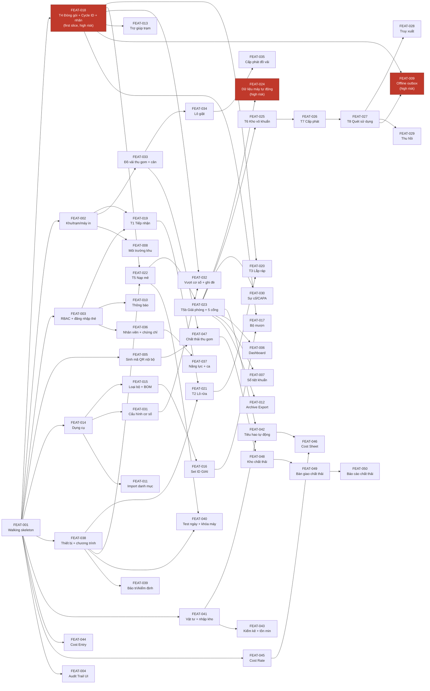
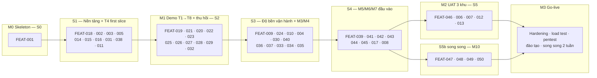

# Implementation Plan: TraceCore

> Status: Draft · Last updated: 2026-10-21
> Inputs: docs/srs.md (v1.11, 90 FR / 35 NFR) · docs/use-cases.md (39 UC) · docs/architecture.md (14 ADR, 63 DocType) · docs/ux-foundations.md (43 SCR) · docs/design.md + docs/tokens.json · docs/.architecture-inputs.md · input/ba_md/cover.md ("Thứ tự phát triển đề xuất") · input/ba_md/d01.md §6 (GĐ1–8).
> Fidelity: đủ 4 tài liệu đầu vào chính. SCR-44..46 (ux-foundations §B5.2) là **đề xuất chưa duyệt**, không tính vào inventory và không được slice. Không có FR/SCR tombstoned.
> Thuật ngữ kỹ thuật giữ tiếng Anh (DocType, RPC, hook, Page, PWA…); nội dung tiếng Việt.

## 1. Overview

TraceCore là app Frappe v15 `tracecore` (cạnh `erpnext`, `hrms`) cho khoa KSNK/CSSD: truy xuất dụng cụ qua chuỗi 8 trạm T1–T8 với cổng kiểm soát 5 bước, Set ID GS1 GIAI vĩnh viễn, Cycle ID GS1 DataMatrix dùng một lần in trên 2 loại nhãn (hấp/plasma), cùng đồ vải, nhân sự, thiết bị, kho, chi phí, cơ số, báo cáo và (v1.11) chất thải y tế. Bốn surface: WEB (Desk), STN (kiosk Frappe Page), PDA (PWA cùng Page), DEPT (Portal).

Kế hoạch gồm **12 epic / 50 feature (FEAT-001..050)**, mỗi FEAT là một lát cắt dọc (UI + RPC `tracecore.v1.*` + domain + DocType). Ưu tiên sắp xếp (Phase 2, chủ đầu tư xác nhận):

1. **De-risk sớm** 4 ADR rủi ro nhất: ADR-004 (GS1 DataMatrix 300 dpi trên nhãn chịu hấp, rủi ro R-01), ADR-005 (step-gate engine), ADR-003 (offline/idempotency), ADR-006 (station agent + 2 loại nhãn, R-04).
2. **Milestone demo** "1 bộ đi hết T1→T8 + thu hồi" sớm nhất có thể (cuối Sprint 2).
3. **MVP cut line** = toàn bộ Must của M1, M2, M8 và M9 nền tảng (tinh thần Sprint 1–2 của BA). Không có deadline cứng ngoài PID (go-live T+28 tuần, d01 §6).
4. Đội: 2–3 dev Frappe Miyano + Claude Code; 1 BA/PM Medcons. Sprint 3 tuần (Sprint 2 cho phép 4 tuần).

Cấu trúc tài liệu: §2 walking skeleton → §3 epic/feature breakdown (toàn app) → §4 build sequence + dependency graph + milestones → §5 first slice (FEAT-018, handoff cho ui-design và detailed-design) → §6 engineering foundations → §7 rủi ro, coverage gap → §8 khác biệt so với BA Sprint 1–5 → §9 kết quả verification.

## 2. Walking Skeleton (FEAT-001)

Mục tiêu: chứng minh **mọi container** của architecture §5.1 chạy và deploy được bằng pipeline thật, trước khi viết nghiệp vụ. Đường đi: Chromium kiosk → Frappe Page `station` → RPC `tracecore.v1.*` → `core.gs1` + DocType → MariaDB → trả về; song song kiosk → Station Agent → máy in ZPL; Audit Log hook; CI xanh; deploy config cho dev/staging bench Miyano.

| Thành phần | Real | Stub / để sau |
| --- | --- | --- |
| Bench + site | Bench `tracecore-dev` version-15, site `tracecore-dev.local`, apps `frappe`, `erpnext`, `hrms`, `tracecore`; `install_app` sạch; `bench migrate` không lỗi | `insights`, `print_designer` cài ở Sprint 5 |
| App `tracecore` | 11 module Frappe (`core`, M1–M10) đúng tên architecture §5.2; `hooks.py` với `doc_events` audit, `website_route_rules` cho `manifest.json`/`sw.js`; `translations/vi.csv` khung | Module M3–M10 chỉ có `__init__` |
| DocType thật | **Set Unit** (đủ trường architecture §5.3: `set_id` = name GIAI, `set_type` Link, `cycles_used`, `max_cycles`, `active_cycle_id`, `status`, `current_station`, `is_loaner`); **Code Registry**; **Audit Log** (append-only, permission `delete=0`, hook `before_save`/`on_trash` chặn) | `Instrument Set Type` chỉ là DocType khung (name + method) để Link; các DocType khác chưa tạo |
| `core.gs1` | `make_giai(prefix, asset_ref)` thật với check cấu trúc AI 8004; `parse_scan(raw)` cho GIAI và QR nội bộ; encoder DataMatrix `pylibdmtx` → PNG; render ZPL `^BXN` cùng payload; unit test | `make_cycle_payload` (01)(11)(17)(21) — đến FEAT-018; GTIN loại bộ dùng prefix test (OQ-05) |
| RPC | `tracecore.v1.ping` (trả version, site, time zone, trạng thái agent nếu có); `tracecore.v1.set_unit.get(set_id)` đọc theo PK, qua decorator `@idempotent` (bảng `Idempotency Key` thật) | Mọi RPC nghiệp vụ khác |
| Kiosk shell | Frappe Page `station` full-screen tối giản: zonebar, ô quét luôn focus, 1 card kết quả, 4 trạng thái màn hình (loading / empty / error / offline — FR-M9-14) với **CSS vars `--tc-*` sinh từ docs/tokens.json** (script `scripts/build_tokens.py` → `tracecore/public/css/tokens.css`), font ≥ 16 px, nút ≥ 48 px; đo thời gian tải Desk shell trên mini PC (R-07) | Router trạm T1..T8; đăng nhập thẻ (dùng user kỹ thuật `station-t4@local` cấu hình sẵn); PWA Service Worker chỉ precache shell, chưa có outbox |
| Station Agent | Service Python `tracecore_agent` tối giản: `GET /health`, `POST /print` nhận ZPL, hàng đợi SQLite, gửi TCP 9100; lệnh `hello` in **1 nhãn test** (GIAI test + chữ) ra máy in thật tại Miyano **hoặc ghi file `.zpl` + ảnh render qua Labelary/`pylibdmtx` nếu chưa có máy in**; `agent.heartbeat` RPC với API key | Cân, driver CSV/API máy, auto-update, xoay key |
| Audit | Hook `after_insert/on_update/on_submit/on_cancel/on_trash` cho Set Unit → Audit Log; `audit.query` RPC đơn giản | Report Audit Trail UI (FEAT-004) |
| CI | GitHub Actions `mvl26/tracecore`: job `lint` (ruff, eslint, bandit, pip-audit), job `test` (frappe_docker + mariadb 10.6 + redis 7 → `bench run-tests --app tracecore --coverage`, `diff-cover --fail-under=70`), job `e2e` Playwright smoke (mở `/app/station`, quét giả GIAI → thấy card kết quả) | `e2e-nightly` lên staging, `release` job khung |
| Deploy config | `scripts/install_dev.sh` (bench init pinned commits, new-site, install apps), `scripts/install_prod.sh` idempotent (viết, chưa chạy), `deploy/staging.env.example`, `site_config.json.example` (secrets ngoài repo), systemd unit mẫu cho agent — **viết, không chạy** | Thực thi deploy production (initial-deployment) |
| Fixtures | Role `TC R01..R10` (rỗng permission trừ Set Unit read), Zone Station khung 3 khu | Ma trận quyền đầy đủ (FEAT-003) |

**Done when:** (1) `bench --site tracecore-dev.local install-app tracecore` sạch trên bench dev Miyano; (2) Chromium kiosk mở `/app/station?station=TR-004`, quét (hoặc gõ) một GIAI test → `set_unit.get` trả bản ghi ≤ 1 s, card hiển thị đúng token màu; quét mã lạ → trạng thái error đúng câu chữ tiếng Việt; (3) `tracecore_agent hello` tạo bản ghi `Print Job` Đã in và nhãn/ZPL kiểm được bằng mắt + quét được bằng máy quét HID (nếu có máy in); (4) tạo/sửa Set Unit sinh Audit Log, `DELETE` Audit Log bị từ chối; (5) CI xanh trên PR đầu; (6) `install_prod.sh --dry-run` và cấu hình staging review xong. **Không** có nghiệp vụ thật nào trong skeleton.

## 3. Epic & Feature Breakdown

Quy ước: **FEAT-NNN** bất biến (không đánh số lại, bỏ = tombstone). Cột *FRs* cite ID gốc `FR-Mx-NN` (dòng con `.k` kế thừa, chỉ ghi khi cần nói "partial"). *Screens* ghi SCR + surface. *Blocks/Endpoints* theo architecture §5.2 và namespace `tracecore.v1.<domain>.<action>` (ADR-001). *Size*: S ≈ ≤ 3 ngày-dev, M ≈ 1 tuần, L ≈ 2 tuần. *Sprint* = đề xuất §4 (S0..S5, S5b).

### E-00 Foundations & skeleton

| ID | Feature | FRs | UCs | Screens | Blocks / Endpoints | Data (DocType) | ADR | Size | Sprint |
| :- | :- | :- | :- | :- | :- | :- | :- | :- | :- |
| FEAT-001 | Walking skeleton (§2) | FR-M9-07 (partial: Code Registry + GIAI), FR-M9-14 (partial: 4 trạng thái shell) | — | shell STN (chưa SCR) | `core.gs1`, `core.audit`, `core.idempotency`, `ui.station`, agent; `v1.ping`, `v1.set_unit.get`, `v1.agent.heartbeat` | W: Set Unit, Code Registry, Audit Log, Idempotency Key, Print Job | 001, 002, 004, 006, 008, 012 | L | S0 |

### E-04 M9 Quản trị nền tảng & báo cáo (Zone Station · Audit · Dashboard · Sổ tiệt khuẩn)

| ID | Feature | FRs | UCs | Screens | Blocks / Endpoints | Data | ADR | Size | Sprint |
| :- | :- | :- | :- | :- | :- | :- | :- | :- | :- |
| FEAT-002 | Khu – trạm – thiết bị ngoại vi – máy in/cuộn – mẫu nhãn cấu hình không code | FR-M9-03; FR-M2-08 (partial .2 khai báo máy in/cuộn, .4 mẫu nhãn) | UC-33 | SCR-33 (WEB) | M9 admin, `core.print` config; Desk form + Client Script; `v1.station.config(station_id)` cho agent kéo cấu hình | W: Zone Station, Station Peripheral, Printer, Label Template | 006 | M | S1 |
| FEAT-003 | Tài khoản/vai trò RBAC 10 role, thẻ nhân viên, đăng nhập thẻ & phiên trạm 8 h, đăng xuất/khóa 10 phút, mật khẩu/PIN/2FA | FR-M9-05, FR-M9-08, FR-M9-09; FR-M4-01 (partial: Employee HRMS + `tc_card_id`, `tc_pin_hash`); FR-M4-03 (partial: kiểm Competency còn hiệu lực, cấp quyền tạm 24 h) | UC-33, UC-20 (partial) | SCR-33 (WEB), màn đăng nhập thẻ trạm (thuộc shell STN/PDA) | `core.station_auth`; `v1.station.login/logout/heartbeat`, `v1.station.verify_pin`; fixtures `custom_role.json`, `custom_docperm.json` từ `permission_matrix.csv`; test ma trận CI | W: Station Session, Station Competency (khung), HRMS Employee (Ext); R: Zone Station | 010, 008 | L | S1 |
| FEAT-004 | Audit Trail tra cứu, xóa mềm danh mục, R02 chuyển trạng thái thủ công có ticket + NC | FR-M9-16; FR-M2-00.3; (NFR-SEC-03) | UC-33 | SCR-33 (WEB) | Report `Audit Trail`, `v1.audit.query`; hook `on_trash` toàn DocType nghiệp vụ; `v1.admin.force_transition` | R/W: Audit Log; W: Incident CAPA (link) | 008, 005 | S | S3 |
| FEAT-005 | Sinh mã đối tượng tự động & in QR nội bộ (NV-/TB-/KE-/TR-/CN-): `core.code_registry` + `core.qr`; in nhãn 50 × 30 mm từ Desk qua server worker (A-05 R1/R2); cấp mã cuộn `CN-` hàng loạt trên form Item (R3); vô hiệu mã `TB-` khi `Retired` (R4); `NV-`/`KE-` và `register_card` chỉ có hàm + test, chưa UI (R6); ngoài phạm vi: DataMatrix GIAI, `CT-`, in từ kiosk/PDA (R7) | FR-M9-07 | UC-33 | SCR-33 (WEB); nút in trên SCR-03/19/21 | `core.gs1.next_code`, `core.print`; `v1.print.object_label` | W: Code Registry, Print Job; R: Employee, Equipment, Sterile Location, Zone Station, Printer | 004, 006 | S | S1 |
| FEAT-006 | Dashboard vận hành theo vai trò + tìm kiếm/lọc/phân trang mọi danh sách, ô quét là phím tắt | FR-M9-01, FR-M9-13 | UC-32 | SCR-32 (WEB) | Frappe Workspace + Dashboard Chart + Script Report; realtime 60 s socketio; List View chuẩn Frappe + Client Script ô quét | R: Set Unit, Pack, Sterilization Load, Issue Note, Notification Log | 001, 009 | M | S5 |
| FEAT-007 | Sổ tiệt khuẩn điện tử theo máy, báo cáo KSNK mẫu BYT, dự báo dụng cụ hết vòng đời (PDF ≤ 30 s nền) | FR-M9-02; (OTH-LEG-001) | UC-32 | SCR-32 (WEB) | Query Report + Print Format; RQ long; `v1.report.sterilization_log` | R: Sterilization Load, Load Indicator Result, Load Pack, Pack, Set Unit, Par Level | 001, 008 | L | S5 |
| FEAT-008 | Nhật ký môi trường khu (nhập tay 2 lần/ngày hoặc cảm biến), báo cáo tháng | FR-M9-04 (Should) | UC-33 | SCR-33 (WEB) | `v1.env.log`; scheduler nhắc | W: Environment Log | 006 | S | S4 |

### E-11 Cross-cutting (offline · thông báo · import/export · trợ giúp)

| ID | Feature | FRs | UCs | Screens | Blocks / Endpoints | Data | ADR | Size | Sprint |
| :- | :- | :- | :- | :- | :- | :- | :- | :- | :- |
| FEAT-009 | Offline outbox IndexedDB + replay theo `client_ts`, dải mã cấp trước, Sync Conflict cho R02 (PWA Service Worker đầy đủ) | FR-M9-06; FR-M2-07.11; FR-M1-06.4 | UC-33 (offline), UC-05/08/13 E3 | SCR-34, SCR-35, SCR-36, SCR-37 (PDA); offline indicator mọi STN (SCR-05..12); SCR-33 (WEB, Sync Conflict) | `core.idempotency` (đã có decorator) + `v1.code_range.allocate`, `v1.sync.replay`; `sw.js` precache danh mục; `tcApi.call()` | W: Code Range, Sync Conflict, Idempotency Key; R: Pack, Set Unit | 003 | L | S3 |
| FEAT-010 | Trung tâm thông báo đa kênh (in-app/PDA/email/SMS), cấu hình người nhận theo sự kiện, đã gửi/đã đọc, leo thang 15 phút | FR-M9-10 | UC-38 | SCR-42 (WEB + STN + PDA + DEPT) | `core.notification.emit`, `v1.notification.list/mark_read`; Email Queue; SMS adapter; scheduler leo thang | W: Notification Rule, Notification Recipient, Notification Log | 014 | M | S3 |
| FEAT-011 | Import danh mục ban đầu từ Excel mẫu theo lô, kiểm từng dòng, import ảnh hàng loạt | FR-M9-11; (EI-SW-007, NFR-PORT-02) | UC-39 | SCR-43 (WEB) | Frappe Data Import bọc bởi Import Template; RQ default; import loại bộ/BOM qua `bom_versions.create_set_type/create_version`, cùng luật FEAT-015 (A-07, S15); import Set Unit qua `set_units.issue_batch`, không insert trực tiếp (A-09, G4) | W: Import Template, Import Batch; W: Instrument, Instrument Set Type, Set BOM Item, Par Level, Equipment, Process Program, Item, Employee, Certificate, Department | 009 | M | S1 |
| FEAT-012 | Archive Export hồ sơ tiệt khuẩn theo kỳ (PDF + CSV, checksum, dấu thời gian) | FR-M9-12; (OTH-RET-001, NFR-COMP-01) | UC-39 | SCR-43 (WEB) | `v1.archive.export`; RQ long; Frappe Data Export | W: Archive Export; R: Load, Load Indicator Result, Pack, Issue Note, Usage Record (masked), Audit Log | 008 | M | S5 |
| FEAT-013 | Trợ giúp theo trạm (3–5 bước có ảnh) & gửi phản hồi/báo lỗi kèm ảnh màn hình tới R10 | FR-M9-15 (Could) | — (mọi UC trạm) | overlay trên mọi STN/PDA (SCR-05..12, 16–18, 23, 34–40) | `ui.station.help`; `v1.feedback.create` | W: Incident CAPA (loại Phần mềm) hoặc Frappe `Issue` | 002 | S | S5 |

> FR-M9-14 (trạng thái màn hình loading/empty/error/offline) là xuyên suốt → **Foundations** (§6, component thư viện shell STN/PDA từ FEAT-001), mọi FEAT trạm kế thừa.

### E-01 M1 Danh mục dụng cụ & bộ dụng cụ

| ID | Feature | FRs | UCs | Screens | Blocks / Endpoints | Data | ADR | Size | Sprint |
| :- | :- | :- | :- | :- | :- | :- | :- | :- | :- |
| FEAT-014 | Dụng cụ đơn lẻ (ảnh thực tế, Spaulding, IFU, phương pháp tương thích, phiên bản) + ngưỡng bảo dưỡng + mã GIAI khắc laser (tính năng bật/tắt) | FR-M1-01, FR-M1-09, FR-M1-02 (Should; FR-M1-02.2/.4 chuyển FEAT-020, A-06 I17) | UC-01 | SCR-01 (WEB) | M1 instrument; Desk form; `v1.instrument.get_image` (thumbnail cho trạm) | W: Instrument, Instrument Compatible Method, Instrument Group (mới, A-06), Instrument Maintenance, TraceCore Settings (mới, Single, A-06); R: Item (tùy chọn) | 004, 009 | M | S1 |
| FEAT-015 | Loại bộ & BOM có phiên bản (ngày hiệu lực, so sánh 2 phiên bản), ảnh bộ đã xếp, hạn lưu theo loại gói, phiếu kiểm đếm PDF | FR-M1-03, FR-M1-04 | UC-02 | SCR-02 (WEB) | M1; Print Format phiếu kiểm đếm (DataMatrix PNG); `v1.set_type.bom(set_type, version)` cache | W: Instrument Set Type, Set BOM Item, Set Unit (cycle_bom_version qua step_gate), Item (tc_shelf_life_days qua RPC); R: Instrument, Department, Item (loại gói) | 004 | M | S1 |
| FEAT-016 | Cấp Set ID GIAI hàng loạt (≤ 100), in thẻ kim loại/nhãn khay, in lại có lý do, vòng đời Set Unit & lịch sử | FR-M1-05, FR-M1-06 | UC-03 | SCR-03 (WEB) | `core.gs1.make_giai`, `core.print` (Label Template `Set Tag`/`Set Tray Label`); `v1.set_unit.create_batch/print_tags/reprint_tag/verify_tag/dispose/tag_preview/print_status/form_context/history/batch_csv`; vòng đời và lịch sử từ `core.step_gate` (`init_unit`, `dispose`, sự kiện trong Audit Log; A-09) | W: Set Unit, Code Registry, Print Job, Label Template (mẫu Set Tag/Set Tray Label); R: Instrument Set Type, Printer | 004, 005, 006 | M | S1 |
| FEAT-017 | Bộ mượn (loaner): nhận LN-, biên bản nhận/trả PDF, chặn cấp phát trước tái xử lý đầy đủ, dòng LOANER trên nhãn | FR-M1-07, FR-M1-08 (Should) | UC-04 | SCR-04 (WEB) | `v1.loaner.receive/return`; hook chặn tại T4/T7 | W: Loaner Set, Loaner BOM Item, Set Unit (is_loaner) | 004 | M | S4 |

### E-02 M2 Chuỗi tái xử lý & truy xuất

| ID | Feature | FRs | UCs | Screens | Blocks / Endpoints | Data | ADR | Size | Sprint |
| :- | :- | :- | :- | :- | :- | :- | :- | :- | :- |
| **FEAT-018** | **T4 Đóng gói → Cycle ID GS1 + in nhãn theo phương pháp + cổng T3→T4** (first slice, §5) | FR-M2-07, FR-M2-08; FR-M2-25 (partial: check T3 Đạt, record T4); FR-M2-00.1, FR-M2-00.2; FR-M8-03 (partial: so sánh `cycles_used`/`max_cycles` + stub ghi đè); FR-M1-09 (partial: hiển thị nhắc bảo dưỡng, xác nhận/hoãn) | UC-08 | SCR-08 (STN) | `v1.pack.generate_cycle_id`, `v1.pack.reprint_label`, `v1.pack.void`, `v1.pack.scan`, `v1.printer.set_roll`, `v1.station.config`, `v1.print.ack`; `core.step_gate.check/record`, `core.gs1.make_cycle_payload`, `core.print.select_printer/render`; agent `/print` | W: Pack, Pack Instrument Confirmed, Pack Maintenance Done, Step Gate Result, Print Job, Code Registry, Set Unit (`active_cycle_id`); R: Instrument Set Type, Set BOM Item, Instrument, Instrument Maintenance, Assembly Record (stub), Item/Batch (lô chỉ thị), Printer, Label Template, Par Level (stub) | 003, 004, 005, 006 | L | S1 |
| FEAT-019 | T1 Tiếp nhận nhiều bộ nối tiếp: quét thẻ người giao + Set ID, kiểm chiều, danh sách BOM có ảnh, xác nhận thành phần từng dòng/tất cả, ghi chú bất thường | FR-M2-01, FR-M2-02, FR-M2-23; FR-M2-25 (T1 record) | UC-05 | SCR-05 (STN), SCR-34 (PDA) | `v1.receive.open/scan_set/confirm_line/submit`; `core.step_gate.record(T1)`; `core.step_gate.start_cycle(set_unit, on=client_time.to_system_time(client_time.parse_client_ts(client_ts)))` để ghim phiên bản BOM của chu trình (A-07, S3; `on` là giờ hệ thống `Asia/Ho_Chi_Minh` không múi giờ: **phải đổi** `client_ts` UTC sang giờ hệ thống trước, nếu không bộ tiếp nhận 00:00–06:59 bị ghim phiên bản của ngày hôm trước); T1 nhận bộ `New` cho chu trình đầu tiên (A-13, G4: bộ cấp bởi FEAT-016 ở trạng thái `New`, ghim BOM ở `start_cycle`) | W: Dirty Receipt, Dirty Receipt Item, Dirty Receipt Confirm Line, Step Gate Result, Set Unit; R: Employee (thẻ), Set BOM Item, Instrument | 005, 003 | M | S2 |
| FEAT-020 | T3 Kiểm tra – lắp ráp theo BOM có ảnh, ghi thiếu/hỏng/thay, khóa Đóng gói khi thiếu chưa R02 xác nhận (PIN), rẽ nhánh Sửa chữa/Thanh lý | FR-M2-05, FR-M2-06; FR-M2-00.5; FR-M2-25 (T3 record; thay stub FEAT-018); FR-M1-02.2, FR-M1-02.4 (quét mã dụng cụ tại T3, chuyển từ FEAT-014, A-06 I17) | UC-07 | SCR-07 (STN) | `v1.assembly.open/line/confirm_shortage/submit`; `core.station_auth.verify_pin`; rẽ nhánh Thanh lý gọi `step_gate.dispose` qua `set_units.dispose` (A-13, G14) | W: Assembly Record, Assembly Line, Step Gate Result, Incident CAPA (thiếu); R: Set BOM Item, Instrument, Par Level (cảnh báo cam) | 005 | M | S2 |
| FEAT-021 | T2 Lô rửa: quét QR máy → chương trình → hóa chất lô/hạn → quét từng bộ → Hoàn thành nạp (LR-), dỡ lô + kết quả Đạt/Không đạt áp cho mọi bộ, nhập tay có xác nhận. Handoff `param_schema`: giới hạn dưới/trên bằng 0 là không đặt; dải một phía hợp lệ | FR-M2-03, FR-M2-04; FR-M2-24 (partial: đính dữ liệu nhập tay vào mã lô); FR-M2-25 (T2 record, Xử lý lại) | UC-06 | SCR-06 (STN) | `v1.wash.start/add_set/complete/unload/result/manual_data` (+ `unload_context`, `lookup`, `redo_queue`, A-12); `core.step_gate.record(T2, mọi bộ)` | W: Wash Batch, Wash Batch Set Unit, Wash Batch Chemical, Step Gate Result; R: Equipment, Process Program, Batch | 005, 007 | L | S2 |
| FEAT-022 | T5 Nạp mẻ: quét QR máy → chương trình → quét Cycle ID từng gói (kiểm tương thích, dung tích, cổng T4) → Hoàn thành nạp → Load ID ME- + in QR mẻ; form nhập tay dữ liệu máy theo `param_schema` + ảnh bản in + xác nhận thẻ. Handoff `param_schema`: giới hạn dưới/trên bằng 0 là không đặt; dải một phía hợp lệ | FR-M2-09, FR-M2-10 | UC-09 | SCR-09 (STN), SCR-35 (PDA) | `v1.load.create/add_pack/complete/manual_data`; `core.print` nhãn QR mẻ | W: Sterilization Load, Load Pack, Print Job; R: Pack, Equipment, Process Program, Daily Test (stub "máy sẵn sàng" đến FEAT-040) | 005, 006, 007 | L | S2 |
| FEAT-023 | T5b Dỡ mẻ – giải phóng (R02 PIN) – cách ly chờ BI – Không đạt → Xử lý lại từ T4; **Vô khuẩn khi đủ 5 cổng**; tăng bộ đếm chu trình Set & dụng cụ; sự kiện async cho M6/M7 | FR-M2-11, FR-M2-12; FR-M2-25 (full: 5 cổng, redo, bảng cổng trên hồ sơ bộ); FR-M8-03 (counter thật, thay stub FEAT-018); FR-M1-06 (partial .1 bộ đếm); FR-M1-09.2 (gọi hook `tracecore_after_release` → `maintenance.on_set_released` với `ctx = {set_unit, set_type, bom_version, cycle_id}`, `cycle_id` bắt buộc để không đếm hai lần khi thử lại, A-06 I16) | UC-10 | SCR-10 (STN; R02 cũng dùng WEB) | `v1.load.unload/release/quarantine/bi_result`; `core.step_gate.record(T5, mọi gói)`; `enqueue_after_commit` → `inventory.consume`, `costing.build_sheet`, `par.evaluate` | W: Sterilization Load, Load Indicator Result, Pack, Step Gate Result, Set Unit, Instrument Maintenance (counter); R: Process Program | 005, 007, 008 | L | S2 |
| FEAT-024 | Dữ liệu máy tự động qua station agent: driver CSV generic + stub API, khớp theo Load ID/khoảng thời gian, `Cần xem xét` khi khớp mờ, chuyển nhập tay có lý do khi mất dữ liệu | FR-M2-24 (full); (EI-SW-001, NFR-INT-01) | UC-06 A3, UC-09 A3 | SCR-06, SCR-09 (STN: panel nguồn dữ liệu) | agent `drivers/csv_generic.py`, `v1.load.ingest_machine_data` (API key, idempotent) | W: Sterilization Load, Wash Batch (`machine_data`, `machine_files`, `data_source`) ; R: Equipment (`is_connected`) | 006, 007 | M | S3 |
| FEAT-025 | T6 Kho vô khuẩn: quét Cycle ID + mã kệ KE- → Trong kho; tồn theo vị trí; hết hạn 00:00/rách → Hết hiệu lực, Set Unit Chờ tiếp nhận; FEFO gợi ý | FR-M2-13, FR-M2-14 | UC-11 | SCR-11 (STN) | `v1.putaway.scan`, `v1.pack.mark_damaged`; scheduler 00:00 | W: Sterile Putaway, Pack, Set Unit, Step Gate Result (T6 kiểm); R: Sterile Location | 005 | M | S2 |
| FEAT-026 | T7 Cấp phát nhiều gói/khoa, quét thẻ người nhận, kiểm cơ số khoa min/max, ký điện tử (thẻ/chữ ký cảm ứng), in phiếu | FR-M2-15, FR-M2-16; FR-M8-02 (partial: áp dụng cơ số khoa khi cấp) | UC-12 | SCR-12 (STN), SCR-36 (PDA) | `v1.issue.create/add_pack/sign/submit`; Print Format phiếu | W: Issue Note, Issue Note Pack, Pack, Set Unit; R: Par Level (khoa), Employee, Department | 005, 006 | M | S2 |
| FEAT-027 | T8 Quét sử dụng: mã BN mã hóa (Password/AES), ca mổ, PTV; chặn 100 % mã Đã dùng/Quá hạn/Thu hồi/Hết hiệu lực kèm lý do; xem mã BN đầy đủ (R01/R02, lý do, audit) | FR-M2-17, FR-M2-18 | UC-13 | SCR-13 (DEPT), SCR-37 (PDA) | `v1.usage.scan`, `v1.usage.reveal_patient_code`; `core.crypto`; `permission_query_conditions` Department | W: Usage Record, Pack, Set Unit; R: Department | 010, 003 | M | S2 |
| FEAT-028 | Truy xuất hai chiều theo mã BN (hash), Set ID, Cycle ID, Load ID, máy, nhân viên, khoảng ngày — timeline 8 trạm | FR-M2-19 | UC-14 | SCR-14 (WEB; view DEPT) | Query Report + `v1.trace.query`; index composite | R: Usage Record, Pack, Load Pack, Sterilization Load, Wash Batch, Dirty Receipt, Issue Note, Step Gate Result, Audit Log | 008, 010 | M | S2 |
| FEAT-029 | Thu hồi theo Load ID / lô BI / lô vật tư: tự lập lệnh gồm mọi Cycle ID, khóa gói trong kho, thông báo khoa, xác nhận từng gói, đóng lệnh | FR-M2-20 | UC-14 | SCR-14 (WEB), SCR-42 (DEPT/PDA xác nhận — in-app tối thiểu) | `v1.recall.create/confirm_pack/close`; realtime badge | W: Recall Order, Recall Order Pack, Pack; R: Load Pack, Issue Note, Usage Record (masked) | 008, 014 | M | S2 |
| FEAT-030 | Sự cố / NC / CAPA: tạo Incident (loại, mức, liên kết đối tượng, ảnh), workflow Phân tích → CAPA → Kiểm tra → Đóng; đồng bộ Quality tùy chọn | FR-M2-21, FR-M2-22 (Should) | UC-15 | SCR-15 (WEB) | `v1.incident.create`; Workflow WF-06 | W: Incident CAPA, CAPA Action; R: mọi chứng từ liên kết | 009 | M | S3 |

### E-03 M8 Cơ số & kiểm soát vượt ngưỡng

| ID | Feature | FRs | UCs | Screens | Blocks / Endpoints | Data | ADR | Size | Sprint |
| :- | :- | :- | :- | :- | :- | :- | :- | :- | :- |
| FEAT-031 | Cấu hình cơ số tái xử lý (dụng cụ/loại bộ/vật tư, nguồn IFU/Ước tính, ngưỡng cảnh báo sớm) và cơ số tồn khoa (min/max/% vượt), lịch sử phiên bản | FR-M8-01, FR-M8-02 | UC-30 | SCR-30 (WEB) | M8 par; Desk form | W: Par Level, Par Level History; R: Instrument, Instrument Set Type, Department, Linen Type | 009 | S | S1 |
| FEAT-032 | Kiểm soát vượt cơ số đầy đủ: cảnh báo cam tại T3/dashboard, chặn sinh Cycle ID + Hết vòng đời, đề nghị ghi đè từ T4 → R01 duyệt PIN (WF-08) → mở trong phạm vi/thời hạn, báo cáo ghi đè tháng | FR-M8-03 (full), FR-M8-04 | UC-31 | SCR-31 (WEB), SCR-08 (STN nút Đề nghị ghi đè) | `v1.par.check`, `v1.par.override.request/approve`; thay stub trong `pack.generate_cycle_id`; duyệt Hết vòng đời → thanh lý gọi `step_gate.dispose` qua `set_units.dispose` (A-09, G14) | W: Par Override, Set Unit; R: Par Level, Instrument Maintenance | 005, 014 | M | S2 |

### E-05 M3 Đồ vải

| ID | Feature | FRs | UCs | Screens | Blocks / Endpoints | Data | ADR | Size | Sprint |
| :- | :- | :- | :- | :- | :- | :- | :- | :- | :- |
| FEAT-033 | Danh mục loại đồ vải (kg chuẩn, định mức khoa, giá) + thu gom theo khoa với cân RS-232 qua agent (`GET /scale`) hoặc nhập tay có xác nhận; component `tc-weigh-line` | FR-M3-01, FR-M3-02 | UC-16 | SCR-16 (STN) | `v1.linen.collect`; agent `/scale` | W: Linen Type, Linen Dept Quota, Linen Collection, Linen Collection Line | 006, 013 | M | S3 |
| FEAT-034 | Lô giặt theo kg (máy Sẵn sàng, chương trình, hóa chất) + trừ hóa chất & chi phí/kg khi Hoàn tất | FR-M3-03, FR-M3-04 (Should) | UC-17 | SCR-17 (STN) | `v1.laundry.start/complete`; hook → `inventory.consume`, `costing` | W: Laundry Batch, Laundry Batch Chemical; R: Equipment, Process Program | 009 | M | S3 |
| FEAT-035 | Cấp phát đồ vải theo khoa, tồn khoa, đối chiếu thu − trả − hủy cuối ngày, cảnh báo vượt định mức | FR-M3-05, FR-M3-06 | UC-18 | SCR-18 (STN; view DEPT) | `v1.linen.issue`; Script Report chênh lệch; scheduler cuối ngày | W: Linen Issue, Linen Issue Line; R: Linen Collection, Linen Dept Quota | 013 | M | S3 |

### E-06 M4 Nhân sự & chứng chỉ

| ID | Feature | FRs | UCs | Screens | Blocks / Endpoints | Data | ADR | Size | Sprint |
| :- | :- | :- | :- | :- | :- | :- | :- | :- | :- |
| FEAT-036 | Hồ sơ nhân viên HRMS (mã NV-, thẻ, khu, KSK, tiêm chủng, ảnh) + chứng chỉ có hạn & file scan, nhắc 60/30/7 ngày; vô hiệu khi nghỉ việc | FR-M4-01 (full), FR-M4-02 | UC-19 | SCR-19 (WEB) | HRMS Employee (Ext) + Desk; scheduler nhắc → `core.notification` | W: Employee (Ext), Certificate; W: Code Registry | 009, 014 | M | S3 |
| FEAT-037 | Ma trận năng lực theo trạm (chứng chỉ yêu cầu, hiệu lực, quyền tạm 24 h) + phân ca theo khu + sản lượng theo người/ca từ Audit Log | FR-M4-03 (full), FR-M4-04 (Should) | UC-20 | SCR-20 (WEB) | `core.station_auth` dùng Competency thật; HRMS Shift Type/Assignment (Ext); Script Report sản lượng | W: Station Competency, Competency Required Cert, Shift Assignment (Ext); R: Audit Log | 009, 010 | M | S3 |

### E-07 M5 Thiết bị & bảo trì

| ID | Feature | FRs | UCs | Screens | Blocks / Endpoints | Data | ADR | Size | Sprint |
| :- | :- | :- | :- | :- | :- | :- | :- | :- | :- |
| FEAT-038 | Hồ sơ thiết bị (mã TB-, khu, cửa vào/ra, `is_connected`, `has_printout`, dung tích, Link Asset) + chương trình xử lý (dải tham số `param_schema`, định mức tiêu hao, loại gói tương thích, yêu cầu BI) + mã `TB-` ghi `Code Registry` (in QR máy do FEAT-005 đảm nhiệm, A-04 Q4) | FR-M5-01, FR-M5-02 | UC-21 | SCR-21 (WEB) | Desk form; `v1.equipment.get(qr)` | W: Equipment, Process Program, Program Consumable, Program Compatible Pack Type, Program Parameter, Equipment Type Norm; R: Asset, Item | 009 | M | S1 |
| FEAT-039 | Kế hoạch bảo trì/kiểm định/hiệu chuẩn (nhắc 30/7 ngày, hết hạn → khóa), sự cố thiết bị (Đang sửa chữa, mẻ ảnh hưởng, chi phí) | FR-M5-03, FR-M5-04 | UC-22 | SCR-22 (WEB) | Workflow WF-07; scheduler; `core.notification` | W: Maintenance Record, Maintenance Part, Maintenance Affected Load, Equipment (status); R: Asset | 009, 014 | M | S4 |
| FEAT-040 | Test hằng ngày (Bowie-Dick, leak, làm sạch) mở khóa máy; khóa tạo mẻ/lô khi chưa test Đạt / quá hạn kiểm định / Sửa chữa; mở khóa tạm ≤ 24 h R02 (không với áp lực quá hạn) | FR-M5-05, FR-M5-06; (OTH-LEG-003) | UC-23 | SCR-23 (STN) | `v1.daily_test.record`, `v1.equipment.unlock_temp`; thay stub "máy sẵn sàng" trong `load.create`/`wash.start` | W: Daily Test, Equipment (lock state); R: Maintenance Record | 005 | M | S3 |

### E-08 M6 Kho vật tư tiêu hao

| ID | Feature | FRs | UCs | Screens | Blocks / Endpoints | Data | ADR | Size | Sprint |
| :- | :- | :- | :- | :- | :- | :- | :- | :- | :- |
| FEAT-041 | Vật tư tiêu hao trên ERPNext Item (nhóm CSSD, phương pháp tương thích cho nhãn, tồn tối thiểu/kho) + nhập kho theo lô/hạn (Stock Entry Material Receipt, bình quân gia quyền) | FR-M6-02, FR-M6-01 | UC-24 | SCR-24 (WEB) | ERPNext Item/Batch/Warehouse/Stock Entry (Ext `tc_*`); Desk | W: Item (Ext), Item Reorder (bảng con chuẩn), Batch, Stock Entry (Ext), Warehouse; Custom Field mới `Item-tc_specification`, `Stock Entry-tc_supplier`/`tc_document_no`, `Stock Entry Detail-tc_batch_id`/`tc_expiry_date` (A-07) | 009 | M | S4 |
| FEAT-042 | Tiêu hao tự động theo lô rửa/mẻ/lô giặt (Material Issue theo định mức × gói/kg, ghi lô vào hồ sơ, idempotent `tc_source`) + xuất kho thủ công FEFO | FR-M6-03, FR-M6-04 | UC-25 | SCR-25 (WEB) | hook `inventory.consume` (RQ default) nối với sự kiện FEAT-023/021/034; `v1.stock.issue_manual` | W: Stock Entry (Ext), Stock Ledger Entry; R: Program Consumable, Cost Norm Line, Batch | 009 | M | S4 |
| FEAT-043 | Kiểm kê (Stock Reconciliation + duyệt R02/R09, in phiếu) + cảnh báo tồn dưới tối thiểu (dashboard, email, Material Request) | FR-M6-05 (Should), FR-M6-06 | UC-26 | SCR-26 (WEB) | ERPNext Stock Reconciliation (Ext), Material Request; scheduler → `core.notification` | W: Stock Reconciliation, Material Request; R: Bin, Item | 009, 014 | S | S4 |

### E-09 M7 Chi phí & giá thành

| ID | Feature | FRs | UCs | Screens | Blocks / Endpoints | Data | ADR | Size | Sprint |
| :- | :- | :- | :- | :- | :- | :- | :- | :- | :- |
| FEAT-044 | Nhập chi phí theo khoản mục/kỳ/chứng từ + gắn đối tượng phân bổ (thiết bị/khu/chương trình, %) | FR-M7-01, FR-M7-02 | UC-27 | SCR-27 (WEB) | Desk form | W: Cost Entry, Cost Allocation; R: Equipment, Zone Station, Process Program, Cost Center | 009 | S | S4 |
| FEAT-045 | Bảng định giá có phiên bản (hiệu lực, phê duyệt) + định mức tiêu hao theo mẻ/gói | FR-M7-03, FR-M7-04 | UC-28 | SCR-28 (WEB) | Desk form; `v1.costing.rate_at(date)` | W: Cost Rate Version, Cost Rate Line, Cost Norm Line; R: Item | 009 | M | S4 |
| FEAT-046 | Cost Sheet mẻ khi giải phóng (khấu hao/mẻ + điện + nước + hóa chất + chỉ thị + nhân công + bảo trì phân bổ) → chia gói → giá thành bộ/chu trình (+ khấu hao dụng cụ ÷ cơ số); xuất Excel/CSV | FR-M7-05, FR-M7-06; (EI-SW-006) | UC-29 | SCR-29 (WEB) | job `costing.build_sheet` (RQ) nối sự kiện FEAT-023; Query Report; Data Export | W: Cost Sheet, Cost Sheet Line; R: Sterilization Load, Load Pack, Stock Entry, Cost Rate Version, Cost Entry, Asset, Par Level | 009 | L | S5 |

### E-10 M10 Quản lý chất thải y tế

| ID | Feature | FRs | UCs | Screens | Blocks / Endpoints | Data | ADR | Size | Sprint |
| :- | :- | :- | :- | :- | :- | :- | :- | :- | :- |
| FEAT-047 | Loại chất thải (nhóm TT 20/2021, mã màu, bao bì, hạn lưu thường/lạnh, đơn giá) + thu gom theo khoa: quét thẻ người giao, loại, số túi, kg (cân/nhập tay), sinh & in QR túi CT- | FR-M10-01, FR-M10-02 | UC-34 | SCR-38 (STN + PDA) | `v1.waste.collect`, `core.gs1` CT-, `core.print` nhãn QR túi; `tc-weigh-line` | W: Waste Type, Waste Type Rate, Waste Collection, Waste Collection Line, Waste Container, Code Registry; R: Employee, Department | 013, 004, 006 | M | S5b |
| FEAT-048 | Kho lưu giữ tạm: quét túi + vị trí KE- theo loại, thời gian lưu còn lại, cảnh báo 80 % / quá hạn + NC, nhiệt độ kho lạnh | FR-M10-03 | UC-35 | SCR-39 (STN; view WEB) | `v1.waste.store`; scheduler 15 phút; `core.notification` | W: Waste Container, Waste Storage Location, Environment Log, Incident CAPA | 013, 014 | M | S5b |
| FEAT-049 | Đơn vị xử lý (MST, giấy phép, loại được phép, hợp đồng/đơn giá) + Phiếu bàn giao (quét túi/theo loại, kg bàn giao, chênh lệch > ngưỡng → lý do + NC, chứng từ CTNH, chữ ký 2 bên, PDF) → Cost Entry thuê ngoài | FR-M10-04, FR-M10-05 | UC-36 | SCR-40 (STN bàn giao + WEB danh mục) | `v1.waste.handover.create/add/sign/submit`; Print Format | W: Waste Treatment Vendor, Vendor Permitted Waste Type, Vendor Contract, Waste Handover, Waste Handover Line, Waste Handover Container, Waste Container, Cost Entry | 013 | L | S5b |
| FEAT-050 | Báo cáo chất thải (kg theo khoa/loại/kỳ, chênh lệch, chi phí/kg, PDF/Excel, view khoa trên DEPT) + sự cố chất thải qua NC chung + định mức túi/thùng & kg/giường/ngày | FR-M10-06, FR-M10-07, FR-M10-08 | UC-37 | SCR-41 (WEB; view DEPT), SCR-32 (khối chất thải), SCR-15 (loại Chất thải) | Script Report + Print Format; `Incident CAPA` (`incident_category=Chất thải`); Desk form Waste Quota | W: Waste Quota, Incident CAPA; R: Waste Collection, Waste Handover, Waste Container, Item | 013 | M | S5b |

### 3.1 Coverage ledger

**Must FR (toàn bộ 90 FR gốc, kể cả Should/Could):** mỗi FR xuất hiện ở ít nhất một FEAT ở trên; FR-M9-14 đặt vào Foundations (§6). Kiểm bằng script (§9): **0 FR chưa phủ, 0 Must FR chưa phủ.** FR partial được hoàn tất tại: FR-M2-25 (018 → 019/020/021/022 → 023 full), FR-M8-03 (018 stub → 023 counter → 032 full), FR-M4-01/FR-M4-03 (003 partial → 036/037 full), FR-M2-24 (021 nhập tay → 024 tự động), FR-M2-08 (002 cấu hình → 018 in), FR-M9-07 (001 → 005), FR-M1-09 (014 → 018 nhắc tại T4), FR-M8-02 (031 → 026 áp dụng).

**SCR (43/43):** SCR-01→014 · 02→015 · 03→016, 005 · 04→017 · 05→019 · 06→021, 024 · 07→020 · 08→018, 032, 009 · 09→022, 024 · 10→023 · 11→025 · 12→026 · 13→027 · 14→028, 029 · 15→030, 050 · 16→033 · 17→034 · 18→035 · 19→036 · 20→037 · 21→038 · 22→039 · 23→040 · 24→041 · 25→042 · 26→043 · 27→044 · 28→045 · 29→046 · 30→031 · 31→032 · 32→006, 007, 050 · 33→002, 003, 004, 005, 008, 009 · 34→019, 009 · 35→022, 009 · 36→026, 009 · 37→027, 009 · 38→047 · 39→048 · 40→049 · 41→050 · 42→010, 029 · 43→011, 012. **0 màn hình chưa chạm.**

**NFR (35):** phân vào Foundations hoặc FEAT đo được — ghi trong RTM Plan ref (§9); EI-*/OTH-* không có dòng RTM, được tham chiếu trong ngoặc tại FEAT liên quan.

## 4. Build Sequence

### 4.1 Nguyên tắc sắp xếp

1. **Risk thắng dependency khi có thể gây re-architecture**: T4 (FEAT-018) được kéo lên ngay sau skeleton dù về nghiệp vụ nó đứng thứ 4 trong chuỗi — vì nó chạm cả 4 ADR rủi ro nhất (GS1 payload + DataMatrix 300 dpi, step gate, agent + 2 loại nhãn, idempotency) và là anchor screen A2. Các bước trước (T1–T3) được giả lập bằng fixture/stub và thay thật ở Sprint 2.
2. **Dependency thắng cho build order thường**: Zone Station/Printer (002), đăng nhập thẻ (003), Equipment + Program (038) phải có trước T1/T2/T5 vì các trạm quét QR máy, QR trạm, thẻ. Đây là lý do **M5 (một phần) được kéo từ Sprint 4 của BA lên Sprint 1**.
3. **MoSCoW làm tiebreaker**: Should (FR-M1-02/07/08, FR-M2-22, FR-M3-04, FR-M4-04, FR-M6-05, FR-M9-04) và Could (FR-M9-15) xếp sau Must cùng epic; "all Musts shipped" đạt cuối Sprint 5.
4. **Luồng dữ liệu bàn giao D-01..D-04**: Import (011) đưa lên Sprint 1 để nạp danh mục thật sớm (R-06).
5. **Offline (009), dữ liệu máy tự động (024), thông báo (010)** đưa vào Sprint 3 (BA để offline ở Sprint 5) — đủ sớm để UAT 3 khu diễn tập mất mạng, đủ muộn để chuỗi T1→T8 online đã ổn.
6. **M10** là epic độc lập trên core đã có (ADR-013) → track song song Sprint 4–5 bởi 1 dev (S5b); phạm vi go-live của M10 do chủ đầu tư chốt (OQ).

### 4.2 Sprint đề xuất

| Sprint (tuần) | FEAT | Tăng trưởng demo được | Milestone |
| --- | --- | --- | --- |
| **S0** (2) | 001 | Kiosk quét GIAI → card; agent in nhãn test; CI xanh; deploy config | **M0 Skeleton** |
| **S1** (3) | 018 (first slice), 002, 003, 005, 014, 015, 016, 031, 038, 011 | Đóng gói 1 bộ thật (import từ Excel) → Cycle ID → nhãn hấp/plasma quét được sau hấp thử; đăng nhập thẻ; cơ số chặn stub | Nhãn mẫu qua 1 mẻ hấp + 1 mẻ plasma (kiểm R-01 sớm) |
| **S2** (4) | 019, 021, 020, 022, 023, 025, 026, 027, 028, 029, 032 | **1 bộ đi hết T1→T8**, mẻ Không đạt → thu hồi; vượt cơ số → chặn → R01 duyệt ghi đè → mở | **M1 Demo** |
| **S3** (3) | 009, 024, 010, 004, 030, 040, 036, 037, 033, 034, 035 | Mất mạng 4 giờ vẫn quét; dữ liệu máy CSV tự động; thông báo đa kênh; test ngày khóa máy; M4 đầy đủ; M3 đồ vải | Diễn tập offline nội bộ |
| **S4** (3) | 039, 041, 042, 043, 044, 045, 017, 008 (+ S5b bắt đầu: 047, 048) | Tiêu hao tự động theo mẻ; kho lô/hạn; chi phí đầu vào; bộ mượn | — |
| **S5** (3) | 046, 006, 007, 012, 013 (+ S5b: 049, 050) | Giá thành mẻ/bộ; dashboard; sổ tiệt khuẩn điện tử in mẫu BYT; export hồ sơ | **M2 UAT 3 khu** (GĐ6 PID, 3 tuần) |
| **S5b** (song song S4–S5, 1 dev) | 047, 048, 049, 050 | Thu gom → lưu giữ → bàn giao → báo cáo chất thải | UAT M10 cùng M2 hoặc sau go-live |
| Sau UAT | hardening, load test, pentest ASVS L2, đào tạo, chạy song song 2 tuần | — | **M3 Go-live** (GĐ7 PID) |

Thời lượng: S0–S5 ≈ 18 tuần phát triển (PID GĐ3–5 = 15 tuần + GĐ2 thiết kế 3 tuần — tương đương vì detailed-design/ui-design chạy per-slice trong sprint). Thứ tự sau S2 là **living order**: tái sắp sau mỗi sprint theo kết quả đo (Debt-1, R-07) — không phải cam kết.

### 4.3 Dependency graph (acyclic; cạnh = "phải có trước")



### 4.4 Milestone view



## 5. First Vertical Slice — FEAT-018 "T4 Đóng gói → Cycle ID GS1 + in nhãn theo phương pháp + cổng T3→T4"

> **Amendment A-02 (2026-10-20):** quyết định thiết kế FEAT-018 (D1–D14, xem `docs/superpowers/plans/FEAT-018-t4-packing-cycle-id.md`) được ghi ở `docs/architecture.md`, Revision History A-02; D1–D5, D7 **tạm — trình CĐT 20/10/2026**, D6 còn mở (FEAT-018 dùng GTIN test). Nếu đoạn dưới lệch với A-02 thì A-02 thắng, cụ thể: §5.3 AC-5 (hạn dùng = ngày đóng gói + min(hạn loại gói, hạn ghi đè của loại bộ), D4), §5.3 AC-12 (ngưỡng chặn bảo dưỡng: bộ đếm > ngưỡng × 1,2 hoặc số lần hoãn ≥ 3, D5), §5.4 ("scan-box thứ hai" → một ô quét duy nhất ở đầu màn, lô chỉ thị chỉ hiển thị kết quả, D10; thêm nút "Xác nhận tất cả thành phần", D1), §5.5 (RPC và mã lỗi đã cập nhật bên dưới).

> **Amendment A-03 (2026-10-20, cập nhật 2026-10-21):** quyết định thiết kế FEAT-002 (E1–E8 và ruling P1, xem `docs/superpowers/plans/FEAT-002-zone-station-peripherals.md`) được ghi ở `docs/architecture.md`, Revision History A-03 và ghi chú A-03 ở §5.3.1 (M9); E1–E3 **tạm — chờ chủ đầu tư duyệt**. Điểm chạm slice FEAT-018: nạp cuộn nhãn từ form Máy in trên Desk (`tracecore.v1.printer.set_roll` kèm `printer`) chỉ cho TC R10 và System Manager, không cần là trạm T4, ghi nhận cuộn nhưng không phát hành nhãn chờ (nhãn chờ in khi quét cuộn ở màn T4, AC-9 vẫn đạt qua đường kiosk); trạm không hoạt động bị từ chối `STATION_INACTIVE` (409). Khung 3 khu + 7 trạm mặc định tạo nếu chưa có (`tracecore.setup.seed`), không còn là fixtures như ghi ở §2.

### 5.1 Lựa chọn và lý do

Đề xuất đầu vào là FEAT-018; tôi đánh giá lại hai ứng viên thay thế:

| Ứng viên | Ưu | Nhược | Kết luận |
| --- | --- | --- | --- |
| T1 Tiếp nhận (FEAT-019, anchor A1) | Đầu chuỗi, dữ liệu vào tự nhiên, tần suất cao nhất, luồng 2 mã quét | Không chạm GS1 Cycle ID, không in nhãn, không step gate (T1 chỉ ghi), không agent → de-risk kém; cần đăng nhập thẻ + Employee trước | Loại |
| Cấp Set ID + in thẻ (FEAT-016) | Chạm GS1 GIAI + agent in | Chỉ WEB, không kiosk; không step gate, không 2 loại nhãn; GIAI đã có trong skeleton | Loại |
| **T4 Đóng gói (FEAT-018)** | Chạm cả 4 ADR rủi ro (003 idempotency, 004 payload (01)(11)(17)(21) + DataMatrix 300 dpi, 005 gate check/record, 006 agent + chọn máy in theo loại nhãn), là anchor A2 (màn phức tạp nhất → kiểm design system sớm), là điều kiện vào mẻ (CHG-028), có thể **đưa nhãn mẫu qua hấp/plasma ngay Sprint 1** (R-01) | Cần stub T3 Đạt, cơ số, lô chỉ thị; cần dữ liệu M1 bằng fixture | **Chọn** |

### 5.2 Luồng người dùng (UC-08 main scenario, rút gọn)

R04 (phiên kỹ thuật `station-t4@local`, đăng nhập thẻ đến FEAT-003) quét Set ID tại kiosk T4 → hệ thống kiểm cổng T3 Đạt (từ Assembly Record stub seed) → hiển thị BOM có ảnh dụng cụ + ảnh bộ đã xếp, par bar `cycles_used/max_cycles`, nhắc bảo dưỡng (nếu có) → R04 tick từng loại dụng cụ → quét lô chỉ thị hóa học (ERPNext Batch của Item nhóm Chỉ thị; kiểm loại 5/6 theo phương pháp + còn hạn) → chọn loại gói (hạn lưu nhập tay của loại gói) → **Xác nhận hoàn thành đóng gói** → server (một transaction, `SELECT … FOR UPDATE` Set Unit) kiểm gate T3, đủ tick, CI lot, bảo dưỡng, cơ số stub, `active_cycle_id` rỗng → sinh `CY-YYMMDD-NNNN` + payload GS1 → insert Pack (Đã đóng gói) + Step Gate Result T4 Đạt + `Set Unit.active_cycle_id` → chọn Printer có `label_type_loaded` khớp phương pháp → trả `{cycle_id, zpl, printer}` → kiosk POST agent `/print` → TCP 9100 → `print.ack` → label preview; R04 quét lại nhãn để xác nhận (parse_scan GS1).

### 5.3 Acceptance criteria (EARS, từ FR-M2-07/08/25, FR-M8-03, FR-M2-00)

| # | Tiêu chí | Nguồn |
| --- | --- | --- |
| AC-1 | Khi R04 bấm Xác nhận hoàn thành đóng gói sau khi tick đủ dòng BOM và quét lô chỉ thị hợp lệ, hệ thống sinh **một** Cycle ID mới duy nhất (không có bước sinh mã riêng), tạo Pack trạng thái Đã đóng gói mang Set ID, tên bộ, phiên bản BOM, ngày giờ, người, hạn dùng, phương pháp, loại gói, lô chỉ thị, và in nhãn ngay | FR-M2-07 |
| AC-2 | Nhãn mã hóa GS1 DataMatrix với (01) GTIN loại bộ, (11) ngày đóng gói, (17) hạn dùng, (21) Cycle ID; `parse_scan` của chuỗi quét từ máy quét HID (có/không `]d2`) trả đúng `{type: pack, id}`; dòng người đọc in dưới mã | FR-M2-07.1, ADR-004 |
| AC-3 | Nếu chưa tick đủ dòng BOM hoặc chưa quét lô chỉ thị loại 5/6 đúng phương pháp, nút Xác nhận bị khóa và danh sách mục còn thiếu hiển thị; lô chỉ thị hết hạn bị chặn và yêu cầu lô khác | FR-M2-07.2, FR-M2-07.12 |
| AC-4 | Nếu Set Unit còn `active_cycle_id` hiệu lực, hệ thống không sinh Cycle ID mới và nêu Cycle ID cũ | FR-M2-07.5, FR-M2-07.6 |
| AC-5 | Hạn dùng = ngày đóng gói + hạn lưu nhập tay của loại gói đang áp dụng (không có mặc định cứng); loại gói chưa có hạn lưu không chọn được; thay đổi hạn lưu chỉ áp cho gói đóng sau đó | FR-M2-07.7, FR-M2-07.8 |
| AC-6 | Nếu cổng T3 của bộ trong chu trình hiện tại chưa Đạt (hoặc Set Unit ở trạng thái không hợp lệ với T4), quét Set ID tại T4 hiện cảnh báo đỏ toàn màn kèm lý do, không ghi nhận, ghi Audit Log | FR-M2-25.1, FR-M2-00.1, FR-M2-00.2 |
| AC-7 | Khi Cycle ID sinh thành công, Step Gate Result (set_unit, cycle_no, T4) = Đạt được ghi trong cùng transaction với Pack | FR-M2-25, ADR-005 |
| AC-8 | Hệ thống chọn Label Template và Printer theo phương pháp của gói (Hấp → `VT-NHAN-HAP`, Plasma → `VT-NHAN-PLASMA`); nếu trạm không có máy in/cuộn khớp, Cycle ID vẫn giữ, Print Job trạng thái Chờ, hiển thị lý do, **không** in tạm trên loại nhãn khác | FR-M2-08, FR-M2-08.1, FR-M2-08.8, EI-HW-008 |
| AC-9 | Đổi cuộn trên trạm 1 máy in = quét mã cuộn `CN-` → cập nhật `label_type_loaded` + audit trước khi in gói phương pháp khác | FR-M2-08.2 |
| AC-10 | In lại trong 10 phút kể từ khi sinh (tính từ lúc tạo Pack, đo bằng giờ server — A-02, ruling Task 8): cùng Cycle ID, bắt buộc lý do, `label_print_count++`; quá 10 phút: yêu cầu hủy Cycle ID cũ và sinh mới | FR-M2-08.5, FR-M2-08.6 |
| AC-11 | Nếu `cycles_used ≥ max_cycles` của Set Unit (stub cấp bộ; cấp dụng cụ và ghi đè đến FEAT-032), hệ thống không sinh Cycle ID, hiển thị lý do và nút "Đề nghị ghi đè" (disabled kèm chú thích "có từ FEAT-032") | FR-M8-03.2 (partial) |
| AC-12 | Khi dụng cụ trong bộ có bộ đếm bảo dưỡng ≥ ngưỡng, nhắc kèm ảnh + loại việc hiển thị; "Đã bảo dưỡng" ghi người/thời điểm/lô dầu và reset; "Hoãn" yêu cầu lý do; bộ đếm > ngưỡng × 1,2 (vượt 20 %) hoặc số lần hoãn ≥ 3 → chặn sinh, trừ khi lần đóng gói này chọn Đã bảo dưỡng (A-02, D5) | FR-M1-09.3..6, FR-M2-07.4 |
| AC-13 | Cùng `X-Idempotency-Key` gửi lại → trả cùng response, không sinh Cycle ID thứ hai | ADR-003, EI-SW-004 |
| AC-14 | Quét Cycle ID (sau in) hiển thị ngày đóng gói, người, hạn, phương pháp, lô chỉ thị | FR-M2-07.9 |
| AC-15 | Màn SCR-08 đạt: nút ≥ 48 px, chữ ≥ 16 px, ≤ 3 chạm sau quét cho đường chính, 4 trạng thái màn hình, trạng thái Đạt/Chặn không chỉ bằng màu, 0 chuỗi chưa dịch; RPC `pack.generate_cycle_id` ≤ 1 s P95 trên bench dev với 50 bộ seed | NFR-USAB-01/02, NFR-ACC-01, NFR-PERF-01, FR-M9-14 |
| AC-16 | Nhãn in bằng Label Template mẫu trên máy in 300 dpi: quét được 100 % trước và sau 1 mẻ hấp 134 °C và 1 mẻ plasma thử (nếu có vật liệu D-03; nếu chưa, ghi là pending-environment) | FR-M2-08.7, NFR-COMP-02, R-01 |

**Stub trong slice này (ghi rõ để detailed-design không hiểu nhầm là thiết kế cuối):** Assembly Record Đạt tạo bằng Desk form mặc định/fixture (FEAT-020 thay); Instrument/Instrument Set Type/Set BOM Item/Instrument Maintenance có schema theo architecture §5.3 nhưng chỉ Desk form mặc định + fixtures seed (FEAT-014/015 thêm validation, phiên bản, UI); kiểm cơ số chỉ so sánh cấp Set Unit (FEAT-032); lô chỉ thị = ERPNext Item/Batch seed (FEAT-041 thêm UI/Custom Field); tiêu hao vật tư chỉ phát sự kiện `pack_created` (FEAT-042 tiêu thụ); sinh Cycle ID offline từ Code Range (FEAT-009); đăng nhập thẻ (FEAT-003). Set Unit phải được tạo bằng `core.gs1.make_giai` (đã có từ skeleton) qua fixture để payload (01) có GTIN loại bộ.

### 5.4 Handoff → **ui-design** (screens)

- **SCR-08** (STN, kiosk 1366×768 và 1920×1080) — anchor A2 theo ux-foundations Part D: gate panel (T1–T5, T3 Đạt, T4 đang), par bar, khối nhắc bảo dưỡng (due/done/hoãn), BOM checklist có ảnh (component chung với SCR-05/07), scan-box thứ hai cho lô chỉ thị, form grid loại gói/hạn, nút Xác nhận disabled có lý do, alert-error toàn màn (AC-6, AC-8, AC-11), label preview hấp/plasma, modal lý do in lại / PIN, hàng đợi in, offline indicator (hiển thị, chưa hoạt động), 4 trạng thái màn hình. Dùng tokens `--tc-*` từ docs/tokens.json và design.md §4; đối chiếu #17 `t4*`, ảnh design-refs 12, 13.
- Không có SCR WEB trong slice (Printer/Label Template dùng Desk form mặc định; UI cấu hình thuộc FEAT-002).

### 5.5 Handoff → **detailed-design** (contracts / data)

- **RPC** (`/api/method/tracecore.v1.*`; RPC ghi đều `@idempotent`, kiểm `Station Session.zone` = Sạch; Amendment A-02):
  - `pack.scan(raw, station, open_set=None, client_ts=None)`: một ô quét duy nhất (D10), server phân loại bằng `core.gs1.parse_scan` rồi định tuyến: Set ID → ngữ cảnh bộ (BOM + ảnh + gate + par + bảo dưỡng + loại gói, thay cho `pack.get_context`); Cycle ID → tra cứu (thay cho `pack.lookup`, AC-14); mã cuộn `CN-` → `set_roll` (AC-9); mã khác khi đang mở bộ (`open_set`) → lô chỉ thị.
  - `pack.generate_cycle_id(set_id, station, confirmed_lines, ci_batch, pack_type, maint_actions=None, client_ts=None)` → `{cycle_id, payload, zpl, printer, print_job}`; `pack.reprint_label(cycle_id, reason, station, client_ts=None)`; `pack.void(cycle_id, reason, station, note=None, client_ts=None)`; `printer.set_roll(roll_code, station, printer=None, client_ts=None)`.
  - `station.config(station)` (agent, API key; không `@idempotent`): trả danh sách máy in của trạm; agent chỉ in tới máy in có trong danh sách này (D11). `print.ack(print_job, status, message)` (agent, API key).
  - Từ chối nghiệp vụ trả body `{"ok": false, "error": {code, title, reason, action, http_status, items?, redo_step?}}`. Mã lỗi `error.code`: `STATION_WRONG_STEP`, `SCAN_INVALID`, `BOM_INCOMPLETE`, `CI_LOT_INVALID`, `CI_LOT_EXPIRED`, `PACK_TYPE_INVALID`, `REASON_REQUIRED`, `MAINT_ACTION_REQUIRED`, `MAINT_OIL_LOT_REQUIRED`, `ROLL_NOT_LABEL`, `SET_NOT_FOUND`, `PACK_NOT_FOUND`, `ROLL_NOT_FOUND`, `STATUS_INVALID_FOR_STATION`, `ACTIVE_CYCLE_EXISTS`, `GATE_PREV_NOT_PASSED`, `SET_TYPE_GTIN_MISSING`, `PAR_EXCEEDED`, `MAINT_OVERDUE`, `REPRINT_WINDOW_EXPIRED`, `PACK_NOT_VOIDABLE`, `ROLL_PRINTER_AMBIGUOUS`. `NO_PRINTER_FOR_METHOD` là cảnh báo đi kèm kết quả thành công (Cycle ID vẫn giữ), không phải lỗi. **Ánh xạ từng mã sang HTTP (400/403/404/409/422) chỉ định nghĩa ở `docs/architecture.md`, ADR-003 (Amendment A-02)**; không lặp lại ở đây.
- **DocType ghi**: Pack (naming `CY-.YY.MM.DD.-.####`, `barcode_payload`, `expiry`, `label_print_count`, WF-02 trạng thái hiển thị), Pack Instrument Confirmed, Pack Maintenance Done, Step Gate Result (unique set_unit+cycle_no+step, index), Print Job, Code Registry, Set Unit (`active_cycle_id`, `current_station`), Audit Log, Idempotency Key. **DocType đọc**: Instrument Set Type (`gtin`, `method`, `default_pack_type`, `shelf_life_days`, `tray_image`), Set BOM Item, Instrument (`image`, `compatible_methods`), Instrument Maintenance, Assembly Record (stub), Item/Batch (nhóm Chỉ thị, `tc_ci_class`, `expiry_date`), Printer (`label_type_loaded`, `ip`, `language`), Label Template (ZPL Jinja theo method), Par Level (stub đọc `max_cycles`).
- **Core services**: `core.gs1.make_cycle_payload`, `core.gs1.parse_scan` mở rộng cho (01)(11)(17)(21) + FNC1; `core.step_gate.check/record`; `core.print.select_printer(station, method)`, `render(template, doc)`; agent `POST /print {print_job, zpl, printer}` (tên Printer, định tuyến theo cấu hình từ `station.config`; A-02, D11) + retry 3 lần; `core.print.render` qua lớp dialect theo ngôn ngữ máy in (hiện chỉ ZPL, thêm TSPL sau; A-02, D7); sự kiện `pack_created` (enqueue) cho M6/M7 sau.
- **Ràng buộc**: một transaction cho Pack + Gate + Set Unit; `SELECT … FOR UPDATE` trên Set Unit; audit tổng hợp khi sinh (không trong vòng quét lặp); không `set_value('Set Unit','status')` ngoài `core.step_gate` (lint).
- **Mới so với architecture §5.3**: không có DocType mới (trường mới và vị trí module của `Step Gate Result`, `Printer`, `Label Template` xem Amendment A-02 ở architecture.md §5.3.1). Nếu detailed-design cần thêm (ví dụ `Pack Type` làm DocType riêng thay Item), phải đi qua amendment kiến trúc.

## 6. Engineering Foundations (dựng cùng skeleton; FR xuyên suốt đặt ở đây)

| # | Hạng mục | Nội dung | Nguồn |
| --- | --- | --- | --- |
| F-1 | Repo & conventions | `mvl26/tracecore` nhánh `main` bảo vệ (CI xanh + 1 review); cấu trúc app theo architecture §5.2 (11 module); Conventional Commits; CODEOWNERS core/; `CONTRIBUTING.md` quy tắc module (không import chéo M1–M10), quy tắc `core.step_gate` duy nhất đổi trạng thái | ADR-001, ADR-005, .architecture-inputs |
| F-2 | Pre-commit | ruff (format + lint), eslint/prettier cho JS Page, bandit, `check_bru_coverage.py`, cấm string tiếng Việt hard-code ngoài `_()`; lint import chéo module | ADR-012, NFR-MAINT-02 |
| F-3 | CI GitHub Actions | `lint` · `test` (frappe_docker + MariaDB 10.6 + Redis 7, `bench run-tests --coverage`, `diff-cover --fail-under=70` changed-code) · `e2e` Playwright smoke mỗi PR (kiosk 1366×768) · `e2e-nightly` lên staging (PDA 412×915, offline emulation từ FEAT-009) · `release` tag; cache bench apps ≈ 10–15 phút/PR | ADR-012, NFR-MAINT-02 |
| F-4 | Môi trường | dev bench Miyano `tracecore-dev` → staging bench Miyano `tracecore-staging` (bản sao ẩn danh, UAT, load test, thử bản vá) → production on-prem BV; cùng artefact = Git tag + pinned commit frappe/erpnext/hrms version-15; `install_dev.sh`, `install_prod.sh`, `restore.sh` viết trong skeleton, chạy production ở initial-deployment | ADR-011 §7.2, NFR-PORT-01, NFR-SEC-05 |
| F-5 | Test strategy | FrappeTestCase unit/integration/contract; factories `tracecore/tests/factories.py`; `test_permissions.py` sinh từ `fixtures/permission_matrix.csv` (100 % ô, NFR-SEC-07); marker `@bru("BRU-…")` 100 % BRU; Playwright Python cho 6 luồng tới hạn; Locust `loadtest/locustfile.py` (NFR-PERF-01/02) chạy staging trước release | ADR-012 §8.6 |
| F-6 | Audit hook | `core.audit` `doc_events` toàn DocType nghiệp vụ + gọi tường minh trong RPC (đăng nhập, từ chối, ghi đè, xem mã BN, sync); Audit Log append-only (permission, hook, partition năm); filter trường Password khỏi old/new | ADR-008, NFR-SEC-03, OTH-RET-001, OTH-LEG-002 |
| F-7 | RBAC baseline | 10 Role `TC R01..R10` + Role Profile; DocPerm fixtures từ ma trận #13 §2.1 (+ amendment M10/DocType mới, R-13); User Permission Department cho R08; user kỹ thuật `station-<tram>@local`, `agent-<tram>@local` (Role `TC Agent`) | ADR-010, NFR-SEC-07 |
| F-8 | Auth & secrets | System Settings mật khẩu ≥ 10, hết hạn 90 ngày, khóa 5 lần; 2FA R01/R02/R09/R10; `site_config.json` ngoài repo (db, `encryption_key`, `tc_patient_key`, SMTP, SMS, API keys), `.example` trong repo; xoay API key agent 90 ngày (scheduler) | NFR-SEC-01, NFR-SEC-06, EI-COM-003 |
| F-9 | Idempotency middleware | Decorator `@idempotent` + DocType `Idempotency Key` (unique key, TTL 30 ngày, purge) áp dụng cho **mọi** RPC ghi của trạm từ skeleton; `client_ts` ISO 8601 có offset bắt buộc | ADR-003, EI-SW-004 |
| F-10 | Code Registry & naming series | `Code Registry` chặn cấp lại; naming series §5.3.3 (`CY-`, `LR-`, `LG-`, `ME-`, `NV-`, `TB-`, `KE-`, `TR-`, `CN-`, `CT-`, `RC-/AS-/IS-/US-/TH-/NC-/TG-/BG-`) khai báo trong fixtures | FR-M9-07, ADR-004 |
| F-11 | Tokens → CSS | `scripts/build_tokens.py`: docs/tokens.json (W3C DTCG) → `public/css/tokens.css` (`--tc-*`) + ánh xạ Frappe theme vars (design.md §2.3); CI fail nếu tokens.css lệch tokens.json; dark mode chỉ WEB | ux-foundations A3, design.md |
| F-12 | Station shell & trạng thái màn hình | Component thư viện Page `station`: zonebar, scan-box (focus-lock, parse_scan), stepper, gate panel, alert 4 mức, card, PIN modal, toast, offline indicator, **4 trạng thái loading/empty/error/offline với câu chữ tiếng Việt + hành động kế tiếp** — mọi FEAT trạm dùng lại | **FR-M9-14**, EI-UI-002/007, ux-foundations Part C |
| F-13 | i18n vi | `translations/vi.csv`; mọi label/message qua `_()`; script CI đếm chuỗi chưa dịch trên 43 SCR = 0 trước UAT; định dạng `dd-mm-yyyy`, 24 h, `#.###,##`, VND, `Asia/Ho_Chi_Minh` trong System Settings | NFR-USAB-02, NFR-L10N-01 |
| F-14 | Accessibility | Checklist NFR-ACC-01: tương phản ≥ 4,5:1 (tokens đã chỉnh), chữ ≥ 16 px/nút ≥ 48 px trên STN/PDA, trạng thái không chỉ bằng màu, điều hướng bàn phím WEB (WCAG 2.1 AA); axe-core trong Playwright smoke | NFR-ACC-01, NFR-USAB-01 |
| F-15 | Observability | `tracecore.v1.health`; JSON logger (request_id, user, station, doctype, load_id; lọc patient_code); Frappe Monitor; Prometheus exporters + blackbox `/api/method/ping` (cấu hình viết, bật ở staging); agent `/health` | NFR-OBS-01/02, NFR-AVAIL-01 |
| F-16 | Backup/DR | `bench backup --with-files` 02:00 + binlog 15 phút + restic offsite (script); restore drill hằng quý trên staging (checklist) | NFR-BACKUP-01/02, ADR-011 |
| F-17 | Performance guardrails | Index composite Step Gate Result, Pack/Usage; cache Redis BOM/ảnh/Equipment; việc nặng qua RQ; ngân sách ≤ 1 s P95 cho RPC quét đo bằng Frappe Monitor từ FEAT-018 | NFR-PERF-01..04, NFR-SCAL-01/02 §8.5 |
| F-18 | Security scanning | bandit, pip-audit, npm audit trong CI; pentest nội bộ ASVS L2 trước go-live (ngoài CI) | NFR-SEC-04 |
| F-19 | Compatibility | Playwright matrix: Chromium kiosk 1366×768 + 1920×1080, Android Chrome (Pixel 7 descriptor); Edge/Firefox smoke WEB thủ công trước UAT | NFR-COMPAT-01 |
| F-20 | Tài liệu kỹ thuật đồng bộ | Docstring cho DocType/RPC/hook; `#00 CHG` + Revision History khi đổi yêu cầu; design-manifest.json từ ui-design | NFR-MAINT-03 |

## 7. Risks & Assumptions

**Open coverage gaps:** không có (0 Must FR, 0 SCR). FR-M9-14 đặt vào Foundations F-12 (có FR ID). FR-M9-15 (Could) là FEAT-013 ở S5 — nếu cắt phạm vi, tombstone FEAT-013 chứ không xóa.

| # | Rủi ro / giả định | Ảnh hưởng tới kế hoạch | Giảm thiểu / điều kiện tái sắp |
| --- | --- | --- | --- |
| P-1 | **Nhãn 300 dpi sau hấp/plasma** (R-01) chưa kiểm; vật liệu D-03 chưa có | AC-16 của first slice có thể pending-environment | Mua mẫu nhãn trước S1; nếu quét lỗi → đổi kích cỡ module/vật liệu trong Label Template, không đổi kiến trúc |
| P-2 | **Frappe Desk shell nặng trên mini PC/PDA** (R-07) | Skeleton đo > 3 s → phải tối giản Page (không Desk sidebar) trước S1 | Đo trong S0; fallback đã có trong ADR-002 |
| P-3 | **Dữ liệu D-01/D-02 chậm** (R-06) | S1 dùng fixture; M1 demo cần BOM thật | FEAT-011 ở S1; checklist bàn giao; demo với 5–10 loại bộ thật đủ |
| P-4 | **S2 quá tải** (11 FEAT, 4 tuần) | M1 demo trễ | Cho phép demo M1 với T6/T7 trên Desk form nếu kiosk SCR-11/12 chưa xong; tái sắp sau S1 |
| P-5 | **First slice dựa stub T3/cơ số** | Rework khi FEAT-020/032 thay stub | Stub nằm sau interface `core.step_gate.check` và `par.check` — chỉ đổi implementation |
| P-6 | **Driver máy theo hãng** (R-05, D-04) | FEAT-024 chỉ CSV generic; nhập tay là đường chính | Nghiệm thu từng máy tại UAT; FR-M2-24 "Tự động" đo theo máy kết nối được |
| P-7 | **Wi-Fi khu bẩn** (R-02) | FEAT-009 Sync Conflict tăng | Khảo sát sóng trước UAT; dashboard tuổi hàng đợi |
| P-8 | **Station agent trên Windows** (R-04) | Lỗi lẻ tẻ in/cân | Ưu tiên mini PC Ubuntu; pilot 2 trạm ở S1 |
| P-9 | **Ma trận quyền #13 thiếu M10/DocType mới** (R-13) | Test ma trận CI thiếu ô | Amendment SEC trong detailed-design FEAT-003 và FEAT-047 |
| P-10 | **Hai lớp mã hóa mã BN** (R-11, OQ) | FEAT-027 phức tạp | Chốt với chủ đầu tư Fernet đủ hay AES-256-GCM bọc trước S2 |
| P-11 | **Phạm vi go-live M10** chưa chốt | S5b có thể dời sau go-live | Quyết định của Medcons PM/chủ đầu tư trước S4 |
| P-12 | **ERPNext Stock Entry hook** (R-10) | FEAT-042 async lỗi | Test hồi quy M6 trong CI; `allow_negative_stock` kho tiêu hao |
| P-13 | **Tiền tố GS1 thật** (OQ-05) | Payload (01) GTIN loại bộ dùng prefix test | Thẻ/nhãn dev/staging đánh dấu TEST; re-issue thẻ khi có prefix thật trước UAT (Set ID không sửa sau in — nên chỉ in thẻ thật ở staging/prod) |

**Giả định:** đội 2–3 dev song song 2–3 FEAT/sprint; detailed-design + ui-design chạy per-slice trong sprint (không có GĐ2 riêng 3 tuần như PID); Claude Code hỗ trợ scaffold/test; staging bench Miyano sẵn từ S0. Thứ tự từ S3 trở đi là **living order** — tái sắp sau mỗi sprint review, không phải cam kết.

## 8. Khác biệt so với "Thứ tự phát triển đề xuất" của BA (cover.md Sprint 1–5, d01 §6)

| BA v1.10 | Kế hoạch này | Lý do |
| --- | --- | --- |
| Không có sprint skeleton; GĐ2 "Thiết kế kỹ thuật" 3 tuần trước code | **S0 walking skeleton 2 tuần**; thiết kế chi tiết per-slice | Chứng minh container/CI/deploy chạy trước; tránh waterfall thiết kế toàn bộ |
| Sprint 1 = M1 + M9 nền tảng; Sprint 2 = M2 | **FEAT-018 (T4) kéo vào S1** ngay sau skeleton, trước T1–T3 | De-risk 4 ADR rủi ro nhất + anchor A2 + thử nhãn hấp/plasma sớm (R-01) |
| M5 thiết bị ở Sprint 4 | **FEAT-038 Equipment + Program lên S1**; FEAT-040 test ngày/khóa máy lên S3 | T2/T5 quét QR máy và chọn chương trình — không thể demo chuỗi nếu thiếu |
| M8 cơ số ở Sprint 2 cùng M2 | **FEAT-031 cấu hình cơ số lên S1** (nhỏ, WEB); FEAT-032 giữ S2 | T4 cần cơ số để chặn ngay từ first slice |
| Offline trạm ở Sprint 5 | **FEAT-009 lên S3** | Must từ v1.11 (NFR-AVAIL-02); cần diễn tập trước UAT; rủi ro ADR-003 |
| Nhập tay dữ liệu máy ở Sprint 2, tự động không rõ sprint | Nhập tay trong FEAT-021/022 (S2); **tự động FEAT-024 ở S3** | ADR-007 plugin driver; D-04 chưa có |
| Báo cáo/dashboard/sổ tiệt khuẩn ở Sprint 5 | Giữ S5 (FEAT-006/007) | Cần dữ liệu đủ; không chặn demo |
| FR-M9-08..16 "Sprint 5 đề xuất" | Phân tán: **FR-M9-08/09 → S1 (FEAT-003)**, **FR-M9-11 import → S1**, FR-M9-16 → S3, FR-M9-10 → S3, FR-M9-12 → S5, FR-M9-13 → S5 (Frappe native + Client Script), FR-M9-14 → Foundations S0, FR-M9-15 → S5 | Đăng xuất/mật khẩu là một phần của đăng nhập; import cần sớm để nạp D-01; export cần dữ liệu |
| M10 "Sprint 5 đề xuất" | **S5b track song song S4–S5, 1 dev**; phạm vi go-live M10 chờ chốt | ADR-013: epic độc lập trên core sẵn |
| M3 đồ vải Sprint 3 | Giữ S3 (FEAT-033..035) nhưng **sau FEAT-002** để dùng cân qua agent | Tái dùng `tc-weigh-line` cho M10 |
| Go-live T+28 tuần | S0–S5 ≈ 18 tuần + UAT 3 + đào tạo/go-live 3 ≈ T+24..28 tuần từ bắt đầu S0 | Tương đương PID nếu S0 bắt đầu ngay sau phê duyệt kế hoạch |

## 9. Verification (theo references/verification.md)

Kết quả tự kiểm bằng script `scripts/verify_plan.py` (chạy 2026-10-17, xem log bên dưới):

1. **ID integrity** — mọi FR/UC/SCR/NFR/ADR cite trong tài liệu tồn tại trong srs.md / use-cases.md / ux-foundations.md / architecture.md; FEAT-001..050 duy nhất, liên tục; không cite SCR-44..46; không có FR/SCR tombstoned.
2. **Coverage** — 90/90 FR gốc (toàn bộ Must) nằm trong FEAT hoặc Foundations (FR-M9-14); 43/43 SCR được ít nhất một FEAT chạm; 35/35 NFR có Plan ref.
3. **Structural** — dependency graph §4.3: 50 node + skeleton, tất cả là FEAT đã định nghĩa, **acyclic** (topo sort OK); FEAT-018 đứng ngay sau FEAT-001 trong build sequence và trong graph; 2 Mermaid block parse theo quy tắc diagram-guide (label quoted, không `end` trần).
4. **Handoff** — §5 nêu luồng + lý do, 16 AC, SCR list → ui-design (§5.4), contracts/data → detailed-design (§5.5).
5. **Document conformance** — đủ §1–§7 template + §8/§9 bổ sung; fidelity note ở header; MoSCoW giữ nguyên SRS; **RTM write-back**: cột Plan ref điền cho 90 FR + 35 NFR (chỉ cột này).

Log kiểm: xem cuối file (phần "Verification log").

### Verification log (scripts/verify_plan.py, 2026-10-17)

```
defined: FR 90 NFR 35 UC 39 SCR 43 ADR 14
FEAT count: 50 FEAT-001 FEAT-050 (contiguous, no reuse)
Foundations FR: {'FR-M9-14'}
uncovered FR: [] · uncovered Must: [] · uncovered SCR: []
dependency graph: 50 nodes, 60 edges, acyclic: True; F001 -> F018 present
mermaid: labels quoted, no bare 'end'
ERRORS: 0
RTM write-back: 125 rows (90 FR + 35 NFR) Plan ref filled; other columns untouched
```

**Kết quả: verification clean.** Ghi chú: FR-M2-00.x (quy tắc chung M2) không phải FR gốc trong RTM nên được cite trong FEAT-018/020 nhưng không có dòng RTM — đúng với srs.md §3.1.2.
