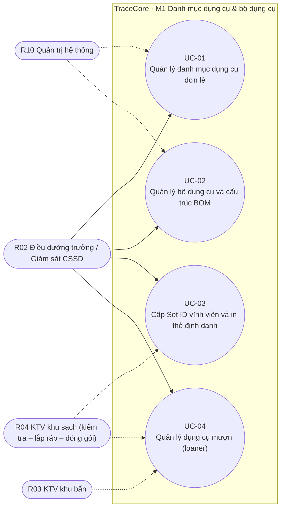
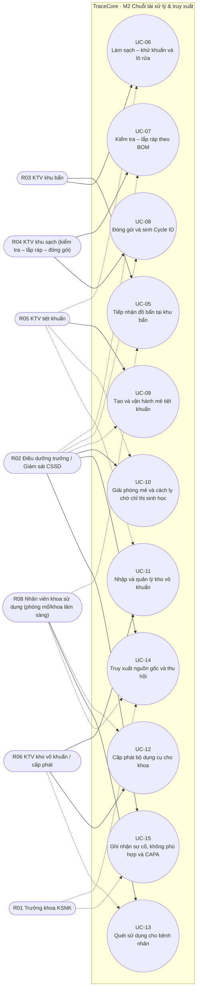
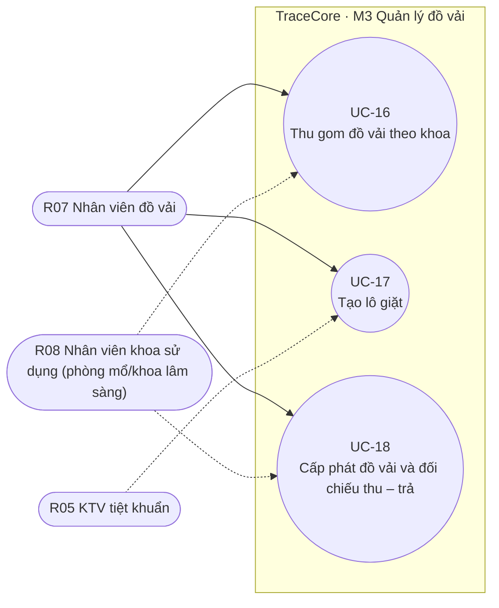
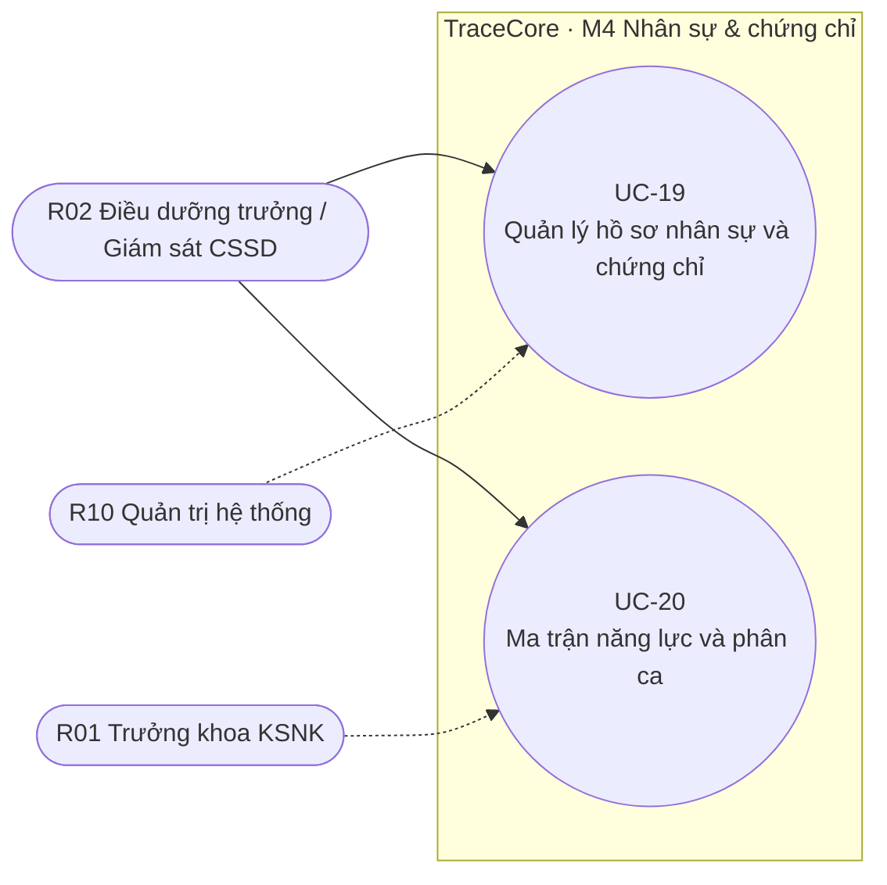
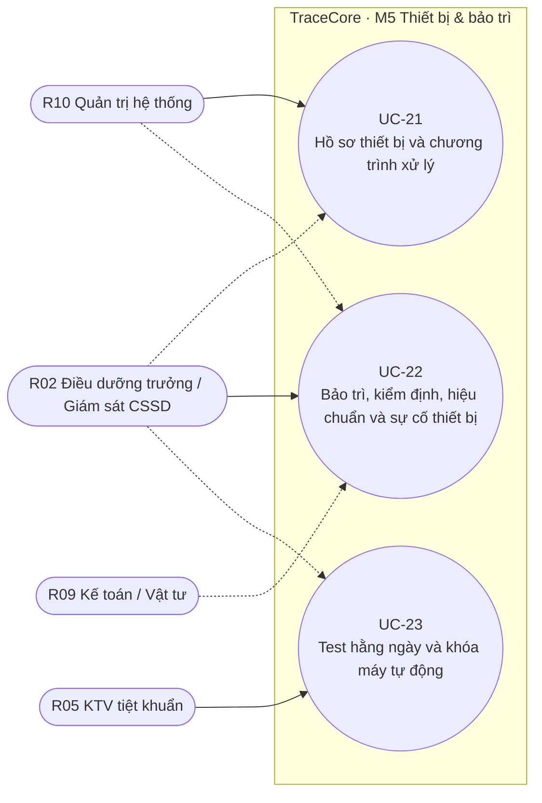
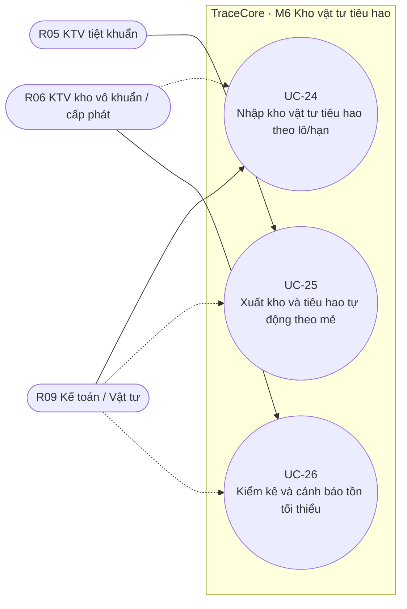
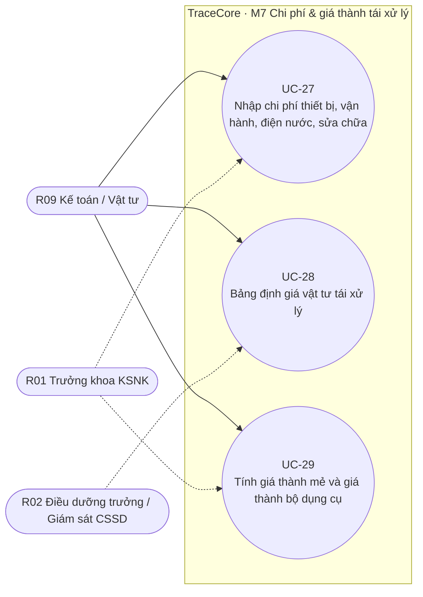
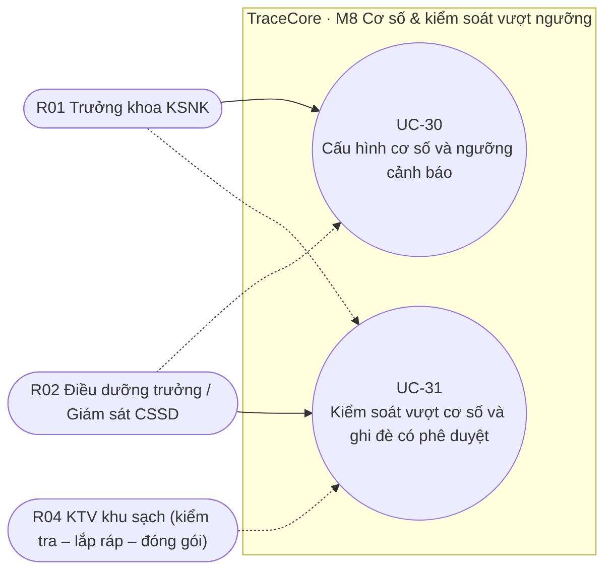
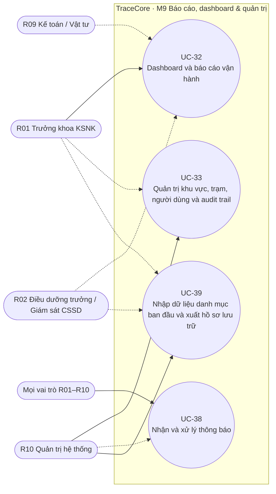
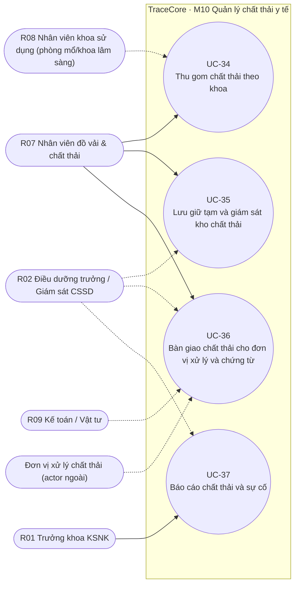

# Use Cases: TraceCore

> Version 1.11 (Finalized) · 2026-10-17 · Nguồn: #06 UC v1.10, giữ nguyên ID UC-01..UC-33; [v1.11] thêm UC-34..37 (M10 chất thải y tế) và UC-38..39 (M9: thông báo, import/export) theo quyết định chủ đầu tư 2026-10-17. Tổng 39 UC, 10 phân hệ, 43 màn hình (SCR-01..43).
> Tài liệu use-case-centric theo use-case-guide: đặc tả văn bản là nội dung chính, sơ đồ Mermaid theo phân hệ là minh họa. Không có user story (US-xx chỉ giữ làm tham chiếu gốc). Mọi luồng chính / thay thế / ngoại lệ được giữ nguyên nội dung từ #06 v1.10; nhãn A1/E1 là nhãn gốc của #06 để các TC-xx-xx tiếp tục tham chiếu được.

## Mục lục

| Phân hệ | Use case |
| :-- | :-- |
| M1 Danh mục dụng cụ & bộ dụng cụ | UC-01, UC-02, UC-03, UC-04 |
| M2 Chuỗi tái xử lý & truy xuất | UC-05, UC-06, UC-07, UC-08, UC-09, UC-10, UC-11, UC-12, UC-13, UC-14, UC-15 |
| M3 Quản lý đồ vải | UC-16, UC-17, UC-18 |
| M4 Nhân sự & chứng chỉ | UC-19, UC-20 |
| M5 Thiết bị & bảo trì | UC-21, UC-22, UC-23 |
| M6 Kho vật tư tiêu hao | UC-24, UC-25, UC-26 |
| M7 Chi phí & giá thành tái xử lý | UC-27, UC-28, UC-29 |
| M8 Cơ số & kiểm soát vượt ngưỡng | UC-30, UC-31 |
| M9 Báo cáo, dashboard & quản trị | UC-32, UC-33, UC-38, UC-39 |
| M10 Quản lý chất thải y tế [v1.11] | UC-34, UC-35, UC-36, UC-37 |

## Actors

Vai trò người dùng R01–R10 theo #02 BRD §5 và ma trận Actor – Use Case của #06 §3.

| Mã | Actor | Trách nhiệm chính | UC chính (primary) | UC phụ (secondary) |
| :-- | :-- | :-- | :-- | :-- |
| R01 | Trưởng khoa KSNK | Phê duyệt cơ số, ghi đè cảnh báo, duyệt thu hồi, xem toàn bộ báo cáo và chi phí; [v1.11] báo cáo chất thải, xuất hồ sơ lưu trữ. | UC-30, UC-32, UC-37 | UC-14, UC-15, UC-20, UC-27, UC-29, UC-31, UC-33, UC-38, UC-39 |
| R02 | Điều dưỡng trưởng / Giám sát CSSD | Điều phối ca, giải phóng mẻ, quản lý cơ số, duyệt NC-CAPA, kiểm kê; [v1.11] giám sát kho chất thải, duyệt chênh lệch kg, danh mục loại chất thải. | UC-01, UC-02, UC-03, UC-04, UC-10, UC-14, UC-15, UC-19, UC-20, UC-22, UC-31 | UC-07, UC-08, UC-09, UC-21, UC-23, UC-28, UC-30, UC-32, UC-35, UC-36, UC-37, UC-38, UC-39 |
| R03 | KTV khu bẩn | Tiếp nhận đồ bẩn, vận hành máy rửa, tạo lô rửa. | UC-05, UC-06 | UC-04 |
| R04 | KTV khu sạch (kiểm tra – lắp ráp – đóng gói) | Kiểm đếm theo BOM, ghi thiếu/hỏng, đóng gói, sinh và in Cycle ID. | UC-07, UC-08 | UC-03, UC-04, UC-31 |
| R05 | KTV tiệt khuẩn | Tạo mẻ, vận hành máy tiệt khuẩn, nhập kết quả chỉ thị, đề nghị giải phóng mẻ. | UC-09, UC-23, UC-25 | UC-06, UC-10, UC-11, UC-17 |
| R06 | KTV kho vô khuẩn / cấp phát | Nhập kho vô khuẩn, quản lý vị trí, FEFO, cấp phát cho khoa. | UC-11, UC-12, UC-26 | UC-13, UC-24 |
| R07 | Nhân viên đồ vải & chất thải [v1.11 mở rộng] | Thu gom, cân, tạo lô giặt, cấp phát đồ vải theo khoa; [v1.11] thu gom chất thải tại khoa, nhập kho lưu giữ tạm, bàn giao đơn vị xử lý, ghi sự cố chất thải. | UC-16, UC-17, UC-18, UC-34, UC-35, UC-36 | UC-38 |
| R08 | Nhân viên khoa sử dụng (phòng mổ/khoa lâm sàng) | Nhận bộ dụng cụ, quét sử dụng gắn bệnh nhân, trả đồ bẩn, nhận đồ vải; [v1.11] giao chất thải đã phân loại cho người thu gom. | UC-13 | UC-05, UC-12, UC-14, UC-16, UC-18, UC-34, UC-38 |
| R09 | Kế toán / Vật tư | Nhập chi phí, giá vật tư, hóa đơn điện nước, xem giá thành; [v1.11] hợp đồng và đơn giá đơn vị xử lý chất thải. | UC-24, UC-27, UC-28, UC-29 | UC-22, UC-25, UC-26, UC-32, UC-36, UC-38 |
| R10 | Quản trị hệ thống | Cấu hình khu vực, trạm, thiết bị, người dùng, phân quyền, audit trail; [v1.11] cấu hình kênh thông báo, import danh mục ban đầu. | UC-21, UC-33, UC-39 | UC-01, UC-02, UC-19, UC-22, UC-38 |

**Actor ngoài (không phải người dùng hệ thống)** [v1.11]:

| Actor ngoài | Vai trò trong luồng | UC liên quan |
| :-- | :-- | :-- |
| Đơn vị xử lý chất thải (vận chuyển/xử lý có giấy phép môi trường) | Nhận bàn giao chất thải, ký điện tử/ký biên bản, cung cấp số chứng từ chất thải nguy hại (NĐ 08/2022/NĐ-CP) | UC-36 |

**Actor hệ thống / thiết bị ngoại vi** (không có mã R trong #06; suy ra từ luồng và NFR-INT-01, ghi để các bước thiết kế giao diện tích hợp sau):

| Actor hệ thống | Vai trò trong luồng | UC liên quan |
| :-- | :-- | :-- |
| Máy quét mã (HID/serial) và PDA | Đọc Set ID, Cycle ID, thẻ nhân viên, QR máy, QR mã lô/mẻ, mã vị trí kệ | UC-03..UC-13, UC-23, UC-26, UC-33 |
| Máy in thẻ / nhãn (ZPL/TSPL) | In thẻ Set ID, nhãn Cycle ID theo phương pháp (2 loại nhãn), nhãn QR lô/mẻ, thẻ nhân viên, QR thiết bị | UC-03, UC-04, UC-06, UC-08, UC-09, UC-21, UC-24, UC-33 |
| Cân điện tử (RS-232/USB) | Lấy cân nặng đồ vải; [v1.11] cân túi/thùng chất thải khi thu gom và bàn giao | UC-16, UC-34, UC-36 |
| Máy rửa / máy tiệt khuẩn (API, tùy chọn giai đoạn 2) | Tự điền tham số và kết quả chu trình vào mã lô/mẻ; khi không kết nối thì nhập tay có xác nhận (FR-M2-10) | UC-06, UC-09, UC-10 |
| Bộ lập lịch hệ thống (Scheduler) | Hết hạn gói lúc 00:00, cảnh báo chứng chỉ/kiểm định/tồn kho, khấu hao tháng, email báo cáo; [v1.11] cảnh báo hạn lưu chất thải, giấy phép đơn vị xử lý, gửi lại thông báo thất bại | UC-11, UC-19, UC-22, UC-26, UC-27, UC-32, UC-35, UC-36, UC-38 |
| Cảm biến nhiệt độ kho lạnh chất thải (tùy chọn) [v1.11] | Ghi nhiệt độ kho lạnh ≤ 8°C | UC-35 |

## M1 — Danh mục dụng cụ & bộ dụng cụ

Nguồn nghiệp vụ: BR-M1 (BRD #02). Use case: UC-01, UC-02, UC-03, UC-04.

_Nét liền = actor chính (primary); nét đứt = actor phụ (secondary)._

### UC-01: Quản lý danh mục dụng cụ đơn lẻ

- **ID:** UC-01
- **Actors:** R02 Điều dưỡng trưởng / Giám sát CSSD (primary); R10 Quản trị hệ thống (secondary)
- **Description:** Khai báo dụng cụ đơn lẻ với phân loại Spaulding, IFU tái xử lý, phương pháp tiệt khuẩn tương thích và cơ số tái xử lý tối đa. Kích hoạt khi: khoa nhận dụng cụ mới, cần chuẩn hóa danh mục trước khi lập BOM, hoặc cần đặt ngưỡng bảo dưỡng tra dầu.
- **Preconditions:** Người dùng có vai trò R02/R10 và quyền Master Data. Có IFU của nhà sản xuất (file hoặc bản chụp).
- **Postconditions (success):** Dụng cụ ở trạng thái Đang dùng, chọn được khi lập BOM. Cơ số tái xử lý tối đa và phương pháp tương thích được lưu để M8 và M2 sử dụng.
- **Traces to:** FR-M1-01, FR-M1-02, FR-M1-09
- **Business rules:** —
- **Screens:** SCR-01
- **Priority:** Must · Frequency: 20–50 bản ghi/tháng; ban đầu 800–1.500 dụng cụ.
- **Related NFR:** NFR-COMP-02, NFR-MAINT-01

**Main success scenario**
1. R02 mở màn Dụng cụ, chọn Tạo mới.
2. Nhập mã, tên, hãng, model; tải ảnh.
3. Chọn phân loại Spaulding và các phương pháp tiệt khuẩn tương thích.
4. Đính kèm IFU, nhập cơ số tái xử lý tối đa, ngưỡng bảo dưỡng (số chu trình giữa hai lần tra dầu/kiểm tra) và giá trị; tải ảnh chụp thực tế rõ nét của dụng cụ để hiển thị tại trạm tiếp nhận và đóng gói.
5. Hệ thống kiểm tra trùng mã và tính đầy đủ; lưu và hiển thị bản ghi.
6. Hệ thống ghi audit tạo mới.

**Alternate flows**
- A1. Nhập hàng loạt từ Excel mẫu: hệ thống kiểm tra từng dòng, báo lỗi dòng sai, nhập các dòng đúng.
- A2. Cơ số tối đa chưa biết: người dùng để trống, hệ thống đánh dấu Chưa xác định và đưa vào báo cáo cần bổ sung.

**Exception flows**
- E1. Trùng mã dụng cụ → báo lỗi và gợi ý mã kế tiếp.
- E2. File IFU vượt 20 MB → từ chối tệp, cho phép lưu bản ghi không kèm IFU.
- E3. Ngừng sử dụng dụng cụ đang nằm trong BOM đang áp dụng → cảnh báo danh sách BOM bị ảnh hưởng, yêu cầu xác nhận.

**Open issues:** Đã chốt: Set ID GS1; 2 loại nhãn (hấp / plasma); hạn lưu loại gói và cơ số do khoa nhập tay trước Sprint 1. Còn xác nhận mẫu nhãn cụ thể tại UAT.

_Nguồn: #06 UC v1.10 (v1.10 — Đang Review); US-01; API API-M1-01, API-M1-06; DocType DT-INSTR; Workflow — (không có trạng thái); TC TC-01-01, TC-01-02._

### UC-02: Quản lý bộ dụng cụ và cấu trúc BOM

- **ID:** UC-02
- **Actors:** R02 Điều dưỡng trưởng / Giám sát CSSD (primary); R10 Quản trị hệ thống (secondary)
- **Description:** Định nghĩa loại bộ dụng cụ gồm N dụng cụ × số lượng, ảnh lắp ráp, phiếu kiểm đếm, phương pháp tiệt khuẩn và hạn lưu. Kích hoạt khi: khoa lâm sàng yêu cầu bộ dụng cụ mới hoặc thay đổi cấu hình bộ hiện có.
- **Preconditions:** Các dụng cụ trong BOM đã tồn tại (UC-01). Người dùng có quyền Master Data.
- **Postconditions (success):** Loại bộ có BOM phiên bản mới nhất, phiếu kiểm đếm in được. Bộ vật lý áp dụng phiên bản mới từ chu trình kế tiếp.
- **Traces to:** FR-M1-03, FR-M1-04
- **Business rules:** —
- **Screens:** SCR-02
- **Priority:** Must · Frequency: 10–20 loại bộ/tháng; ban đầu 150–300 loại.
- **Related NFR:** NFR-COMP-02, NFR-MAINT-01

**Main success scenario**
1. R02 tạo loại bộ: tên, khoa sở hữu, phương pháp tiệt khuẩn, loại gói mặc định, hạn lưu, cờ cấy ghép.
2. Thêm từng dòng dụng cụ × số lượng; tải ảnh chụp thực tế bộ đã sắp xếp hoàn chỉnh (một hoặc nhiều góc) và thứ tự xếp.
3. Hệ thống kiểm tra tương thích phương pháp bộ với từng dụng cụ.
4. Nhập thời gian lắp ráp chuẩn (phút) phục vụ tính nhân công.
5. Lưu; hệ thống tạo phiên bản BOM v1 và phiếu kiểm đếm PDF.
6. Hiển thị bản ghi và cơ số bộ suy ra từ dụng cụ thấp nhất.

**Alternate flows**
- A1. Sửa BOM: chọn Sửa, nhập ngày hiệu lực, lý do; hệ thống tạo phiên bản mới và màn so sánh.
- A2. Sao chép loại bộ hiện có làm mẫu cho bộ mới.

**Exception flows**
- E1. Dụng cụ không tương thích phương pháp bộ → báo lỗi tại dòng, không lưu.
- E2. BOM rỗng → chặn.
- E3. Ngày hiệu lực trong quá khứ → chặn.

**Open issues:** Đã chốt: Set ID GS1; 2 loại nhãn (hấp / plasma); hạn lưu loại gói và cơ số do khoa nhập tay trước Sprint 1. Còn xác nhận mẫu nhãn cụ thể tại UAT.

_Nguồn: #06 UC v1.10 (v1.10 — Đang Review); US-02; API API-M1-02; DocType DT-SETTYPE, DT-SETBOM; Workflow — (không có trạng thái); TC TC-02-01, TC-02-02._

### UC-03: Cấp Set ID vĩnh viễn và in thẻ định danh

- **ID:** UC-03
- **Actors:** R02 Điều dưỡng trưởng / Giám sát CSSD (primary); R04 KTV khu sạch (kiểm tra – lắp ráp – đóng gói) (secondary)
- **Description:** Tạo bộ dụng cụ vật lý từ loại bộ, cấp Set ID duy nhất suốt vòng đời, in thẻ DataMatrix gắn khay. Kích hoạt khi: khoa đưa bộ dụng cụ vật lý mới vào lưu hành (mua mới hoặc gắn mã cho bộ hiện có).
- **Preconditions:** Loại bộ đã có BOM (UC-02). Máy in thẻ/nhãn DataMatrix sẵn sàng tại trạm.
- **Postconditions (success):** Set Unit mang Set ID duy nhất, trạng thái Mới tạo, bộ đếm chu trình = 0. Thẻ Set ID in và gắn vào khay/hộp.
- **Traces to:** FR-M1-05, FR-M1-06
- **Business rules:** BRU-ID-001, BRU-ID-006
- **Screens:** SCR-03
- **Priority:** Must · Frequency: Ban đầu 500–1.200 bộ; sau đó 10–30 bộ/tháng.
- **Related NFR:** NFR-COMP-02, NFR-MAINT-01

**Main success scenario**
1. R02 chọn loại bộ, nhập số lượng bộ cần tạo và khoa sở hữu.
2. Hệ thống sinh Set ID theo chuẩn GS1 DataMatrix GIAI với tiền tố GS1 của bệnh viện, kiểm tra duy nhất.
3. Hệ thống tạo Set Unit và hiển thị phiên bản BOM dự kiến áp dụng; phiên bản chỉ được ghim khi bộ bắt đầu chu trình tại T1, Set Unit chưa gắn cố định phiên bản lúc cấp.
4. In thẻ; R04 gắn thẻ vào khay và quét kiểm tra đọc được.
5. Hệ thống ghi số lần in và audit.
6. Bộ sẵn sàng đi vào chuỗi từ trạm Tiếp nhận (chu trình đầu tiên bắt buộc).

**Alternate flows**
- A1. Gắn mã cho bộ đang lưu hành: nhập số chu trình đã dùng ước tính (lớn hơn 0) kèm lý do, hệ thống ghi nguồn Ước tính; người, thời điểm và lý do nằm trong Audit Log.
- A2. Thẻ bị mất/hỏng: in lại thẻ cùng Set ID với lý do, đếm số lần in.

**Exception flows**
- E1. Máy in không phản hồi → Set ID vẫn được lưu, đưa vào hàng đợi in.
- E2. Quét kiểm tra không đọc được → đánh dấu Thẻ lỗi, in lại.
- E3. Tạo hàng loạt vượt 100 bộ/lần → yêu cầu chia lô.

**Open issues:** Đã chốt: Set ID GS1; 2 loại nhãn (hấp / plasma); hạn lưu loại gói và cơ số do khoa nhập tay trước Sprint 1. Còn xác nhận mẫu nhãn cụ thể tại UAT.

_Nguồn: #06 UC v1.10 (v1.10 — Đang Review); US-03; API API-M1-03, API-M1-04; DocType DT-SETUNIT; Workflow WF-01; TC TC-03-01, TC-03-02._

### UC-04: Quản lý dụng cụ mượn (loaner)

- **ID:** UC-04
- **Actors:** R02 Điều dưỡng trưởng / Giám sát CSSD (primary); R03 KTV khu bẩn, R04 KTV khu sạch (kiểm tra – lắp ráp – đóng gói) (secondary)
- **Description:** Nhập tạm bộ mượn từ hãng, cấp Set ID tạm, tái xử lý theo chuỗi chuẩn, trả hãng có biên bản. Kích hoạt khi: hãng gửi bộ dụng cụ mượn cho ca mổ cụ thể.
- **Preconditions:** Có biên bản mượn và IFU của bộ. Người dùng R02 có quyền Loaner.
- **Postconditions (success):** Set ID tạm (LN-) tồn tại với ngày trả dự kiến. Bộ mượn buộc phải qua chuỗi tái xử lý trước khi cấp phát và trước khi trả.
- **Traces to:** FR-M1-07, FR-M1-08
- **Business rules:** —
- **Screens:** SCR-04
- **Priority:** Must · Frequency: 5–20 bộ mượn/tháng.
- **Related NFR:** NFR-COMP-02, NFR-MAINT-01

**Main success scenario**
1. R02 tạo phiếu mượn: hãng, tên bộ, ngày nhận, ngày trả dự kiến, đính kèm IFU.
2. Nhập BOM mượn nhanh (danh sách dụng cụ × số lượng) hoặc tải file.
3. Hệ thống cấp Set ID tạm LN-, in thẻ.
4. Bộ đi qua T1→T5 như bộ thường; nhãn có dòng LOANER.
5. Sau ca mổ, bộ trả về T1, tái xử lý lại rồi lập biên bản trả.
6. Hệ thống in biên bản trả (thiếu/hỏng so với BOM), Set ID tạm hết hiệu lực.

**Alternate flows**
- A1. Hãng gửi trước 1 ngày: bộ vẫn phải rửa – tiệt khuẩn tại khoa trước khi dùng.
- A2. Gia hạn mượn: R02 cập nhật ngày trả, ghi lý do.

**Exception flows**
- E1. Quá ngày trả dự kiến → cảnh báo hằng ngày cho R02.
- E2. Quét Set ID LN tại đóng gói khi chưa rửa → chặn.
- E3. Mất dụng cụ mượn → NC và biên bản trả ghi thiếu.

**Open issues:** Đã chốt: Set ID GS1; 2 loại nhãn (hấp / plasma); hạn lưu loại gói và cơ số do khoa nhập tay trước Sprint 1. Còn xác nhận mẫu nhãn cụ thể tại UAT.

_Nguồn: #06 UC v1.10 (v1.10 — Đang Review); US-04; API API-M1-05; DocType DT-LOANER, DT-SETUNIT; Workflow WF-01; TC TC-04-01, TC-04-02._

## M2 — Chuỗi tái xử lý & truy xuất

Nguồn nghiệp vụ: BR-M2 (BRD #02). Use case: UC-05, UC-06, UC-07, UC-08, UC-09, UC-10, UC-11, UC-12, UC-13, UC-14, UC-15.

_Nét liền = actor chính (primary); nét đứt = actor phụ (secondary)._

### UC-05: Tiếp nhận đồ bẩn tại khu bẩn

- **ID:** UC-05
- **Actors:** R03 KTV khu bẩn (primary); R08 Nhân viên khoa sử dụng (phòng mổ/khoa lâm sàng) (secondary)
- **Description:** Quét Set ID trả về từ khoa, ghi khoa trả, tình trạng, thiếu/hỏng, vật sắc nhọn; chuyển trạng thái Đã tiếp nhận. Kích hoạt khi: khoa lâm sàng/phòng mổ trả nhiều bộ dụng cụ đã dùng về khu bẩn trong cùng một lượt.
- **Preconditions:** Nhân viên R03 đã đăng nhập trạm T1 bằng thẻ, có năng lực trạm. Nhân viên khoa mang dụng cụ tới có thẻ nhân viên do hệ thống cấp (FR-M9-07). Set ID ở trạng thái Tại khoa hoặc Đã sử dụng.
- **Postconditions (success):** Phiếu tiếp nhận ghi sổ gồm N bộ, mỗi bộ có xác nhận thành phần và ghi chú bất thường; người giao (thẻ), người nhận, khoa, thời điểm; Set Unit → Chờ rửa. Bộ có ghi chú mang cờ Cần xem xét cho T3 kiểm tra chi tiết; Cycle ID cũ (nếu chưa quét sử dụng) → Hết hiệu lực với lý do Trả không sử dụng.
- **Traces to:** FR-M2-01, FR-M2-02, FR-M2-23
- **Business rules:** BRU-FLOW-002, BRU-FLOW-003, BRU-REP-001, BRU-REP-012
- **Screens:** SCR-05, SCR-34
- **Priority:** Must · Frequency: 120–200 bộ/ngày, 15–30 lượt trả/ngày; mỗi lượt 5–20 bộ nối tiếp.
- **Related NFR:** NFR-PERF-01, NFR-AVAIL-02, NFR-SEC-03, NFR-USAB-01, NFR-COMP-01

**Main success scenario**
1. R03 quét mã thẻ của nhân viên khoa mang dụng cụ tới; hệ thống hiển thị tên và khoa trả (một lần cho cả phiếu).
2. Quét mã vạch bộ dụng cụ thứ nhất; hệ thống kiểm tra trạng thái hợp lệ (BRU-FLOW-002), hủy Cycle ID cũ nếu chưa dùng và hiện danh sách thành phần bộ: từng loại dụng cụ, số lượng theo BOM, ảnh chụp thực tế, ảnh bộ đã sắp xếp.
3. R03 tick xác nhận từng dòng hoặc bấm Xác nhận tất cả; nếu có bất thường (thiếu, hỏng, vật lạ, sắc nhọn) ghi vào ô Ghi chú bất thường, chụp ảnh nếu cần — không nhập số lượng.
4. Bấm Xác nhận bộ; hệ thống lưu xác nhận và ghi chú, chuyển bộ sang Chờ rửa (cờ Cần xem xét nếu có ghi chú) và quay lại ô quét chờ bộ kế tiếp.
5. Lặp lại bước 2–4 cho mọi bộ trong xe trả; phiếu hiển thị số bộ đã nhận và số bộ có ghi chú.
6. Ghi sổ phiếu; hệ thống ghi người giao, người nhận, giờ, trạm, khoa; in hoặc gửi biên nhận; ghi chú hiển thị đỏ tại T3 để kiểm tra chi tiết và tạo NC nếu có hỏng/thất lạc.

**Alternate flows**
- A1. Nhân viên giao không có thẻ (người mới): chọn khoa và ghi tên, R02 cấp thẻ sau (FR-M9-07).
- A2. Bộ trả kèm dụng cụ rời không thuộc BOM: ghi vào Ghi chú bất thường; T3 xử lý và tạo NC.
- A3. Dụng cụ hoặc bộ chưa có ảnh chụp thực tế: hiển thị khung Chưa có ảnh, ghi nhận thiếu ảnh để bổ sung tại danh mục.
- A4. [A-67] Màn T1 có khối "Phiếu đã tiếp nhận hôm nay" (phiếu đã ghi sổ trong ngày tại trạm, của mọi người nhận, kèm tổng phiếu/bộ); bấm một phiếu để xem nhanh các bộ và trạng thái hiện tại; chỉ đọc, tự làm mới sau mỗi lần Ghi sổ.

**Exception flows**
- E1. Set ID ở trạng thái không hợp lệ (ví dụ Trong kho vô khuẩn) → từ chối, hiển thị trạm hiện tại; R02 có thể tiếp nhận cưỡng bức.
- E2. Mã không tồn tại → Mã không hợp lệ, ghi log.
- E3. Mất mạng → lưu cục bộ, đồng bộ sau (FR-M9-06).

**Open issues:** Đã chốt: Set ID GS1; 2 loại nhãn (hấp / plasma); hạn lưu loại gói và cơ số do khoa nhập tay trước Sprint 1. Còn xác nhận mẫu nhãn cụ thể tại UAT.

_Nguồn: #06 UC v1.10 (v1.10 — Đang Review); US-05; API API-M2-01, API-M1-06; DocType DT-RECEIPT, DT-SETUNIT, DT-PACK, DT-SETBOM, DT-INSTR, DT-EMP; Workflow WF-01, WF-02; TC TC-05-01, TC-05-02._

### UC-06: Làm sạch – khử khuẩn và lô rửa

- **ID:** UC-06
- **Actors:** R03 KTV khu bẩn (primary); R05 KTV tiệt khuẩn (secondary)
- **Description:** Tạo lô rửa gắn máy rửa, chương trình, hóa chất theo lô/hạn; quét các Set ID vào lô; ghi kết quả. Kích hoạt khi: đủ bộ đã qua cổng T1 (kiểm đếm tiếp nhận) để nạp một lô rửa nhiều bộ.
- **Preconditions:** Máy rửa ở trạng thái Sẵn sàng (test ngày đạt). Hóa chất còn lô trong hạn.
- **Postconditions (success):** Mã lô LR- chứa danh sách toàn bộ bộ dụng cụ và toàn bộ dữ liệu máy rửa; lô Đạt: cổng T2 Đạt cho từng bộ → Chờ lắp ráp; tiêu hao hóa chất trừ kho; chi phí lô ghi nhận. Lô Không đạt: cổng T2 Không đạt, Set ID → Xử lý lại (rửa) và chỉ có thể quét lại tại T2; NC tự tạo.
- **Traces to:** FR-M2-03, FR-M2-24, FR-M2-25, FR-M2-04
- **Business rules:** BRU-FLOW-002, BRU-FLOW-003, BRU-REP-002, BRU-FLOW-004, BRU-REP-015, BRU-REP-016
- **Screens:** SCR-06
- **Priority:** Must · Frequency: 15–25 lô/ngày.
- **Related NFR:** NFR-PERF-01, NFR-AVAIL-02, NFR-SEC-03, NFR-USAB-01, NFR-COMP-01

**Main success scenario**
1. R03 quét QR máy rửa; hệ thống kiểm tra máy Sẵn sàng, hiển thị chương trình, gợi ý hóa chất theo FEFO; chưa quét máy thì không quét được bộ.
2. Quét nối tiếp Set ID của từng bộ đưa vào máy; hệ thống kiểm tra cổng T1 của từng bộ và từ chối bộ chưa Đạt hoặc đang ở lô khác.
3. R03 quét mã Hoàn thành nạp (hoặc bấm nút); hệ thống tự sinh mã lô LR-YYMMDD-NN gồm toàn bộ bộ vừa quét, in nhãn QR lô, ghi giờ, người, chương trình; máy bắt đầu chạy.
4. Khi máy kết thúc, người dỡ (R04 ở cửa ra khu sạch với máy hai cửa) quét QR máy và QR mã lô; hệ thống liệt kê toàn bộ bộ trong lô. Máy kết nối API → dữ liệu và kết quả chu trình tự điền; máy không kết nối → nhập tay tham số theo mẫu, đính ảnh bản in nếu có, chọn Đạt/Không đạt và tick xác nhận.
5. Hệ thống áp một kết quả cho toàn bộ bộ trong lô: Đạt → cổng T2 Đạt cho từng bộ, trừ hóa chất theo định mức, tính chi phí lô; Không đạt → mọi bộ về Xử lý lại (T2).
6. Bộ hiển thị tại trạm lắp ráp ở khu sạch; quét mã lô ở bất kỳ đâu mở được hồ sơ lô đầy đủ.

**Alternate flows**
- A1. Rửa thủ công/siêu âm cho dụng cụ tinh vi: lô loại Thủ công, nhập thời gian ngâm, nồng độ, nhiệt độ.
- A2. Máy rửa hai cửa: xác nhận dỡ tại cửa khu sạch bởi R04.
- A3. Máy không có cả màn hình lẫn bản in: nhập tay tối thiểu chương trình + giờ bắt đầu/kết thúc và xác nhận; R02 xác nhận thêm khi kết luận (BRU-REP-015).
- A4. [A-66] Màn nạp hiển thị danh sách Bộ chờ rửa (bộ đã Đạt T1, chưa có kết quả T2, chưa ở lô đang chạy) để KTV biết bộ nào cần rửa; danh sách chỉ để xem, vẫn quét Set ID từng bộ vào lô.

**Exception flows**
- E1. Máy Khóa (test/kiểm định) → không chọn được, hiển thị lý do.
- E2. Hóa chất hết hạn → chặn chọn lô đó.
- E3. Lô Không đạt → toàn bộ bộ chuyển Xử lý lại (rửa), chỉ quét được tại T2, lặp tới khi Đạt; NC tự tạo.
- E4. Chưa có dữ liệu tự động và chưa có nhập tay đã xác nhận → nút Đóng lô khóa, không kết luận Đạt được.
- E5. Dỡ lô: quét QR máy không khớp máy của mã lô, hoặc chưa quét đủ máy + mã lô → từ chối mở màn kết quả.

**Open issues:** Đã chốt: Set ID GS1; 2 loại nhãn (hấp / plasma); hạn lưu loại gói và cơ số do khoa nhập tay trước Sprint 1. Còn xác nhận mẫu nhãn cụ thể tại UAT.

_Nguồn: #06 UC v1.10 (v1.10 — Đang Review); US-06; API API-M2-02, API-M2-03, API-M2-17; DocType DT-WASHBATCH, DT-STOCKENTRY; Workflow WF-04, WF-01; TC TC-06-01, TC-06-02._

### UC-07: Kiểm tra – lắp ráp theo BOM

- **ID:** UC-07
- **Actors:** R04 KTV khu sạch (kiểm tra – lắp ráp – đóng gói) (primary); R02 Điều dưỡng trưởng / Giám sát CSSD (secondary)
- **Description:** Đếm từng dụng cụ theo BOM, ghi thiếu, hỏng, thay thế; chặn nếu thiếu chưa xác nhận; kiểm tra cơ số. Kích hoạt khi: bộ ra khỏi lô rửa Đạt tại khu sạch.
- **Preconditions:** R04 đăng nhập trạm T3, có năng lực. Set ID thuộc lô rửa Đạt.
- **Postconditions (success):** Phiếu lắp ráp lưu với kết quả từng dòng BOM. Bộ Chờ đóng gói hoặc bị chặn nếu thiếu chưa xác nhận.
- **Traces to:** FR-M2-05, FR-M2-06
- **Business rules:** BRU-FLOW-002, BRU-FLOW-003, BRU-REP-003, BRU-FLOW-004
- **Screens:** SCR-07
- **Priority:** Must · Frequency: 120–200 bộ/ngày.
- **Related NFR:** NFR-PERF-01, NFR-AVAIL-02, NFR-SEC-03, NFR-USAB-01, NFR-COMP-01

**Main success scenario**
1. R04 quét Set ID; hệ thống hiển thị BOM phiên bản áp dụng kèm ảnh lắp ráp.
2. Kiểm tra từng dụng cụ (sạch, khô, chức năng), tick hoặc nhập số lượng thực tế.
3. Ghi dụng cụ hỏng, chọn dụng cụ thay từ kho dự phòng; dụng cụ hỏng chuyển Sửa chữa/Thanh lý.
4. Hệ thống hiển thị cảnh báo sớm cơ số (bộ và từng dụng cụ).
5. Xác nhận đủ; in phiếu kiểm đếm kèm gói.
6. Bộ chuyển Chờ đóng gói, chuyển sang UC-08 trên cùng màn hình.

**Alternate flows**
- A1. Quét mã đơn lẻ (giai đoạn 2) tự tick dòng BOM.
- A2. Thiếu dụng cụ nhưng ca mổ cần gấp: R02 xác nhận đóng gói thiếu bằng PIN, nhãn in dòng THIẾU.

**Exception flows**
- E1. Bộ chưa qua lô rửa Đạt → chặn.
- E2. Thiếu chưa xác nhận → nút Đóng gói khóa, NC tự tạo.
- E3. Bộ đạt/vượt cơ số → hiển thị đỏ, không cho đóng gói (UC-31).

**Open issues:** Đã chốt: Set ID GS1; 2 loại nhãn (hấp / plasma); hạn lưu loại gói và cơ số do khoa nhập tay trước Sprint 1. Còn xác nhận mẫu nhãn cụ thể tại UAT.

_Nguồn: #06 UC v1.10 (v1.10 — Đang Review); US-07; API API-M2-04; DocType DT-ASSEMBLY, DT-SETUNIT; Workflow WF-01; TC TC-07-01, TC-07-02._

### UC-08: Đóng gói và sinh Cycle ID

- **ID:** UC-08
- **Actors:** R04 KTV khu sạch (kiểm tra – lắp ráp – đóng gói) (primary); R02 Điều dưỡng trưởng / Giám sát CSSD (secondary)
- **Description:** Sinh Cycle ID duy nhất, in nhãn chịu hấp gồm Set ID, Cycle ID, người đóng gói, ngày, hạn, phương pháp. Kích hoạt khi: bộ được xác nhận đủ tại lắp ráp và đưa tới bàn đóng gói.
- **Preconditions:** Phiếu lắp ráp Đạt hoặc có xác nhận thiếu của R02. Máy in nhãn tại T4 sẵn sàng; Set ID không còn Cycle ID hiệu lực. Lô chỉ thị hóa học phù hợp phương pháp còn hạn tại bàn.
- **Postconditions (success):** Mã vạch một lần (Cycle ID) đã tự sinh và in ngay sau xác nhận hoàn thành đóng gói, gắn với bộ và mang ngày giờ đóng gói, người đóng gói, hạn sử dụng, phương pháp, loại gói, lô chỉ thị, phiên bản BOM; Pack trạng thái Đã đóng gói — đây là điều kiện để bộ được quét vào mẻ tiệt khuẩn (UC-09). Nhãn in đúng loại; tiêu hao bao gói/chỉ thị/nhãn/dầu bôi trơn ghi nhận theo định mức; bộ đếm bảo dưỡng cập nhật.
- **Traces to:** FR-M2-07, FR-M2-08
- **Business rules:** BRU-ID-002, BRU-ID-004, BRU-FLOW-002, BRU-FLOW-003, BRU-REP-009, BRU-FLOW-004, BRU-REP-013, BRU-REP-014, BRU-REP-011
- **Screens:** SCR-08
- **Priority:** Must · Frequency: 120–200 gói/ngày.
- **Related NFR:** NFR-PERF-01, NFR-AVAIL-02, NFR-SEC-03, NFR-USAB-01, NFR-COMP-01

**Main success scenario**
1. R04 quét Set ID tại bàn đóng gói; hệ thống hiển thị BOM kèm ảnh chụp thực tế từng dụng cụ và ảnh chụp thực tế bộ đã sắp xếp hoàn chỉnh.
2. R04 xếp dụng cụ theo ảnh thực tế và tick xác nhận từng loại dụng cụ; nếu có dụng cụ đạt ngưỡng bảo dưỡng, hệ thống hiển thị nhắc tra dầu kèm ảnh, R04 bảo dưỡng và bấm Đã bảo dưỡng (ghi lô dầu) hoặc Hoãn có lý do.
3. R04 đặt chỉ thị hóa học vào trong bộ và quét lô chỉ thị; hệ thống kiểm tra loại chỉ thị khớp phương pháp và còn hạn.
4. R04 chọn loại gói (giấy crepe, túi hàn, hộp lọc); hệ thống lấy hạn lưu đã nhập tay; R04 bấm Xác nhận hoàn thành đóng gói → hệ thống kiểm tra cơ số (M8) và BRU-ID-004 rồi TỰ ĐỘNG sinh mã vạch một lần (Cycle ID) gắn với bộ, chứa ngày giờ đóng gói, người đóng gói, hạn sử dụng, Set ID, tên bộ, phương pháp, loại gói, lô chỉ thị, phiên bản BOM.
5. Hệ thống chọn loại nhãn theo phương pháp (nhãn hấp hơi nước cho Hấp 121/134, nhãn plasma cho Plasma H2O2), gửi lệnh in tới máy in/cuộn đúng loại; in nhãn (Set ID, Cycle ID, tên bộ, khoa, người, ngày, hạn, phương pháp, chỉ thị).
6. R04 dán nhãn và chỉ thị hóa học, hàn túi; quét lại nhãn để xác nhận.
7. Pack hiển thị tại trạm nạp mẻ.

**Alternate flows**
- A1. Nhãn in hỏng: in lại trong 10 phút với lý do.
- A2. Gói đôi (double wrap) cho cấy ghép: hệ thống nhắc dán chỉ thị trong và ngoài.
- A3. Trạm chỉ có một máy in: người dùng đổi cuộn nhãn, quét mã cuộn để xác nhận loại trước khi in gói phương pháp khác.

**Exception flows**
- E1. Vượt cơ số → không sinh Cycle ID (UC-31).
- E4. Chưa tick đủ dụng cụ hoặc chưa quét lô chỉ thị → nút Sinh Cycle ID khóa, hiển thị mục còn thiếu; lô chỉ thị sai phương pháp/hết hạn → từ chối.
- E5. Dụng cụ quá ngưỡng bảo dưỡng 20% chưa tra dầu → chặn sinh mã tới khi xác nhận bảo dưỡng.
- E2. Máy in đúng loại nhãn lỗi hoặc trạm không có cuộn nhãn đúng loại → giữ Cycle ID, hàng đợi in; chặn in tạm trên loại nhãn khác (BRU-REP-011).
- E3. Mất mạng → sinh Cycle ID từ dải offline, đồng bộ sau.

**Open issues:** Đã chốt: Set ID GS1; 2 loại nhãn (hấp / plasma); hạn lưu loại gói và cơ số do khoa nhập tay trước Sprint 1. Còn xác nhận mẫu nhãn cụ thể tại UAT.

_Nguồn: #06 UC v1.10 (v1.10 — Đang Review); US-08; API API-M2-05, API-M2-06, API-M1-06; DocType DT-PACK, DT-STOCKENTRY, DT-INSTRMAINT, DT-SETBOM; Workflow WF-02; TC TC-08-01, TC-08-02._

### UC-09: Tạo và vận hành mẻ tiệt khuẩn

- **ID:** UC-09
- **Actors:** R05 KTV tiệt khuẩn (primary); R02 Điều dưỡng trưởng / Giám sát CSSD (secondary)
- **Description:** Tạo Load ID, chọn máy – chương trình tương thích, quét gói vào mẻ, nhập tham số và biểu đồ mẻ. Kích hoạt khi: đủ gói đã qua cổng T4 Đạt để nạp một mẻ tiệt khuẩn nhiều gói.
- **Preconditions:** Máy tiệt khuẩn Sẵn sàng (test ngày đạt, kiểm định còn hạn). R05 đăng nhập trạm T5.
- **Postconditions (success):** Mã mẻ ME- chứa danh sách toàn bộ gói/bộ; Load Đang chạy → Hoàn tất chu trình. Toàn bộ dữ liệu máy tiệt khuẩn (tham số, biểu đồ, cảnh báo, bản in) và chỉ thị được đính vào mã mẻ.
- **Traces to:** FR-M2-09, FR-M2-10
- **Business rules:** BRU-FLOW-002, BRU-FLOW-003, BRU-REP-004, BRU-FLOW-004, BRU-REP-015, BRU-REP-016
- **Screens:** SCR-09, SCR-35
- **Priority:** Must · Frequency: 10–16 mẻ/ngày.
- **Related NFR:** NFR-PERF-01, NFR-AVAIL-02, NFR-SEC-03, NFR-USAB-01, NFR-COMP-01

**Main success scenario**
1. R05 quét QR máy tiệt khuẩn; hệ thống kiểm tra Sẵn sàng (test ngày, kiểm định), chọn chương trình; chưa quét máy thì không quét được gói.
2. Quét nối tiếp Cycle ID của từng gói đưa vào máy; hệ thống kiểm tra cổng T4 Đạt của từng bộ, tương thích gói – chương trình và dung tích.
3. Đặt chỉ thị hóa học/gói thử thách, BI nếu chương trình yêu cầu; quét lô chỉ thị.
4. Quét mã Hoàn thành nạp (hoặc bấm nút); hệ thống tự sinh mã mẻ ME-YYMMDD-NN gồm toàn bộ gói vừa quét, in nhãn QR mẻ, ghi giờ, người; máy bắt đầu chạy.
5. Kết thúc: máy kết nối được → nhận tham số tự động; máy không kết nối → R05 nhập tay nhiệt độ, áp suất, thời gian pha theo mẫu chương trình, đính ảnh bản in/biểu đồ nếu có, tick xác nhận đúng với máy; hệ thống đính vào mã mẻ kèm nguồn và người xác nhận.
6. Mẻ chuyển Hoàn tất chu trình khi đã có dữ liệu (tự động hoặc nhập tay đã xác nhận), sẵn sàng giải phóng (UC-10); quét mã mẻ mở hồ sơ đầy đủ.

**Alternate flows**
- A1. Máy plasma: chương trình ngắn/dài, chỉ thị plasma, không Bowie-Dick.
- A2. Mẻ ưu tiên (flash) cho phòng mổ: đánh dấu Ưu tiên, giới hạn theo IFU.
- A3. Máy kết nối được nhưng mất dữ liệu: chuyển sang nhập tay có xác nhận, ghi lý do.

**Exception flows**
- E1. Gói không tương thích → từ chối, hiển thị lý do.
- E2. Gói đã trong mẻ khác → từ chối.
- E3. Máy dừng giữa chừng (sự cố) → mẻ đánh dấu Cần xem xét, tạo sự cố thiết bị.
- E4. Gói chưa qua cổng T4 Đạt (chưa xác nhận dụng cụ/chỉ thị) → từ chối (BRU-FLOW-004).

**Open issues:** Đã chốt: Set ID GS1; 2 loại nhãn (hấp / plasma); hạn lưu loại gói và cơ số do khoa nhập tay trước Sprint 1. Còn xác nhận mẫu nhãn cụ thể tại UAT.

_Nguồn: #06 UC v1.10 (v1.10 — Đang Review); US-09; API API-M2-07, API-M2-08, API-M2-17; DocType DT-LOAD, DT-PACK, DT-LOADTEST, DT-STEPGATE; Workflow WF-03, WF-02; TC TC-09-01, TC-09-02._

### UC-10: Giải phóng mẻ và cách ly chờ chỉ thị sinh học

- **ID:** UC-10
- **Actors:** R02 Điều dưỡng trưởng / Giám sát CSSD (primary); R05 KTV tiệt khuẩn (secondary)
- **Description:** Nhập kết quả chỉ thị, giải phóng mẻ có kiểm soát, cách ly mẻ cấy ghép chờ BI, xử lý mẻ không đạt. Kích hoạt khi: mẻ Hoàn tất chu trình.
- **Preconditions:** Đã quét QR máy và QR mã mẻ khi dỡ; kết quả chu trình và tham số đã có (tự động hoặc nhập tay có xác nhận); chỉ thị hóa học đã đọc. R02 có mặt để giải phóng.
- **Postconditions (success):** Load → Đã giải phóng (cổng T5 Đạt cho từng bộ; bộ đủ 5 cổng → Vô khuẩn, được vào kho) hoặc Cách ly chờ BI hoặc Không đạt (cổng T5 Không đạt → Xử lý lại từ T4 hoặc T2). Bộ đếm chu trình tăng 1 khi Đạt; chi phí mẻ tính; tiêu hao trừ.
- **Traces to:** FR-M2-11, FR-M2-12
- **Business rules:** BRU-FLOW-002, BRU-FLOW-003, BRU-REP-005, BRU-REP-006, BRU-FLOW-004, BRU-REP-015, BRU-REP-016
- **Screens:** SCR-10
- **Priority:** Must · Frequency: 10–16 mẻ/ngày; BI 1–3 mẻ/ngày.
- **Related NFR:** NFR-PERF-01, NFR-AVAIL-02, NFR-SEC-03, NFR-USAB-01, NFR-COMP-01

**Main success scenario**
1. Khi máy kết thúc, R05 quét QR máy và QR mã mẻ tại cửa ra; hệ thống liệt kê toàn bộ gói/bộ trong mẻ; kết quả chu trình tự điền nếu máy kết nối API, ngược lại R05 nhập tay có xác nhận; kết quả áp cho mọi gói.
2. R05 nhập kết quả chỉ thị hóa học từng gói/mẻ, Bowie-Dick ngày; hệ thống đối chiếu tham số với chương trình.
3. R02 xem tổng hợp, giải phóng bằng thẻ/PIN.
4. Nếu mẻ có BI: chuyển Cách ly, đặt giờ đọc BI.
5. Khi BI âm tính → Đã giải phóng; gói chuyển kho vô khuẩn.
6. Hệ thống tính chi phí mẻ, trừ tiêu hao, tăng bộ đếm chu trình.

**Alternate flows**
- A1. Cấp trước kết quả BI cho ca không hoãn được: R01 phê duyệt, gói đánh dấu Chờ BI, theo dõi.
- A2. Giải phóng khẩn bởi R01 với lý do.

**Exception flows**
- E1. Chỉ thị hóa học không đạt, hoặc chưa có dữ liệu máy (tự động hoặc nhập tay đã xác nhận) → không giải phóng; mẻ Không đạt → gói hết hiệu lực, bộ về Xử lý lại từ T4 (mặc định) hoặc T2 (R02 chọn), NC.
- E2. BI dương tính sau khi đã cấp/dùng → tự tạo lệnh thu hồi (UC-14), thông báo R01 và khoa.
- E3. Thiếu tham số → không giải phóng.

**Open issues:** Đã chốt: Set ID GS1; 2 loại nhãn (hấp / plasma); hạn lưu loại gói và cơ số do khoa nhập tay trước Sprint 1. Còn xác nhận mẫu nhãn cụ thể tại UAT.

_Nguồn: #06 UC v1.10 (v1.10 — Đang Review); US-10; API API-M2-09, API-M2-10; DocType DT-LOAD, DT-LOADTEST, DT-COSTSHEET; Workflow WF-03, WF-02; TC TC-10-01, TC-10-02._

### UC-11: Nhập và quản lý kho vô khuẩn

- **ID:** UC-11
- **Actors:** R06 KTV kho vô khuẩn / cấp phát (primary); R05 KTV tiệt khuẩn (secondary)
- **Description:** Quét gói vào vị trí kệ, áp dụng FEFO, cảnh báo sắp hết hạn, kiểm kê kho vô khuẩn. Kích hoạt khi: gói đã giải phóng được chuyển sang kho vô khuẩn.
- **Preconditions:** Gói Đã giải phóng và bộ đã đủ 5 cổng bước Đạt (trạng thái Vô khuẩn). Kệ có mã vị trí.
- **Postconditions (success):** Pack → Trong kho vô khuẩn với vị trí. Tồn kho vô khuẩn theo loại bộ và hạn.
- **Traces to:** FR-M2-13, FR-M2-14
- **Business rules:** BRU-FLOW-002, BRU-FLOW-003, BRU-REP-008, BRU-FLOW-004
- **Screens:** SCR-11
- **Priority:** Must · Frequency: 120–200 gói/ngày; tồn 600–900 gói.
- **Related NFR:** NFR-PERF-01, NFR-AVAIL-02, NFR-SEC-03, NFR-USAB-01, NFR-COMP-01

**Main success scenario**
1. R06 quét Cycle ID rồi quét mã vị trí kệ.
2. Hệ thống kiểm tra trạng thái và cập nhật vị trí.
3. Dashboard kho hiển thị tồn theo loại bộ, gói sắp hết hạn 7 ngày.
4. Khi lấy gói cấp phát, hệ thống gợi ý FEFO.
5. Kiểm kê kho định kỳ: quét toàn bộ, đối chiếu.
6. Gói quá hạn tự chuyển Hết hiệu lực lúc 00:00 và vào danh sách đưa về khu bẩn.

**Alternate flows**
- A1. Gói rách/ướt phát hiện tại kho: quét + lý do → Hết hiệu lực.
- A2. Chuyển vị trí: quét gói, quét vị trí mới.

**Exception flows**
- E1. Gói chưa giải phóng hoặc bộ chưa đủ 5 cổng Đạt → từ chối, hiển thị bước còn thiếu (BRU-FLOW-004).
- E2. Vị trí không tồn tại → từ chối.
- E3. Kiểm kê lệch → lập biên bản, R02 xử lý.

**Open issues:** Đã chốt: Set ID GS1; 2 loại nhãn (hấp / plasma); hạn lưu loại gói và cơ số do khoa nhập tay trước Sprint 1. Còn xác nhận mẫu nhãn cụ thể tại UAT.

_Nguồn: #06 UC v1.10 (v1.10 — Đang Review); US-11; API API-M2-11, API-M2-17; DocType DT-PACK, DT-STERLOC; Workflow WF-02; TC TC-11-01, TC-11-02._

### UC-12: Cấp phát bộ dụng cụ cho khoa

- **ID:** UC-12
- **Actors:** R06 KTV kho vô khuẩn / cấp phát (primary); R08 Nhân viên khoa sử dụng (phòng mổ/khoa lâm sàng) (secondary)
- **Description:** Quét gói + người nhận, ký điện tử, trừ tồn kho vô khuẩn, cộng tồn khoa, kiểm tra cơ số khoa. Kích hoạt khi: khoa đề nghị cấp hoặc đến lịch cấp theo cơ số.
- **Preconditions:** Gói Trong kho vô khuẩn. Người nhận có thẻ nhân viên.
- **Postconditions (success):** Phiếu cấp phát ký điện tử; Pack → Đã cấp phát; tồn khoa cập nhật. Cảnh báo/phê duyệt vượt cơ số được ghi nhận.
- **Traces to:** FR-M2-15, FR-M2-16
- **Business rules:** BRU-FLOW-002, BRU-FLOW-003, BRU-PAR-005
- **Screens:** SCR-12, SCR-36
- **Priority:** Must · Frequency: 80–150 gói/ngày.
- **Related NFR:** NFR-PERF-01, NFR-AVAIL-02, NFR-SEC-03, NFR-USAB-01, NFR-COMP-01

**Main success scenario**
1. R06 chọn khoa; hệ thống hiển thị tồn khoa và cơ số.
2. Quét từng gói; hệ thống kiểm tra FEFO và cơ số khoa.
3. Quét thẻ người nhận; ký điện tử.
4. Xác nhận phiếu; in/gửi phiếu.
5. Tồn kho vô khuẩn giảm, tồn khoa tăng.
6. Bộ → Tại khoa.

**Alternate flows**
- A1. Vượt cơ số → R02 phê duyệt tại chỗ bằng PIN.
- A2. Cấp theo yêu cầu Set ID cụ thể (phẫu thuật viên chỉ định) với ghi chú.

**Exception flows**
- E1. Gói hết hiệu lực/quá hạn → chặn.
- E2. Người nhận không thuộc khoa → cảnh báo, cho tiếp tục có lý do.
- E3. Khoa không có cơ số cấu hình → cho phép, ghi thiếu cấu hình.

**Open issues:** Đã chốt: Set ID GS1; 2 loại nhãn (hấp / plasma); hạn lưu loại gói và cơ số do khoa nhập tay trước Sprint 1. Còn xác nhận mẫu nhãn cụ thể tại UAT.

_Nguồn: #06 UC v1.10 (v1.10 — Đang Review); US-12; API API-M2-12; DocType DT-ISSUE, DT-PACK, DT-PARLEVEL; Workflow WF-02, WF-01; TC TC-12-01, TC-12-02._

### UC-13: Quét sử dụng cho bệnh nhân

- **ID:** UC-13
- **Actors:** R08 Nhân viên khoa sử dụng (phòng mổ/khoa lâm sàng) (primary); R06 KTV kho vô khuẩn / cấp phát (secondary)
- **Description:** Quét Cycle ID tại phòng mổ/khoa, nhập mã bệnh nhân – ca mổ (nhập tay, không tích hợp HIS), hủy hiệu lực mã. Kích hoạt khi: điều dưỡng mở gói dùng cho bệnh nhân tại phòng mổ/khoa.
- **Preconditions:** R08 đăng nhập PDA/máy tính phòng mổ. Gói Đã cấp phát, còn hạn.
- **Postconditions (success):** Usage Record với mã bệnh nhân (mã hóa), ca mổ, PTV. Pack → Đã sử dụng, hết hiệu lực; Set Unit → Chờ tiếp nhận.
- **Traces to:** FR-M2-17, FR-M2-18
- **Business rules:** BRU-ID-003, BRU-FLOW-002, BRU-FLOW-003, BRU-REP-010
- **Screens:** SCR-13, SCR-37
- **Priority:** Must · Frequency: 60–120 ca/ngày, 100–200 gói/ngày.
- **Related NFR:** NFR-SEC-02, NFR-PERF-01, NFR-AVAIL-02

**Main success scenario**
1. R08 quét Cycle ID trên PDA.
2. Hệ thống kiểm tra hiệu lực (BRU-ID-003).
3. Nhập mã bệnh nhân, mã ca mổ, phẫu thuật viên, phòng (không tích hợp HIS).
4. Xác nhận; hệ thống lưu mã bệnh nhân mã hóa.
5. Cycle ID hết hiệu lực; hệ thống tạo yêu cầu trả đồ bẩn.
6. Có thể gắn thêm gói cho cùng ca bằng quét tiếp.

**Alternate flows**
- A1. Ca cấp cứu: quét gói trước, nhập bệnh nhân trong 24 giờ.
- A2. Gói mở nhưng không dùng: chọn Mở không dùng → Hết hiệu lực, thống kê lãng phí.

**Exception flows**
- E1. Cycle ID đã dùng/quá hạn/thu hồi → chặn, hiển thị lý do.
- E2. Gói thuộc khoa khác → cảnh báo, tiếp tục có lý do.
- E3. Mất mạng → lưu cục bộ, đồng bộ.

**Open issues:** Đã chốt: Set ID GS1; 2 loại nhãn (hấp / plasma); hạn lưu loại gói và cơ số do khoa nhập tay trước Sprint 1. Còn xác nhận mẫu nhãn cụ thể tại UAT.

_Nguồn: #06 UC v1.10 (v1.10 — Đang Review); US-13; API API-M2-13; DocType DT-USAGE, DT-PACK; Workflow WF-02, WF-01; TC TC-13-01, TC-13-02._

### UC-14: Truy xuất nguồn gốc và thu hồi

- **ID:** UC-14
- **Actors:** R02 Điều dưỡng trưởng / Giám sát CSSD (primary); R01 Trưởng khoa KSNK, R08 Nhân viên khoa sử dụng (phòng mổ/khoa lâm sàng) (secondary)
- **Description:** Tra cứu hai chiều theo bệnh nhân, Set ID, Cycle ID, mẻ, máy, người; lập lệnh thu hồi khi mẻ không đạt. Kích hoạt khi: yêu cầu kiểm tra nguồn gốc (khiếu nại, kiểm tra KSNK) hoặc mẻ không đạt/BI dương tính.
- **Preconditions:** Dữ liệu chuỗi trạm đã ghi nhận. Người dùng R02/R01 có quyền truy xuất.
- **Postconditions (success):** Kết quả truy xuất xuất PDF. Lệnh thu hồi (nếu có) với trạng thái từng gói và tiến độ.
- **Traces to:** FR-M2-19, FR-M2-20
- **Business rules:** BRU-REP-007
- **Screens:** SCR-14
- **Priority:** Must · Frequency: Truy xuất 5–20 lần/tuần; thu hồi 0–2 lần/tháng.
- **Related NFR:** NFR-PERF-01, NFR-AVAIL-02, NFR-SEC-03, NFR-USAB-01, NFR-COMP-01

**Main success scenario**
1. R02 nhập tiêu chí (mã bệnh nhân/Set ID/Cycle ID/Load ID/máy/nhân viên/khoảng ngày).
2. Hệ thống hiển thị chuỗi sự kiện theo thời gian với người – giờ – trạm – máy.
3. Khi cần thu hồi: chọn Load ID/lô BI, bấm Lập lệnh thu hồi.
4. Hệ thống liệt kê mọi gói: Trong kho (tự khóa), Đã cấp (chờ thu), Đã dùng (báo bác sĩ).
5. Thông báo khoa và R01; khoa xác nhận từng gói qua PDA.
6. R02 đóng lệnh khi 100% xác nhận; NC/CAPA liên kết.

**Alternate flows**
- A1. Thu hồi theo lô chỉ thị sinh học lỗi: chọn lô vật tư → mọi mẻ dùng lô đó.
- A2. Truy xuất ngược từ dụng cụ hỏng → các bệnh nhân đã dùng bộ đó.

**Exception flows**
- E1. Không có kết quả → gợi ý tiêu chí.
- E2. Gói đã dùng cho bệnh nhân → hiển thị ẩn một phần mã, gửi R01 xử lý lâm sàng.
- E3. Khoa không xác nhận sau 2 giờ → nhắc lại và báo R01.

**Open issues:** Đã chốt: Set ID GS1; 2 loại nhãn (hấp / plasma); hạn lưu loại gói và cơ số do khoa nhập tay trước Sprint 1. Còn xác nhận mẫu nhãn cụ thể tại UAT.

_Nguồn: #06 UC v1.10 (v1.10 — Đang Review); US-14; API API-M2-14, API-M2-15; DocType DT-RECALL, DT-PACK, DT-USAGE, DT-LOAD; Workflow WF-05; TC TC-14-01, TC-14-02._

### UC-15: Ghi nhận sự cố, không phù hợp và CAPA

- **ID:** UC-15
- **Actors:** R02 Điều dưỡng trưởng / Giám sát CSSD (primary); R01 Trưởng khoa KSNK (secondary)
- **Description:** Ghi sự cố/NC gắn mẻ, máy, người, bộ dụng cụ; lập hành động khắc phục – phòng ngừa; theo dõi đóng. Kích hoạt khi: sự cố hoặc không phù hợp phát sinh tại bất kỳ trạm nào, hoặc tự động từ hệ thống.
- **Preconditions:** Người dùng đăng nhập. Đối tượng liên quan tồn tại (mẻ/máy/bộ/người).
- **Postconditions (success):** Incident đi qua Mới → Phân tích → CAPA → Kiểm tra → Đóng. Báo cáo NC theo tháng.
- **Traces to:** FR-M2-21, FR-M2-22
- **Business rules:** —
- **Screens:** SCR-15
- **Priority:** Must · Frequency: 5–15 sự cố/tháng.
- **Related NFR:** NFR-PERF-01, NFR-AVAIL-02, NFR-SEC-03, NFR-USAB-01, NFR-COMP-01

**Main success scenario**
1. Người phát hiện tạo sự cố: loại, mức độ, mô tả, ảnh, liên kết đối tượng.
2. Hệ thống thông báo R02 (mức Cao thông báo R01).
3. R02 phân tích nguyên nhân gốc, lập CAPA với người phụ trách và hạn.
4. Người phụ trách cập nhật tiến độ.
5. R02 kiểm tra hiệu quả sau thực hiện.
6. R01/R02 đóng sự cố; thống kê.

**Alternate flows**
- A1. Sự cố tự tạo từ lô rửa/mẻ Không đạt hoặc thiếu dụng cụ.
- A2. Sự cố thiết bị liên kết UC-22.

**Exception flows**
- E1. Thiếu liên kết đối tượng → không lưu.
- E2. CAPA quá hạn → nhắc và báo R02.
- E3. Đóng khi chưa kiểm tra hiệu quả → chặn.

**Open issues:** Đã chốt: Set ID GS1; 2 loại nhãn (hấp / plasma); hạn lưu loại gói và cơ số do khoa nhập tay trước Sprint 1. Còn xác nhận mẫu nhãn cụ thể tại UAT.

_Nguồn: #06 UC v1.10 (v1.10 — Đang Review); US-15; API API-M2-16; DocType DT-INCIDENT; Workflow WF-06; TC TC-15-01, TC-15-02._

## M3 — Quản lý đồ vải

Nguồn nghiệp vụ: BR-M3 (BRD #02). Use case: UC-16, UC-17, UC-18.

_Nét liền = actor chính (primary); nét đứt = actor phụ (secondary)._

### UC-16: Thu gom đồ vải theo khoa

- **ID:** UC-16
- **Actors:** R07 Nhân viên đồ vải (primary); R08 Nhân viên khoa sử dụng (phòng mổ/khoa lâm sàng) (secondary)
- **Description:** Ghi lượt thu gom theo khoa, loại đồ vải, số chiếc, cân nặng (nhập tay hoặc cân điện tử), nhiễm/không nhiễm. Kích hoạt khi: hộ lý khoa mang đồ vải bẩn xuống trạm thu gom.
- **Preconditions:** R07 đăng nhập trạm thu gom. Cân điện tử kết nối (tùy chọn).
- **Postconditions (success):** Linen Collection ghi sổ theo khoa – loại – số – kg. Số liệu sẵn sàng đối chiếu (UC-18) và lập lô giặt (UC-17).
- **Traces to:** FR-M3-01, FR-M3-02
- **Business rules:** BRU-LIN-001
- **Screens:** SCR-16
- **Priority:** Must · Frequency: 15–30 lượt/ngày, 300–600 kg/ngày.
- **Related NFR:** NFR-USAB-01, NFR-INT-01

**Main success scenario**
1. R07 chọn khoa, nhập người giao.
2. Thêm dòng: chọn loại đồ vải, nhập số chiếc; bấm Lấy cân hoặc nhập kg.
3. Đánh dấu nhiễm/không nhiễm theo bao.
4. Hệ thống quy đổi và cảnh báo lệch > 15%.
5. Xác nhận; in/ký biên nhận.
6. Số liệu lên dashboard kg/khoa trong ngày.

**Alternate flows**
- A1. Chỉ có cân tổng của xe: nhập kg tổng, phân bổ theo loại bằng khối lượng chuẩn.
- A2. Khoa gửi bảng kê giấy: nhập lại theo bảng kê.

**Exception flows**
- E1. Cân không phản hồi → nhập tay, ghi Nhập tay.
- E2. Loại đồ vải ngừng sử dụng → không chọn được.
- E3. Sửa lượt đã ký → tạo phiếu điều chỉnh, không sửa đè.

**Open issues:** Xác nhận định mức/đơn giá thực tế tại bệnh viện trước go-live.

_Nguồn: #06 UC v1.10 (v1.10 — Đang Review); US-16; API API-M3-01; DocType DT-LINENCOL, DT-LINENTYPE; Workflow — (không có trạng thái); TC TC-16-01, TC-16-02._

### UC-17: Tạo lô giặt

- **ID:** UC-17
- **Actors:** R07 Nhân viên đồ vải (primary); R05 KTV tiệt khuẩn (secondary)
- **Description:** Tạo lô giặt theo cân nặng, máy giặt – sấy, chương trình, hóa chất; ghi kết quả; tiêu hao tự động. Kích hoạt khi: đủ đồ vải để nạp máy giặt.
- **Preconditions:** Máy giặt/sấy Sẵn sàng. Có hóa chất trong hạn.
- **Postconditions (success):** Laundry Batch Đạt/Không đạt; tiêu hao và chi phí/kg ghi nhận.
- **Traces to:** FR-M3-03, FR-M3-04
- **Business rules:** BRU-LIN-001, BRU-LIN-003
- **Screens:** SCR-17
- **Priority:** Must · Frequency: 8–15 lô/ngày.
- **Related NFR:** NFR-USAB-01, NFR-INT-01

**Main success scenario**
1. R07 tạo lô: chọn máy, chương trình, nhóm nhiễm/không nhiễm.
2. Nhập kg nạp (≤ tải máy); chọn hóa chất theo FEFO.
3. Bắt đầu; ghi giờ, người.
4. Kết thúc giặt; tạo bước sấy (máy sấy, nhiệt độ, thời gian).
5. Nhập kết quả kiểm tra (sạch, khô).
6. Hoàn tất: trừ hóa chất, tính chi phí/kg.

**Alternate flows**
- A1. Giặt lại lô không đạt: tạo lô mới liên kết lô cũ.
- A2. Thuê giặt ngoài: lô loại Thuê ngoài, nhập giá/kg.

**Exception flows**
- E1. Trộn nhiễm/không nhiễm → chặn.
- E2. Chương trình nhiễm < 71°C không hóa chất khử khuẩn → chặn.
- E3. Máy khóa → không chọn.

**Open issues:** Xác nhận định mức/đơn giá thực tế tại bệnh viện trước go-live.

_Nguồn: #06 UC v1.10 (v1.10 — Đang Review); US-17; API API-M3-02; DocType DT-LAUNDRY, DT-STOCKENTRY; Workflow WF-04; TC TC-17-01, TC-17-02._

### UC-18: Cấp phát đồ vải và đối chiếu thu – trả

- **ID:** UC-18
- **Actors:** R07 Nhân viên đồ vải (primary); R08 Nhân viên khoa sử dụng (phòng mổ/khoa lâm sàng) (secondary)
- **Description:** Ghi trả về khoa theo loại, số lượng, cân nặng; đối chiếu với thu gom; cảnh báo vượt định mức. Kích hoạt khi: khoa nhận đồ vải sạch hoặc cuối kỳ đối chiếu.
- **Preconditions:** Có lượt thu gom của khoa. Định mức đồ vải khoa đã cấu hình.
- **Postconditions (success):** Linen Issue ký nhận; bảng đối chiếu thu – trả – hủy theo khoa.
- **Traces to:** FR-M3-05, FR-M3-06
- **Business rules:** BRU-LIN-001, BRU-LIN-004
- **Screens:** SCR-18
- **Priority:** Must · Frequency: 15–30 lượt/ngày; đối chiếu hằng tháng.
- **Related NFR:** NFR-USAB-01, NFR-INT-01

**Main success scenario**
1. R07 chọn khoa, người nhận; thêm dòng loại – số – kg.
2. Hệ thống hiển thị lượng thu gom chưa trả của khoa.
3. Kiểm tra định mức: vượt → cảnh báo.
4. Ký nhận điện tử; in biên nhận.
5. Cuối kỳ mở báo cáo đối chiếu; ghi hủy đồ vải hỏng (ảnh, lý do).
6. Chênh lệch > 5% → cảnh báo R02.

**Alternate flows**
- A1. Cấp đồ vải mới (chưa qua thu gom) từ kho: đánh dấu Cấp mới.
- A2. Khoa trả đồ vải dư: lượt thu gom loại Trả dư.

**Exception flows**
- E1. Khoa không có định mức → cho phép, ghi thiếu cấu hình.
- E2. Số kg = 0 → chặn.
- E3. Sửa phiếu đã ký → phiếu điều chỉnh.

**Open issues:** Xác nhận định mức/đơn giá thực tế tại bệnh viện trước go-live.

_Nguồn: #06 UC v1.10 (v1.10 — Đang Review); US-18; API API-M3-03, API-M3-04; DocType DT-LINENISS, DT-LINENCOL; Workflow — (không có trạng thái); TC TC-18-01, TC-18-02._

## M4 — Nhân sự & chứng chỉ

Nguồn nghiệp vụ: BR-M4 (BRD #02). Use case: UC-19, UC-20.

_Nét liền = actor chính (primary); nét đứt = actor phụ (secondary)._

### UC-19: Quản lý hồ sơ nhân sự và chứng chỉ

- **ID:** UC-19
- **Actors:** R02 Điều dưỡng trưởng / Giám sát CSSD (primary); R10 Quản trị hệ thống (secondary)
- **Description:** Hồ sơ, CCHN, chứng chỉ KSNK/tiệt khuẩn/vận hành thiết bị áp lực, khám sức khỏe, tiêm chủng; cảnh báo hết hạn. Kích hoạt khi: nhân viên mới, chứng chỉ mới/gia hạn, khám sức khỏe định kỳ.
- **Preconditions:** R02/R10 có quyền HR. Có bản scan chứng chỉ.
- **Postconditions (success):** Employee, Certificate lưu; cảnh báo hết hạn hoạt động.
- **Traces to:** FR-M4-01, FR-M4-02
- **Business rules:** BRU-ID-006
- **Screens:** SCR-19
- **Priority:** Must · Frequency: Ban đầu 20–40 nhân viên; 5–10 cập nhật/tháng.
- **Related NFR:** NFR-SEC-01, NFR-COMP-01

**Main success scenario**
1. Tạo hồ sơ: thông tin, chức danh, khu, mã thẻ, ảnh.
2. Thêm chứng chỉ: loại, số, nơi cấp, ngày cấp, hạn, file.
3. Nhập khám sức khỏe, tiêm chủng với hạn.
4. Hệ thống tạo lịch cảnh báo 60/30/7 ngày.
5. Khi hết hạn: vô hiệu năng lực yêu cầu chứng chỉ đó.
6. Gia hạn: tạo bản ghi mới, giữ lịch sử.

**Alternate flows**
- A1. Nhập hàng loạt nhân sự từ Excel.
- A2. Nghỉ việc: vô hiệu thẻ và tài khoản ngay.

**Exception flows**
- E1. Trùng mã thẻ → chặn.
- E2. Chứng chỉ vĩnh viễn → đánh dấu Không hết hạn.
- E3. File scan > 10 MB → từ chối.

**Open issues:** Xác nhận định mức/đơn giá thực tế tại bệnh viện trước go-live.

_Nguồn: #06 UC v1.10 (v1.10 — Đang Review); US-19; API API-M4-01; DocType DT-EMP, DT-CERT; Workflow — (không có trạng thái); TC TC-19-01, TC-19-02._

### UC-20: Ma trận năng lực và phân ca

- **ID:** UC-20
- **Actors:** R02 Điều dưỡng trưởng / Giám sát CSSD (primary); R01 Trưởng khoa KSNK (secondary)
- **Description:** Gán năng lực theo trạm; chỉ người đủ năng lực và chứng chỉ còn hạn mới đăng nhập trạm; lập lịch ca. Kích hoạt khi: phân công nhân sự vận hành trạm hoặc lập lịch ca.
- **Preconditions:** Hồ sơ và chứng chỉ đã có (UC-19). Trạm và khu đã khai báo (UC-33).
- **Postconditions (success):** Competency theo trạm; lịch ca; đăng nhập trạm được kiểm soát.
- **Traces to:** FR-M4-03, FR-M4-04
- **Business rules:** BRU-HR-001
- **Screens:** SCR-20
- **Priority:** Must · Frequency: Lịch ca hằng tuần; 20–40 đăng nhập trạm/ngày.
- **Related NFR:** NFR-SEC-01, NFR-COMP-01

**Main success scenario**
1. R02 mở ma trận nhân viên × trạm.
2. Gán năng lực: người đánh giá, ngày, chứng chỉ yêu cầu.
3. Lập lịch ca theo khu và ngày.
4. Hệ thống chặn xếp người thiếu năng lực vào ca khu đó.
5. Khi nhân viên quét thẻ tại trạm: hệ thống kiểm tra năng lực + chứng chỉ.
6. Thống kê sản lượng theo người/ca từ sự kiện trạm.

**Alternate flows**
- A1. Quyền tạm 24 giờ khi thiếu người, R02 cấp có lý do.
- A2. Đổi ca: hai nhân viên đề nghị, R02 duyệt.

**Exception flows**
- E1. Đăng nhập bị từ chối → hiển thị lý do, ghi audit.
- E2. Trùng ca một người → cảnh báo.
- E3. Chứng chỉ hết hạn trong ca → phiên trạm kết thúc tại ca kế.

**Open issues:** Xác nhận định mức/đơn giá thực tế tại bệnh viện trước go-live.

_Nguồn: #06 UC v1.10 (v1.10 — Đang Review); US-20; API API-M4-02; DocType DT-COMP, DT-SHIFT; Workflow — (không có trạng thái); TC TC-20-01, TC-20-02._

## M5 — Thiết bị & bảo trì

Nguồn nghiệp vụ: BR-M5 (BRD #02). Use case: UC-21, UC-22, UC-23.

_Nét liền = actor chính (primary); nét đứt = actor phụ (secondary)._

### UC-21: Hồ sơ thiết bị và chương trình xử lý

- **ID:** UC-21
- **Actors:** R10 Quản trị hệ thống (primary); R02 Điều dưỡng trưởng / Giám sát CSSD (secondary)
- **Description:** Khai báo thiết bị theo khu, danh mục chương trình với tham số và định mức điện – nước – tiêu hao. Kích hoạt khi: thiết bị mới hoặc thay đổi chương trình xử lý.
- **Preconditions:** R10 có quyền Thiết bị. Có tài liệu kỹ thuật máy.
- **Postconditions (success):** Equipment và Program với định mức; máy chọn được tại lô/mẻ.
- **Traces to:** FR-M5-01, FR-M5-02
- **Business rules:** BRU-ID-006, BRU-EQP-003
- **Screens:** SCR-21
- **Priority:** Must · Frequency: Ban đầu 8 thiết bị, 20–30 chương trình.
- **Related NFR:** NFR-COMP-01, NFR-INT-01

**Main success scenario**
1. Tạo thiết bị: loại, hãng, model, serial, khu, cửa vào/ra, nguyên giá, năm khấu hao, dung tích.
2. Thêm chương trình: tham số nhiệt độ/thời gian/áp suất, hóa chất.
3. Nhập định mức điện, nước/RO, hơi, chỉ thị/test theo mẻ và theo gói.
4. Chọn loại gói tương thích, yêu cầu BI.
5. Hệ thống tính khấu hao/mẻ.
6. In QR thiết bị.

**Alternate flows**
- A1. Dùng định mức mặc định theo loại máy khi chưa có số đo.
- A2. Sao chép chương trình từ máy cùng model.

**Exception flows**
- E1. Trùng serial → chặn.
- E2. Thiếu định mức → cảnh báo, không tính giá thành mẻ.
- E3. Tham số ngoài dải an toàn → cảnh báo.

**Open issues:** Xác nhận định mức/đơn giá thực tế tại bệnh viện trước go-live.

_Nguồn: #06 UC v1.10 (v1.10 — Đang Review); US-21; API API-M5-01; DocType DT-EQUIP, DT-PROGRAM; Workflow — (không có trạng thái); TC TC-21-01, TC-21-02._

### UC-22: Bảo trì, kiểm định, hiệu chuẩn và sự cố thiết bị

- **ID:** UC-22
- **Actors:** R02 Điều dưỡng trưởng / Giám sát CSSD (primary); R10 Quản trị hệ thống, R09 Kế toán / Vật tư (secondary)
- **Description:** Lịch bảo trì phòng ngừa, kiểm định, hiệu chuẩn; hồ sơ sửa chữa, phụ tùng, chi phí; khóa máy quá hạn. Kích hoạt khi: đến lịch bảo trì/kiểm định hoặc máy gặp sự cố.
- **Preconditions:** Thiết bị đã khai báo. R02 có quyền Bảo trì.
- **Postconditions (success):** Maintenance Record; máy Khóa/Sửa chữa/Sẵn sàng; chi phí sang M7.
- **Traces to:** FR-M5-03, FR-M5-04
- **Business rules:** BRU-EQP-002
- **Screens:** SCR-22
- **Priority:** Must · Frequency: Bảo trì 2–4 lần/tháng; sự cố 1–3/tháng.
- **Related NFR:** NFR-COMP-01, NFR-INT-01

**Main success scenario**
1. Hệ thống nhắc lịch 30/7 ngày trước.
2. R02 tạo hồ sơ thực hiện: đơn vị, ngày, kết quả, chứng nhận, hạn hiệu lực, chi phí.
3. Hoàn tất → lịch kế tiếp tự tạo.
4. Sự cố: ghi thời điểm, dừng máy, phụ tùng, chi phí; máy → Đang sửa chữa.
5. Mẻ đang chạy khi sự cố → Cần xem xét.
6. Sửa xong: kiểm tra, test ngày → Sẵn sàng.

**Alternate flows**
- A1. Kiểm định quá hạn → máy Khóa tự động; R02 không mở khóa được với thiết bị áp lực.
- A2. Bảo trì thuê ngoài: nhập hợp đồng, SLA.

**Exception flows**
- E1. Thiếu chứng nhận kiểm định → không đóng hồ sơ.
- E2. Đóng sự cố không có kết quả kiểm tra → chặn.
- E3. Chi phí âm → chặn.

**Open issues:** Xác nhận định mức/đơn giá thực tế tại bệnh viện trước go-live.

_Nguồn: #06 UC v1.10 (v1.10 — Đang Review); US-22; API API-M5-03; DocType DT-MAINT, DT-EQUIP, DT-COSTENTRY; Workflow WF-07; TC TC-22-01, TC-22-02._

### UC-23: Test hằng ngày và khóa máy tự động

- **ID:** UC-23
- **Actors:** R05 KTV tiệt khuẩn (primary); R02 Điều dưỡng trưởng / Giám sát CSSD (secondary)
- **Description:** Nhập Bowie-Dick, leak test, test máy rửa; máy chỉ được tạo mẻ khi test ngày đạt và kiểm định còn hạn. Kích hoạt khi: đầu ca làm việc mỗi ngày trước mẻ đầu tiên.
- **Preconditions:** Máy đã khai báo; có gói test trong hạn.
- **Postconditions (success):** Daily Test lưu; máy Sẵn sàng hoặc Khóa.
- **Traces to:** FR-M5-05, FR-M5-06
- **Business rules:** BRU-EQP-001
- **Screens:** SCR-23
- **Priority:** Must · Frequency: Hằng ngày mỗi máy (5–6 test/ngày).
- **Related NFR:** NFR-COMP-01, NFR-INT-01

**Main success scenario**
1. R05 quét QR máy, chọn loại test (Bowie-Dick, leak test, test máy rửa).
2. Chạy test; nhập kết quả, quét lô test, chụp ảnh.
3. Hệ thống đánh giá đạt/không đạt.
4. Đạt → máy Sẵn sàng cho ngày.
5. Không đạt → máy Khóa, NC tự tạo, thông báo R02.
6. Dashboard hiển thị máy chưa test.

**Alternate flows**
- A1. Máy plasma: chỉ thị hóa học từng mẻ, không Bowie-Dick.
- A2. R02 mở khóa tạm ≤ 24 giờ có lý do (trừ quá hạn kiểm định).

**Exception flows**
- E1. Chưa test mà tạo mẻ → chặn với lý do.
- E2. Lô test hết hạn → chặn.
- E3. Ảnh thiếu với Bowie-Dick → cảnh báo.

**Open issues:** Xác nhận định mức/đơn giá thực tế tại bệnh viện trước go-live.

_Nguồn: #06 UC v1.10 (v1.10 — Đang Review); US-23; API API-M5-02; DocType DT-DAILYTEST, DT-EQUIP; Workflow WF-07; TC TC-23-01, TC-23-02._

## M6 — Kho vật tư tiêu hao

Nguồn nghiệp vụ: BR-M6 (BRD #02). Use case: UC-24, UC-25, UC-26.

_Nét liền = actor chính (primary); nét đứt = actor phụ (secondary)._

### UC-24: Nhập kho vật tư tiêu hao theo lô/hạn

- **ID:** UC-24
- **Actors:** R09 Kế toán / Vật tư (primary); R06 KTV kho vô khuẩn / cấp phát (secondary)
- **Description:** Nhập chỉ thị, bao gói, hóa chất, nhãn theo lô, hạn dùng, đơn giá; cập nhật tồn và giá bình quân. Kích hoạt khi: vật tư về kho khoa từ Phòng Vật tư/nhà cung cấp.
- **Preconditions:** Danh mục vật tư có (FR-M6-02). Có chứng từ.
- **Postconditions (success):** Stock Entry Đã ghi sổ; tồn theo lô; giá bình quân.
- **Traces to:** FR-M6-01, FR-M6-02
- **Business rules:** —
- **Screens:** SCR-24
- **Priority:** Must · Frequency: 10–20 phiếu/tháng.
- **Related NFR:** NFR-PERF-02, NFR-MAINT-01

**Main success scenario**
1. R09/R06 tạo phiếu nhập: NCC, chứng từ.
2. Thêm dòng: vật tư, lô, hạn, số lượng, đơn giá.
3. Hệ thống kiểm tra hạn, tính giá bình quân.
4. Ghi sổ; in nhãn lô nếu cần.
5. Tồn cập nhật; cảnh báo tồn tối thiểu tắt.
6. Audit.

**Alternate flows**
- A1. Nhập từ Excel mẫu.
- A2. Nhập trả lại từ trạm (dư).

**Exception flows**
- E1. Hạn < hôm nay → chặn.
- E2. Đơn giá 0 → cảnh báo.
- E3. Kiểm kê đang mở → chặn.

**Open issues:** Xác nhận định mức/đơn giá thực tế tại bệnh viện trước go-live.

_Nguồn: #06 UC v1.10 (v1.10 — Đang Review); US-24; API API-M6-01; DocType DT-STOCKENTRY, DT-ITEM; Workflow WF-09; TC TC-24-01, TC-24-02._

### UC-25: Xuất kho và tiêu hao tự động theo mẻ

- **ID:** UC-25
- **Actors:** R05 KTV tiệt khuẩn (primary); R09 Kế toán / Vật tư (secondary)
- **Description:** Trừ tồn tự động khi hoàn tất lô rửa/mẻ/lô giặt theo định mức chương trình; xuất thủ công có lý do. Kích hoạt khi: lô rửa/mẻ/lô giặt hoàn tất, hoặc cần xuất thủ công.
- **Preconditions:** Định mức chương trình có. Tồn theo lô.
- **Postconditions (success):** Stock Entry tiêu hao/xuất; lô vật tư ghi vào mẻ; chi phí ghi nhận.
- **Traces to:** FR-M6-03, FR-M6-04
- **Business rules:** BRU-INV-001, BRU-INV-002
- **Screens:** SCR-25
- **Priority:** Must · Frequency: 30–50 tiêu hao tự động/ngày.
- **Related NFR:** NFR-PERF-02, NFR-MAINT-01

**Main success scenario**
1. Sự kiện hoàn tất mẻ kích hoạt tiêu hao tự động.
2. Hệ thống tính định mức × số gói/kg.
3. Chọn lô theo FEFO; ghi lô vào hồ sơ mẻ.
4. Người vận hành có thể điều chỉnh thực dùng trước hoàn tất (lý do).
5. Ghi sổ; cập nhật tồn.
6. Xuất thủ công: chọn vật tư, số lượng, lý do.

**Alternate flows**
- A1. Tồn không đủ → vẫn hoàn tất mẻ, tồn âm, cảnh báo R09.
- A2. Xuất cho khoa khác (cho mượn) với lý do.

**Exception flows**
- E1. Chọn lô quá hạn → chặn.
- E2. Không có định mức → không trừ, cảnh báo.
- E3. Không lý do xuất thủ công → chặn.

**Open issues:** Xác nhận định mức/đơn giá thực tế tại bệnh viện trước go-live.

_Nguồn: #06 UC v1.10 (v1.10 — Đang Review); US-25; API API-M6-01; DocType DT-STOCKENTRY; Workflow WF-09; TC TC-25-01, TC-25-02._

### UC-26: Kiểm kê và cảnh báo tồn tối thiểu

- **ID:** UC-26
- **Actors:** R06 KTV kho vô khuẩn / cấp phát (primary); R09 Kế toán / Vật tư (secondary)
- **Description:** Kiểm kê định kỳ, ghi chênh lệch, cảnh báo dưới tồn tối thiểu và sắp hết hạn, đề nghị mua. Kích hoạt khi: kiểm kê định kỳ (tháng/quý) hoặc cảnh báo tồn.
- **Preconditions:** Kho không có phiếu đang mở.
- **Postconditions (success):** Stock Count với chênh lệch, điều chỉnh có phê duyệt; đề nghị mua.
- **Traces to:** FR-M6-05, FR-M6-06
- **Business rules:** —
- **Screens:** SCR-26
- **Priority:** Must · Frequency: Hằng tháng.
- **Related NFR:** NFR-PERF-02, NFR-MAINT-01

**Main success scenario**
1. R06 tạo phiếu kiểm kê; hệ thống khóa xuất nhập kho.
2. Nhập số thực tế theo lô (quét mã lô).
3. Hệ thống tính chênh lệch.
4. R02/R09 duyệt điều chỉnh.
5. Ghi sổ; mở lại kho.
6. Dashboard cảnh báo tồn tối thiểu/sắp hết hạn; tạo đề nghị mua một chạm.

**Alternate flows**
- A1. Kiểm kê một phần (nhóm chỉ thị).
- A2. Đề nghị mua từ dự báo tiêu hao 3 tháng.

**Exception flows**
- E1. Chênh lệch lớn (> 10%) → yêu cầu lý do.
- E2. Lô không tồn tại → chặn.
- E3. Không có tồn tối thiểu → không cảnh báo, ghi thiếu cấu hình.

**Open issues:** Xác nhận định mức/đơn giá thực tế tại bệnh viện trước go-live.

_Nguồn: #06 UC v1.10 (v1.10 — Đang Review); US-26; API API-M6-02; DocType DT-STOCKCOUNT; Workflow WF-09; TC TC-26-01, TC-26-02._

## M7 — Chi phí & giá thành tái xử lý

Nguồn nghiệp vụ: BR-M7 (BRD #02). Use case: UC-27, UC-28, UC-29.

_Nét liền = actor chính (primary); nét đứt = actor phụ (secondary)._

### UC-27: Nhập chi phí thiết bị, vận hành, điện nước, sửa chữa

- **ID:** UC-27
- **Actors:** R09 Kế toán / Vật tư (primary); R01 Trưởng khoa KSNK (secondary)
- **Description:** Nhập khấu hao, bảo trì, sửa chữa, điện, nước RO, hơi, khí nén, nhân công, thuê ngoài gắn thiết bị/khu/chương trình. Kích hoạt khi: cuối kỳ có hóa đơn điện, nước, bảo trì; phát sinh sửa chữa; nhập khấu hao.
- **Preconditions:** Thiết bị, khu, chương trình đã khai báo. R09 có quyền Chi phí.
- **Postconditions (success):** Cost Entry gắn đối tượng; sẵn sàng phân bổ theo mẻ.
- **Traces to:** FR-M7-01, FR-M7-02
- **Business rules:** —
- **Screens:** SCR-27
- **Priority:** Must · Frequency: 20–40 khoản/tháng.
- **Related NFR:** NFR-MAINT-01, NFR-BACKUP-01

**Main success scenario**
1. R09 tạo khoản chi: khoản mục, số tiền, kỳ, chứng từ.
2. Chọn nguồn: hóa đơn / định mức / đồng hồ đo (chỉ số đầu – cuối).
3. Gắn đối tượng: thiết bị / khu / chương trình với tỷ lệ.
4. Hệ thống kiểm tra tổng 100%.
5. Ghi sổ; báo cáo chi phí theo thiết bị/kỳ.
6. Khấu hao tự sinh hằng tháng từ hồ sơ thiết bị.

**Alternate flows**
- A1. Chi phí sửa chữa tự chuyển từ UC-22.
- A2. Nhân công: tính từ ca và đơn giá giờ.

**Exception flows**
- E1. Số âm → chặn.
- E2. Tỷ lệ ≠ 100% → chặn.
- E3. Kỳ đã khóa → chặn, cần mở kỳ.

**Open issues:** Xác nhận định mức/đơn giá thực tế tại bệnh viện trước go-live.

_Nguồn: #06 UC v1.10 (v1.10 — Đang Review); US-27; API API-M7-01; DocType DT-COSTENTRY; Workflow — (không có trạng thái); TC TC-27-01, TC-27-02._

### UC-28: Bảng định giá vật tư tái xử lý

- **ID:** UC-28
- **Actors:** R09 Kế toán / Vật tư (primary); R02 Điều dưỡng trưởng / Giám sát CSSD (secondary)
- **Description:** Định giá chỉ thị hóa học/sinh học, test, giấy gói, túi, hộp lọc, nhãn, hóa chất theo phiên bản có hiệu lực. Kích hoạt khi: giá vật tư/nhân công/điện nước thay đổi hoặc khởi tạo bảng giá.
- **Preconditions:** Danh mục vật tư có. R09 có quyền.
- **Postconditions (success):** Cost Rate Version hiệu lực; định mức theo chương trình/loại gói.
- **Traces to:** FR-M7-03, FR-M7-04
- **Business rules:** BRU-CST-002
- **Screens:** SCR-28
- **Priority:** Must · Frequency: Hằng quý.
- **Related NFR:** NFR-MAINT-01, NFR-BACKUP-01

**Main success scenario**
1. R09 tạo phiên bản bảng giá: hiệu lực từ ngày.
2. Nhập đơn giá từng vật tư (chỉ thị 1–6, BI, test, giấy gói, túi, hộp lọc, nhãn, hóa chất), nhân công/giờ, điện/kWh, nước/lít.
3. Nhập định mức tiêu hao theo chương trình và theo loại gói.
4. R01 phê duyệt.
5. Hệ thống dùng phiên bản theo ngày giao dịch.
6. Lịch sử giá xem được.

**Alternate flows**
- A1. Cập nhật giá từ phiếu nhập kho gần nhất (giá bình quân).
- A2. Nhập bảng giá từ Excel.

**Exception flows**
- E1. Hiệu lực chồng lấn → chặn.
- E2. Định mức 0 → cảnh báo.
- E3. Phiên bản chưa duyệt → không dùng tính giá.

**Open issues:** Xác nhận định mức/đơn giá thực tế tại bệnh viện trước go-live.

_Nguồn: #06 UC v1.10 (v1.10 — Đang Review); US-28; API API-M7-01; DocType DT-COSTRATE; Workflow — (không có trạng thái); TC TC-28-01, TC-28-02._

### UC-29: Tính giá thành mẻ và giá thành bộ dụng cụ

- **ID:** UC-29
- **Actors:** R09 Kế toán / Vật tư (primary); R01 Trưởng khoa KSNK (secondary)
- **Description:** Phân bổ chi phí mẻ cho từng gói, cộng dồn qua 8 trạm (cấu hình mặc định, A-64), cộng khấu hao dụng cụ; xuất theo bộ, Cycle ID, khoa. Kích hoạt khi: mẻ được giải phóng; cuối tháng lập báo cáo giá thành.
- **Preconditions:** Bảng giá và định mức có; chi phí kỳ đã nhập.
- **Postconditions (success):** Cost Sheet mẻ và giá thành gói/bộ; báo cáo.
- **Traces to:** FR-M7-05, FR-M7-06
- **Business rules:** BRU-CST-001, BRU-CST-003
- **Screens:** SCR-29
- **Priority:** Must · Frequency: Tự động mỗi mẻ; báo cáo hằng tháng.
- **Related NFR:** NFR-MAINT-01, NFR-BACKUP-01

**Main success scenario**
1. Khi mẻ giải phóng, hệ thống tính chi phí mẻ (khấu hao, điện, nước, hóa chất, chỉ thị, nhân công, bảo trì phân bổ).
2. Chia theo số gói (hoặc thể tích).
3. Cộng chi phí các trạm khác theo định mức/phút chuẩn.
4. Cộng khấu hao dụng cụ = giá trị bộ ÷ cơ số.
5. Ghi giá thành vào Pack và Set Unit.
6. Báo cáo theo bộ, Cycle ID, khoa, phương pháp, tháng; so sánh.

**Alternate flows**
- A1. Tính lại theo yêu cầu R01 với phiên bản giá khác (ghi chú).
- A2. Xuất giá dịch vụ tiệt khuẩn cho bên ngoài.

**Exception flows**
- E1. Thiếu đơn giá → Chưa định giá, cảnh báo.
- E2. Mẻ không đạt → chi phí chất lượng.
- E3. Bộ mượn → không khấu hao.

**Open issues:** Xác nhận định mức/đơn giá thực tế tại bệnh viện trước go-live.

_Nguồn: #06 UC v1.10 (v1.10 — Đang Review); US-29; API API-M7-02; DocType DT-COSTSHEET; Workflow — (không có trạng thái); TC TC-29-01, TC-29-02._

## M8 — Cơ số & kiểm soát vượt ngưỡng

Nguồn nghiệp vụ: BR-M8 (BRD #02). Use case: UC-30, UC-31.

_Nét liền = actor chính (primary); nét đứt = actor phụ (secondary)._

### UC-30: Cấu hình cơ số và ngưỡng cảnh báo

- **ID:** UC-30
- **Actors:** R01 Trưởng khoa KSNK (primary); R02 Điều dưỡng trưởng / Giám sát CSSD (secondary)
- **Description:** Đặt cơ số tái xử lý tối đa theo dụng cụ/bộ, cơ số tồn khoa, ngưỡng cảnh báo sớm. Kích hoạt khi: khởi tạo hệ thống, dụng cụ mới, thay đổi IFU, thay đổi nhu cầu khoa.
- **Preconditions:** Dụng cụ/loại bộ/khoa đã có. R01 có quyền cơ số.
- **Postconditions (success):** Par Level tái xử lý và Par Level khoa có hiệu lực.
- **Traces to:** FR-M8-01, FR-M8-02
- **Business rules:** —
- **Screens:** SCR-30
- **Priority:** Must · Frequency: Ban đầu; sau đó 5–10 thay đổi/tháng.
- **Related NFR:** NFR-SEC-03, NFR-PERF-01

**Main success scenario**
1. R01 mở cấu hình cơ số.
2. Nhập tay cơ số tái xử lý tối đa cho dụng cụ/loại bộ/vật tư tái sử dụng (theo IFU hoặc ước tính), ghi nguồn.
3. Đặt ngưỡng cảnh báo sớm (% hoặc số lần).
4. Đặt cơ số tồn khoa: tối thiểu/tối đa/cho phép vượt %.
5. Lưu; lịch sử thay đổi.
6. Hệ thống áp dụng ngay cho lắp ráp/đóng gói/cấp phát.

**Alternate flows**
- A1. Cơ số bộ suy ra từ dụng cụ thấp nhất trong BOM.
- A2. Nhập hàng loạt cơ số từ Excel.

**Exception flows**
- E1. Cơ số ≤ chu trình đã dùng → cảnh báo trước khi lưu.
- E2. Tối thiểu > tối đa → chặn.
- E3. Không có IFU → nguồn Ước tính.

**Open issues:** Xác nhận định mức/đơn giá thực tế tại bệnh viện trước go-live.

_Nguồn: #06 UC v1.10 (v1.10 — Đang Review); US-30; API API-M8-01; DocType DT-PARLEVEL; Workflow — (không có trạng thái); TC TC-30-01, TC-30-02._

### UC-31: Kiểm soát vượt cơ số và ghi đè có phê duyệt

- **ID:** UC-31
- **Actors:** R02 Điều dưỡng trưởng / Giám sát CSSD (primary); R01 Trưởng khoa KSNK, R04 KTV khu sạch (kiểm tra – lắp ráp – đóng gói) (secondary)
- **Description:** Chặn sinh Cycle ID và quét sử dụng khi vượt cơ số; ghi đè có lý do, có phê duyệt, lưu audit. Kích hoạt khi: bộ đạt ngưỡng cảnh báo hoặc đạt/vượt cơ số tại lắp ráp/đóng gói/sử dụng.
- **Preconditions:** Cơ số đã cấu hình; bộ đếm chu trình hoạt động.
- **Postconditions (success):** Cảnh báo hiển thị; Cycle ID không sinh; Set Unit → Hết vòng đời; ghi đè có phê duyệt và audit.
- **Traces to:** FR-M8-03, FR-M8-04
- **Business rules:** BRU-PAR-001, BRU-PAR-002, BRU-PAR-003, BRU-PAR-004
- **Screens:** SCR-31
- **Priority:** Must · Frequency: Cảnh báo 5–20 bộ/tháng; ghi đè 0–5/tháng.
- **Related NFR:** NFR-SEC-03, NFR-PERF-01

**Main success scenario**
1. Tại lắp ráp, hệ thống hiển thị chu trình đã dùng/cơ số; cam khi ≤ ngưỡng.
2. Tại đóng gói, nếu đạt/vượt → không sinh Cycle ID, hiển thị dụng cụ vượt.
3. Set Unit → Hết vòng đời – chờ thanh lý; quét sử dụng bị chặn.
4. R04 đề nghị ghi đè (lý do); R01/R02 ủy quyền duyệt: số chu trình thêm, thời hạn.
5. Ghi đè hợp lệ → cho sinh Cycle ID; audit.
6. Báo cáo ghi đè hằng tháng và dự báo thay thế.

**Alternate flows**
- A1. Chỉ một dụng cụ vượt: thay dụng cụ từ kho dự phòng, bộ tiếp tục.
- A2. Ghi đè hết hiệu lực → chặn lại.

**Exception flows**
- E1. Duyệt không lý do → chặn.
- E2. R04 cố quét sử dụng bộ EOL → chặn, audit.
- E3. Cơ số Chưa xác định → cảnh báo, không chặn, báo cáo.

**Open issues:** Xác nhận định mức/đơn giá thực tế tại bệnh viện trước go-live.

_Nguồn: #06 UC v1.10 (v1.10 — Đang Review); US-31; API API-M8-02; DocType DT-OVERRIDE, DT-SETUNIT; Workflow WF-08, WF-01; TC TC-31-01, TC-31-02._

## M9 — Báo cáo, dashboard & quản trị

Nguồn nghiệp vụ: BR-M9 (BRD #02); [v1.11] khoảng trống catalog FR-M9-08..16 (duyệt 2026-10-17). Use case: UC-32, UC-33, UC-38, UC-39.

_Nét liền = actor chính (primary); nét đứt = actor phụ (secondary)._

### UC-32: Dashboard và báo cáo vận hành

- **ID:** UC-32
- **Actors:** R01 Trưởng khoa KSNK (primary); R02 Điều dưỡng trưởng / Giám sát CSSD, R09 Kế toán / Vật tư (secondary)
- **Description:** Sản lượng theo trạm/người/máy, trạng thái bộ, tỷ lệ mẻ lỗi, tồn vô khuẩn, chi phí/bộ, sổ tiệt khuẩn điện tử. Kích hoạt khi: người quản lý mở dashboard; cuối kỳ lập báo cáo.
- **Preconditions:** Dữ liệu vận hành có.
- **Postconditions (success):** Dashboard theo vai trò; báo cáo PDF/Excel.
- **Traces to:** FR-M9-01, FR-M9-02, FR-M9-13
- **Business rules:** —
- **Screens:** SCR-32
- **Priority:** Must · Frequency: Hằng ngày; báo cáo tháng.
- **Related NFR:** NFR-AVAIL-01, NFR-SEC-01, NFR-SEC-03, NFR-BACKUP-01

**Main success scenario**
1. R01/R02 mở dashboard: số bộ theo trạng thái, sản lượng trạm/người/máy, mẻ lỗi, tồn vô khuẩn, cảnh báo.
2. Lọc theo ngày/tuần/tháng, khu, máy, khoa.
3. Mở sổ tiệt khuẩn điện tử theo máy/kỳ, in PDF.
4. Mở báo cáo KSNK theo mẫu BYT.
5. Mở dự báo thay thế dụng cụ theo tháng kèm giá.
6. Xuất Excel; đóng kỳ.

**Alternate flows**
- A1. Dashboard trạm cho KTV (chỉ khu của mình).
- A2. Gửi email báo cáo tự động hằng ngày.

**Exception flows**
- E1. Không dữ liệu → 0.
- E2. Kỳ chưa khóa → dấu Tạm.
- E3. Xuất > 50.000 dòng → chạy nền.

**Open issues:** Xác nhận định mức/đơn giá thực tế tại bệnh viện trước go-live.

_Nguồn: #06 UC v1.10 (v1.10 — Đang Review); US-32; API API-M9-01; DocType Tất cả; Workflow — (không có trạng thái); TC TC-32-01, TC-32-02._

### UC-33: Quản trị khu vực, trạm, người dùng và audit trail

- **ID:** UC-33
- **Actors:** R10 Quản trị hệ thống (primary); R01 Trưởng khoa KSNK (secondary)
- **Description:** Khai báo 3 khu một chiều, trạm quét, thiết bị ngoại vi, người dùng, phân quyền; tra cứu audit trail. Kích hoạt khi: triển khai ban đầu, thay đổi bố trí khoa, nhân sự mới, đối tượng mới cần mã, kiểm tra audit.
- **Preconditions:** R10 có quyền quản trị.
- **Postconditions (success):** Zone Station, thiết bị ngoại vi, người dùng, vai trò; audit tra cứu được; offline cấu hình.
- **Traces to:** FR-M9-03, FR-M9-04, FR-M9-05, FR-M9-07, FR-M9-06, FR-M9-08, FR-M9-09, FR-M9-16
- **Business rules:** BRU-ID-006, BRU-FLOW-001
- **Screens:** SCR-33
- **Priority:** Must · Frequency: Ban đầu; thay đổi ít.
- **Related NFR:** NFR-AVAIL-01, NFR-SEC-01, NFR-SEC-03, NFR-BACKUP-01

**Main success scenario**
1. R10 khai báo 3 khu và trạm thuộc khu, chức năng trạm.
2. Gán thiết bị ngoại vi (máy quét, in nhãn, cân) theo IP/cổng.
3. Cấu hình môi trường khu và ngưỡng.
4. Tạo người dùng, vai trò; hệ thống tự sinh mã và in thẻ nhân viên (kể cả nhân viên khoa lâm sàng), QR thiết bị, mã vị trí kệ, mã trạm (FR-M9-07); chính sách mật khẩu.
5. Cấp dải Cycle ID offline cho trạm (offline = Must từ v1.11, FR-M9-06).
6. Tra cứu audit theo đối tượng/người/khoảng ngày.
7. [v1.11] Quản lý phiên và tài khoản: đăng xuất/kết thúc phiên trạm (một thẻ – một phiên, FR-M9-08), đổi/đặt lại mật khẩu – PIN, vô hiệu tài khoản nghỉ việc (FR-M9-09); danh mục đã có giao dịch chỉ xóa mềm (FR-M9-16).

**Alternate flows**
- A1. Nhập cảm biến môi trường tự động.
- A2. Nhập người dùng từ Employee.
- A3. [v1.11] Người dùng quên mật khẩu → R10 (hoặc R02 với thẻ/PIN trạm) đặt lại, bắt buộc đổi ở lần đăng nhập kế tiếp; không gửi mật khẩu dạng rõ qua email/SMS.

**Exception flows**
- E1. Trạm không có khu → không kích hoạt.
- E2. Xung đột đồng bộ offline → R02 xử lý.
- E3. Sai mật khẩu 5 lần → khóa.
- E4. [v1.11] Thẻ quét vào trạm thứ hai khi phiên trạm thứ nhất còn mở → kết thúc phiên cũ, ghi audit (FR-M9-08.1).
- E5. [v1.11] R10 xóa cứng bản ghi danh mục đã có giao dịch → chặn, chỉ cho vô hiệu (FR-M9-16).

**Open issues:** Xác nhận định mức/đơn giá thực tế tại bệnh viện trước go-live.

_Nguồn: #06 UC v1.10 (v1.10 — Đang Review); US-33; API API-M9-02; DocType DT-ZONE, DT-AUDIT; Workflow — (không có trạng thái); TC TC-33-01, TC-33-02._

### UC-38: Nhận và xử lý thông báo [NEW v1.11]

- **ID:** UC-38
- **Actors:** Mọi vai trò R01–R10 (primary — người nhận theo cấu hình loại sự kiện); R10 Quản trị hệ thống (secondary — cấu hình kênh, người nhận)
- **Description:** Hệ thống phát thông báo khi phát sinh sự kiện nghiệp vụ (lệnh thu hồi, chứng chỉ/kiểm định/giấy phép sắp hết hạn 60/30/7 ngày, bộ sắp/đạt cơ số, tồn kho dưới tối thiểu, lô/mẻ không đạt, đề nghị ghi đè, túi chất thải sắp/quá hạn lưu) tới các vai trò được cấu hình qua in-app/PDA và tùy chọn email/SMS; người nhận xem, đánh dấu đã đọc và đi tới đối tượng liên quan. Kích hoạt khi: sự kiện xảy ra (tức thời hoặc theo lịch Scheduler).
- **Preconditions:** R10 đã cấu hình bảng loại sự kiện → vai trò/người nhận → kênh. SMTP/SMS gateway cấu hình (nếu dùng).
- **Postconditions (success):** Thông báo được tạo với trạng thái Đã gửi/Đã đọc theo từng người nhận; sự kiện email/SMS thất bại được thử lại và ghi log.
- **Traces to:** FR-M9-10
- **Business rules:** —
- **Screens:** SCR-42 (Trung tâm thông báo — web, trạm, PDA)
- **Priority:** Must · Frequency: 20–100 thông báo/ngày.
- **Related NFR:** NFR-SEC-03, NFR-OBS-01, NFR-AVAIL-04

**Main success scenario**
1. Sự kiện nghiệp vụ phát sinh (ví dụ FR-M2-20 lập lệnh thu hồi; FR-M10-03.3 túi chất thải đạt 80% hạn lưu).
2. Hệ thống tra bảng cấu hình loại sự kiện → danh sách vai trò/người nhận và kênh.
3. Hệ thống tạo thông báo in-app cho từng người nhận (trạng thái Đã gửi), hiển thị huy hiệu trên web/trạm/PDA.
4. Với kênh email/SMS được bật: gửi qua SMTP/SMS gateway, ghi kết quả gửi.
5. Người nhận mở SCR-42, xem danh sách theo mức độ/loại/thời gian, bấm vào thông báo → chuyển tới đối tượng (lệnh thu hồi, bộ, phiếu).
6. Hệ thống đánh dấu Đã đọc kèm thời điểm; thông báo được ghi audit.

**Alternate flows**
- A1. Thông báo yêu cầu hành động (đề nghị ghi đè, duyệt chênh lệch kg) → có nút hành động nhanh dẫn tới màn phê duyệt (UC-31, UC-36).
- A2. R10 cấu hình lại người nhận/kênh cho một loại sự kiện → áp dụng cho thông báo kế tiếp, không gửi lại thông báo cũ.
- A3. Người dùng lọc theo chưa đọc / theo phân hệ; đánh dấu tất cả đã đọc.

**Exception flows**
- E1. Gửi email/SMS thất bại → giữ thông báo in-app, Scheduler thử lại theo lịch (3 lần), ghi log lỗi gửi; nếu vẫn thất bại báo R10 (FR-M9-10.1).
- E2. Loại sự kiện chưa cấu hình người nhận → gửi mặc định tới R02 và cảnh báo R10 thiếu cấu hình.
- E3. Thông báo khẩn (thu hồi, phơi nhiễm sắc nhọn) chưa được đọc sau 15 phút → nhắc lại và nâng cấp gửi email/SMS cho R01.

**Open issues:** Push notification (Firebase) là tùy chọn — xem OQ-16.

_Nguồn: SRS v1.11 FR-M9-10 (khoảng trống catalog Notifications, duyệt chủ đầu tư 2026-10-17); liên kết EI-SW-002. Không có US/TC/API gốc trong BA v1.10 — bước detailed-design bổ sung._

### UC-39: Nhập dữ liệu danh mục ban đầu và xuất hồ sơ lưu trữ [NEW v1.11]

- **ID:** UC-39
- **Actors:** R10 Quản trị hệ thống (primary); R02 Điều dưỡng trưởng / Giám sát CSSD, R01 Trưởng khoa KSNK (secondary)
- **Description:** (a) Trước Sprint 1 / go-live: R10 (cùng R02) tải mẫu Excel, nhập theo lô danh mục dụng cụ, loại bộ & BOM, nhân sự & chứng chỉ, thiết bị & chương trình, vật tư, cơ số, khoa, loại chất thải; import ảnh chụp thực tế hàng loạt. (b) Theo kỳ hoặc khi có đoàn kiểm tra: R01/R10 xuất gói hồ sơ tiệt khuẩn (mẻ, chỉ thị, dữ liệu máy, cấp phát, sử dụng, audit) dạng PDF + Excel/CSV có dấu thời gian để lưu ≥ 10 năm độc lập với hệ thống. Kích hoạt khi: triển khai ban đầu, bổ sung danh mục lớn, đoàn kiểm tra, đóng kỳ năm.
- **Preconditions:** Bệnh viện đã bàn giao danh mục (D-01..D-04); R10 có quyền Data Import/Export; với xuất hồ sơ, kỳ đã khóa hoặc chấp nhận dấu Tạm.
- **Postconditions (success):** Danh mục được ghi sổ với báo cáo lỗi theo dòng; gói hồ sơ xuất ra lưu được ngoài hệ thống, có checksum/dấu thời gian và ghi audit người xuất.
- **Traces to:** FR-M9-11, FR-M9-12
- **Business rules:** BRU-ID-006 (mã do hệ thống sinh — import không nhập tay Set ID/NV-)
- **Screens:** SCR-43 (Import/Export danh mục & hồ sơ lưu trữ)
- **Priority:** Must · Frequency: Import: tập trung trước go-live (800–1.500 dụng cụ, 100–300 loại bộ), sau đó theo đợt; Export: hằng quý/năm hoặc theo đoàn kiểm tra.
- **Related NFR:** NFR-PORT-02, NFR-COMP-01, NFR-SEC-02, NFR-SEC-03, NFR-PERF-03

**Main success scenario**
1. R10 mở SCR-43, chọn loại danh mục, tải mẫu Excel (cột bắt buộc, danh sách giá trị hợp lệ).
2. R10/R02 điền mẫu, tải lên; hệ thống kiểm tra từng dòng (bắt buộc, trùng mã, tham chiếu tồn tại, giá trị hợp lệ).
3. Hệ thống hiển thị bản xem trước: số dòng hợp lệ / lỗi, chi tiết lỗi theo dòng; cho tải báo cáo lỗi.
4. R10 xác nhận ghi sổ các dòng hợp lệ; hệ thống tạo bản ghi, tự sinh mã theo BRU-ID-006, ghi audit lô import.
5. R10 tải ảnh chụp thực tế hàng loạt (zip, tên file = mã dụng cụ/loại bộ); hệ thống gắn ảnh đúng bản ghi và liệt kê mã không khớp.
6. (Xuất hồ sơ) R01/R10 chọn kỳ, phạm vi (mẻ, chỉ thị, dữ liệu máy, cấp phát, sử dụng, audit); hệ thống sinh gói PDF + Excel/CSV, dấu thời gian, checksum; chạy nền nếu lớn; thông báo khi xong (UC-38).

**Alternate flows**
- A1. Import lại cùng file sau khi sửa lỗi → hệ thống bỏ qua dòng đã ghi sổ (theo mã), chỉ nhập dòng mới/sửa.
- A2. Import danh mục loại chất thải và đơn vị xử lý (M10) dùng cùng cơ chế.
- A3. Xuất hồ sơ theo một mẻ/một lệnh thu hồi phục vụ điều tra sự cố.

**Exception flows**
- E1. File vượt kích cỡ hoặc sai mẫu (thiếu cột) → từ chối, chỉ rõ cột thiếu.
- E2. Dòng chứa Set ID/mã nhân viên nhập tay → từ chối dòng (mã do hệ thống sinh, BRU-ID-006).
- E3. Gói xuất chứa mã bệnh nhân → mã bệnh nhân vẫn ở dạng ẩn/mã hóa theo NFR-SEC-02; chỉ R01 với lý do mới xuất dạng đầy đủ, ghi audit.
- E4. Xuất > 50.000 dòng → chạy nền, thông báo khi hoàn tất.

**Open issues:** Danh mục chuẩn hóa BOM giữa các khoa (OQ-17); tiền tố GS1 thực tế (OQ-05).

_Nguồn: SRS v1.11 FR-M9-11, FR-M9-12 (khoảng trống catalog Data import / export–retention, duyệt chủ đầu tư 2026-10-17); liên kết EI-SW-007, NFR-PORT-02, OTH-RET-001. Không có US/TC/API gốc trong BA v1.10 — bước detailed-design bổ sung._

## M10 — Quản lý chất thải y tế [NEW v1.11]

Nguồn nghiệp vụ: Quyết định chủ đầu tư 2026-10-17 (SC-01); Thông tư 20/2021/TT-BYT (quản lý chất thải y tế trong khuôn viên cơ sở y tế); Nghị định 08/2022/NĐ-CP (chứng từ chất thải nguy hại). Phạm vi: chất thải **rắn** toàn bệnh viện, khoa KSNK giám sát; lỏng/khí ngoài phạm vi. Use case: UC-34, UC-35, UC-36, UC-37. Quy tắc: BRU-WST-001..004 (srs.md Appendix A).

_Nét liền = actor chính (primary); nét đứt = actor phụ (secondary)._

### UC-34: Thu gom chất thải theo khoa [NEW v1.11]

- **ID:** UC-34
- **Actors:** R07 Nhân viên đồ vải & chất thải (primary); R08 Nhân viên khoa sử dụng — người giao chất thải tại khoa (secondary)
- **Description:** Tại điểm tập kết của khoa (hoặc trạm thu gom), R07 quét thẻ nhân viên khoa giao, chọn/quét loại chất thải theo nhóm – mã màu TT 20/2021/TT-BYT, nhập số túi/thùng và cân (cân điện tử hoặc nhập tay có xác nhận), tùy chọn chụp ảnh; hệ thống lập Phiếu thu gom theo khoa – loại – số – kg (nhiều dòng), sinh mã QR cho từng túi/thùng và chặn trộn loại trong một túi. Kích hoạt khi: theo lịch thu gom hằng ngày hoặc khoa gọi thu gom.
- **Preconditions:** R07 đăng nhập trạm/PDA thu gom bằng thẻ. Danh mục loại chất thải (FR-M10-01) và khoa đã khai báo. Nhân viên khoa giao có thẻ do hệ thống sinh/đăng ký. Cân điện tử kết nối (tùy chọn).
- **Postconditions (success):** Phiếu thu gom ghi sổ; mỗi túi/thùng có mã QR `CT-` trạng thái Đã thu gom, bắt đầu tính thời gian lưu giữ; kg cộng vào tổng khoa/loại/ngày; biên nhận in/ký với khoa; NC phân loại sai (nếu có) đã tạo.
- **Traces to:** FR-M10-01, FR-M10-02
- **Business rules:** BRU-WST-001 (phân loại không trộn), BRU-WST-002 (thời gian lưu tính từ thu gom), BRU-ID-006 (mã QR túi/thùng do hệ thống sinh)
- **Screens:** SCR-38 (Trạm/PDA thu gom chất thải)
- **Priority:** Must · Frequency: 1–2 lượt/khoa/ngày × 20–40 khoa; 200–600 kg/ngày toàn viện.
- **Related NFR:** NFR-USAB-01, NFR-INT-01, NFR-AVAIL-02, NFR-AVAIL-04, NFR-COMP-01

**Main success scenario**
1. R07 mở SCR-38 tại khoa, quét thẻ nhân viên khoa giao (R08); hệ thống hiển thị khoa và người giao.
2. Thêm dòng: chọn hoặc quét loại chất thải (mã màu hiển thị lớn: vàng/đen/xanh/trắng); nhập số túi/thùng.
3. Bấm Lấy cân (cân RS-232/USB qua station agent) hoặc nhập kg tay và tick xác nhận; tùy chọn chụp ảnh túi/thùng.
4. Lặp bước 2–3 cho từng loại; hệ thống kiểm tra mỗi dòng đúng một loại (BRU-WST-001).
5. R07 xác nhận; hệ thống sinh mã QR `CT-` cho từng túi/thùng, in nhãn QR tại trạm/PDA, ghi sổ phiếu, chuyển túi/thùng sang Đã thu gom, bắt đầu đếm thời gian lưu giữ.
6. In hoặc ký điện tử biên nhận với khoa (quét thẻ R08 lần hai hoặc ký cảm ứng); kg/khoa/loại lên dashboard trong ngày.

**Alternate flows**
- A1. Khoa đã dán nhãn QR túi sẵn (in trước từ định mức túi FR-M10-08) → R07 quét QR túi thay cho nhập số túi; hệ thống cộng dồn theo loại.
- A2. Chỉ có cân tổng xe thu gom → nhập kg tổng theo loại, phân bổ theo khối lượng chuẩn túi (FR-M10-01).
- A3. Trạm/PDA offline → ghi hàng đợi cục bộ, QR túi lấy từ dải mã cấp trước; đồng bộ khi có mạng (FR-M9-06).

**Exception flows**
- E1. Cân không phản hồi → nhập tay bắt buộc tick xác nhận, ghi nguồn Nhập tay (FR-M10-02.1).
- E2. Thẻ người giao không do hệ thống sinh/đăng ký hoặc không thuộc khoa đang chọn → từ chối dòng, ghi log (FR-M10-02.5).
- E3. Phát hiện phân loại sai (trộn loại, sai màu, vật sắc nhọn ngoài thùng) → R07 đánh dấu Phân loại sai, chụp ảnh; hệ thống tạo NC (UC-37, FR-M10-06); túi chỉ được thu gom sau khi khoa phân loại lại hoặc R02 xác nhận (FR-M10-02.4).
- E4. Loại chất thải ngừng sử dụng → không chọn được.
- E5. Sửa phiếu đã ghi sổ → tạo phiếu điều chỉnh, không sửa đè (OTH-LEG-002).

**Open issues:** Lịch thu gom theo khoa và điểm tập kết (do khoa KSNK quy định); máy in nhãn QR cầm tay cho PDA thu gom hay in trước tại trạm — chốt trước Sprint M10.

_Nguồn: SRS v1.11 §3.1.10 FR-M10-01, FR-M10-02; TT 20/2021/TT-BYT Điều 6–7 (phân loại, thu gom). Không có US/TC/API gốc trong BA v1.10 — bước detailed-design bổ sung._

### UC-35: Lưu giữ tạm và giám sát kho chất thải [NEW v1.11]

- **ID:** UC-35
- **Actors:** R07 Nhân viên đồ vải & chất thải (primary); R02 Điều dưỡng trưởng / Giám sát CSSD (secondary — giám sát, xử lý cảnh báo)
- **Description:** R07 đưa túi/thùng đã thu gom vào kho lưu giữ tạm: quét QR túi/thùng và quét mã vị trí kho theo loại; hệ thống theo dõi thời gian lưu giữ so với thời gian tối đa của loại, ghi nhiệt độ kho lạnh (nhập tay hoặc cảm biến), cảnh báo sắp/quá hạn lưu và đề xuất FIFO khi bàn giao. Kích hoạt khi: kết thúc lượt thu gom; ghi nhiệt độ theo ca; Scheduler kiểm tra hạn lưu.
- **Preconditions:** Túi/thùng ở trạng thái Đã thu gom. Vị trí kho (mã `KE-`) đã cấu hình theo loại chất thải (FR-M9-03/07). Thời gian lưu giữ tối đa theo loại đã nhập (FR-M10-01.3).
- **Postconditions (success):** Túi/thùng ở trạng thái Đang lưu giữ với vị trí, thời gian còn lại; tồn kho chất thải theo loại/vị trí đúng; cảnh báo và NC quá hạn (nếu có) đã phát; nhật ký nhiệt độ kho lạnh đầy đủ.
- **Traces to:** FR-M10-03
- **Business rules:** BRU-WST-002 (thời gian lưu giữ tối đa; kho lạnh > 8°C → áp ngưỡng lưu thường), BRU-WST-001 (vị trí kho theo loại)
- **Screens:** SCR-39 (Kho lưu giữ tạm chất thải — tồn theo loại/vị trí, thời gian còn lại, nhiệt độ)
- **Priority:** Must · Frequency: 1–3 lượt nhập kho/ngày; nhiệt độ ≥ 2 lần/ngày; tồn 50–200 túi/thùng.
- **Related NFR:** NFR-USAB-01, NFR-COMP-01, NFR-AVAIL-02, NFR-SEC-03

**Main success scenario**
1. R07 mở SCR-39, quét mã vị trí kho (ví dụ khu vàng – kệ 2).
2. Quét lần lượt QR túi/thùng; hệ thống kiểm tra loại của túi khớp loại của vị trí.
3. Hệ thống chuyển túi/thùng sang Đang lưu giữ, hiển thị thời gian còn lại = thời gian tối đa − (hiện tại − thời điểm thu gom).
4. Theo ca, R07 ghi nhiệt độ kho lạnh (hoặc cảm biến tự ghi); hệ thống lưu nhật ký.
5. Scheduler kiểm tra hạn lưu: 80% → cảnh báo Sắp quá hạn tới R07/R02 (UC-38); quá hạn → cảnh báo đỏ + NC + ưu tiên bàn giao.
6. Khi lập phiếu bàn giao (UC-36), hệ thống đề xuất túi/thùng theo FIFO từng loại.

**Alternate flows**
- A1. Nhập kho hàng loạt theo phiếu thu gom: quét QR phiếu → toàn bộ túi/thùng của phiếu vào vị trí mặc định theo loại.
- A2. Chuyển vị trí trong kho (ví dụ từ kho thường sang kho lạnh) → quét túi + vị trí mới; hệ thống tính lại thời gian tối đa theo điều kiện lưu.
- A3. R02 xem bản đồ tồn kho theo loại/vị trí và danh sách sắp hết hạn trên web.

**Exception flows**
- E1. Vị trí không đúng loại (túi vàng vào khu đen) → từ chối, báo vị trí đúng (FR-M10-03.1).
- E2. Nhiệt độ kho lạnh > 8°C quá 2 giờ → cảnh báo R07/R02; áp lại thời gian lưu tối đa về ngưỡng lưu thường cho túi/thùng trong kho đó (FR-M10-03.2).
- E3. Túi/thùng quá hạn lưu → cảnh báo đỏ, tạo NC quá hạn lưu, đưa lên đầu danh sách bàn giao (FR-M10-03.4).
- E4. Quét túi chưa thu gom (không có phiếu) → từ chối, hướng dẫn lập phiếu thu gom (UC-34).
- E5. Người dùng bỏ qua túi/thùng sớm hơn khi bàn giao → cảnh báo FIFO, yêu cầu lý do (FR-M10-03.5).

**Open issues:** Kho lạnh có cảm biến hay nhập tay (tùy mua sắm, tương tự OQ-16); ngưỡng 80% và 2 giờ là `[đề xuất]` — R02 có thể hiệu chỉnh tham số.

_Nguồn: SRS v1.11 §3.1.10 FR-M10-03; TT 20/2021/TT-BYT Điều 8 (lưu giữ). Không có US/TC/API gốc trong BA v1.10 — bước detailed-design bổ sung._

### UC-36: Bàn giao chất thải cho đơn vị xử lý và chứng từ [NEW v1.11]

- **ID:** UC-36
- **Actors:** R07 Nhân viên đồ vải & chất thải (primary); R02 Điều dưỡng trưởng / Giám sát CSSD (secondary — duyệt chênh lệch), R09 Kế toán / Vật tư (secondary — hợp đồng, đơn giá, chi phí); **Đơn vị xử lý chất thải** (actor ngoài — ký nhận, cung cấp số chứng từ)
- **Description:** R07 lập Phiếu bàn giao cho đơn vị xử lý có giấy phép còn hiệu lực: chọn đơn vị, quét/chọn túi/thùng theo loại (FIFO), cân bàn giao; hệ thống đối chiếu kg thu gom – bàn giao, yêu cầu ký điện tử/ảnh biên bản, số chứng từ chất thải nguy hại và tính chi phí = kg × đơn giá (liên kết M7). R09 quản lý danh mục đơn vị xử lý, giấy phép, hợp đồng, đơn giá. Kích hoạt khi: xe đơn vị xử lý đến theo lịch (hằng ngày/2 ngày) hoặc kho sắp hết hạn lưu.
- **Preconditions:** Có túi/thùng Đang lưu giữ. Đơn vị xử lý có giấy phép và hợp đồng còn hiệu lực cho các loại cần bàn giao (FR-M10-05). Đơn giá phiên bản hiệu lực (FR-M10-01.4 / FR-M10-05.4).
- **Postconditions (success):** Phiếu bàn giao ghi sổ; túi/thùng sang Đã bàn giao; chứng từ CTNH đính kèm; chi phí xử lý ghi vào M7 và phân bổ theo khoa; NC chênh lệch (nếu có) đã tạo và được R02 duyệt; phiếu PDF in được.
- **Traces to:** FR-M10-04, FR-M10-05
- **Business rules:** BRU-WST-003 (chỉ bàn giao đơn vị có giấy phép còn hiệu lực cho loại đó), BRU-WST-004 (đối chiếu kg, ngưỡng 5%), BRU-CST-002 (đơn giá có phiên bản, không tính lại quá khứ)
- **Screens:** SCR-40 (Bàn giao chất thải & danh mục đơn vị xử lý/hợp đồng)
- **Priority:** Must · Frequency: Bàn giao 3–7 lần/tuần; danh mục đơn vị xử lý thay đổi ít (theo năm hợp đồng).
- **Related NFR:** NFR-COMP-01, NFR-SEC-03, NFR-USAB-01, NFR-INT-01, NFR-L10N-01

**Main success scenario**
1. R07 mở SCR-40, chọn đơn vị xử lý; hệ thống hiển thị các loại chất thải đơn vị được phép nhận và hiệu lực giấy phép/hợp đồng.
2. Hệ thống đề xuất danh sách túi/thùng theo FIFO từng loại; R07 quét QR túi/thùng hoặc chọn theo loại từ kho.
3. Nhập kg bàn giao theo loại (cân hoặc nhập tay có xác nhận); hệ thống tính chênh lệch so với tổng kg thu gom của các túi/thùng.
4. Với chất thải lây nhiễm/nguy hại: nhập số chứng từ chất thải nguy hại, đơn vị vận chuyển, số hợp đồng, đính bản scan (FR-M10-04.3); biển số xe (nếu có).
5. Ký điện tử: R07 quét thẻ hoặc ký cảm ứng; đại diện đơn vị xử lý ký cảm ứng hoặc chụp ảnh biên bản có chữ ký.
6. R07 xác nhận; hệ thống ghi sổ, chuyển túi/thùng sang Đã bàn giao, tính chi phí = kg × đơn giá hiệu lực, tạo bản ghi chi phí thuê ngoài M7 phân bổ theo khoa theo tỷ lệ kg, in phiếu bàn giao PDF kèm chứng từ; thông báo R02/R09 (UC-38).

**Alternate flows**
- A1. (R09) Khai báo/cập nhật đơn vị xử lý: tên, mã số thuế, số và hiệu lực giấy phép môi trường, loại được phép, hợp đồng (số, hiệu lực, đơn giá/kg theo loại), file đính kèm (FR-M10-05).
- A2. Đơn giá hợp đồng theo loại có hiệu lực → dùng thay đơn giá mặc định của loại (FR-M10-05.4).
- A3. Bàn giao chất thải thông thường/tái chế → không bắt buộc chứng từ CTNH; vẫn phiếu loại – số – kg.
- A4. Chứng từ CTNH do đơn vị xử lý gửi sau → phiếu ghi sổ với trạng thái Chờ chứng từ; R07/R09 đính bổ sung trong ≤ 7 ngày; dashboard hiển thị phiếu chờ chứng từ (FR-M10-07.1).

**Exception flows**
- E1. Đơn vị không có giấy phép/hợp đồng còn hiệu lực cho một loại trong phiếu → chặn ghi sổ, chỉ rõ loại bị chặn (FR-M10-04.4, BRU-WST-003).
- E2. Chênh lệch kg > 5% (tham số) → cảnh báo R02, yêu cầu lý do, tạo NC chênh lệch khối lượng; chỉ ghi sổ sau khi R02 duyệt (FR-M10-04.1, BRU-WST-004).
- E3. Thiếu số chứng từ CTNH với chất thải nguy hại và không chọn Chờ chứng từ → không cho ghi sổ (FR-M10-04.3).
- E4. Giấy phép/hợp đồng hết hiệu lực giữa kỳ → đơn vị tự chuyển Hết hiệu lực cho loại tương ứng; cảnh báo 60/30/7 ngày trước đó (FR-M10-05.2/.3).
- E5. Sửa phiếu đã ghi sổ → hủy (tạo bản ghi hủy) và lập phiếu điều chỉnh (FR-M10-04.6).
- E6. Máy in không phản hồi → phiếu vẫn ghi sổ, lệnh in vào hàng đợi (NFR-AVAIL-04).

**Open issues:** Mẫu chứng từ chất thải nguy hại điện tử theo NĐ 08/2022 có áp dụng tại tỉnh/thành triển khai không (cổng EPR/Sở TN&MT) — chốt với Phòng Hành chính; ngưỡng 5% là `[đề xuất]`.

_Nguồn: SRS v1.11 §3.1.10 FR-M10-04, FR-M10-05; TT 20/2021/TT-BYT Điều 10 (chuyển giao); NĐ 08/2022/NĐ-CP (chứng từ CTNH). Không có US/TC/API gốc trong BA v1.10 — bước detailed-design bổ sung._

### UC-37: Báo cáo chất thải và sự cố [NEW v1.11]

- **ID:** UC-37
- **Actors:** R01 Trưởng khoa KSNK (primary); R02 Điều dưỡng trưởng / Giám sát CSSD (secondary — ghi/duyệt NC, cấu hình định mức)
- **Description:** R01/R02 xem dashboard và báo cáo chất thải (kg theo khoa/loại/ngày/tháng, chênh lệch thu – giao, chi phí/kg, tuân thủ thời gian lưu, khoa phát sinh bất thường), xuất mẫu báo cáo định kỳ theo TT 20/2021/TT-BYT (PDF/Excel); ghi nhận và theo dõi sự cố chất thải (tràn đổ, phơi nhiễm vật sắc nhọn, phân loại sai, quá hạn lưu, chênh lệch kg) qua NC/CAPA dùng chung; cấu hình định mức túi/thùng theo khoa và kg/giường. Kích hoạt khi: mở dashboard; cuối tháng/quý lập báo cáo; xảy ra sự cố; thiết lập định mức.
- **Preconditions:** Dữ liệu thu gom/bàn giao có (UC-34..36). Định mức túi/thùng và kg/giường theo khoa đã nhập (hoặc chấp nhận cảnh báo Thiếu định mức).
- **Postconditions (success):** Báo cáo PDF/Excel đúng mẫu TT 20/2021 (dấu Tạm nếu kỳ chưa khóa); NC chất thải được tạo với loại/khoa/ảnh và CAPA theo dõi tới đóng; định mức có ngày hiệu lực; cảnh báo bất thường ±30% phát tới R02.
- **Traces to:** FR-M10-06, FR-M10-07, FR-M10-08
- **Business rules:** BRU-WST-001 (NC phân loại sai lặp ≥ 3/30 ngày → cảnh báo R01), BRU-WST-002 (tỷ lệ tuân thủ hạn lưu), BRU-WST-004 (báo chênh lệch thu – giao)
- **Screens:** SCR-41 (Báo cáo/dashboard chất thải & sự cố, định mức); tích hợp khối chất thải trên SCR-32 (FR-M10-07.1); SCR-15 (NC/CAPA dùng chung)
- **Priority:** Must · Frequency: Dashboard hằng ngày; báo cáo tháng/quý/năm; 0–5 sự cố/tháng.
- **Related NFR:** NFR-COMP-01, NFR-PERF-03, NFR-SEC-03, NFR-SEC-07, NFR-L10N-01

**Main success scenario**
1. R01 mở SCR-41 (hoặc khối chất thải trên dashboard SCR-32): kg hôm nay theo loại, túi sắp/quá hạn lưu, phiếu chờ chứng từ, khoa phát sinh bất thường.
2. Lọc theo kỳ (ngày/tháng/quý/năm), khoa, loại; xem kg thu gom – bàn giao, chênh lệch, chi phí và chi phí/kg, tỷ lệ tuân thủ hạn lưu, danh sách sự cố.
3. Xuất báo cáo định kỳ quản lý chất thải y tế theo mẫu TT 20/2021/TT-BYT (PDF/Excel), kèm người xuất, thời điểm; kỳ chưa khóa → dấu Tạm.
4. (Sự cố) R07/R02 ghi nhận sự cố chất thải: loại sự cố, loại chất thải, khoa, vị trí, người liên quan, ảnh, mức độ → hệ thống tạo NC theo cơ chế FR-M2-21, mở CAPA (FR-M2-22) và thông báo R01/R02 (UC-38).
5. R02 xử lý NC/CAPA tới đóng; sự cố xuất hiện trong báo cáo kỳ.
6. (Định mức) R02 cấu hình định mức túi/thùng theo khoa – loại (liên kết vật tư M6) và kg/giường/ngày tham chiếu, ngày hiệu lực; hệ thống dùng để so sánh và cảnh báo.

**Alternate flows**
- A1. NC được tạo tự động từ UC-34 (phân loại sai), UC-35 (quá hạn lưu), UC-36 (chênh lệch kg) → tự điền loại sự cố, khoa, loại chất thải, mã phiếu nguồn (FR-M10-06.3).
- A2. R08 xem kg chất thải và NC phân loại sai của khoa mình trên Cổng khoa (FR-M10-07.3).
- A3. Đối chiếu số túi/thùng sắc nhọn cấp từ kho M6 với số thu gom theo kỳ; báo chênh lệch > 10% (FR-M10-08.2).
- A4. Gửi email báo cáo tháng tự động cho R01 và Phòng Hành chính.

**Exception flows**
- E1. Phơi nhiễm vật sắc nhọn → bắt buộc mã nhân viên bị phơi nhiễm, thời điểm, nguồn; hiển thị nhắc quy trình xử lý sau phơi nhiễm TT 16/2018; thông báo ngay R01/R02; dữ liệu nhân sự theo OTH-PRIV-002 (FR-M10-06.1).
- E2. Khoa có NC phân loại sai ≥ 3 lần/30 ngày → cảnh báo R01, đưa vào báo cáo tuân thủ (FR-M10-06.2).
- E3. Khoa chưa có định mức → chỉ cảnh báo Thiếu định mức trên báo cáo, không chặn thu gom (FR-M10-08.3).
- E4. Lịch sử khoa < 30 ngày → trung bình trên số ngày có, đánh dấu Chưa đủ dữ liệu (FR-M10-08.4).
- E5. Không dữ liệu → hiển thị 0; xuất > 50.000 dòng → chạy nền.

**Open issues:** Mẫu báo cáo định kỳ TT 20/2021/TT-BYT (phụ lục) cần bản mẫu từ khoa KSNK để làm Print Format; ngưỡng ±30% và 10% là `[đề xuất]`.

_Nguồn: SRS v1.11 §3.1.10 FR-M10-06, FR-M10-07, FR-M10-08; TT 20/2021/TT-BYT (báo cáo, chế độ thống kê); TT 16/2018/TT-BYT (phơi nhiễm). Không có US/TC/API gốc trong BA v1.10 — bước detailed-design bổ sung._

## Phụ lục A — Ma trận UC → FR

| UC | Tên | Phân hệ | Actor chính | Traces to (FR) | Screens |
| :-- | :-- | :-- | :-- | :-- | :-- |
| UC-01 | Quản lý danh mục dụng cụ đơn lẻ | M1 | R02 | FR-M1-01, FR-M1-02, FR-M1-09 | SCR-01 |
| UC-02 | Quản lý bộ dụng cụ và cấu trúc BOM | M1 | R02 | FR-M1-03, FR-M1-04 | SCR-02 |
| UC-03 | Cấp Set ID vĩnh viễn và in thẻ định danh | M1 | R02 | FR-M1-05, FR-M1-06 | SCR-03 |
| UC-04 | Quản lý dụng cụ mượn (loaner) | M1 | R02 | FR-M1-07, FR-M1-08 | SCR-04 |
| UC-05 | Tiếp nhận đồ bẩn tại khu bẩn | M2 | R03 | FR-M2-01, FR-M2-02, FR-M2-23 | SCR-05, SCR-34 |
| UC-06 | Làm sạch – khử khuẩn và lô rửa | M2 | R03 | FR-M2-03, FR-M2-24, FR-M2-25, FR-M2-04 | SCR-06 |
| UC-07 | Kiểm tra – lắp ráp theo BOM | M2 | R04 | FR-M2-05, FR-M2-06 | SCR-07 |
| UC-08 | Đóng gói và sinh Cycle ID | M2 | R04 | FR-M2-07, FR-M2-08 | SCR-08 |
| UC-09 | Tạo và vận hành mẻ tiệt khuẩn | M2 | R05 | FR-M2-09, FR-M2-10 | SCR-09, SCR-35 |
| UC-10 | Giải phóng mẻ và cách ly chờ chỉ thị sinh học | M2 | R02 | FR-M2-11, FR-M2-12 | SCR-10 |
| UC-11 | Nhập và quản lý kho vô khuẩn | M2 | R06 | FR-M2-13, FR-M2-14 | SCR-11 |
| UC-12 | Cấp phát bộ dụng cụ cho khoa | M2 | R06 | FR-M2-15, FR-M2-16 | SCR-12, SCR-36 |
| UC-13 | Quét sử dụng cho bệnh nhân | M2 | R08 | FR-M2-17, FR-M2-18 | SCR-13, SCR-37 |
| UC-14 | Truy xuất nguồn gốc và thu hồi | M2 | R02 | FR-M2-19, FR-M2-20 | SCR-14 |
| UC-15 | Ghi nhận sự cố, không phù hợp và CAPA | M2 | R02 | FR-M2-21, FR-M2-22 | SCR-15 |
| UC-16 | Thu gom đồ vải theo khoa | M3 | R07 | FR-M3-01, FR-M3-02 | SCR-16 |
| UC-17 | Tạo lô giặt | M3 | R07 | FR-M3-03, FR-M3-04 | SCR-17 |
| UC-18 | Cấp phát đồ vải và đối chiếu thu – trả | M3 | R07 | FR-M3-05, FR-M3-06 | SCR-18 |
| UC-19 | Quản lý hồ sơ nhân sự và chứng chỉ | M4 | R02 | FR-M4-01, FR-M4-02 | SCR-19 |
| UC-20 | Ma trận năng lực và phân ca | M4 | R02 | FR-M4-03, FR-M4-04 | SCR-20 |
| UC-21 | Hồ sơ thiết bị và chương trình xử lý | M5 | R10 | FR-M5-01, FR-M5-02 | SCR-21 |
| UC-22 | Bảo trì, kiểm định, hiệu chuẩn và sự cố thiết bị | M5 | R02 | FR-M5-03, FR-M5-04 | SCR-22 |
| UC-23 | Test hằng ngày và khóa máy tự động | M5 | R05 | FR-M5-05, FR-M5-06 | SCR-23 |
| UC-24 | Nhập kho vật tư tiêu hao theo lô/hạn | M6 | R09 | FR-M6-01, FR-M6-02 | SCR-24 |
| UC-25 | Xuất kho và tiêu hao tự động theo mẻ | M6 | R05 | FR-M6-03, FR-M6-04 | SCR-25 |
| UC-26 | Kiểm kê và cảnh báo tồn tối thiểu | M6 | R06 | FR-M6-05, FR-M6-06 | SCR-26 |
| UC-27 | Nhập chi phí thiết bị, vận hành, điện nước, sửa chữa | M7 | R09 | FR-M7-01, FR-M7-02 | SCR-27 |
| UC-28 | Bảng định giá vật tư tái xử lý | M7 | R09 | FR-M7-03, FR-M7-04 | SCR-28 |
| UC-29 | Tính giá thành mẻ và giá thành bộ dụng cụ | M7 | R09 | FR-M7-05, FR-M7-06 | SCR-29 |
| UC-30 | Cấu hình cơ số và ngưỡng cảnh báo | M8 | R01 | FR-M8-01, FR-M8-02 | SCR-30 |
| UC-31 | Kiểm soát vượt cơ số và ghi đè có phê duyệt | M8 | R02 | FR-M8-03, FR-M8-04 | SCR-31 |
| UC-32 | Dashboard và báo cáo vận hành | M9 | R01 | FR-M9-01, FR-M9-02, FR-M9-13 | SCR-32 |
| UC-33 | Quản trị khu vực, trạm, người dùng và audit trail | M9 | R10 | FR-M9-03, FR-M9-04, FR-M9-05, FR-M9-07, FR-M9-06, FR-M9-08, FR-M9-09, FR-M9-16 | SCR-33 |
| UC-34 | Thu gom chất thải theo khoa [v1.11] | M10 | R07 | FR-M10-01, FR-M10-02 | SCR-38 |
| UC-35 | Lưu giữ tạm và giám sát kho chất thải [v1.11] | M10 | R07 | FR-M10-03 | SCR-39 |
| UC-36 | Bàn giao chất thải cho đơn vị xử lý và chứng từ [v1.11] | M10 | R07 | FR-M10-04, FR-M10-05 | SCR-40 |
| UC-37 | Báo cáo chất thải và sự cố [v1.11] | M10 | R01 | FR-M10-06, FR-M10-07, FR-M10-08 | SCR-41, SCR-32, SCR-15 |
| UC-38 | Nhận và xử lý thông báo [v1.11] | M9 | Mọi vai trò | FR-M9-10 | SCR-42 |
| UC-39 | Nhập dữ liệu danh mục ban đầu và xuất hồ sơ lưu trữ [v1.11] | M9 | R10 | FR-M9-11, FR-M9-12 | SCR-43 |

Kiểm đếm: **39 UC** (33 gốc + UC-34..39 v1.11); **88/90 FR** được ít nhất một UC truy vết — FR-M9-14 (trạng thái màn hình) và FR-M9-15 (trợ giúp) là yêu cầu xuyên suốt mọi màn hình trạm/PDA, không có UC sở hữu riêng (RTM ghi "— / mọi UC trạm"). **43 SCR** (SCR-01..37 gốc #09 + SCR-38..43 mới: 38 Trạm thu gom chất thải; 39 Kho lưu giữ tạm; 40 Bàn giao & đơn vị xử lý; 41 Báo cáo chất thải & sự cố; 42 Trung tâm thông báo; 43 Import/Export). Bộ Số Chuẩn BA v1.10 → v1.11: N_MOD 9→10, N_FR 73→90, N_NFR 14→35, N_UC 33→39, N_SCR 37→43.
