# Use Cases: TraceCore

> Version 1.12 (Amendment A-113) · 2026-11-03 · Nguồn: #06 UC v1.10, giữ nguyên ID UC-01..UC-33; [v1.11] thêm UC-34..37 (M10 chất thải y tế) và UC-38..39 (M9: thông báo, import/export) theo quyết định chủ đầu tư 2026-10-17; [v1.12] thêm UC-40..57 (M11–M17 KSNK toàn viện và M9 mở rộng) theo BA v1.12 / Amendment A-113 — người dùng duyệt D1–D11 ngày 03/11/2026, chủ đầu tư chưa xác nhận. Tổng 57 UC, 17 phân hệ, 63 màn hình đã duyệt (SCR-01..43, SCR-47..66; SCR-44..46 đề xuất).
> **Revision:** v1.11 2026-10-17 Finalized · v1.12 A-113 2026-11-03 Miyano (dev lead) + Claude Code — thêm UC-40..57, actor R11–R13, Phụ lục A 18 dòng; không đổi UC-01..39. · v1.12 A-138 2026-11-10 Miyano (dev lead) + Claude Code — UC-40 kiểm thêm trình độ, khối ngành sức khỏe, chứng chỉ, toàn thời gian theo vai trò, tách người phụ trách và giám sát viên chuyên trách dưới 150 giường, kiểm Chủ tịch / Thư ký / khối bắt buộc của Hội đồng theo bộ tiêu chí cấu hình; thêm FR-M11-01.5..01.8, 02.3, 02.4, 03.3, BRU-ICP-006, 007; không thêm UC.
> Tài liệu use-case-centric theo use-case-guide: đặc tả văn bản là nội dung chính, sơ đồ Mermaid theo phân hệ là minh họa. Không có user story (US-xx chỉ giữ làm tham chiếu gốc). Mọi luồng chính / thay thế / ngoại lệ được giữ nguyên nội dung từ #06 v1.10; nhãn A1/E1 là nhãn gốc của #06 để các TC-xx-xx tiếp tục tham chiếu được.

## Mục lục

| Phân hệ | Use case |
| :-- | :-- |
| M1 Danh mục dụng cụ & bộ dụng cụ | UC-01, UC-02, UC-03, UC-04 |
| M2 Chuỗi tái xử lý & truy xuất | UC-05, UC-06, UC-07, UC-08, UC-09, UC-10, UC-11, UC-12, UC-13, UC-14, UC-15 |
| M3 Quản lý đồ vải | UC-16, UC-17, UC-18 |
| M4 Nhân sự & chứng chỉ | UC-19, UC-20 |
| M5 Thiết bị & bảo trì | UC-21, UC-22, UC-23 |
| M6 Kho vật tư tiêu hao | UC-24, UC-25, UC-26 |
| M7 Chi phí & giá thành tái xử lý | UC-27, UC-28, UC-29 |
| M8 Cơ số & kiểm soát vượt ngưỡng | UC-30, UC-31 |
| M9 Báo cáo, dashboard & quản trị | UC-32, UC-33, UC-38, UC-39; [v1.12] UC-57 |
| M10 Quản lý chất thải y tế [v1.11] | UC-34, UC-35, UC-36, UC-37 |
| M11 Chương trình KSNK [v1.12] | UC-40, UC-41, UC-42 |
| M12 Giám sát tuân thủ [v1.12] | UC-43, UC-44, UC-45, UC-46 |
| M13 Giám sát nhiễm khuẩn bệnh viện [v1.12] | UC-47, UC-48, UC-49, UC-50 |
| M14 Vi sinh, đa kháng, cách ly, ổ dịch [v1.12] | UC-51, UC-52, UC-53 |
| M15 Vệ sinh môi trường và cơ sở hạ tầng [v1.12] | UC-54 |
| M16 An toàn nghề nghiệp [v1.12] | UC-55 |
| M17 An toàn thực phẩm và tư vấn người bệnh [v1.12] | UC-56 |
| M9 mở rộng — Bảng chỉ số KSNK toàn viện [v1.12] | UC-57 |

## Actors

Vai trò người dùng R01–R10 theo #02 BRD §5 và ma trận Actor – Use Case của #06 §3; [v1.12] thêm R11–R13 theo BA v1.12 §3.2 (TT 16/2018 Điều 17, 19, 22). Tổng 13 vai trò.

| Mã | Actor | Trách nhiệm chính | UC chính (primary) | UC phụ (secondary) |
| :-- | :-- | :-- | :-- | :-- |
| R01 | Trưởng khoa KSNK | Phê duyệt cơ số, ghi đè cảnh báo, duyệt thu hồi, xem toàn bộ báo cáo và chi phí; [v1.11] báo cáo chất thải, xuất hồ sơ lưu trữ. | UC-30, UC-32, UC-37, UC-40, UC-41, UC-42, UC-43, UC-48, UC-53, UC-54, UC-55, UC-56, UC-57 | UC-14, UC-15, UC-20, UC-27, UC-29, UC-31, UC-33, UC-38, UC-39, UC-45, UC-46, UC-47, UC-49, UC-50, UC-51, UC-52 |
| R02 | Điều dưỡng trưởng / Giám sát CSSD | Điều phối ca, giải phóng mẻ, quản lý cơ số, duyệt NC-CAPA, kiểm kê; [v1.11] giám sát kho chất thải, duyệt chênh lệch kg, danh mục loại chất thải. | UC-01, UC-02, UC-03, UC-04, UC-10, UC-14, UC-15, UC-19, UC-20, UC-22, UC-31, UC-42, UC-43, UC-55 | UC-07, UC-08, UC-09, UC-21, UC-23, UC-28, UC-30, UC-32, UC-35, UC-36, UC-37, UC-38, UC-39, UC-40, UC-46, UC-54 |
| R03 | KTV khu bẩn | Tiếp nhận đồ bẩn, vận hành máy rửa, tạo lô rửa. | UC-05, UC-06 | UC-04 |
| R04 | KTV khu sạch (kiểm tra – lắp ráp – đóng gói) | Kiểm đếm theo BOM, ghi thiếu/hỏng, đóng gói, sinh và in Cycle ID. | UC-07, UC-08 | UC-03, UC-04, UC-31 |
| R05 | KTV tiệt khuẩn | Tạo mẻ, vận hành máy tiệt khuẩn, nhập kết quả chỉ thị, đề nghị giải phóng mẻ. | UC-09, UC-23, UC-25 | UC-06, UC-10, UC-11, UC-17 |
| R06 | KTV kho vô khuẩn / cấp phát | Nhập kho vô khuẩn, quản lý vị trí, FEFO, cấp phát cho khoa. | UC-11, UC-12, UC-26 | UC-13, UC-24 |
| R07 | Nhân viên đồ vải & chất thải [v1.11 mở rộng] | Thu gom, cân, tạo lô giặt, cấp phát đồ vải theo khoa; [v1.11] thu gom chất thải tại khoa, nhập kho lưu giữ tạm, bàn giao đơn vị xử lý, ghi sự cố chất thải. | UC-16, UC-17, UC-18, UC-34, UC-35, UC-36 | UC-38 |
| R08 | Nhân viên khoa sử dụng (phòng mổ/khoa lâm sàng) | Nhận bộ dụng cụ, quét sử dụng gắn bệnh nhân, trả đồ bẩn, nhận đồ vải; [v1.11] giao chất thải đã phân loại cho người thu gom. | UC-13, UC-47, UC-52, UC-55 | UC-05, UC-12, UC-14, UC-16, UC-18, UC-34, UC-38, UC-44, UC-45, UC-49, UC-56 |
| R09 | Kế toán / Vật tư | Nhập chi phí, giá vật tư, hóa đơn điện nước, xem giá thành; [v1.11] hợp đồng và đơn giá đơn vị xử lý chất thải. | UC-24, UC-27, UC-28, UC-29, UC-46 | UC-22, UC-25, UC-26, UC-32, UC-36, UC-38 |
| R10 | Quản trị hệ thống | Cấu hình khu vực, trạm, thiết bị, người dùng, phân quyền, audit trail; [v1.11] cấu hình kênh thông báo, import danh mục ban đầu. | UC-21, UC-33, UC-39 | UC-01, UC-02, UC-19, UC-22, UC-38, UC-40, UC-57 |
| R11 | Giám sát viên KSNK [v1.12] | Làm phiếu giám sát mọi khoa trên PDA; rà soát, tạo và xác định ca NKBV; đăng ký giám sát NKVM; import mẫu số, vi sinh; xử trí và theo dõi phơi nhiễm; ghi mẫu môi trường, thực phẩm; xem đầy đủ mã BN khi có lý do (Audit Log). Surface: PDA + Desk. | UC-44, UC-45, UC-48, UC-49, UC-50, UC-51, UC-52, UC-53, UC-54, UC-55, UC-56 | UC-40, UC-42, UC-43, UC-46, UC-47, UC-57 |
| R12 | Mạng lưới viên KSNK [v1.12] | Làm phiếu giám sát, nhập mẫu số ngày, đợt thiết bị, tạo ca Nghi ngờ, lệnh cách ly, buổi truyền thông — chỉ khoa mình (User Permission Department). Surface: PDA + Cổng khoa. | UC-44, UC-47, UC-52, UC-57 | UC-40, UC-42, UC-45, UC-50, UC-53, UC-54, UC-56 |
| R13 | Hội đồng KSNK & Ban Giám đốc [v1.12] | Chủ tịch Hội đồng ghi sổ (phê duyệt) kế hoạch KSNK năm; xem bảng chỉ số và báo cáo tổng hợp; không xem từng người bệnh. Surface: Desk (bảng chỉ số). | UC-41, UC-57 | UC-40, UC-45, UC-48, UC-52, UC-53, UC-55, UC-56 |

**Actor ngoài (không phải người dùng hệ thống)** [v1.11]:

| Actor ngoài | Vai trò trong luồng | UC liên quan |
| :-- | :-- | :-- |
| Đơn vị xử lý chất thải (vận chuyển/xử lý có giấy phép môi trường) | Nhận bàn giao chất thải, ký điện tử/ký biên bản, cung cấp số chứng từ chất thải nguy hại (NĐ 08/2022/NĐ-CP) | UC-36 |
| Phòng xét nghiệm vi sinh [v1.12] | Cung cấp file kết quả nuôi cấy, kháng sinh đồ (WHONET/CSV) — không tích hợp API (D3); vẫn giữ nghĩa vụ báo cáo QĐ 3596 (BRU-MDR-005) | UC-51 |
| Đơn vị thuê ngoài: vệ sinh công nghiệp, giặt là, suất ăn, tiệt khuẩn [v1.12] | Hồ sơ trên ERPNext Supplier (giấy phép, hợp đồng); bên chịu trách nhiệm vùng vệ sinh; đối tượng của phiếu giám sát "Đơn vị thuê ngoài" / "An toàn thực phẩm" | UC-46, UC-54, UC-56 |
| HIS / phòng mổ / khoa Dược (nguồn file) [v1.12] | Xuất file CSV/Excel mẫu số ngày, danh sách phẫu thuật, hóa chất để nhập qua hồ sơ ánh xạ cột — không tích hợp API (D3) | UC-47, UC-49, UC-46, UC-57 |

**Actor hệ thống / thiết bị ngoại vi** (không có mã R trong #06; suy ra từ luồng và NFR-INT-01, ghi để các bước thiết kế giao diện tích hợp sau):

| Actor hệ thống | Vai trò trong luồng | UC liên quan |
| :-- | :-- | :-- |
| Máy quét mã (HID/serial) và PDA | Đọc Set ID, Cycle ID, thẻ nhân viên, QR máy, QR mã lô/mẻ, mã vị trí kệ | UC-03..UC-13, UC-23, UC-26, UC-33 |
| Máy in thẻ / nhãn (ZPL/TSPL) | In thẻ Set ID, nhãn Cycle ID theo phương pháp (2 loại nhãn), nhãn QR lô/mẻ, thẻ nhân viên, QR thiết bị | UC-03, UC-04, UC-06, UC-08, UC-09, UC-21, UC-24, UC-33 |
| Cân điện tử (RS-232/USB) | Lấy cân nặng đồ vải; [v1.11] cân túi/thùng chất thải khi thu gom và bàn giao | UC-16, UC-34, UC-36 |
| Máy rửa / máy tiệt khuẩn (API, tùy chọn giai đoạn 2) | Tự điền tham số và kết quả chu trình vào mã lô/mẻ; khi không kết nối thì nhập tay có xác nhận (FR-M2-10) | UC-06, UC-09, UC-10 |
| Bộ lập lịch hệ thống (Scheduler) | Hết hạn gói lúc 00:00, cảnh báo chứng chỉ/kiểm định/tồn kho, khấu hao tháng, email báo cáo; [v1.11] cảnh báo hạn lưu chất thải, giấy phép đơn vị xử lý, gửi lại thông báo thất bại; [v1.12] nhắc hoạt động kế hoạch, hạn rà soát văn bản, lịch giám sát và độ bao phủ, mẫu số thiếu 10:00, theo dõi sau ra viện, cụm ca, giấy phép thuê ngoài, bước theo dõi phơi nhiễm, mũi tiêm, hạn khám người chế biến, hạn khai báo bệnh truyền nhiễm, báo cáo Hội đồng ngày làm việc thứ 5, tính IC Indicator Value khi khóa kỳ | UC-11, UC-19, UC-22, UC-26, UC-27, UC-32, UC-35, UC-36, UC-38, UC-41, UC-43, UC-46, UC-47, UC-49, UC-50, UC-53, UC-54, UC-55, UC-56, UC-57 |
| Cảm biến nhiệt độ kho lạnh chất thải (tùy chọn) [v1.11] | Ghi nhiệt độ kho lạnh ≤ 8°C | UC-35 |

## M1 — Danh mục dụng cụ & bộ dụng cụ

Nguồn nghiệp vụ: BR-M1 (BRD #02). Use case: UC-01, UC-02, UC-03, UC-04.

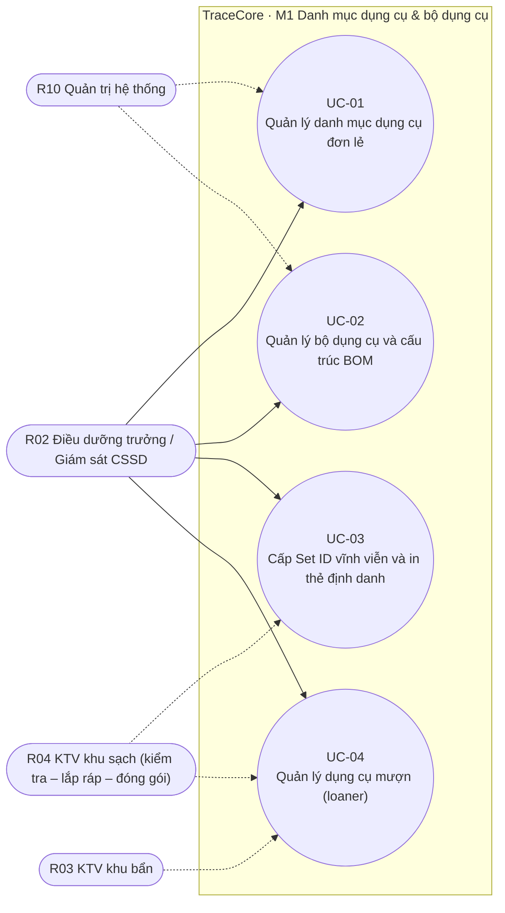

_Nét liền = actor chính (primary); nét đứt = actor phụ (secondary)._

### UC-01: Quản lý danh mục dụng cụ đơn lẻ

- **ID:** UC-01
- **Actors:** R02 Điều dưỡng trưởng / Giám sát CSSD (primary); R10 Quản trị hệ thống (secondary)
- **Description:** Khai báo dụng cụ đơn lẻ với phân loại Spaulding, IFU tái xử lý, phương pháp tiệt khuẩn tương thích và cơ số tái xử lý tối đa. Kích hoạt khi: khoa nhận dụng cụ mới, cần chuẩn hóa danh mục trước khi lập BOM, hoặc cần đặt ngưỡng bảo dưỡng tra dầu.
- **Preconditions:** Người dùng có vai trò R02/R10 và quyền Master Data. Có IFU của nhà sản xuất (file hoặc bản chụp).
- **Postconditions (success):** Dụng cụ ở trạng thái Đang dùng, chọn được khi lập BOM. Cơ số tái xử lý tối đa và phương pháp tương thích được lưu để M8 và M2 sử dụng.
- **Traces to:** FR-M1-01, FR-M1-02, FR-M1-09
- **Business rules:** —
- **Screens:** SCR-01
- **Priority:** Must · Frequency: 20–50 bản ghi/tháng; ban đầu 800–1.500 dụng cụ.
- **Related NFR:** NFR-COMP-02, NFR-MAINT-01

**Main success scenario**
1. R02 mở màn Dụng cụ, chọn Tạo mới.
2. Nhập mã, tên, hãng, model; tải ảnh.
3. Chọn phân loại Spaulding và các phương pháp tiệt khuẩn tương thích.
4. Đính kèm IFU, nhập cơ số tái xử lý tối đa, ngưỡng bảo dưỡng (số chu trình giữa hai lần tra dầu/kiểm tra) và giá trị; tải ảnh chụp thực tế rõ nét của dụng cụ để hiển thị tại trạm tiếp nhận và đóng gói.
5. Hệ thống kiểm tra trùng mã và tính đầy đủ; lưu và hiển thị bản ghi.
6. Hệ thống ghi audit tạo mới.

**Alternate flows**
- A1. Nhập hàng loạt từ Excel mẫu: hệ thống kiểm tra từng dòng, báo lỗi dòng sai, nhập các dòng đúng.
- A2. Cơ số tối đa chưa biết: người dùng để trống, hệ thống đánh dấu Chưa xác định và đưa vào báo cáo cần bổ sung.

**Exception flows**
- E1. Trùng mã dụng cụ → báo lỗi và gợi ý mã kế tiếp.
- E2. File IFU vượt 20 MB → từ chối tệp, cho phép lưu bản ghi không kèm IFU.
- E3. Ngừng sử dụng dụng cụ đang nằm trong BOM đang áp dụng → cảnh báo danh sách BOM bị ảnh hưởng, yêu cầu xác nhận.

**Open issues:** Đã chốt: Set ID GS1; 2 loại nhãn (hấp / plasma); hạn lưu loại gói và cơ số do khoa nhập tay trước Sprint 1. Còn xác nhận mẫu nhãn cụ thể tại UAT.

_Nguồn: #06 UC v1.10 (v1.10 — Đang Review); US-01; API API-M1-01, API-M1-06; DocType DT-INSTR; Workflow — (không có trạng thái); TC TC-01-01, TC-01-02._

### UC-02: Quản lý bộ dụng cụ và cấu trúc BOM

- **ID:** UC-02
- **Actors:** R02 Điều dưỡng trưởng / Giám sát CSSD (primary); R10 Quản trị hệ thống (secondary)
- **Description:** Định nghĩa loại bộ dụng cụ gồm N dụng cụ × số lượng, ảnh lắp ráp, phiếu kiểm đếm, phương pháp tiệt khuẩn và hạn lưu. Kích hoạt khi: khoa lâm sàng yêu cầu bộ dụng cụ mới hoặc thay đổi cấu hình bộ hiện có.
- **Preconditions:** Các dụng cụ trong BOM đã tồn tại (UC-01). Người dùng có quyền Master Data.
- **Postconditions (success):** Loại bộ có BOM phiên bản mới nhất, phiếu kiểm đếm in được. Bộ vật lý áp dụng phiên bản mới từ chu trình kế tiếp.
- **Traces to:** FR-M1-03, FR-M1-04
- **Business rules:** —
- **Screens:** SCR-02
- **Priority:** Must · Frequency: 10–20 loại bộ/tháng; ban đầu 150–300 loại.
- **Related NFR:** NFR-COMP-02, NFR-MAINT-01

**Main success scenario**
1. R02 tạo loại bộ: tên, khoa sở hữu, phương pháp tiệt khuẩn, loại gói mặc định, hạn lưu, cờ cấy ghép.
2. Thêm từng dòng dụng cụ × số lượng; tải ảnh chụp thực tế bộ đã sắp xếp hoàn chỉnh (một hoặc nhiều góc) và thứ tự xếp.
3. Hệ thống kiểm tra tương thích phương pháp bộ với từng dụng cụ.
4. Nhập thời gian lắp ráp chuẩn (phút) phục vụ tính nhân công.
5. Lưu; hệ thống tạo phiên bản BOM v1 và phiếu kiểm đếm PDF.
6. Hiển thị bản ghi và cơ số bộ suy ra từ dụng cụ thấp nhất.

**Alternate flows**
- A1. Sửa BOM: chọn Sửa, nhập ngày hiệu lực, lý do; hệ thống tạo phiên bản mới và màn so sánh.
- A2. Sao chép loại bộ hiện có làm mẫu cho bộ mới.

**Exception flows**
- E1. Dụng cụ không tương thích phương pháp bộ → báo lỗi tại dòng, không lưu.
- E2. BOM rỗng → chặn.
- E3. Ngày hiệu lực trong quá khứ → chặn.

**Open issues:** Đã chốt: Set ID GS1; 2 loại nhãn (hấp / plasma); hạn lưu loại gói và cơ số do khoa nhập tay trước Sprint 1. Còn xác nhận mẫu nhãn cụ thể tại UAT.

_Nguồn: #06 UC v1.10 (v1.10 — Đang Review); US-02; API API-M1-02; DocType DT-SETTYPE, DT-SETBOM; Workflow — (không có trạng thái); TC TC-02-01, TC-02-02._

### UC-03: Cấp Set ID vĩnh viễn và in thẻ định danh

- **ID:** UC-03
- **Actors:** R02 Điều dưỡng trưởng / Giám sát CSSD (primary); R04 KTV khu sạch (kiểm tra – lắp ráp – đóng gói) (secondary)
- **Description:** Tạo bộ dụng cụ vật lý từ loại bộ, cấp Set ID duy nhất suốt vòng đời, in thẻ DataMatrix gắn khay. Kích hoạt khi: khoa đưa bộ dụng cụ vật lý mới vào lưu hành (mua mới hoặc gắn mã cho bộ hiện có).
- **Preconditions:** Loại bộ đã có BOM (UC-02). Máy in thẻ/nhãn DataMatrix sẵn sàng tại trạm.
- **Postconditions (success):** Set Unit mang Set ID duy nhất, trạng thái Mới tạo, bộ đếm chu trình = 0. Thẻ Set ID in và gắn vào khay/hộp.
- **Traces to:** FR-M1-05, FR-M1-06
- **Business rules:** BRU-ID-001, BRU-ID-006
- **Screens:** SCR-03
- **Priority:** Must · Frequency: Ban đầu 500–1.200 bộ; sau đó 10–30 bộ/tháng.
- **Related NFR:** NFR-COMP-02, NFR-MAINT-01

**Main success scenario**
1. R02 chọn loại bộ, nhập số lượng bộ cần tạo và khoa sở hữu.
2. Hệ thống sinh Set ID theo chuẩn GS1 DataMatrix GIAI với tiền tố GS1 của bệnh viện, kiểm tra duy nhất.
3. Hệ thống tạo Set Unit và hiển thị phiên bản BOM dự kiến áp dụng; phiên bản chỉ được ghim khi bộ bắt đầu chu trình tại T1, Set Unit chưa gắn cố định phiên bản lúc cấp.
4. In thẻ; R04 gắn thẻ vào khay và quét kiểm tra đọc được.
5. Hệ thống ghi số lần in và audit.
6. Bộ sẵn sàng đi vào chuỗi từ trạm Tiếp nhận (chu trình đầu tiên bắt buộc).

**Alternate flows**
- A1. Gắn mã cho bộ đang lưu hành: nhập số chu trình đã dùng ước tính (lớn hơn 0) kèm lý do, hệ thống ghi nguồn Ước tính; người, thời điểm và lý do nằm trong Audit Log.
- A2. Thẻ bị mất/hỏng: in lại thẻ cùng Set ID với lý do, đếm số lần in.

**Exception flows**
- E1. Máy in không phản hồi → Set ID vẫn được lưu, đưa vào hàng đợi in.
- E2. Quét kiểm tra không đọc được → đánh dấu Thẻ lỗi, in lại.
- E3. Tạo hàng loạt vượt 100 bộ/lần → yêu cầu chia lô.

**Open issues:** Đã chốt: Set ID GS1; 2 loại nhãn (hấp / plasma); hạn lưu loại gói và cơ số do khoa nhập tay trước Sprint 1. Còn xác nhận mẫu nhãn cụ thể tại UAT.

_Nguồn: #06 UC v1.10 (v1.10 — Đang Review); US-03; API API-M1-03, API-M1-04; DocType DT-SETUNIT; Workflow WF-01; TC TC-03-01, TC-03-02._

### UC-04: Quản lý dụng cụ mượn (loaner)

- **ID:** UC-04
- **Actors:** R02 Điều dưỡng trưởng / Giám sát CSSD (primary); R03 KTV khu bẩn, R04 KTV khu sạch (kiểm tra – lắp ráp – đóng gói) (secondary)
- **Description:** Nhập tạm bộ mượn từ hãng, cấp Set ID tạm, tái xử lý theo chuỗi chuẩn, trả hãng có biên bản. Kích hoạt khi: hãng gửi bộ dụng cụ mượn cho ca mổ cụ thể.
- **Preconditions:** Có biên bản mượn và IFU của bộ. Người dùng R02 có quyền Loaner.
- **Postconditions (success):** Set ID tạm (LN-) tồn tại với ngày trả dự kiến. Bộ mượn buộc phải qua chuỗi tái xử lý trước khi cấp phát và trước khi trả.
- **Traces to:** FR-M1-07, FR-M1-08
- **Business rules:** —
- **Screens:** SCR-04
- **Priority:** Must · Frequency: 5–20 bộ mượn/tháng.
- **Related NFR:** NFR-COMP-02, NFR-MAINT-01

**Main success scenario**
1. R02 tạo phiếu mượn: hãng, tên bộ, ngày nhận, ngày trả dự kiến, đính kèm IFU.
2. Nhập BOM mượn nhanh (danh sách dụng cụ × số lượng) hoặc tải file.
3. Hệ thống cấp Set ID tạm LN-, in thẻ.
4. Bộ đi qua T1→T5 như bộ thường; nhãn có dòng LOANER.
5. Sau ca mổ, bộ trả về T1, tái xử lý lại rồi lập biên bản trả.
6. Hệ thống in biên bản trả (thiếu/hỏng so với BOM), Set ID tạm hết hiệu lực.

**Alternate flows**
- A1. Hãng gửi trước 1 ngày: bộ vẫn phải rửa – tiệt khuẩn tại khoa trước khi dùng.
- A2. Gia hạn mượn: R02 cập nhật ngày trả, ghi lý do.

**Exception flows**
- E1. Quá ngày trả dự kiến → cảnh báo hằng ngày cho R02.
- E2. Quét Set ID LN tại đóng gói khi chưa rửa → chặn.
- E3. Mất dụng cụ mượn → NC và biên bản trả ghi thiếu.

**Open issues:** Đã chốt: Set ID GS1; 2 loại nhãn (hấp / plasma); hạn lưu loại gói và cơ số do khoa nhập tay trước Sprint 1. Còn xác nhận mẫu nhãn cụ thể tại UAT.

_Nguồn: #06 UC v1.10 (v1.10 — Đang Review); US-04; API API-M1-05; DocType DT-LOANER, DT-SETUNIT; Workflow WF-01; TC TC-04-01, TC-04-02._

## M2 — Chuỗi tái xử lý & truy xuất

Nguồn nghiệp vụ: BR-M2 (BRD #02). Use case: UC-05, UC-06, UC-07, UC-08, UC-09, UC-10, UC-11, UC-12, UC-13, UC-14, UC-15.

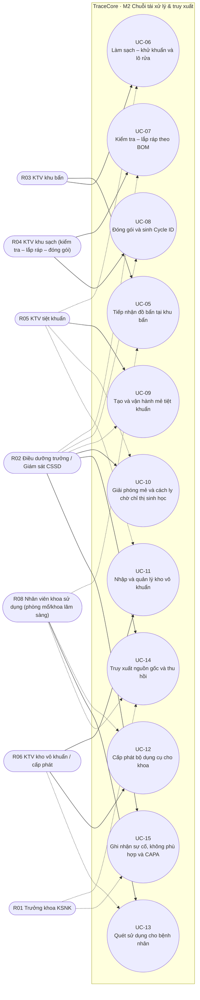

_Nét liền = actor chính (primary); nét đứt = actor phụ (secondary)._

### UC-05: Tiếp nhận đồ bẩn tại khu bẩn

- **ID:** UC-05
- **Actors:** R03 KTV khu bẩn (primary); R08 Nhân viên khoa sử dụng (phòng mổ/khoa lâm sàng) (secondary)
- **Description:** Quét Set ID trả về từ khoa, ghi khoa trả, tình trạng, thiếu/hỏng, vật sắc nhọn; chuyển trạng thái Đã tiếp nhận. Kích hoạt khi: khoa lâm sàng/phòng mổ trả nhiều bộ dụng cụ đã dùng về khu bẩn trong cùng một lượt.
- **Preconditions:** Nhân viên R03 đã đăng nhập trạm T1 bằng thẻ, có năng lực trạm. Nhân viên khoa mang dụng cụ tới có thẻ nhân viên do hệ thống cấp (FR-M9-07). Set ID ở trạng thái Tại khoa hoặc Đã sử dụng.
- **Postconditions (success):** Phiếu tiếp nhận ghi sổ gồm N bộ, mỗi bộ có xác nhận thành phần và ghi chú bất thường; người giao (thẻ), người nhận, khoa, thời điểm; Set Unit → Chờ rửa. Bộ có ghi chú mang cờ Cần xem xét cho T3 kiểm tra chi tiết; Cycle ID cũ (nếu chưa quét sử dụng) → Hết hiệu lực với lý do Trả không sử dụng.
- **Traces to:** FR-M2-01, FR-M2-02, FR-M2-23
- **Business rules:** BRU-FLOW-002, BRU-FLOW-003, BRU-REP-001, BRU-REP-012
- **Screens:** SCR-05, SCR-34
- **Priority:** Must · Frequency: 120–200 bộ/ngày, 15–30 lượt trả/ngày; mỗi lượt 5–20 bộ nối tiếp.
- **Related NFR:** NFR-PERF-01, NFR-AVAIL-02, NFR-SEC-03, NFR-USAB-01, NFR-COMP-01

**Main success scenario**
1. R03 quét mã thẻ của nhân viên khoa mang dụng cụ tới; hệ thống hiển thị tên và khoa trả (một lần cho cả phiếu).
2. Quét mã vạch bộ dụng cụ thứ nhất; hệ thống kiểm tra trạng thái hợp lệ (BRU-FLOW-002), hủy Cycle ID cũ nếu chưa dùng và hiện danh sách thành phần bộ: từng loại dụng cụ, số lượng theo BOM, ảnh chụp thực tế, ảnh bộ đã sắp xếp.
3. R03 kiểm đếm theo bảng: cột Số lượng thực tế điền sẵn theo BOM, sửa dòng nào lệch (A-94); nếu có bất thường (thiếu, hỏng, vật lạ, sắc nhọn) ghi vào ô Ghi chú bất thường, chụp ảnh nếu cần.
4. Bấm Xác nhận bộ; hệ thống lưu xác nhận và ghi chú, chuyển bộ sang Chờ rửa (cờ Cần xem xét nếu có ghi chú) và quay lại ô quét chờ bộ kế tiếp.
5. Lặp lại bước 2–4 cho mọi bộ trong xe trả; phiếu hiển thị số bộ đã nhận và số bộ có ghi chú.
6. Ghi sổ phiếu; hệ thống ghi người giao, người nhận, giờ, trạm, khoa; in hoặc gửi biên nhận; ghi chú hiển thị đỏ tại T3 để kiểm tra chi tiết và tạo NC nếu có hỏng/thất lạc.

**Alternate flows**
- A1. Nhân viên giao không có thẻ (người mới): chọn khoa và ghi tên, R02 cấp thẻ sau (FR-M9-07).
- A2. Bộ trả kèm dụng cụ rời không thuộc BOM: ghi vào Ghi chú bất thường; T3 xử lý và tạo NC.
- A3. Dụng cụ hoặc bộ chưa có ảnh chụp thực tế: hiển thị khung Chưa có ảnh, ghi nhận thiếu ảnh để bổ sung tại danh mục.
- A4. [A-67] Màn T1 có khối "Phiếu đã tiếp nhận hôm nay" (phiếu đã ghi sổ trong ngày tại trạm, của mọi người nhận, kèm tổng phiếu/bộ); bấm một phiếu để xem nhanh các bộ và trạng thái hiện tại; chỉ đọc, tự làm mới sau mỗi lần Ghi sổ.

**Exception flows**
- E1. Set ID ở trạng thái không hợp lệ (ví dụ Trong kho vô khuẩn) → từ chối, hiển thị trạm hiện tại; R02 có thể tiếp nhận cưỡng bức.
- E2. Mã không tồn tại → Mã không hợp lệ, ghi log.
- E3. Mất mạng → lưu cục bộ, đồng bộ sau (FR-M9-06).

**Open issues:** Đã chốt: Set ID GS1; 2 loại nhãn (hấp / plasma); hạn lưu loại gói và cơ số do khoa nhập tay trước Sprint 1. Còn xác nhận mẫu nhãn cụ thể tại UAT.

_Nguồn: #06 UC v1.10 (v1.10 — Đang Review); US-05; API API-M2-01, API-M1-06; DocType DT-RECEIPT, DT-SETUNIT, DT-PACK, DT-SETBOM, DT-INSTR, DT-EMP; Workflow WF-01, WF-02; TC TC-05-01, TC-05-02._

### UC-06: Làm sạch – khử khuẩn và lô rửa

- **ID:** UC-06
- **Actors:** R03 KTV khu bẩn (primary); R05 KTV tiệt khuẩn (secondary)
- **Description:** Tạo lô rửa gắn máy rửa, chương trình, hóa chất theo lô/hạn; quét các Set ID vào lô; ghi kết quả. Kích hoạt khi: đủ bộ đã qua cổng T1 (kiểm đếm tiếp nhận) để nạp một lô rửa nhiều bộ.
- **Preconditions:** Máy rửa ở trạng thái Sẵn sàng (test ngày đạt). Hóa chất còn lô trong hạn.
- **Postconditions (success):** Mã lô LR- chứa danh sách toàn bộ bộ dụng cụ và toàn bộ dữ liệu máy rửa; lô Đạt: cổng T2 Đạt cho từng bộ → Chờ lắp ráp; tiêu hao hóa chất trừ kho; chi phí lô ghi nhận. Lô Không đạt: cổng T2 Không đạt, Set ID → Xử lý lại (rửa) và chỉ có thể quét lại tại T2; NC tự tạo.
- **Traces to:** FR-M2-03, FR-M2-24, FR-M2-25, FR-M2-04
- **Business rules:** BRU-FLOW-002, BRU-FLOW-003, BRU-REP-002, BRU-FLOW-004, BRU-REP-015, BRU-REP-016
- **Screens:** SCR-06
- **Priority:** Must · Frequency: 15–25 lô/ngày.
- **Related NFR:** NFR-PERF-01, NFR-AVAIL-02, NFR-SEC-03, NFR-USAB-01, NFR-COMP-01

**Main success scenario**
1. R03 quét QR máy rửa; hệ thống kiểm tra máy Sẵn sàng, hiển thị chương trình, gợi ý hóa chất theo FEFO; chưa quét máy thì không quét được bộ.
2. Quét nối tiếp Set ID của từng bộ đưa vào máy; hệ thống kiểm tra cổng T1 của từng bộ và từ chối bộ chưa Đạt hoặc đang ở lô khác.
3. R03 quét mã Hoàn thành nạp (hoặc bấm nút); hệ thống tự sinh mã lô LR-YYMMDD-NN gồm toàn bộ bộ vừa quét, in nhãn QR lô, ghi giờ, người, chương trình; máy bắt đầu chạy.
4. Khi máy kết thúc, người dỡ (R04 ở cửa ra khu sạch với máy hai cửa) quét QR máy và QR mã lô; hệ thống liệt kê toàn bộ bộ trong lô. Máy kết nối API → dữ liệu và kết quả chu trình tự điền; máy không kết nối → nhập tay tham số theo mẫu, đính ảnh bản in nếu có, chọn Đạt/Không đạt và tick xác nhận.
5. Hệ thống áp một kết quả cho toàn bộ bộ trong lô: Đạt → cổng T2 Đạt cho từng bộ, trừ hóa chất theo định mức, tính chi phí lô; Không đạt → mọi bộ về Xử lý lại (T2).
6. Bộ hiển thị tại trạm lắp ráp ở khu sạch; quét mã lô ở bất kỳ đâu mở được hồ sơ lô đầy đủ.

**Alternate flows**
- A1. Rửa thủ công/siêu âm cho dụng cụ tinh vi: lô loại Thủ công, nhập thời gian ngâm, nồng độ, nhiệt độ.
- A2. Máy rửa hai cửa: xác nhận dỡ tại cửa khu sạch bởi R04.
- A3. Máy không có cả màn hình lẫn bản in: nhập tay tối thiểu chương trình + giờ bắt đầu/kết thúc và xác nhận; R02 xác nhận thêm khi kết luận (BRU-REP-015).
- A5. [A-77] Chương trình bật bắt buộc chỉ thị: quét đủ QR máy và QR mã lô thì lô sang Chờ đọc chỉ thị, máy được nạp lô mới, bộ chưa sang T3. Người đọc (quét lại QR lô nếu đọc sau) ghi vật tư, lô, hạn, kết quả, ảnh; bước 5 áp kết quả chung của chu trình và chỉ thị.
- A4. [A-66] Màn nạp hiển thị danh sách Bộ chờ rửa (bộ đã Đạt T1, chưa có kết quả T2, chưa ở lô đang chạy) để KTV biết bộ nào cần rửa; danh sách chỉ để xem, vẫn quét Set ID từng bộ vào lô.

**Exception flows**
- E1. Máy Khóa (test/kiểm định) → không chọn được, hiển thị lý do.
- E2. Hóa chất hết hạn → chặn chọn lô đó.
- E3. Lô Không đạt → toàn bộ bộ chuyển Xử lý lại (rửa), chỉ quét được tại T2, lặp tới khi Đạt; NC tự tạo.
- E4. Chưa có dữ liệu tự động và chưa có nhập tay đã xác nhận → nút Đóng lô khóa, không kết luận Đạt được.
- E5. Dỡ lô: quét QR máy không khớp máy của mã lô, hoặc chưa quét đủ máy + mã lô → từ chối mở màn kết quả.
- E6. [A-77] Chỉ thị thiếu lô, hết hạn hoặc thiếu ảnh bắt buộc → không ghi được Đạt, lô vẫn Chờ đọc chỉ thị.

**Open issues:** Đã chốt: Set ID GS1; 2 loại nhãn (hấp / plasma); hạn lưu loại gói và cơ số do khoa nhập tay trước Sprint 1. Còn xác nhận mẫu nhãn cụ thể tại UAT.

_Nguồn: #06 UC v1.10 (v1.10 — Đang Review); US-06; API API-M2-02, API-M2-03, API-M2-17; DocType DT-WASHBATCH, DT-STOCKENTRY; Workflow WF-04, WF-01; TC TC-06-01, TC-06-02._

### UC-07: Kiểm tra – lắp ráp theo BOM

- **ID:** UC-07
- **Actors:** R04 KTV khu sạch (kiểm tra – lắp ráp – đóng gói) (primary); R02 Điều dưỡng trưởng / Giám sát CSSD (secondary)
- **Description:** Đếm từng dụng cụ theo BOM, ghi thiếu, hỏng, thay thế; chặn nếu thiếu chưa xác nhận; kiểm tra cơ số. Kích hoạt khi: bộ ra khỏi lô rửa Đạt tại khu sạch.
- **Preconditions:** R04 đăng nhập trạm T3, có năng lực. Set ID thuộc lô rửa Đạt.
- **Postconditions (success):** Phiếu lắp ráp lưu với kết quả từng dòng BOM. Bộ Chờ đóng gói hoặc bị chặn nếu thiếu chưa xác nhận.
- **Traces to:** FR-M2-05, FR-M2-06
- **Business rules:** BRU-FLOW-002, BRU-FLOW-003, BRU-REP-003, BRU-FLOW-004
- **Screens:** SCR-07
- **Priority:** Must · Frequency: 120–200 bộ/ngày.
- **Related NFR:** NFR-PERF-01, NFR-AVAIL-02, NFR-SEC-03, NFR-USAB-01, NFR-COMP-01

**Main success scenario**
1. R04 quét Set ID; hệ thống hiển thị BOM phiên bản áp dụng kèm ảnh lắp ráp.
2. Kiểm tra từng dụng cụ (sạch, khô, chức năng), tick hoặc nhập số lượng thực tế từng dòng; mọi dòng bắt đầu ở Chưa đếm; có nút Xác nhận tất cả thành phần ghi mọi dòng chưa đếm theo định mức. [A-79, A-102 đảo phần xác nhận tất cả] Số lượng khác định mức: thiếu phải chọn Thiếu/Hỏng và ghi chú, dư phải ghi chú.
3. Ghi dụng cụ hỏng, chọn dụng cụ thay từ kho dự phòng; dụng cụ hỏng chuyển Sửa chữa/Thanh lý.
4. Hệ thống hiển thị cảnh báo sớm cơ số (bộ và từng dụng cụ).
5. Xác nhận đủ; in phiếu kiểm đếm kèm gói.
6. Bộ chuyển Chờ đóng gói, chuyển sang UC-08 trên cùng màn hình.

**Alternate flows**
- A1. Quét mã đơn lẻ (giai đoạn 2) tự tick dòng BOM.
- A2. Thiếu dụng cụ nhưng ca mổ cần gấp: R02 xác nhận đóng gói thiếu bằng PIN, nhãn in dòng THIẾU.

**Exception flows**
- E1. Bộ chưa qua lô rửa Đạt → chặn.
- E2. Thiếu chưa xác nhận → nút Đóng gói khóa, NC tự tạo.
- E3. Bộ đạt/vượt cơ số → hiển thị đỏ, không cho đóng gói (UC-31).

**Open issues:** Đã chốt: Set ID GS1; 2 loại nhãn (hấp / plasma); hạn lưu loại gói và cơ số do khoa nhập tay trước Sprint 1. Còn xác nhận mẫu nhãn cụ thể tại UAT.

_Nguồn: #06 UC v1.10 (v1.10 — Đang Review); US-07; API API-M2-04; DocType DT-ASSEMBLY, DT-SETUNIT; Workflow WF-01; TC TC-07-01, TC-07-02._

### UC-08: Đóng gói và sinh Cycle ID

- **ID:** UC-08
- **Actors:** R04 KTV khu sạch (kiểm tra – lắp ráp – đóng gói) (primary); R02 Điều dưỡng trưởng / Giám sát CSSD (secondary)
- **Description:** Sinh Cycle ID duy nhất, in nhãn chịu hấp gồm Set ID, Cycle ID, người đóng gói, ngày, hạn, phương pháp. Kích hoạt khi: bộ được xác nhận đủ tại lắp ráp và đưa tới bàn đóng gói.
- **Preconditions:** Phiếu lắp ráp Đạt hoặc có xác nhận thiếu của R02. Máy in nhãn tại T4 sẵn sàng; Set ID không còn Cycle ID hiệu lực. Lô chỉ thị hóa học phù hợp phương pháp còn hạn tại bàn.
- **Postconditions (success):** Mã vạch một lần (Cycle ID) đã tự sinh và in ngay sau xác nhận hoàn thành đóng gói, gắn với bộ và mang ngày giờ đóng gói, người đóng gói, hạn sử dụng, phương pháp, loại gói, lô chỉ thị, phiên bản BOM; Pack trạng thái Đã đóng gói — đây là điều kiện để bộ được quét vào mẻ tiệt khuẩn (UC-09). Nhãn in đúng loại; tiêu hao bao gói/chỉ thị/nhãn/dầu bôi trơn ghi nhận theo định mức; bộ đếm bảo dưỡng cập nhật.
- **Traces to:** FR-M2-07, FR-M2-08
- **Business rules:** BRU-ID-002, BRU-ID-004, BRU-FLOW-002, BRU-FLOW-003, BRU-REP-009, BRU-FLOW-004, BRU-REP-013, BRU-REP-014, BRU-REP-011
- **Screens:** SCR-08
- **Priority:** Must · Frequency: 120–200 gói/ngày.
- **Related NFR:** NFR-PERF-01, NFR-AVAIL-02, NFR-SEC-03, NFR-USAB-01, NFR-COMP-01

**Main success scenario**
1. R04 quét Set ID tại bàn đóng gói; hệ thống hiển thị BOM kèm ảnh chụp thực tế từng dụng cụ và ảnh chụp thực tế bộ đã sắp xếp hoàn chỉnh.
2. R04 xếp dụng cụ theo ảnh thực tế và tick xác nhận từng loại dụng cụ; nếu có dụng cụ đạt ngưỡng bảo dưỡng, hệ thống hiển thị nhắc tra dầu kèm ảnh, R04 bảo dưỡng và bấm Đã bảo dưỡng (ghi lô dầu) hoặc Hoãn có lý do.
3. R04 đặt chỉ thị hóa học vào trong bộ và quét lô chỉ thị; hệ thống kiểm tra loại chỉ thị khớp phương pháp và còn hạn.
4. R04 chọn loại gói (giấy crepe, túi hàn, hộp lọc); hệ thống lấy hạn lưu đã nhập tay; R04 bấm Xác nhận hoàn thành đóng gói → hệ thống kiểm tra cơ số (M8) và BRU-ID-004 rồi TỰ ĐỘNG sinh mã vạch một lần (Cycle ID) gắn với bộ, chứa ngày giờ đóng gói, người đóng gói, hạn sử dụng, Set ID, tên bộ, phương pháp, loại gói, lô chỉ thị, phiên bản BOM.
5. Hệ thống chọn loại nhãn theo phương pháp (nhãn hấp hơi nước cho Hấp 121/134, nhãn plasma cho Plasma H2O2), gửi lệnh in tới máy in/cuộn đúng loại; in nhãn (Set ID, Cycle ID, tên bộ, khoa, người, ngày, hạn, phương pháp, chỉ thị).
6. R04 dán nhãn và chỉ thị hóa học, hàn túi; quét lại nhãn để xác nhận.
7. Pack hiển thị tại trạm nạp mẻ.

**Alternate flows**
- A1. Nhãn in hỏng: in lại trong 10 phút với lý do.
- A2. Gói đôi (double wrap) cho cấy ghép: hệ thống nhắc dán chỉ thị trong và ngoài.
- A3. Trạm chỉ có một máy in: người dùng đổi cuộn nhãn, quét mã cuộn để xác nhận loại trước khi in gói phương pháp khác.

**Exception flows**
- E1. Vượt cơ số → không sinh Cycle ID (UC-31).
- E4. Chưa tick đủ dụng cụ hoặc chưa quét lô chỉ thị → nút Sinh Cycle ID khóa, hiển thị mục còn thiếu; lô chỉ thị sai phương pháp/hết hạn → từ chối.
- E5. Dụng cụ quá ngưỡng bảo dưỡng 20% chưa tra dầu → chặn sinh mã tới khi xác nhận bảo dưỡng.
- E2. Không dựng được PDF nhãn hoặc trình duyệt không mở được hộp thoại In → giữ Cycle ID, báo lỗi inline, nút In lại; không sinh mã mới (A-114: một máy in nhãn chung, không còn chặn theo loại cuộn hay hàng đợi in; BRU-REP-011 thu hẹp).
- E3. Mất mạng → sinh Cycle ID từ dải offline, đồng bộ sau.

**Open issues:** Đã chốt: Set ID GS1; 2 loại nhãn (hấp / plasma); hạn lưu loại gói và cơ số do khoa nhập tay trước Sprint 1. Còn xác nhận mẫu nhãn cụ thể tại UAT.

_Nguồn: #06 UC v1.10 (v1.10 — Đang Review); US-08; API API-M2-05, API-M2-06, API-M1-06; DocType DT-PACK, DT-STOCKENTRY, DT-INSTRMAINT, DT-SETBOM; Workflow WF-02; TC TC-08-01, TC-08-02._

### UC-09: Tạo và vận hành mẻ tiệt khuẩn

- **ID:** UC-09
- **Actors:** R05 KTV tiệt khuẩn (primary); R02 Điều dưỡng trưởng / Giám sát CSSD (secondary)
- **Description:** Tạo Load ID, chọn máy – chương trình tương thích, quét gói vào mẻ, nhập tham số và biểu đồ mẻ. Kích hoạt khi: đủ gói đã qua cổng T4 Đạt để nạp một mẻ tiệt khuẩn nhiều gói.
- **Preconditions:** Máy tiệt khuẩn Sẵn sàng (test ngày đạt, kiểm định còn hạn). R05 đăng nhập trạm T5.
- **Postconditions (success):** Mã mẻ ME- chứa danh sách toàn bộ gói/bộ; Load Đang chạy → Hoàn tất chu trình. Toàn bộ dữ liệu máy tiệt khuẩn (tham số, biểu đồ, cảnh báo, bản in) và chỉ thị được đính vào mã mẻ.
- **Traces to:** FR-M2-09, FR-M2-10
- **Business rules:** BRU-FLOW-002, BRU-FLOW-003, BRU-REP-004, BRU-FLOW-004, BRU-REP-015, BRU-REP-016
- **Screens:** SCR-09, SCR-35
- **Priority:** Must · Frequency: 10–16 mẻ/ngày.
- **Related NFR:** NFR-PERF-01, NFR-AVAIL-02, NFR-SEC-03, NFR-USAB-01, NFR-COMP-01

**Main success scenario**
1. R05 quét QR máy tiệt khuẩn; hệ thống kiểm tra Sẵn sàng (test ngày, kiểm định), chọn chương trình; chưa quét máy thì không quét được gói.
2. Quét nối tiếp Cycle ID của từng gói đưa vào máy; hệ thống kiểm tra cổng T4 Đạt của từng bộ, tương thích gói – chương trình và dung tích.
3. Đặt chỉ thị hóa học/gói thử thách, BI nếu chương trình yêu cầu; quét lô chỉ thị.
4. Quét mã Hoàn thành nạp (hoặc bấm nút); hệ thống tự sinh mã mẻ ME-YYMMDD-NN gồm toàn bộ gói vừa quét, in nhãn QR mẻ, ghi giờ, người; máy bắt đầu chạy.
5. Kết thúc: máy kết nối được → nhận tham số tự động; máy không kết nối → R05 nhập tay nhiệt độ, áp suất, thời gian pha theo mẫu chương trình, đính ảnh bản in/biểu đồ nếu có, tick xác nhận đúng với máy; hệ thống đính vào mã mẻ kèm nguồn và người xác nhận.
6. Mẻ chuyển Hoàn tất chu trình khi đã có dữ liệu (tự động hoặc nhập tay đã xác nhận), sẵn sàng giải phóng (UC-10); quét mã mẻ mở hồ sơ đầy đủ.

**Alternate flows**
- A1. Máy plasma: chương trình ngắn/dài, chỉ thị plasma, không Bowie-Dick.
- A2. Mẻ ưu tiên (flash) cho phòng mổ: đánh dấu Ưu tiên, giới hạn theo IFU.
- A3. Máy kết nối được nhưng mất dữ liệu: chuyển sang nhập tay có xác nhận, ghi lý do.

**Exception flows**
- E1. Gói không tương thích → từ chối, hiển thị lý do.
- E2. Gói đã trong mẻ khác → từ chối.
- E3. Máy dừng giữa chừng (sự cố) → mẻ đánh dấu Cần xem xét, tạo sự cố thiết bị.
- E4. Gói chưa qua cổng T4 Đạt (chưa xác nhận dụng cụ/chỉ thị) → từ chối (BRU-FLOW-004).

**Open issues:** Đã chốt: Set ID GS1; 2 loại nhãn (hấp / plasma); hạn lưu loại gói và cơ số do khoa nhập tay trước Sprint 1. Còn xác nhận mẫu nhãn cụ thể tại UAT.

_Nguồn: #06 UC v1.10 (v1.10 — Đang Review); US-09; API API-M2-07, API-M2-08, API-M2-17; DocType DT-LOAD, DT-PACK, DT-LOADTEST, DT-STEPGATE; Workflow WF-03, WF-02; TC TC-09-01, TC-09-02._

### UC-10: Giải phóng mẻ và cách ly chờ chỉ thị sinh học

- **ID:** UC-10
- **Actors:** R05 KTV tiệt khuẩn, R02 Điều dưỡng trưởng / Giám sát CSSD (primary); R01 Trưởng khoa KSNK (duyệt mẻ ngoài dải, A-106)
- **Description:** Nhập kết quả chỉ thị, giải phóng mẻ có kiểm soát, cách ly mẻ cấy ghép chờ BI, xử lý mẻ không đạt. Kích hoạt khi: mẻ Hoàn tất chu trình.
- **Preconditions:** Đã quét QR máy và QR mã mẻ khi dỡ; kết quả chu trình và tham số đã có (tự động hoặc nhập tay có xác nhận); chỉ thị hóa học đã đọc. Mẻ ngoài dải cần R01 có mặt tại trạm (A-106).
- **Postconditions (success):** Load → Đã giải phóng (cổng T5 Đạt cho từng bộ; bộ đủ 5 cổng → Vô khuẩn, được vào kho) hoặc Cách ly chờ BI hoặc Không đạt (cổng T5 Không đạt → Xử lý lại từ T4 hoặc T2). Bộ đếm chu trình tăng 1 khi Đạt; chi phí mẻ tính; tiêu hao trừ.
- **Traces to:** FR-M2-11, FR-M2-12
- **Business rules:** BRU-FLOW-002, BRU-FLOW-003, BRU-REP-005, BRU-REP-006, BRU-FLOW-004, BRU-REP-015, BRU-REP-016
- **Screens:** SCR-10
- **Priority:** Must · Frequency: 10–16 mẻ/ngày; BI 1–3 mẻ/ngày.
- **Related NFR:** NFR-PERF-01, NFR-AVAIL-02, NFR-SEC-03, NFR-USAB-01, NFR-COMP-01

**Main success scenario**
1. Khi máy kết thúc, R05 quét QR máy và QR mã mẻ tại cửa ra; hệ thống liệt kê toàn bộ gói/bộ trong mẻ; kết quả chu trình tự điền nếu máy kết nối API, ngược lại R05 nhập tay có xác nhận; kết quả áp cho mọi gói.
2. R05 nhập kết quả chỉ thị hóa học từng gói/mẻ, Bowie-Dick ngày; hệ thống đối chiếu tham số với chương trình.
3. Dữ liệu trong dải: R05, R02 hoặc R01 của phiên trạm giải phóng, không PIN; mẻ Cần xem xét do sự cố máy hoặc dữ liệu khớp theo giờ thì R02, R01 xác nhận (A-106).
4. Nếu mẻ có BI: chuyển Cách ly, đặt giờ đọc BI.
5. Khi BI âm tính → Đã giải phóng; gói chuyển kho vô khuẩn.
6. Hệ thống tính chi phí mẻ, trừ tiêu hao, tăng bộ đếm chu trình.

**Alternate flows**
- A1. Cấp trước kết quả BI cho ca không hoãn được: R01 phê duyệt, gói đánh dấu Chờ BI, theo dõi.
- A2. Giải phóng khẩn bởi R01 với PIN và lý do, chỉ khi dữ liệu trong dải.
- A3. Dữ liệu ngoài dải (A-106): người ghi kết quả chọn Vẫn chấp nhận; R01 đăng nhập bằng thẻ tại trạm, nhập PIN và lý do để giải phóng; R02, R05 thấy `Cần trưởng khoa duyệt vì dữ liệu chu trình ngoài dải: <tên thông số>`. Cổng BI giữ nguyên. Sửa dữ liệu về trong dải thì về luồng chính.

**Exception flows**
- E1. Chỉ thị hóa học không đạt, hoặc chưa có dữ liệu máy (tự động hoặc nhập tay đã xác nhận) → không giải phóng; mẻ Không đạt → gói hết hiệu lực, bộ về Xử lý lại từ T4 (mặc định) hoặc T2 (R02 chọn), NC.
- E2. BI dương tính sau khi đã cấp/dùng → tự tạo lệnh thu hồi (UC-14), thông báo R01 và khoa.
- E3. Thiếu tham số → không giải phóng.

**Open issues:** Đã chốt: Set ID GS1; 2 loại nhãn (hấp / plasma); hạn lưu loại gói và cơ số do khoa nhập tay trước Sprint 1. Còn xác nhận mẫu nhãn cụ thể tại UAT.

_Nguồn: #06 UC v1.10 (v1.10 — Đang Review); US-10; API API-M2-09, API-M2-10; DocType DT-LOAD, DT-LOADTEST, DT-COSTSHEET; Workflow WF-03, WF-02; TC TC-10-01, TC-10-02._

### UC-11: Nhập và quản lý kho vô khuẩn

- **ID:** UC-11
- **Actors:** R06 KTV kho vô khuẩn / cấp phát (primary); R05 KTV tiệt khuẩn (secondary)
- **Description:** Quét gói vào vị trí kệ, áp dụng FEFO, cảnh báo sắp hết hạn, kiểm kê kho vô khuẩn. Kích hoạt khi: gói đã giải phóng được chuyển sang kho vô khuẩn.
- **Preconditions:** Gói Đã giải phóng và bộ đã đủ 5 cổng bước Đạt (trạng thái Vô khuẩn). Kệ có mã vị trí.
- **Postconditions (success):** Pack → Trong kho vô khuẩn với vị trí. Tồn kho vô khuẩn theo loại bộ và hạn.
- **Traces to:** FR-M2-13, FR-M2-14
- **Business rules:** BRU-FLOW-002, BRU-FLOW-003, BRU-REP-008, BRU-FLOW-004
- **Screens:** SCR-11
- **Priority:** Must · Frequency: 120–200 gói/ngày; tồn 600–900 gói.
- **Related NFR:** NFR-PERF-01, NFR-AVAIL-02, NFR-SEC-03, NFR-USAB-01, NFR-COMP-01

**Main success scenario**
1. R06 quét Cycle ID rồi quét mã vị trí kệ.
2. Hệ thống kiểm tra trạng thái và cập nhật vị trí.
3. Dashboard kho hiển thị tồn theo loại bộ, gói sắp hết hạn 7 ngày.
4. Khi lấy gói cấp phát, hệ thống gợi ý FEFO.
5. Kiểm kê kho định kỳ: quét toàn bộ, đối chiếu.
6. Gói quá hạn tự chuyển Hết hiệu lực lúc 00:00 và vào danh sách đưa về khu bẩn.

**Alternate flows**
- A1. Gói rách/ướt phát hiện tại kho: quét + lý do → Hết hiệu lực.
- A2. Chuyển vị trí: quét gói, quét vị trí mới.

**Exception flows**
- E1. Gói chưa giải phóng hoặc bộ chưa đủ 5 cổng Đạt → từ chối, hiển thị bước còn thiếu (BRU-FLOW-004).
- E2. Vị trí không tồn tại → từ chối.
- E3. Kiểm kê lệch → lập biên bản, R02 xử lý.

**Open issues:** Đã chốt: Set ID GS1; 2 loại nhãn (hấp / plasma); hạn lưu loại gói và cơ số do khoa nhập tay trước Sprint 1. Còn xác nhận mẫu nhãn cụ thể tại UAT.

_Nguồn: #06 UC v1.10 (v1.10 — Đang Review); US-11; API API-M2-11, API-M2-17; DocType DT-PACK, DT-STERLOC; Workflow WF-02; TC TC-11-01, TC-11-02._

### UC-12: Cấp phát bộ dụng cụ cho khoa

- **ID:** UC-12
- **Actors:** R06 KTV kho vô khuẩn / cấp phát (primary); R08 Nhân viên khoa sử dụng (phòng mổ/khoa lâm sàng) (secondary)
- **Description:** Quét gói + người nhận, ký điện tử, trừ tồn kho vô khuẩn, cộng tồn khoa, kiểm tra cơ số khoa. Kích hoạt khi: khoa đề nghị cấp hoặc đến lịch cấp theo cơ số.
- **Preconditions:** Gói Trong kho vô khuẩn. Người nhận có thẻ nhân viên.
- **Postconditions (success):** Phiếu cấp phát ký điện tử; Pack → Đã cấp phát; tồn khoa cập nhật. Cảnh báo/phê duyệt vượt cơ số được ghi nhận.
- **Traces to:** FR-M2-15, FR-M2-16
- **Business rules:** BRU-FLOW-002, BRU-FLOW-003, BRU-PAR-005
- **Screens:** SCR-12, SCR-36
- **Priority:** Must · Frequency: 80–150 gói/ngày.
- **Related NFR:** NFR-PERF-01, NFR-AVAIL-02, NFR-SEC-03, NFR-USAB-01, NFR-COMP-01

**Main success scenario**
1. R06 chọn khoa; hệ thống hiển thị tồn khoa và cơ số.
2. Quét từng gói; hệ thống kiểm tra FEFO và cơ số khoa.
3. Quét thẻ người nhận; ký điện tử.
4. Xác nhận phiếu; in/gửi phiếu.
5. Tồn kho vô khuẩn giảm, tồn khoa tăng.
6. Bộ → Tại khoa.

**Alternate flows**
- A1. Vượt cơ số → R02 phê duyệt tại chỗ bằng PIN.
- A2. Cấp theo yêu cầu Set ID cụ thể (phẫu thuật viên chỉ định) với ghi chú.

**Exception flows**
- E1. Gói hết hiệu lực/quá hạn → chặn.
- E2. Người nhận không thuộc khoa → cảnh báo, cho tiếp tục có lý do.
- E3. Khoa không có cơ số cấu hình → cho phép, ghi thiếu cấu hình.

**Open issues:** Đã chốt: Set ID GS1; 2 loại nhãn (hấp / plasma); hạn lưu loại gói và cơ số do khoa nhập tay trước Sprint 1. Còn xác nhận mẫu nhãn cụ thể tại UAT.

_Nguồn: #06 UC v1.10 (v1.10 — Đang Review); US-12; API API-M2-12; DocType DT-ISSUE, DT-PACK, DT-PARLEVEL; Workflow WF-02, WF-01; TC TC-12-01, TC-12-02._

### UC-13: Quét sử dụng cho bệnh nhân

- **ID:** UC-13
- **Actors:** R08 Nhân viên khoa sử dụng (phòng mổ/khoa lâm sàng) (primary); R06 KTV kho vô khuẩn / cấp phát (secondary)
- **Description:** Quét Cycle ID tại phòng mổ/khoa, nhập mã bệnh nhân – ca mổ (nhập tay, không tích hợp HIS), hủy hiệu lực mã. Kích hoạt khi: điều dưỡng mở gói dùng cho bệnh nhân tại phòng mổ/khoa.
- **Preconditions:** R08 đăng nhập PDA/máy tính phòng mổ. Gói Đã cấp phát, còn hạn.
- **Postconditions (success):** Usage Record với mã bệnh nhân (mã hóa), ca mổ, PTV. Pack → Đã sử dụng, hết hiệu lực; Set Unit → Chờ tiếp nhận.
- **Traces to:** FR-M2-17, FR-M2-18
- **Business rules:** BRU-ID-003, BRU-FLOW-002, BRU-FLOW-003, BRU-REP-010
- **Screens:** SCR-13, SCR-37
- **Priority:** Must · Frequency: 60–120 ca/ngày, 100–200 gói/ngày.
- **Related NFR:** NFR-SEC-02, NFR-PERF-01, NFR-AVAIL-02

**Main success scenario**
1. R08 quét Cycle ID trên PDA.
2. Hệ thống kiểm tra hiệu lực (BRU-ID-003).
3. Nhập mã bệnh nhân, mã ca mổ, phẫu thuật viên, phòng (không tích hợp HIS).
4. Xác nhận; hệ thống lưu mã bệnh nhân mã hóa.
5. Cycle ID hết hiệu lực; hệ thống tạo yêu cầu trả đồ bẩn.
6. Có thể gắn thêm gói cho cùng ca bằng quét tiếp.

**Alternate flows**
- A1. Ca cấp cứu: quét gói trước, nhập bệnh nhân trong 24 giờ.
- A2. Gói mở nhưng không dùng: chọn Mở không dùng → Hết hiệu lực, thống kê lãng phí.

**Exception flows**
- E1. Cycle ID đã dùng/quá hạn/thu hồi → chặn, hiển thị lý do.
- E2. Gói thuộc khoa khác → cảnh báo, tiếp tục có lý do.
- E3. Mất mạng → lưu cục bộ, đồng bộ.

**Open issues:** Đã chốt: Set ID GS1; 2 loại nhãn (hấp / plasma); hạn lưu loại gói và cơ số do khoa nhập tay trước Sprint 1. Còn xác nhận mẫu nhãn cụ thể tại UAT.

_Nguồn: #06 UC v1.10 (v1.10 — Đang Review); US-13; API API-M2-13; DocType DT-USAGE, DT-PACK; Workflow WF-02, WF-01; TC TC-13-01, TC-13-02._

### UC-14: Truy xuất nguồn gốc và thu hồi

- **ID:** UC-14
- **Actors:** R02 Điều dưỡng trưởng / Giám sát CSSD (primary); R01 Trưởng khoa KSNK, R08 Nhân viên khoa sử dụng (phòng mổ/khoa lâm sàng) (secondary)
- **Description:** Tra cứu hai chiều theo bệnh nhân, Set ID, Cycle ID, mẻ, máy, người; lập lệnh thu hồi khi mẻ không đạt. Kích hoạt khi: yêu cầu kiểm tra nguồn gốc (khiếu nại, kiểm tra KSNK) hoặc mẻ không đạt/BI dương tính.
- **Preconditions:** Dữ liệu chuỗi trạm đã ghi nhận. Người dùng R02/R01 có quyền truy xuất.
- **Postconditions (success):** Kết quả truy xuất xuất PDF. Lệnh thu hồi (nếu có) với trạng thái từng gói và tiến độ.
- **Traces to:** FR-M2-19, FR-M2-20
- **Business rules:** BRU-REP-007
- **Screens:** SCR-14
- **Priority:** Must · Frequency: Truy xuất 5–20 lần/tuần; thu hồi 0–2 lần/tháng.
- **Related NFR:** NFR-PERF-01, NFR-AVAIL-02, NFR-SEC-03, NFR-USAB-01, NFR-COMP-01

**Main success scenario**
1. R02 nhập tiêu chí (mã bệnh nhân/Set ID/Cycle ID/Load ID/máy/nhân viên/khoảng ngày).
2. Hệ thống hiển thị chuỗi sự kiện theo thời gian với người – giờ – trạm – máy.
3. Khi cần thu hồi: chọn Load ID/lô BI, bấm Lập lệnh thu hồi.
4. Hệ thống liệt kê mọi gói: Trong kho (tự khóa), Đã cấp (chờ thu), Đã dùng (báo bác sĩ).
5. Thông báo khoa và R01; khoa xác nhận từng gói qua PDA.
6. R02 đóng lệnh khi 100% xác nhận; NC/CAPA liên kết.

**Alternate flows**
- A1. Thu hồi theo lô chỉ thị sinh học lỗi: chọn lô vật tư → mọi mẻ dùng lô đó.
- A2. Truy xuất ngược từ dụng cụ hỏng → các bệnh nhân đã dùng bộ đó.

**Exception flows**
- E1. Không có kết quả → gợi ý tiêu chí.
- E2. Gói đã dùng cho bệnh nhân → hiển thị ẩn một phần mã, gửi R01 xử lý lâm sàng.
- E3. Khoa không xác nhận sau 2 giờ → nhắc lại và báo R01.

**Open issues:** Đã chốt: Set ID GS1; 2 loại nhãn (hấp / plasma); hạn lưu loại gói và cơ số do khoa nhập tay trước Sprint 1. Còn xác nhận mẫu nhãn cụ thể tại UAT.

_Nguồn: #06 UC v1.10 (v1.10 — Đang Review); US-14; API API-M2-14, API-M2-15; DocType DT-RECALL, DT-PACK, DT-USAGE, DT-LOAD; Workflow WF-05; TC TC-14-01, TC-14-02._

### UC-15: Ghi nhận sự cố, không phù hợp và CAPA

- **ID:** UC-15
- **Actors:** R02 Điều dưỡng trưởng / Giám sát CSSD (primary); R01 Trưởng khoa KSNK (secondary)
- **Description:** Ghi sự cố/NC gắn mẻ, máy, người, bộ dụng cụ; lập hành động khắc phục – phòng ngừa; theo dõi đóng. Kích hoạt khi: sự cố hoặc không phù hợp phát sinh tại bất kỳ trạm nào, hoặc tự động từ hệ thống.
- **Preconditions:** Người dùng đăng nhập. Đối tượng liên quan tồn tại (mẻ/máy/bộ/người).
- **Postconditions (success):** Incident đi qua Mới → Phân tích → CAPA → Kiểm tra → Đóng. Báo cáo NC theo tháng.
- **Traces to:** FR-M2-21, FR-M2-22
- **Business rules:** —
- **Screens:** SCR-15
- **Priority:** Must · Frequency: 5–15 sự cố/tháng.
- **Related NFR:** NFR-PERF-01, NFR-AVAIL-02, NFR-SEC-03, NFR-USAB-01, NFR-COMP-01

**Main success scenario**
1. Người phát hiện tạo sự cố: loại, mức độ, mô tả, ảnh, liên kết đối tượng.
2. Hệ thống thông báo R02 (mức Cao thông báo R01).
3. R02 phân tích nguyên nhân gốc, lập CAPA với người phụ trách và hạn.
4. Người phụ trách cập nhật tiến độ.
5. R02 kiểm tra hiệu quả sau thực hiện.
6. R01/R02 đóng sự cố; thống kê.

**Alternate flows**
- A1. Sự cố tự tạo từ lô rửa/mẻ Không đạt hoặc thiếu dụng cụ.
- A2. Sự cố thiết bị liên kết UC-22.

**Exception flows**
- E1. Thiếu liên kết đối tượng → không lưu.
- E2. CAPA quá hạn → nhắc và báo R02.
- E3. Đóng khi chưa kiểm tra hiệu quả → chặn.

**Open issues:** Đã chốt: Set ID GS1; 2 loại nhãn (hấp / plasma); hạn lưu loại gói và cơ số do khoa nhập tay trước Sprint 1. Còn xác nhận mẫu nhãn cụ thể tại UAT.

_Nguồn: #06 UC v1.10 (v1.10 — Đang Review); US-15; API API-M2-16; DocType DT-INCIDENT; Workflow WF-06; TC TC-15-01, TC-15-02._

## M3 — Quản lý đồ vải

Nguồn nghiệp vụ: BR-M3 (BRD #02). Use case: UC-16, UC-17, UC-18.

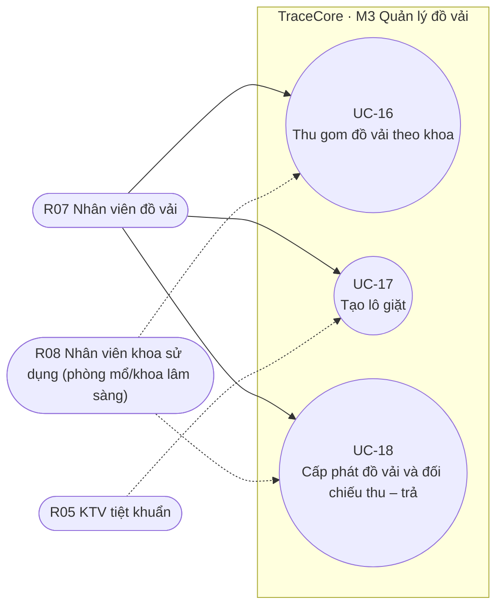

_Nét liền = actor chính (primary); nét đứt = actor phụ (secondary)._

### UC-16: Thu gom đồ vải theo khoa

- **ID:** UC-16
- **Actors:** R07 Nhân viên đồ vải (primary); R08 Nhân viên khoa sử dụng (phòng mổ/khoa lâm sàng) (secondary)
- **Description:** Ghi lượt thu gom theo khoa, loại đồ vải, số chiếc, cân nặng (nhập tay hoặc cân điện tử), nhiễm/không nhiễm. Kích hoạt khi: hộ lý khoa mang đồ vải bẩn xuống trạm thu gom.
- **Preconditions:** R07 đăng nhập trạm thu gom. Cân điện tử kết nối (tùy chọn).
- **Postconditions (success):** Linen Collection ghi sổ theo khoa – loại – số – kg. Số liệu sẵn sàng đối chiếu (UC-18) và lập lô giặt (UC-17).
- **Traces to:** FR-M3-01, FR-M3-02
- **Business rules:** BRU-LIN-001
- **Screens:** SCR-16
- **Priority:** Must · Frequency: 15–30 lượt/ngày, 300–600 kg/ngày.
- **Related NFR:** NFR-USAB-01, NFR-INT-01

**Main success scenario**
1. R07 chọn khoa, nhập người giao.
2. Thêm dòng: chọn loại đồ vải, nhập số chiếc; bấm Lấy cân hoặc nhập kg.
3. Đánh dấu nhiễm/không nhiễm theo bao.
4. Hệ thống quy đổi và cảnh báo lệch > 15%.
5. Xác nhận; in/ký biên nhận.
6. Số liệu lên dashboard kg/khoa trong ngày.

**Alternate flows**
- A1. Chỉ có cân tổng của xe: nhập kg tổng, phân bổ theo loại bằng khối lượng chuẩn.
- A2. Khoa gửi bảng kê giấy: nhập lại theo bảng kê.

**Exception flows**
- E1. Cân không phản hồi → nhập tay, ghi Nhập tay.
- E2. Loại đồ vải ngừng sử dụng → không chọn được.
- E3. Sửa lượt đã ký → tạo phiếu điều chỉnh, không sửa đè.

**Open issues:** Xác nhận định mức/đơn giá thực tế tại bệnh viện trước go-live.

_Nguồn: #06 UC v1.10 (v1.10 — Đang Review); US-16; API API-M3-01; DocType DT-LINENCOL, DT-LINENTYPE; Workflow — (không có trạng thái); TC TC-16-01, TC-16-02._

### UC-17: Tạo lô giặt

- **ID:** UC-17
- **Actors:** R07 Nhân viên đồ vải (primary); R05 KTV tiệt khuẩn (secondary)
- **Description:** Tạo lô giặt theo cân nặng, máy giặt – sấy, chương trình, hóa chất; ghi kết quả; tiêu hao tự động. Kích hoạt khi: đủ đồ vải để nạp máy giặt.
- **Preconditions:** Máy giặt/sấy Sẵn sàng. Có hóa chất trong hạn.
- **Postconditions (success):** Laundry Batch Đạt/Không đạt; tiêu hao và chi phí/kg ghi nhận.
- **Traces to:** FR-M3-03, FR-M3-04
- **Business rules:** BRU-LIN-001, BRU-LIN-003
- **Screens:** SCR-17
- **Priority:** Must · Frequency: 8–15 lô/ngày.
- **Related NFR:** NFR-USAB-01, NFR-INT-01

- **A-104 (#1847):** chọn chương trình thì hệ thống điền hóa chất, nước, điện theo định mức; khi hoàn tất, số thực tế lệch quá ngưỡng phải có lý do; lô lưu cả định mức và thực tế.

**Main success scenario**
1. R07 tạo lô: chọn máy, chương trình, nhóm nhiễm/không nhiễm.
2. Nhập kg nạp (≤ tải máy); chọn hóa chất theo FEFO.
3. Bắt đầu; ghi giờ, người.
4. Kết thúc giặt; tạo bước sấy (máy sấy, nhiệt độ, thời gian).
5. Nhập kết quả kiểm tra (sạch, khô).
6. Hoàn tất: trừ hóa chất, tính chi phí/kg.

**Alternate flows**
- A1. Giặt lại lô không đạt: tạo lô mới liên kết lô cũ.
- A2. Thuê giặt ngoài: lô loại Thuê ngoài, nhập giá/kg.

**Exception flows**
- E1. Trộn nhiễm/không nhiễm → chặn.
- E2. Chương trình nhiễm < 71°C không hóa chất khử khuẩn → chặn.
- E3. Máy khóa → không chọn.

**Open issues:** Xác nhận định mức/đơn giá thực tế tại bệnh viện trước go-live.

_Nguồn: #06 UC v1.10 (v1.10 — Đang Review); US-17; API API-M3-02; DocType DT-LAUNDRY, DT-STOCKENTRY; Workflow WF-04; TC TC-17-01, TC-17-02._

### UC-18: Cấp phát đồ vải và đối chiếu thu – trả

- **ID:** UC-18
- **Actors:** R07 Nhân viên đồ vải (primary); R08 Nhân viên khoa sử dụng (phòng mổ/khoa lâm sàng) (secondary)
- **Description:** Ghi trả về khoa theo loại, số lượng, cân nặng; đối chiếu với thu gom; cảnh báo vượt định mức. Kích hoạt khi: khoa nhận đồ vải sạch hoặc cuối kỳ đối chiếu.
- **Preconditions:** Có lượt thu gom của khoa. Định mức đồ vải khoa đã cấu hình.
- **Postconditions (success):** Linen Issue ký nhận; bảng đối chiếu thu – trả – hủy theo khoa.
- **Traces to:** FR-M3-05, FR-M3-06
- **Business rules:** BRU-LIN-001, BRU-LIN-004
- **Screens:** SCR-18
- **Priority:** Must · Frequency: 15–30 lượt/ngày; đối chiếu hằng tháng.
- **Related NFR:** NFR-USAB-01, NFR-INT-01

**Main success scenario**
1. R07 chọn khoa, người nhận; thêm dòng loại – số – kg.
2. Hệ thống hiển thị lượng thu gom chưa trả của khoa.
3. Kiểm tra định mức: vượt → cảnh báo.
4. Ký nhận điện tử; in biên nhận.
5. Cuối kỳ mở báo cáo đối chiếu; ghi hủy đồ vải hỏng (ảnh, lý do).
6. Chênh lệch > 5% → cảnh báo R02.

**Alternate flows**
- A1. Cấp đồ vải mới (chưa qua thu gom) từ kho: đánh dấu Cấp mới.
- A2. Khoa trả đồ vải dư: lượt thu gom loại Trả dư.

**Exception flows**
- E1. Khoa không có định mức → cho phép, ghi thiếu cấu hình.
- E2. Số kg = 0 → chặn.
- E3. Sửa phiếu đã ký → phiếu điều chỉnh.

**Open issues:** Xác nhận định mức/đơn giá thực tế tại bệnh viện trước go-live.

_Nguồn: #06 UC v1.10 (v1.10 — Đang Review); US-18; API API-M3-03, API-M3-04; DocType DT-LINENISS, DT-LINENCOL; Workflow — (không có trạng thái); TC TC-18-01, TC-18-02._

## M4 — Nhân sự & chứng chỉ

Nguồn nghiệp vụ: BR-M4 (BRD #02). Use case: UC-19, UC-20.

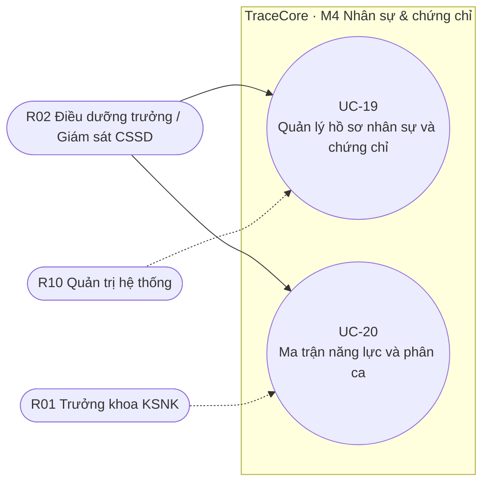

_Nét liền = actor chính (primary); nét đứt = actor phụ (secondary)._

### UC-19: Quản lý hồ sơ nhân sự và chứng chỉ

- **ID:** UC-19
- **Actors:** R02 Điều dưỡng trưởng / Giám sát CSSD (primary); R10 Quản trị hệ thống (secondary)
- **Description:** Hồ sơ, CCHN, chứng chỉ KSNK/tiệt khuẩn/vận hành thiết bị áp lực, khám sức khỏe, tiêm chủng; cảnh báo hết hạn. Kích hoạt khi: nhân viên mới, chứng chỉ mới/gia hạn, khám sức khỏe định kỳ.
- **Preconditions:** R02/R10 có quyền HR. Có bản scan chứng chỉ.
- **Postconditions (success):** Employee, Certificate lưu; cảnh báo hết hạn hoạt động.
- **Traces to:** FR-M4-01, FR-M4-02
- **Business rules:** BRU-ID-006
- **Screens:** SCR-19
- **Priority:** Must · Frequency: Ban đầu 20–40 nhân viên; 5–10 cập nhật/tháng.
- **Related NFR:** NFR-SEC-01, NFR-COMP-01

**Main success scenario**
1. Tạo hồ sơ: thông tin, chức danh, khu, mã thẻ, ảnh.
2. Thêm chứng chỉ: loại, số, nơi cấp, ngày cấp, hạn, file.
3. Nhập khám sức khỏe, tiêm chủng với hạn.
4. Hệ thống tạo lịch cảnh báo 60/30/7 ngày.
5. Khi hết hạn: vô hiệu năng lực yêu cầu chứng chỉ đó.
6. Gia hạn: tạo bản ghi mới, giữ lịch sử.

**Alternate flows**
- A1. Nhập hàng loạt nhân sự từ Excel.
- A2. Nghỉ việc: vô hiệu thẻ và tài khoản ngay.

**Exception flows**
- E1. Trùng mã thẻ → chặn.
- E2. Chứng chỉ vĩnh viễn → đánh dấu Không hết hạn.
- E3. File scan > 10 MB → từ chối.

**Open issues:** Xác nhận định mức/đơn giá thực tế tại bệnh viện trước go-live.

_Nguồn: #06 UC v1.10 (v1.10 — Đang Review); US-19; API API-M4-01; DocType DT-EMP, DT-CERT; Workflow — (không có trạng thái); TC TC-19-01, TC-19-02._

### UC-20: Ma trận năng lực và phân ca

- **ID:** UC-20
- **Actors:** R02 Điều dưỡng trưởng / Giám sát CSSD (primary); R01 Trưởng khoa KSNK (secondary)
- **Description:** Gán năng lực theo trạm; chỉ người đủ năng lực và chứng chỉ còn hạn mới đăng nhập trạm; lập lịch ca. Kích hoạt khi: phân công nhân sự vận hành trạm hoặc lập lịch ca.
- **Preconditions:** Hồ sơ và chứng chỉ đã có (UC-19). Trạm và khu đã khai báo (UC-33).
- **Postconditions (success):** Competency theo trạm; lịch ca; đăng nhập trạm được kiểm soát.
- **Traces to:** FR-M4-03, FR-M4-04
- **Business rules:** BRU-HR-001
- **Screens:** SCR-20
- **Priority:** Must · Frequency: Lịch ca hằng tuần; 20–40 đăng nhập trạm/ngày.
- **Related NFR:** NFR-SEC-01, NFR-COMP-01

**Main success scenario**
1. R02 mở ma trận nhân viên × trạm.
2. Gán năng lực: người đánh giá, ngày, chứng chỉ yêu cầu.
3. Lập lịch ca theo khu và ngày.
4. Hệ thống chặn xếp người thiếu năng lực vào ca khu đó.
5. Khi nhân viên quét thẻ tại trạm: hệ thống kiểm tra năng lực + chứng chỉ.
6. Thống kê sản lượng theo người/ca từ sự kiện trạm.

**Alternate flows**
- A1. Quyền tạm 24 giờ khi thiếu người, R02 cấp có lý do.
- A2. Đổi ca: hai nhân viên đề nghị, R02 duyệt.

**Exception flows**
- E1. Đăng nhập bị từ chối → hiển thị lý do, ghi audit.
- E2. Trùng ca một người → cảnh báo.
- E3. Chứng chỉ hết hạn trong ca → phiên trạm kết thúc tại ca kế.

**Open issues:** Xác nhận định mức/đơn giá thực tế tại bệnh viện trước go-live.

_Nguồn: #06 UC v1.10 (v1.10 — Đang Review); US-20; API API-M4-02; DocType DT-COMP, DT-SHIFT; Workflow — (không có trạng thái); TC TC-20-01, TC-20-02._

## M5 — Thiết bị & bảo trì

Nguồn nghiệp vụ: BR-M5 (BRD #02). Use case: UC-21, UC-22, UC-23.

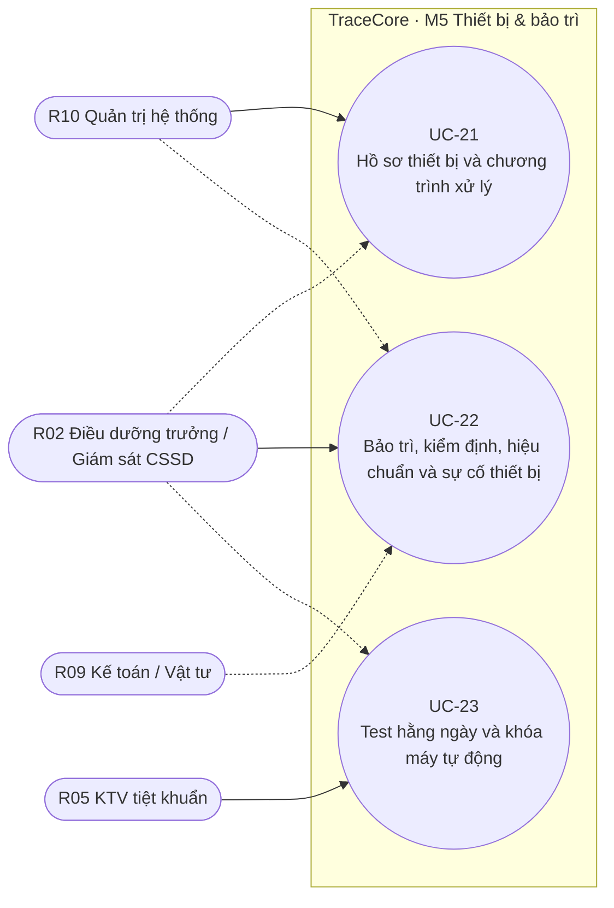

_Nét liền = actor chính (primary); nét đứt = actor phụ (secondary)._

### UC-21: Hồ sơ thiết bị và chương trình xử lý

- **ID:** UC-21
- **Actors:** R10 Quản trị hệ thống (primary); R02 Điều dưỡng trưởng / Giám sát CSSD (secondary)
- **Description:** Khai báo thiết bị theo khu, danh mục chương trình với tham số và định mức điện – nước – tiêu hao. Kích hoạt khi: thiết bị mới hoặc thay đổi chương trình xử lý.
- **Preconditions:** R10 có quyền Thiết bị. Có tài liệu kỹ thuật máy.
- **Postconditions (success):** Equipment và Program với định mức; máy chọn được tại lô/mẻ.
- **Traces to:** FR-M5-01, FR-M5-02
- **Business rules:** BRU-ID-006, BRU-EQP-003
- **Screens:** SCR-21
- **Priority:** Must · Frequency: Ban đầu 8 thiết bị, 20–30 chương trình.
- **Related NFR:** NFR-COMP-01, NFR-INT-01

**Main success scenario**
1. Tạo thiết bị: loại, hãng, model, serial, khu, cửa vào/ra, nguyên giá, năm khấu hao, dung tích.
2. Thêm chương trình: tham số nhiệt độ/thời gian/áp suất, hóa chất.
3. Nhập định mức điện, nước/RO, hơi, chỉ thị/test theo mẻ và theo gói.
4. Chọn loại gói tương thích, yêu cầu BI.
5. Hệ thống tính khấu hao/mẻ.
6. In QR thiết bị.

**Alternate flows**
- A1. Dùng định mức mặc định theo loại máy khi chưa có số đo.
- A2. Sao chép chương trình từ máy cùng model.

**Exception flows**
- E1. Trùng serial → chặn.
- E2. Thiếu định mức → cảnh báo, không tính giá thành mẻ.
- E3. Tham số ngoài dải an toàn → cảnh báo.

**Open issues:** Xác nhận định mức/đơn giá thực tế tại bệnh viện trước go-live.

_Nguồn: #06 UC v1.10 (v1.10 — Đang Review); US-21; API API-M5-01; DocType DT-EQUIP, DT-PROGRAM; Workflow — (không có trạng thái); TC TC-21-01, TC-21-02._

### UC-22: Bảo trì, kiểm định, hiệu chuẩn và sự cố thiết bị

- **ID:** UC-22
- **Actors:** R02 Điều dưỡng trưởng / Giám sát CSSD (primary); R10 Quản trị hệ thống, R09 Kế toán / Vật tư (secondary)
- **Description:** Lịch bảo trì phòng ngừa, kiểm định, hiệu chuẩn; hồ sơ sửa chữa, phụ tùng, chi phí; khóa máy quá hạn. Kích hoạt khi: đến lịch bảo trì/kiểm định hoặc máy gặp sự cố.
- **Preconditions:** Thiết bị đã khai báo. R02 có quyền Bảo trì.
- **Postconditions (success):** Maintenance Record; máy Khóa/Sửa chữa/Sẵn sàng; chi phí sang M7.
- **Traces to:** FR-M5-03, FR-M5-04
- **Business rules:** BRU-EQP-002
- **Screens:** SCR-22
- **Priority:** Must · Frequency: Bảo trì 2–4 lần/tháng; sự cố 1–3/tháng.
- **Related NFR:** NFR-COMP-01, NFR-INT-01

**Main success scenario**
1. Hệ thống nhắc lịch 30/7 ngày trước.
2. R02 tạo hồ sơ thực hiện: đơn vị, ngày, kết quả, chứng nhận, hạn hiệu lực, chi phí.
3. Hoàn tất → lịch kế tiếp tự tạo.
4. Sự cố: ghi thời điểm, dừng máy, phụ tùng, chi phí; máy → Đang sửa chữa.
5. Mẻ đang chạy khi sự cố → Cần xem xét.
6. Sửa xong: kiểm tra, test ngày → Sẵn sàng.

**Alternate flows**
- A1. Kiểm định quá hạn → máy Khóa tự động; R02 không mở khóa được với thiết bị áp lực.
- A2. Bảo trì thuê ngoài: nhập hợp đồng, SLA.

**Exception flows**
- E1. Thiếu chứng nhận kiểm định → không đóng hồ sơ.
- E2. Đóng sự cố không có kết quả kiểm tra → chặn.
- E3. Chi phí âm → chặn.

**Open issues:** Xác nhận định mức/đơn giá thực tế tại bệnh viện trước go-live.

_Nguồn: #06 UC v1.10 (v1.10 — Đang Review); US-22; API API-M5-03; DocType DT-MAINT, DT-EQUIP, DT-COSTENTRY; Workflow WF-07; TC TC-22-01, TC-22-02._

### UC-23: Test hằng ngày và khóa máy tự động

- **ID:** UC-23
- **Actors:** R05 KTV tiệt khuẩn (primary); R02 Điều dưỡng trưởng / Giám sát CSSD (secondary)
- **Description:** Nhập Bowie-Dick, leak test, test máy rửa; máy chỉ được tạo mẻ khi test ngày đạt và kiểm định còn hạn. Kích hoạt khi: đầu ca làm việc mỗi ngày trước mẻ đầu tiên.
- **Preconditions:** Máy đã khai báo; có gói test trong hạn.
- **Postconditions (success):** Daily Test lưu; máy Sẵn sàng hoặc Khóa. [A-84] Test chạy máy: bấm Bắt đầu (máy Đang test, không nạp được), bấm Kết thúc, rồi mới ghi kết quả, lô, ảnh, ghi chú.
- **Traces to:** FR-M5-05, FR-M5-06
- **Business rules:** BRU-EQP-001
- **Screens:** SCR-23
- **Priority:** Must · Frequency: Hằng ngày mỗi máy (5–6 test/ngày).
- **Related NFR:** NFR-COMP-01, NFR-INT-01

**Main success scenario**
1. R05 quét QR máy, chọn loại test (Bowie-Dick, leak test, test máy rửa).
2. Chạy test; nhập kết quả, quét lô test, chụp ảnh.
3. Hệ thống đánh giá đạt/không đạt.
4. Đạt → máy Sẵn sàng cho ngày.
5. Không đạt → máy Khóa, NC tự tạo, thông báo R02.
6. Dashboard hiển thị máy chưa test.

**Alternate flows**
- A1. Máy plasma: chỉ thị hóa học từng mẻ, không Bowie-Dick; có test hằng ngày máy plasma nếu thuộc diện bắt buộc [A-70].
- A2. R02 mở khóa tạm ≤ 24 giờ có lý do (trừ quá hạn kiểm định).
- A3. [A-70] Diện bắt buộc theo `TraceCore Settings` (Không bắt buộc / Tất cả máy tiệt khuẩn / Chỉ máy được chọn). Máy rửa và máy ngoài diện không bị khóa, chặn hay nhắc; vẫn ghi test tự nguyện được.

**Exception flows**
- E1. Chưa test mà tạo mẻ → chặn với lý do.
- E2. Lô test hết hạn → chặn.
- E3. Ảnh thiếu với Bowie-Dick → cảnh báo.

**Open issues:** Xác nhận định mức/đơn giá thực tế tại bệnh viện trước go-live.

_Nguồn: #06 UC v1.10 (v1.10 — Đang Review); US-23; API API-M5-02; DocType DT-DAILYTEST, DT-EQUIP; Workflow WF-07; TC TC-23-01, TC-23-02._

## M6 — Kho vật tư tiêu hao

Nguồn nghiệp vụ: BR-M6 (BRD #02). Use case: UC-24, UC-25, UC-26.

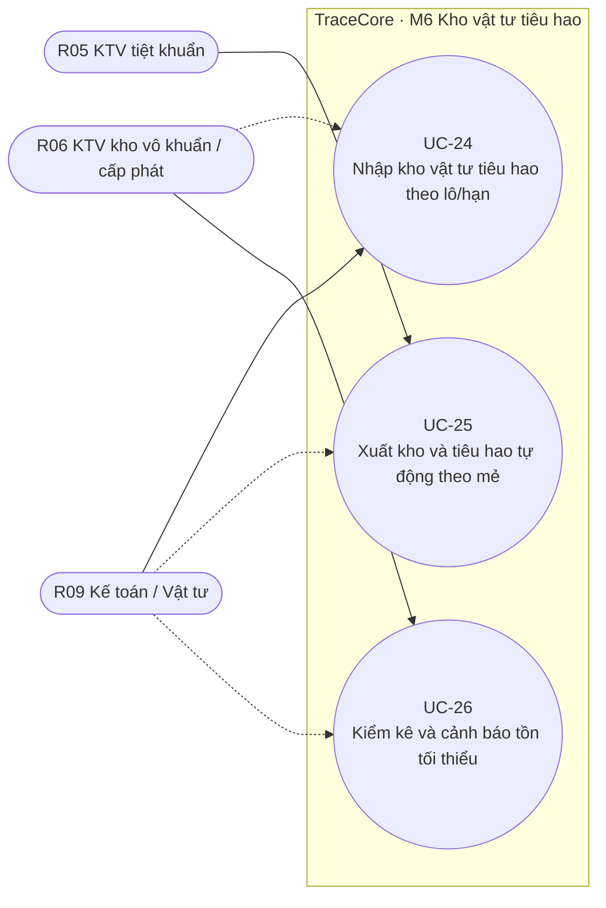

_Nét liền = actor chính (primary); nét đứt = actor phụ (secondary)._

### UC-24: Nhập kho vật tư tiêu hao theo lô/hạn

- **ID:** UC-24
- **Actors:** R09 Kế toán / Vật tư (primary); R06 KTV kho vô khuẩn / cấp phát (secondary)
- **Description:** Nhập chỉ thị, bao gói, hóa chất, nhãn theo lô, hạn dùng, đơn giá; cập nhật tồn và giá bình quân. Kích hoạt khi: vật tư về kho khoa từ Phòng Vật tư/nhà cung cấp.
- **Preconditions:** Danh mục vật tư có (FR-M6-02). Có chứng từ.
- **Postconditions (success):** Stock Entry Đã ghi sổ; tồn theo lô; giá bình quân.
- **Traces to:** FR-M6-01, FR-M6-02
- **Business rules:** —
- **Screens:** SCR-24
- **Priority:** Must · Frequency: 10–20 phiếu/tháng.
- **Related NFR:** NFR-PERF-02, NFR-MAINT-01

**Main success scenario**
1. R09/R06 tạo phiếu nhập: NCC, chứng từ.
2. Thêm dòng: vật tư, lô, hạn, số lượng, đơn giá.
3. Hệ thống kiểm tra hạn, tính giá bình quân.
4. Ghi sổ; in nhãn lô nếu cần.
5. Tồn cập nhật; cảnh báo tồn tối thiểu tắt.
6. Audit.

**Alternate flows**
- A1. Nhập từ Excel mẫu.
- A2. Nhập trả lại từ trạm (dư).

**Exception flows**
- E1. Hạn < hôm nay → chặn.
- E2. Đơn giá 0 → cảnh báo.
- E3. Kiểm kê đang mở → chặn.

**Open issues:** Xác nhận định mức/đơn giá thực tế tại bệnh viện trước go-live.

_Nguồn: #06 UC v1.10 (v1.10 — Đang Review); US-24; API API-M6-01; DocType DT-STOCKENTRY, DT-ITEM; Workflow WF-09; TC TC-24-01, TC-24-02._

### UC-25: Xuất kho và tiêu hao tự động theo mẻ

- **ID:** UC-25
- **Actors:** R05 KTV tiệt khuẩn (primary); R09 Kế toán / Vật tư (secondary)
- **Description:** Trừ tồn tự động khi hoàn tất lô rửa/mẻ/lô giặt theo định mức chương trình; xuất thủ công có lý do. Kích hoạt khi: lô rửa/mẻ/lô giặt hoàn tất, hoặc cần xuất thủ công.
- **Preconditions:** Định mức chương trình có. Tồn theo lô.
- **Postconditions (success):** Stock Entry tiêu hao/xuất; lô vật tư ghi vào mẻ; chi phí ghi nhận.
- **Traces to:** FR-M6-03, FR-M6-04
- **Business rules:** BRU-INV-001, BRU-INV-002
- **Screens:** SCR-25
- **Priority:** Must · Frequency: 30–50 tiêu hao tự động/ngày.
- **Related NFR:** NFR-PERF-02, NFR-MAINT-01

**Main success scenario**
1. Sự kiện hoàn tất mẻ kích hoạt tiêu hao tự động.
2. Hệ thống tính định mức × số gói/kg.
3. Chọn lô theo FEFO; ghi lô vào hồ sơ mẻ.
4. Người vận hành có thể điều chỉnh thực dùng trước hoàn tất (lý do).
5. Ghi sổ; cập nhật tồn.
6. Xuất thủ công: chọn vật tư, số lượng, lý do.

**Alternate flows**
- A1. Tồn không đủ → vẫn hoàn tất mẻ, tồn âm, cảnh báo R09.
- A2. Xuất cho khoa khác (cho mượn) với lý do.

**Exception flows**
- E1. Chọn lô quá hạn → chặn.
- E2. Không có định mức → không trừ, cảnh báo.
- E3. Không lý do xuất thủ công → chặn.

**Open issues:** Xác nhận định mức/đơn giá thực tế tại bệnh viện trước go-live.

_Nguồn: #06 UC v1.10 (v1.10 — Đang Review); US-25; API API-M6-01; DocType DT-STOCKENTRY; Workflow WF-09; TC TC-25-01, TC-25-02._

### UC-26: Kiểm kê và cảnh báo tồn tối thiểu

- **ID:** UC-26
- **Actors:** R06 KTV kho vô khuẩn / cấp phát (primary); R09 Kế toán / Vật tư (secondary)
- **Description:** Kiểm kê định kỳ, ghi chênh lệch, cảnh báo dưới tồn tối thiểu và sắp hết hạn, đề nghị mua. Kích hoạt khi: kiểm kê định kỳ (tháng/quý) hoặc cảnh báo tồn.
- **Preconditions:** Kho không có phiếu đang mở.
- **Postconditions (success):** Stock Count với chênh lệch, điều chỉnh có phê duyệt; đề nghị mua.
- **Traces to:** FR-M6-05, FR-M6-06
- **Business rules:** —
- **Screens:** SCR-26
- **Priority:** Must · Frequency: Hằng tháng.
- **Related NFR:** NFR-PERF-02, NFR-MAINT-01

**Main success scenario**
1. R06 tạo phiếu kiểm kê; hệ thống khóa xuất nhập kho.
2. Nhập số thực tế theo lô (quét mã lô).
3. Hệ thống tính chênh lệch.
4. R02/R09 duyệt điều chỉnh.
5. Ghi sổ; mở lại kho.
6. Dashboard cảnh báo tồn tối thiểu/sắp hết hạn; tạo đề nghị mua một chạm.

**Alternate flows**
- A1. Kiểm kê một phần (nhóm chỉ thị).
- A2. Đề nghị mua từ dự báo tiêu hao 3 tháng.

**Exception flows**
- E1. Chênh lệch lớn (> 10%) → yêu cầu lý do.
- E2. Lô không tồn tại → chặn.
- E3. Không có tồn tối thiểu → không cảnh báo, ghi thiếu cấu hình.

**Open issues:** Xác nhận định mức/đơn giá thực tế tại bệnh viện trước go-live.

_Nguồn: #06 UC v1.10 (v1.10 — Đang Review); US-26; API API-M6-02; DocType DT-STOCKCOUNT; Workflow WF-09; TC TC-26-01, TC-26-02._

## M7 — Chi phí & giá thành tái xử lý

Nguồn nghiệp vụ: BR-M7 (BRD #02). Use case: UC-27, UC-28, UC-29.

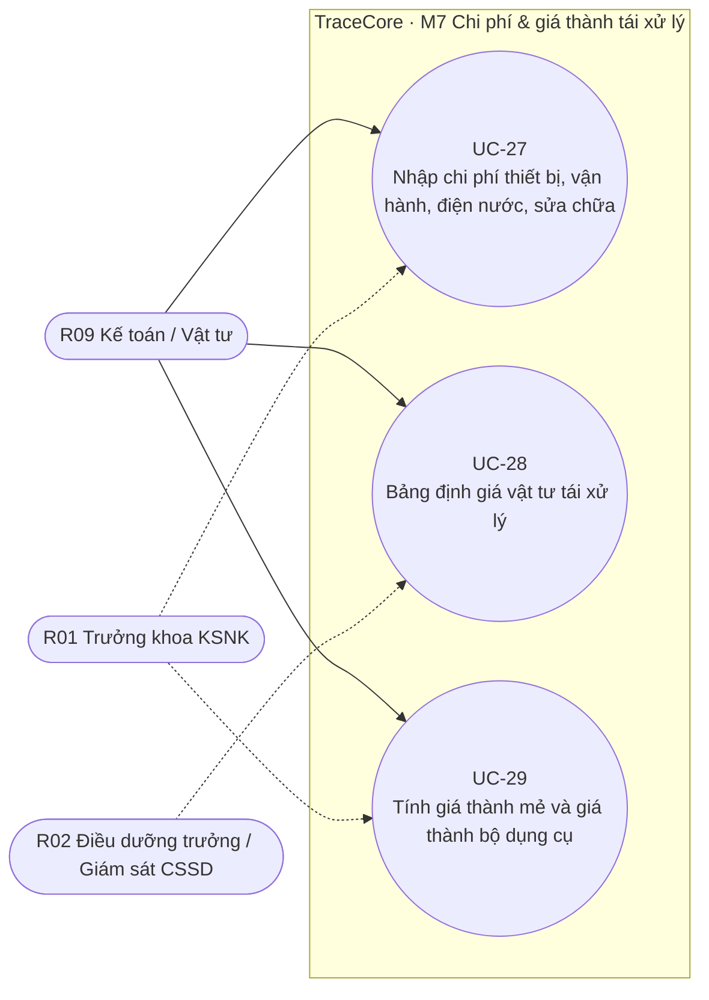

_Nét liền = actor chính (primary); nét đứt = actor phụ (secondary)._

### UC-27: Nhập chi phí thiết bị, vận hành, điện nước, sửa chữa

- **ID:** UC-27
- **Actors:** R09 Kế toán / Vật tư (primary); R01 Trưởng khoa KSNK (secondary)
- **Description:** Nhập khấu hao, bảo trì, sửa chữa, điện, nước RO, hơi, khí nén, nhân công, thuê ngoài gắn thiết bị/khu/chương trình. Kích hoạt khi: cuối kỳ có hóa đơn điện, nước, bảo trì; phát sinh sửa chữa; nhập khấu hao.
- **Preconditions:** Thiết bị, khu, chương trình đã khai báo. R09 có quyền Chi phí.
- **Postconditions (success):** Cost Entry gắn đối tượng; sẵn sàng phân bổ theo mẻ.
- **Traces to:** FR-M7-01, FR-M7-02
- **Business rules:** —
- **Screens:** SCR-27
- **Priority:** Must · Frequency: 20–40 khoản/tháng.
- **Related NFR:** NFR-MAINT-01, NFR-BACKUP-01

**Main success scenario**
1. R09 tạo khoản chi: khoản mục, số tiền, kỳ, chứng từ.
2. Chọn nguồn: hóa đơn / định mức / đồng hồ đo (chỉ số đầu – cuối).
3. Gắn đối tượng: thiết bị / khu / chương trình với tỷ lệ.
4. Hệ thống kiểm tra tổng 100%.
5. Ghi sổ; báo cáo chi phí theo thiết bị/kỳ.
6. Khấu hao tự sinh hằng tháng từ hồ sơ thiết bị.

**Alternate flows**
- A1. Chi phí sửa chữa tự chuyển từ UC-22.
- A2. Nhân công: tính từ ca và đơn giá giờ.

**Exception flows**
- E1. Số âm → chặn.
- E2. Tỷ lệ ≠ 100% → chặn.
- E3. Kỳ đã khóa → chặn, cần mở kỳ.

**Open issues:** Xác nhận định mức/đơn giá thực tế tại bệnh viện trước go-live.

_Nguồn: #06 UC v1.10 (v1.10 — Đang Review); US-27; API API-M7-01; DocType DT-COSTENTRY; Workflow — (không có trạng thái); TC TC-27-01, TC-27-02._

### UC-28: Bảng định giá vật tư tái xử lý

- **ID:** UC-28
- **Actors:** R09 Kế toán / Vật tư (primary); R02 Điều dưỡng trưởng / Giám sát CSSD (secondary)
- **Description:** Định giá chỉ thị hóa học/sinh học, test, giấy gói, túi, hộp lọc, nhãn, hóa chất theo phiên bản có hiệu lực. Kích hoạt khi: giá vật tư/nhân công/điện nước thay đổi hoặc khởi tạo bảng giá.
- **Preconditions:** Danh mục vật tư có. R09 có quyền.
- **Postconditions (success):** Cost Rate Version hiệu lực; định mức theo chương trình/loại gói.
- **Traces to:** FR-M7-03, FR-M7-04
- **Business rules:** BRU-CST-002
- **Screens:** SCR-28
- **Priority:** Must · Frequency: Hằng quý.
- **Related NFR:** NFR-MAINT-01, NFR-BACKUP-01

**Main success scenario**
1. R09 tạo phiên bản bảng giá: hiệu lực từ ngày.
2. Nhập đơn giá từng vật tư (chỉ thị 1–6, BI, test, giấy gói, túi, hộp lọc, nhãn, hóa chất), nhân công/giờ, điện/kWh, nước/lít.
3. Nhập định mức tiêu hao theo chương trình và theo loại gói.
4. R01 phê duyệt.
5. Hệ thống dùng phiên bản theo ngày giao dịch.
6. Lịch sử giá xem được.

**Alternate flows**
- A1. Cập nhật giá từ phiếu nhập kho gần nhất (giá bình quân).
- A2. Nhập bảng giá từ Excel.

**Exception flows**
- E1. Hiệu lực chồng lấn → chặn.
- E2. Định mức 0 → cảnh báo.
- E3. Phiên bản chưa duyệt → không dùng tính giá.

**Open issues:** Xác nhận định mức/đơn giá thực tế tại bệnh viện trước go-live.

_Nguồn: #06 UC v1.10 (v1.10 — Đang Review); US-28; API API-M7-01; DocType DT-COSTRATE; Workflow — (không có trạng thái); TC TC-28-01, TC-28-02._

### UC-29: Tính giá thành mẻ và giá thành bộ dụng cụ

- **ID:** UC-29
- **Actors:** R09 Kế toán / Vật tư (primary); R01 Trưởng khoa KSNK (secondary)
- **Description:** Phân bổ chi phí mẻ cho từng gói, cộng dồn qua 8 trạm (cấu hình mặc định, A-64), cộng khấu hao dụng cụ; xuất theo bộ, Cycle ID, khoa. Kích hoạt khi: mẻ được giải phóng; cuối tháng lập báo cáo giá thành.
- **Preconditions:** Bảng giá và định mức có; chi phí kỳ đã nhập.
- **Postconditions (success):** Cost Sheet mẻ và giá thành gói/bộ; báo cáo.
- **Traces to:** FR-M7-05, FR-M7-06
- **Business rules:** BRU-CST-001, BRU-CST-003
- **Screens:** SCR-29
- **Priority:** Must · Frequency: Tự động mỗi mẻ; báo cáo hằng tháng.
- **Related NFR:** NFR-MAINT-01, NFR-BACKUP-01

**Main success scenario**
1. Khi mẻ giải phóng, hệ thống tính chi phí mẻ (khấu hao, điện, nước, hóa chất, chỉ thị, nhân công, bảo trì phân bổ).
2. Chia theo số gói (hoặc thể tích).
3. Cộng chi phí các trạm khác theo định mức/phút chuẩn.
4. Cộng khấu hao dụng cụ = giá trị bộ ÷ cơ số.
5. Ghi giá thành vào Pack và Set Unit.
6. Báo cáo theo bộ, Cycle ID, khoa, phương pháp, tháng; so sánh.

**Alternate flows**
- A1. Tính lại theo yêu cầu R01 với phiên bản giá khác (ghi chú).
- A2. Xuất giá dịch vụ tiệt khuẩn cho bên ngoài.

**Exception flows**
- E1. Thiếu đơn giá → Chưa định giá, cảnh báo.
- E2. Mẻ không đạt → chi phí chất lượng.
- E3. Bộ mượn → không khấu hao.

**Open issues:** Xác nhận định mức/đơn giá thực tế tại bệnh viện trước go-live.

_Nguồn: #06 UC v1.10 (v1.10 — Đang Review); US-29; API API-M7-02; DocType DT-COSTSHEET; Workflow — (không có trạng thái); TC TC-29-01, TC-29-02._

## M8 — Cơ số & kiểm soát vượt ngưỡng

Nguồn nghiệp vụ: BR-M8 (BRD #02). Use case: UC-30, UC-31.

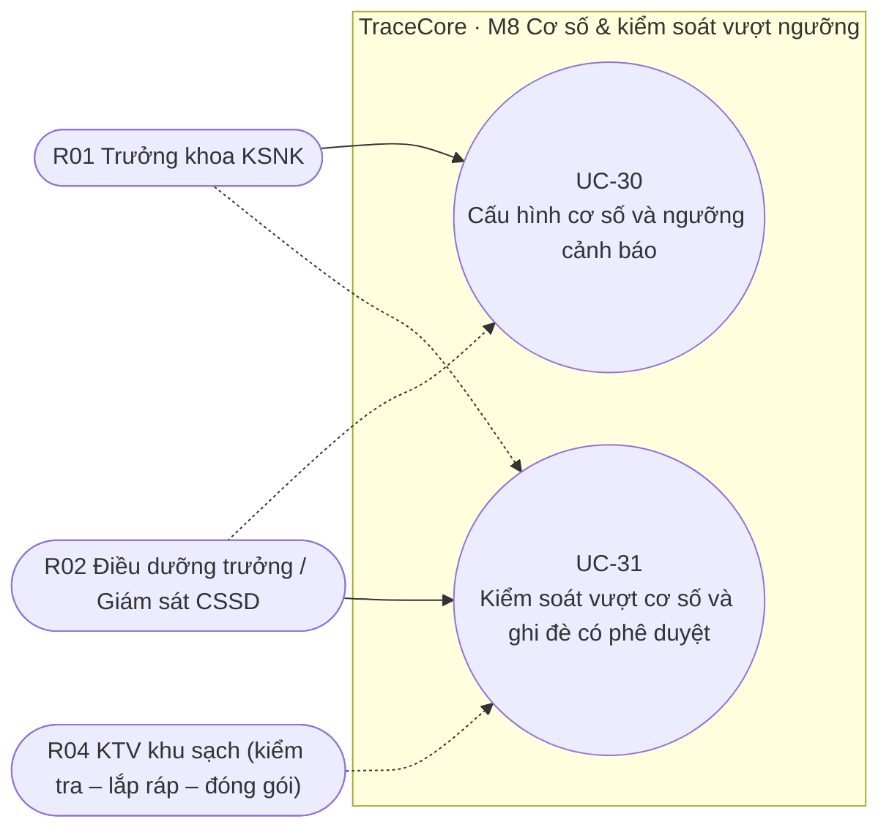

_Nét liền = actor chính (primary); nét đứt = actor phụ (secondary)._

### UC-30: Cấu hình cơ số và ngưỡng cảnh báo

- **ID:** UC-30
- **Actors:** R01 Trưởng khoa KSNK (primary); R02 Điều dưỡng trưởng / Giám sát CSSD (secondary)
- **Description:** Đặt cơ số tái xử lý tối đa theo dụng cụ/bộ, cơ số tồn khoa, ngưỡng cảnh báo sớm. Kích hoạt khi: khởi tạo hệ thống, dụng cụ mới, thay đổi IFU, thay đổi nhu cầu khoa.
- **Preconditions:** Dụng cụ/loại bộ/khoa đã có. R01 có quyền cơ số.
- **Postconditions (success):** Par Level tái xử lý và Par Level khoa có hiệu lực.
- **Traces to:** FR-M8-01, FR-M8-02
- **Business rules:** —
- **Screens:** SCR-30
- **Priority:** Must · Frequency: Ban đầu; sau đó 5–10 thay đổi/tháng.
- **Related NFR:** NFR-SEC-03, NFR-PERF-01

**Main success scenario**
1. R01 mở cấu hình cơ số.
2. Nhập tay cơ số tái xử lý tối đa cho dụng cụ/loại bộ/vật tư tái sử dụng (theo IFU hoặc ước tính), ghi nguồn.
3. Đặt ngưỡng cảnh báo sớm (% hoặc số lần).
4. Đặt cơ số tồn khoa: tối thiểu/tối đa/cho phép vượt %.
5. Lưu; lịch sử thay đổi.
6. Hệ thống áp dụng ngay cho lắp ráp/đóng gói/cấp phát.

**Alternate flows**
- A1. Cơ số bộ suy ra từ dụng cụ thấp nhất trong BOM.
- A2. Nhập hàng loạt cơ số từ Excel.

**Exception flows**
- E1. Cơ số ≤ chu trình đã dùng → cảnh báo trước khi lưu.
- E2. Tối thiểu > tối đa → chặn.
- E3. Không có IFU → nguồn Ước tính.

**Open issues:** Xác nhận định mức/đơn giá thực tế tại bệnh viện trước go-live.

_Nguồn: #06 UC v1.10 (v1.10 — Đang Review); US-30; API API-M8-01; DocType DT-PARLEVEL; Workflow — (không có trạng thái); TC TC-30-01, TC-30-02._

### UC-31: Kiểm soát vượt cơ số và ghi đè có phê duyệt

- **ID:** UC-31
- **Actors:** R02 Điều dưỡng trưởng / Giám sát CSSD (primary); R01 Trưởng khoa KSNK, R04 KTV khu sạch (kiểm tra – lắp ráp – đóng gói) (secondary)
- **Description:** Chặn sinh Cycle ID và quét sử dụng khi vượt cơ số; ghi đè có lý do, có phê duyệt, lưu audit. Kích hoạt khi: bộ đạt ngưỡng cảnh báo hoặc đạt/vượt cơ số tại lắp ráp/đóng gói/sử dụng.
- **Preconditions:** Cơ số đã cấu hình; bộ đếm chu trình hoạt động.
- **Postconditions (success):** Cảnh báo hiển thị; Cycle ID không sinh; Set Unit → Hết vòng đời; ghi đè có phê duyệt và audit.
- **Traces to:** FR-M8-03, FR-M8-04
- **Business rules:** BRU-PAR-001, BRU-PAR-002, BRU-PAR-003, BRU-PAR-004
- **Screens:** SCR-31
- **Priority:** Must · Frequency: Cảnh báo 5–20 bộ/tháng; ghi đè 0–5/tháng.
- **Related NFR:** NFR-SEC-03, NFR-PERF-01

**Main success scenario**
1. Tại lắp ráp, hệ thống hiển thị chu trình đã dùng/cơ số; cam khi ≤ ngưỡng.
2. Tại đóng gói, nếu đạt/vượt → không sinh Cycle ID, hiển thị dụng cụ vượt.
3. Set Unit → Hết vòng đời – chờ thanh lý; quét sử dụng bị chặn.
4. R04 đề nghị ghi đè (lý do); R01/R02 ủy quyền duyệt: số chu trình thêm, thời hạn.
5. Ghi đè hợp lệ → cho sinh Cycle ID; audit.
6. Báo cáo ghi đè hằng tháng và dự báo thay thế.

**Alternate flows**
- A1. Chỉ một dụng cụ vượt: thay dụng cụ từ kho dự phòng, bộ tiếp tục.
- A2. Ghi đè hết hiệu lực → chặn lại.

**Exception flows**
- E1. Duyệt không lý do → chặn.
- E2. R04 cố quét sử dụng bộ EOL → chặn, audit.
- E3. Cơ số Chưa xác định → cảnh báo, không chặn, báo cáo.

**Open issues:** Xác nhận định mức/đơn giá thực tế tại bệnh viện trước go-live.

_Nguồn: #06 UC v1.10 (v1.10 — Đang Review); US-31; API API-M8-02; DocType DT-OVERRIDE, DT-SETUNIT; Workflow WF-08, WF-01; TC TC-31-01, TC-31-02._

## M9 — Báo cáo, dashboard & quản trị

Nguồn nghiệp vụ: BR-M9 (BRD #02); [v1.11] khoảng trống catalog FR-M9-08..16 (duyệt 2026-10-17). Use case: UC-32, UC-33, UC-38, UC-39.

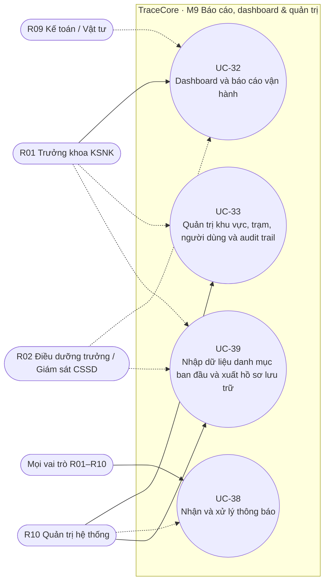

_Nét liền = actor chính (primary); nét đứt = actor phụ (secondary)._

### UC-32: Dashboard và báo cáo vận hành

- **ID:** UC-32
- **Actors:** R01 Trưởng khoa KSNK (primary); R02 Điều dưỡng trưởng / Giám sát CSSD, R09 Kế toán / Vật tư (secondary)
- **Description:** Sản lượng theo trạm/người/máy, trạng thái bộ, tỷ lệ mẻ lỗi, tồn vô khuẩn, chi phí/bộ, sổ tiệt khuẩn điện tử. Kích hoạt khi: người quản lý mở dashboard; cuối kỳ lập báo cáo.
- **Preconditions:** Dữ liệu vận hành có.
- **Postconditions (success):** Dashboard theo vai trò; báo cáo PDF/Excel.
- **Traces to:** FR-M9-01, FR-M9-02, FR-M9-13
- **Business rules:** —
- **Screens:** SCR-32
- **Priority:** Must · Frequency: Hằng ngày; báo cáo tháng.
- **Related NFR:** NFR-AVAIL-01, NFR-SEC-01, NFR-SEC-03, NFR-BACKUP-01

**Main success scenario**
1. R01/R02 mở dashboard: số bộ theo trạng thái, sản lượng trạm/người/máy, mẻ lỗi, tồn vô khuẩn, cảnh báo.
2. Lọc theo ngày/tuần/tháng, khu, máy, khoa.
3. Mở sổ tiệt khuẩn điện tử theo máy/kỳ, in PDF.
4. Mở báo cáo KSNK theo mẫu BYT.
5. Mở dự báo thay thế dụng cụ theo tháng kèm giá.
6. Xuất Excel; đóng kỳ.

**Alternate flows**
- A1. Dashboard trạm cho KTV (chỉ khu của mình).
- A2. Gửi email báo cáo tự động hằng ngày.

**Exception flows**
- E1. Không dữ liệu → 0.
- E2. Kỳ chưa khóa → dấu Tạm.
- E3. Xuất > 50.000 dòng → chạy nền.

**Open issues:** Xác nhận định mức/đơn giá thực tế tại bệnh viện trước go-live.

_Nguồn: #06 UC v1.10 (v1.10 — Đang Review); US-32; API API-M9-01; DocType Tất cả; Workflow — (không có trạng thái); TC TC-32-01, TC-32-02._

### UC-33: Quản trị khu vực, trạm, người dùng và audit trail

- **ID:** UC-33
- **Actors:** R10 Quản trị hệ thống (primary); R01 Trưởng khoa KSNK (secondary)
- **Description:** Khai báo 3 khu một chiều, trạm quét, thiết bị ngoại vi, người dùng, phân quyền; tra cứu audit trail. Kích hoạt khi: triển khai ban đầu, thay đổi bố trí khoa, nhân sự mới, đối tượng mới cần mã, kiểm tra audit.
- **Preconditions:** R10 có quyền quản trị.
- **Postconditions (success):** Zone Station, thiết bị ngoại vi, người dùng, vai trò; audit tra cứu được; offline cấu hình.
- **Traces to:** FR-M9-03, FR-M9-04, FR-M9-05, FR-M9-07, FR-M9-06, FR-M9-08, FR-M9-09, FR-M9-16
- **Business rules:** BRU-ID-006, BRU-FLOW-001
- **Screens:** SCR-33
- **Priority:** Must · Frequency: Ban đầu; thay đổi ít.
- **Related NFR:** NFR-AVAIL-01, NFR-SEC-01, NFR-SEC-03, NFR-BACKUP-01

**Main success scenario**
1. R10 khai báo 3 khu và trạm thuộc khu, chức năng trạm.
2. Gán thiết bị ngoại vi (máy quét, in nhãn, cân) theo IP/cổng.
3. Cấu hình môi trường khu và ngưỡng.
4. Tạo người dùng, vai trò; hệ thống tự sinh mã và in thẻ nhân viên (kể cả nhân viên khoa lâm sàng), QR thiết bị, mã vị trí kệ, mã trạm (FR-M9-07); chính sách mật khẩu.
5. Cấp dải Cycle ID offline cho trạm (offline = Must từ v1.11, FR-M9-06).
6. Tra cứu audit theo đối tượng/người/khoảng ngày.
7. [v1.11] Quản lý phiên và tài khoản: đăng xuất/kết thúc phiên trạm (một thẻ – một phiên, FR-M9-08), đổi/đặt lại mật khẩu – PIN, vô hiệu tài khoản nghỉ việc (FR-M9-09); danh mục đã có giao dịch chỉ xóa mềm (FR-M9-16).

**Alternate flows**
- A1. Nhập cảm biến môi trường tự động.
- A2. Nhập người dùng từ Employee.
- A3. [v1.11] Người dùng quên mật khẩu → R10 (hoặc R02 với thẻ/PIN trạm) đặt lại, bắt buộc đổi ở lần đăng nhập kế tiếp; không gửi mật khẩu dạng rõ qua email/SMS.

**Exception flows**
- E1. Trạm không có khu → không kích hoạt.
- E2. Xung đột đồng bộ offline → R02 xử lý.
- E3. Sai mật khẩu 5 lần → khóa.
- E4. [v1.11] Thẻ quét vào trạm thứ hai khi phiên trạm thứ nhất còn mở → kết thúc phiên cũ, ghi audit (FR-M9-08.1).
- E5. [v1.11] R10 xóa cứng bản ghi danh mục đã có giao dịch → chặn, chỉ cho vô hiệu (FR-M9-16).

**Open issues:** Xác nhận định mức/đơn giá thực tế tại bệnh viện trước go-live.

_Nguồn: #06 UC v1.10 (v1.10 — Đang Review); US-33; API API-M9-02; DocType DT-ZONE, DT-AUDIT; Workflow — (không có trạng thái); TC TC-33-01, TC-33-02._

### UC-38: Nhận và xử lý thông báo [NEW v1.11]

- **ID:** UC-38
- **Actors:** Mọi vai trò R01–R10 (primary — người nhận theo cấu hình loại sự kiện); R10 Quản trị hệ thống (secondary — cấu hình kênh, người nhận)
- **Description:** Hệ thống phát thông báo khi phát sinh sự kiện nghiệp vụ (lệnh thu hồi, chứng chỉ/kiểm định/giấy phép sắp hết hạn 60/30/7 ngày, bộ sắp/đạt cơ số, tồn kho dưới tối thiểu, lô/mẻ không đạt, đề nghị ghi đè, túi chất thải sắp/quá hạn lưu) tới các vai trò được cấu hình qua in-app/PDA và tùy chọn email/SMS; người nhận xem, đánh dấu đã đọc và đi tới đối tượng liên quan. Kích hoạt khi: sự kiện xảy ra (tức thời hoặc theo lịch Scheduler).
- **Preconditions:** R10 đã cấu hình bảng loại sự kiện → vai trò/người nhận → kênh. SMTP/SMS gateway cấu hình (nếu dùng).
- **Postconditions (success):** Thông báo được tạo với trạng thái Đã gửi/Đã đọc theo từng người nhận; sự kiện email/SMS thất bại được thử lại và ghi log.
- **Traces to:** FR-M9-10
- **Business rules:** —
- **Screens:** SCR-42 (Trung tâm thông báo — web, trạm, PDA)
- **Priority:** Must · Frequency: 20–100 thông báo/ngày.
- **Related NFR:** NFR-SEC-03, NFR-OBS-01, NFR-AVAIL-04

**Main success scenario**
1. Sự kiện nghiệp vụ phát sinh (ví dụ FR-M2-20 lập lệnh thu hồi; FR-M10-03.3 túi chất thải đạt 80% hạn lưu).
2. Hệ thống tra bảng cấu hình loại sự kiện → danh sách vai trò/người nhận và kênh.
3. Hệ thống tạo thông báo in-app cho từng người nhận (trạng thái Đã gửi), hiển thị huy hiệu trên web/trạm/PDA.
4. Với kênh email/SMS được bật: gửi qua SMTP/SMS gateway, ghi kết quả gửi.
5. Người nhận mở SCR-42, xem danh sách theo mức độ/loại/thời gian, bấm vào thông báo → chuyển tới đối tượng (lệnh thu hồi, bộ, phiếu).
6. Hệ thống đánh dấu Đã đọc kèm thời điểm; thông báo được ghi audit.

**Alternate flows**
- A1. Thông báo yêu cầu hành động (đề nghị ghi đè, duyệt chênh lệch kg) → có nút hành động nhanh dẫn tới màn phê duyệt (UC-31, UC-36).
- A2. R10 cấu hình lại người nhận/kênh cho một loại sự kiện → áp dụng cho thông báo kế tiếp, không gửi lại thông báo cũ.
- A3. Người dùng lọc theo chưa đọc / theo phân hệ; đánh dấu tất cả đã đọc.

**Exception flows**
- E1. Gửi email/SMS thất bại → giữ thông báo in-app, Scheduler thử lại theo lịch (3 lần), ghi log lỗi gửi; nếu vẫn thất bại báo R10 (FR-M9-10.1).
- E2. Loại sự kiện chưa cấu hình người nhận → gửi mặc định tới R02 và cảnh báo R10 thiếu cấu hình.
- E3. Thông báo khẩn (thu hồi, phơi nhiễm sắc nhọn) chưa được đọc sau 15 phút → nhắc lại và nâng cấp gửi email/SMS cho R01.

**Open issues:** Push notification (Firebase) là tùy chọn — xem OQ-16.

_Nguồn: SRS v1.11 FR-M9-10 (khoảng trống catalog Notifications, duyệt chủ đầu tư 2026-10-17); liên kết EI-SW-002. Không có US/TC/API gốc trong BA v1.10 — bước detailed-design bổ sung._

### UC-39: Nhập dữ liệu danh mục ban đầu và xuất hồ sơ lưu trữ [NEW v1.11]

- **ID:** UC-39
- **Actors:** R10 Quản trị hệ thống (primary); R02 Điều dưỡng trưởng / Giám sát CSSD, R01 Trưởng khoa KSNK (secondary)
- **Description:** (a) Trước Sprint 1 / go-live: R10 (cùng R02) tải mẫu Excel, nhập theo lô danh mục dụng cụ, loại bộ & BOM, nhân sự & chứng chỉ, thiết bị & chương trình, vật tư, cơ số, khoa, loại chất thải; import ảnh chụp thực tế hàng loạt. (b) Theo kỳ hoặc khi có đoàn kiểm tra: R01/R10 xuất gói hồ sơ tiệt khuẩn (mẻ, chỉ thị, dữ liệu máy, cấp phát, sử dụng, audit) dạng PDF + Excel/CSV có dấu thời gian để lưu ≥ 10 năm độc lập với hệ thống. Kích hoạt khi: triển khai ban đầu, bổ sung danh mục lớn, đoàn kiểm tra, đóng kỳ năm.
- **Preconditions:** Bệnh viện đã bàn giao danh mục (D-01..D-04); R10 có quyền Data Import/Export; với xuất hồ sơ, kỳ đã khóa hoặc chấp nhận dấu Tạm.
- **Postconditions (success):** Danh mục được ghi sổ với báo cáo lỗi theo dòng; gói hồ sơ xuất ra lưu được ngoài hệ thống, có checksum/dấu thời gian và ghi audit người xuất.
- **Traces to:** FR-M9-11, FR-M9-12
- **Business rules:** BRU-ID-006 (mã do hệ thống sinh — import không nhập tay Set ID/NV-)
- **Screens:** SCR-43 (Import/Export danh mục & hồ sơ lưu trữ)
- **Priority:** Must · Frequency: Import: tập trung trước go-live (800–1.500 dụng cụ, 100–300 loại bộ), sau đó theo đợt; Export: hằng quý/năm hoặc theo đoàn kiểm tra.
- **Related NFR:** NFR-PORT-02, NFR-COMP-01, NFR-SEC-02, NFR-SEC-03, NFR-PERF-03

**Main success scenario**
1. R10 mở SCR-43, chọn loại danh mục, tải mẫu Excel (cột bắt buộc, danh sách giá trị hợp lệ).
2. R10/R02 điền mẫu, tải lên; hệ thống kiểm tra từng dòng (bắt buộc, trùng mã, tham chiếu tồn tại, giá trị hợp lệ).
3. Hệ thống hiển thị bản xem trước: số dòng hợp lệ / lỗi, chi tiết lỗi theo dòng; cho tải báo cáo lỗi.
4. R10 xác nhận ghi sổ các dòng hợp lệ; hệ thống tạo bản ghi, tự sinh mã theo BRU-ID-006, ghi audit lô import.
5. R10 tải ảnh chụp thực tế hàng loạt (zip, tên file = mã dụng cụ/loại bộ); hệ thống gắn ảnh đúng bản ghi và liệt kê mã không khớp.
6. (Xuất hồ sơ) R01/R10 chọn kỳ, phạm vi (mẻ, chỉ thị, dữ liệu máy, cấp phát, sử dụng, audit); hệ thống sinh gói PDF + Excel/CSV, dấu thời gian, checksum; chạy nền nếu lớn; thông báo khi xong (UC-38).

**Alternate flows**
- A1. Import lại cùng file sau khi sửa lỗi → hệ thống bỏ qua dòng đã ghi sổ (theo mã), chỉ nhập dòng mới/sửa.
- A2. Import danh mục loại chất thải và đơn vị xử lý (M10) dùng cùng cơ chế.
- A3. Xuất hồ sơ theo một mẻ/một lệnh thu hồi phục vụ điều tra sự cố.

**Exception flows**
- E1. File vượt kích cỡ hoặc sai mẫu (thiếu cột) → từ chối, chỉ rõ cột thiếu.
- E2. Dòng chứa Set ID/mã nhân viên nhập tay → từ chối dòng (mã do hệ thống sinh, BRU-ID-006).
- E3. Gói xuất chứa mã bệnh nhân → mã bệnh nhân vẫn ở dạng ẩn/mã hóa theo NFR-SEC-02; chỉ R01 với lý do mới xuất dạng đầy đủ, ghi audit.
- E4. Xuất > 50.000 dòng → chạy nền, thông báo khi hoàn tất.

**Open issues:** Danh mục chuẩn hóa BOM giữa các khoa (OQ-17); tiền tố GS1 thực tế (OQ-05).

_Nguồn: SRS v1.11 FR-M9-11, FR-M9-12 (khoảng trống catalog Data import / export–retention, duyệt chủ đầu tư 2026-10-17); liên kết EI-SW-007, NFR-PORT-02, OTH-RET-001. Không có US/TC/API gốc trong BA v1.10 — bước detailed-design bổ sung._

## M10 — Quản lý chất thải y tế [NEW v1.11]

Nguồn nghiệp vụ: Quyết định chủ đầu tư 2026-10-17 (SC-01); Thông tư 20/2021/TT-BYT (quản lý chất thải y tế trong khuôn viên cơ sở y tế); Nghị định 08/2022/NĐ-CP (chứng từ chất thải nguy hại). Phạm vi: chất thải **rắn** toàn bệnh viện, khoa KSNK giám sát; lỏng/khí ngoài phạm vi. Use case: UC-34, UC-35, UC-36, UC-37. Quy tắc: BRU-WST-001..004 (srs.md Appendix A).

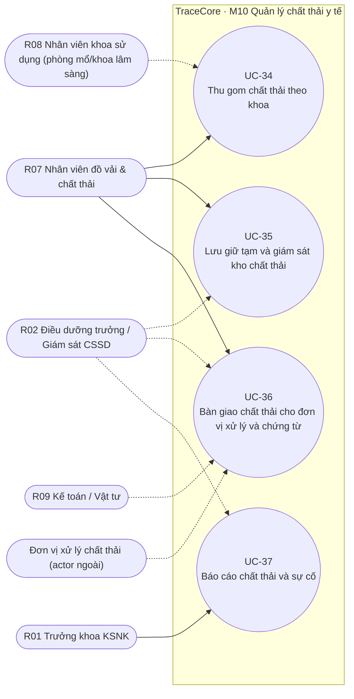

_Nét liền = actor chính (primary); nét đứt = actor phụ (secondary)._

### UC-34: Thu gom chất thải theo khoa [NEW v1.11]

- **ID:** UC-34
- **Actors:** R07 Nhân viên đồ vải & chất thải (primary); R08 Nhân viên khoa sử dụng — người giao chất thải tại khoa (secondary)
- **Description:** Tại điểm tập kết của khoa (hoặc trạm thu gom), R07 quét thẻ nhân viên khoa giao, chọn/quét loại chất thải theo nhóm – mã màu TT 20/2021/TT-BYT, nhập số túi/thùng và cân (cân điện tử hoặc nhập tay có xác nhận), tùy chọn chụp ảnh; hệ thống lập Phiếu thu gom theo khoa – loại – số – kg (nhiều dòng), sinh mã QR cho từng túi/thùng và chặn trộn loại trong một túi. Kích hoạt khi: theo lịch thu gom hằng ngày hoặc khoa gọi thu gom.
- **Preconditions:** R07 đăng nhập trạm/PDA thu gom bằng thẻ. Danh mục loại chất thải (FR-M10-01) và khoa đã khai báo. Nhân viên khoa giao có thẻ do hệ thống sinh/đăng ký. Cân điện tử kết nối (tùy chọn).
- **Postconditions (success):** Phiếu thu gom ghi sổ; mỗi túi/thùng có mã QR `CT-` trạng thái Đã thu gom, bắt đầu tính thời gian lưu giữ; kg cộng vào tổng khoa/loại/ngày; biên nhận in/ký với khoa; NC phân loại sai (nếu có) đã tạo.
- **Traces to:** FR-M10-01, FR-M10-02
- **Business rules:** BRU-WST-001 (phân loại không trộn), BRU-WST-002 (thời gian lưu tính từ thu gom), BRU-ID-006 (mã QR túi/thùng do hệ thống sinh)
- **Screens:** SCR-38 (Trạm/PDA thu gom chất thải)
- **Priority:** Must · Frequency: 1–2 lượt/khoa/ngày × 20–40 khoa; 200–600 kg/ngày toàn viện.
- **Related NFR:** NFR-USAB-01, NFR-INT-01, NFR-AVAIL-02, NFR-AVAIL-04, NFR-COMP-01

**Main success scenario**
1. R07 mở SCR-38 tại khoa, quét thẻ nhân viên khoa giao (R08); hệ thống hiển thị khoa và người giao.
2. Thêm dòng: chọn hoặc quét loại chất thải (mã màu hiển thị lớn: vàng/đen/xanh/trắng); nhập số túi/thùng.
3. Bấm Lấy cân (cân RS-232/USB qua station agent) hoặc nhập kg tay và tick xác nhận; tùy chọn chụp ảnh túi/thùng.
4. Lặp bước 2–3 cho từng loại; hệ thống kiểm tra mỗi dòng đúng một loại (BRU-WST-001).
5. R07 xác nhận; hệ thống sinh mã QR `CT-` cho từng túi/thùng, in nhãn QR tại trạm/PDA, ghi sổ phiếu, chuyển túi/thùng sang Đã thu gom, bắt đầu đếm thời gian lưu giữ.
6. In hoặc ký điện tử biên nhận với khoa (quét thẻ R08 lần hai hoặc ký cảm ứng); kg/khoa/loại lên dashboard trong ngày.

**Alternate flows**
- A1. Khoa đã dán nhãn QR túi sẵn (in trước từ định mức túi FR-M10-08) → R07 quét QR túi thay cho nhập số túi; hệ thống cộng dồn theo loại.
- A2. Chỉ có cân tổng xe thu gom → nhập kg tổng theo loại, phân bổ theo khối lượng chuẩn túi (FR-M10-01).
- A3. Trạm/PDA offline → ghi hàng đợi cục bộ, QR túi lấy từ dải mã cấp trước; đồng bộ khi có mạng (FR-M9-06).

**Exception flows**
- E1. Cân không phản hồi → nhập tay bắt buộc tick xác nhận, ghi nguồn Nhập tay (FR-M10-02.1).
- E2. Thẻ người giao không do hệ thống sinh/đăng ký hoặc không thuộc khoa đang chọn → từ chối dòng, ghi log (FR-M10-02.5).
- E3. Phát hiện phân loại sai (trộn loại, sai màu, vật sắc nhọn ngoài thùng) → R07 đánh dấu Phân loại sai, chụp ảnh; hệ thống tạo NC (UC-37, FR-M10-06); túi chỉ được thu gom sau khi khoa phân loại lại hoặc R02 xác nhận (FR-M10-02.4).
- E4. Loại chất thải ngừng sử dụng → không chọn được.
- E5. Sửa phiếu đã ghi sổ → tạo phiếu điều chỉnh, không sửa đè (OTH-LEG-002).

**Open issues:** Lịch thu gom theo khoa và điểm tập kết (do khoa KSNK quy định); máy in nhãn QR cầm tay cho PDA thu gom hay in trước tại trạm — chốt trước Sprint M10.

_Nguồn: SRS v1.11 §3.1.10 FR-M10-01, FR-M10-02; TT 20/2021/TT-BYT Điều 6–7 (phân loại, thu gom). Không có US/TC/API gốc trong BA v1.10 — bước detailed-design bổ sung._

### UC-35: Lưu giữ tạm và giám sát kho chất thải [NEW v1.11]

- **ID:** UC-35
- **Actors:** R07 Nhân viên đồ vải & chất thải (primary); R02 Điều dưỡng trưởng / Giám sát CSSD (secondary — giám sát, xử lý cảnh báo)
- **Description:** R07 đưa túi/thùng đã thu gom vào kho lưu giữ tạm: quét QR túi/thùng và quét mã vị trí kho theo loại; hệ thống theo dõi thời gian lưu giữ so với thời gian tối đa của loại, ghi nhiệt độ kho lạnh (nhập tay hoặc cảm biến), cảnh báo sắp/quá hạn lưu và đề xuất FIFO khi bàn giao. Kích hoạt khi: kết thúc lượt thu gom; ghi nhiệt độ theo ca; Scheduler kiểm tra hạn lưu.
- **Preconditions:** Túi/thùng ở trạng thái Đã thu gom. Vị trí kho (mã `KE-`) đã cấu hình theo loại chất thải (FR-M9-03/07). Thời gian lưu giữ tối đa theo loại đã nhập (FR-M10-01.3).
- **Postconditions (success):** Túi/thùng ở trạng thái Đang lưu giữ với vị trí, thời gian còn lại; tồn kho chất thải theo loại/vị trí đúng; cảnh báo và NC quá hạn (nếu có) đã phát; nhật ký nhiệt độ kho lạnh đầy đủ.
- **Traces to:** FR-M10-03
- **Business rules:** BRU-WST-002 (thời gian lưu giữ tối đa; kho lạnh > 8°C → áp ngưỡng lưu thường), BRU-WST-001 (vị trí kho theo loại)
- **Screens:** SCR-39 (Kho lưu giữ tạm chất thải — tồn theo loại/vị trí, thời gian còn lại, nhiệt độ)
- **Priority:** Must · Frequency: 1–3 lượt nhập kho/ngày; nhiệt độ ≥ 2 lần/ngày; tồn 50–200 túi/thùng.
- **Related NFR:** NFR-USAB-01, NFR-COMP-01, NFR-AVAIL-02, NFR-SEC-03

**Main success scenario**
1. R07 mở SCR-39, quét mã vị trí kho (ví dụ khu vàng – kệ 2).
2. Quét lần lượt QR túi/thùng; hệ thống kiểm tra loại của túi khớp loại của vị trí.
3. Hệ thống chuyển túi/thùng sang Đang lưu giữ, hiển thị thời gian còn lại = thời gian tối đa − (hiện tại − thời điểm thu gom).
4. Theo ca, R07 ghi nhiệt độ kho lạnh (hoặc cảm biến tự ghi); hệ thống lưu nhật ký.
5. Scheduler kiểm tra hạn lưu: 80% → cảnh báo Sắp quá hạn tới R07/R02 (UC-38); quá hạn → cảnh báo đỏ + NC + ưu tiên bàn giao.
6. Khi lập phiếu bàn giao (UC-36), hệ thống đề xuất túi/thùng theo FIFO từng loại.

**Alternate flows**
- A1. Nhập kho hàng loạt theo phiếu thu gom: quét QR phiếu → toàn bộ túi/thùng của phiếu vào vị trí mặc định theo loại.
- A2. Chuyển vị trí trong kho (ví dụ từ kho thường sang kho lạnh) → quét túi + vị trí mới; hệ thống tính lại thời gian tối đa theo điều kiện lưu.
- A3. R02 xem bản đồ tồn kho theo loại/vị trí và danh sách sắp hết hạn trên web.

**Exception flows**
- E1. Vị trí không đúng loại (túi vàng vào khu đen) → từ chối, báo vị trí đúng (FR-M10-03.1).
- E2. Nhiệt độ kho lạnh > 8°C quá 2 giờ → cảnh báo R07/R02; áp lại thời gian lưu tối đa về ngưỡng lưu thường cho túi/thùng trong kho đó (FR-M10-03.2).
- E3. Túi/thùng quá hạn lưu → cảnh báo đỏ, tạo NC quá hạn lưu, đưa lên đầu danh sách bàn giao (FR-M10-03.4).
- E4. Quét túi chưa thu gom (không có phiếu) → từ chối, hướng dẫn lập phiếu thu gom (UC-34).
- E5. Người dùng bỏ qua túi/thùng sớm hơn khi bàn giao → cảnh báo FIFO, yêu cầu lý do (FR-M10-03.5).

**Open issues:** Kho lạnh có cảm biến hay nhập tay (tùy mua sắm, tương tự OQ-16); ngưỡng 80% và 2 giờ là `[đề xuất]` — R02 có thể hiệu chỉnh tham số.

_Nguồn: SRS v1.11 §3.1.10 FR-M10-03; TT 20/2021/TT-BYT Điều 8 (lưu giữ). Không có US/TC/API gốc trong BA v1.10 — bước detailed-design bổ sung._

### UC-36: Bàn giao chất thải cho đơn vị xử lý và chứng từ [NEW v1.11]

- **ID:** UC-36
- **Actors:** R07 Nhân viên đồ vải & chất thải (primary); R02 Điều dưỡng trưởng / Giám sát CSSD (secondary — duyệt chênh lệch), R09 Kế toán / Vật tư (secondary — hợp đồng, đơn giá, chi phí); **Đơn vị xử lý chất thải** (actor ngoài — ký nhận, cung cấp số chứng từ)
- **Description:** R07 lập Phiếu bàn giao cho đơn vị xử lý có giấy phép còn hiệu lực: chọn đơn vị, quét/chọn túi/thùng theo loại (FIFO), cân bàn giao; hệ thống đối chiếu kg thu gom – bàn giao, yêu cầu ký điện tử/ảnh biên bản, số chứng từ chất thải nguy hại và tính chi phí = kg × đơn giá (liên kết M7). R09 quản lý danh mục đơn vị xử lý, giấy phép, hợp đồng, đơn giá. Kích hoạt khi: xe đơn vị xử lý đến theo lịch (hằng ngày/2 ngày) hoặc kho sắp hết hạn lưu.
- **Preconditions:** Có túi/thùng Đang lưu giữ. Đơn vị xử lý có giấy phép và hợp đồng còn hiệu lực cho các loại cần bàn giao (FR-M10-05). Đơn giá phiên bản hiệu lực (FR-M10-01.4 / FR-M10-05.4).
- **Postconditions (success):** Phiếu bàn giao ghi sổ; túi/thùng sang Đã bàn giao; chứng từ CTNH đính kèm; chi phí xử lý ghi vào M7 và phân bổ theo khoa; NC chênh lệch (nếu có) đã tạo và được R02 duyệt; phiếu PDF in được.
- **Traces to:** FR-M10-04, FR-M10-05
- **Business rules:** BRU-WST-003 (chỉ bàn giao đơn vị có giấy phép còn hiệu lực cho loại đó), BRU-WST-004 (đối chiếu kg, ngưỡng 5%), BRU-CST-002 (đơn giá có phiên bản, không tính lại quá khứ)
- **Screens:** SCR-40 (Bàn giao chất thải & danh mục đơn vị xử lý/hợp đồng)
- **Priority:** Must · Frequency: Bàn giao 3–7 lần/tuần; danh mục đơn vị xử lý thay đổi ít (theo năm hợp đồng).
- **Related NFR:** NFR-COMP-01, NFR-SEC-03, NFR-USAB-01, NFR-INT-01, NFR-L10N-01

**Main success scenario**
1. R07 mở SCR-40, chọn đơn vị xử lý; hệ thống hiển thị các loại chất thải đơn vị được phép nhận và hiệu lực giấy phép/hợp đồng.
2. Hệ thống đề xuất danh sách túi/thùng theo FIFO từng loại; R07 quét QR túi/thùng hoặc chọn theo loại từ kho.
3. Nhập kg bàn giao theo loại (cân hoặc nhập tay có xác nhận); hệ thống tính chênh lệch so với tổng kg thu gom của các túi/thùng.
4. Với chất thải lây nhiễm/nguy hại: nhập số chứng từ chất thải nguy hại, đơn vị vận chuyển, số hợp đồng, đính bản scan (FR-M10-04.3); biển số xe (nếu có).
5. Ký điện tử: R07 quét thẻ hoặc ký cảm ứng; đại diện đơn vị xử lý ký cảm ứng hoặc chụp ảnh biên bản có chữ ký.
6. R07 xác nhận; hệ thống ghi sổ, chuyển túi/thùng sang Đã bàn giao, tính chi phí = kg × đơn giá hiệu lực, tạo bản ghi chi phí thuê ngoài M7 phân bổ theo khoa theo tỷ lệ kg, in phiếu bàn giao PDF kèm chứng từ; thông báo R02/R09 (UC-38).

**Alternate flows**
- A1. (R09) Khai báo/cập nhật đơn vị xử lý: tên, mã số thuế, số và hiệu lực giấy phép môi trường, loại được phép, hợp đồng (số, hiệu lực, đơn giá/kg theo loại), file đính kèm (FR-M10-05).
- A2. Đơn giá hợp đồng theo loại có hiệu lực → dùng thay đơn giá mặc định của loại (FR-M10-05.4).
- A3. Bàn giao chất thải thông thường/tái chế → không bắt buộc chứng từ CTNH; vẫn phiếu loại – số – kg.
- A4. Chứng từ CTNH do đơn vị xử lý gửi sau → phiếu ghi sổ với trạng thái Chờ chứng từ; R07/R09 đính bổ sung trong ≤ 7 ngày; dashboard hiển thị phiếu chờ chứng từ (FR-M10-07.1).

**Exception flows**
- E1. Đơn vị không có giấy phép/hợp đồng còn hiệu lực cho một loại trong phiếu → chặn ghi sổ, chỉ rõ loại bị chặn (FR-M10-04.4, BRU-WST-003).
- E2. Chênh lệch kg > 5% (tham số) → cảnh báo R02, yêu cầu lý do, tạo NC chênh lệch khối lượng; chỉ ghi sổ sau khi R02 duyệt (FR-M10-04.1, BRU-WST-004).
- E3. Thiếu số chứng từ CTNH với chất thải nguy hại và không chọn Chờ chứng từ → không cho ghi sổ (FR-M10-04.3).
- E4. Giấy phép/hợp đồng hết hiệu lực giữa kỳ → đơn vị tự chuyển Hết hiệu lực cho loại tương ứng; cảnh báo 60/30/7 ngày trước đó (FR-M10-05.2/.3).
- E5. Sửa phiếu đã ghi sổ → hủy (tạo bản ghi hủy) và lập phiếu điều chỉnh (FR-M10-04.6).
- E6. Máy in không phản hồi → phiếu vẫn ghi sổ, lệnh in vào hàng đợi (NFR-AVAIL-04).

**Open issues:** Mẫu chứng từ chất thải nguy hại điện tử theo NĐ 08/2022 có áp dụng tại tỉnh/thành triển khai không (cổng EPR/Sở TN&MT) — chốt với Phòng Hành chính; ngưỡng 5% là `[đề xuất]`.

_Nguồn: SRS v1.11 §3.1.10 FR-M10-04, FR-M10-05; TT 20/2021/TT-BYT Điều 10 (chuyển giao); NĐ 08/2022/NĐ-CP (chứng từ CTNH). Không có US/TC/API gốc trong BA v1.10 — bước detailed-design bổ sung._

### UC-37: Báo cáo chất thải và sự cố [NEW v1.11]

- **ID:** UC-37
- **Actors:** R01 Trưởng khoa KSNK (primary); R02 Điều dưỡng trưởng / Giám sát CSSD (secondary — ghi/duyệt NC, cấu hình định mức)
- **Description:** R01/R02 xem dashboard và báo cáo chất thải (kg theo khoa/loại/ngày/tháng, chênh lệch thu – giao, chi phí/kg, tuân thủ thời gian lưu, khoa phát sinh bất thường), xuất mẫu báo cáo định kỳ theo TT 20/2021/TT-BYT (PDF/Excel); ghi nhận và theo dõi sự cố chất thải (tràn đổ, phơi nhiễm vật sắc nhọn, phân loại sai, quá hạn lưu, chênh lệch kg) qua NC/CAPA dùng chung; cấu hình định mức túi/thùng theo khoa và kg/giường. Kích hoạt khi: mở dashboard; cuối tháng/quý lập báo cáo; xảy ra sự cố; thiết lập định mức.
- **Preconditions:** Dữ liệu thu gom/bàn giao có (UC-34..36). Định mức túi/thùng và kg/giường theo khoa đã nhập (hoặc chấp nhận cảnh báo Thiếu định mức).
- **Postconditions (success):** Báo cáo PDF/Excel đúng mẫu TT 20/2021 (dấu Tạm nếu kỳ chưa khóa); NC chất thải được tạo với loại/khoa/ảnh và CAPA theo dõi tới đóng; định mức có ngày hiệu lực; cảnh báo bất thường ±30% phát tới R02.
- **Traces to:** FR-M10-06, FR-M10-07, FR-M10-08
- **Business rules:** BRU-WST-001 (NC phân loại sai lặp ≥ 3/30 ngày → cảnh báo R01), BRU-WST-002 (tỷ lệ tuân thủ hạn lưu), BRU-WST-004 (báo chênh lệch thu – giao)
- **Screens:** SCR-41 (Báo cáo/dashboard chất thải & sự cố, định mức); tích hợp khối chất thải trên SCR-32 (FR-M10-07.1); SCR-15 (NC/CAPA dùng chung)
- **Priority:** Must · Frequency: Dashboard hằng ngày; báo cáo tháng/quý/năm; 0–5 sự cố/tháng.
- **Related NFR:** NFR-COMP-01, NFR-PERF-03, NFR-SEC-03, NFR-SEC-07, NFR-L10N-01

**Main success scenario**
1. R01 mở SCR-41 (hoặc khối chất thải trên dashboard SCR-32): kg hôm nay theo loại, túi sắp/quá hạn lưu, phiếu chờ chứng từ, khoa phát sinh bất thường.
2. Lọc theo kỳ (ngày/tháng/quý/năm), khoa, loại; xem kg thu gom – bàn giao, chênh lệch, chi phí và chi phí/kg, tỷ lệ tuân thủ hạn lưu, danh sách sự cố.
3. Xuất báo cáo định kỳ quản lý chất thải y tế theo mẫu TT 20/2021/TT-BYT (PDF/Excel), kèm người xuất, thời điểm; kỳ chưa khóa → dấu Tạm.
4. (Sự cố) R07/R02 ghi nhận sự cố chất thải: loại sự cố, loại chất thải, khoa, vị trí, người liên quan, ảnh, mức độ → hệ thống tạo NC theo cơ chế FR-M2-21, mở CAPA (FR-M2-22) và thông báo R01/R02 (UC-38).
5. R02 xử lý NC/CAPA tới đóng; sự cố xuất hiện trong báo cáo kỳ.
6. (Định mức) R02 cấu hình định mức túi/thùng theo khoa – loại (liên kết vật tư M6) và kg/giường/ngày tham chiếu, ngày hiệu lực; hệ thống dùng để so sánh và cảnh báo.

**Alternate flows**
- A1. NC được tạo tự động từ UC-34 (phân loại sai), UC-35 (quá hạn lưu), UC-36 (chênh lệch kg) → tự điền loại sự cố, khoa, loại chất thải, mã phiếu nguồn (FR-M10-06.3).
- A2. R08 xem kg chất thải và NC phân loại sai của khoa mình trên Cổng khoa (FR-M10-07.3).
- A3. Đối chiếu số túi/thùng sắc nhọn cấp từ kho M6 với số thu gom theo kỳ; báo chênh lệch > 10% (FR-M10-08.2).
- A4. Gửi email báo cáo tháng tự động cho R01 và Phòng Hành chính.

**Exception flows**
- E1. Phơi nhiễm vật sắc nhọn → bắt buộc mã nhân viên bị phơi nhiễm, thời điểm, nguồn; hiển thị nhắc quy trình xử lý sau phơi nhiễm TT 16/2018; thông báo ngay R01/R02; dữ liệu nhân sự theo OTH-PRIV-002 (FR-M10-06.1).
- E2. Khoa có NC phân loại sai ≥ 3 lần/30 ngày → cảnh báo R01, đưa vào báo cáo tuân thủ (FR-M10-06.2).
- E3. Khoa chưa có định mức → chỉ cảnh báo Thiếu định mức trên báo cáo, không chặn thu gom (FR-M10-08.3).
- E4. Lịch sử khoa < 30 ngày → trung bình trên số ngày có, đánh dấu Chưa đủ dữ liệu (FR-M10-08.4).
- E5. Không dữ liệu → hiển thị 0; xuất > 50.000 dòng → chạy nền.

**Open issues:** Mẫu báo cáo định kỳ TT 20/2021/TT-BYT (phụ lục) cần bản mẫu từ khoa KSNK để làm Print Format; ngưỡng ±30% và 10% là `[đề xuất]`.

_Nguồn: SRS v1.11 §3.1.10 FR-M10-06, FR-M10-07, FR-M10-08; TT 20/2021/TT-BYT (báo cáo, chế độ thống kê); TT 16/2018/TT-BYT (phơi nhiễm). Không có US/TC/API gốc trong BA v1.10 — bước detailed-design bổ sung._

## M11 — Chương trình KSNK [NEW v1.12]

Nguồn nghiệp vụ: BA v1.12 §4 (Amendment A-113, người dùng duyệt D1–D11 ngày 03/11/2026; chủ đầu tư chưa xác nhận); TT 16/2018/TT-BYT Điều 3, 16–22, 24; NĐ 96/2023/NĐ-CP Điều 41; chỉ tiêu QĐ 38/QĐ-BYT. Phạm vi: số hóa bộ máy KSNK (cơ cấu theo quy mô giường, Hội đồng, mạng lưới, bộ phận giám sát), kế hoạch KSNK năm, văn bản nội bộ, họp Hội đồng, đào tạo (trên HRMS Training), sinh viên thực tập, cải tiến chất lượng, tự đánh giá năm. Use case: UC-40, UC-41, UC-42. Quy tắc: BRU-ICP-001..005 (SRS Appendix A).

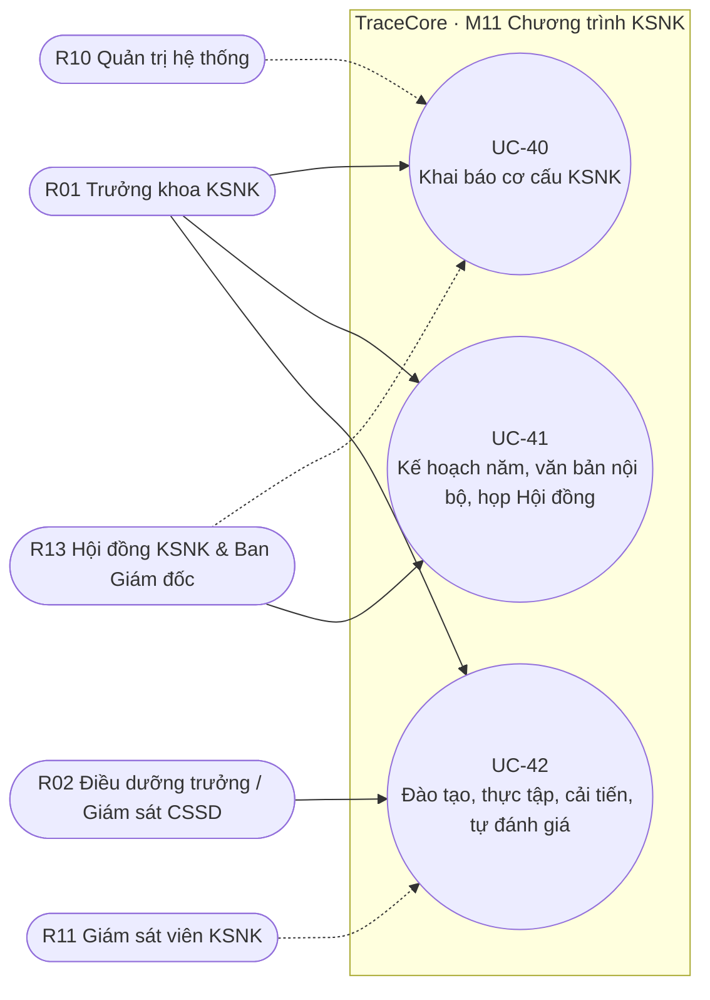

_Nét liền = actor chính (primary); nét đứt = actor phụ (secondary)._

### UC-40: Khai báo cơ cấu KSNK: Hội đồng, mạng lưới, bộ phận giám sát [NEW v1.12]

- **ID:** UC-40
- **Actors:** R01 Trưởng khoa KSNK (primary); R10 Quản trị hệ thống — khai báo số giường, tuyến; R13 Hội đồng KSNK & BGĐ — đọc; R02 — sửa danh sách mạng lưới (secondary)
- **Description:** R10 khai báo số giường và tuyến của cơ sở trong `IC Program Settings`; hệ thống tính cơ cấu KSNK bắt buộc theo BRU-ICP-001 và hiển thị trạng thái đáp ứng từng thành phần. R01 nhập quyết định thành lập Hội đồng (`IC Committee` + thành viên), danh sách mạng lưới viên theo khoa (`IC Network Member`) và nhân sự bộ phận giám sát; hệ thống kiểm tra đủ Chủ tịch/Thư ký, đại diện các khối, và mỗi khoa có đủ bác sĩ + điều dưỡng/hộ sinh/KTV. [A-138] Hệ thống còn kiểm từng người của khoa/bộ phận KSNK có đạt yêu cầu của vai trò (trình độ, khối ngành sức khỏe, chứng chỉ KSNK, toàn thời gian) theo bộ tiêu chí do R01 duyệt, và chỉ đếm người đạt.
- **Preconditions:** Department (khoa) và Employee đã có trên ERPNext/HRMS; vai trò R01, R10, R13 đã gán (FEAT-056).
- **Postconditions (success):** `IC Program Settings` lưu số giường, tuyến, tỷ lệ giám sát viên; `IC Committee` ghi sổ với đúng 1 Chủ tịch, 1 Thư ký; `IC Network Member` hiệu lực theo khoa; bảng trạng thái cơ cấu hiển thị thành phần Đủ/Thiếu bằng chữ; mọi cảnh báo thiếu ghi Audit Log.
- **Traces to:** FR-M11-01, FR-M11-02, FR-M11-03 (kể cả FR-M11-01.5..01.8, 02.3, 02.4, 03.3 theo A-138)
- **Business rules:** BRU-ICP-001 (cơ cấu tối thiểu theo giường; giám sát viên = giường ÷ 150, cách làm tròn cấu hình được, mặc định lên, OQ-V12-04), BRU-ICP-002 (Chủ tịch là Giám đốc, Thư ký là trưởng khoa/người phụ trách KSNK), BRU-ICP-003 (mỗi khoa ≥ 1 bác sĩ và ≥ 1 điều dưỡng/hộ sinh/KTV), BRU-ICP-006 (trình độ, chứng chỉ, toàn thời gian theo vai trò), BRU-ICP-007 (dưới 150 giường: người phụ trách và giám sát viên chuyên trách)
- **Screens:** SCR-47 (Cơ cấu KSNK: cài đặt chương trình, Hội đồng, mạng lưới)
- **Priority:** Must · Frequency: khi thành lập/kiện toàn (1–2 lần/năm); cập nhật mạng lưới theo biến động nhân sự.
- **Related NFR:** NFR-SEC-09 (ma trận quyền R11–R13), NFR-MAINT-04

**Main success scenario**
1. R10 mở SCR-47, nhập `bed_count`, `facility_level` (Chuyên sâu / Cơ bản / Ban đầu), `has_inpatient`, `surveillance_ratio_beds` (mặc định 150), `surveillance_rounding` (Lên / Xuống, mặc định Lên), `director` (người đứng đầu cơ sở), `doc_review_months` (mặc định 12) và lưu. [A-138]
2. Hệ thống tính cơ cấu bắt buộc theo BRU-ICP-001 (ví dụ 420 giường → Hội đồng, khoa KSNK, mạng lưới, ≥ 3 giám sát viên) và hiển thị bảng thành phần với nhãn chữ Đủ / Thiếu.
3. R01 tạo `IC Committee`: số và ngày quyết định, file quyết định, hiệu lực; thêm thành viên (nhân viên, vai trò Chủ tịch / Phó Chủ tịch / Thư ký / Ủy viên, khoa, khối đại diện).
4. R01 ghi sổ Hội đồng; hệ thống kiểm tra đúng 1 Chủ tịch và 1 Thư ký; nếu thiếu đại diện vi sinh–xét nghiệm, dược hoặc khoa lâm sàng nguy cơ cao thì ghi sổ được kèm cảnh báo và Audit Log.
5. R01/R02 nhập mạng lưới viên theo khoa (`IC Network Member`: nhân viên, khoa, loại thành viên, ngày bổ nhiệm, số quyết định, hiệu lực).
6. Mỗi lần danh sách mạng lưới thay đổi, hệ thống kiểm tra từng khoa lâm sàng, cận lâm sàng và liệt kê khoa thiếu bác sĩ hoặc thiếu điều dưỡng/hộ sinh/KTV.
7. R01 nhập nhân sự khoa/bộ phận KSNK kèm vai trò (Trưởng khoa / Điều dưỡng trưởng / Người phụ trách / Giám sát viên) và chuyên trách; R01/R02 nhập bậc học và khối ngành sức khỏe trên hồ sơ nhân viên. Hệ thống đối chiếu từng người với yêu cầu của vai trò và với chứng chỉ KSNK / kết quả đào tạo KSNK đạt (FEAT-059), so số người đạt với số tối thiểu và cập nhật bảng trạng thái cơ cấu kèm lý do từng người chưa đạt. [A-138]

**Alternate flows**
- A1. Cơ sở dưới 150 giường → cơ cấu bắt buộc là bộ phận KSNK, mạng lưới, ≥ 1 người phụ trách toàn thời gian và ≥ 1 giám sát viên chuyên trách (hai thành phần riêng; một người được tính cho cả hai vai hay không theo cấu hình, mặc định không, OQ-V12-11); không bắt buộc Hội đồng đầy đủ. [A-138]
- A2. Cơ sở không có nội trú → chỉ cần 1 người phụ trách KSNK; các thành phần khác hiển thị Không áp dụng.
- A3. Kiện toàn Hội đồng mới → tạo `IC Committee` mới với `valid_from`; bản cũ hết hiệu lực theo `valid_to`, lịch sử giữ nguyên.
- A4. [A-138] Người trong khoa/bộ phận KSNK chưa có dữ liệu bậc học hoặc chứng chỉ → hệ thống hiển thị "Chưa xác minh", không đếm vào số tối thiểu, không tính là thành phần thiếu (OQ-V12-12).
- A5. [A-138] Chưa có bộ tiêu chí cơ cấu Đã duyệt → hệ thống chỉ kiểm phần đếm và hiển thị "Chưa duyệt bộ tiêu chí cơ cấu"; R01 mở bộ tiêu chí Nháp (nạp sẵn theo TT 16/2018), rà soát và duyệt (OQ-V12-16).

**Exception flows**
- E1. Ghi sổ Hội đồng thiếu Chủ tịch hoặc Thư ký, hoặc có hơn một → hệ thống chặn ghi sổ, chỉ rõ vai trò thiếu/thừa (FR-M11-02).
- E1a. [A-138] Chủ tịch không phải người đứng đầu cơ sở, Thư ký không phải trưởng khoa/người phụ trách KSNK, hoặc thiếu khối bắt buộc (lãnh đạo phòng chức năng, vi sinh–xét nghiệm, dược, khoa lâm sàng nguy cơ cao) → vẫn ghi sổ, cảnh báo nêu rõ và ghi Audit Log (mức Chặn nếu bộ tiêu chí đặt, OQ-V12-13).
- E2. Vô hiệu mạng lưới viên cuối cùng của một khoa → cảnh báo R01 và khoa vào danh sách thiếu (FR-M11-03).
- E3. R12 mở màn hình → chỉ đọc dữ liệu mạng lưới của khoa mình (User Permission Department).

**Open issues:** Làm tròn số giám sát viên lên hay xuống (OQ-V12-04, đã có cấu hình); [A-138] OQ-V12-11..16 (kiêm nhiệm ở dưới 150 giường, chưa xác minh, mức chặn Hội đồng, loại chứng chỉ được công nhận, xác định Giám đốc, bộ tiêu chí chưa duyệt).

_Nguồn: BA v1.12 §4.1 bước 1–2, §4.3 FR-M11-01..03, §4.4; TT 16/2018 Điều 16, 17, 19, 22. Không có US/TC/API gốc — bước detailed-design bổ sung._

### UC-41: Lập, duyệt và theo dõi kế hoạch KSNK năm; văn bản nội bộ; họp Hội đồng [NEW v1.12]

- **ID:** UC-41
- **Actors:** R01 Trưởng khoa KSNK (primary — lập kế hoạch, sổ văn bản, biên bản); R13 Chủ tịch Hội đồng KSNK (primary — ghi sổ kế hoạch = phê duyệt); người chủ trì hoạt động/kết luận (R02, R11, trưởng khoa) (secondary)
- **Description:** R01 lập `IC Annual Plan` (mục tiêu, chỉ số với baseline/target, hoạt động có người chủ trì, hạn, ngân sách); R13 ghi sổ làm phê duyệt; hệ thống nhắc tiến độ từng hoạt động và cuối năm tạo báo cáo tổng kết từ số liệu M9, M12, M13. R01 quản lý sổ `IC Procedure Document` có phiên bản và hạn rà soát; sau mỗi cuộc họp Hội đồng ghi `IC Committee Meeting`, mỗi kết luận thành một việc theo dõi.
- **Preconditions:** UC-40 đã có Hội đồng hiệu lực; danh mục `IC Indicator` đã có (FEAT-056); `core.notification` hoạt động (ADR-014).
- **Postconditions (success):** Mỗi năm có đúng một kế hoạch đã duyệt (hoặc bản Amend); hoạt động được nhắc đúng mốc; báo cáo tổng kết PDF/Excel khớp bảng chỉ số M9 cùng kỳ; văn bản nội bộ ở trạng thái Hiệu lực / Cần rà soát / Thay thế đúng hạn; biên bản họp có việc theo dõi cho từng kết luận.
- **Traces to:** FR-M11-04, FR-M11-05, FR-M11-06, FR-M11-07, FR-M11-08
- **Business rules:** BRU-ICP-004 (kế hoạch chỉ hiệu lực khi Chủ tịch duyệt; sửa bằng Amend), BRU-ICP-005 (văn bản quá hạn rà soát không tính "đã cập nhật trong năm")
- **Screens:** SCR-48 (Kế hoạch KSNK năm & hoạt động; biên bản họp Hội đồng; sổ văn bản nội bộ)
- **Priority:** Must (FR-M11-05, FR-M11-08 Should) · Frequency: kế hoạch 1 lần/năm + Amend; nhắc hoạt động hằng ngày (scheduler); họp Hội đồng theo quý; rà soát văn bản theo `doc_review_months`.
- **Related NFR:** NFR-AVAIL-04 (thông báo), NFR-PERF-05 (số liệu tổng kết đọc từ `IC Indicator Value`)

**Main success scenario**
1. R01 mở SCR-48, tạo `IC Annual Plan` năm N: mục tiêu; bảng `IC Plan Indicator` (chỉ số, baseline, target); bảng `IC Plan Activity` (hoạt động, nhóm biện pháp, người chủ trì, khoa, hạn, ngân sách VND, bằng chứng).
2. R01 lưu Nháp và trình; R13 (Chủ tịch Hội đồng) mở và ghi sổ → kế hoạch có hiệu lực, lưu `approved_by`, `approved_on`.
3. Scheduler hằng ngày: hoạt động còn 7 ngày tới hạn hoặc quá hạn mà chưa hoàn thành → thông báo người chủ trì và R01 qua `core.notification`, mỗi mốc một lần.
4. Người chủ trì cập nhật trạng thái hoạt động và đính bằng chứng; hoàn thành thì dừng nhắc.
5. R01 quản lý `IC Procedure Document` (mã, tiêu đề, phiên bản, nhóm biện pháp, ngày ban hành, hạn rà soát, file); còn 30 ngày tới hạn hoặc quá hạn → hệ thống nhắc R01 và chuyển trạng thái Cần rà soát; ban hành phiên bản mới → bản cũ chuyển Thay thế, lịch sử phiên bản giữ nguyên.
6. Sau họp Hội đồng, R01 ghi `IC Committee Meeting` (ngày, chương trình, người dự, biên bản, file) với bảng `IC Resolution` (nội dung, người chủ trì, hạn); ghi sổ → hệ thống tạo một việc theo dõi cho mỗi kết luận và nhắc đến khi đóng.
7. Cuối năm R01 yêu cầu tổng kết → hệ thống tạo báo cáo: kết quả từng chỉ số so mục tiêu (từ `IC Indicator Value`), tỷ lệ hoạt động hoàn thành, phần nhận xét của R01; xuất PDF/Excel.

**Alternate flows**
- A1. Cần điều chỉnh kế hoạch đã duyệt → R01 tạo bản Amend (cùng năm, tham chiếu bản gốc); R13 ghi sổ lại; bản gốc giữ nguyên.
- A2. Tổng kết khi kỳ M9 chưa khóa → báo cáo mang dấu "Tạm" (như FR-M9-02.1).
- A3. Kết luận chưa đóng của lần họp trước → hiển thị trong danh sách mở của lần họp kế tiếp.

**Exception flows**
- E1. R01 bấm ghi sổ kế hoạch → bị chặn: chỉ R13 được ghi sổ (FR-M11-04).
- E2. Tạo kế hoạch thứ hai cùng năm không phải Amend → chặn.
- E3. Sửa trường của kế hoạch đã duyệt → chặn; hướng dẫn tạo Amend.
- E4. Email/SMS nhắc thất bại → giữ in-app, scheduler gửi lại tối đa 3 lần (FR-M9-10.1).

**Open issues:** Mẫu báo cáo tổng kết năm theo yêu cầu Sở Y tế (chờ bệnh viện thí điểm, liên quan OQ-V12-02).

_Nguồn: BA v1.12 §4.1 bước 3–5, §4.3 FR-M11-04..08, §4.4; TT 16/2018 Điều 17, 20. Không có US/TC/API gốc — bước detailed-design bổ sung._

### UC-42: Theo dõi đào tạo KSNK (HRMS Training), sinh viên thực tập, cải tiến chất lượng, tự đánh giá năm [NEW v1.12]

- **ID:** UC-42
- **Actors:** R01 Trưởng khoa KSNK (primary — cải tiến, tự đánh giá); R02 Điều dưỡng trưởng / Giám sát (primary — đào tạo, thực tập); R11 Giám sát viên KSNK (secondary — làm phiếu tự đánh giá); R12 — đọc dữ liệu khoa mình (secondary)
- **Description:** Đào tạo chạy trên HRMS `Training Program` / `Training Event` / `Training Result` với Custom Field `tc_ic_category`; M11 tính tỷ lệ nhân viên được đào tạo KSNK cơ bản theo khoa, tỷ lệ nhân sự chuyên trách / Hội đồng / mạng lưới đã đào tạo theo quy định (từ Training Result hoặc Certificate loại KSNK còn hiệu lực, FR-M4-02) và liệt kê người chưa học. R02 ghi `Trainee Induction` cho sinh viên thực tập; R01 ghi `IC Improvement Project` và thực hiện tự đánh giá chất lượng KSNK hằng năm bằng mẫu phiếu M12 loại "Tự đánh giá chất lượng".
- **Preconditions:** HRMS Training có chương trình gắn `tc_ic_category`; Employee có khoa; UC-43 đã có mẫu "Tự đánh giá chất lượng" được duyệt (cho bước tự đánh giá).
- **Postconditions (success):** Tỷ lệ đào tạo theo khoa và theo nhóm đối tượng được tính và đẩy sang `IC Indicator` (M9); danh sách chưa đào tạo có thể gửi nhắc; sinh viên có ngày đào tạo trước ngày thực tập; dự án cải tiến có trạng thái/kết quả; kết quả tự đánh giá lưu theo năm, so sánh hai năm liền.
- **Traces to:** FR-M11-09, FR-M11-10, FR-M11-11, FR-M11-12, FR-M11-13
- **Business rules:** BRU-ICP-001 (đối tượng chuyên trách), BRU-AUD-001 (tự đánh giá dùng mẫu đã duyệt)
- **Screens:** SCR-49 (Đào tạo, sinh viên thực tập, cải tiến chất lượng — báo cáo); SCR-52 (phiếu tự đánh giá theo mục)
- **Priority:** Must (FR-M11-09, 10); Should (FR-M11-11, 12, 13) · Frequency: tính tỷ lệ theo tháng/năm; thực tập theo đợt; tự đánh giá 1 lần/năm.
- **Related NFR:** NFR-PERF-05, NFR-MAINT-04

**Main success scenario**
1. R02 tạo/duy trì `Training Program` trên HRMS với `tc_ic_category` = KSNK cơ bản / Chuyên trách / Hội đồng–mạng lưới / Tân tuyển; tổ chức `Training Event` và ghi `Training Result`.
2. Hệ thống tính theo khoa: tử số = nhân viên có Training Result đạt thuộc chương trình KSNK cơ bản trong năm; mẫu số = nhân viên đang làm việc của khoa (nhân viên nghỉ việc không tính); hiển thị tỷ lệ (ví dụ 38/40 → 95,0 %) và danh sách chưa đào tạo trên SCR-49.
3. Hệ thống tính tỷ lệ nhân sự chuyên trách, thành viên Hội đồng và mạng lưới viên đã đào tạo theo quy định (Training Result hoặc Certificate loại KSNK còn hiệu lực); người chưa đạt vào danh sách.
4. R02 ghi `Trainee Induction` (họ tên, trường, khoa, kỳ thực tập, ngày đào tạo KSNK, kết quả); hệ thống kiểm tra `trained_on` ≤ `period_from` và báo cáo tỷ lệ đạt theo kỳ.
5. R01 ghi `IC Improvement Project` (loại Cải tiến chất lượng / Đề tài nghiên cứu, tiêu đề, nhóm biện pháp, chủ trì, thời gian, trạng thái, tóm tắt kết quả, tệp đính kèm); hệ thống đếm số dự án Hoàn thành theo năm cho chỉ số M9.
6. Cuối năm R01 mở phiếu tự đánh giá (mẫu M12 loại "Tự đánh giá chất lượng", UC-44 trên Desk/PDA), chấm từng mục; hệ thống lưu kết quả theo năm và hiển thị hai năm liền cạnh nhau theo từng mục.

**Alternate flows**
- A1. Nhân viên có Certificate KSNK còn hiệu lực nhưng chưa dự lớp trong năm → vẫn tính đạt cho FR-M11-10; không tính cho FR-M11-09 (đào tạo cơ bản trong năm).
- A2. Gửi nhắc hàng loạt cho danh sách chưa đào tạo qua `core.notification`.
- A3. Tự đánh giá theo QĐ 38 → dùng UC-57 (FR-M9-29) để điền sẵn phần tính được.

**Exception flows**
- E1. `trained_on` sau `period_from` → cảnh báo và đánh dấu "Chưa đạt trước thực tập" (FR-M11-11).
- E2. Training Program không có `tc_ic_category` → không vào tử số; cảnh báo R02 khi lập báo cáo.
- E3. Khoa chưa có nhân viên đang làm việc (mẫu số 0) → hiển thị "Không tính" (BRU-RPT-001).

**Open issues:** Danh mục chứng chỉ KSNK được công nhận (phụ thuộc FR-M4-02 và quy định bệnh viện).

_Nguồn: BA v1.12 §4.1 bước 6, §4.3 FR-M11-09..13, §4.4; TT 16/2018 Điều 24; QĐ 38 (chỉ tiêu đào tạo). Không có US/TC/API gốc — bước detailed-design bổ sung._

## M12 — Giám sát tuân thủ [NEW v1.12]

Nguồn nghiệp vụ: BA v1.12 §5 (A-113); TT 16/2018/TT-BYT Điều 5, 6, 7, 15, 25; QĐ 3916/QĐ-BYT (vệ sinh tay, NK tiết niệu); QĐ 3671/QĐ-BYT (phòng ngừa chuẩn, NK huyết catheter, NKVM, viêm phổi bệnh viện, tiêm an toàn); chỉ tiêu QĐ 38. Phạm vi: engine phiếu giám sát cấu hình được (ADR-015, D5) — `Audit Template` có phiên bản, `Audit Schedule`, `Audit Session` — dùng cho vệ sinh tay theo cơ hội, phòng ngừa chuẩn–PPE, gói dự phòng, vệ sinh môi trường (M15), đơn vị thuê ngoài, an toàn thực phẩm (M17), tự đánh giá (M11); kèm hóa chất KSNK theo khoa–tháng. Use case: UC-43, UC-44, UC-45, UC-46. Quy tắc: BRU-AUD-001..006.

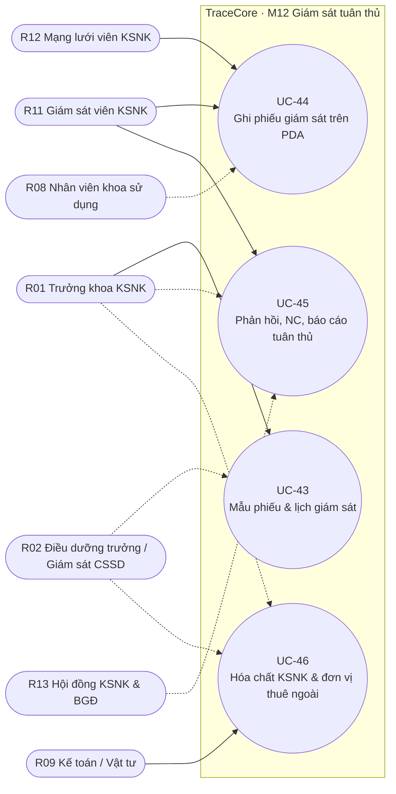

_Nét liền = actor chính (primary); nét đứt = actor phụ (secondary)._

### UC-43: Quản lý mẫu phiếu giám sát có phiên bản và lịch giám sát [NEW v1.12]

- **ID:** UC-43
- **Actors:** R01 Trưởng khoa KSNK (primary — duyệt mẫu); R02 Điều dưỡng trưởng / Giám sát CSSD (primary — lập lịch); R11 Giám sát viên KSNK (secondary — soạn nháp mẫu, nhận việc)
- **Description:** R01 soạn/duyệt `Audit Template` (loại, phương pháp chấm, mục hỏi với trọng số và cờ trọng yếu, cỡ mẫu tối thiểu, căn cứ pháp lý); ghi sổ = duyệt và khóa phiên bản; sửa phải tạo phiên bản mới. Bộ mẫu khởi tạo (8 mẫu) nạp ở trạng thái Nháp khi cài app, không bị ghi đè khi nâng cấp. R01/R02 lập `Audit Schedule` (mẫu, khoa, tần suất, mục tiêu, người phụ trách); hệ thống sinh việc theo kỳ và hiển thị độ bao phủ theo khoa.
- **Preconditions:** Module Compliance Audit cài đặt (FEAT-060); fixtures mẫu khởi tạo đã migrate (FEAT-061); Department và Employee có sẵn.
- **Postconditions (success):** Mẫu đã duyệt bất biến theo phiên bản `MP-<code>-V<n>`; lịch giám sát hoạt động sinh việc đúng kỳ; độ bao phủ (đã làm / mục tiêu) hiển thị theo khoa và nhắc tuần cuối kỳ.
- **Traces to:** FR-M12-01, FR-M12-02, FR-M12-03
- **Business rules:** BRU-AUD-001 (chỉ mẫu đã duyệt mới dùng; phiếu lưu bản chụp phiên bản), BRU-AUD-002, BRU-AUD-003 (quy tắc chấm gắn với mẫu)
- **Screens:** SCR-50 (Mẫu phiếu giám sát — builder có phiên bản & lịch giám sát)
- **Priority:** Must · Frequency: duyệt mẫu khi có thay đổi tiêu chí (vài lần/năm); lịch theo tuần/tháng/quý.
- **Related NFR:** NFR-MAINT-04 (tiêu chí là dữ liệu cấu hình có phiên bản, migrate không ghi đè), NFR-SEC-09

**Main success scenario**
1. Sau `bench migrate`, hệ thống nạp 8 mẫu Nháp: vệ sinh tay 5 thời điểm, phòng ngừa chuẩn–PPE, 4 gói dự phòng (VAP, CLABSI, CAUTI, SSI), vệ sinh môi trường bề mặt, đơn vị thuê ngoài; mỗi mẫu có `legal_ref`.
2. R01 mở SCR-50, chọn mẫu Nháp (hoặc tạo mới): `audit_type`, `scoring_method` (Theo cơ hội / Tất cả-hoặc-không / Điểm %), `bundle_type`, `min_sample`, `legal_ref`; bảng `Audit Template Item` (mã mục, phần, câu hỏi, kiểu trả lời, lựa chọn, trọng số, `is_critical`, hướng dẫn).
3. R01 ghi sổ → mẫu được duyệt, phiên bản `V<n>` khóa nội dung, `effective_from` ghi nhận.
4. R02 tạo `Audit Schedule`: mẫu, danh sách khoa, tần suất (Tuần / Tháng / Quý), `target_count` (ví dụ 30 cơ hội/khoa/tháng), người phụ trách, hiệu lực.
5. Đến kỳ, scheduler sinh việc cho người phụ trách (thông báo + danh sách việc trên PDA/Cổng khoa) và hiển thị độ bao phủ theo khoa (ví dụ 12/30).
6. Tuần cuối kỳ, khoa chưa đạt mục tiêu → hệ thống nhắc người phụ trách và R02.

**Alternate flows**
- A1. Cần sửa câu hỏi của mẫu đã duyệt → R01 tạo phiên bản V(n+1) từ bản cũ, sửa, ghi sổ; phiếu từ ngày hiệu lực mới dùng V(n+1), phiếu cũ vẫn hiển thị V(n).
- A2. Nâng cấp app có fixtures mới → mẫu bệnh viện đã sửa không bị ghi đè; mẫu mới thêm ở trạng thái Nháp (như FR-M9-17).
- A3. Mẫu loại "Cơ sở hạ tầng" (M15) có thêm hạn kiểm tra kế tiếp; mẫu "An toàn thực phẩm" (M17) gắn `supplier`; mẫu "Tự đánh giá chất lượng" (M11) lưu theo năm.

**Exception flows**
- E1. Sửa trực tiếp nội dung mẫu đã duyệt → chặn, gợi ý tạo V(n+1) (FR-M12-01).
- E2. Lịch gắn mẫu chưa duyệt (Nháp) → chặn lưu lịch (BRU-AUD-001).
- E3. Mẫu không có mục nào `is_critical` với loại Gói dự phòng → cảnh báo (không chặn), ghi Audit Log.

**Open issues:** Ai soạn và duyệt nội dung chuyên môn của bộ mẫu khởi tạo (OQ-V12-08); cỡ mẫu tối thiểu mặc định (OQ-V12-09).

_Nguồn: BA v1.12 §5.1 bước 1–2, §5.3 FR-M12-01..03, §5.4; QĐ 3671, QĐ 3916. Không có US/TC/API gốc — bước detailed-design bổ sung._

### UC-44: Ghi phiếu giám sát trên PDA (vệ sinh tay theo cơ hội, điểm %, gói dự phòng), offline [NEW v1.12]

- **ID:** UC-44
- **Actors:** R11 Giám sát viên KSNK (primary — mọi khoa); R12 Mạng lưới viên KSNK (primary — khoa mình); R08 Điều dưỡng khoa (secondary — phiếu gói dự phòng khoa mình); R01 (secondary — phiếu tự đánh giá)
- **Description:** Người giám sát mở phiếu trên PDA (PWA, Page `station`) hoặc Cổng khoa, chọn khoa và vị trí, ghi từng cơ hội vệ sinh tay (≤ 3 chạm/cơ hội) hoặc chấm từng mục (Điểm %, gói dự phòng tất cả-hoặc-không gắn đợt thiết bị M13). Phiếu chạy được khi mất mạng ≥ 4 giờ, đồng bộ idempotent khi có mạng. Ghi sổ → hệ thống tính tỷ lệ/điểm theo phương pháp của mẫu.
- **Preconditions:** Mẫu đã duyệt (UC-43); người dùng đăng nhập PDA bằng thẻ/PIN với vai trò R11/R12/R08; với phiếu gói dự phòng cần `Device Episode` đang mở (UC-47).
- **Postconditions (success):** `Audit Session` ghi sổ với bản chụp phiên bản mẫu, `score_pct`, `result` (Đạt / Không đạt), `sample_flag`; cơ hội vệ sinh tay lưu đủ (vai trò, thời điểm 1–5, hành động, kỹ thuật, găng thay rửa tay); mọi RPC ghi có `X-Idempotency-Key`, không trùng sau đồng bộ.
- **Traces to:** FR-M12-04, FR-M12-05, FR-M12-06, FR-M12-07, FR-M12-10, FR-M12-11
- **Business rules:** BRU-AUD-002 (tuân thủ tính theo cơ hội), BRU-AUD-003 (gói chấm tất cả-hoặc-không; "Không áp dụng" loại khỏi mẫu số), BRU-AUD-004 (không tự đánh giá mình), BRU-AUD-005 (mục trọng yếu không đạt → phiếu Không đạt)
- **Screens:** SCR-51 (PDA — Phiếu vệ sinh tay theo cơ hội); SCR-52 (PDA/DEPT — Phiếu giám sát theo mục)
- **Priority:** Must (FR-M12-11 Should) · Frequency: hằng ngày tại khoa; gói dự phòng hằng ngày cho mỗi đợt thiết bị đang mở; vệ sinh tay ≥ 30 cơ hội/khoa/tháng (mục tiêu lịch).
- **Related NFR:** NFR-USAB-03 (≤ 3 chạm, nút ≥ 48 px, chữ ≥ 16 px, một tay), NFR-AVAIL-05 (offline ≥ 4 giờ, đồng bộ idempotent), NFR-SEC-09 (R12 theo khoa), NFR-PERF-01

**Main success scenario**
1. R11/R12 mở SCR-51 trên PDA, chọn mẫu "Vệ sinh tay 5 thời điểm", khoa, vị trí, chế độ (Công khai / Không báo trước); hệ thống tạo `Audit Session` Nháp, `observer` = người đăng nhập.
2. Với mỗi cơ hội: chọn vai trò người được quan sát (hoặc nhân viên), thời điểm 1–5, hành động (Chà tay cồn / Rửa tay xà phòng / Không thực hiện) — tối đa 3 chạm; tùy chọn `technique_ok`, `glove_instead`; gửi `tracecore.v1.audit.record_opportunity` (`@idempotent`).
3. Mất mạng → phiếu và cơ hội lưu hàng đợi cục bộ (IndexedDB, ADR-003), giao diện hiện trạng thái offline; có mạng → đồng bộ theo thứ tự, không trùng.
4. Kết thúc, người giám sát bấm Ghi sổ (`tracecore.v1.audit.submit_session`); hệ thống tính tỷ lệ tuân thủ = cơ hội có hành động / tổng cơ hội và tỷ lệ đúng kỹ thuật riêng (mẫu số không gồm "Không thực hiện").
5. (Phiếu Điểm %) người giám sát chấm từng mục trên SCR-52; ghi sổ → điểm = tổng trọng số mục Đạt / tổng trọng số mục áp dụng; mục trọng yếu không đạt → `result` = Không đạt bất kể điểm.
6. (Phiếu gói dự phòng) R08/R12 mở SCR-52 từ nhắc 10:00, chọn `device_episode` đang mở, chấm tất cả mục; ghi sổ → Đạt chỉ khi mọi mục áp dụng Đạt.
7. Nếu khoa–tháng có số cơ hội/phiếu < `min_sample` → tỷ lệ hiển thị kèm "Chưa đủ cỡ mẫu (n = …)"; hệ thống chuyển sang UC-45 (phản hồi).

**Alternate flows**
- A1. Giám sát không báo trước → `mode` = Không báo trước; không gửi thông báo trước cho khoa.
- A2. Phiếu loại Vệ sinh môi trường gắn `environment_zone` (M15), loại An toàn thực phẩm gắn `supplier` (M17), loại Đơn vị thuê ngoài gắn `supplier` (UC-46), loại Tự đánh giá (M11) do R01 làm trên Desk.
- A3. Điều tra cắt ngang (FR-M13-14) dùng mẫu loại "Khác" + danh sách `Device Episode`.
- A4. Mất mạng khi ghi sổ → phiếu xếp hàng, ghi sổ khi có mạng; hiển thị "Chờ đồng bộ".

**Exception flows**
- E1. `subject_employee` = `observer` → chặn lưu cơ hội (lỗi inline, FR-M12-10, BRU-AUD-004).
- E2. Phiếu gói không chọn đợt thiết bị đang mở → chặn ghi sổ.
- E3. Đồng bộ gặp xung đột (phiên bản mẫu hết hiệu lực giữa chừng) → phiếu giữ phiên bản tại lúc tạo (bản chụp), ghi Audit Log.
- E4. R12 chọn khoa khác khoa mình → danh sách khoa chỉ hiện khoa được phân quyền (User Permission).
- E5. Hết 4 giờ offline, hàng đợi đầy → cảnh báo, chặn tạo phiếu mới đến khi đồng bộ (NFR-AVAIL-05).

**Open issues:** Ngưỡng cỡ mẫu tối thiểu mặc định (OQ-V12-09); E2E PDA 412×915 chỉ chạy khi người dùng cho phép.

_Nguồn: BA v1.12 §5.1 bước 3, 5, §5.3 FR-M12-04..07, 10, 11, §5.4; QĐ 3916 (vệ sinh tay); QĐ 3671 (gói dự phòng). Không có US/TC/API gốc — bước detailed-design bổ sung._

### UC-45: Phản hồi kết quả giám sát, mở NC, báo cáo tuân thủ [NEW v1.12]

- **ID:** UC-45
- **Actors:** R11 Giám sát viên KSNK (primary); R01 Trưởng khoa KSNK (secondary — mở/duyệt NC, xem tất cả); R08 Trưởng khoa sử dụng và R12 Mạng lưới viên (secondary — nhận phản hồi khoa mình); R13 (secondary — xem báo cáo)
- **Description:** Khi phiếu ghi sổ, hệ thống gửi phản hồi (điểm, mục không đạt) cho trưởng khoa và mạng lưới viên của khoa trong ngày; phiếu có mục trọng yếu không đạt → đề nghị R11/R01 mở `Incident CAPA` loại Compliance liên kết phiếu nguồn, theo dõi đến khi đóng. Theo kỳ, người dùng xuất báo cáo tuân thủ theo loại phiếu, khoa, nghề nghiệp, thời điểm (PDF/Excel) và hệ thống đẩy chỉ số sang `IC Indicator` cho M9.
- **Preconditions:** Có phiếu ghi sổ (UC-44); `Notification Rule` cho sự kiện phản hồi (ADR-014); `Incident CAPA` có giá trị `incident_category` = Compliance.
- **Postconditions (success):** Phản hồi đến khoa trong ngày; NC tạo ra có `source_doctype` = Audit Session, đóng NC cần kết quả xác minh (FR-M2-21/22); báo cáo kỳ khớp tổng từ phiếu ghi sổ; chỉ số tuân thủ xuất hiện trong `IC Indicator Value` sau khóa kỳ.
- **Traces to:** FR-M12-08, FR-M12-09, FR-M12-14
- **Business rules:** BRU-AUD-005, BRU-AUD-004; BRU-RPT-001 (mẫu số 0 → "Không tính")
- **Screens:** SCR-53 (Báo cáo tuân thủ & phản hồi khoa; danh sách phiếu — WEB, view DEPT); SCR-15 (NC/CAPA hiện có)
- **Priority:** Must · Frequency: phản hồi theo từng phiếu (hằng ngày); báo cáo tháng/quý.
- **Related NFR:** NFR-SEC-09 (R12 chỉ thấy phiếu khoa mình — `permission_query_conditions`), NFR-AVAIL-04, NFR-PERF-05

**Main success scenario**
1. Phiếu ghi sổ (UC-44) → hệ thống phát sự kiện qua `core.notification.emit` tới trưởng khoa (R08) và mạng lưới viên (R12) của khoa: điểm, mục không đạt, liên kết phiếu.
2. R08/R12 mở phản hồi trên Cổng khoa (SCR-53 view DEPT) → chỉ thấy phiếu của khoa mình.
3. Phiếu có mục trọng yếu không đạt → hệ thống hiển thị đề nghị "Mở NC" cho R11/R01 với thông tin điền sẵn (khoa, mẫu, mục, phiếu nguồn).
4. R11/R01 tạo `Incident CAPA` loại Compliance, `source_doctype` = Audit Session; theo dõi hành động khắc phục; đóng NC khi có kết quả xác minh (UC-15).
5. Cuối kỳ, R11/R01 mở SCR-53, chọn kỳ và bộ lọc (loại phiếu, khoa, nghề nghiệp, thời điểm); hệ thống tổng hợp từ phiếu ghi sổ trong kỳ, hiển thị cỡ mẫu và nhãn "Chưa đủ cỡ mẫu" khi cần.
6. Người dùng xuất PDF/Excel; hệ thống đẩy chỉ số (tỷ lệ tuân thủ vệ sinh tay, tỷ lệ đạt gói, tỷ lệ phòng ngừa chuẩn…) sang `IC Indicator` qua hook `tracecore_ic_indicators` để UC-57 tính `IC Indicator Value` khi khóa kỳ.

**Alternate flows**
- A1. Khoa không có mạng lưới viên hiệu lực → phản hồi chỉ gửi trưởng khoa và cảnh báo R01 (liên kết FR-M11-03).
- A2. R13 xem báo cáo tổng hợp toàn viện (không xem từng phiếu/người được quan sát).
- A3. Báo cáo theo đơn vị thuê ngoài (UC-46) và theo vùng/mức nguy cơ (UC-54) dùng cùng màn hình với bộ lọc tương ứng.

**Exception flows**
- E1. R12 khoa A mở danh sách → không thấy phiếu khoa B (FR-M12-08).
- E2. NC Compliance bị đóng mà chưa có kết quả xác minh → chặn (FR-M2-22).
- E3. Kỳ không có phiếu nào → tỷ lệ "Không tính", không hiển thị 0 (BRU-RPT-001).
- E4. Thông báo email/SMS lỗi → giữ in-app, gửi lại tối đa 3 lần (FR-M9-10.1).

**Open issues:** Mẫu báo cáo tuân thủ theo yêu cầu Sở Y tế (OQ-V12-02).

_Nguồn: BA v1.12 §5.1 bước 4, §5.3 FR-M12-08, 09, 14, §5.4; TT 16/2018 Điều 5, 6. Không có US/TC/API gốc — bước detailed-design bổ sung._

### UC-46: Hóa chất KSNK theo khoa–tháng và giám sát đơn vị thuê ngoài [NEW v1.12]

- **ID:** UC-46
- **Actors:** R09 Kế toán / Vật tư (primary — nhập hóa chất, hồ sơ nhà cung cấp); R01 Trưởng khoa KSNK (secondary — báo cáo quý, giám sát thuê ngoài); R02 (secondary — nhận nhắc giấy phép); R11 (secondary — phiếu giám sát đơn vị thuê ngoài)
- **Description:** Hệ thống ghi lượng hóa chất KSNK theo khoa–tháng (`IC Chemical Consumption`) từ 3 nguồn: `Stock Entry` ERPNext xuất tới kho khoa, file import từ khoa Dược, nhập tay có người xác nhận; cuối quý xuất báo cáo theo loại hóa chất, và tính lít dung dịch VST/1.000 ngày nằm viện khi có mẫu số M13. Đơn vị thuê ngoài (vệ sinh, giặt là, xử lý chất thải, tiệt khuẩn, suất ăn) quản lý trên ERPNext `Supplier` với Custom Field giấy phép/hợp đồng; hệ thống nhắc hạn giấy phép và liệt kê đơn vị chưa được giám sát trong quý.
- **Preconditions:** Item hóa chất có `tc_ic_chemical_type`; kho khoa khai báo trên ERPNext; Supplier có `tc_ic_service_type`, `tc_license_expiry`, `tc_contract_to`; mẫu phiếu "Đơn vị thuê ngoài" đã duyệt (UC-43).
- **Postconditions (success):** Mỗi (tháng, khoa, item) có đúng một nguồn ghi nhận hoặc được cảnh báo trùng; báo cáo quý khớp tổng 3 tháng; lít VST/1.000 ngày nằm viện hiển thị khi có mẫu số; giấy phép hết hạn chỉ cảnh báo + Audit Log, không chặn giao dịch.
- **Traces to:** FR-M12-12, FR-M12-13
- **Business rules:** BRU-AUD-006 (hết hạn giấy phép chỉ cảnh báo; quyết định dừng hợp đồng thuộc bệnh viện), BRU-WST-003 (đơn vị xử lý chất thải vẫn theo M10)
- **Screens:** SCR-54 (Hóa chất KSNK theo khoa–tháng; đơn vị thuê ngoài & giấy phép); SCR-43 (import file hóa chất qua hồ sơ ánh xạ cột)
- **Priority:** Must · Frequency: hóa chất theo tháng, báo cáo quý; nhắc giấy phép theo mốc 60/30/7 ngày; giám sát thuê ngoài ≥ 1 lần/quý.
- **Related NFR:** NFR-PERF-05, NFR-AVAIL-04

**Main success scenario**
1. Khi `Stock Entry` xuất hóa chất có `tc_ic_chemical_type` tới kho khoa được ghi sổ, hook tạo/cộng dồn `IC Chemical Consumption` (kỳ tháng, khoa, item, qty, uom, `source` = Stock Entry, `source_ref`).
2. Khoa Dược gửi file → R09/R11 import qua SCR-43 với hồ sơ ánh xạ cột (FR-M9-28); dòng hợp lệ tạo bản ghi `source` = Import.
3. Khoa không có cả hai nguồn → R09 nhập tay trên SCR-54 với người xác nhận; `source` = Nhập tay, Audit Log.
4. Cuối quý R01 mở SCR-54, chọn quý → hệ thống tổng hợp theo loại hóa chất (Dung dịch VST nhanh / Xà phòng / Khử khuẩn bề mặt / Khử khuẩn dụng cụ / Khác) theo khoa; nếu M13 có ngày nằm viện của kỳ → tính lít VST/1.000 ngày nằm viện; xuất PDF/Excel; đẩy chỉ số sang M9.
5. R09 cập nhật `Supplier` thuê ngoài: loại dịch vụ, số giấy phép, hạn giấy phép, hợp đồng từ–đến.
6. Scheduler: giấy phép còn 60, 30, 7 ngày hoặc đã hết hạn → nhắc R01, R02; cuối quý liệt kê đơn vị chưa có phiếu giám sát loại "Đơn vị thuê ngoài" trong quý.
7. R11 giám sát đơn vị thuê ngoài bằng phiếu M12 gắn `supplier` (UC-44); kết quả tách riêng theo đơn vị trên báo cáo (liên kết FR-M15-02).

**Alternate flows**
- A1. Hóa chất khử khuẩn bề mặt dùng cho báo cáo môi trường (FR-M15-07) → lấy từ cùng bảng.
- A2. Đơn vị xử lý chất thải → hợp đồng/giấy phép môi trường vẫn theo `Waste Treatment Vendor` M10; SCR-54 chỉ hiển thị tham chiếu.

**Exception flows**
- E1. Cùng (tháng, khoa, item) từ 2 nguồn → cảnh báo trùng, yêu cầu R09 chọn nguồn giữ lại (FR-M12-12).
- E2. Giấy phép đã hết hạn → cảnh báo và Audit Log, không chặn phiếu giám sát hay giao dịch (BRU-AUD-006).
- E3. Chưa có mẫu số ngày nằm viện của kỳ → chỉ hiển thị số lít, ghi "Chưa có mẫu số".

**Open issues:** Định dạng file hóa chất từ khoa Dược (OQ-V12-05).

_Nguồn: BA v1.12 §5.1 bước 6–7, §5.3 FR-M12-12, 13, §5.4; TT 16/2018 Điều 25; QĐ 38 (báo cáo hóa chất quý). Không có US/TC/API gốc — bước detailed-design bổ sung._

## M13 — Giám sát nhiễm khuẩn bệnh viện [NEW v1.12]

Nguồn nghiệp vụ: BA v1.12 §6 (A-113); TT 16/2018/TT-BYT Điều 4, 22; QĐ 3916/QĐ-BYT (giám sát NKBV, KSNK khoa GMHS, NK tiết niệu); QĐ 1526/QĐ-BYT (giám sát NKVM); QĐ 3671/QĐ-BYT (NK huyết catheter, viêm phổi bệnh viện); QĐ 5631/QĐ-BYT (kháng sinh dự phòng); QĐ 38 (chỉ tiêu báo cáo NKVM, NK hồi sức, kháng sinh dự phòng). Phạm vi: mẫu số (ngày nằm viện, ngày thiết bị) nhập theo khoa hoặc nhập file từ HIS (D3 — không tích hợp API), đợt thiết bị, ca NKBV theo định nghĩa có phiên bản, giám sát NKVM, kỳ báo cáo khóa tháng, tỷ suất. Dữ liệu người bệnh chỉ gồm mã BN mã hóa (ADR-010), năm sinh, giới, khoa, ngày — không họ tên (D4, BRU-HAI-005). Use case: UC-47, UC-48, UC-49, UC-50. Quy tắc: BRU-HAI-001..006.

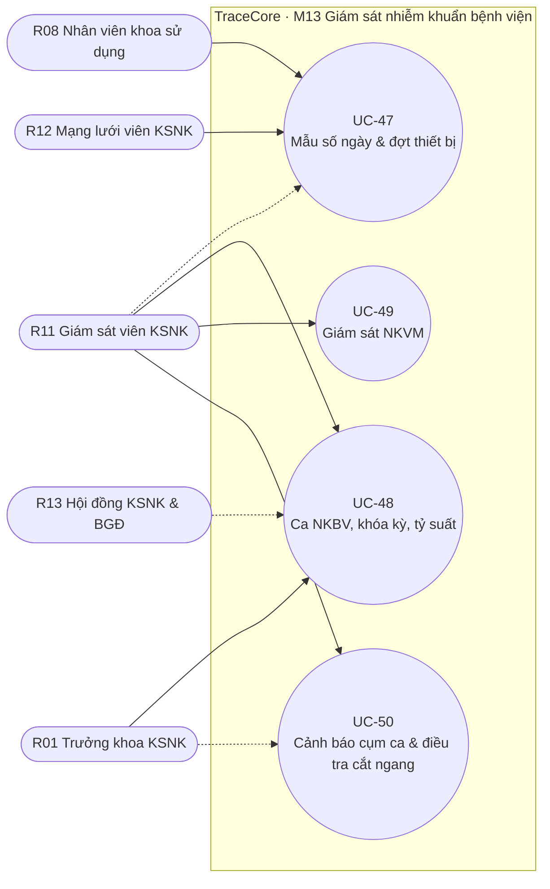

_Nét liền = actor chính (primary); nét đứt = actor phụ (secondary)._

### UC-47: Nhập mẫu số ngày và đợt thiết bị tại khoa (Cổng khoa/PDA/import) [NEW v1.12]

- **ID:** UC-47
- **Actors:** R08 Điều dưỡng khoa (primary); R12 Mạng lưới viên KSNK (primary); R11 Giám sát viên KSNK (secondary — import file từ HIS, nhận nhắc)
- **Description:** Mỗi khoa nội trú nhập `Ward Daily Census` hằng ngày (số người bệnh nằm viện, số có thở máy / catheter TM trung tâm / thông tiểu, số nhập viện) trên Cổng khoa hoặc PDA, hoặc R11 nhập file xuất từ HIS qua hồ sơ ánh xạ cột (D3). Khoa hồi sức ghi `Device Episode` mỗi lần đặt/rút thiết bị với mã người bệnh mã hóa; đợt đang mở là căn cứ cho phiếu gói dự phòng M12 (UC-44) và ngày thiết bị cho tỷ suất.
- **Preconditions:** Department có cờ nội trú/lâm sàng; vai trò R08/R12 có User Permission theo khoa; hồ sơ ánh xạ cột cho mẫu số đã lưu (UC-57) khi dùng import; mã BN nhập theo ADR-010.
- **Postconditions (success):** Đúng một `Ward Daily Census` mỗi (ngày, khoa); số thiết bị ≤ số người bệnh; `Device Episode` lưu `patient_code` mã hóa + `patient_code_hash` + mã che, tính số ngày thiết bị; khoa cấu hình nguồn ngày thiết bị (mẫu số ngày hoặc đợt thiết bị); khoa thiếu mẫu số được nhắc 10:00.
- **Traces to:** FR-M13-02, FR-M13-03, FR-M13-04
- **Business rules:** BRU-HAI-002 (một mẫu số/khoa/ngày; sau khóa kỳ chỉ sửa khi R01 mở khóa), BRU-HAI-005 (không lưu họ tên)
- **Screens:** SCR-55 (Cổng khoa — Mẫu số ngày & đợt thiết bị; DEPT + PDA); SCR-43 (import)
- **Priority:** Must · Frequency: hằng ngày mỗi khoa nội trú; đợt thiết bị theo sự kiện đặt/rút.
- **Related NFR:** NFR-PRIV-01, NFR-AVAIL-05 (mẫu số nhập được offline, đồng bộ idempotent), NFR-SEC-09, NFR-USAB-03

**Main success scenario**
1. R08/R12 mở SCR-55 trên Cổng khoa (hoặc PDA), chọn ngày hôm trước (mặc định), nhập `patient_count`, `vent_count`, `cvc_count`, `urinary_catheter_count`, `admissions`; gửi qua `tracecore.v1.hai.census_upsert` (`@idempotent`).
2. Hệ thống kiểm tra duy nhất (ngày, khoa), số thiết bị ≤ số người bệnh, lưu `source` = Nhập tay.
3. Khoa hồi sức ghi `Device Episode` khi đặt thiết bị: mã BN (nhập → mã hóa trường Password, sinh hash và mã che), năm sinh, giới, loại thiết bị, `inserted_on`; gửi `tracecore.v1.hai.device_episode`.
4. Khi rút thiết bị, khoa đóng đợt (`removed_on`); hệ thống tính số ngày thiết bị; đợt đang mở hiển thị trong danh sách để làm phiếu gói dự phòng (FR-M12-07).
5. R10/R01 cấu hình cho từng khoa nguồn ngày thiết bị dùng cho tỷ suất: mẫu số ngày hoặc đợt thiết bị.
6. Scheduler 10:00 (giờ cấu hình): khoa nội trú chưa có mẫu số ngày hôm trước → nhắc mạng lưới viên của khoa và R11.

**Alternate flows**
- A1. Bệnh viện xuất được file từ HIS → R11 import hằng ngày/tuần qua SCR-43 với hồ sơ ánh xạ cột; dòng hợp lệ ghi `source` = Import; dòng lỗi báo theo số dòng (mẫu FR-M9-11).
- A2. PDA mất mạng → mẫu số/đợt thiết bị xếp hàng cục bộ, đồng bộ khi có mạng, không trùng (ADR-003).
- A3. Khoa không nội trú → không yêu cầu mẫu số, không nhắc.

**Exception flows**
- E1. `vent_count` > `patient_count` → chặn dòng/bản ghi, chỉ rõ trường (FR-M13-02).
- E2. Trùng (ngày, khoa) → chặn; gợi ý sửa bản ghi hiện có (nếu kỳ chưa khóa).
- E3. `removed_on` < `inserted_on` → chặn (FR-M13-04).
- E4. Sửa mẫu số thuộc kỳ đã khóa → chặn (FR-M13-11); chỉ R01 mở khóa với lý do.
- E5. Danh sách đợt thiết bị → chỉ hiện mã BN che; R12 chỉ thấy khoa mình.

**Open issues:** Định dạng cột file mẫu số từ HIS của bệnh viện thí điểm (OQ-V12-05).

_Nguồn: BA v1.12 §6.1 bước 1–2, §6.3 FR-M13-02..04, §6.4; QĐ 3916 (giám sát NKBV). Không có US/TC/API gốc — bước detailed-design bổ sung._

### UC-48: Ghi nhận và xác định ca NKBV, khóa kỳ, tỷ suất, che mã BN [NEW v1.12]

- **ID:** UC-48
- **Actors:** R11 Giám sát viên KSNK (primary — tạo, xác định ca); R01 Trưởng khoa KSNK (primary — duyệt định nghĩa, khóa kỳ); R12/R08 (secondary — tạo ca Nghi ngờ khoa mình); R13 (secondary — xem số liệu tổng hợp)
- **Description:** R01 duyệt `HAI Case Definition` có phiên bản (vị trí nhiễm khuẩn, tiêu chí, ngưỡng giờ sau nhập viện, ngày thiết bị trước khởi phát). R11 rà soát (người bệnh có thiết bị, sốt, kết quả vi sinh dương tính từ M14) → tạo `HAI Case` Nghi ngờ → đối chiếu định nghĩa có hiệu lực tại ngày khởi phát → Xác định hoặc Loại trừ (bắt buộc lý do). R01 khóa `IC Reporting Period` tháng → hệ thống tính tỷ suất theo khoa và kỳ, đẩy chỉ số sang M9. Mã BN che trên mọi danh sách/báo cáo/file xuất; xem đầy đủ chỉ R01/R11 với lý do và Audit Log.
- **Preconditions:** UC-47 có mẫu số/đợt thiết bị của kỳ; bộ định nghĩa khởi tạo đã migrate ở trạng thái Nháp (FEAT-063); M14 (tùy chọn) có chủng liên kết.
- **Postconditions (success):** Ca lưu bản chụp phiên bản định nghĩa; trạng thái Nghi ngờ / Xác định / Loại trừ với `confirmed_by`; kỳ khóa chặn sửa mẫu số và ca; tỷ suất NKBV/1.000 ngày nằm viện, VAP/1.000 ngày thở máy, CLABSI/1.000 ngày catheter, CAUTI/1.000 ngày thông tiểu, tỷ lệ sử dụng thiết bị tính đúng; mẫu số 0 → "Không tính".
- **Traces to:** FR-M13-01, FR-M13-05, FR-M13-06, FR-M13-10, FR-M13-11, FR-M13-15
- **Business rules:** BRU-HAI-001 (phiên bản định nghĩa theo ngày khởi phát; ngưỡng từ định nghĩa), BRU-HAI-002, BRU-HAI-005 (không họ tên), BRU-HAI-006 (mẫu số 0 không hiển thị 0), BRU-RPT-003 (giá trị đã khóa chỉ đổi khi mở khóa có lý do)
- **Screens:** SCR-56 (Ca NKBV — danh sách + hồ sơ ca, che mã BN; kỳ báo cáo); SCR-58 (Báo cáo NKBV / NK hồi sức)
- **Priority:** Must · Frequency: rà soát ca hằng ngày; khóa kỳ hằng tháng.
- **Related NFR:** NFR-PRIV-01 (tối thiểu hóa, mã hóa, che, xem có lý do + Audit Log), NFR-PRIV-02 (thời hạn lưu, OQ-V12-07), NFR-SEC-09, NFR-PERF-05, NFR-MAINT-04 (định nghĩa là cấu hình có phiên bản)

**Main success scenario**
1. R01 mở SCR-56 → `HAI Case Definition`: `def_code`, vị trí nhiễm khuẩn (NKVM nông/sâu/cơ quan–khoang, viêm phổi thở máy, NK huyết liên quan catheter, NK tiết niệu liên quan thông tiểu, Khác), tiêu chí, loại thiết bị, `min_hours_after_admission`, `min_device_days_before_onset`, `legal_ref`; ghi sổ = duyệt, khóa phiên bản `DN-<code>-V<n>` với `effective_from`.
2. R11 rà soát danh sách gợi ý (đợt thiết bị đang mở, chủng dương tính từ M14) và tạo `HAI Case` trạng thái Nghi ngờ: mã BN (mã hóa), năm sinh, giới, khoa, ngày nhập viện, ngày khởi phát, đợt thiết bị/ca phẫu thuật liên quan, chủng (tùy chọn).
3. Hệ thống gắn phiên bản định nghĩa có hiệu lực tại `onset_date` (bản chụp) và kiểm tra ngưỡng: khởi phát sớm hơn `min_hours_after_admission` hoặc thiết bị lưu ngắn hơn `min_device_days_before_onset` → cảnh báo, yêu cầu lý do.
4. R11/R01 chuyển Xác định (lưu `confirmed_by`) hoặc Loại trừ (bắt buộc `exclusion_reason`); ghi sổ ca.
5. Cuối tháng R01 khóa `IC Reporting Period` → hệ thống chặn sửa mẫu số và ca thuộc kỳ, tính tỷ suất theo khoa/kỳ (FR-M13-10) và lưu `IC Indicator Value` (FR-M9-27).
6. Người dùng mở SCR-58 xem tỷ suất, tỷ lệ sử dụng thiết bị theo khoa; mọi danh sách chỉ hiện mã BN che.
7. Khi cần xem mã đầy đủ, R01/R11 bấm "Xem mã BN", nhập lý do → hệ thống giải mã hiển thị tạm thời và ghi Audit Log "Xem mã BN".

**Alternate flows**
- A1. R12/R08 tạo ca Nghi ngờ cho khoa mình → chỉ R11/R01 xác định; R08 không thấy nút Xác định.
- A2. Ca khởi phát trước ngày hiệu lực V2 → vẫn gắn V1 (BRU-HAI-001).
- A3. Cần sửa dữ liệu kỳ đã khóa → R01 mở khóa với `unlock_reason` (Audit Log), sửa, khóa lại → giá trị chỉ số tính lại (FR-M9-27).
- A4. Hết thời hạn lưu (NFR-PRIV-02) → job xóa định danh (mã BN, năm sinh), giữ số liệu tổng hợp.

**Exception flows**
- E1. Loại trừ với lý do trống → chặn (FR-M13-05).
- E2. Sửa `Ward Daily Census` hoặc `HAI Case` thuộc kỳ đã khóa → lỗi chặn (FR-M13-11).
- E3. Mẫu số (ngày thiết bị) = 0 → tỷ suất hiển thị "Không tính" (FR-M13-10, BRU-HAI-006).
- E4. R13 mở hồ sơ ca → bị từ chối; chỉ xem số liệu tổng hợp (ADR-010 mở rộng).
- E5. Nhập họ tên vào trường tự do → không có trường họ tên trong DocType; test tự động kiểm tra JSON (NFR-PRIV-01).

**Open issues:** Thời hạn lưu dữ liệu ca bệnh và bên lập hồ sơ bảo vệ dữ liệu cá nhân (OQ-V12-07); nội dung định nghĩa khởi tạo do chuyên gia KSNK soạn (OQ-V12-08).

_Nguồn: BA v1.12 §6.1 bước 3, 5, §6.3 FR-M13-01, 05, 06, 10, 11, 15, §6.4; QĐ 3916; QĐ 3671; NĐ 356/2025/NĐ-CP. Không có US/TC/API gốc — bước detailed-design bổ sung._

### UC-49: Giám sát NKVM: đăng ký phẫu thuật, NNIS, theo dõi sau ra viện, kháng sinh dự phòng, xuất báo cáo [NEW v1.12]

- **ID:** UC-49
- **Actors:** R11 Giám sát viên KSNK (primary); R01 (secondary — cấu hình nhóm phẫu thuật, ngưỡng); R08 phòng mổ (secondary — cung cấp danh sách phẫu thuật, file)
- **Description:** R01 chọn `Surgical Procedure Group` được giám sát (T-time, cửa sổ 30/90 ngày). R11 đăng ký `Surgical Surveillance` (mã BN mã hóa, nhóm, ngày mổ, ASA, loại vết mổ, thời gian, cấy ghép, kháng sinh dự phòng); hệ thống tính NNIS (BRU-HAI-003) và ngày kết thúc cửa sổ (BRU-HAI-004); khi có ngày ra viện, sinh lịch theo dõi sau ra viện (điện thoại/tái khám/hồ sơ), nhắc R11 đúng ngày; hết cửa sổ với mọi lần theo dõi âm tính → Không NKVM; có NKVM → liên kết `HAI Case`. Tính tỷ lệ ca có kháng sinh dự phòng và đúng thời điểm theo ngưỡng phút cấu hình; xuất báo cáo NKVM theo ánh xạ cột (Excel/CSV) chỉ mã BN che.
- **Preconditions:** Danh mục nhóm phẫu thuật với `t_time_minutes`, `followup_days`, `is_monitored`; ngưỡng phút kháng sinh dự phòng cấu hình (QĐ 5631, phác đồ bệnh viện); hồ sơ ánh xạ cột báo cáo (UC-57).
- **Postconditions (success):** Mỗi ca phẫu thuật có `nnis_index` 0–3, `window_end`; bảng `SSI Follow-up` sinh theo cấu hình; `outcome` đúng (Đang theo dõi / Không NKVM / Có NKVM / Mất theo dõi); tỷ lệ NKVM % theo nhóm và NNIS, tỷ lệ kháng sinh dự phòng đúng thời điểm tính theo kỳ; file xuất không có họ tên/mã rõ.
- **Traces to:** FR-M13-07, FR-M13-08, FR-M13-09, FR-M13-12
- **Business rules:** BRU-HAI-003 (NNIS = (ASA ≥ 3) + (vết mổ Nhiễm/Bẩn) + (thời gian > T)), BRU-HAI-004 (cửa sổ 30/90 ngày từ ngày mổ), BRU-HAI-005, BRU-RPT-002 (file ra ngoài chỉ mã che)
- **Screens:** SCR-57 (Giám sát NKVM: đăng ký phẫu thuật, lịch theo dõi sau ra viện, kháng sinh dự phòng — WEB + PDA); SCR-58 (báo cáo NKVM)
- **Priority:** Must · Frequency: đăng ký theo ca mổ thuộc nhóm giám sát (hằng ngày); theo dõi sau ra viện theo lịch; báo cáo tháng/quý.
- **Related NFR:** NFR-PRIV-01, NFR-PRIV-02, NFR-MAINT-04 (T-time, cửa sổ, ngưỡng phút là cấu hình), NFR-PERF-05

**Main success scenario**
1. R01 cấu hình `Surgical Procedure Group` (mã, tên, `t_time_minutes`, `followup_days` 30/90, `is_monitored`) và ngưỡng phút kháng sinh dự phòng trước rạch da.
2. R11 mở SCR-57, đăng ký `Surgical Surveillance`: mã BN (mã hóa), năm sinh, giới, khoa, nhóm phẫu thuật, ngày mổ, ASA 1–5, loại vết mổ, thời gian mổ (phút), cấy ghép, `prophylaxis_given`, phút trước rạch da, thuốc.
3. Hệ thống tính `nnis_index` (ví dụ ASA 3, vết mổ Sạch, 150 phút với T = 120 → 2) và `window_end` (ngày mổ + 30, hoặc + 90 nếu cấy ghép/nhóm có cấy ghép).
4. R11 nhập `discharge_date` → hệ thống sinh bảng `SSI Follow-up` theo cấu hình nhóm (hạn, phương thức); đến ngày → nhắc R11.
5. R11 ghi kết quả từng lần theo dõi (`done_on`, `result`); hết cửa sổ, mọi lần âm tính → `outcome` = Không NKVM; phát hiện NKVM → tạo/gắn `HAI Case` (UC-48), `outcome` = Có NKVM.
6. Hệ thống tính theo kỳ: tỷ lệ NKVM % theo nhóm và NNIS; tỷ lệ ca có kháng sinh dự phòng; tỷ lệ đúng thời điểm theo ngưỡng.
7. Người dùng xuất báo cáo NKVM (hoặc NK hồi sức) qua SCR-58: chọn hồ sơ ánh xạ cột để khớp mẫu cơ quan quản lý yêu cầu → Excel/CSV chỉ chứa mã BN che.

**Alternate flows**
- A1. Danh sách phẫu thuật từ phòng mổ/HIS dạng file → import qua SCR-43 với hồ sơ ánh xạ cột (FR-M9-28); R11 bổ sung ASA/vết mổ còn thiếu.
- A2. Ca chưa ra viện quá cửa sổ → theo dõi nội trú, `outcome` cập nhật khi đóng ca.
- A3. Đổi ngưỡng phút kháng sinh dự phòng → chỉ áp dụng kỳ chưa khóa (FR-M13-09).

**Exception flows**
- E1. Bỏ lỡ lần theo dõi cuối (không `done_on` khi hết cửa sổ) → `outcome` = Mất theo dõi, không tự thành Không NKVM (FR-M13-08).
- E2. ASA ngoài 1–5, thời gian mổ ≤ 0 → chặn lưu.
- E3. Hồ sơ ánh xạ cột chứa cột họ tên/mã rõ → chặn xuất (FR-M13-12, NFR-PRIV-01).
- E4. Nhóm phẫu thuật chưa có `t_time_minutes` → không tính NNIS, cảnh báo R01.

**Open issues:** Mẫu báo cáo NKVM/kháng sinh dự phòng của cơ quan quản lý (OQ-V12-02); ngưỡng phút mặc định (OQ-V12-09).

_Nguồn: BA v1.12 §6.1 bước 4, §6.3 FR-M13-07..09, 12, §6.4; QĐ 1526/QĐ-BYT; QĐ 5631/QĐ-BYT; QĐ 38. Không có US/TC/API gốc — bước detailed-design bổ sung._

### UC-50: Cảnh báo cụm ca và điều tra cắt ngang [NEW v1.12]

- **ID:** UC-50
- **Actors:** R11 Giám sát viên KSNK (primary); R01 Trưởng khoa KSNK (secondary — đặt ngưỡng, mở điều tra ổ dịch); R12 (secondary — hỗ trợ điều tra tại khoa)
- **Description:** Hệ thống theo dõi số ca cùng loại nhiễm khuẩn hoặc cùng tác nhân tại một khoa trong N ngày; vượt ngưỡng do R01 đặt → cảnh báo R01, R11 và đề nghị mở điều tra ổ dịch ở M14 (UC-53). R11 thực hiện điều tra cắt ngang (tỷ lệ hiện mắc) theo ngày: ghi từng người bệnh đang nằm viện có/không NKBV bằng mẫu phiếu M12 loại "Khác" kết hợp `Device Episode`, tính tỷ lệ hiện mắc theo khoa — không thêm DocType riêng.
- **Preconditions:** Ngưỡng cụm ca cấu hình (mặc định trống); ca NKBV và chủng M14 có `department`, `onset_date`/`collected_on`; mẫu phiếu "Điều tra cắt ngang" (loại Khác) đã duyệt.
- **Postconditions (success):** Cảnh báo cụm ca gửi đúng người, có nút mở `Outbreak Investigation` điền sẵn; phiếu cắt ngang ghi sổ với số người bệnh khảo sát và số có NKBV; tỷ lệ hiện mắc theo khoa đẩy sang M9.
- **Traces to:** FR-M13-13, FR-M13-14
- **Business rules:** BRU-HAI-005, BRU-RPT-001, BRU-MDR-004 (điều tra ổ dịch kết thúc khi đủ điều kiện — UC-53)
- **Screens:** SCR-58 (cảnh báo cụm ca, điều tra cắt ngang); SCR-52 (phiếu cắt ngang theo mục trên PDA)
- **Priority:** Should (FR-M13-13); Could (FR-M13-14) · Frequency: kiểm tra cụm ca hằng ngày (scheduler); cắt ngang theo đợt (quý/năm).
- **Related NFR:** NFR-PRIV-01, NFR-AVAIL-04, NFR-MAINT-04 (ngưỡng là cấu hình)

**Main success scenario**
1. R01 đặt ngưỡng cụm ca: loại nhiễm khuẩn/tác nhân, khoa (hoặc toàn viện), N ngày, số ca.
2. Scheduler hằng ngày đếm ca Xác định (M13) và chủng (M14) theo (khoa, loại/tác nhân) trong cửa sổ N ngày.
3. Vượt ngưỡng → thông báo R01, R11 với danh sách ca (mã BN che) và nút "Mở điều tra ổ dịch" điền sẵn khoa, tác nhân, ca.
4. R01 mở `Outbreak Investigation` (UC-53) hoặc ghi lý do không mở; cảnh báo không lặp cho cùng cụm đến khi có ca mới.
5. (Cắt ngang) R11 chọn ngày điều tra, khoa; hệ thống liệt kê người bệnh đang nằm viện có `Device Episode` mở và cho thêm người bệnh khác theo mã BN.
6. R11 ghi từng người bệnh có/không NKBV (phiếu M12 loại "Khác" trên SCR-52); ghi sổ → tỷ lệ hiện mắc = số có NKBV / số khảo sát theo khoa, đẩy sang `IC Indicator`.

**Alternate flows**
- A1. Cụm ca phát hiện từ M14 (chủng đa kháng cùng loài) → cùng luồng cảnh báo (FR-M14-09 nhận ca).
- A2. Cắt ngang toàn viện → gộp từng khoa; R12 hỗ trợ ghi phiếu khoa mình.

**Exception flows**
- E1. Ngưỡng chưa đặt (mặc định trống) → không cảnh báo; nhắc R01 trên SCR-58 rằng chưa cấu hình.
- E2. Số khảo sát = 0 → "Không tính" (BRU-RPT-001).
- E3. Người bệnh chưa có `Device Episode` và nhập mã BN mới → mã hóa theo ADR-010; không nhập họ tên.

**Open issues:** Ngưỡng cụm ca mặc định (OQ-V12-09).

_Nguồn: BA v1.12 §6.3 FR-M13-13, 14; QĐ 3916 (điều tra cắt ngang). Không có US/TC/API gốc — bước detailed-design bổ sung._

## M14 — Vi sinh, đa kháng, cách ly, ổ dịch [NEW v1.12]

Nguồn nghiệp vụ: BA v1.12 §7 (A-113); TT 16/2018/TT-BYT Điều 4, 7, 14, 22; QĐ 3596/QĐ-BYT (2025, giám sát kháng thuốc, WHONET); Luật Phòng bệnh 114/2025/QH15 và TT 15/2026/TT-BYT (bệnh truyền nhiễm nhóm A/B/C); QĐ 38. Phạm vi: nhận kết quả vi sinh bằng file WHONET/CSV hoặc nhập tay (D3 — không API LIS), quy tắc đa kháng cấu hình, cảnh báo và lệnh cách ly, phòng cách ly, điều tra ổ dịch, theo dõi khai báo bệnh truyền nhiễm. TraceCore không thay nghĩa vụ báo cáo của phòng xét nghiệm (BRU-MDR-005). Use case: UC-51, UC-52, UC-53. Quy tắc: BRU-MDR-001..005.

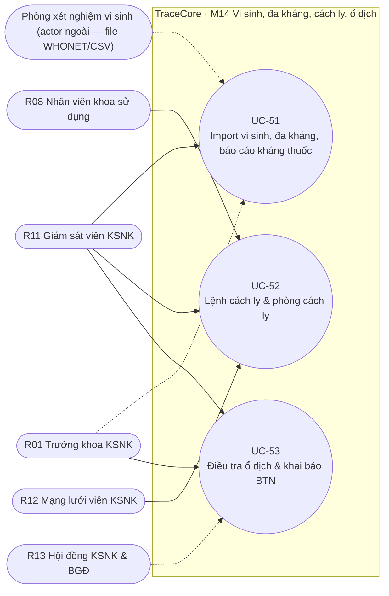

_Nét liền = actor chính (primary); nét đứt = actor phụ (secondary)._

### UC-51: Import kết quả vi sinh (WHONET/CSV), gắn nhãn đa kháng, cảnh báo, báo cáo kháng thuốc [NEW v1.12]

- **ID:** UC-51
- **Actors:** R11 Giám sát viên KSNK (primary); R01 (secondary — duyệt `MDRO Rule`); Phòng xét nghiệm vi sinh (actor ngoài — cung cấp file); R08/R12 (secondary — nhận cảnh báo khoa)
- **Description:** R11 nhập file nuôi cấy + kháng sinh đồ (WHONET hoặc LIS xuất CSV) theo hồ sơ ánh xạ cột; hệ thống kiểm tra từng dòng, bỏ trùng (lab_sample_id, organism), tạo `Microbiology Isolate` với mã BN mã hóa. Khi phòng xét nghiệm không xuất file, R11 nhập tay có xác nhận. Mỗi chủng mới chạy mọi `MDRO Rule` đã duyệt → gắn nhãn đa kháng, đánh dấu chủng đầu tiên mỗi người bệnh–loài trong kỳ; chủng đa kháng mới → thông báo R11, trưởng khoa, mạng lưới viên trong 15 phút với nút "Tạo lệnh cách ly". Người bệnh từng mang đa kháng → nhãn chữ ở M13/M14. Báo cáo kháng thuốc quý: S/I/R theo vi khuẩn–kháng sinh, theo khoa, chỉ trên chủng đầu tiên, kèm cảnh báo cỡ mẫu nhỏ.
- **Preconditions:** Danh mục `Organism` (mã WHONET); hồ sơ ánh xạ cột loại Microbiology (UC-57); `MDRO Rule` đã duyệt (ví dụ MRSA, ESBL, CRE); `Notification Rule` cho sự kiện đa kháng.
- **Postconditions (success):** Import lại cùng file → 0 bản ghi mới; chủng có `mdro_flags`, `is_first_isolate`; cảnh báo đến đúng khoa trong 15 phút; báo cáo quý tính đúng trên chủng đầu tiên; mọi danh sách chỉ hiện mã BN che.
- **Traces to:** FR-M14-01, FR-M14-02, FR-M14-03, FR-M14-04, FR-M14-05, FR-M14-08
- **Business rules:** BRU-MDR-001 (đa kháng chỉ theo quy tắc đã duyệt; đổi quy tắc không gắn lại nhãn kỳ đã khóa), BRU-MDR-002 (thống kê chỉ chủng đầu tiên), BRU-MDR-005 (không thay nghĩa vụ báo cáo của phòng xét nghiệm), BRU-HAI-005
- **Screens:** SCR-59 (Import vi sinh & danh sách chủng, quy tắc đa kháng, báo cáo kháng thuốc); SCR-43 (wizard import)
- **Priority:** Must (FR-M14-05 Should) · Frequency: import hằng ngày/tuần; báo cáo quý.
- **Related NFR:** NFR-PRIV-01, NFR-PRIV-02, NFR-AVAIL-04 (cảnh báo ≤ 15 phút), NFR-MAINT-04 (quy tắc là cấu hình có phiên bản), NFR-PERF-03 (import), NFR-PERF-05

**Main success scenario**
1. R11 mở SCR-59 → Import, chọn file WHONET/CSV và hồ sơ ánh xạ cột đã lưu (lab_sample_id, mã BN, năm sinh, giới, khoa, loại bệnh phẩm, ngày lấy, mã vi khuẩn, kháng sinh/S-I-R/MIC).
2. Hệ thống kiểm tra từng dòng (mã vi khuẩn tồn tại, ngày hợp lệ, mã BN), bỏ dòng trùng (lab_sample_id, organism), hiển thị xem trước: số dòng hợp lệ / lỗi theo số dòng.
3. R11 xác nhận → hệ thống tạo `Microbiology Isolate` (mã BN mã hóa + hash + che, bảng `Isolate Susceptibility`), `source` = Import, gắn `import_batch`.
4. Với mỗi chủng mới, hệ thống chạy mọi `MDRO Rule` đã duyệt (điều kiện R với bất kỳ / tất cả / ≥ n nhóm) → điền `mdro_flags`; đánh dấu `is_first_isolate` cho chủng đầu tiên của (người bệnh–loài) trong kỳ.
5. Chủng đa kháng mới → `core.notification.emit` tới R11, trưởng khoa, mạng lưới viên khoa (≤ 15 phút) kèm `precaution_type` của quy tắc và nút "Tạo lệnh cách ly" điền sẵn (UC-52).
6. Mã BN (so bằng hash) đã từng có chủng đa kháng xuất hiện lại ở M13/M14 → hiển thị nhãn chữ "Đã từng mang vi khuẩn đa kháng".
7. Cuối quý R11/R01 xuất báo cáo kháng thuốc: tỷ lệ S/I/R theo vi khuẩn–kháng sinh và theo khoa trên chủng đầu tiên; tỷ lệ ca NKBV xác định có tác nhân; cặp có n < ngưỡng (mặc định 30) kèm cảnh báo cỡ mẫu nhỏ; đẩy chỉ số sang M9.

**Alternate flows**
- A1. Phòng xét nghiệm không xuất được file → R11 nhập tay chủng và kháng sinh đồ với xác nhận người nhập; `source` = Nhập tay, Audit Log (FR-M14-02).
- A2. R01 tạo/sửa `MDRO Rule` → phiên bản mới `MDR-<code>-V<n>`; chỉ áp dụng cho chủng từ ngày hiệu lực; kỳ đã khóa không gắn lại nhãn.
- A3. Chủng liên kết ca NKBV → R11 gắn vào `HAI Case.isolates` (UC-48).

**Exception flows**
- E1. Dòng thiếu mã vi khuẩn hoặc mã không có trong `Organism` → lỗi theo số dòng, không ghi dòng đó (FR-M14-01).
- E2. Import lại cùng file → 0 bản ghi mới, báo "đã tồn tại".
- E3. Hồ sơ ánh xạ cột có cột họ tên → bỏ qua cột, cảnh báo (NFR-PRIV-01).
- E4. Thông báo email/SMS lỗi → giữ in-app, gửi lại (FR-M9-10.1).

**Open issues:** Phòng xét nghiệm thí điểm xuất được file WHONET không; định dạng cột (OQ-V12-05); nội dung quy tắc đa kháng khởi tạo (OQ-V12-08); ngưỡng cỡ mẫu nhỏ (OQ-V12-09).

_Nguồn: BA v1.12 §7.1 bước 1–2, §7.3 FR-M14-01..05, 08, §7.4; QĐ 3596/QĐ-BYT; QĐ 38. Không có US/TC/API gốc — bước detailed-design bổ sung._

### UC-52: Lệnh cách ly và phòng cách ly theo khoa [NEW v1.12]

- **ID:** UC-52
- **Actors:** R08 Điều dưỡng khoa / R12 Mạng lưới viên (primary — tạo lệnh cách ly khoa mình); R11 Giám sát viên KSNK (primary — kiểm tra tuân thủ, đóng lệnh do đa kháng); R01 (secondary — danh mục phòng cách ly, đóng lệnh); R13 (secondary — xem tỷ lệ khoa có phòng cách ly)
- **Description:** Khoa tạo `Isolation Order` (mã BN mã hóa, khoa, phòng, loại phòng ngừa Tiếp xúc / Giọt bắn / Không khí / Kết hợp, lý do, chủng liên quan); danh sách cách ly đang mở theo khoa hiển thị trên Cổng khoa; R11 kiểm tra tuân thủ bằng phiếu M12; đóng lệnh cần lý do kết thúc, lệnh do đa kháng chỉ R11/R01 đóng. R01 duy trì `Isolation Room` (loại phòng, số giường, đạt chuẩn, ngày kiểm tra); hệ thống tính tỷ lệ khoa lâm sàng có ≥ 1 phòng cách ly đạt điều kiện và liệt kê khoa chưa có.
- **Preconditions:** Department có cờ lâm sàng; `Isolation Room` theo khoa; có cảnh báo đa kháng (UC-51) hoặc ca bệnh truyền nhiễm/nghi nhiễm.
- **Postconditions (success):** Lệnh cách ly có đủ loại phòng ngừa và lý do; danh sách đang mở đúng theo khoa và hiển thị trong việc cần làm Cổng khoa (FR-M9-26); lệnh đóng có `end_reason`; tỷ lệ khoa có phòng cách ly đạt chuẩn tính cho M9 (chỉ tiêu QĐ 38 ≥ 80 %).
- **Traces to:** FR-M14-06, FR-M14-07
- **Business rules:** BRU-MDR-003 (không đóng khi thiếu lý do; lệnh do đa kháng chỉ R11/R01 đóng), BRU-HAI-005
- **Screens:** SCR-60 (Lệnh cách ly & phòng cách ly — WEB + DEPT)
- **Priority:** Must · Frequency: theo ca (hằng ngày ở khoa hồi sức/truyền nhiễm); phòng cách ly kiểm tra định kỳ (UC-54 hạ tầng).
- **Related NFR:** NFR-PRIV-01, NFR-SEC-09 (R12/R08 theo khoa), NFR-USAB-03 (tạo lệnh từ thông báo trên PDA)

**Main success scenario**
1. Từ thông báo đa kháng (UC-51) hoặc chủ động, R08/R12 mở SCR-60 trên Cổng khoa, bấm "Tạo lệnh cách ly": khoa và người bệnh điền sẵn (mã BN che), chọn `isolation_room`, `precaution_type`, `reason` (Vi khuẩn đa kháng / Bệnh truyền nhiễm / Nghi nhiễm), `start_at`.
2. Hệ thống lưu lệnh trạng thái Đang cách ly, hiển thị trong danh sách cách ly đang mở của khoa và trong việc cần làm Cổng khoa.
3. R11 giám sát tuân thủ cách ly bằng phiếu M12 (phòng ngừa theo đường lây) gắn khoa/vị trí (UC-44).
4. Khi đủ điều kiện, R11 (hoặc R08 với lệnh không do đa kháng) đóng lệnh: nhập `end_at`, `end_reason`.
5. R01 duy trì `Isolation Room` (khoa, mã phòng, loại Phòng đơn / Áp lực âm / Phòng nhóm, số giường, `meets_standard`, `checked_on`).
6. Hệ thống tính tỷ lệ khoa lâm sàng có ≥ 1 phòng cách ly đạt điều kiện, liệt kê khoa chưa có trên SCR-60 và đẩy chỉ số sang M9.

**Alternate flows**
- A1. Người bệnh chuyển khoa → đóng lệnh ở khoa cũ với lý do "Chuyển khoa", tạo lệnh mới ở khoa nhận (giữ cùng mã BN hash).
- A2. Phòng cách ly hết chỗ → chọn phòng khác hoặc ghi "Cách ly tại giường" với cảnh báo.
- A3. Kiểm tra phòng cách ly theo phiếu hạ tầng M15 (UC-54) cập nhật `checked_on`, `meets_standard`.

**Exception flows**
- E1. Thiếu `precaution_type` hoặc `reason` → chặn lưu (FR-M14-06).
- E2. R08 đóng lệnh do đa kháng → chặn; chỉ R11/R01 (BRU-MDR-003).
- E3. Đóng lệnh không có `end_reason` → chặn.
- E4. R12 khoa A xem danh sách → không thấy lệnh khoa B.

**Open issues:** Tiêu chí "phòng cách ly đạt điều kiện" cấu hình theo hướng dẫn bệnh viện (OQ-V12-08).

_Nguồn: BA v1.12 §7.1 bước 3, §7.3 FR-M14-06, 07, §7.4; TT 16/2018 Điều 7; QĐ 38. Không có US/TC/API gốc — bước detailed-design bổ sung._

### UC-53: Điều tra ổ dịch và khai báo bệnh truyền nhiễm [NEW v1.12]

- **ID:** UC-53
- **Actors:** R01 Trưởng khoa KSNK (primary — mở/kết thúc điều tra ổ dịch); R11 Giám sát viên KSNK (primary — điều tra, theo dõi khai báo); R12/R08 (secondary — ghi ca bệnh truyền nhiễm của khoa, hành động tại khoa); R13 (secondary — nhận báo cáo)
- **Description:** Khi có cảnh báo cụm ca (UC-50/UC-51) hoặc nghi ngờ, R01 mở `Outbreak Investigation`: gắn ca từ M13/M14 (mã BN che, ngày khởi phát), định nghĩa ca điều tra, đường cong dịch theo ngày khởi phát, hành động qua `Incident CAPA`; chỉ kết thúc khi có tóm tắt và mọi CAPA đã đóng hoặc có lý do. Ca bệnh truyền nhiễm phải khai báo: khoa/R11 ghi `Notifiable Disease Report`; hệ thống tính hạn theo cấu hình nhóm bệnh A/B/C (TT 15/2026, chuyên gia nhập) và nhắc R11, trưởng khoa đến khi ghi `reported_on` và `report_ref` trên hệ thống giám sát quốc gia.
- **Preconditions:** Danh mục bệnh truyền nhiễm với nhóm và thời hạn khai báo (cấu hình, OQ-V12-03); ca NKBV/chủng có sẵn; `Incident CAPA` dùng chung.
- **Postconditions (success):** Ổ dịch có danh sách ca, đường cong dịch, CAPA, tóm tắt và `external_report_ref` khi kết thúc; ca bệnh truyền nhiễm có `due_by` và được nhắc đến khi khai báo xong; số liệu tổng hợp đẩy sang M9 (không dữ liệu cá nhân).
- **Traces to:** FR-M14-09, FR-M14-10
- **Business rules:** BRU-MDR-004 (kết thúc ổ dịch khi có tóm tắt và CAPA đóng/có lý do), BRU-MDR-005 (chỉ theo dõi đã khai báo hay chưa), BRU-HAI-005, BRU-FS-002 (ngộ độc thực phẩm xem như ổ dịch tiềm năng — UC-56)
- **Screens:** SCR-61 (Điều tra ổ dịch — đường cong dịch; khai báo bệnh truyền nhiễm); SCR-15 (NC/CAPA)
- **Priority:** Must · Frequency: ổ dịch theo sự kiện (vài lần/năm); khai báo theo ca.
- **Related NFR:** NFR-PRIV-01, NFR-AVAIL-04, NFR-MAINT-04 (thời hạn nhóm bệnh là cấu hình)

**Main success scenario**
1. R01 mở SCR-61 từ nút "Mở điều tra ổ dịch" của cảnh báo (hoặc tạo mới): tiêu đề, tác nhân/bệnh, khoa liên quan, ngày bắt đầu, định nghĩa ca điều tra.
2. R01/R11 gắn ca: chọn từ `HAI Case` (M13) và `Microbiology Isolate` (M14) hoặc thêm mã BN che + ngày khởi phát; hệ thống vẽ đường cong dịch theo `onset_date`.
3. R11 ghi hành động kiểm soát qua `Incident CAPA` liên kết ổ dịch (cách ly, vệ sinh môi trường, lấy mẫu môi trường M15, đào tạo…); theo dõi trạng thái.
4. Khi kiểm soát được, R01 chuyển Đã kiểm soát; khi mọi CAPA đóng (hoặc có lý do) và có tóm tắt → R01 ghi sổ Kết thúc với `end_date`, `summary`, `external_report_ref`.
5. (Khai báo) R12/R08/R11 ghi `Notifiable Disease Report`: mã BN (mã hóa), bệnh (danh mục, nhóm A/B/C), ngày chẩn đoán, khoa; hệ thống tính `due_by` theo cấu hình nhóm.
6. Scheduler nhắc R11 và trưởng khoa trước và sau hạn đến khi `reported_on` và `report_ref` được ghi.
7. R13 xem báo cáo ổ dịch/khai báo tổng hợp (số ca, thời gian, trạng thái), không dữ liệu cá nhân.

**Alternate flows**
- A1. Ổ dịch bắt nguồn từ sự cố ngộ độc thực phẩm (FR-M17-04) → `Foodborne Event` liên kết `outbreak_investigation`.
- A2. Mẫu môi trường trong điều tra (UC-54) gắn vào CAPA của ổ dịch.
- A3. Cảnh báo cụm ca nhưng R01 quyết định không mở → ghi lý do, cảnh báo đóng.

**Exception flows**
- E1. Kết thúc ổ dịch khi còn CAPA mở không có lý do hoặc thiếu tóm tắt → chặn (FR-M14-09, BRU-MDR-004).
- E2. Nhóm bệnh chưa cấu hình thời hạn → không tính `due_by`, cảnh báo R01/R10 cấu hình (không code cứng).
- E3. Ghi `reported_on` mà thiếu `report_ref` → cảnh báo, nhắc tiếp đến khi đủ.
- E4. Ca gắn vào ổ dịch bị Loại trừ ở M13 → ổ dịch hiển thị nhãn "Ca đã loại trừ", R01 xem xét gỡ.

**Open issues:** TT 54/2015/TT-BYT còn hiệu lực hay thay bằng hướng dẫn Luật Phòng bệnh 2025; thời hạn khai báo nhóm A/B/C (OQ-V12-03).

_Nguồn: BA v1.12 §7.1 bước 4–5, §7.3 FR-M14-09, 10, §7.4; Luật Phòng bệnh 114/2025/QH15; TT 15/2026/TT-BYT. Không có US/TC/API gốc — bước detailed-design bổ sung._

## M15 — Vệ sinh môi trường và cơ sở hạ tầng [NEW v1.12]

Nguồn nghiệp vụ: BA v1.12 §8 (A-113); TT 16/2018/TT-BYT Điều 11; QĐ 3916/QĐ-BYT (vệ sinh môi trường bề mặt); QĐ 38 (chỉ tiêu vệ sinh bề mặt khu nguy cơ cao, giám sát chất lượng vệ sinh, nước sạch, thông khí). Phạm vi: vùng vệ sinh theo mức nguy cơ, phiếu giám sát vệ sinh và kiểm tra hạ tầng dùng engine M12, xét nghiệm môi trường (bề mặt, không khí, nước) so với ngưỡng có phiên bản, kế hoạch lấy mẫu, báo cáo môi trường. `Environment Log` (M9) vẫn dùng cho nhiệt độ/độ ẩm/áp suất khu CSSD. Use case: UC-54. Quy tắc: BRU-ENV-001..003.

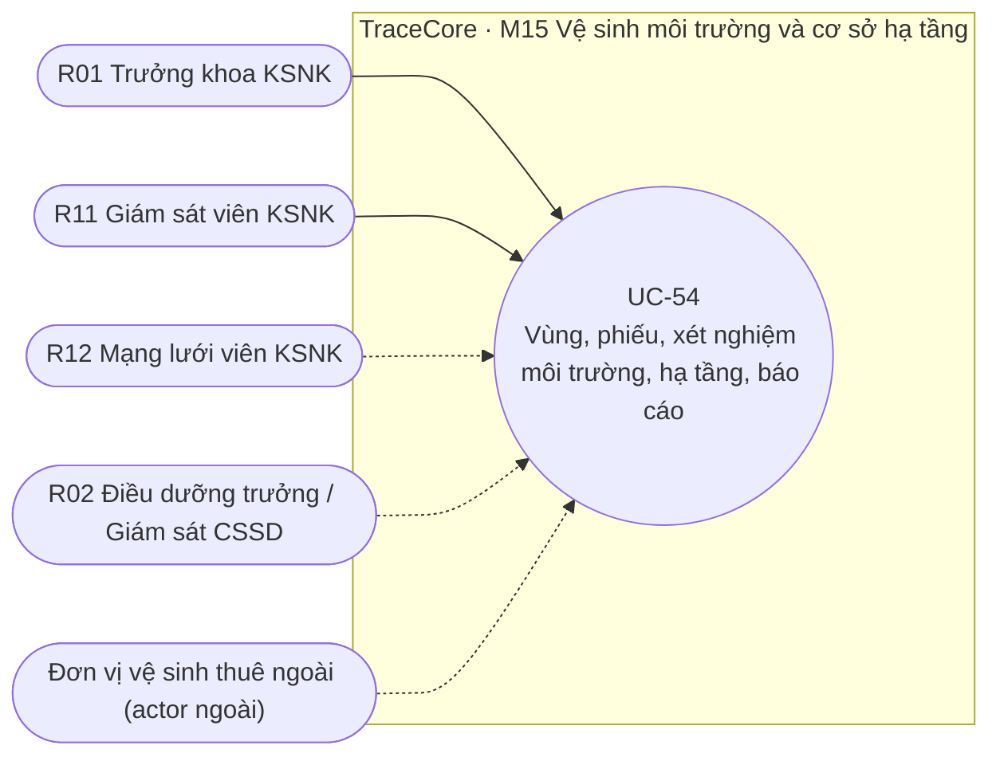

_Nét liền = actor chính (primary); nét đứt = actor phụ (secondary)._

### UC-54: Vệ sinh môi trường: vùng, phiếu, xét nghiệm môi trường, hạ tầng, báo cáo [NEW v1.12]

- **ID:** UC-54
- **Actors:** R01 Trưởng khoa KSNK (primary — vùng, ngưỡng, kế hoạch); R11 Giám sát viên KSNK (primary — phiếu, mẫu, hạ tầng); R12 (secondary — phiếu khoa mình); R02, R13 (secondary — xem); Đơn vị vệ sinh thuê ngoài (actor ngoài — bên chịu trách nhiệm)
- **Description:** R01 khai báo `Environment Zone` (khoa, khu, mức nguy cơ theo QĐ 3916, tần suất, hóa chất, bên chịu trách nhiệm khoa/thuê ngoài, số phiếu tối thiểu/tháng) và duyệt `Environmental Limit` có phiên bản. R11/R12 giám sát vệ sinh bằng phiếu M12 gắn vùng; tỷ lệ đạt tổng hợp theo mức nguy cơ, khoa, bên chịu trách nhiệm. R11 ghi `Environmental Sample` theo `Sampling Plan`; hệ thống so ngưỡng có hiệu lực tại ngày lấy mẫu (bản chụp), Không đạt → thông báo, đề nghị NC loại Environment, việc lấy mẫu lại, cờ vùng đến khi mẫu lại Đạt. Kiểm tra hạ tầng (thông khí, cấp nước, nhà vệ sinh, côn trùng, phòng cách ly) bằng phiếu M12 loại "Cơ sở hạ tầng" có hạn kế tiếp. Báo cáo môi trường tháng/quý gộp giám sát vệ sinh, xét nghiệm, hạ tầng và hóa chất khử khuẩn bề mặt (M12).
- **Preconditions:** Engine phiếu M12 (UC-43) với mẫu "Vệ sinh môi trường bề mặt" và "Cơ sở hạ tầng" đã duyệt; Supplier thuê ngoài (UC-46); Item hóa chất.
- **Postconditions (success):** Vùng thiếu phiếu tối thiểu được liệt kê; mẫu có `limit_applied` bản chụp, `result`; vùng Không đạt mang cờ "Chờ lấy mẫu lại" đến khi mẫu lại Đạt; hạ tầng có `next_due`, nhắc trước 7 ngày; báo cáo PDF/Excel; chỉ số đẩy sang M9.
- **Traces to:** FR-M15-01, FR-M15-02, FR-M15-03, FR-M15-04, FR-M15-05, FR-M15-06, FR-M15-07
- **Business rules:** BRU-ENV-001 (mức nguy cơ quyết định số phiếu tối thiểu; cấu hình theo QĐ 3916), BRU-ENV-002 (ngưỡng theo phiên bản hiệu lực tại ngày lấy mẫu, có `legal_ref`), BRU-ENV-003 (Không đạt bắt buộc lấy mẫu lại; cờ giữ đến khi Đạt), BRU-AUD-001, BRU-AUD-006
- **Screens:** SCR-62 (Vùng vệ sinh, ngưỡng, kế hoạch lấy mẫu, mẫu môi trường, hạ tầng, báo cáo môi trường — WEB); SCR-52 (phiếu vệ sinh/hạ tầng trên PDA)
- **Priority:** Must (FR-M15-05 Should) · Frequency: phiếu theo mức nguy cơ (vùng nguy cơ cao ≥ 4/tháng); lấy mẫu theo kế hoạch (tháng/quý); hạ tầng theo hạn; báo cáo tháng/quý.
- **Related NFR:** NFR-MAINT-04 (ngưỡng, mức nguy cơ là cấu hình có phiên bản), NFR-AVAIL-04, NFR-USAB-03 (phiếu PDA), NFR-PERF-05

**Main success scenario**
1. R01 mở SCR-62, tạo `Environment Zone`: khoa, tên khu, `risk_level`, tần suất vệ sinh, hóa chất (Item), `responsible_party` (Khoa / Đơn vị thuê ngoài + `supplier`), `min_audits_per_month`.
2. R01 duyệt `Environmental Limit` (loại mẫu Bề mặt / Không khí / Nước sinh hoạt / Nước chuyên môn / Khác, phương pháp, thông số, giá trị, đơn vị, mức nguy cơ áp dụng, `legal_ref`, phiên bản, `effective_from`) và lập `Sampling Plan` (loại mẫu, vùng, tần suất, người phụ trách).
3. R11/R12 làm phiếu vệ sinh môi trường gắn `environment_zone` trên PDA (UC-44); ghi sổ → hệ thống tổng hợp tỷ lệ đạt theo mức nguy cơ, khoa và bên chịu trách nhiệm; vùng chưa đủ `min_audits_per_month` vào danh sách thiếu.
4. Đến kỳ kế hoạch lấy mẫu, scheduler giao việc cho người phụ trách và liệt kê mẫu trễ hạn; R11 ghi `Environmental Sample` (vùng, loại, phương thức, ngày, người lấy, phòng xét nghiệm, kết quả, tệp).
5. Hệ thống so với ngưỡng có hiệu lực tại `sampled_on`, lưu `limit_applied` (bản chụp), `result` Đạt / Không đạt.
6. Mẫu Không đạt → thông báo R01, R11 và bên chịu trách nhiệm; đề nghị mở NC loại Environment; tạo việc lấy mẫu lại (`is_resample_of`); gắn cờ vùng "Chờ lấy mẫu lại" đến khi mẫu lại Đạt.
7. R11 làm phiếu kiểm tra hạ tầng (mẫu loại "Cơ sở hạ tầng"); ghi sổ → lưu `next_due`, nhắc trước 7 ngày; hệ thống tính tỷ lệ hệ thống thông khí, nguồn nước được kiểm tra đúng hạn.
8. Cuối tháng/quý R01 xuất báo cáo môi trường (PDF/Excel) gộp giám sát vệ sinh, xét nghiệm, hạ tầng, lượng hóa chất khử khuẩn bề mặt từ M12; chỉ số đẩy sang M9.

**Alternate flows**
- A1. Mẫu thực phẩm (M17, FR-M17-03) xử lý như mẫu môi trường với `sample_type` = Thực phẩm.
- A2. Vùng do đơn vị thuê ngoài chịu trách nhiệm → kết quả tách theo `supplier` trên báo cáo; giấy phép hết hạn chỉ cảnh báo (UC-46).
- A3. Lấy mẫu phục vụ điều tra ổ dịch (UC-53) → mẫu gắn CAPA của ổ dịch.
- A4. Phòng cách ly kiểm tra bằng phiếu hạ tầng → cập nhật `Isolation Room.checked_on`, `meets_standard` (UC-52).

**Exception flows**
- E1. Vùng thiếu `risk_level` hoặc `responsible_party` → chặn lưu (FR-M15-01).
- E2. Đổi ngưỡng sau ngày lấy mẫu → kết quả mẫu cũ không đổi (FR-M15-03, BRU-ENV-002).
- E3. Mẫu quá hạn kế hoạch 7 ngày → nhắc R01 (FR-M15-05).
- E4. Hệ thống hạ tầng quá hạn kiểm tra → không tính "đúng hạn" (FR-M15-06).
- E5. Mẫu lại vẫn Không đạt → NC giữ mở, tạo tiếp việc lấy mẫu lại, cờ vùng giữ nguyên.

**Open issues:** Danh sách mức nguy cơ và tần suất mặc định; ngưỡng môi trường khởi tạo do chuyên gia soạn (OQ-V12-08, OQ-V12-09).

_Nguồn: BA v1.12 §8.1 bước 1–4, §8.3 FR-M15-01..07, §8.4; TT 16/2018 Điều 11; QĐ 3916; QĐ 38. Không có US/TC/API gốc — bước detailed-design bổ sung._

## M16 — An toàn nghề nghiệp [NEW v1.12]

Nguồn nghiệp vụ: BA v1.12 §9 (A-113); TT 16/2018/TT-BYT Điều 13; QĐ 3671/QĐ-BYT (phòng ngừa chuẩn, tiêm an toàn). Phạm vi: báo cáo và theo dõi phơi nhiễm nghề nghiệp của nhân viên y tế (nối tiếp FR-M10-06.1 phơi nhiễm vật sắc nhọn từ chất thải, qua hook), tiêm chủng nhân viên có nguy cơ (thay trường tiêm chủng đơn lẻ của FR-M4-01), cảnh báo thuốc dự phòng sau phơi nhiễm. **Nguyên tắc riêng tư:** không lưu kết quả xét nghiệm hay chẩn đoán của nhân viên; chỉ lưu sự việc, các bước đã làm và ngày làm (BRU-OCC-001). Use case: UC-55. Quy tắc: BRU-OCC-001..004.

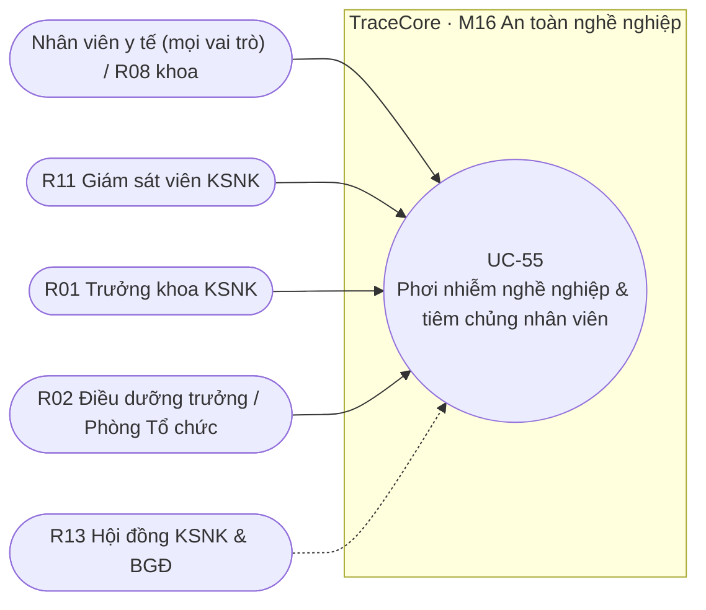

_Nét liền = actor chính (primary); nét đứt = actor phụ (secondary)._

### UC-55: Báo cáo và theo dõi phơi nhiễm nghề nghiệp; tiêm chủng nhân viên [NEW v1.12]

- **ID:** UC-55
- **Actors:** Nhân viên y tế bị phơi nhiễm / R08 khoa (primary — báo cáo ban đầu); R11 Giám sát viên KSNK (primary — xử trí, theo dõi); R01 (primary — cấu hình mẫu theo dõi, ngưỡng, xem); R02 / Phòng Tổ chức (primary — tiêm chủng); R13 (secondary — số liệu tổng hợp)
- **Description:** Nhân viên hoặc khoa báo phơi nhiễm trên PDA/Cổng khoa trong ≤ 3 bước (hoặc tự tạo từ sự cố chất thải M10 qua hook, không trùng); hệ thống báo ngay R01, R11 (≤ 1 phút) và hiển thị quy trình xử trí ban đầu (`IC Procedure Document`). R11 ghi sơ cứu, nguồn phơi nhiễm (mã BN nguồn mã hóa), chỉ định dự phòng và thời điểm bắt đầu; hệ thống sinh lịch theo dõi từ `Exposure Follow-up Template` theo loại, nhắc trước mỗi bước 3 ngày; tính thời gian phơi nhiễm → báo cáo → bắt đầu dự phòng và gắn cờ vượt ngưỡng. Hồ sơ chỉ R01, R11 và chính nhân viên xem; không trường kết quả xét nghiệm/chẩn đoán. Tiêm chủng: R02 ghi `Staff Immunization`; hệ thống tính `next_due`, nhắc, tính tỷ lệ bao phủ theo `Immunization Requirement`; cảnh báo R01 khi tồn thuốc dự phòng thấp hoặc lô sắp hết hạn (đọc từ ERPNext Stock).
- **Preconditions:** `Exposure Follow-up Template` theo loại phơi nhiễm và `Immunization Requirement` đã duyệt (R01); Item thuốc dự phòng đánh dấu; `IC Procedure Document` quy trình xử trí phơi nhiễm; hook `tracecore_exposure_incident` đăng ký (M10 → M16).
- **Postconditions (success):** Mỗi sự cố có đúng một `Occupational Exposure`; thông báo R11 ≤ 1 phút; lịch theo dõi đầy đủ với nhắc; hồ sơ bị giới hạn quyền xem; báo cáo kỳ không có tên nhân viên; tỷ lệ bao phủ vaccine theo nhóm nguy cơ; NC (nếu có) không chứa thông tin sức khỏe.
- **Traces to:** FR-M16-01, FR-M16-02, FR-M16-03, FR-M16-04, FR-M16-05, FR-M16-06, FR-M16-07, FR-M16-08, FR-M16-09
- **Business rules:** BRU-OCC-001 (không lưu kết quả xét nghiệm/chẩn đoán), BRU-OCC-002 (một sự cố = một hồ sơ, dù từ M10 hay M16), BRU-OCC-003 (chỉ R01, R11 và chính nhân viên xem; NC không chứa thông tin sức khỏe), BRU-OCC-004 (danh mục vaccine và bước theo dõi là cấu hình do R01 duyệt)
- **Screens:** SCR-63 (PDA/DEPT — Báo phơi nhiễm ≤ 3 bước); SCR-64 (Hồ sơ phơi nhiễm & theo dõi; tiêm chủng nhân viên; báo cáo phơi nhiễm — WEB); SCR-15 (NC)
- **Priority:** Must (FR-M16-08 Should) · Frequency: phơi nhiễm theo sự kiện (vài chục/năm); tiêm chủng theo lịch; báo cáo quý/năm.
- **Related NFR:** NFR-PRIV-01 (dữ liệu sức khỏe nhân viên là nhạy cảm; không lưu kết quả), NFR-PRIV-02 (thời hạn lưu), NFR-SEC-09, NFR-USAB-03 (≤ 3 bước trên PDA), NFR-AVAIL-05 (báo phơi nhiễm offline), NFR-AVAIL-04 (≤ 1 phút)

**Main success scenario**
1. Nhân viên (hoặc R08 thay mặt) mở SCR-63 trên PDA/Cổng khoa: bước 1 loại phơi nhiễm (Kim tiêm–vật sắc nhọn / Bắn máu–dịch vào niêm mạc / Da không lành / Hô hấp / Khác) và thời điểm; bước 2 hoạt động, thiết bị, nguồn đã biết? (mã BN nguồn → mã hóa); bước 3 xác nhận → gửi `tracecore.v1.exposure.report` (`@idempotent`).
2. Hệ thống tạo `Occupational Exposure` (`reported_at`), thông báo ngay R01, R11 qua `core.notification` (≤ 1 phút) và hiển thị quy trình xử trí ban đầu của bệnh viện.
3. R11 mở SCR-64, ghi `first_aid_done`, `prophylaxis` (Có / Không chỉ định / Từ chối), `prophylaxis_started_at`; hệ thống tính thời gian phơi nhiễm → báo cáo và → bắt đầu dự phòng, gắn cờ nếu vượt ngưỡng giờ R01 cấu hình.
4. Hệ thống sinh bảng `Exposure Follow-up` từ template theo loại (bước, hạn = ngày + `days_after`); nhắc nhân viên và R11 trước mỗi bước 3 ngày; bước quá hạn chưa `done_on` → nhắc hằng ngày tối đa 7 lần.
5. R11 ghi `done_on` từng bước; đủ bước → `status` Hoàn thành theo dõi.
6. Nếu nguyên nhân là quy trình/thiết bị, R11 mở `Incident CAPA` loại Occupational Exposure chỉ mô tả nguyên nhân quy trình (không thông tin sức khỏe).
7. (Tiêm chủng) R02 ghi `Staff Immunization` (nhân viên, vaccine, mũi số, ngày tiêm, bằng chứng); hệ thống tính `next_due`, nhắc nhân viên và R02 đến hạn (cơ chế FR-M4-01.4), tính tỷ lệ bao phủ từng vaccine trong nhóm nguy cơ theo `Immunization Requirement` (nhân viên nghỉ việc không tính).
8. Cuối kỳ R01/R11 xuất báo cáo phơi nhiễm: theo loại, khoa, nghề nghiệp, thiết bị gây phơi nhiễm, tỷ lệ báo cáo đúng hạn, tỷ lệ hoàn thành theo dõi — không có tên nhân viên; chỉ số đẩy sang M9.

**Alternate flows**
- A1. Sự cố chất thải loại phơi nhiễm vật sắc nhọn ghi ở M10 (FR-M10-06.1) → hook tạo `Occupational Exposure` liên kết `incident_capa`; ghi lại cùng sự cố → vẫn một hồ sơ (FR-M16-02).
- A2. PDA mất mạng → báo cáo ban đầu xếp hàng cục bộ, gửi khi có mạng; thông báo tính từ lúc server nhận.
- A3. Tồn kho Item thuốc dự phòng < mức tối thiểu hoặc lô ≤ 30 ngày hạn → cảnh báo R01 (đọc ERPNext Stock, không nhập lại).
- A4. Nhân viên tự xem hồ sơ phơi nhiễm của mình trên Cổng khoa/Desk.

**Exception flows**
- E1. R02 hoặc R13 mở danh sách phơi nhiễm → không thấy bản ghi cá nhân, chỉ số liệu tổng hợp (FR-M16-05).
- E2. Mã BN nguồn luôn che; không có trường kết quả xét nghiệm/chẩn đoán để nhập (FR-M16-06, kiểm tra JSON DocType bằng test).
- E3. Thời gian đến báo cáo hoặc đến dự phòng vượt ngưỡng → cờ hiển thị bằng chữ, đưa vào báo cáo "không đúng hạn".
- E4. Template theo dõi chưa có cho loại phơi nhiễm → không sinh lịch, cảnh báo R01 cấu hình.
- E5. NC chứa nội dung sức khỏe → chặn bởi quy tắc nhập (chỉ mục nguyên nhân quy trình).

**Open issues:** Ai xử trí và theo dõi phơi nhiễm (R11 hay khoa khác), có cần vai trò riêng (OQ-V12-06); ngưỡng giờ báo cáo (OQ-V12-09); thời hạn lưu (OQ-V12-07).

_Nguồn: BA v1.12 §9.1 bước 1–5, §9.3 FR-M16-01..09, §9.4; TT 16/2018 Điều 13; QĐ 3671; NĐ 356/2025/NĐ-CP. Không có US/TC/API gốc — bước detailed-design bổ sung._

## M17 — An toàn thực phẩm và tư vấn người bệnh [NEW v1.12]

Nguồn nghiệp vụ: BA v1.12 §10 (A-113); TT 16/2018/TT-BYT Điều 12, 25; Luật An toàn thực phẩm 55/2010/QH12. Phạm vi: module nhỏ tận dụng M12 (phiếu loại "An toàn thực phẩm" gắn đơn vị suất ăn) và M15 (mẫu thực phẩm xử lý như mẫu môi trường): sức khỏe người chế biến (chỉ Đủ/Không đủ), sự cố nghi ngộ độc, buổi truyền thông KSNK cho người bệnh/người nhà, tài liệu truyền thông có QR. Use case: UC-56. Quy tắc: BRU-FS-001..002.

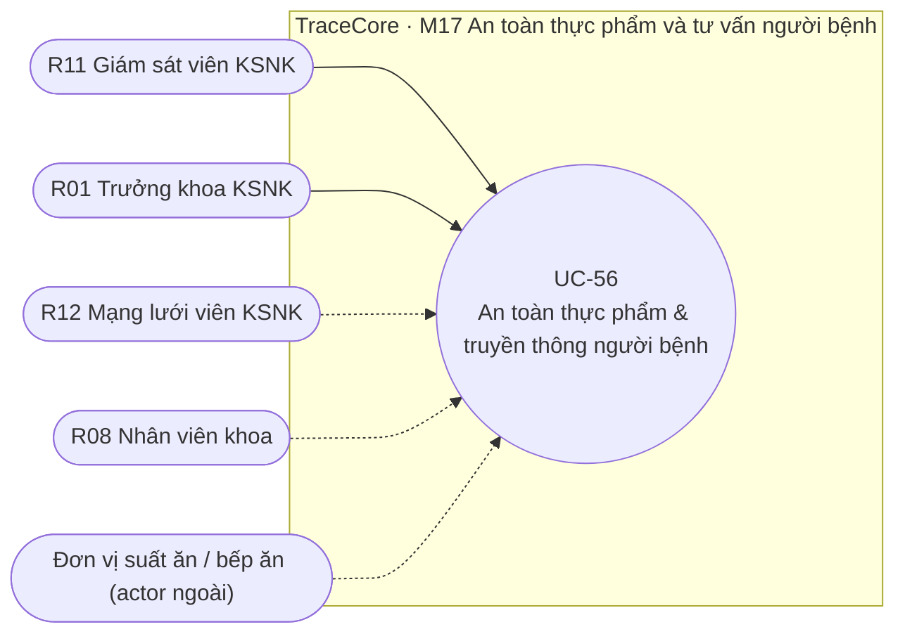

_Nét liền = actor chính (primary); nét đứt = actor phụ (secondary)._

### UC-56: An toàn thực phẩm và truyền thông người bệnh [NEW v1.12]

- **ID:** UC-56
- **Actors:** R11 Giám sát viên KSNK (primary — giám sát bếp ăn, sức khỏe người chế biến, mẫu thực phẩm, sự cố); R01 (primary — ban hành tài liệu truyền thông, ngưỡng); R12/R08 (secondary — ghi buổi truyền thông của khoa); Đơn vị suất ăn/bếp ăn (actor ngoài)
- **Description:** R11 giám sát bếp ăn hoặc đơn vị suất ăn bằng phiếu M12 loại "An toàn thực phẩm" gắn `supplier`; theo dõi `Food Handler Health Check` (chỉ Đủ/Không đủ và hạn), nhắc còn 30 ngày/quá hạn; ghi mẫu thực phẩm như mẫu môi trường M15; ghi `Foodborne Event` → báo ngay R01, R11, đề nghị NC, vượt ngưỡng số người → đề nghị điều tra ổ dịch M14. Khoa ghi `IC Education Session` (đối tượng, chủ đề, số người) tổng hợp theo quý; R01 ban hành tài liệu truyền thông (`IC Procedure Document` loại Tài liệu truyền thông) với mã QR trỏ tới bản hiện hành.
- **Preconditions:** Mẫu phiếu "An toàn thực phẩm" đã duyệt (UC-43); Supplier loại Suất ăn (UC-46); `Environmental Limit` cho `sample_type` = Thực phẩm (UC-54); ngưỡng số người bị ảnh hưởng do R01 đặt.
- **Postconditions (success):** Kết quả giám sát gắn đơn vị cung cấp; người chế biến quá hạn khám được liệt kê theo đơn vị; mẫu thực phẩm có kết quả so ngưỡng; sự cố ngộ độc có NC và (khi vượt ngưỡng) ổ dịch liên kết; buổi truyền thông tổng hợp quý; QR tài liệu luôn trỏ bản mới nhất.
- **Traces to:** FR-M17-01, FR-M17-02, FR-M17-03, FR-M17-04, FR-M17-05, FR-M17-06
- **Business rules:** BRU-FS-001 (hồ sơ sức khỏe người chế biến chỉ lưu kết luận Đủ/Không đủ và hạn), BRU-FS-002 (ngộ độc luôn xem xét như ổ dịch tiềm năng theo ngưỡng), BRU-AUD-001, BRU-ENV-002, BRU-ENV-003, BRU-AUD-006
- **Screens:** SCR-65 (An toàn thực phẩm — sức khỏe người chế biến, sự cố; truyền thông người bệnh với QR — WEB); SCR-52 (phiếu ATTP trên PDA); SCR-62 (mẫu thực phẩm); SCR-61 (ổ dịch)
- **Priority:** Should (FR-M17-01..04); Could (FR-M17-05, 06) · Frequency: giám sát bếp ăn tháng/quý; khám sức khỏe người chế biến theo hạn (năm); truyền thông theo buổi; sự cố theo sự kiện.
- **Related NFR:** NFR-PRIV-01 (không lưu chẩn đoán người chế biến), NFR-AVAIL-04, NFR-MAINT-04

**Main success scenario**
1. R11 mở phiếu loại "An toàn thực phẩm" trên PDA (SCR-52), chọn `supplier` (đơn vị suất ăn) hoặc bếp ăn bệnh viện, chấm các mục; ghi sổ → kết quả gắn đơn vị cung cấp, phản hồi theo UC-45.
2. R11 ghi `Food Handler Health Check` cho từng người chế biến (họ tên, `supplier` hoặc `employee`, ngày khám, hạn kế tiếp, `fit_for_work` Đủ/Không đủ, bằng chứng); scheduler nhắc R11 khi còn 30 ngày hoặc quá hạn và liệt kê theo đơn vị trên SCR-65.
3. R11 ghi mẫu thực phẩm như `Environmental Sample` với `sample_type` = Thực phẩm (SCR-62): so ngưỡng, cờ, lấy mẫu lại (dùng chung FR-M15-03, FR-M15-04).
4. Khi nghi ngộ độc, R11 ghi `Foodborne Event` (ngày, địa điểm, số người bị ảnh hưởng, thực phẩm nghi ngờ, đơn vị); hệ thống báo ngay R01, R11, đề nghị mở NC; `affected_count` ≥ ngưỡng → đề nghị mở `Outbreak Investigation` (UC-53), liên kết hai chiều.
5. Khoa (R12/R08) ghi `IC Education Session` (ngày, đối tượng Người bệnh / Người nhà / Nhân viên / Người chế biến / Sinh viên, chủ đề theo nhóm biện pháp, khoa, số người, tài liệu); hệ thống tổng hợp quý theo đối tượng–chủ đề.
6. R01 ban hành tài liệu truyền thông (`IC Procedure Document` loại Tài liệu truyền thông, có phiên bản); hệ thống sinh mã QR trỏ tới bản hiện hành để in dán tại khoa; phiên bản mới → QR cũ vẫn trỏ bản mới nhất.

**Alternate flows**
- A1. Bếp ăn do bệnh viện tự vận hành → giám sát gắn khoa Dinh dưỡng thay `supplier`.
- A2. Sự cố ngộ độc được cơ quan bên ngoài điều tra → ghi `reported_ref`, ổ dịch kết thúc theo UC-53.
- A3. Người chế biến thuộc đơn vị thuê ngoài → theo dõi theo `supplier`; giấy phép đơn vị theo UC-46.

**Exception flows**
- E1. Nhập chẩn đoán/kết quả xét nghiệm vào hồ sơ người chế biến → không có trường; chỉ Đủ/Không đủ (BRU-FS-001).
- E2. Ngưỡng số người chưa đặt → chỉ đề nghị NC, không đề nghị ổ dịch; nhắc R01 cấu hình.
- E3. Người chế biến `fit_for_work` = Không đủ → nhãn chữ trên danh sách, nhắc đơn vị; không chặn giao dịch (quyết định thuộc bệnh viện).
- E4. QR được quét khi tài liệu đã thu hồi (không bản hiện hành) → trang thông báo "Tài liệu đã thu hồi".

**Open issues:** Nội dung mẫu phiếu ATTP khởi tạo do chuyên gia soạn (OQ-V12-08); ngưỡng số người bị ảnh hưởng (OQ-V12-09).

_Nguồn: BA v1.12 §10.2 FR-M17-01..06; TT 16/2018 Điều 12, 25; Luật ATTP 2010. Không có US/TC/API gốc — bước detailed-design bổ sung._

## M9 mở rộng — Bảng chỉ số KSNK toàn viện, báo cáo, nhập dữ liệu ngoài [NEW v1.12]

Nguồn nghiệp vụ: BA v1.12 §11 (A-113); TT 16/2018/TT-BYT Điều 17, 20 (báo cáo Giám đốc, Hội đồng); QĐ 38 (chỉ tiêu, ứng dụng công nghệ). Phạm vi: engine chỉ số dùng chung cho M11–M17 (`IC Indicator`, `IC Indicator Value`, hook `tracecore_ic_indicators`), bảng chỉ số cho Hội đồng và khoa, báo cáo tháng một trang, Cổng khoa, tự đánh giá QĐ 38, nhập file có hồ sơ ánh xạ cột thay tích hợp HIS/LIS (D3), gói xuất hồ sơ KSNK. Use case: UC-57 (bổ sung UC-32, UC-33, UC-38, UC-39 hiện có). Quy tắc: BRU-RPT-001..003.

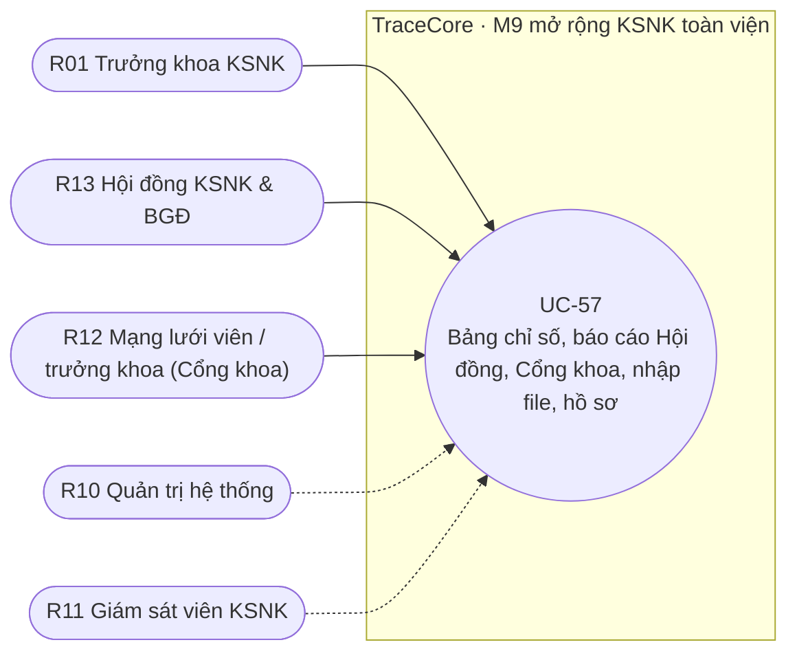

_Nét liền = actor chính (primary); nét đứt = actor phụ (secondary)._

### UC-57: Bảng chỉ số KSNK toàn viện, báo cáo Hội đồng, Cổng khoa, tự đánh giá QĐ 38, nhập file ngoài, xuất hồ sơ [NEW v1.12]

- **ID:** UC-57
- **Actors:** R01 Trưởng khoa KSNK (primary — khóa kỳ, tự đánh giá, xuất hồ sơ); R13 Hội đồng KSNK & BGĐ (primary — xem bảng chỉ số, nhận báo cáo tháng); R12 / trưởng khoa (primary — Cổng khoa); R10 Quản trị (secondary — hồ sơ ánh xạ cột, import); R11 (secondary — import)
- **Description:** Khi kỳ báo cáo khóa (UC-48), hệ thống tính và lưu `IC Indicator Value` cho mọi `IC Indicator` theo khoa và toàn viện (hàm tính đăng ký qua hook từ M11–M17, M12, M13), đánh dấu `locked`. R01/R13 mở bảng chỉ số: từng chỉ số của kế hoạch năm với giá trị kỳ gần nhất, mục tiêu, xu hướng 12 tháng, cỡ mẫu, lọc theo khoa. Ngày làm việc thứ 5 mỗi tháng, hệ thống sinh báo cáo một trang PDF cho Hội đồng từ kỳ đã khóa và thông báo R01, R13. Cổng khoa hiển thị chỉ số khoa mình cạnh trung bình toàn viện và việc cần làm (phiếu chưa làm, mẫu số thiếu, cách ly đang mở). R11/R10 nhập file (mẫu số, phẫu thuật, vi sinh, hóa chất) qua hồ sơ ánh xạ cột (`Import Mapping Profile`), nhập lại không trùng, báo lỗi theo dòng. R01 lập tự đánh giá năm theo QĐ 38 với phần tính được điền sẵn; xuất gói hồ sơ KSNK (PDF + Excel) cho đoàn kiểm tra với mã BN che.
- **Preconditions:** Danh mục `IC Indicator` (mã, nhóm biện pháp 14 nhóm, loại, hàm tính, tần suất, chỉ tiêu quốc gia, `target_ref`); kế hoạch năm (UC-41); kỳ báo cáo và cơ chế khóa (UC-48); Import Batch (FR-M9-11) mở rộng loại import; Notification Rule.
- **Postconditions (success):** `IC Indicator Value` bất biến sau khóa, chỉ tính lại khi R01 mở khóa có lý do; bảng chỉ số đọc từ giá trị đã lưu (≤ 3 giây với 24 tháng dữ liệu BV 1.000 giường); báo cáo tháng không dữ liệu cá nhân; R12 không xem chi tiết khoa khác; import 500 dòng có 3 dòng lỗi → 497 ghi, 3 báo lỗi; tự đánh giá ghi rõ nguồn Tự động / Thủ công; gói xuất không có dữ liệu cá nhân rõ.
- **Traces to:** FR-M9-24, FR-M9-25, FR-M9-26, FR-M9-27, FR-M9-28, FR-M9-29, FR-M9-30
- **Business rules:** BRU-RPT-001 (mẫu số 0 → "Không tính"), BRU-RPT-002 (báo cáo cho R13 và file ra ngoài chỉ số liệu tổng hợp/mã che), BRU-RPT-003 (giá trị đã khóa chỉ đổi khi mở khóa có lý do), BRU-ID-006 (import không nhập tay mã hệ thống sinh)
- **Screens:** SCR-66 (Bảng chỉ số KSNK; báo cáo Hội đồng; view Cổng khoa; tự đánh giá QĐ 38; nhập file & hồ sơ ánh xạ cột; gói hồ sơ KSNK — WEB + DEPT); SCR-43 (wizard import/export hiện có); SCR-42 (thông báo)
- **Priority:** Must (FR-M9-24..28); Should (FR-M9-29); Could (FR-M9-30) · Frequency: tính giá trị khi khóa kỳ (tháng); báo cáo tháng; Cổng khoa hằng ngày; import theo nguồn (ngày/tuần/tháng); tự đánh giá năm; gói hồ sơ theo đoàn kiểm tra.
- **Related NFR:** NFR-PERF-05 (bảng ≤ 3 giây, đọc từ `IC Indicator Value`), NFR-PRIV-01, NFR-SEC-09, NFR-PORT-02, NFR-COMP-01, NFR-PERF-03, NFR-AVAIL-04

**Main success scenario**
1. R10/R01 duy trì `IC Indicator` (mã, tên, `measure_group`, `kind` Tỷ lệ % / Tỷ suất ‰ / Số đếm, `source_method` — hàm do module đăng ký qua hook `tracecore_ic_indicators`, tần suất, `national_target`, `target_ref`).
2. R01 khóa kỳ tháng (UC-48) → hệ thống gọi hàm tính của từng module, lưu `IC Indicator Value` (chỉ số, kỳ, khoa hoặc toàn viện, tử số, mẫu số, giá trị, ghi chú cỡ mẫu, `computed_on`, `locked` = 1).
3. R01/R13 mở SCR-66 → bảng chỉ số: từng chỉ số của `IC Annual Plan` năm hiện hành với giá trị kỳ gần nhất, mục tiêu, trạng thái Đạt / Chưa đạt bằng chữ, xu hướng 12 tháng, cỡ mẫu; lọc theo khoa; số liệu đọc từ `IC Indicator Value` qua `tracecore.v1.indicator.values` (chỉ đọc).
4. Ngày làm việc thứ 5 mỗi tháng (cấu hình), scheduler sinh báo cáo một trang PDF cho Hội đồng từ kỳ đã khóa (chỉ số, so mục tiêu, xu hướng, việc nổi bật) và thông báo R01, R13 (SCR-42).
5. Trưởng khoa/R12 mở Cổng khoa (SCR-66 view DEPT) → chỉ số của khoa mình cạnh trung bình toàn viện; danh sách việc cần làm: phiếu chưa làm (UC-43), mẫu số thiếu (UC-47), cách ly đang mở (UC-52), theo dõi phơi nhiễm (UC-55).
6. R11/R10 nhập file (mẫu số ngày, danh sách phẫu thuật, vi sinh, hóa chất) qua SCR-43: chọn loại import và `Import Mapping Profile` đã lưu (hoặc tạo mới bằng cách ánh xạ cột file → trường); hệ thống kiểm tra từng dòng, nhập lại cùng file không tạo trùng, trả báo cáo lỗi theo số dòng; dòng hợp lệ ghi vào M13/M14/M12.
7. Cuối năm R01 lập tự đánh giá theo QĐ 38 (SCR-66): hệ thống điền sẵn trạng thái chỉ tiêu tính được (kế hoạch, đào tạo, báo cáo NKVM, hồi sức, kháng thuốc, phòng cách ly, hóa chất) với nguồn "Tự động"; R01 đánh giá tay phần còn lại ("Thủ công"); lưu theo năm.
8. Khi có đoàn kiểm tra, R01 chọn kỳ → hệ thống xuất gói PDF + Excel (kế hoạch, biên bản Hội đồng, kết quả giám sát, chỉ số, đào tạo) với mã BN che, dấu thời gian, checksum (cùng cơ chế FR-M9-12).

**Alternate flows**
- A1. Kỳ chưa khóa khi đến ngày sinh báo cáo → báo cáo mang dấu "Tạm" từ giá trị tạm tính; khi khóa, sinh lại bản chính thức.
- A2. R01 mở khóa kỳ có lý do, sửa dữ liệu nguồn, khóa lại → giá trị tính lại, Audit Log ghi giá trị trước/sau (FR-M9-27).
- A3. Dashboard CSSD hiện có (FR-M9-01, SCR-32) giữ nguyên; bảng chỉ số KSNK là màn riêng.
- A4. Xuất > 50.000 dòng → chạy nền, thông báo khi xong (như UC-39 E4).
- A5. Nếu D3 được mở sau này (FEAT-074) → API `tracecore.v1` nhận mẫu số/vi sinh thay file; không thuộc v1.12.

**Exception flows**
- E1. Chỉ số có mẫu số 0 → hiển thị "Không tính", không ghi 0 (BRU-RPT-001).
- E2. Dữ liệu nguồn hoặc ngưỡng đổi sau khóa → giá trị đã khóa không đổi (FR-M9-27, BRU-RPT-003).
- E3. R12 khoa A truy cập chỉ số chi tiết khoa B → từ chối (FR-M9-26).
- E4. File import sai mẫu / hồ sơ ánh xạ thiếu cột bắt buộc → từ chối, chỉ rõ cột thiếu; dòng chứa họ tên người bệnh → bỏ cột, cảnh báo (NFR-PRIV-01).
- E5. Báo cáo Hội đồng hoặc gói hồ sơ phát hiện mã BN rõ → test tự động chặn xuất (NFR-PRIV-01).
- E6. Bảng chỉ số vượt 3 giây → vi phạm NFR-PERF-05 (test hiệu năng với dữ liệu sinh giả, BV 1.000 giường, 24 tháng).

**Open issues:** Định dạng cột file HIS/WHONET của bệnh viện thí điểm (OQ-V12-05); mẫu báo cáo cơ quan quản lý (OQ-V12-02); mở D3 tích hợp HIS/LIS là quyết định riêng của chủ đầu tư.

_Nguồn: BA v1.12 §11.2 FR-M9-24..30, §11.1; TT 16/2018 Điều 17, 20; QĐ 38. Không có US/TC/API gốc — bước detailed-design bổ sung._

## Phụ lục A — Ma trận UC → FR

| UC | Tên | Phân hệ | Actor chính | Traces to (FR) | Screens |
| :-- | :-- | :-- | :-- | :-- | :-- |
| UC-01 | Quản lý danh mục dụng cụ đơn lẻ | M1 | R02 | FR-M1-01, FR-M1-02, FR-M1-09 | SCR-01 |
| UC-02 | Quản lý bộ dụng cụ và cấu trúc BOM | M1 | R02 | FR-M1-03, FR-M1-04 | SCR-02 |
| UC-03 | Cấp Set ID vĩnh viễn và in thẻ định danh | M1 | R02 | FR-M1-05, FR-M1-06 | SCR-03 |
| UC-04 | Quản lý dụng cụ mượn (loaner) | M1 | R02 | FR-M1-07, FR-M1-08 | SCR-04 |
| UC-05 | Tiếp nhận đồ bẩn tại khu bẩn | M2 | R03 | FR-M2-01, FR-M2-02, FR-M2-23 | SCR-05, SCR-34 |
| UC-06 | Làm sạch – khử khuẩn và lô rửa | M2 | R03 | FR-M2-03, FR-M2-24, FR-M2-25, FR-M2-04 | SCR-06 |
| UC-07 | Kiểm tra – lắp ráp theo BOM | M2 | R04 | FR-M2-05, FR-M2-06 | SCR-07 |
| UC-08 | Đóng gói và sinh Cycle ID | M2 | R04 | FR-M2-07, FR-M2-08 | SCR-08 |
| UC-09 | Tạo và vận hành mẻ tiệt khuẩn | M2 | R05 | FR-M2-09, FR-M2-10 | SCR-09, SCR-35 |
| UC-10 | Giải phóng mẻ và cách ly chờ chỉ thị sinh học | M2 | R02 | FR-M2-11, FR-M2-12 | SCR-10 |
| UC-11 | Nhập và quản lý kho vô khuẩn | M2 | R06 | FR-M2-13, FR-M2-14 | SCR-11 |
| UC-12 | Cấp phát bộ dụng cụ cho khoa | M2 | R06 | FR-M2-15, FR-M2-16 | SCR-12, SCR-36 |
| UC-13 | Quét sử dụng cho bệnh nhân | M2 | R08 | FR-M2-17, FR-M2-18 | SCR-13, SCR-37 |
| UC-14 | Truy xuất nguồn gốc và thu hồi | M2 | R02 | FR-M2-19, FR-M2-20 | SCR-14 |
| UC-15 | Ghi nhận sự cố, không phù hợp và CAPA | M2 | R02 | FR-M2-21, FR-M2-22 | SCR-15 |
| UC-16 | Thu gom đồ vải theo khoa | M3 | R07 | FR-M3-01, FR-M3-02 | SCR-16 |
| UC-17 | Tạo lô giặt | M3 | R07 | FR-M3-03, FR-M3-04 | SCR-17 |
| UC-18 | Cấp phát đồ vải và đối chiếu thu – trả | M3 | R07 | FR-M3-05, FR-M3-06 | SCR-18 |
| UC-19 | Quản lý hồ sơ nhân sự và chứng chỉ | M4 | R02 | FR-M4-01, FR-M4-02 | SCR-19 |
| UC-20 | Ma trận năng lực và phân ca | M4 | R02 | FR-M4-03, FR-M4-04 | SCR-20 |
| UC-21 | Hồ sơ thiết bị và chương trình xử lý | M5 | R10 | FR-M5-01, FR-M5-02 | SCR-21 |
| UC-22 | Bảo trì, kiểm định, hiệu chuẩn và sự cố thiết bị | M5 | R02 | FR-M5-03, FR-M5-04 | SCR-22 |
| UC-23 | Test hằng ngày và khóa máy tự động | M5 | R05 | FR-M5-05, FR-M5-06 | SCR-23 |
| UC-24 | Nhập kho vật tư tiêu hao theo lô/hạn | M6 | R09 | FR-M6-01, FR-M6-02 | SCR-24 |
| UC-25 | Xuất kho và tiêu hao tự động theo mẻ | M6 | R05 | FR-M6-03, FR-M6-04 | SCR-25 |
| UC-26 | Kiểm kê và cảnh báo tồn tối thiểu | M6 | R06 | FR-M6-05, FR-M6-06 | SCR-26 |
| UC-27 | Nhập chi phí thiết bị, vận hành, điện nước, sửa chữa | M7 | R09 | FR-M7-01, FR-M7-02 | SCR-27 |
| UC-28 | Bảng định giá vật tư tái xử lý | M7 | R09 | FR-M7-03, FR-M7-04 | SCR-28 |
| UC-29 | Tính giá thành mẻ và giá thành bộ dụng cụ | M7 | R09 | FR-M7-05, FR-M7-06 | SCR-29 |
| UC-30 | Cấu hình cơ số và ngưỡng cảnh báo | M8 | R01 | FR-M8-01, FR-M8-02 | SCR-30 |
| UC-31 | Kiểm soát vượt cơ số và ghi đè có phê duyệt | M8 | R02 | FR-M8-03, FR-M8-04 | SCR-31 |
| UC-32 | Dashboard và báo cáo vận hành | M9 | R01 | FR-M9-01, FR-M9-02, FR-M9-13 | SCR-32 |
| UC-33 | Quản trị khu vực, trạm, người dùng và audit trail | M9 | R10 | FR-M9-03, FR-M9-04, FR-M9-05, FR-M9-07, FR-M9-06, FR-M9-08, FR-M9-09, FR-M9-16 | SCR-33 |
| UC-34 | Thu gom chất thải theo khoa [v1.11] | M10 | R07 | FR-M10-01, FR-M10-02 | SCR-38 |
| UC-35 | Lưu giữ tạm và giám sát kho chất thải [v1.11] | M10 | R07 | FR-M10-03 | SCR-39 |
| UC-36 | Bàn giao chất thải cho đơn vị xử lý và chứng từ [v1.11] | M10 | R07 | FR-M10-04, FR-M10-05 | SCR-40 |
| UC-37 | Báo cáo chất thải và sự cố [v1.11] | M10 | R01 | FR-M10-06, FR-M10-07, FR-M10-08 | SCR-41, SCR-32, SCR-15 |
| UC-38 | Nhận và xử lý thông báo [v1.11] | M9 | Mọi vai trò | FR-M9-10 | SCR-42 |
| UC-39 | Nhập dữ liệu danh mục ban đầu và xuất hồ sơ lưu trữ [v1.11] | M9 | R10 | FR-M9-11, FR-M9-12 | SCR-43 |
| UC-40 | Khai báo cơ cấu KSNK: Hội đồng, mạng lưới, bộ phận giám sát [v1.12] | M11 | R01 | FR-M11-01, FR-M11-02, FR-M11-03 | SCR-47 |
| UC-41 | Lập, duyệt và theo dõi kế hoạch KSNK năm; văn bản nội bộ; họp Hội đồng [v1.12] | M11 | R01, R13 | FR-M11-04, FR-M11-05, FR-M11-06, FR-M11-07, FR-M11-08 | SCR-48 |
| UC-42 | Theo dõi đào tạo KSNK (HRMS Training), sinh viên thực tập, cải tiến chất lượng, tự đánh giá năm [v1.12] | M11 | R01, R02 | FR-M11-09, FR-M11-10, FR-M11-11, FR-M11-12, FR-M11-13 | SCR-49, SCR-52 |
| UC-43 | Quản lý mẫu phiếu giám sát có phiên bản và lịch giám sát [v1.12] | M12 | R01, R11 | FR-M12-01, FR-M12-02, FR-M12-03 | SCR-50 |
| UC-44 | Ghi phiếu giám sát trên PDA (vệ sinh tay theo cơ hội, điểm %, gói dự phòng), offline [v1.12] | M12 | R11, R12 | FR-M12-04, FR-M12-05, FR-M12-06, FR-M12-07, FR-M12-10, FR-M12-11 | SCR-51, SCR-52 |
| UC-45 | Phản hồi kết quả giám sát, mở NC, báo cáo tuân thủ [v1.12] | M12 | R11, R01, R08 | FR-M12-08, FR-M12-09, FR-M12-14 | SCR-53, SCR-15 |
| UC-46 | Hóa chất KSNK theo khoa–tháng và giám sát đơn vị thuê ngoài [v1.12] | M12 | R09, R01, R02 | FR-M12-12, FR-M12-13 | SCR-54, SCR-43 |
| UC-47 | Nhập mẫu số ngày và đợt thiết bị tại khoa (Cổng khoa/PDA/import) [v1.12] | M13 | R08, R12, R11 | FR-M13-02, FR-M13-03, FR-M13-04 | SCR-55, SCR-43 |
| UC-48 | Ghi nhận và xác định ca NKBV, khóa kỳ, tỷ suất, che mã BN [v1.12] | M13 | R11, R01 | FR-M13-01, FR-M13-05, FR-M13-06, FR-M13-10, FR-M13-11, FR-M13-15 | SCR-56, SCR-58 |
| UC-49 | Giám sát NKVM: đăng ký phẫu thuật, NNIS, theo dõi sau ra viện, kháng sinh dự phòng, xuất báo cáo [v1.12] | M13 | R11 | FR-M13-07, FR-M13-08, FR-M13-09, FR-M13-12 | SCR-57, SCR-58 |
| UC-50 | Cảnh báo cụm ca và điều tra cắt ngang [v1.12] | M13 | R11, R01 | FR-M13-13, FR-M13-14 | SCR-58, SCR-52 |
| UC-51 | Import kết quả vi sinh (WHONET/CSV), gắn nhãn đa kháng, cảnh báo, báo cáo kháng thuốc [v1.12] | M14 | R11 | FR-M14-01, FR-M14-02, FR-M14-03, FR-M14-04, FR-M14-05, FR-M14-08 | SCR-59, SCR-43 |
| UC-52 | Lệnh cách ly và phòng cách ly theo khoa [v1.12] | M14 | R08, R12, R11 | FR-M14-06, FR-M14-07 | SCR-60 |
| UC-53 | Điều tra ổ dịch và khai báo bệnh truyền nhiễm [v1.12] | M14 | R01, R11 | FR-M14-09, FR-M14-10 | SCR-61, SCR-15 |
| UC-54 | Vệ sinh môi trường: vùng, phiếu, xét nghiệm môi trường, hạ tầng, báo cáo [v1.12] | M15 | R01, R11 | FR-M15-01, FR-M15-02, FR-M15-03, FR-M15-04, FR-M15-05, FR-M15-06, FR-M15-07 | SCR-62, SCR-52 |
| UC-55 | Báo cáo và theo dõi phơi nhiễm nghề nghiệp; tiêm chủng nhân viên [v1.12] | M16 | Nhân viên/R08, R11, R01, R02 | FR-M16-01, FR-M16-02, FR-M16-03, FR-M16-04, FR-M16-05, FR-M16-06, FR-M16-07, FR-M16-08, FR-M16-09 | SCR-63, SCR-64, SCR-15 |
| UC-56 | An toàn thực phẩm và truyền thông người bệnh [v1.12] | M17 | R11, R01, R08 | FR-M17-01, FR-M17-02, FR-M17-03, FR-M17-04, FR-M17-05, FR-M17-06 | SCR-65, SCR-52, SCR-62, SCR-61 |
| UC-57 | Bảng chỉ số KSNK toàn viện, báo cáo Hội đồng, Cổng khoa, tự đánh giá QĐ 38, nhập file ngoài, xuất hồ sơ [v1.12] | M9 | R01, R13, R12, R10 | FR-M9-24, FR-M9-25, FR-M9-26, FR-M9-27, FR-M9-28, FR-M9-29, FR-M9-30 | SCR-66, SCR-43, SCR-42 |

Kiểm đếm: **57 UC** (33 gốc + UC-34..39 v1.11 + UC-40..57 v1.12); [v1.12] 81 FR mới (FR-M11-01..13, FR-M12-01..14, FR-M13-01..15, FR-M14-01..10, FR-M15-01..07, FR-M16-01..09, FR-M17-01..06, FR-M9-24..30) được truy vết đủ 81/81 bởi UC-40..57; baseline v1.11: **88/90 FR** được ít nhất một UC truy vết — FR-M9-14 (trạng thái màn hình) và FR-M9-15 (trợ giúp) là yêu cầu xuyên suốt mọi màn hình trạm/PDA, không có UC sở hữu riêng (RTM ghi "— / mọi UC trạm"). **43 SCR** (SCR-01..37 gốc #09 + SCR-38..43 mới: 38 Trạm thu gom chất thải; 39 Kho lưu giữ tạm; 40 Bàn giao & đơn vị xử lý; 41 Báo cáo chất thải & sự cố; 42 Trung tâm thông báo; 43 Import/Export). Bộ Số Chuẩn BA v1.10 → v1.11: N_MOD 9→10, N_FR 73→90, N_NFR 14→35, N_UC 33→39, N_SCR 37→43.
