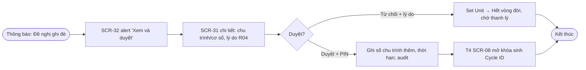
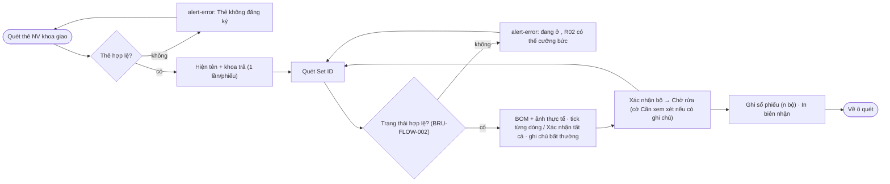
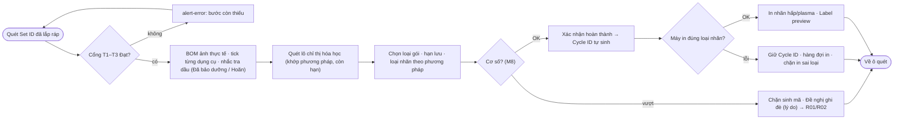
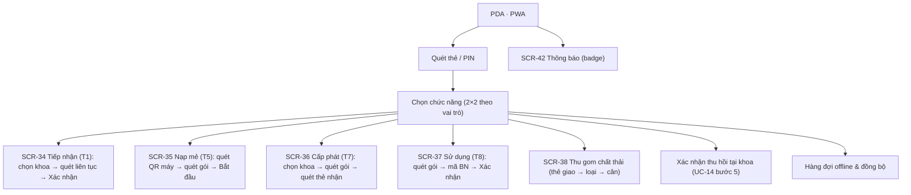
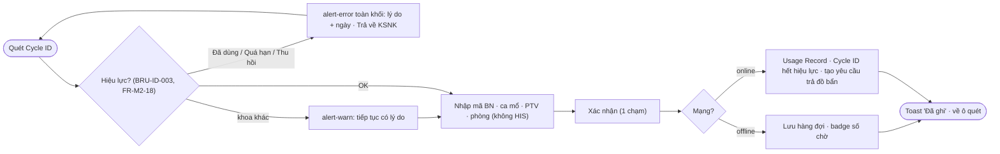
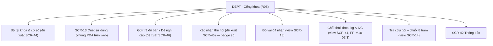
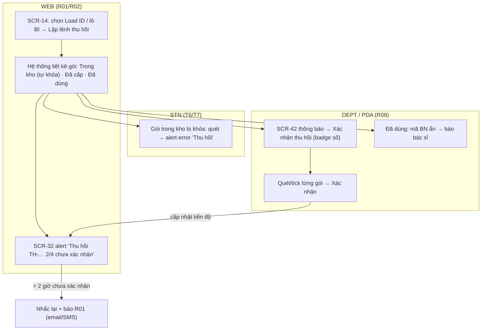

# UX Foundations: TraceCore

> Status: Draft (chờ chủ đầu tư duyệt) · Last updated: 2026-10-17
> Sources: docs/srs.md v1.11 (§1.2, §2.3, §2.5, §3.1, §3.2.1, §3.3) · docs/use-cases.md v1.11 (39 UC) · docs/architecture.md (**chưa tồn tại tại thời điểm viết** — surface lấy từ `.architecture-inputs.md`, cần đối chiếu lại khi có) · input/ba_md/d09.md (#09) · #17 HTML · docs/design-refs (21 ảnh)
> Design system: **docs/design.md + docs/tokens.json** (nguồn sự thật duy nhất cho mọi giá trị thiết kế — tài liệu này chỉ tham chiếu, không lặp lại)

## 1. Overview

TraceCore là phần mềm quản lý vận hành khoa Kiểm soát nhiễm khuẩn (CSSD) trên Frappe v15/ERPNext: truy xuất dụng cụ hai tầng mã (Set ID vĩnh viễn + Cycle ID một lần) qua 8 trạm T1–T8 với cổng kiểm soát 5 bước, quản lý đồ vải, [v1.11] chất thải y tế rắn, và ERP nội bộ khoa (nhân sự, thiết bị, kho, chi phí, cơ số) — SRS §1.2. Tài liệu này định nghĩa cấu trúc UI cho **4 surface** (mã surface là thuộc tính của màn hình; ID màn hình giữ nguyên `SCR-NN` theo quyết định 2026-10-17):

| Mã | Surface | Dành cho | Nền tảng |
| :-- | :-- | :-- | :-- |
| `WEB` | Web desktop quản trị | R01, R02, R09, R10 — quản trị, danh mục, kho, chi phí, dashboard, báo cáo (EI-UI-001) | Frappe Desk tùy biến + Frappe page |
| `STN` | Trạm quét cảm ứng (kiosk) | R03–R07 tại T1–T7, trạm đồ vải, trạm/kho chất thải; R02 khi giải phóng mẻ (EI-UI-002) | Frappe page full-screen, Chromium kiosk 15–22", máy quét HID, in nhãn, cân |
| `PDA` | PDA Android (PWA) | R03/R05/R06/R07 di động tại T1/T5/T7, thu gom; R08 tại T8 (EI-UI-003) | Frappe PWA, offline queue IndexedDB |
| `DEPT` | Cổng khoa | R08 — xem phiếu cấp phát, cơ số khoa, thông báo thu hồi, đồ vải, chất thải khoa mình (EI-UI-004) | Frappe Website/Portal page |

Design-source mode: **Ingest #09 + Extract CSS #17 + ảnh** (fidelity `mapped`) — chi tiết design.md §9.

---

## Part A — Shared Core (tóm tắt; thẩm quyền ở design.md)

### A1. Brand and visual direction

Tin cậy – lâm sàng – một chiều: nền xám xanh nhạt, card trắng phẳng, navy làm chủ đạo, và **màu là mã khu/trạng thái** (đỏ bẩn, cam sạch, xanh lá vô khuẩn, navy khoa) chứ không trang trí. Zonebar 8 px trên cùng mọi màn cho biết đang ở khu nào. Provenance: #09 §3 + #17 CSS, kiểm chứng ảnh → design.md §1, §9.

### A2. Voice and tone

Ngắn, mệnh lệnh nhẹ, thuật ngữ QĐ 3671/QĐ-BYT, không "bạn". Lỗi chặn: kết quả → lý do → hành động kế tiếp, đỏ toàn khối, không modal. STN/PDA ngắn nhất; WEB cho phép câu dài hơn; DEPT thân thiện hơn một chút với người ngoài KSNK. Quy tắc microcopy: design.md §6.

### A3. Design language summary

Palette 7 màu thô + tint; Arial/Segoe UI với mã ở Courier New; thang 2/4 px; bán kính 4–8 px; không bóng. Mật độ: WEB dày (13–15 px), STN/PDA thưa và lớn (≥ 16 px, nút 48–56 px). Token: design.md §2 / tokens.json; component và trạng thái: design.md §4.

### A4. Accessibility standard

- **NFR-ACC-01** (Should, Active): WEB đạt WCAG 2.1 AA; STN/PDA tương phản ≥ 4,5:1, chữ ≥ 16 px, Đạt/Không đạt không chỉ bằng màu.
- **NFR-USAB-01** (Must): nút ≥ 48 px, dùng được khi đeo găng/màn ướt, thao tác chính ≤ 3 chạm sau quét.
- **NFR-USAB-02** (Must) + EI-UI-006: 100 % tiếng Việt QĐ 3671, nhãn có tiếng Anh phụ, 0 chuỗi chưa dịch trên 43 SCR.
- **NFR-L10N-01** (Must): định dạng ngày/giờ/số/tiền VN, múi giờ Asia/Ho_Chi_Minh.
- **FR-M9-14** (Must): mọi màn trạm/PDA có trạng thái loading/empty/error/offline rõ ràng kèm hành động.
Các NFR này **ưu tiên cao hơn nguồn ingest**; 5 cặp màu gốc không đạt AA đã được điều chỉnh (design.md §2.1). Quy tắc cơ học: design.md §5.

### A5. Cross-surface principles

1. **Quét trước – gõ sau**: màn thao tác luôn mở với ô quét có focus; gõ tay chỉ là ngoại lệ có đánh dấu nguồn (FR-M2-10, FR-M10-02.1).
2. **Chặn rõ ràng, không im lặng**: mọi từ chối quét hiển thị đỏ toàn khối với lý do + trạm hiện tại/bước còn thiếu và không ghi giao dịch (EI-UI-007, BRU-FLOW-002/004).
3. **Trạng thái luôn thấy**: badge + stepper trên mọi chứng từ; gate panel 5 cổng ở T3–T7 và truy xuất.
4. **Hành động hủy không xóa**: chứng từ đã ghi sổ chỉ Hủy (bản ghi hủy) hoặc lập phiếu điều chỉnh; xác nhận bằng PIN/thẻ khi nghiệp vụ yêu cầu (R02 giải phóng, R01 duyệt ghi đè — PIN 6 số, NFR-SEC-01).
5. **Offline minh bạch**: chỉ báo mạng + số giao dịch chờ ở foot rail/footer PDA; Ghi sổ vẫn bật khi offline (FR-M9-06, NFR-AVAIL-02); xung đột đồng bộ đưa R02 (SCR-33).
6. **Thiết bị ngoại vi không chặn nghiệp vụ**: in → hàng đợi; cân → nhập tay ghi nguồn (NFR-AVAIL-04).
7. **Một chiều theo khu**: rail STN chỉ liệt kê trạm thuộc khu của máy; R08 chỉ thấy dữ liệu khoa mình (NFR-SEC-07).
8. **Thuật ngữ và mã nhất quán**: cùng tên trạng thái, cùng nhãn T1–T8, mã luôn mono trên mọi surface và nhãn in.

---

## Part B — Surfaces

### B1. Web desktop quản trị — surface code `WEB`

**Users & jobs** (SRS §2.3): **R01** Trưởng khoa KSNK — duyệt ghi đè cơ số trong 5 phút, theo dõi thu hồi/sự cố, xem giá thành, báo cáo, duyệt bảng giá, cấu hình cơ số (UC-30, UC-32, UC-37). **R02** Điều dưỡng trưởng — master data M1/M3/M4/M5, giải phóng mẻ, NC-CAPA, kiểm kê, xử lý xung đột offline (UC-01..04, 10, 14, 15, 19, 20, 22, 31). **R09** Kế toán/Vật tư — chi phí, bảng giá, nhập kho theo lô/hạn, giá thành, hợp đồng đơn vị xử lý (UC-24, 27, 28, 29, 36-A1). **R10** Quản trị — khu/trạm/thiết bị/người dùng/mẫu nhãn, audit, import danh mục (UC-21, 33, 39). Bối cảnh: văn phòng, chuột + bàn phím, 25–40 người đồng thời, ưu tiên mật độ và tốc độ.

**IA & navigation**: Frappe Desk với sidebar module theo 10 phân hệ (M1–M10) + Workspace "Tổng quan hôm nay" cho R01/R02 (ảnh 02). Zonebar web (blue) dưới navbar. Mỗi DocType có List View (filter bar, badge, hành động hàng loạt) và Form; các màn Dashboard/Report là Frappe page/Insights. Trung tâm thông báo (SCR-42) là chuông trên navbar + trang danh sách.

```mermaid
graph TD
    root["WEB · Frappe Desk"]
    root --> home["Tổng quan hôm nay (SCR-32)"]
    root --> m1["M1 Danh mục dụng cụ & bộ"]
    root --> m2["M2 Chuỗi tái xử lý & truy xuất"]
    root --> m3["M3 Đồ vải"]
    root --> m4["M4 Nhân sự & chứng chỉ"]
    root --> m5["M5 Thiết bị & bảo trì"]
    root --> m6["M6 Kho vật tư tiêu hao"]
    root --> m7["M7 Chi phí & giá thành"]
    root --> m8["M8 Cơ số & vượt ngưỡng"]
    root --> m9["M9 Báo cáo, quản trị"]
    root --> m10["M10 Chất thải y tế"]
    root --> notif["Thông báo (SCR-42)"]
    m1 --> s01["SCR-01 Dụng cụ"] 
    m1 --> s02["SCR-02 Loại bộ & BOM"]
    m1 --> s03["SCR-03 Set ID & thẻ"]
    m1 --> s04["SCR-04 Loaner"]
    m2 --> s14["SCR-14 Truy xuất & thu hồi"]
    m2 --> s15["SCR-15 NC / CAPA"]
    m2 --> s2v["Xem chứng từ trạm (SCR-05..12, read-only)"]
    m3 --> s3v["Xem phiếu đồ vải (SCR-16..18)"]
    m4 --> s19["SCR-19 Hồ sơ nhân sự"]
    m4 --> s20["SCR-20 Ma trận năng lực & ca"]
    m5 --> s21["SCR-21 Thiết bị & chương trình"]
    m5 --> s22["SCR-22 Bảo trì, kiểm định, sự cố"]
    m6 --> s24["SCR-24 Nhập kho"]
    m6 --> s25["SCR-25 Xuất kho / tiêu hao"]
    m6 --> s26["SCR-26 Kiểm kê"]
    m7 --> s27["SCR-27 Chi phí"]
    m7 --> s28["SCR-28 Bảng định giá"]
    m7 --> s29["SCR-29 Giá thành"]
    m8 --> s30["SCR-30 Cấu hình cơ số"]
    m8 --> s31["SCR-31 Ghi đè có phê duyệt"]
    m9 --> s32["SCR-32 Dashboard & sổ tiệt khuẩn"]
    m9 --> s33["SCR-33 Khu, trạm, người dùng, audit"]
    m9 --> s43["SCR-43 Import / Export"]
    m10 --> s40b["SCR-40 Đơn vị xử lý & hợp đồng (phần danh mục)"]
    m10 --> s41["SCR-41 Báo cáo chất thải & sự cố"]
```

**Key flows**

*Duyệt ghi đè cơ số [UC-31, UC-38]* — R01 nhận thông báo → mở đề nghị → PIN → T4 được sinh Cycle ID.

*Thu hồi theo Load ID [UC-14, UC-38]* — xem Part C (liên surface).

*Giải phóng mẻ có BI [UC-10]* — R02 tại WEB hoặc STN T5b: xem tổng hợp chỉ thị → PIN → Cách ly (đặt giờ đọc BI) → BI âm tính → Đã giải phóng → gói vào kho.

*Import danh mục ban đầu [UC-39]* — chọn loại → tải mẫu → tải lên → xem trước lỗi theo dòng → ghi sổ dòng hợp lệ → import ảnh zip → báo mã không khớp.

**Screen inventory** — xem bảng hợp nhất §B5 (lọc cột Surface = WEB: 22 màn + SCR-42 chung).

**Surface-specific components**: Frappe List View/Report View với indicator màu token; Filter bar (ngày/khu/máy/khoa/trạng thái, #09); Workspace cards; Insights chart; Print Format (sổ tiệt khuẩn điện tử, báo cáo BYT/TT 20); Data Import wizard (SCR-43); Audit timeline (SCR-33); Tabs Thông tin / Chi tiết / Lịch sử (Master Form).

**Token overrides**: row-height 34 px và `button-table` trong bảng; font body 15 px trong page tùy biến, Desk chuẩn giữ 13 px. Dark mode tùy chọn. (design.md §2.2, §4.20)

### B2. Trạm quét cảm ứng — surface code `STN`

**Users & jobs**: **R03** khu bẩn — T1 tiếp nhận (quét thẻ giao + Set ID, xác nhận thành phần, ghi chú bất thường), T2 nạp/dỡ máy rửa (UC-05, UC-06). **R04** khu sạch — T3 kiểm đếm theo BOM có ảnh, T4 đóng gói (tick dụng cụ, quét lô chỉ thị, nhắc tra dầu, sinh Cycle ID, in nhãn đúng loại), đề nghị ghi đè (UC-07, UC-08, UC-31). **R05** tiệt khuẩn — test ngày, T5 nạp mẻ, T5b dỡ/nhập kết quả (UC-23, UC-09, UC-10, UC-25). **R06** kho vô khuẩn — T6 nhập kệ FEFO, T7 cấp phát + ký (UC-11, UC-12, UC-26). **R07** đồ vải & chất thải — cân, lô giặt, cấp phát đồ vải; [v1.11] thu gom, kho lưu giữ tạm, bàn giao chất thải (UC-16..18, UC-34..36). **R02** — giải phóng mẻ bằng PIN tại T5b. Bối cảnh (SRS §2.3 "đặc điểm chung R03–R07"): theo ca, **đeo găng, màn ướt**, 120–200 bộ/ngày, phản hồi quét ≤ 1 s (NFR-PERF-01), cảnh báo đỏ toàn màn khi chặn, ≤ 3 chạm, phiên thẻ 8 giờ tự khóa 10 phút.

**IA & navigation**: full-screen kiosk; rail trái liệt kê **chỉ các trạm thuộc khu của máy** (#17 `STATIONS`: khu bẩn T1–T2 · khu sạch T3–T5 · khu vô khuẩn T5b–T7; trạm đồ vải và trạm chất thải là khu riêng). Mỗi trạm = một màn chính theo archetype Form chứng từ (header mã + badge + stepper · scan box · kết quả · actions bar). Không breadcrumb sâu: Trang chủ › Trạm Tn › tên màn.

```mermaid
graph TD
    root["STN · Kiosk theo khu"]
    root --> login["Quét thẻ vào trạm (năng lực + chứng chỉ, EI-UI-005)"]
    login --> dirty["Khu bẩn (zonebar đỏ)"]
    login --> clean["Khu sạch (zonebar cam)"]
    login --> sterile["Khu vô khuẩn (zonebar xanh lá)"]
    login --> linen["Trạm đồ vải"]
    login --> waste["Trạm / kho chất thải (zonebar đen)"]
    dirty --> s05["SCR-05 T1 Tiếp nhận đồ bẩn"]
    dirty --> s06["SCR-06 T2 Lô rửa: nạp · dỡ"]
    clean --> s07["SCR-07 T3 Kiểm tra – lắp ráp"]
    clean --> s08["SCR-08 T4 Đóng gói & Cycle ID"]
    clean --> s09["SCR-09 T5 Nạp mẻ"]
    clean --> s23["SCR-23 Test hằng ngày"]
    sterile --> s10["SCR-10 T5b Giải phóng mẻ / cách ly"]
    sterile --> s11["SCR-11 T6 Kho vô khuẩn"]
    sterile --> s12["SCR-12 T7 Cấp phát"]
    linen --> s16["SCR-16 Thu gom đồ vải"]
    linen --> s17["SCR-17 Lô giặt"]
    linen --> s18["SCR-18 Cấp phát đồ vải"]
    waste --> s38["SCR-38 Thu gom chất thải"]
    waste --> s39["SCR-39 Kho lưu giữ tạm"]
    waste --> s40["SCR-40 Bàn giao đơn vị xử lý"]
    root --> notif["SCR-42 Thông báo (badge trên rail)"]
```

**Key flows**

*T1 Tiếp nhận nhiều bộ có kiểm đếm [UC-05]* (ảnh 07, 08):

*T2 Lô rửa: quét máy → quét bộ → Hoàn thành nạp → dỡ (tự động / nhập tay có xác nhận) [UC-06]* (ảnh 09, 10): máy phải Sẵn sàng (test ngày, kiểm định) trước khi ô quét bộ mở khóa; mã lô `LR-YYMMDD-NN` tự sinh khi Hoàn thành nạp; khi dỡ phải quét đủ QR máy + QR lô; Không đạt → mọi bộ về Xử lý lại, NC tự tạo.

*T4 Đóng gói & sinh Cycle ID [UC-08, UC-31]* (ảnh 12, 13):

*T5 → T5b Mẻ tiệt khuẩn và giải phóng [UC-09, UC-10]* (ảnh 14, 15): quét QR máy → chương trình → quét Cycle ID từng gói (cổng T4 Đạt) → Hoàn thành nạp → `ME-YYMMDD-NN`; dỡ tại T5b: quét máy + mã mẻ → kết quả tự động hoặc nhập tay có xác nhận → chỉ thị hóa học/Bowie-Dick → R02 PIN giải phóng → có BI: Cách ly đặt giờ đọc → âm tính → Đã giải phóng.

*T6/T7 Kho và cấp phát [UC-11, UC-12]* (ảnh 16, 17): quét Cycle ID → gate panel đủ 5 cổng → quét mã kệ; cấp phát: chọn khoa (tồn/cơ số) → quét gói (FEFO) → quét thẻ người nhận / ký → in phiếu.

*Thu gom → lưu giữ → bàn giao chất thải [UC-34, UC-35, UC-36]*: quét thẻ người giao → chọn/quét loại (mã màu lớn + chữ) → số túi + cân (hoặc nhập tay xác nhận) → QR `CT-` từng túi, in nhãn, biên nhận ký; kho: quét vị trí `KE-` → quét túi (khớp loại) → thời gian còn lại, nhiệt độ; bàn giao: chọn đơn vị (giấy phép còn hiệu lực) → FIFO → cân → chênh lệch > 5 % cần R02 → chứng từ CTNH → ký hai bên → chi phí M7.

**Screen inventory** — §B5, Surface = STN: 15 màn.

**Surface-specific components** (design.md §4): scan-box với chips; stepper T1–T8; gate panel 5 cổng; BOM checklist ảnh thực tế + tray; label preview hấp/plasma; manual-entry form có tick xác nhận (FR-M2-10); zonebar; actions bar 56 px; offline banner; nhắc bảo dưỡng; signature pad; màn **trợ giúp theo trạm** (FR-M9-15, Could) mở từ rail.

**Token overrides**: chữ sàn 16 px, body 19 px, ô quét 24 px, nút 48/56 px, checkbox 32 px, row 48 px, gap nút 12 px (tokens.json `surface-override.STN`).

### B3. PDA Android (PWA) — surface code `PDA`

**Users & jobs**: R03 (T1 tiếp nhận tại xe trả, SCR-34), R05 (T5 quét gói vào mẻ, SCR-35), R06 (T7 cấp phát tại khoa, SCR-36), R08 (T8 quét sử dụng trước rạch da — 1 chạm, SCR-37), R07 (thu gom chất thải tại khoa với cân di động, SCR-38). Bối cảnh: di chuyển, một tay, găng; màn 5–6"; mất Wi-Fi giữa khoa → **offline queue bắt buộc** (EI-UI-003, FR-M9-06).

**IA & navigation**: không rail; sau quét thẻ vào app là **màn chọn chức năng 2×2 nút lớn** theo vai trò; mỗi chức năng là một màn PDA Mobile (#09 archetype): top bar (giờ · người · mạng · số chờ) · zonebar · ô quét toàn rộng · thẻ kết quả · 1–2 nút lớn · footer. Luồng 3 chạm theo #09 §8.

**Key flows**

*Quét sử dụng cho bệnh nhân [UC-13]* (ảnh 19):

*Tiếp nhận di động [UC-05]*: như SCR-05 nhưng BOM hiển thị dạng danh sách dọc cuộn, ảnh 64 px, "Xác nhận tất cả" nổi trên cùng; ghi chú bất thường bằng ô text + chụp ảnh camera PDA.

*Đồng bộ sau offline*: màn hàng đợi liệt kê giao dịch theo thời gian, trạng thái Chờ/Đang gửi/Lỗi; xung đột → gắn cờ, báo R02 (SCR-33).

**Screen inventory** — §B5, Surface = PDA: 4 màn chính (SCR-34..37) + SCR-38 dùng chung với STN.

**Surface-specific components**: top bar PDA; menu 2×2; sheet full-screen thay modal; camera capture; rung/âm khi quét; hàng đợi offline; nút full-width 56 px; chip current thay stepper đầy đủ.

**Token overrides**: body 21 px, nút 56 px full-width, padding 12, safe-area (tokens.json `surface-override.PDA`).

### B4. Cổng khoa — surface code `DEPT`

**Users & jobs**: **R08** Nhân viên khoa sử dụng (phòng mổ/khoa lâm sàng) — người ngoài KSNK, ít thời gian, chỉ thấy khoa mình (NFR-SEC-07): xem bộ tại khoa so với cơ số, phiếu cấp phát đã nhận, **xác nhận gói thu hồi**, gửi trả đồ bẩn / đề nghị cấp, đồ vải đã nhận, kg chất thải và NC phân loại sai của khoa (FR-M10-07.3), tra cứu gói theo chuỗi 8 trạm (ảnh 21), và quét sử dụng khi dùng máy tính phòng mổ (SCR-13). Thiết bị: trình duyệt trên máy tính phòng mổ (có thể cảm ứng) hoặc PDA.

**IA & navigation**: trang web đơn giản (Frappe Portal page), rail 7 mục theo #17 R08 (ảnh 18–21), zonebar dept (navy). Không có form phức tạp; ưu tiên bảng đọc và nút xác nhận lớn.

**Key flow** — *Xác nhận thu hồi tại khoa [UC-14 bước 5, UC-38]* (ảnh 20): thông báo thu hồi → danh sách gói của khoa (Trong kho tự khóa · Đã cấp chờ thu · Đã dùng báo bác sĩ, mã BN ẩn 4 ký tự) → quét/tick từng gói → Xác nhận → KSNK thấy tiến độ 2/4 trên SCR-14; quá 2 giờ chưa xác nhận → nhắc lại và báo R01.

**Screen inventory**: SCR-13 là màn DEPT chính thức duy nhất trong 43; các mục rail còn lại là **view giới hạn theo khoa** của SCR-14/18/41 hoặc màn đề xuất SCR-44..46 (§B5.2).

**Surface-specific components**: bảng tồn khoa vs cơ số với badge "Đạt / Dưới tối thiểu / Vượt"; danh sách thu hồi có checkbox lớn; khung phone (SCR-13) khi mở trên desktop; chuỗi 8 trạm dạng timeline đọc.

**Token overrides**: body 16 px, touch 48 px (tokens.json `surface-override.DEPT`).

### B5. Screen inventory hợp nhất (43 màn hình, ID giữ nguyên)

Cột **Trạng thái nguồn**: `#17` = có prototype chạy được trong #17; `ảnh NN` = có ảnh design-refs; `—` = chưa có prototype/ảnh (chỉ đặc tả #09 hoặc SRS/UC v1.11). FR chính theo use-cases.md Phụ lục A. Archetype theo #09 §5; màn mới gán theo cùng 5 archetype.

| SCR | Tên màn hình | Surface | Archetype #09 | UC | FR chính | Trạng thái nguồn |
| :-- | :-- | :-- | :-- | :-- | :-- | :-- |
| SCR-01 | Quản lý danh mục dụng cụ đơn lẻ | WEB | Master Form | UC-01 | FR-M1-01, FR-M1-02, FR-M1-09 | — (#09 đặc tả) |
| SCR-02 | Quản lý bộ dụng cụ và cấu trúc BOM | WEB | Master Form | UC-02 | FR-M1-03, FR-M1-04 | — |
| SCR-03 | Cấp Set ID vĩnh viễn và in thẻ định danh | WEB | Master Form | UC-03 | FR-M1-05, FR-M1-06 | — |
| SCR-04 | Quản lý dụng cụ mượn (loaner) | WEB | Form chứng từ | UC-04 | FR-M1-07, FR-M1-08 | — |
| SCR-05 | T1 Tiếp nhận đồ bẩn tại khu bẩn | STN | Form chứng từ | UC-05 | FR-M2-01, FR-M2-02, FR-M2-23 | #17 · ảnh 07, 08 |
| SCR-06 | T2 Làm sạch – khử khuẩn và lô rửa (nạp · dỡ) | STN | Form chứng từ | UC-06 | FR-M2-03, FR-M2-04, FR-M2-24, FR-M2-25 | #17 · ảnh 09, 10 |
| SCR-07 | T3 Kiểm tra – lắp ráp theo BOM | STN | Form chứng từ | UC-07 | FR-M2-05, FR-M2-06 | #17 · ảnh 11 |
| SCR-08 | T4 Đóng gói và sinh Cycle ID | STN | Form chứng từ | UC-08 | FR-M2-07, FR-M2-08 | #17 · ảnh 12, 13 |
| SCR-09 | T5 Tạo và vận hành mẻ tiệt khuẩn | STN | Form chứng từ | UC-09 | FR-M2-09, FR-M2-10 | #17 · ảnh 14 |
| SCR-10 | T5b Giải phóng mẻ và cách ly chờ BI | STN (R02 cũng dùng WEB) | Form chứng từ | UC-10 | FR-M2-11, FR-M2-12 | #17 · ảnh 15 |
| SCR-11 | T6 Nhập và quản lý kho vô khuẩn | STN | List View | UC-11 | FR-M2-13, FR-M2-14 | #17 · ảnh 16 |
| SCR-12 | T7 Cấp phát bộ dụng cụ cho khoa | STN | Form chứng từ | UC-12 | FR-M2-15, FR-M2-16 | #17 · ảnh 17 |
| SCR-13 | Quét sử dụng cho bệnh nhân (web/khung PDA tại khoa) | DEPT | PDA Mobile | UC-13 | FR-M2-17, FR-M2-18 | #17 · ảnh 19 |
| SCR-14 | Truy xuất nguồn gốc và thu hồi | WEB (view DEPT) | List View | UC-14 | FR-M2-19, FR-M2-20 | #17 (R01 recall, R08 trace) · ảnh 04, 20, 21 |
| SCR-15 | Ghi nhận sự cố, không phù hợp và CAPA | WEB | Form chứng từ | UC-15, UC-37 | FR-M2-21, FR-M2-22, FR-M10-06 | #17 (một phần trong recall) |
| SCR-16 | Thu gom đồ vải theo khoa | STN | Form chứng từ | UC-16 | FR-M3-01, FR-M3-02 | — |
| SCR-17 | Tạo lô giặt | STN | Form chứng từ | UC-17 | FR-M3-03, FR-M3-04 | — |
| SCR-18 | Cấp phát đồ vải và đối chiếu thu – trả | STN (view DEPT) | Form chứng từ | UC-18 | FR-M3-05, FR-M3-06 | — (#17 R08 "Đồ vải đã nhận" là view) |
| SCR-19 | Quản lý hồ sơ nhân sự và chứng chỉ | WEB | Master Form | UC-19 | FR-M4-01, FR-M4-02 | #17 (R01 hr, read-only) |
| SCR-20 | Ma trận năng lực và phân ca | WEB | List View | UC-20 | FR-M4-03, FR-M4-04 | #17 (R01 hr, read-only) |
| SCR-21 | Hồ sơ thiết bị và chương trình xử lý | WEB | Master Form | UC-21 | FR-M5-01, FR-M5-02 | #17 (R01 equip, read-only) |
| SCR-22 | Bảo trì, kiểm định, hiệu chuẩn và sự cố thiết bị | WEB | Form chứng từ | UC-22 | FR-M5-03, FR-M5-04 | #17 (R01 equip, một phần) |
| SCR-23 | Test hằng ngày và khóa máy tự động | STN | Form chứng từ | UC-23 | FR-M5-05, FR-M5-06 | #17 (R01 equip hiển thị trạng thái) |
| SCR-24 | Nhập kho vật tư tiêu hao theo lô/hạn | WEB | Form chứng từ | UC-24 | FR-M6-01, FR-M6-02 | — |
| SCR-25 | Xuất kho và tiêu hao tự động theo mẻ | WEB | Form chứng từ | UC-25 | FR-M6-03, FR-M6-04 | — |
| SCR-26 | Kiểm kê và cảnh báo tồn tối thiểu | WEB | Form chứng từ | UC-26 | FR-M6-05, FR-M6-06 | — |
| SCR-27 | Nhập chi phí thiết bị, vận hành, điện nước, sửa chữa | WEB | Form chứng từ | UC-27 | FR-M7-01, FR-M7-02 | — |
| SCR-28 | Bảng định giá vật tư tái xử lý | WEB | Master Form | UC-28 | FR-M7-03, FR-M7-04 | — |
| SCR-29 | Tính giá thành mẻ và giá thành bộ dụng cụ | WEB | Dashboard | UC-29 | FR-M7-05, FR-M7-06 | #17 · ảnh 05 |
| SCR-30 | Cấu hình cơ số và ngưỡng cảnh báo | WEB | Master Form | UC-30 | FR-M8-01, FR-M8-02 | — |
| SCR-31 | Kiểm soát vượt cơ số và ghi đè có phê duyệt | WEB (đề nghị từ STN T4) | Form chứng từ | UC-31 | FR-M8-03, FR-M8-04 | #17 · ảnh 03 |
| SCR-32 | Dashboard và báo cáo vận hành (+ sổ tiệt khuẩn điện tử, khối chất thải) | WEB | Dashboard | UC-32, UC-37 | FR-M9-01, FR-M9-02, FR-M9-13, FR-M10-07.1 | #17 · ảnh 02, 06 |
| SCR-33 | Quản trị khu vực, trạm, người dùng và audit trail | WEB | Master Form | UC-33 | FR-M9-03..09, FR-M9-16 | — |
| SCR-34 | PDA – Quét tiếp nhận đồ bẩn | PDA | PDA Mobile | UC-05 | FR-M2-01, FR-M2-02, FR-M2-23 | — (#09 §8 luồng 3 chạm) |
| SCR-35 | PDA – Quét gói vào mẻ | PDA | PDA Mobile | UC-09 | FR-M2-09, FR-M2-10 | — |
| SCR-36 | PDA – Cấp phát cho khoa | PDA | PDA Mobile | UC-12 | FR-M2-15, FR-M2-16 | — |
| SCR-37 | PDA – Quét sử dụng cho bệnh nhân | PDA | PDA Mobile | UC-13 | FR-M2-17, FR-M2-18 | #17 (khung phone trong cổng khoa) · ảnh 19 |
| SCR-38 | Trạm / PDA thu gom chất thải theo khoa | STN + PDA | Form chứng từ / PDA Mobile | UC-34 | FR-M10-01, FR-M10-02 | — (v1.11) |
| SCR-39 | Kho lưu giữ tạm chất thải (tồn theo loại/vị trí, thời gian còn lại, nhiệt độ) | STN (view WEB cho R02) | List View | UC-35 | FR-M10-03 | — (v1.11) |
| SCR-40 | Bàn giao chất thải & danh mục đơn vị xử lý / hợp đồng | STN (bàn giao) + WEB (danh mục, R09) | Form chứng từ + Master Form | UC-36 | FR-M10-04, FR-M10-05 | — (v1.11) |
| SCR-41 | Báo cáo / dashboard chất thải & sự cố, định mức | WEB (view DEPT) | Dashboard | UC-37 | FR-M10-06, FR-M10-07, FR-M10-08 | — (v1.11) |
| SCR-42 | Trung tâm thông báo (web, trạm, PDA) | WEB + STN + PDA + DEPT | List View | UC-38 | FR-M9-10 | — (v1.11) |
| SCR-43 | Import / Export danh mục & hồ sơ lưu trữ | WEB | List View + Form (wizard) | UC-39 | FR-M9-11, FR-M9-12 | — (v1.11) |

**Đếm theo surface chính**: WEB 22 (01–04, 14, 15, 19–22, 24–33, 41, 43) · STN 15 (05–12, 16–18, 23, 38–40) · PDA 4 (34–37) · DEPT 1 (13) · đa surface 1 (42) → **43**. Có prototype #17: 20 màn (05–15, 19–23, 29, 31, 32, 37); có ảnh: 16 màn; chưa có nguồn hình ảnh: 23 màn (toàn bộ M1, M3, M6, M7 nhập liệu, M8 cấu hình, M9 quản trị/import, M10, PDA 34–36, SCR-42).

**Trạng thái màn hình bắt buộc** (FR-M9-14): mọi SCR trên STN/PDA có loading · empty · error · offline; mọi List View có empty/error; chi tiết design.md §4.19.

#### B5.2 Màn hình đề xuất (chưa tính vào 43 — cần amendment SRS/UC trước khi cấp ID chính thức)

#17 và EI-UI-004 mô tả Cổng khoa với các chức năng không có SCR riêng trong #09. Đề xuất cấp ID kế tiếp **SCR-44..46** sau khi chủ đầu tư duyệt; nếu không duyệt, các chức năng này là view giới hạn theo khoa của SCR hiện có.

| ID đề xuất | Tên | Surface | Archetype | UC/FR liên quan | Nguồn |
| :-- | :-- | :-- | :-- | :-- | :-- |
| SCR-44 (đề xuất) | Cổng khoa — Bộ tại khoa so với cơ số & phiếu cấp phát đã nhận | DEPT | List View | UC-12 (view), FR-M2-16, EI-UI-004 | #17 R08 "stock" · ảnh 18 |
| SCR-45 (đề xuất) | Cổng khoa — Xác nhận thu hồi tại khoa | DEPT + PDA | Form chứng từ | UC-14 bước 5, FR-M2-20, UC-38 | #17 R08 "recallc" · ảnh 20 |
| SCR-46 (đề xuất) | Cổng khoa — Gửi trả đồ bẩn & đề nghị cấp | DEPT | Form chứng từ | FR-M2-17 (yêu cầu trả đồ bẩn), UC-05 (secondary R08) | #17 R08 "ret", "req" (không có FR cho Đề nghị cấp — OQ) |

---

## Part C — Cross-Surface Reconciliation

**Shared vs. surface-specific** (được thúc đẩy vào core vì ≥ 2 surface dùng): scan-box, stepper/badge, gate panel, alert 4 mức, card/res, KPI tile (WEB + STN T6 dashboard kho + DEPT), BOM checklist (STN + PDA), label preview (STN + WEB SCR-03/08 xem lại), PIN modal (WEB + STN), toast, offline indicator (STN + PDA + DEPT), zonebar (tất cả), data table (WEB + STN + DEPT). Chỉ riêng một surface: Frappe List/Report/Import wizard/Print Format (WEB); tray SVG, signature pad, nhắc bảo dưỡng, manual-entry xác nhận (STN); menu 2×2, sheet, camera, hàng đợi offline (PDA); timeline 8 trạm đọc (DEPT).

**Flows that span surfaces**

*Thu hồi theo Load ID [UC-14, UC-38]*:

*Ghi đè cơ số*: STN T4 (đề nghị, lý do) → SCR-42 thông báo → WEB SCR-31 (PIN duyệt) → STN T4 mở khóa (toast + badge). *Mẻ tiệt khuẩn*: STN T5 nạp → T5b dỡ (STN hoặc R02 trên WEB SCR-10) → kho T6. *Chất thải*: PDA/STN SCR-38 tại khoa → STN SCR-39 kho → STN SCR-40 bàn giao → WEB SCR-41/M7 chi phí → DEPT xem kg khoa mình. *Thông báo* (SCR-42) hiện trên cả 4 surface: WEB chuông navbar, STN badge rail + banner khi khẩn, PDA badge top bar, DEPT badge rail.

**Consistency rules** — Phải giống nhau: tên trạng thái và màu badge; nhãn T1–T8; cấu trúc lỗi chặn (kết quả → lý do → hành động); định dạng mã mono, ngày/giờ/số (NFR-L10N-01); zonebar theo khu; ô quét luôn trên cùng và có focus; offline indicator cùng câu chữ. Được phép khác: mật độ và cỡ chữ (override §2.2 design.md); điều hướng (Desk sidebar / rail trạm / menu 2×2 / rail cổng khoa); modal (WEB/STN) vs sheet (PDA); stepper đầy đủ (WEB/STN/DEPT) vs chip (PDA); bảng (WEB/STN/DEPT) vs card list (PDA).

---

## Part D — Anchor screens đề xuất (cho bước ui-design chế độ anchor)

Ba màn đại diện cho ba surface thao tác và bao phủ nhiều component core nhất; mỗi màn đã có prototype #17 và ảnh để đối chiếu.

| Anchor | Màn | Surface | Vì sao | Component kiểm chứng | Nguồn đối chiếu |
| :-- | :-- | :-- | :-- | :-- | :-- |
| A1 | **SCR-05** T1 Tiếp nhận đồ bẩn | STN (khu bẩn) | Màn đầu chuỗi, tần suất cao nhất (120–200 bộ/ngày), có quét 2 loại mã, BOM có ảnh, ghi chú bất thường, lặp nhiều bộ trong một phiếu, offline | rail theo khu, zonebar dirty, stepper, scan-box 2 pha (thẻ → Set ID), alert ok/error, BOM table + photo, textarea, button-ok, actions bar với nhãn đếm, offline foot | #17 `t1*` · ảnh 07, 08 |
| A2 | **SCR-08** T4 Đóng gói & sinh Cycle ID | STN (khu sạch) | Màn phức tạp nhất: gate panel, progress cơ số, nhắc bảo dưỡng (ins due), quét lô chỉ thị qua ô quét duy nhất ở đầu màn, khối Lô chỉ thị chỉ hiển thị kết quả (A-02, D10), form grid, chặn có lý do, label preview hấp/plasma, ghi đè → WEB | gate panel, par bar, ins (due/done), chips, form grid, alert warn/error, button disabled có lý do, label preview, PIN/lý do modal, hàng đợi in | #17 `t4*` · ảnh 12, 13 |
| A3 | **SCR-37** PDA Quét sử dụng cho bệnh nhân | PDA (khoa) | Surface PDA, người dùng ngoài KSNK (R08), 1 chạm, nhập mã BN mã hóa, lỗi chặn FR-M2-18, offline queue | top bar PDA, zonebar dept, scan-box PDA, res card, alert-error toàn khối, form 1 cột, nút 56 px full-width, toast, badge số chờ | #17 `deptUse/useScan/useConfirm` · ảnh 19 |

Bổ sung tùy chọn nếu ui-design cần một anchor WEB: **SCR-32** Tổng quan hôm nay (KPI tile 3 biến thể, alert có nút hành động, 2 bảng, Frappe Workspace) — ảnh 02.

Mỗi anchor phải chứng minh: contrast theo tokens (kể cả `warn-fill`/`neutral-fill` điều chỉnh), chữ ≥ 16 px và nút ≥ 48 px trên STN/PDA, ≤ 3 chạm sau quét, 4 trạng thái màn hình, và không trạng thái nào chỉ phân biệt bằng màu.

---

## Part E — Open Questions and Risks

1. **architecture.md chưa có**: tên container/surface và quyết định Frappe page vs Desk cho STN có thể khác 4 surface ở đây → đối chiếu lại B1–B4 và cột Surface khi tài liệu kiến trúc ra.
2. **Tool Projects không khả dụng trong phiên**: #17 được lấy từ bản nhúng trong `input/BA_v1_10.html` (cùng phiên bản v1.10 · 20/09/2026). Nếu file "17 Giao dien theo vai tro v1_10 20260920.html" trong Project khác bản nhúng, cần rà lại CSS.
3. **Cổng khoa chưa có SCR riêng**: đề xuất SCR-44..46 (B5.2) cần chủ đầu tư duyệt; "Đề nghị cấp" của R08 không có FR tương ứng (OQ mới).
4. **5 cặp màu gốc không đạt AA** đã điều chỉnh trong design.md — cần Medcons/BA xác nhận chấp nhận sắc cam `#B85A00` và xám `#6B6B6B` trong badge, vì khác bảng màu #09.
5. **Icon set** chưa chọn; ảnh thực tế chưa có; kích thước nhãn in thật (mm/DPI) chưa chốt — ảnh hưởng anchor A2.
6. **PDA thu gom chất thải (SCR-38)** cần in nhãn QR túi: máy in cầm tay hay in trước tại trạm (UC-34 open issue) — quyết định đổi bố cục màn.
7. **Dark mode** chỉ phác cho WEB; nếu bệnh viện yêu cầu kiosk ban đêm giảm sáng, cần token riêng thay vì dark mode.
8. **Kiosk timeout 10 phút** (NFR-SEC-01) vs phiếu tiếp nhận dài nhiều bộ: cần banner cảnh báo 60 s và lưu nháp cục bộ để không mất phiếu.
9. **Frappe v15 variable names** trong ánh xạ design.md §2.3 cần xác nhận khi scaffold (khác biệt nhỏ giữa 15.x).
10. **UAT với 5 KTV đeo găng** (NFR-USAB-01) là phép đo cuối cùng cho kích thước nút/chip 48 px và số chạm — giá trị hiện tại là thiết kế, chưa đo.
